# Arcade backgrounds: proposal (16 Oct 2026)

This is a proposal only. It changes no code. Joe picks from it, and a build prompt follows. It covers the 22 active arcade
games (`ACTIVE_ARCADE_GAMES`, Pinball included). The five engine games on the arcade stage (Letterfall, Tenfall, Bonk,
Pull!, Mixed Signals) are out of scope.

What each game gets:

1. How it fills the screen today.
2. One original background on its theme, in the spirit of Gemstone's velvet.
3. For Meteor, Scrumper, Pinball and the seven painted-extension games, exact placement at 414×896.
4. A mockup in `docs/arcade-backgrounds/<game>.webp`.
5. A frame-time estimate against the arcade-lowend-check budget.

## Assumptions (made without asking)

- **Display only.** Every background is presentation. It doesn't touch the sim, inputs, scores, replays or stored data,
  and needs no version stamp (Rule 2 is untouched). Art stays in `*.renderer.ts` and is never imported by a sim or the
  server (Rule 1). The arcade bounds rule still applies: a background holds no solid or collidable shape, and nothing in
  it looks like a play object (no gem, brick, bubble, star, leaf, ball, planet or note shapes).
- **Where it is painted.** Inside the world and inside its arena-scene extension only. The screen-edge black
  (`--screen-edge` #070709) stays wherever a box has no scene, and so does the 16 px strip above the bottom. For the
  taller-world games this means the background lives inside the world rectangle. Their few pixels of leftover box below
  the world (4–10 px at 414×896, 42 px for Orbit) stay black.
- **Painting.** Static layers are painted once per device scale into the game's existing cached backdrop layer, tile or
  `deviceLayer` wherever the game has one, so they cost no extra blit per frame. Extensions use the existing
  `arenaScene.renderer.ts` path, painted once per arena size. Positions are seeded with `artHash`, the same on every phone.
- **Motion.** Motion is optional and slow (a period of 8 s or more, with nothing faster than about 4 px/s on screen). It
  uses the presentation clock, so it is already frozen under reduced motion. It switches off at reduced-effects level 1
  and above (`lowEnd.ts`), where the static frame remains. A layer keyed to the sim's own scroll or camera (parallax) is
  not "motion" in this sense: it is a function of the drawn tick, exactly as Hover's stars and Orbit's nebula are today.
- **Calm.** Each background keeps a low internal contrast: about 0.10 of relative luminance between its darkest and
  lightest areas, measured over any 40 px square. Every play object keeps at least 3:1 contrast against the background
  behind it. Background saturation stays below the play objects' saturation.
- **"Original, no other game's look".** No two games share a palette family and motif. Where two games share a world
  today (Retro, Toybox, Fairground, Countryside, Real World, lava), their new backgrounds deliberately diverge: Hover
  mesas vs Meteor craters, Tilt baize vs Ball Tracker marquetry, Swish pier vs Flightpath big top, Rainbow Bridge loch vs
  Scrumper orchard, Roofbound basalt forge vs Grappler amethyst geode. No background imitates a real game, brand or
  artwork.
- **The mockups are schematic.** They are drawn at 414×896 and DPR 1 with @napi-rs/canvas, then WebP-compressed (q 74,
  9–26 KB each, 348 KB for all 22). The background is drawn as proposed. Play objects are simplified stand-ins, drawn
  bright to show readability; they are not the real renderers' art. The dashed line marks the world rectangle. Each
  mockup includes the 48 px notch, the 52 px header row, controls in their real rows, the black screen edges and the
  16 px bottom strip. The generator script isn't committed, since this is a docs-only change. The build prompt can add
  it under `scripts/shots/` if Joe wants it kept.
- **Geometry.** iPhone 11 home-screen app: 414×896, with a 48 px notch and a 34 px home bar. The header runs from y 48
  to 92, the box starts at y 96, and the lowest control or box ends at y 880 (16 px above the bottom). All sizes are
  in CSS px, from `docs/arena-sizes-oct-2026.md`'s arithmetic.

## 1. How each game fills the screen today

At 414×896, box → world. "Black left" is box area outside the world with no scene painted.

| # | Game (`id`) | World | Fill today | Box → world at 414×896 | Black left (414×896) | Current backdrop |
|---|---|---|---|---|---|---|
| 1 | Hover (`hover`) | 390×735 | Taller world (hoverRev 5) | 414×784 → 414×780 | 4 px below | Retro black screen, faint drifting stars |
| 2 | Breaker (`breaker`) | 390×730 | Taller world (brkRev 6) | 414×784 → 414×775 | 9 px below | Retro black screen |
| 3 | Rally (`rally`) | 390×730 | Taller world (rallyRev 6) | 414×784 → 414×775 | 9 px below | Checkered floor, neon grid |
| 4 | Tempo (`beat`) | 390×730 | Taller world (beatRev 6) | 414×784 → 414×775 | 9 px below | Retro stage: tinted lanes, floor grid |
| 5 | Meteor (`snake`) | 390×724 | Fills the screen (snakeRev 6, screen edge to edge) | 414×784 → 414×769 | 15 px below | Retro black screen, faint grid |
| 6 | Fission (`burst`) | 390×650 | Taller world (burstRev 4) | 414×700 → 414×690 | 10 px above the arrows | Retro black screen |
| 7 | Wavefront (`wavefront`) | 390×730 | Taller world (wavRev 6) | 414×784 → 414×775 | 9 px below | Violet deep space, nebulae, ringed planet |
| 8 | Orbit (`orbit`) | 390×650 | Taller world (orbitRev 8) | 414×732 → 414×690 | 42 px above SET CHECKPOINT | Tiled nebula, star glints |
| 9 | High Rise (`skyline`) | 390×735 | Taller world (skylineRev 4) | 414×784 → 414×780 | 4 px below | Pale daylight sky (night sky late) |
| 10 | Jaywalk (`cross`) | 390×580 | Painted scene extension | 414×784 → 414×616 | none (scene) | Roads, mown grass, pavement |
| 11 | Rainbow Bridge (`inkbridge`) | 390×620 | Painted scene extension | 414×728 → 414×658 | none (scene) | Countryside sky, cloud, hills |
| 12 | Slice (`slice`) | 390×730 | Taller world (sliceRev 6) | 414×784 → 414×775 | 9 px below | End-grain chopping board |
| 13 | Swish (`bintoss`) | 390×560 | Painted scene extension | 414×712 → 414×594 | none (scene) | Evening funfair stall, sky, bunting |
| 14 | Flightpath (`bullseye`) | 390×560 | Painted scene extension | 414×784 → 414×594 | none (scene) | Funfair stall, hay bale, lamp glow |
| 15 | Coral Pop (`bubble`) | 390×730 | Taller world (bubbleRev 5) | 414×784 → 414×775 | 9 px below | Underwater reef, light rays |
| 16 | Roofbound (`flip`) | 390×620 | Painted scene extension | 414×784 → 414×658 | none (scene) | Basalt rock tile, lava veins |
| 17 | Grappler (`swing`) | 390×730 | Taller world (swingRev 9) | 414×784 → 414×775 | 9 px below | Dark cave, parallax rock, lava light |
| 18 | Scrumper (`snip`) | 360×640 | Fills the screen (snipRev 7, under its 24 px HUD row) | 414×760 → 414×736 | 24 px below | Countryside sky and grass |
| 19 | Tilt (`tilt`) | 440×470 | Painted scene extension (world centred) | 414×784 → 414×442 | none (scene) | Lamp-lit wooden table |
| 20 | Ball Tracker (`balltrack`) | 700×1300 | Taller world (btRev 4) | 414×748 → 403×748 | 5.5 px each side | Oak board on a table |
| 21 | Gemstone (`matchup`) | 390×560 | Painted scene extension | 414×784 → 414×594 | none (scene) | Violet velvet, sheen, sparkles |
| 22 | Pinball (`pinball`) | 390×700 | Black below | 414×784 → 414×743 | 41 px below | Retro playfield: gradient, grid, vignette |

The totals are 12 taller worlds, 7 painted extensions (Jaywalk, Rainbow Bridge, Swish, Flightpath, Roofbound, Tilt,
Gemstone), 2 that fill the screen (Meteor, Scrumper) and 1 black (Pinball).

## 2. The backgrounds

Each section gives the concept, its layers from back to front, any motion, its readability guard and the mockup. Colours
are starting points for the build, not final.

### 1. Hover: Mesa night

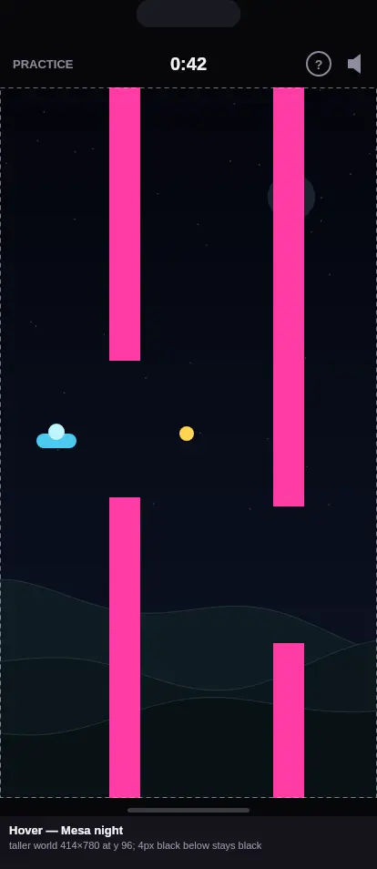

- **Concept.** The saucer flies over a desert at night. The Retro theme stays: dim phosphor colours and vector edges.
- **Layers.**
  - A sky gradient from #04050C to #0E1424.
  - A dark crater moon at the upper right (#1B2230), dimmer than any barrier.
  - Today's star field, kept.
  - Three mesa silhouettes on the bottom fifth: #0F1B22, #0C161B and #091115, each with a 1 px teal edge at 25 % alpha.
- **Motion.** The mesas parallax at 1/20, 1/12 and 1/8 of the course scroll, keyed to the sim's distance as the stars
  are today. This is not clock motion, so it doesn't need switching off, but at level 1 the mesas draw as one static
  layer at 1/12.
- **Readability.** Barriers and stars are the only saturated colours. The mesas stay below 12 % luminance.

### 2. Breaker: Draughtsman's blueprint

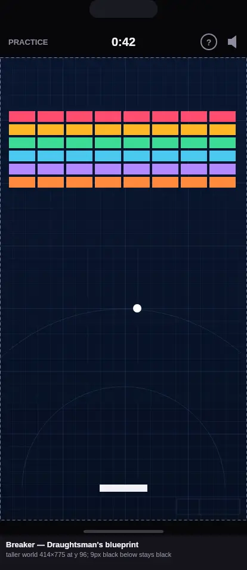

- **Concept.** The court is a sheet of blueprint paper, and the wall is "being designed".
- **Layers.**
  - Navy paper, #0A1630 to #071022.
  - A 21 px minor grid (7 % alpha) and a 105 px major grid (16 %).
  - Two faint compass arcs centred on the paddle line, suggesting rebound paths.
  - A small title block in the bottom-right corner (lines only, no text).
- **Motion.** None.
- **Readability.** The grid never forms brick-sized cells (21 px, against bricks of about 44×18). It has no warm colour,
  so every brick colour and the Fireball's orange stand out.

### 3. Rally: Floodlit night court

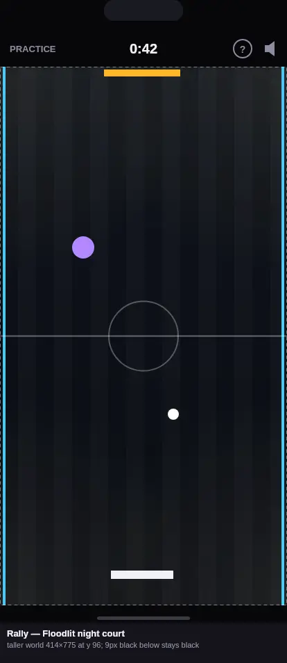

- **Concept.** A real indoor court at night, replacing the checkered floor.
- **Layers.**
  - A dark lacquered floor of 26 px boards, alternating ±2 % brightness.
  - Four floodlight pools from the corners (warm white, 9 %).
  - Today's markings, centre circle and neon side walls on top, unchanged.
- **Motion.** None (the floor is part of the cached floor layer).
- **Readability.** The floor is darker than today's checker, so the ball, pads and bumpers gain contrast.

### 4. Tempo: Concert-stage haze

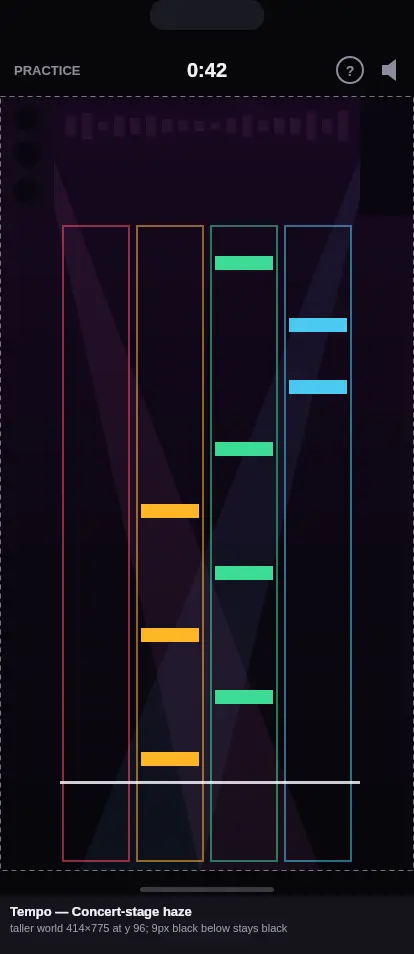

- **Concept.** The lanes sit on a dark stage.
- **Layers.**
  - A plum-to-black haze, #170820 to #07060B.
  - Two speaker-stack silhouettes at the top corners.
  - A faint equaliser strip above the lanes (8 % alpha).
  - Two soft additive light beams from the top corners (7 %).
- **Motion.** The two beams sweep ±6° over a 16 s period, out of phase. They are off at level 1 and frozen under
  reduced motion. The equaliser is static.
- **Readability.** The beams are wide and soft, never note-shaped. Lanes keep their own tint above the haze, and the
  hit line stays the brightest horizontal line.

### 5. Meteor: Crater plain under amber phosphor

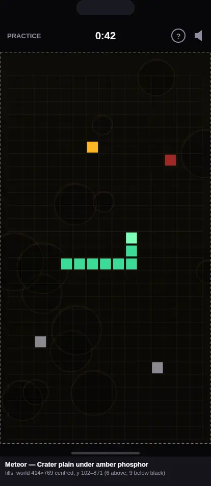

- **Concept.** Looking down on a cratered plain where the rocks land.
- **Layers.**
  - Near-black amber, #0D0B07.
  - 14 seeded craters drawn as rings: 9 % amber rim, 18 % black floor, a 5 % lit lip.
  - Regolith speckle.
  - Today's grid on top, at 7 %.
- **Motion.** None.
- **Readability.** The craters are round and large (24–116 px across), never cell-sized squares. The rock shadow's red
  and the snake's green are the only saturated colours.

### 6. Fission: Reactor pool

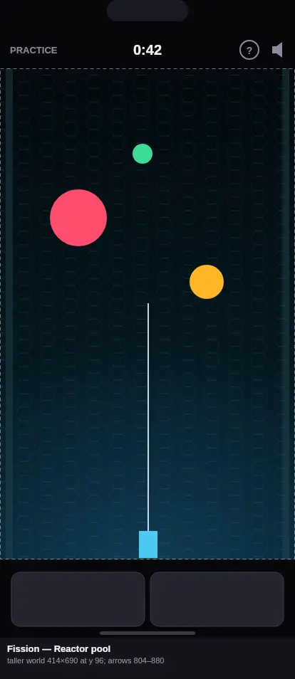

- **Concept.** A shielded reactor hall.
- **Layers.**
  - Teal-black, #03090D to #062029.
  - A hexagonal panel lattice (7 %).
  - Two coolant pipes along the side walls (35 %, darker than any atom).
  - A blue Cherenkov glow rising from the floor (22 %).
- **Motion.** The floor glow breathes from 18 % to 26 % over a 10 s period. It is off at level 1.
- **Readability.** The hexagons are 22 px outlines, never filled discs, so they can't read as atoms. The harpoon line
  stays white.

### 7. Wavefront: Home-world limb

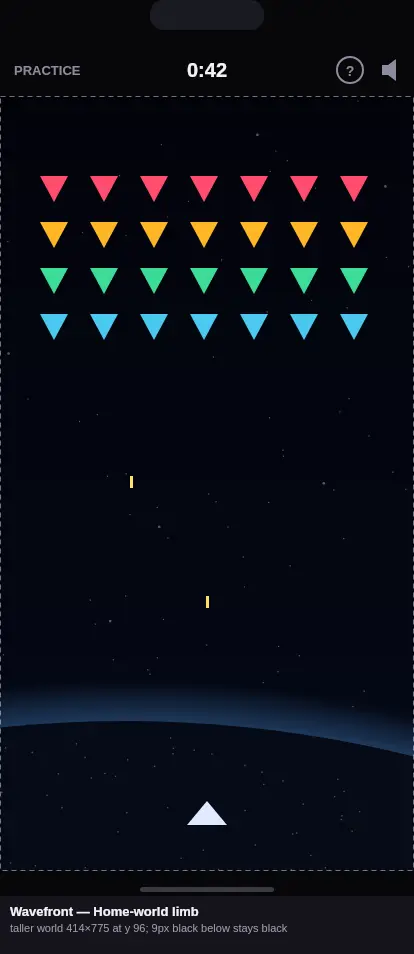

- **Concept.** The fleet attacks the planet the player defends. This replaces today's violet nebula and ringed planet.
- **Layers.**
  - Near-black space, #02030A to #050917.
  - A sparse star field.
  - A huge planet limb low in the world: a 1,200 px radius, a thin blue atmosphere band (30 %) and a dark surface with
    faint amber city lights.
- **Motion.** Stars drift down 1 px every 2 s (a second star layer, wrapped). They are off at level 1.
- **Readability.** The fighter sits on the dark surface, not on the atmosphere band. Bullets are yellow and enemies
  saturated. The background's only colours are dim blue and amber points.

### 8. Orbit: Navigator's star chart

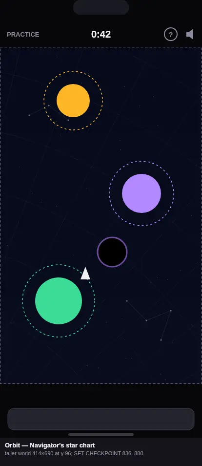

- **Concept.** The flight is plotted on an old celestial chart. This replaces the nebula, so Orbit no longer resembles
  Wavefront's space.
- **Layers.**
  - Midnight blue, #060A1A.
  - Concentric declination arcs and right-ascension rays (8 %), centred off the lower left.
  - Two seeded constellation figures (14 % lines, 45 % dots).
  - A sparse star field.
- **Motion.** Parallax with the existing camera only, as the nebula tile does today.
- **Readability.** The chart lines are 1 px and desaturated. Planets, paths and the black holes' violet rims keep all
  of the colour. No chart circle is drawn near planet sizes: the arcs are 120 px apart, on centres off-screen.

### 9. High Rise: Golden-hour harbour

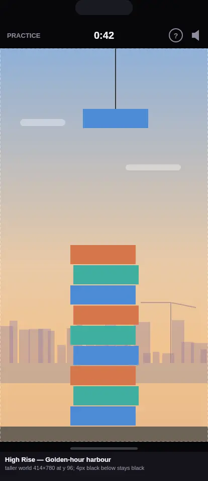

- **Concept.** The tower rises over a harbour city at golden hour.
- **Layers.**
  - A sky from soft blue (#8FB0D8) to apricot near the horizon.
  - A lilac skyline silhouette (35 %) with one dock crane.
  - A strip of harbour water.
  - The site's ground.
- **Motion.** Two flat clouds drift left at 3 px/s. They are off at level 1. As the camera climbs, the sky darkens
  toward today's night sky, which is kept for late levels.
- **Readability.** Blocks are saturated glass tints against a desaturated warm sky. The skyline sits below the lowest
  block's drop height and is lighter than any block.

### 10. Jaywalk: Market-town square

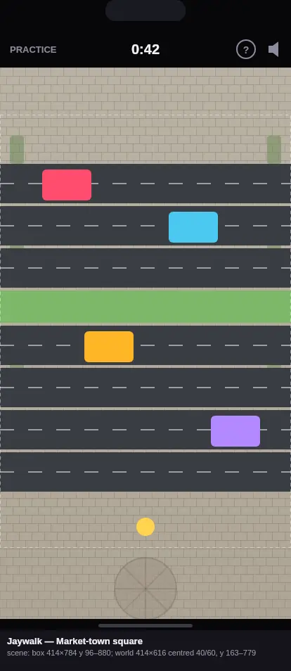

- **Concept.** The crossing runs through a market town. The pavements and verges become sandstone setts.
- **Layers.**
  - Inside the world, a sett pattern (12 % joints) on the pavement and safe strips. The roads and lanes are unchanged.
  - Planters (55 %) at the far left and right edges only, out of the walker's columns.
  - In the extension, the setts continue. Below the start pavement is a compass-rose paving roundel (35 %).
- **Motion.** None.
- **Readability.** The setts are light and neutral, and vehicles stay the only saturated shapes. Planters keep 14 px
  clear of every lane edge.

### 11. Rainbow Bridge: Highland loch

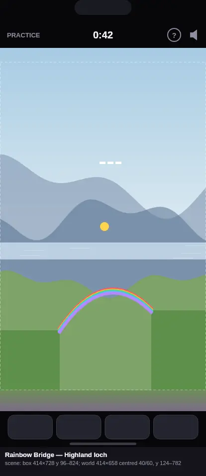

- **Concept.** The bridge is drawn across a glen above a loch, distinct from Scrumper's farmland.
- **Layers.**
  - A pale sky (#A7CBE3 to #DCEAF2).
  - Two misty blue-grey mountain ridges.
  - A silver loch band with a few light streaks.
  - The sim's ground in front, with its colours unchanged.
  - In the extension, sky above (28 px) and a heather hillside below (42 px), green turning to muted purple.
- **Motion.** None. The countryside's cloud stays as it is.
- **Readability.** No rainbow appears anywhere, so the drawn ink stays unique. Birds are white on the mid-blue
  mountains, not on the pale sky.

### 12. Slice: Sage-tile kitchen wall

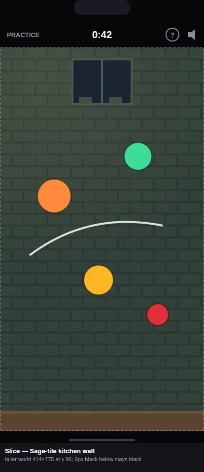

- **Concept.** The food flies in front of a farmhouse kitchen wall. The chopping board shrinks to the worktop edge at
  the bottom.
- **Layers.**
  - Deep sage metro tiles: #2E3C34 with dark grout and a +2.5 % glaze.
  - A warm lamp wash at the upper left (10 %).
  - A night window at the top centre with two herb-pot silhouettes.
  - A butcher-block worktop strip (40 px) at the world's foot.
- **Motion.** None.
- **Readability.** The dark, desaturated green sets off every food colour, including the chilli's red. The 48×24 tiles
  never read as round food.

### 13. Swish: Pier at dusk

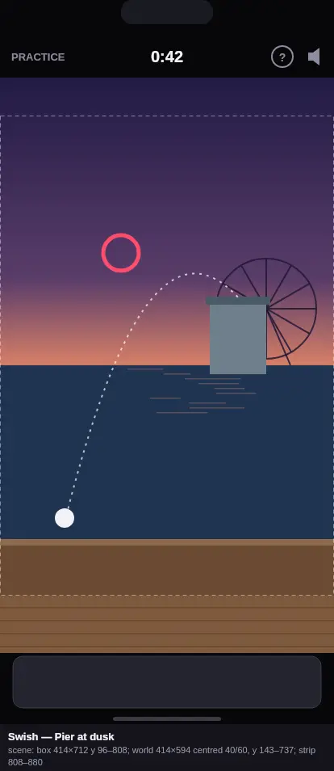

- **Concept.** The bin-toss stall stands at the end of a seaside pier at dusk, in place of the funfair midway, so it
  stays distinct from Flightpath.
- **Layers.**
  - A dusk sky from indigo to coral at the horizon (52 % down the world).
  - Sea with streaks of reflected light.
  - A big-wheel silhouette at the right (85 % indigo).
  - The counter at the bottom (existing).
  - In the extension, the pier's boards below and deeper sky above.
- **Motion.** The big wheel turns once every 60 s. It is off at level 1.
- **Readability.** The bin, hoop and spinner sit against the mid-tone sea and sky band. The wheel is behind the right
  margin and is thinner (2 px spokes) and darker than any hoop.

### 14. Flightpath: Inside the big top

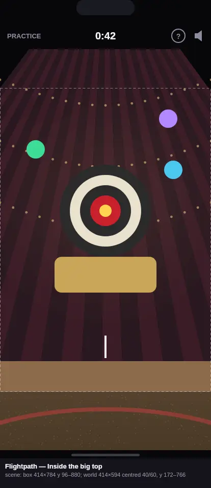

- **Concept.** The darts stall is inside a circus tent.
- **Layers.**
  - Converging canvas panels in dark claret and plum.
  - Three arcs of warm festoon lamps (55 % dots).
  - Today's lamp glow behind the board.
  - The counter at the bottom (existing).
  - In the extension, the tent's peak above and a sawdust ring floor with the red ring kerb below.
- **Motion.** None (the lamps are static; a twinkle was considered and dropped for calm).
- **Readability.** The lamps are 2.4 px dots, far smaller than balloons (36 px). The board keeps its own lit disc.

### 15. Coral Pop: Sandy lagoon floor

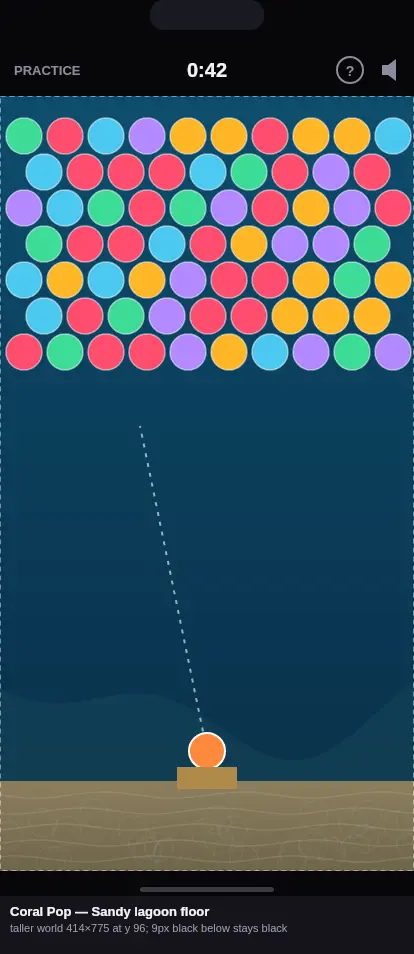

- **Concept.** A shallow lagoon, its sea floor under the launcher.
- **Layers.**
  - Today's deep-blue water gradient.
  - A soft blue-green reef silhouette across the lower world.
  - A sand bed (90 px) with ripple lines and a caustic net.
  - Today's light rays, kept.
- **Motion.** The caustic net drifts 2 px/s and fades at 12 s. It is off at level 1, as the light rays already are.
- **Readability.** The reef is far below the bubble field and dull. Creatures and specials keep their full colour.

### 16. Roofbound: Basalt forge

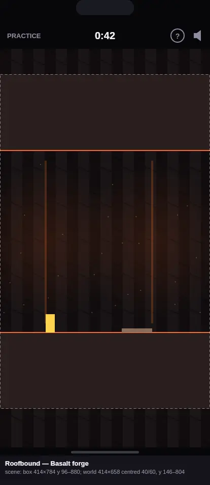

- **Concept.** The tunnel runs through a forge in basalt columns. Today's basalt tile stays for the rock, and the space
  behind the tunnel becomes a far wall with distant lava falls.
- **Layers.**
  - Basalt columns 22 px wide in #151012, alternating dark and lit, with joint lines.
  - Two thin, distant lava falls (22 %) with a soft glow (13 %).
  - Embers.
  - In the extension, the column wall continues: 50 px above and 76 px below.
- **Motion.** Embers rise 3 px/s and fade. They are off at level 1, alongside the existing dust and spouts.
- **Readability.** The falls are behind the tunnel and narrower than any hazard. Hazards keep the bright lava orange,
  and the falls are deeper and dimmer.

### 17. Grappler: Amethyst geode cavern

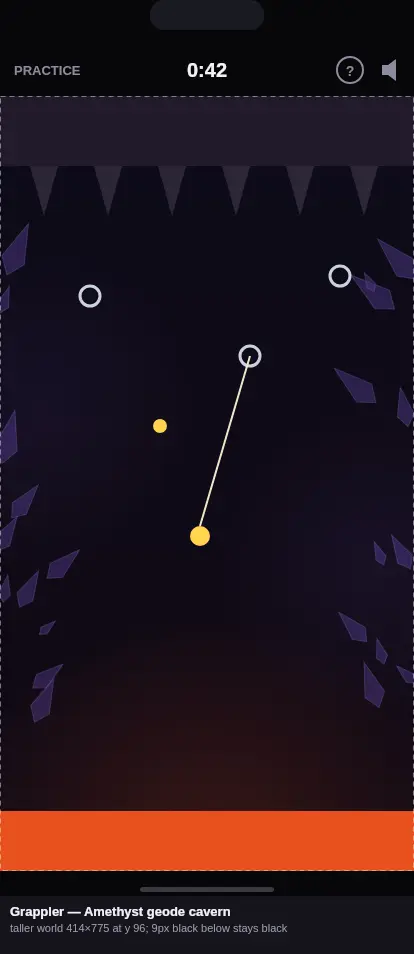

- **Concept.** A cool geode cave above the lava, so it doesn't share Roofbound's warm basalt.
- **Layers.**
  - Violet-black walls, #0C0A18 to #120A14.
  - Amethyst crystal clusters along both sides (55 % fill, 25 % edges), kept outside the middle 270 px.
  - A faint violet glow on each wall.
  - The lava's light from below (18 %, today's).
- **Motion.** Parallax with the existing camera only, in the rock layer that today's level 1 already skips.
- **Readability.** The crystals are cool and the lava hot, so the hazard stays the only warm area. Anchor rings stay
  pale grey on dark violet. Crystal points face away from the middle so they never read as stalactites.

### 18. Scrumper: Harvest orchard

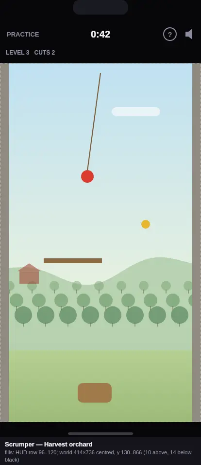

- **Concept.** An apple orchard in late summer, distinct from Rainbow Bridge's highland loch.
- **Layers.**
  - A soft sky from blue to pale green.
  - Gentle hills.
  - Three receding rows of round orchard trees (35–60 %).
  - A small red barn at the left.
  - A meadow at the foot.
- **Motion.** One cloud drifts at 3 px/s. It is off at level 1. No falling leaves, which would read as the golden leaf.
- **Readability.** The trees are smaller than the basket and duller than the apples, with no red fruit drawn on them.
  The barn's red is muted (55 %) and far from the apple's.

### 19. Tilt: Green-baize card table

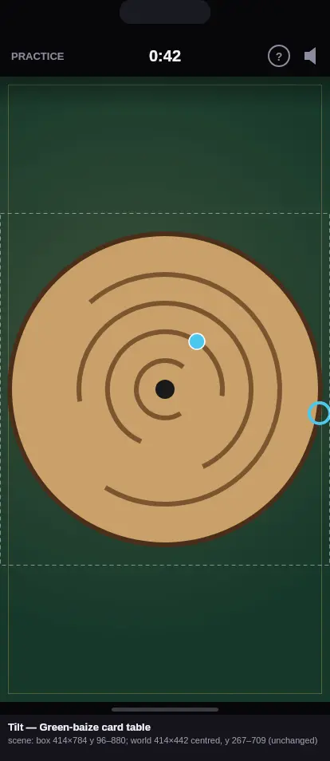

- **Concept.** The labyrinth board rests on a games-room card table, not the shared Toybox oak table, so it is distinct
  from Ball Tracker.
- **Layers.**
  - Bottle-green baize (#17382A) with felt speckle.
  - A warm lamp pool off-centre (16 %).
  - A brass inlay line 10 px in from the scene's edges.
  - A soft shadow under the top edge.
- **Motion.** None. The rotating disc's gloss stays as it is today.
- **Readability.** The oak disc reads warm on cool green, which gives more contrast than oak on oak. Marbles and cups
  are unchanged.

### 20. Ball Tracker: Maple marquetry board

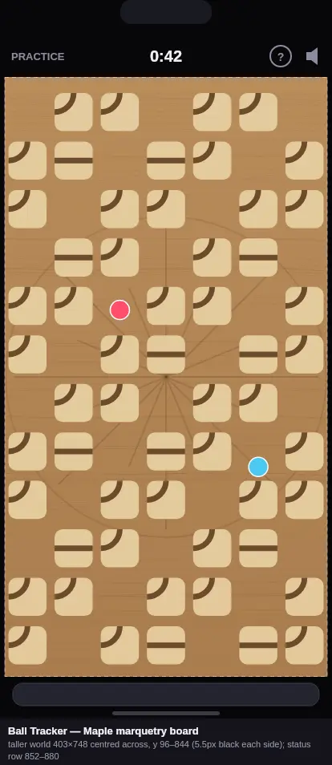

- **Concept.** The world is almost all board, so the background is the board's own surface: honey maple with a faint
  inlaid compass star, seen between the tiles.
- **Layers.**
  - Maple, #B98C5A to #A97D4E.
  - Wavy grain lines (8 %).
  - A 16-point marquetry star and ring (14–18 %) centred on the board.
- **Motion.** None. Ball Tracker is the closest game to the budget (see section 4).
- **Readability.** The inlay is lower in contrast than the tube grooves, so tubes and marbles stay the strongest lines.
  The 5.5 px side slivers stay black.

### 21. Gemstone: Velvet drape (the reference)

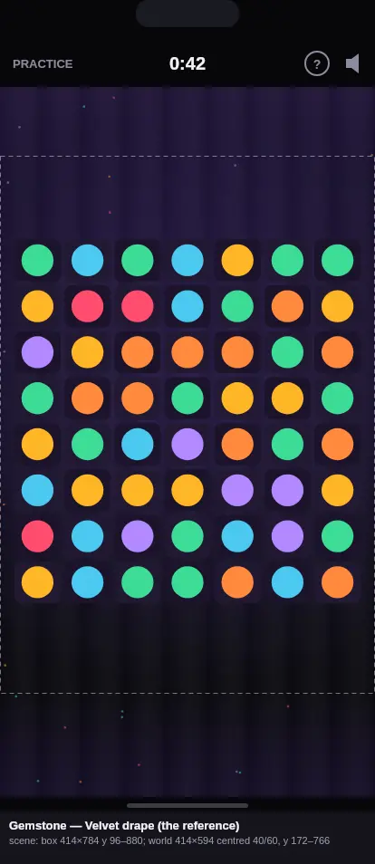

- **Concept.** Today's velvet stays. It gains broad vertical drape folds (±3.5 %) and, with the new placement, velvet
  above the world as well as below it.
- **Layers.**
  - Today's three-stop gradient, the glow and the margin sparkles.
  - Folds every 46 px.
  - In the extension above (76 px), the gradient continues upward to #211538.
- **Motion.** The margin sparkles twinkle (alpha 25–45 %, staggered, 6–10 s periods). They are off at level 1.
- **Readability.** The sparkles stay out of the board, and the folds are wider than a socket and low in contrast.

### 22. Pinball: Sunburst playfield and cabinet trim

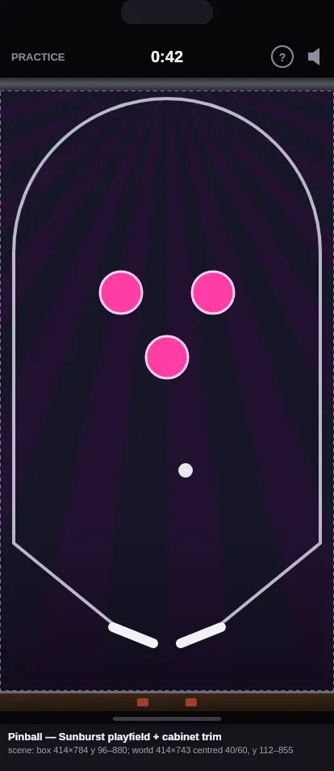

- **Concept.**
  - **Playfield.** Inside the world, the playfield gets printed art: a 1970s sunburst of 28 rays from the top centre in
    dim plum and teal (22–35 %), fading to plum by the flippers.
  - **Painted scenery.** This is new for Pinball, so it joins `ARENA_SCENE_GAMES`. Above the world (16 px) sits the
    backbox's chrome trim strip. Below the world (25 px) are the cabinet's lockdown rail in walnut, a 3 px chrome edge
    and two dim coin-door lamps.
- **Motion.** None.
- **Readability.**
  - Rays converge at the top, away from the flippers.
  - The fade leaves the flipper zone plain.
  - Bumpers keep their neon, and the ball its white.
  - The playfield's existing lane guides and inserts stay on top of the art, unchanged.

## 3. Placement and tuning at 414×896

The rule here is display only. Each world keeps its size (the largest uniform scale that fits the width, as today). The
spare box height is split 40 % above and 60 % below, rounded to whole CSS px, instead of all going below. This sits the
world a little above the optical centre and leaves the larger extension under it, where each game's ground continues.

Tilt keeps its 50/50 centring. `ArcadeArenaSlot`'s boolean `centre` would become a per-game alignment ratio. Taps keep
mapping through the same world transform, so input, sim and replays are untouched. No gameplay tuning is proposed: every
leftover is less than one cell or row of the game's own grid (Meteor's rows are 25.5 CSS px at this scale), so filling
it exactly would need a stamped gameplay revision for no gain.

The box starts at y 96 (Scrumper at y 120, under its own 24 px HUD row). y is measured from the top of the screen.

| Game | Box (w×h, y range) | World at 414×896 | Today: world y / above / below | Proposed: world y / above / below | Scene above | Scene below |
|---|---|---|---|---|---|---|
| Meteor | 414×784, 96–880 | 414×769 (scale 1.0615) | 96–865 / 0 / 15 black | **102–871** / 6 / 9 | none: stays black (too thin for scenery; the retro screen already fills the world edge to edge) | none: stays black |
| Scrumper | 414×760, 120–880 | 414×736 (scale 1.15) | 120–856 / 0 / 24 black | **130–866** / 10 / 14 | none: stays black | none: stays black |
| Pinball | 414×784, 96–880 | 414×743 (scale 1.0615) | 96–839 / 0 / 41 black | **112–855** / 16 / 25 | backbox chrome trim, 414×16 | lockdown rail and coin-door lamps, 414×25 |
| Gemstone | 414×784, 96–880 | 414×594 (1.0615) | 96–690 / 0 / 190 scene | **172–766** / 76 / 114 | velvet, 414×76 | velvet and sparkles, 414×114 |
| Flightpath | 414×784, 96–880 | 414×594 (1.0615) | 96–690 / 0 / 190 scene | **172–766** / 76 / 114 | big-top peak, 414×76 | sawdust ring floor, 414×114 |
| Swish | 414×712, 96–808 (strip 808–880) | 414×594 (1.0615) | 96–690 / 0 / 118 scene | **143–737** / 47 / 71 | dusk sky, 414×47 | pier boards, 414×71 |
| Roofbound | 414×784, 96–880 | 414×658 (1.0615) | 96–754 / 0 / 126 scene | **146–804** / 50 / 76 | basalt columns, 414×50 | basalt columns, 414×76 |
| Rainbow Bridge | 414×728, 96–824 (buttons 832–880) | 414×658 (1.0615) | 96–754 / 0 / 70 scene | **124–782** / 28 / 42 | sky, 414×28 | heather hillside, 414×42 |
| Jaywalk | 414×784, 96–880 | 414×616 (1.0615) | 96–712 / 0 / 168 scene | **163–779** / 67 / 101 | setts, 414×67 | setts and paving roundel, 414×101 |
| Tilt | 414×784, 96–880 | 414×442 (0.941) | 267–709 / 171 / 171 scene | **267–709** / 171 / 171 (unchanged) | baize, 414×171 | baize, 414×171 |

Notes:

- **Meteor and Scrumper fill the screen already.** Centring them only balances their sliver of black. The slivers stay
  `--screen-edge` black, which also matches Meteor's bezel. The Meteor bottom-flash proof (whole CSS pixels, no
  rounding past the box) must hold at the new offset.
- **Pinball moves 16 px down.** Its flippers stay well clear of the 16 px strip: their pivots are at world y 620,
  which is screen y 770, and the world's foot is at y 855.
- **Gemstone and Flightpath.** Their top HUD rows inside the world move 76 px down from the header. If Joe prefers the
  HUD tight under the header, 25/75 (48 above, 142 below) is the alternative.
- **Generalising.** For any other screen size the build applies the same 40/60 ratio to the spare height that
  `docs/arena-sizes-oct-2026.md` lists. `presentation-geometry-check` should regenerate that file with the new world-top
  column.

## 4. Frame-time estimates against the arcade-lowend-check budget

The budget is the one arcade-lowend-check enforces: at least 30 fps at 4× CPU slowdown, 390×844, which is a mean frame
of 33.3 ms or less. The check enforces it for Tilt, Ball Tracker, Rainbow Bridge, Grappler and Orbit. The other games
are held to the same line here. The governor's 20 ms work threshold (`SLOW_WORK_MS`) at 1× is the second line: no game
may step into reduced effects at normal speed.

The baseline is the "4× after" column of `docs/arcade-lowend-oct-2026.md`. Its run-to-run spread is about ±10 %.

These are estimates, not measurements. The cost model comes from that doc's raster table:

- A full-canvas `drawImage` costs 1.0–1.6 ms under `--raster`, which roughly doubles cost, so about 0.5–0.8 ms real at
  1×. It scales by about 4 at 4×.
- **Class A.** A static background folded into a layer the game already blits every frame: +0 ms.
- **Class B.** A new cached world-sized layer replacing a flat fill: about +0.3 ms at 1×, +1.2 ms at 4×.
- **Class C.** Class B or A, plus a slow-motion pass (a second partial layer or a few gradient fills): about +0.6 ms at
  1×, +2.4 ms at 4×. Motion is dropped at level 1, so a slow phone falls back to A or B.
- **Extensions.** Painted once per arena size on the scene canvas, so 0 ms per frame. Pinball's scene canvas is new: one
  more static composited canvas, estimated at +0.1 ms at 1× and +0.4 ms at 4×.

| Game | Class | Motion (off at level 1) | 4× today (ms) | Estimated 4× (ms) | Headroom to 33.3 ms | Estimated 1× added | Enforced by arcade-lowend-check |
|---|---|---|---|---|---|---|---|
| Hover | A (parallax tied to the sim) | none (parallax only) | 21.9 | 22.5 | 10.8 | +0.15 | no |
| Breaker | B | none | 18.0 | 19.2 | 14.1 | +0.3 | no |
| Rally | A (cached floor layer) | none | 18.4 | 18.4 | 14.9 | 0 | no |
| Tempo | A + motion | beams sweep 16 s | 17.7 | 20.1 | 13.2 | +0.6 | no |
| Meteor | A (cached grid raster) | none | 19.9 | 19.9 | 13.4 | 0 | no |
| Fission | C | floor glow 10 s | 17.4 | 19.8 | 13.5 | +0.6 | no |
| Wavefront | A + motion | star drift | 18.2 | 20.6 | 12.7 | +0.6 | no |
| Orbit | A (replaces the nebula tile) | none (camera parallax) | 21.6 | 21.6 | 11.7 | 0 | yes |
| High Rise | C (sky becomes a cached layer) | cloud drift | 19.1 | 21.5 | 11.8 | +0.6 | no |
| Jaywalk | A (cached crossing scene) | none | 18.4 | 18.4 | 14.9 | 0 | no |
| Rainbow Bridge | A (countryside stamp) | none | 18.0 | 18.0 | 15.3 | 0 | yes |
| Slice | A (cached background) | none | 16.8 | 16.8 | 16.5 | 0 | no |
| Swish | A + motion | big wheel 60 s | 18.0 | 20.4 | 12.9 | +0.6 | no |
| Flightpath | A | none | 17.2 | 17.2 | 16.1 | 0 | no |
| Coral Pop | A + motion | caustics | 24.1 | 26.5 | 6.8 | +0.6 | no |
| Roofbound | A + motion | embers | 22.3 | 24.7 | 8.6 | +0.6 | no |
| Grappler | A (parallax rock layer) | none (camera parallax) | 20.0 | 20.0 | 13.3 | 0 | yes |
| Scrumper | A + motion | cloud drift | 23.0 | 25.4 | 7.9 | +0.6 | no |
| Tilt | A (`deviceLayer` and scene) | none | 20.2 | 20.2 | 13.1 | 0 | yes |
| Ball Tracker | A (`deviceLayer` board) | none (kept static on purpose) | 27.5 | 27.5 | 5.8 | 0 | yes |
| Gemstone | A + motion | sparkle twinkle | 22.0 | 24.4 | 8.9 | +0.6 | no |
| Pinball | A + new static scene canvas | none | 19.5 | 19.9 | 13.4 | +0.1 | no |

Every game stays under 33.3 ms at 4× in this estimate, and the five enforced games gain nothing. The tightest are Ball
Tracker (5.8 ms headroom, deliberately static), Coral Pop (6.8 ms) and Scrumper (7.9 ms). If a measured 4× run lands
within 3 ms of the line, the build should make that game's motion static rather than relax any limit. At 1× no game
adds more than 0.6 ms of work, far below the 20 ms threshold.

After the build, measure rather than trust these numbers:

- `bun scripts/arcade-perf.ts <games> --rates=1,4,6` for the before → after.
- `--raster --rates=1` for the new draw calls.

## 5. For the build prompt

- **Order.**
  - Do the placement change (section 3) on its own first, then the backgrounds.
  - Batch the backgrounds by shared world: Retro (Hover, Breaker, Tempo, Meteor, Fission, Pinball), space (Wavefront,
    Orbit), Toybox (Tilt, Ball Tracker), Fairground (Swish, Flightpath), Countryside (Rainbow Bridge, Scrumper), Real
    World (High Rise, Jaywalk), lava (Roofbound, Grappler), and the rest (Rally, Slice, Coral Pop, Gemstone).
  - A shared theme layer (`retro.renderer.ts`, `toybox.renderer.ts`, `fairground.renderer.ts`,
    `countryside.renderer.ts`, `realworld.renderer.ts`) must not change for games that aren't getting a new background.
    Each new background goes in the game's own renderer.
- **Stored revisions.** Backgrounds are presentation, so reveals and replays of older revisions may show the new art,
  as they do for every other art pass. Nothing is regraded, and no stored data changes (Rule 4).
- **Checks to run** (only the relevant ones):
  - arcade-play-check for the games touched.
  - arcade-fx and reveal-score.
  - arcade-self-replay.
  - arcade-lowend-check.
  - bottom-clearance-check and arcade-device-bottom-check (the placement change, Meteor's bottom proof, Pinball's new
    scene).
  - safe-area-screens-check (the header gap above a lowered world).
  - presentation-geometry-check, regenerating `docs/arena-sizes-oct-2026.md`.
  - tap-mapping-check (Tempo's renderer changes).
  - The games' own checks, for any renderer they import.
  - The arcade-play baseline (`.github/ci/arcade-play-baseline.json`) may need re-recording on CI, since frame times
    change on purpose. Never loosen the limits.
- **Intro demos.** Coordinate demos for the seven re-placed games must be re-checked with `scripts/shots/demo-taps.ts`
  and stopped if they miss.
- **Open questions for Joe.**
  - The 40/60 split, or a tighter 25/75 under the header?
  - Should Orbit's 42 px under its world get a painted chart extension? Section 2 keeps it black, as the brief asked
    for taller worlds.
  - Which motions to keep: all of them, or a static-only first pass?

## Mockup files

Each file is 414×954: the 414×896 screen plus a 58 px caption.

`docs/arcade-backgrounds/`: `hover.webp`, `breaker.webp`, `rally.webp`, `tempo.webp`, `meteor.webp`, `fission.webp`,
`wavefront.webp`, `orbit.webp`, `highrise.webp`, `jaywalk.webp`, `rainbowbridge.webp`, `slice.webp`, `swish.webp`,
`flightpath.webp`, `coralpop.webp`, `roofbound.webp`, `grappler.webp`, `scrumper.webp`, `tilt.webp`,
`balltracker.webp`, `gemstone.webp`, `pinball.webp`.
