# Avatars, gems, finishes, accessory, special edition

[← Gallery](../GALLERY.md)

## The 32 avatars

Free for everyone. **✅ Keep** — The 32 game avatars are crisp, distinctive and on brand; free for everyone.

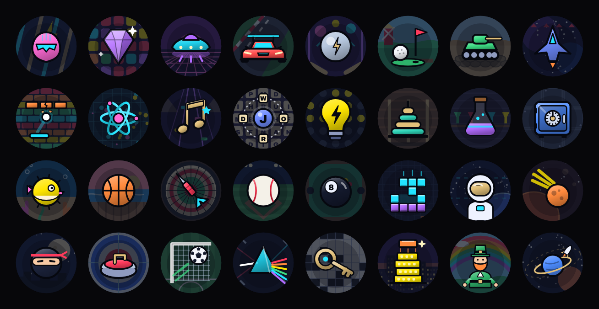

## Gems

Unlocked by stars. **🟠 Improve** — The ten gems recolour the helmet only; at card size several look alike (Pearl, Diamond, Aquamarine). *Premium would be:* A gem shows as a small set stone or a rim colour as well as the tint, so each reads at a glance.

`gem.amber` 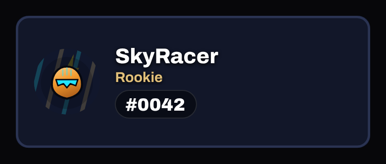

`gem.amethyst` 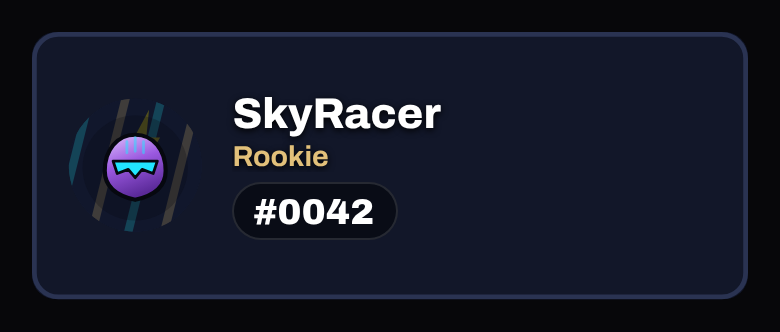

`gem.aquamarine` 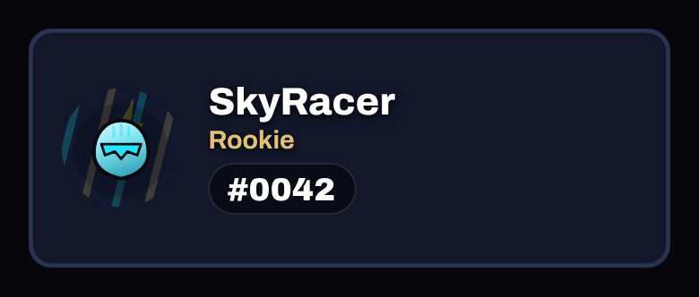

`gem.diamond` 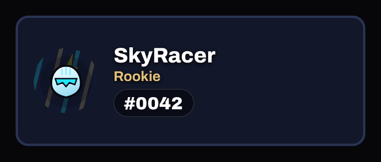

`gem.jade` 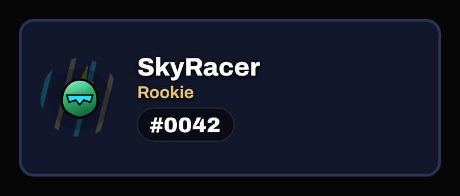

`gem.obsidian` 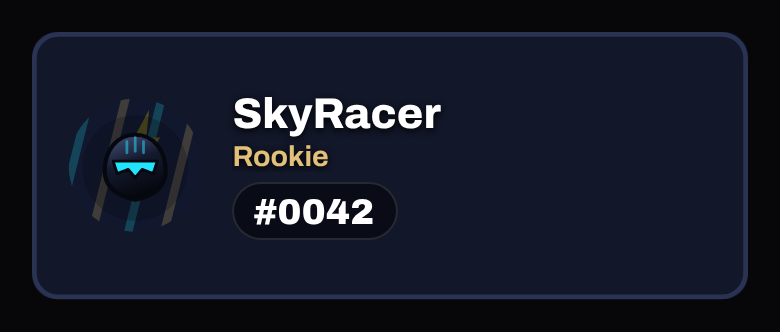

`gem.pearl` 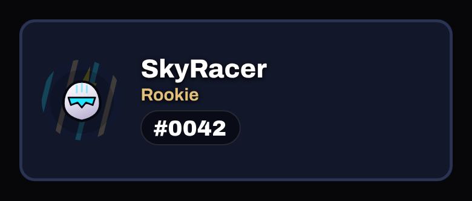

`gem.rose-quartz` 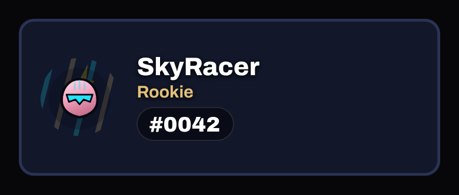

`gem.ruby` 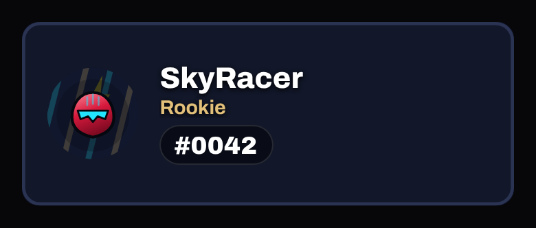

`gem.sapphire` 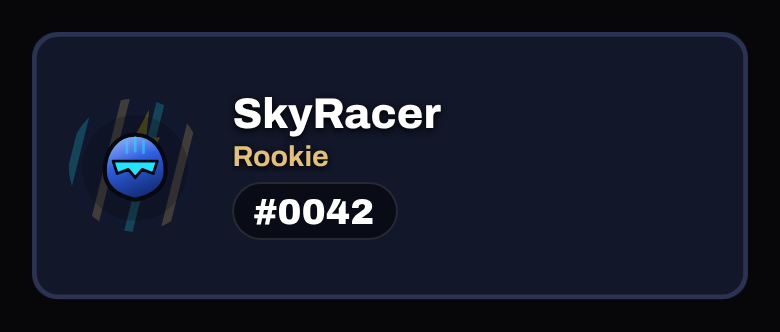

## Chrome

`avatar-finish.chrome` · Shop, 1,000 coins (City Lights bundle) · Epic

**🟠 Improve** — On the card the avatar is ~70 px and the finish changes a small helmet disc; Chrome, Pearl gem and Diamond gem look almost the same. *Premium would be:* A finish should change the whole avatar (body and scene) with a visible material: reflections for Chrome.

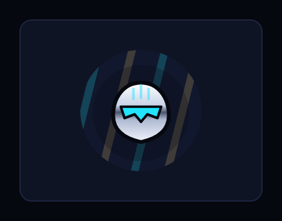 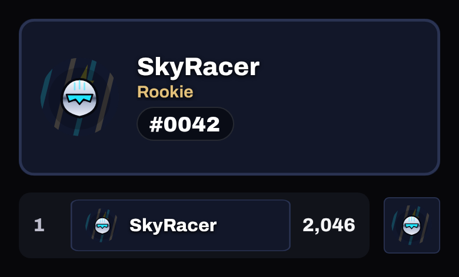

## Carbon

`avatar-finish.carbon` · Shop, 1,000 coins (Hologram bundle) · Epic

**🟠 Improve** — Reads as 'dark avatar'; the weave is invisible at card size. *Premium would be:* A larger, higher-contrast weave and a red accent line.

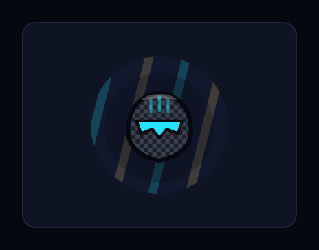 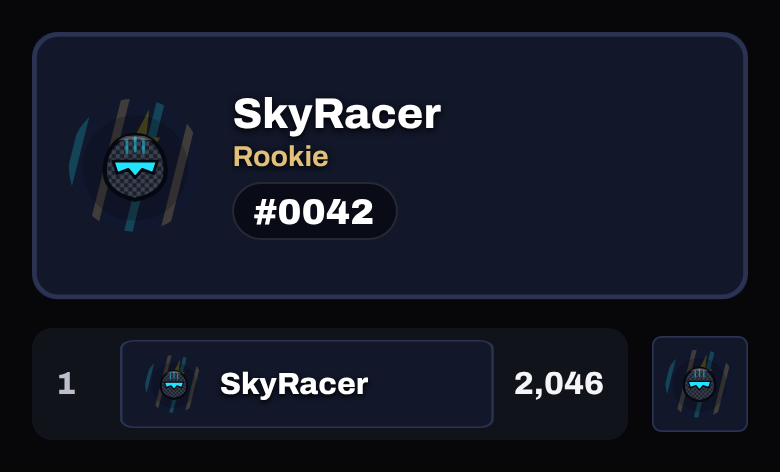

## Comic Ink

`avatar-finish.comic-ink` · Shop, 1,000 coins (Retro Arcade bundle) · Epic

**✅ Keep** — Bold outline and halftone read even small; distinctive.

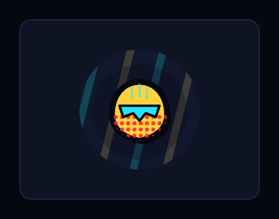 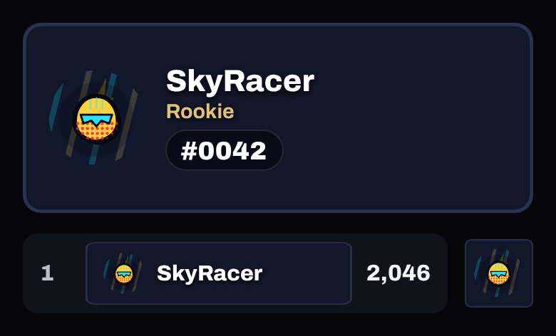

## Holographic

`avatar-finish.holographic` · Shop, 1,600 coins (Hologram bundle) · Elite

**🟠 Improve** — Elite: a pastel tint, easily mistaken for a gem colour. *Premium would be:* A moving rainbow foil (still under Reduce Motion) across the whole avatar.

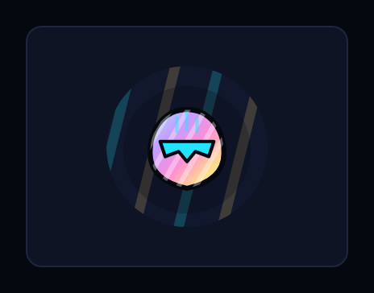 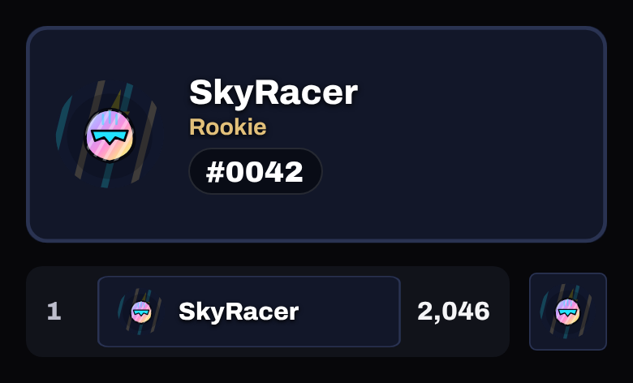

## Wireframe

`avatar-finish.wireframe` · Shop, 1,600 coins (Hologram bundle) · Elite

**✅ Keep** — Elite: cyan wireframe reads clearly and looks special.

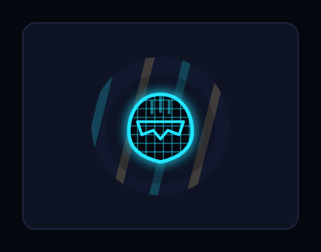 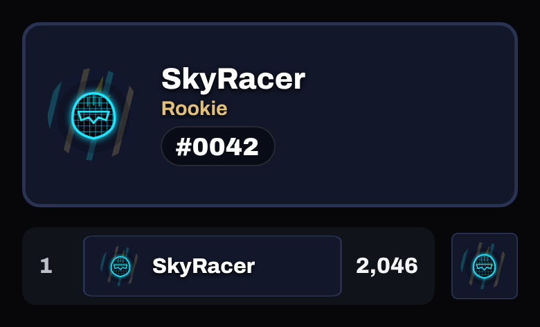

## Lightning Core

`avatar-finish.lightning-core` · Shop, 2,800 coins · Legendary

**✅ Keep** — Legendary: ring and sparks; clearly the top finish.

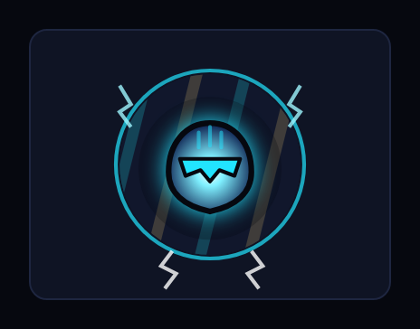 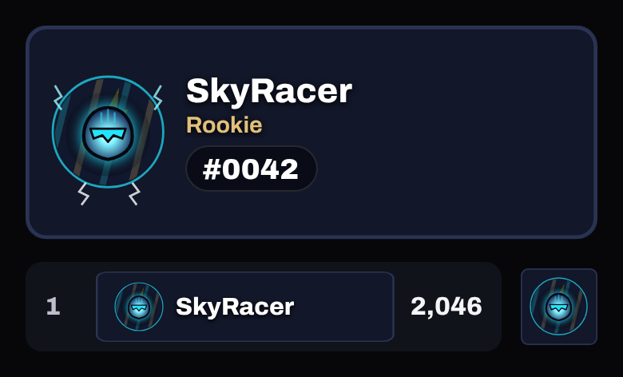

## Neon Captain Joulz

`avatar-special-edition.neon-captain-joulz` · Pass, premium track, level 1 · Elite

**✅ Keep** — Premium level 1 (the pass's headline): pink neon helmet; distinctive.

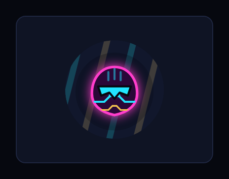 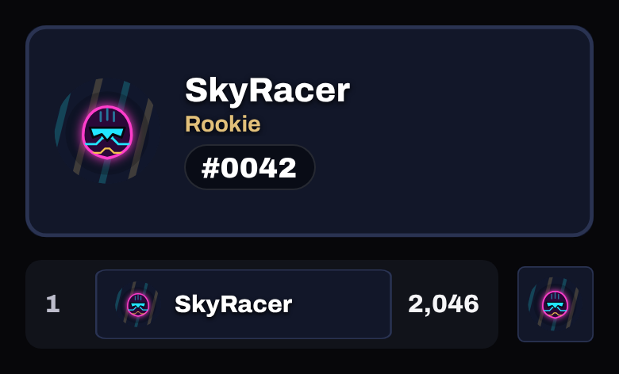

## Neon Glow

`avatar-finish.neon-glow` · Pass, premium track, level 40 · Elite

**🟠 Improve** — Premium level 40: a pink glow round a small disc. *Premium would be:* A glow round the whole avatar silhouette, plus a neon rim.

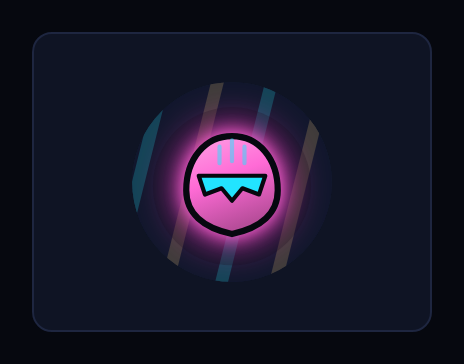 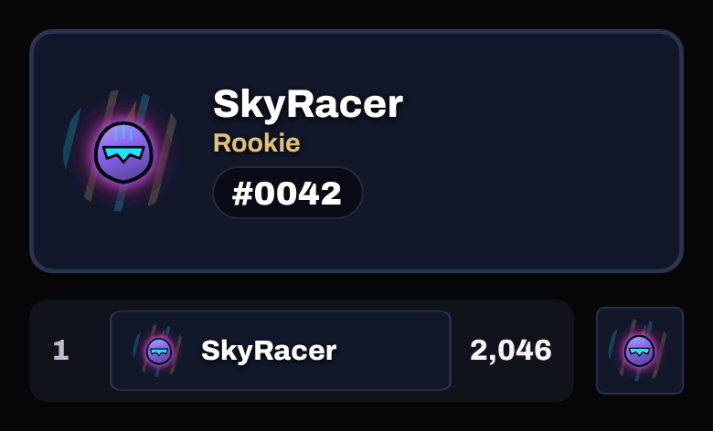

## Neon Bolt

`avatar-accessory.neon-bolt` · Pass, premium track, level 52 · Epic

**🟠 Improve** — Premium level 52: a tiny bolt over the head; at card size it is a few pixels. *Premium would be:* Larger (within the avatar box), glowing, and drawn on every avatar shape the same way.

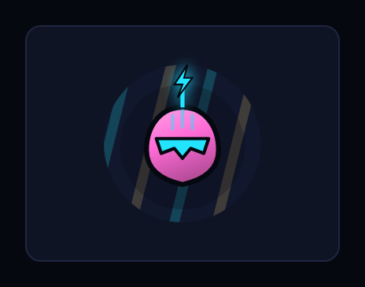 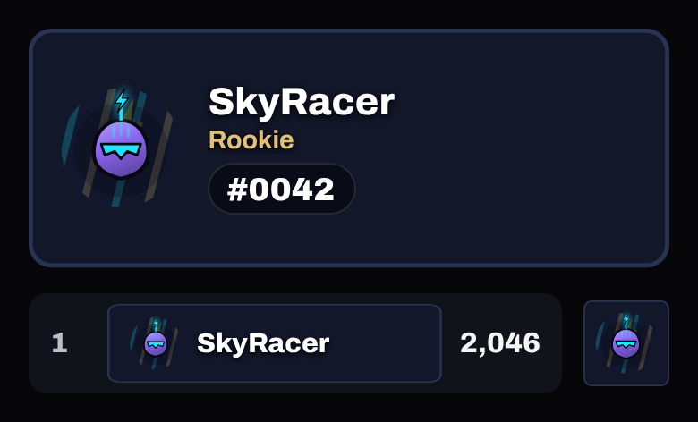
