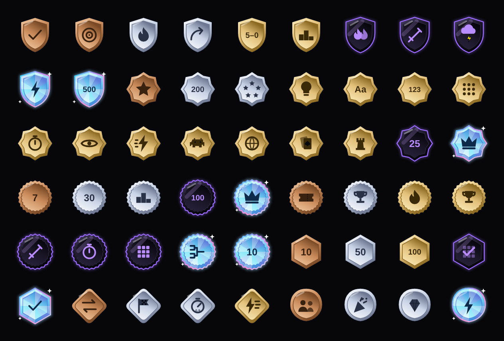
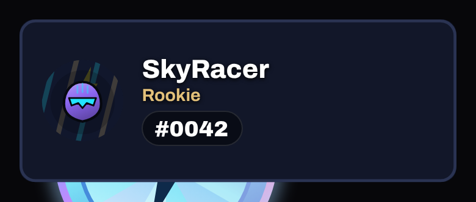
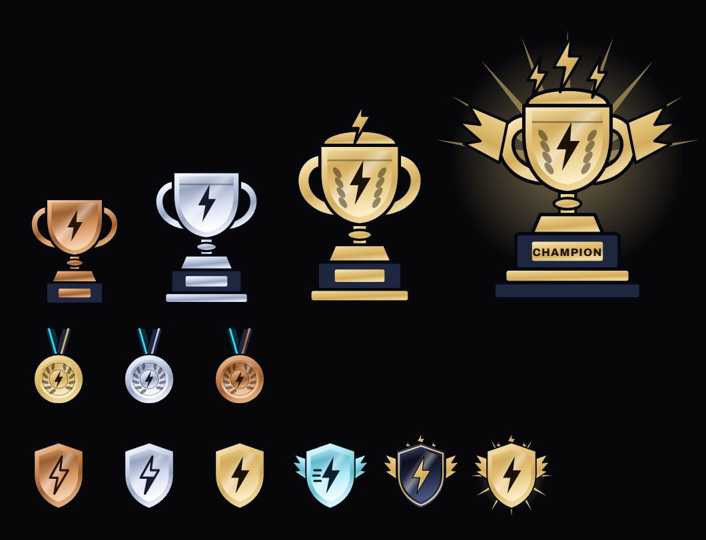

# Badges, titles, trophies, emblems

[← Gallery](../GALLERY.md)

## Badges (54)

**✅ Keep** — The 54 badge drawings are consistent and readable at 56 px; on the card (three small badges) they are small but clear.

## Titles

**✅ Keep** — Text only, in the card's gold title style; fine as long as the card around them is premium.

## Trophies, medals, tier emblems

**✅ Keep** — The four trophies, medals and tier emblems are the approved F5 art; good.

## Season emblem

**🟠 Improve** — The S1 emblem is the tier shield plus a small text mark; fine but plain for a once-a-season reward. *Premium would be:* A season-specific emblem (Neon Circuit motif) per tier.

## PLUS chip

**🟠 Improve** — A small gold 'PLUS' text chip only the owner sees. *Premium would be:* A proper Plus mark (a badge-like emblem) others can see on the card, if Joe wants it shown.
