# Celebrations and tile styles

[← Gallery](../GALLERY.md)

## Confetti Pop

`celebration.confetti-pop` · Shop, 1,000 coins (Big Night bundle) · Epic

**✅ Keep** — Bright confetti; reads at once.

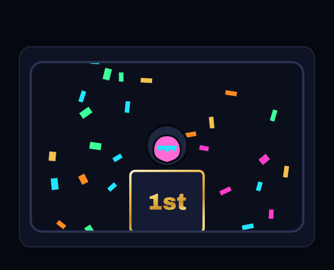 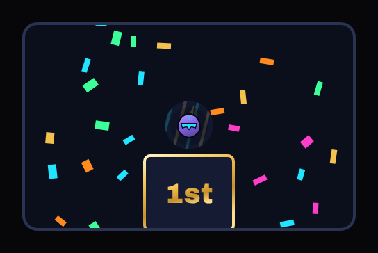

## Spotlight

`celebration.spotlight` · Shop, 1,000 coins (Big Night bundle) · Epic

**🟠 Improve** — Epic at 1,000: two faint grey cones; most players won't notice it. *Premium would be:* Warm stage spotlights with dust in the beams and a sweep onto the winner.

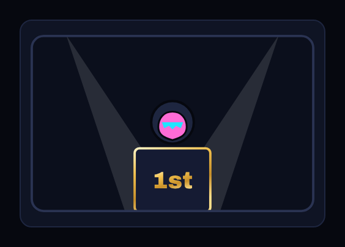 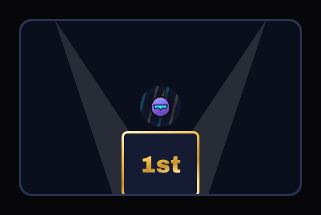

## Fireworks

`celebration.fireworks` · Shop, 1,600 coins (Black and Gold bundle) · Elite

**✅ Keep** — Elite: clear bursts; good.

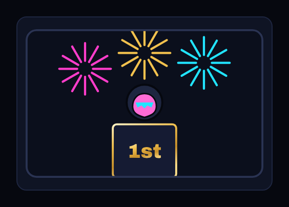 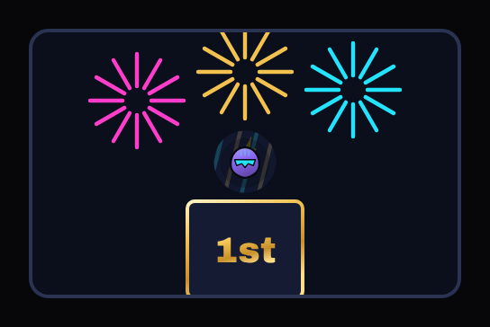

## Shockwave

`celebration.shockwave` · Shop, 1,600 coins (Black and Gold bundle) · Elite

**🟠 Improve** — Elite at 1,600: three thin rings; looks unfinished. *Premium would be:* A visible energy ring with distortion and sparks, in the brand gold.

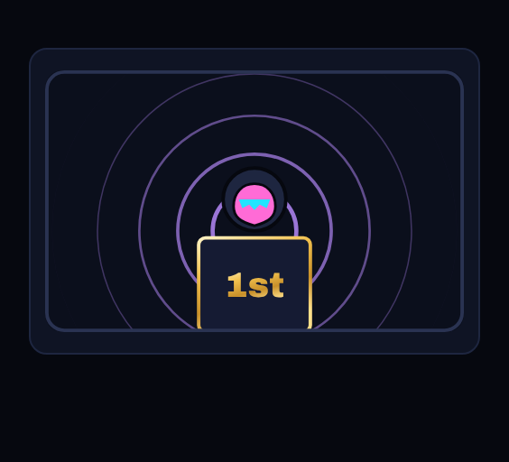 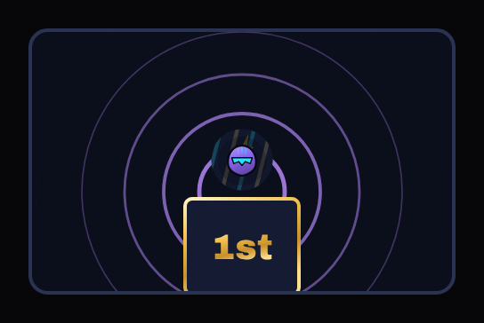

## Gold Rush

`celebration.gold-rush` · Shop, 2,800 coins (Black and Gold bundle) · Legendary

**✅ Keep** — Legendary: coins and crown; strong.

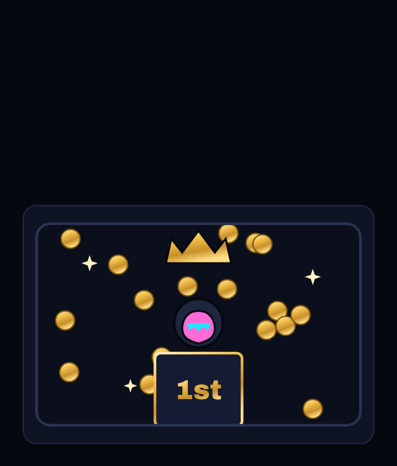 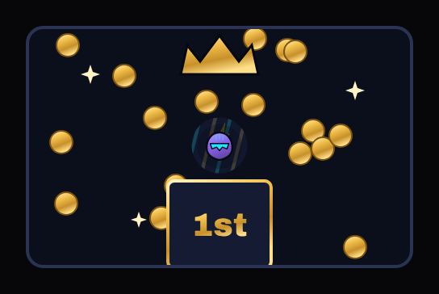

## Power Surge

`celebration.power-surge` · Pass, premium track, level 30 · Legendary

**✅ Keep** — Legendary: lightning and stage glow; strong.

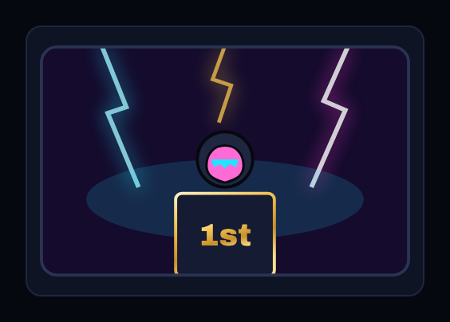 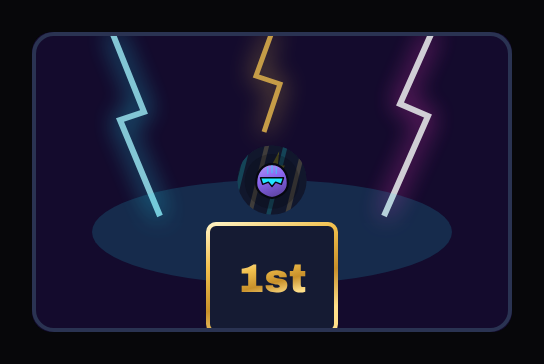

## Circuit Overload

`celebration.circuit-overload` · Pass, premium track, level 58 · Elite

**🟠 Improve** — Elite (premium level 58, the podium entrance): two flat lines; weak for the pass's late levels. *Premium would be:* Traces that light up along the podium with nodes flashing, ending in a burst.

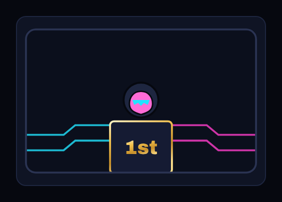 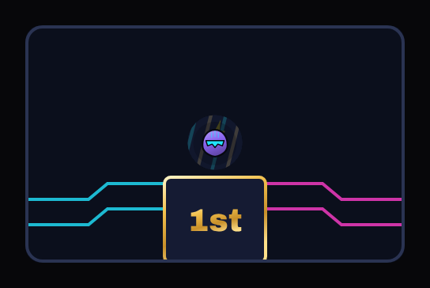

## Brushed Gold

`tile-style.brushed-gold` · Shop, 1,000 coins (Black and Gold bundle) · Epic

**✅ Keep** — Gold border; clearly a paid look.

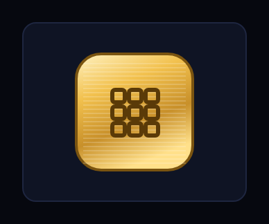 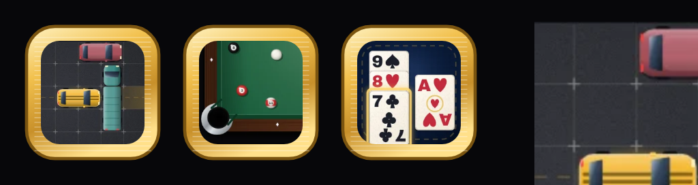

## Blueprint

`tile-style.blueprint` · Shop, 1,000 coins (Retro Arcade bundle) · Epic

**✅ Keep** — Blue border and grid; distinctive.

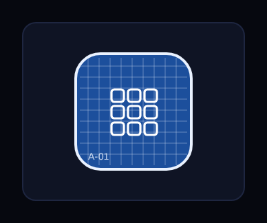 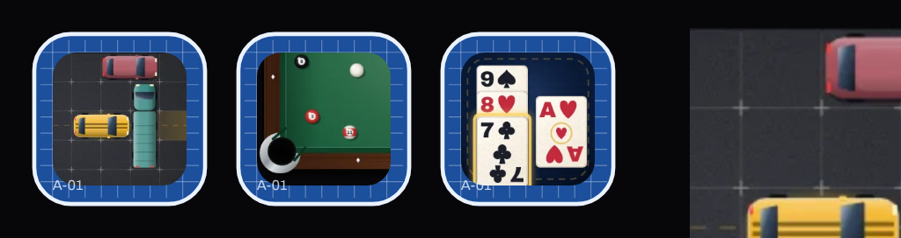

## Obsidian Glass

`tile-style.obsidian-glass` · Shop, 1,600 coins (Black and Gold bundle) · Elite

**✅ Keep** — Violet glass edge; good.

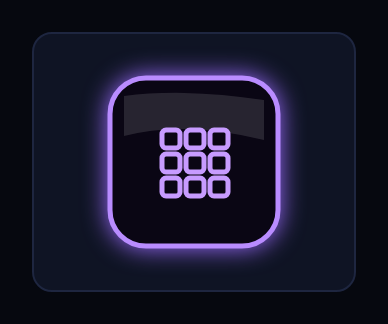 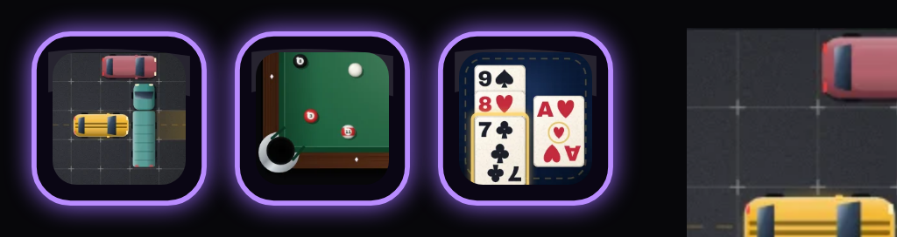

## Circuit Trace

`tile-style.circuit-trace` · Pass, free track, level 16 · Common

**🟠 Improve** — Free level 16: almost identical to the plain tile. *Premium would be:* Visible traces across the tile's border.

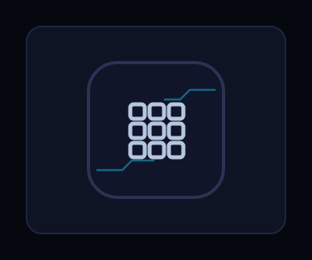 

## Neon Dots

`tile-style.neon-dots` · Pass, premium track, level 38 · Rare

**✅ Keep** — Pink neon dotted edge; fine.

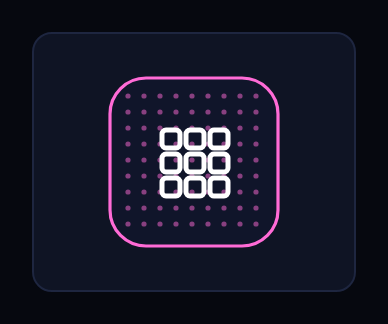 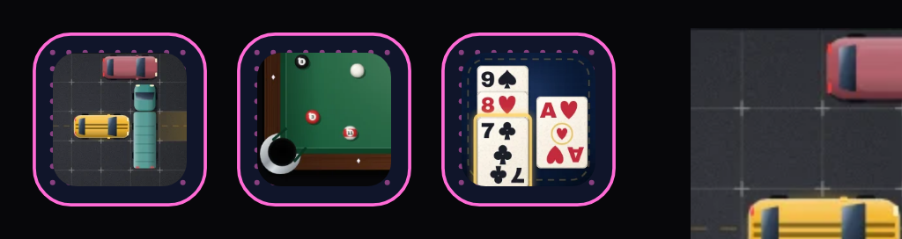

## Neon Grid

`tile-style.neon-grid` · Pass, premium track, level 7 · Epic

**✅ Keep** — Cyan glow; fine.

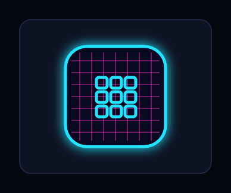 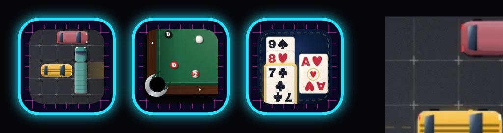
