# Frames (incl. Season 1 and Championship)

[← Gallery](../GALLERY.md)

## Plain

`frame.plain` · Free starter · no rarity

**✅ Keep** — The default thin outline; correct for a default.

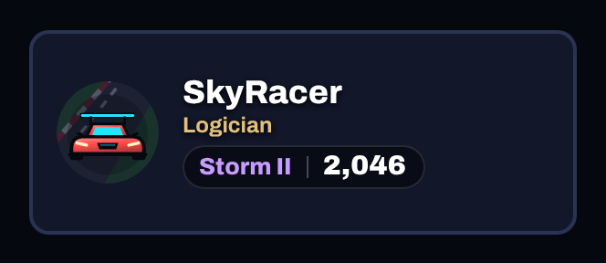 

## Bronze

`frame.bronze` · Pass, free track, level 6 · Common

**🟠 Improve** — A plain orange line (Common, free level 6); nothing says 'bronze'. *Premium would be:* A metal bronze bevel with small corner studs.

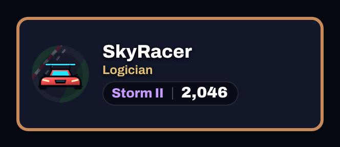 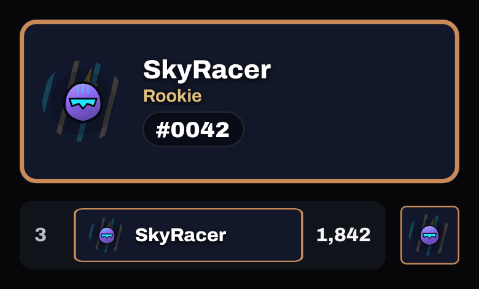

## Silver

`frame.silver` · Pass, free track, level 26 · Rare

**🟠 Improve** — A plain grey line (Rare, free level 26). *Premium would be:* A brushed-silver bevel with a light sweep at the corners.

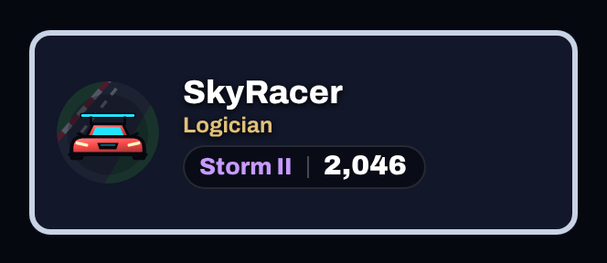 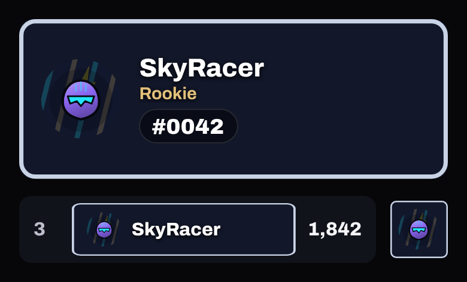

## Gold

`frame.gold` · Shop, 1,000 coins (Black and Gold bundle) · Epic

**✅ Keep** — Ornate gold with corner brackets; reads premium.

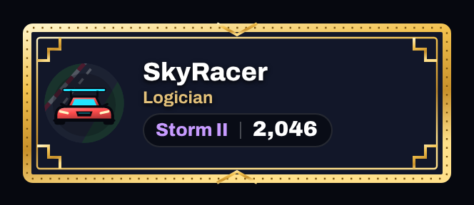 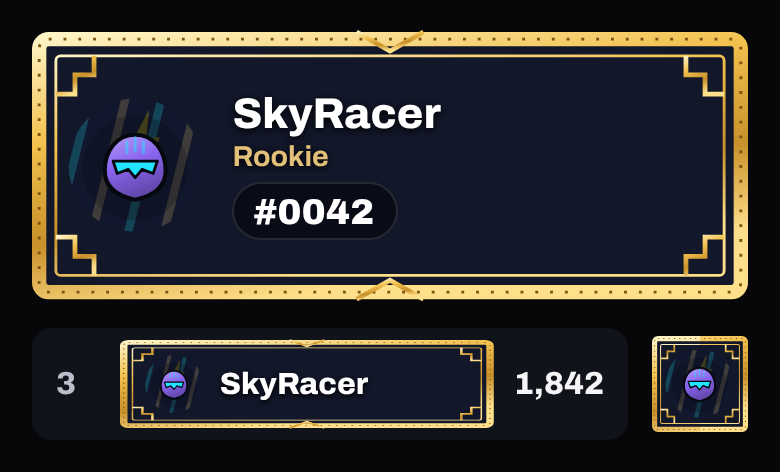

## Obsidian

`frame.obsidian` · Shop, 1,600 coins (Black and Gold bundle) · Elite

**🟠 Improve** — Elite at 1,600, but the triangle corners look like folded paper and the violet edge is faint. *Premium would be:* A glossy black frame with a crisp violet edge light and faceted corners.

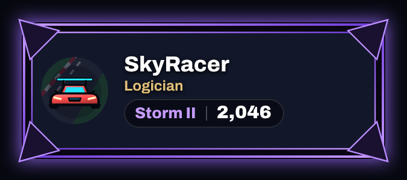 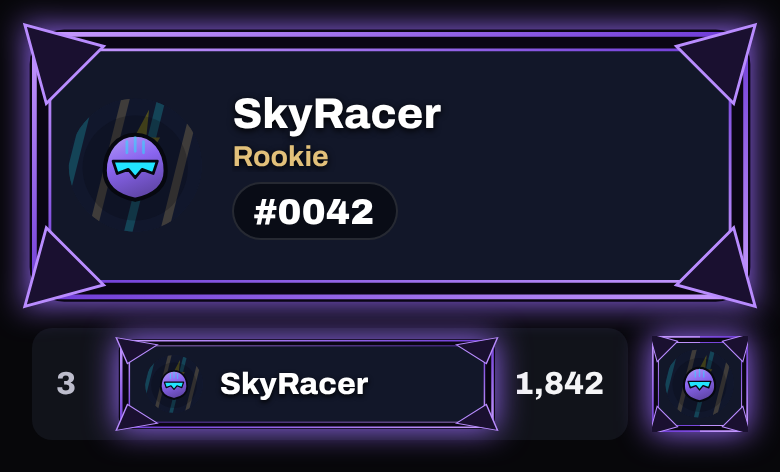

## Diamond

`frame.diamond` · Shop, 2,800 coins (Hologram bundle) · Legendary

**✅ Keep** — Legendary: prism edge with diamond corners; strong.

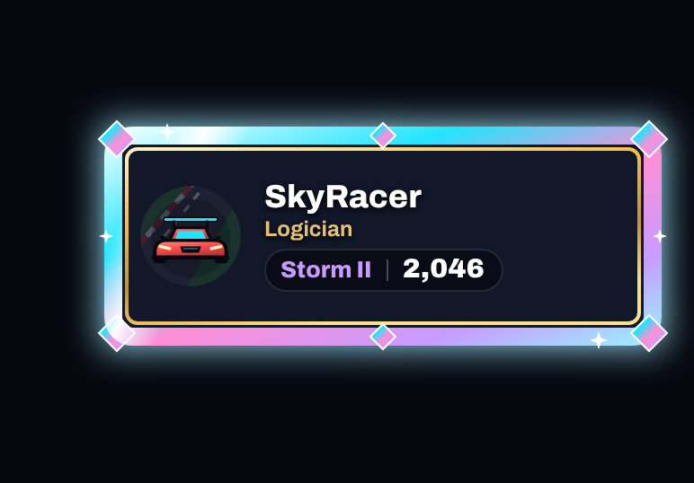 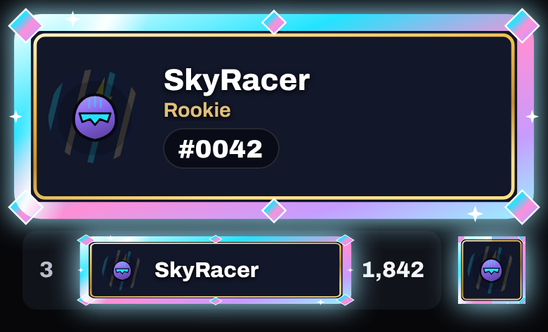

## Founding

`frame.founding` · Earned: Founding Player · no rarity

**🟠 Improve** — Earned; beautiful on the card, but on the 44 px nameplate strip the 'FOUNDER #0042' plaque is unreadable and the bolt tabs run into the score. *Premium would be:* A strip variant: no plaque text (or a small bolt mark) and nothing outside the strip's box.

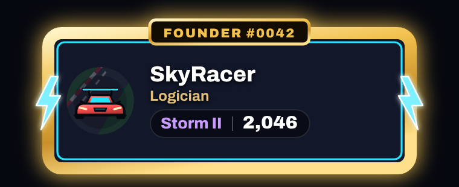 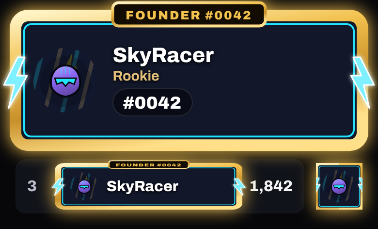

## Top 500

`frame.top-500` · Earned: Top 500 · no rarity

**🟠 Improve** — Earned, but its plaque shows the sample's fixed 'TOP 500 #214' (not the player's place), the crown is cut off at the top, and on the strip it covers the score. *Premium would be:* Draw the player's own place (or no number), keep the crown inside the card's box, and a strip variant that stays inside the name area. Nothing grants it yet.

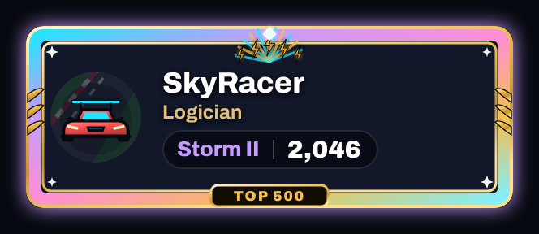 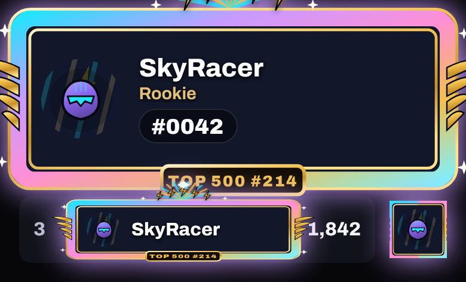

## Neon Circuit

`frame.neon-circuit` · Pass, premium track, level 34 · Elite

**✅ Keep** — Elite (premium level 34): animated neon tubes; strong.

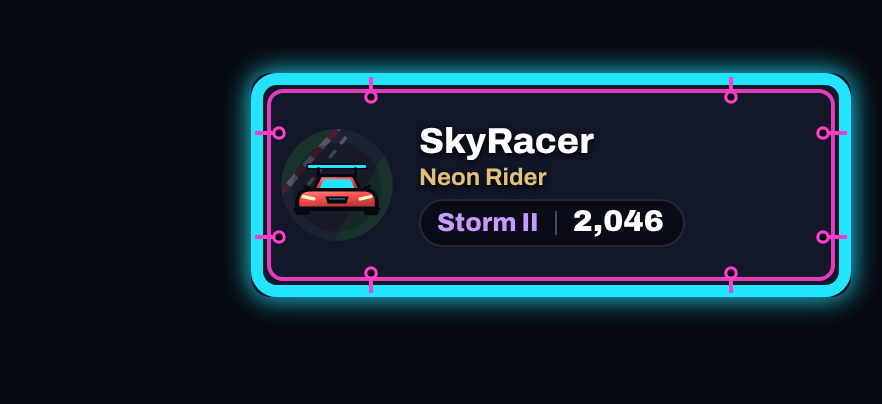 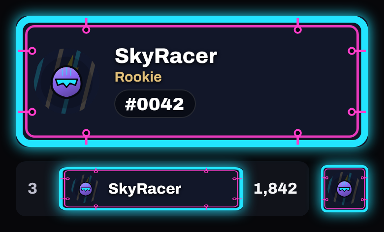

## Championship

`frame.championship` · Earned: Championship · no rarity

**⛔ Withdraw** · 🚧 **PLACEHOLDER** — PLACEHOLDER: no art at all; equipping it draws the Plain frame. *Premium would be:* Draw it (animated, the most prestigious frame) before any Championship is held; until then don't grant it.

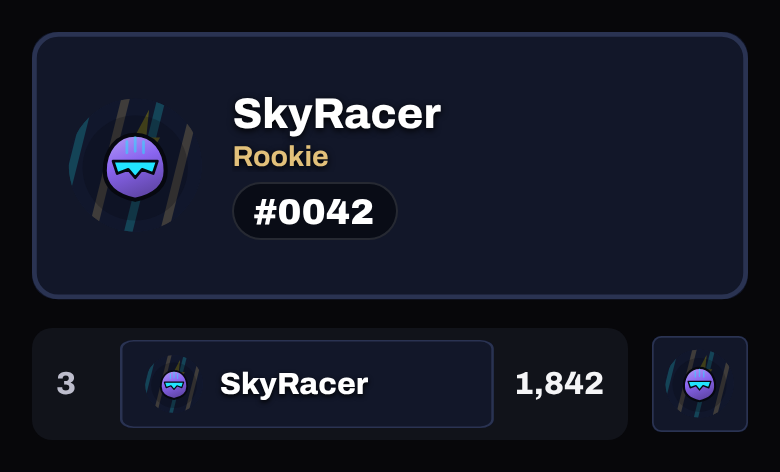

## Season 1 Spark

`frame.s1-spark` · Earned: season peak tier · no rarity

**🟠 Improve** · 🚧 **PLACEHOLDER** — PLACEHOLDER art (a generated metal outline with a 'SEASON 1' tab); the tab is unreadable on the strip. *Premium would be:* Draw the seven Season 1 frames as a set, each with its tier's emblem; the tab hidden on the strip.

 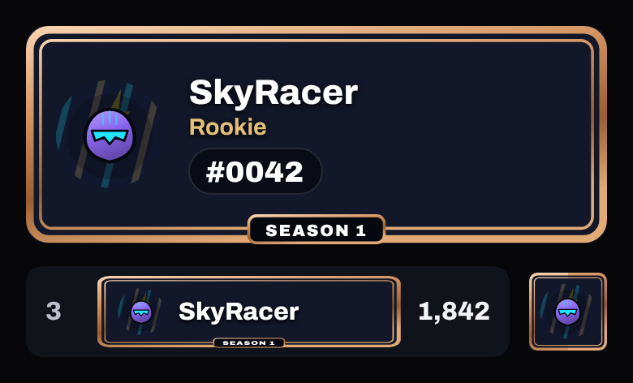

## Season 1 Charge

`frame.s1-charge` · Earned: season peak tier · no rarity

**🟠 Improve** · 🚧 **PLACEHOLDER** — PLACEHOLDER art. *Premium would be:* As Spark.

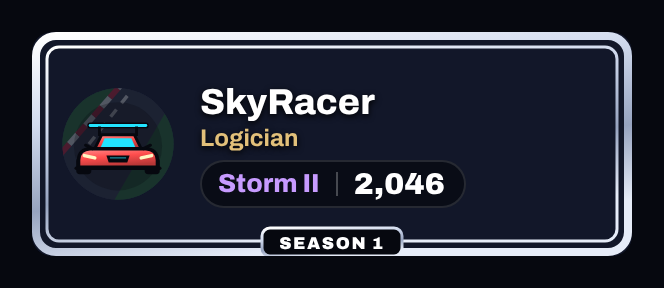 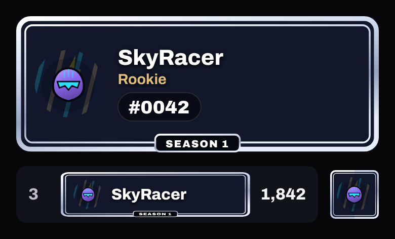

## Season 1 Volt

`frame.s1-volt` · Earned: season peak tier · no rarity

**🟠 Improve** · 🚧 **PLACEHOLDER** — PLACEHOLDER art. *Premium would be:* As Spark.

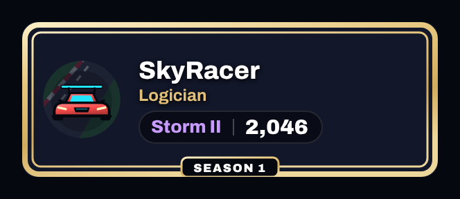 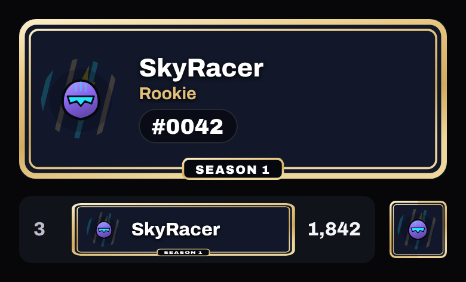

## Season 1 Surge

`frame.s1-surge` · Earned: season peak tier · no rarity

**🟠 Improve** · 🚧 **PLACEHOLDER** — PLACEHOLDER art. *Premium would be:* As Spark.

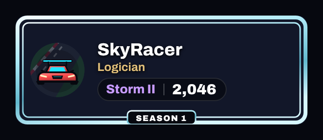 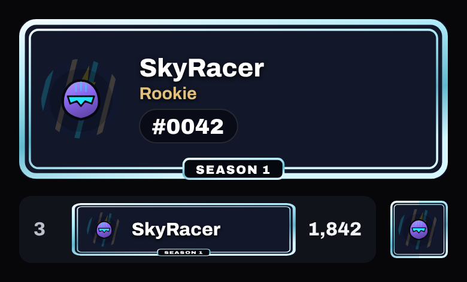

## Season 1 Storm

`frame.s1-storm` · Earned: season peak tier · no rarity

**🟠 Improve** · 🚧 **PLACEHOLDER** — PLACEHOLDER art. *Premium would be:* As Spark.

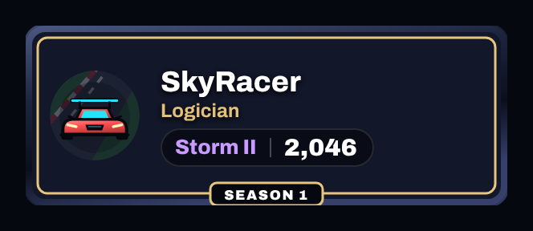 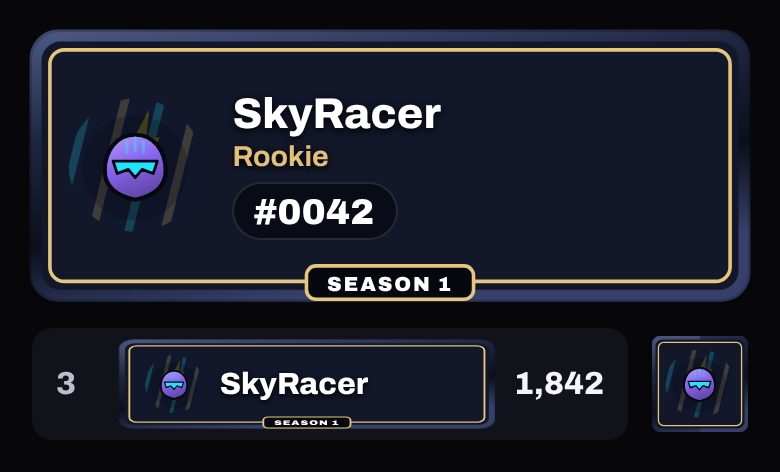

## Season 1 Lightning

`frame.s1-lightning` · Earned: season peak tier · no rarity

**🟠 Improve** · 🚧 **PLACEHOLDER** — PLACEHOLDER art. *Premium would be:* As Spark.

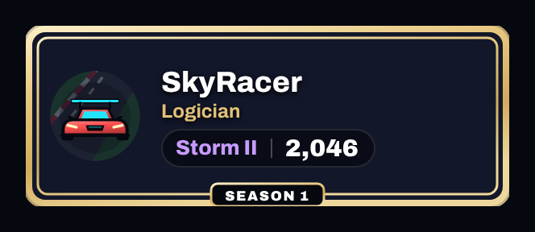 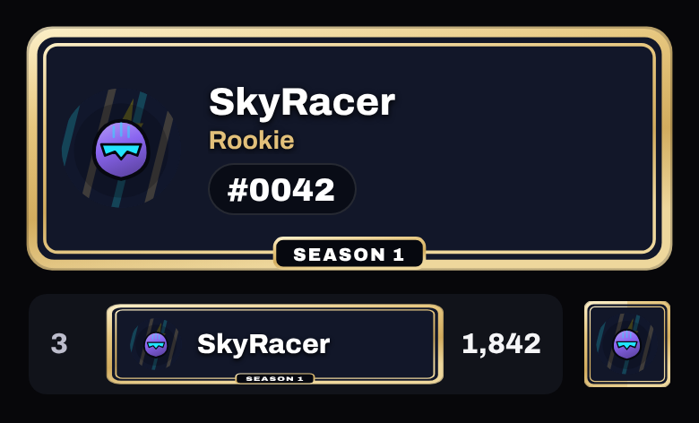

## Season 1 Top 500

`frame.s1-top-500` · Earned: season peak tier · no rarity

**🟠 Improve** · 🚧 **PLACEHOLDER** — PLACEHOLDER art. *Premium would be:* As Spark.

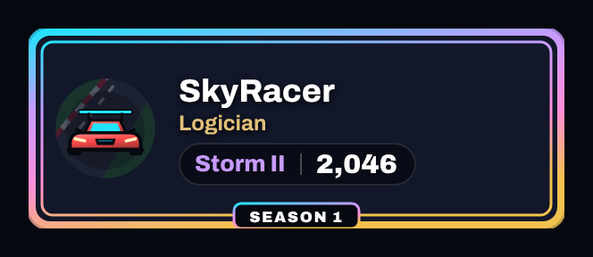 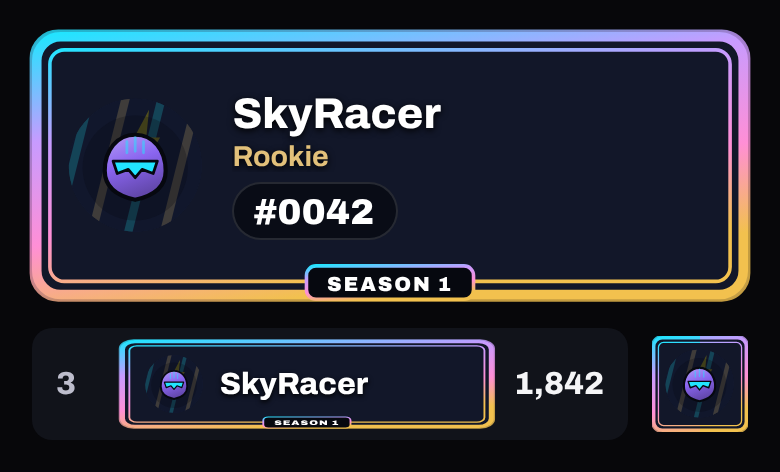
