# Name colours

[← Gallery](../GALLERY.md)

## Gold Leaf

`name-colour.gold-leaf` · Shop, 1,000 coins (Black and Gold bundle) · Epic

**✅ Keep** — Metallic gold with a dark edge; premium.

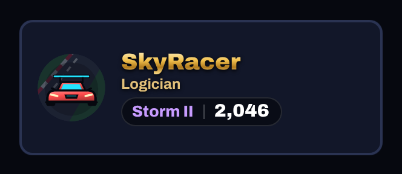 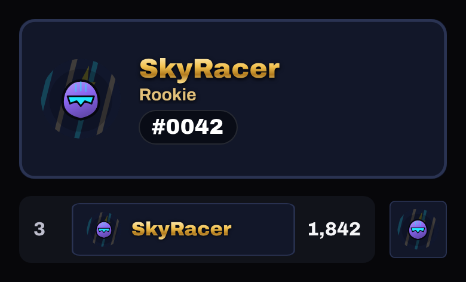

## Chrome

`name-colour.chrome` · Shop, 1,000 coins (Hologram bundle) · Epic

**🟠 Improve** — Epic at 1,000, but it reads as plain grey text at phone size. *Premium would be:* A real chrome gradient (bright top, dark band, bright bottom) with a white glint.

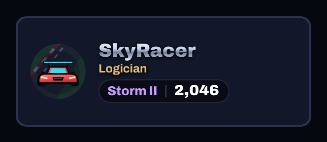 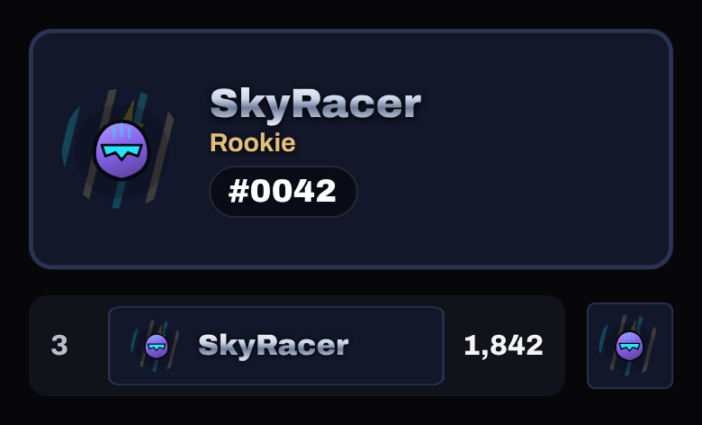

## Sapphire

`name-colour.sapphire` · Shop, 1,000 coins (Retro Arcade bundle) · Epic

**✅ Keep** — Blue metal with a deep shadow; fine.

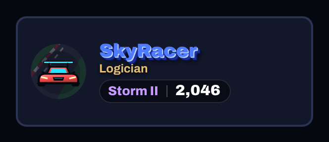 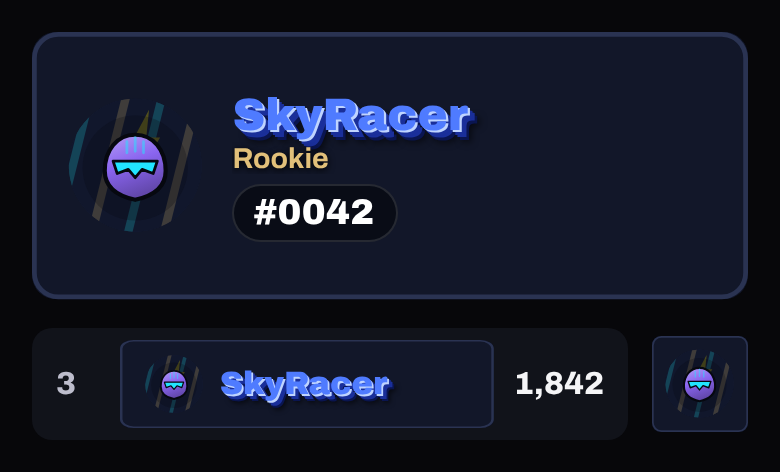

## Amethyst

`name-colour.amethyst` · Shop, 1,600 coins (Hologram bundle) · Elite

**✅ Keep** — Violet glow; fine.

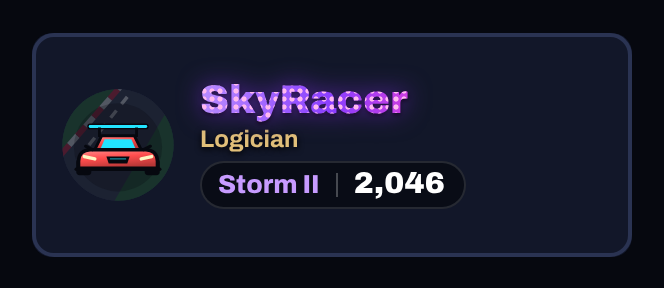 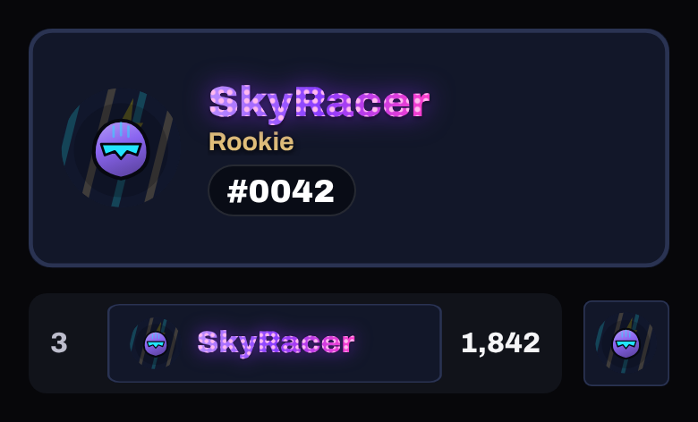

## Emerald Glow

`name-colour.emerald-glow` · Shop, 1,600 coins (City Lights bundle) · Elite

**✅ Keep** — Green neon outline; good.

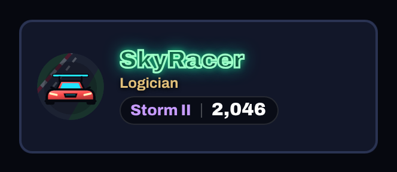 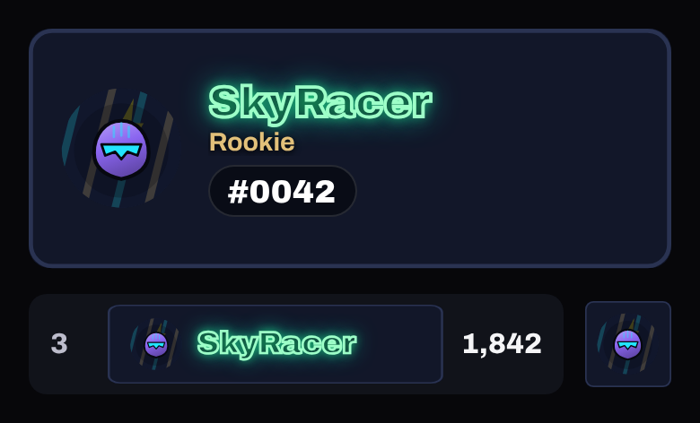

## Prism

`name-colour.prism` · Shop, 2,800 coins (Hologram bundle) · Legendary

**✅ Keep** — Legendary rainbow gradient (animated); strong.

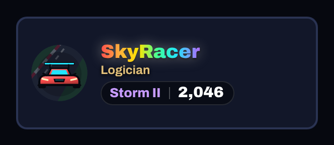 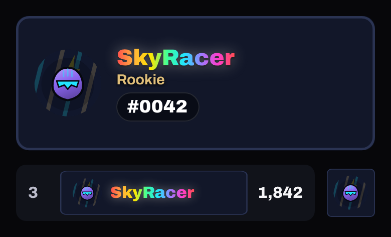

## Neon Pink

`name-colour.neon-pink` · Pass, free track, level 10 · Common

**🟠 Improve** — Free level 10 Common: a flat pink fill, the same as a plain colour. *Premium would be:* A neon tube look: a light core with a pink glow, as Emerald Glow does.

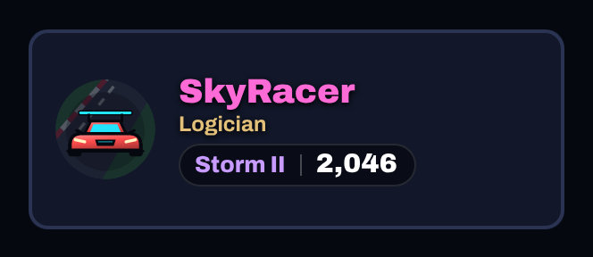 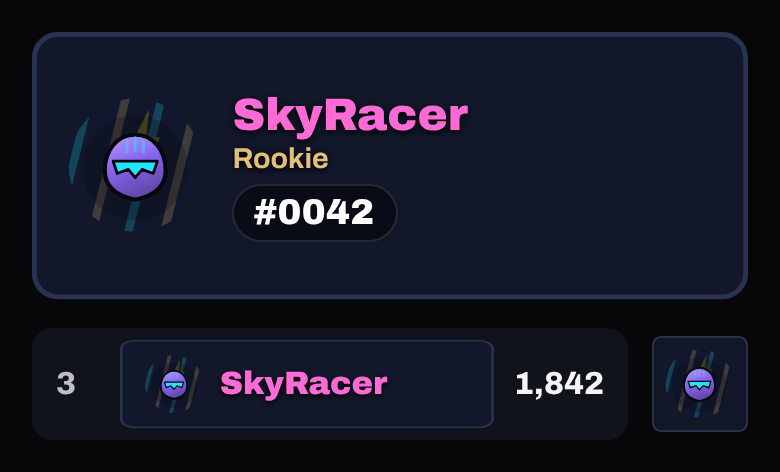

## Neon Cyan

`name-colour.neon-cyan` · Pass, premium track, level 3 · Rare

**🟠 Improve** — Premium level 3 Rare: a flat cyan fill. *Premium would be:* As Neon Pink: a glowing tube.

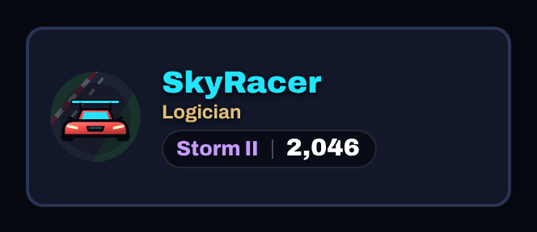 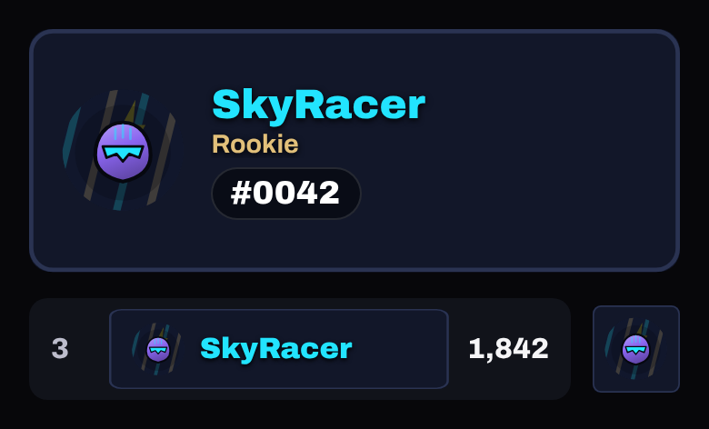

## Neon Red

`name-colour.neon-red` · Pass, premium track, level 18 · Rare

**🟠 Improve** — Premium level 18 Rare: a flat red fill; red names also read as 'error'. *Premium would be:* A glowing tube in a warmer red-orange.

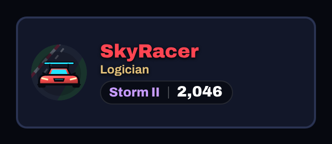 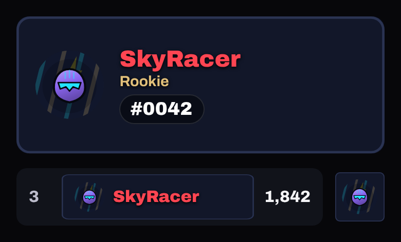

## Electric Orange

`name-colour.electric-orange` · Pass, premium track, level 35 · Epic

**🟠 Improve** — The pixel font (Silkscreen) becomes hard to read on the 44 px strip and long names lose letters. *Premium would be:* Keep the orange glow in the normal font, or keep pixels only on the full card.

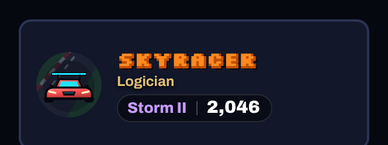 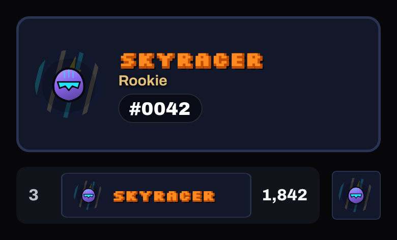

## Neon Flux

`name-colour.neon-flux` · Pass, premium track, level 20 · Legendary

**✅ Keep** — Legendary: animated neon shift; strong.

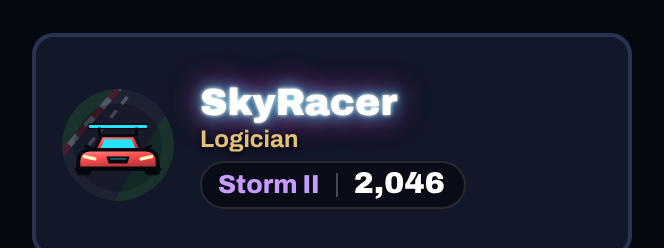 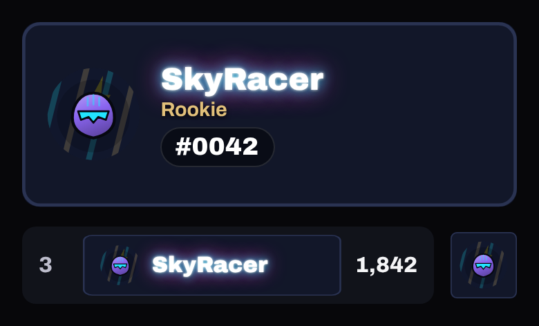
