# Reactions (emotes)

[← Gallery](../GALLERY.md)

## Banter

`reaction.banter` · Shop, 1,000 coins (Big Night bundle) · Epic

**✅ Keep** — Four clear stickers; readable at chat size.

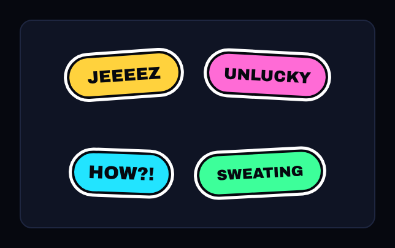 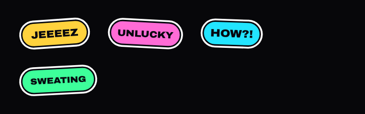

## Retro Arcade

`reaction.retro-arcade` · Shop, 1,000 coins (Retro Arcade bundle) · Epic

**🟠 Improve** — Epic at 1,000: four plain boxes with small pixel words ('GLHF' is hard to read). *Premium would be:* Fuller pixel stickers (coin, 1UP, heart) with colour and a pixel shadow.

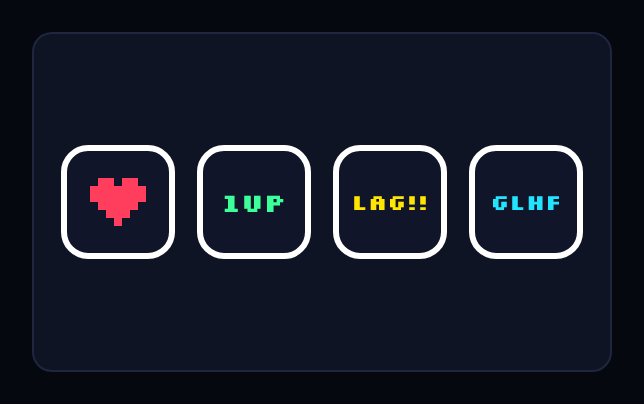 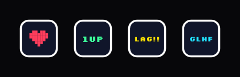

## Captain's Calls

`reaction.captains-calls` · Shop, 1,000 coins (Big Night bundle) · Epic

**🟠 Improve** — Epic at 1,000: plain white speech bubbles with ~7 px text; the cheapest-looking pack. *Premium would be:* Captain Joulz himself in each sticker (the approved ready and win poses) with a short line.

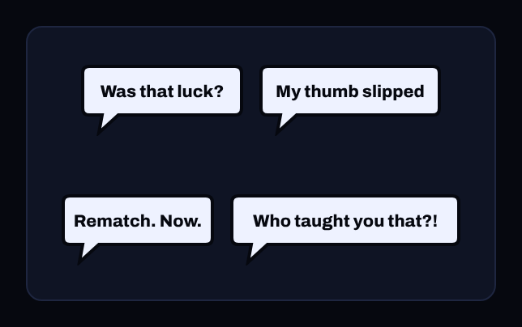 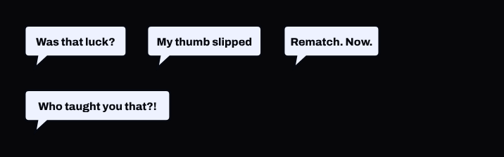

## Holo Stickers

`reaction.holo-stickers` · Shop, 1,600 coins (Hologram bundle) · Elite

**✅ Keep** — Elite: holographic stickers; good.

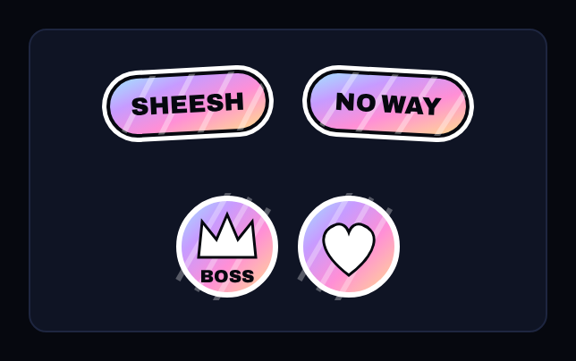 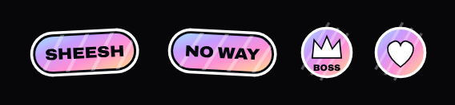

## Spark

`reaction.spark` · Pass, free track, level 22 · Common

**🟠 Improve** — Free level 22: a 'pack' of a single star. *Premium would be:* Two to four emotes per pack, or call it a single emote.

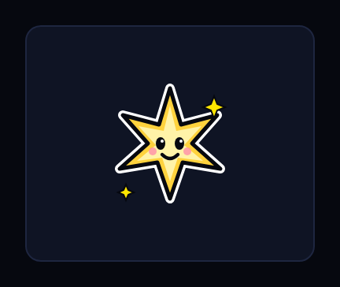 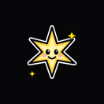

## Zap

`reaction.zap` · Pass, premium track, level 8 · Rare

**🟠 Improve** — Premium level 8: a single bolt. *Premium would be:* As Spark.

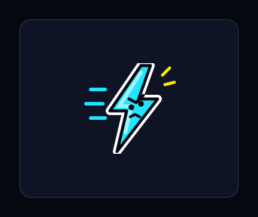 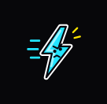

## Clutch

`reaction.clutch` · Pass, premium track, level 28 · Rare

**🟠 Improve** — Premium level 28: one sticker. *Premium would be:* As Spark.

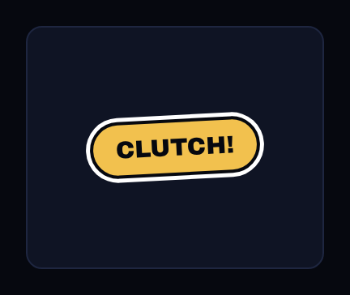 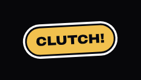

## Neon Signs

`reaction.neon-signs` · Pass, premium track, level 22 · Epic

**🟠 Improve** — 'BRB CRYING' is unreadable at 34 px; the signs' text is thin. *Premium would be:* Shorter words and thicker neon strokes so each reads at chat size.

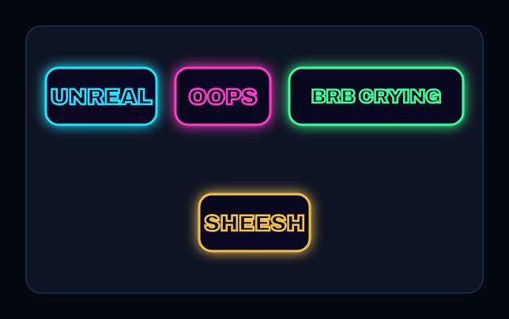 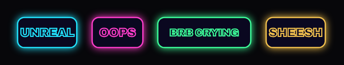

## Live Wire

`reaction.live-wire` · Pass, premium track, level 49 · Elite

**✅ Keep** — Elite: animated electric words; strong.

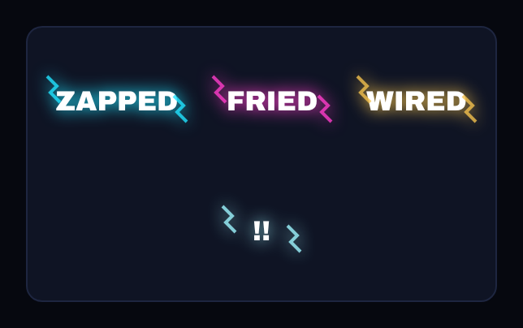 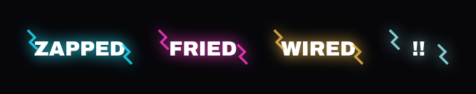
