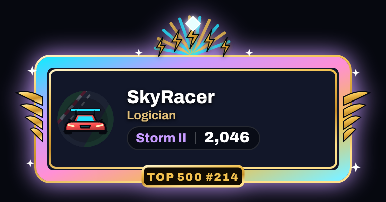
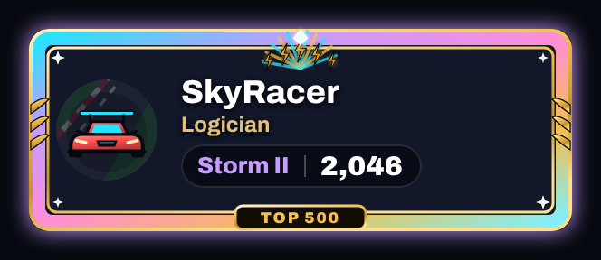
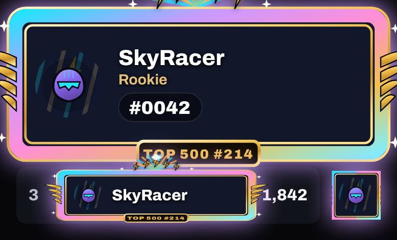
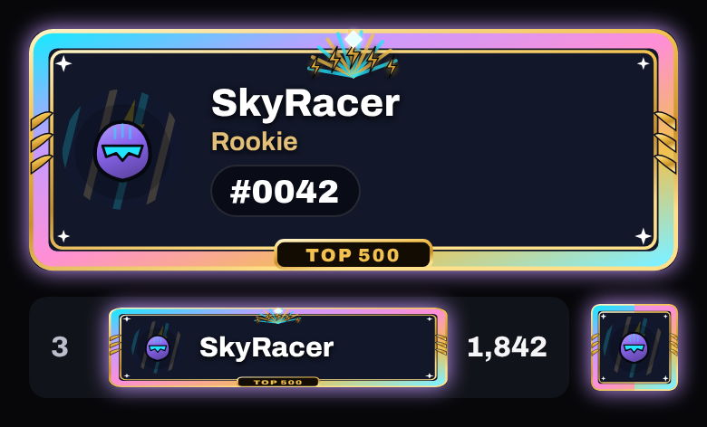
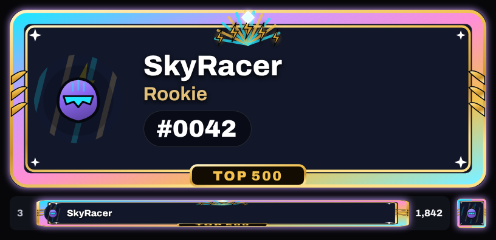
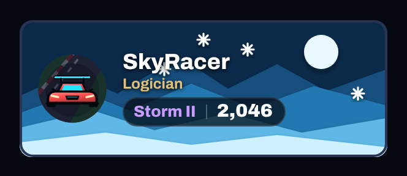
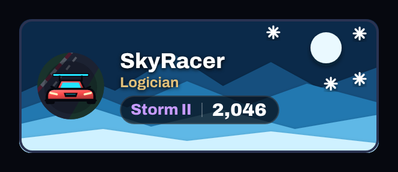
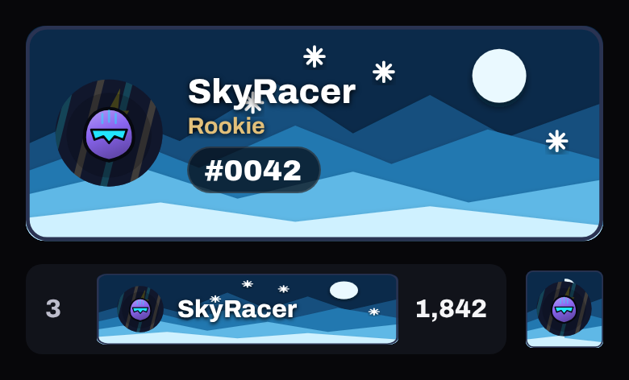
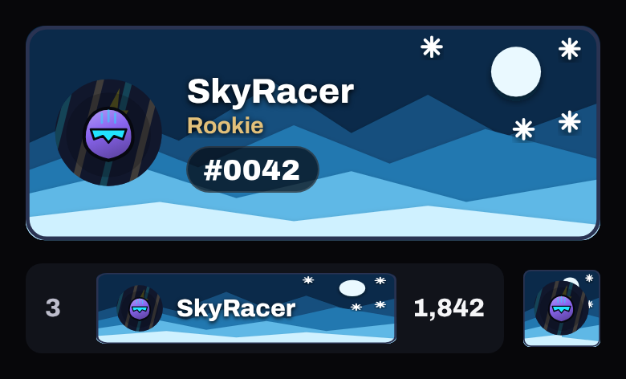
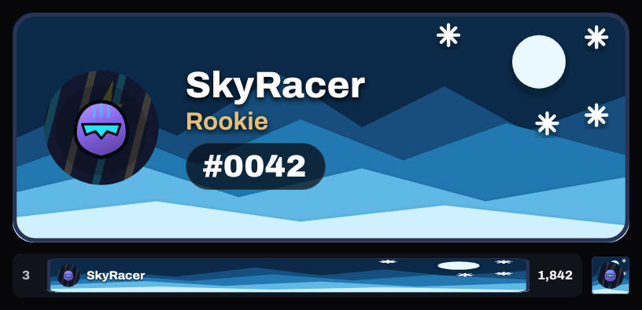

# Redrawn for approval (13 Nov 2026)

[← Gallery](../GALLERY.md)

Two items redrawn on the build PR (both still **withdrawn** until Joe approves restoring them; restoring is one line,
`SELECT economy.restore_item('<id>', '<note>');`). Each shows the approved still before and after, then the item in the
app at phone size (Profile card, a board row's nameplate strip, the Friends mini card) before and after.

## Top 500 frame

`frame.top-500` · Earned (given with the Top 500 badge once restored) · no rarity

Redrawn inside the card's 300 × 112 box: the crown and its rays on the top band, the laurel wings and sparkles inside
the sides and corners, the plaque on the bottom band reading **TOP 500** (no sample number; the player's own place
waits for the overhaul). Nothing reaches past the strip into the score any more.

**Still, before**  

**Still, after**  

**In the app, before**  

**In the app, after**  

**In the app, after, 1440 × 900**  

## Frost card art

`card-art.frost` · Shop, 1,600 coins (Frozen Lake bundle) · Elite

The snowflakes and moon moved to the right, so nothing is drawn through the name; the mountains are unchanged.

**Still, before**  

**Still, after**  

**In the app, before**  

**In the app, after**  

**In the app, after, 1440 × 900**  
