# Components step: review gallery

Phase 2, step 2a (14 Nov 2026). Phone size, 390 × 844, palette-compressed (465 KB in all). Drawn by
`bun scripts/shots/components-review-shots.ts --tag=before|after` on the screen harness (the real screens, network
stubbed) and packed by `python3 -I scripts/shots/components-review-pack.py`. "Before" is main at 7bf200f.

## The components sheet

Every shared component in every state (default, hover, pressed, focus, disabled, loading), from
`src/design/ComponentsGallery.tsx`. The light sheet uses the guide's light tokens inside the gallery's own scope; the
light theme for the whole app is step 2b.

| Dark | Light |
|---|---|
| 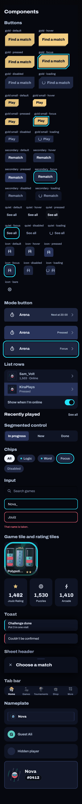 | 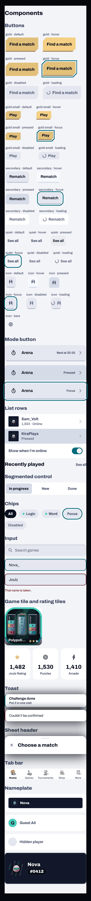 |

## Settings: sound and volume

The sound switches and the two volume sliders; a player who never set them gets sound effects 100 % and music 80 %.

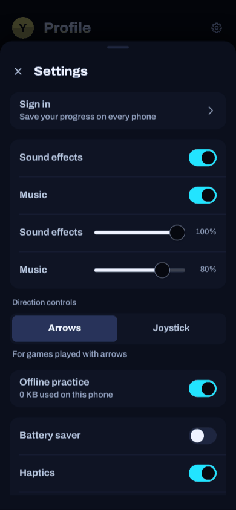

## Before and after

Headers now show only the avatar and the page title (no wordmark, no sound controls); buttons are flat champagne on
their ledge; section headers use the Heading role; cards are flat panels.

| Screen | Before | After |
|---|---|---|
| Home | 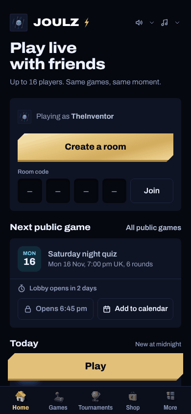 | 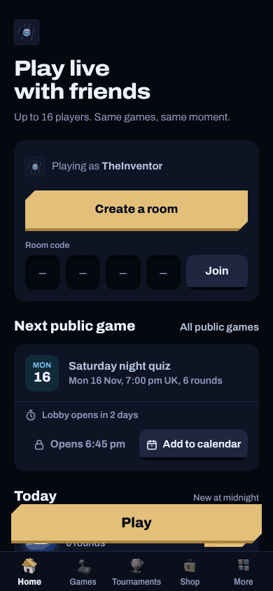 |
| Games | 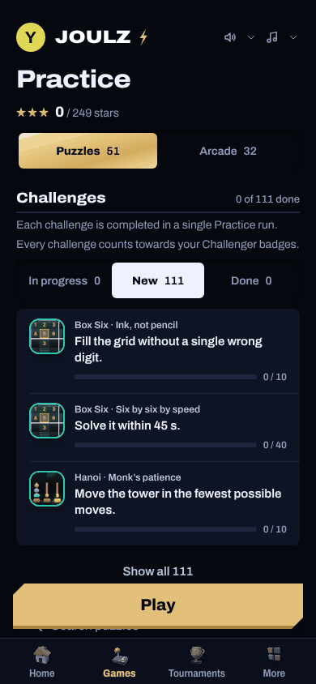 | 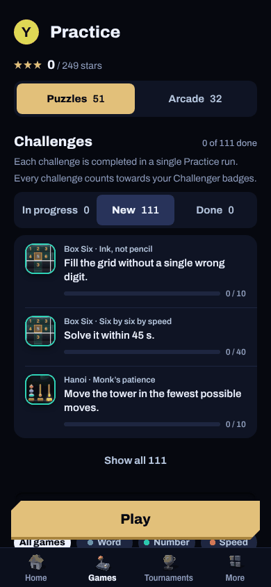 |
| Profile | 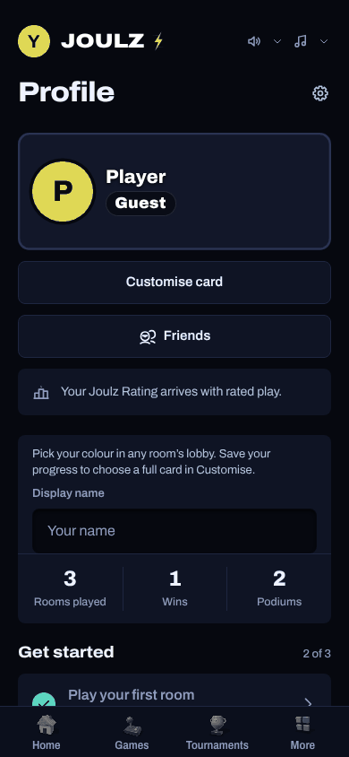 | 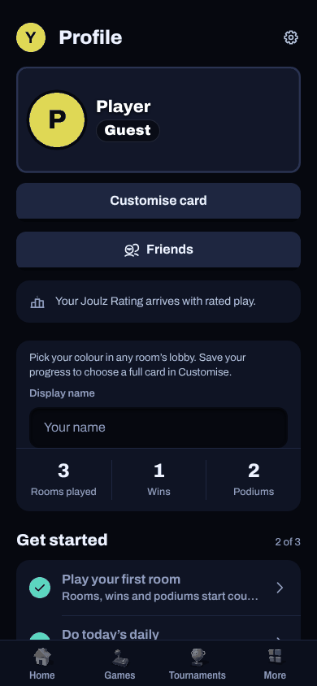 |
| Shop | 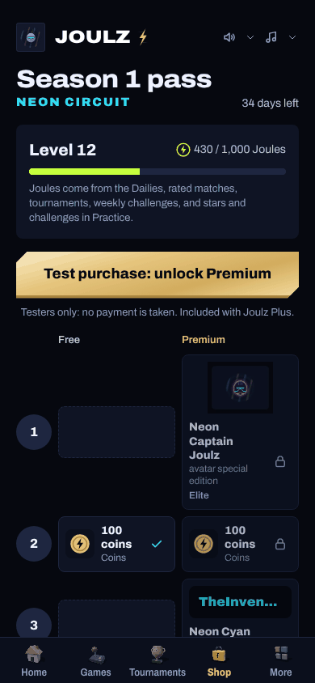 | 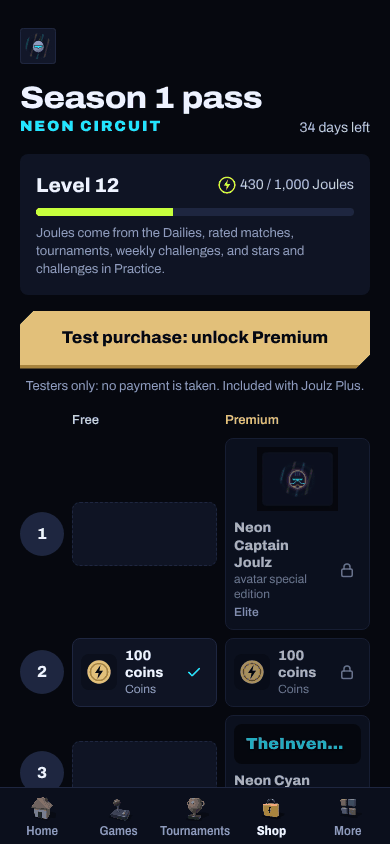 |
| More | 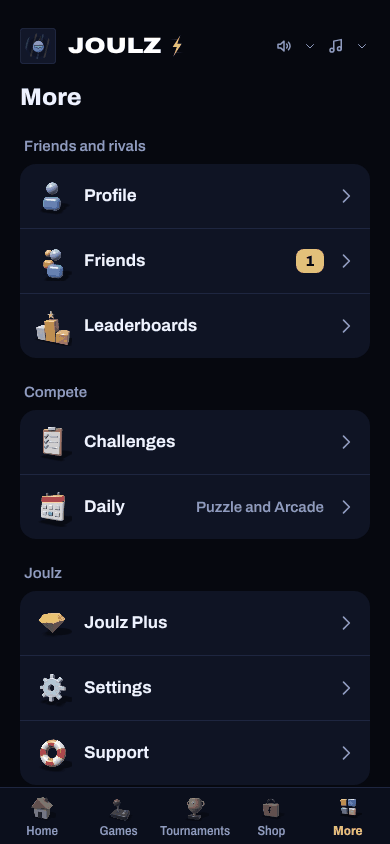 | 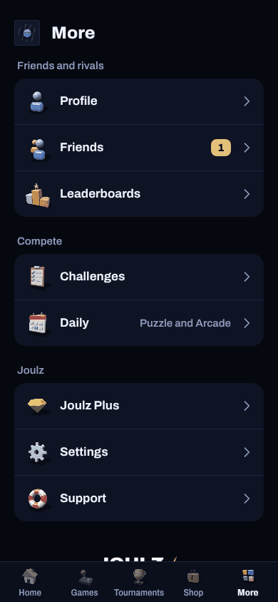 |
| Room lobby | 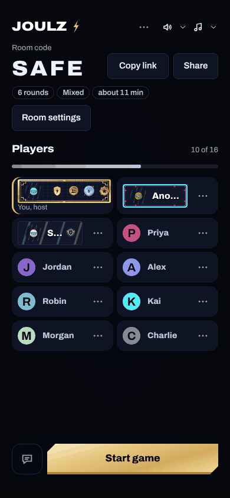 | 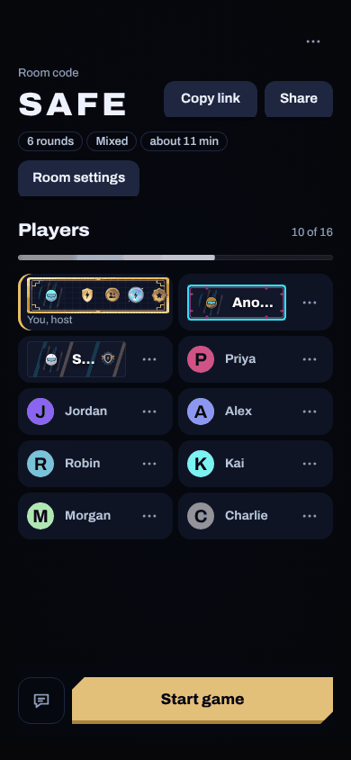 |
| Results | 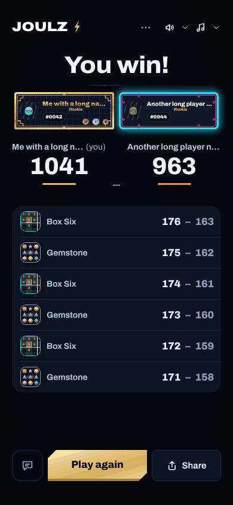 | 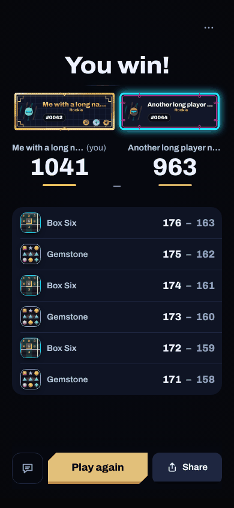 |
