# Cosmetics audit (phase 2 step 4, 15 Nov 2026)

Joe's rule: everything offered must look premium; anything that doesn't isn't offered. Every cosmetic is judged
against that rule and the art kit's finish (docs/design/style-guide/STYLE-GUIDE.md, "Art kit": one gloss material,
one key light from the top left, a soft contact shadow; no flat SVG for anything the kit can render). Starting point:
the cosmetics review (draft PR #389, its verdicts in [review-389.json](review-389.json)); where this audit differs it
says so. Thumbnails are today's art. The redraws, before and after: [GALLERY.md](GALLERY.md).

**Counts.** Catalogue (118 items): **75 redraw, 43 keep** (the review's 72 not-Keep items, plus
Crimson, Emerald and the Lightning tier art). Every cosmetic in all (adding 32 avatars, 10 gems, 54 badges,
15 trophies, medals and emblems, and 41 titles): **75 redraw, 195 keep**.

“Status” is today's: *withdrawn* items are not sold or given (docs/economy/withdrawn.md) and stay withdrawn; nothing
here changes what is offered, owned or priced.

## Card arts (32)

| | Item | Verdict | Why |
|---|---|---|---|
|  | **Joulz Navy**  `card-art.joulz-navy`  no rarity · free starter · withdrawn | **Redraw** | The default every new player wears: a flat navy panel with nothing on it.  Redraw: A subtle navy-to-ink gradient with a faint bolt watermark and a soft top sheen, so even the default card feels finished. |
| 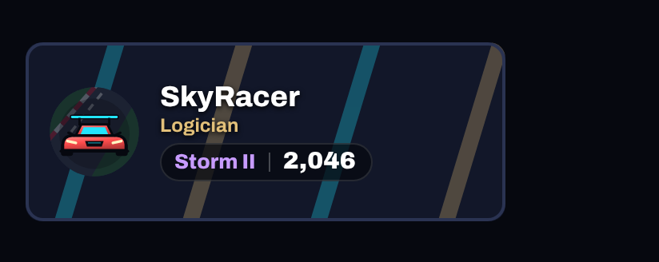 | **Bolt Stripes**  `card-art.bolt-stripes`  no rarity · free starter · withdrawn | **Redraw** | Two thin diagonal stripes on navy; reads as unfinished at phone size.  Redraw: Bolder, glowing bolt stripes with depth (a darker under-stripe) and a light sweep. |
| 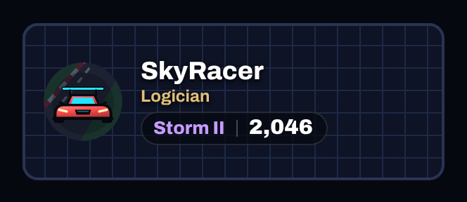 | **Grid**  `card-art.grid`  no rarity · free starter · withdrawn | **Redraw** | A faint 1 px grid that nearly disappears on a phone.  Redraw: A perspective grid (horizon glow) rather than a flat one; doubles as a 'starter neon' look. |
| 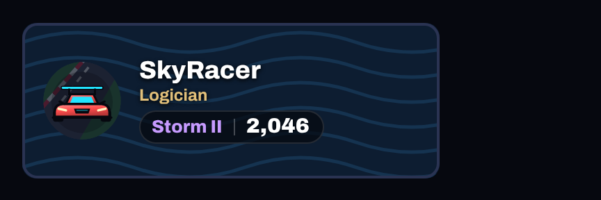 | **Waves**  `card-art.waves`  no rarity · free starter · withdrawn | **Redraw** | Thin outline waves at low contrast; looks like a placeholder texture.  Redraw: Layered filled waves with a gradient, like a night sea; keep the name area calm. |
| 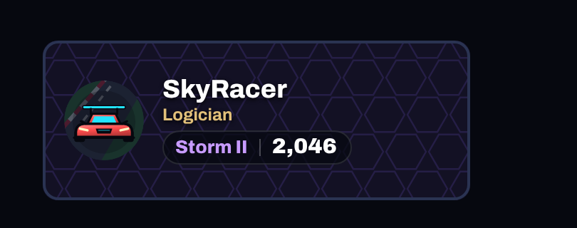 | **Hexes**  `card-art.hexes`  no rarity · free starter · withdrawn | **Redraw** | Faint hex outlines, barely visible.  Redraw: Raised hex tiles with a soft bevel and a few lit cells. |
| 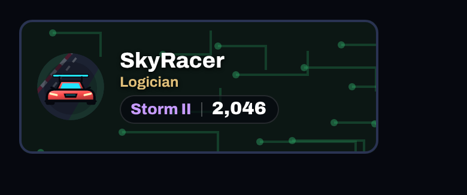 | **Circuit**  `card-art.circuit`  no rarity · free starter · live | **Keep** | Readable green traces with nodes; a decent free design. |
| 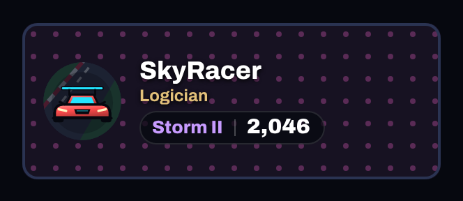 | **Dots**  `card-art.dots`  no rarity · free starter · withdrawn | **Redraw** | A dot grid at very low contrast; disappears on the strip.  Redraw: A halftone fade (big dots to small) in a brand colour. |
| 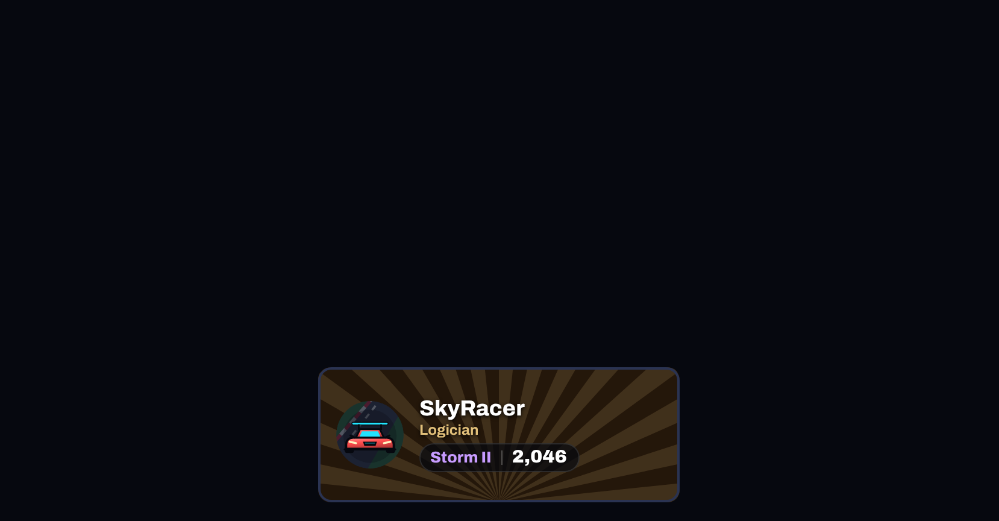 | **Sunburst**  `card-art.sunburst`  no rarity · free starter · withdrawn | **Redraw** | Muddy brown rays; looks dated rather than premium.  Redraw: Gold rays on deep navy with a glow at the centre, so it matches the brand gold. |
| 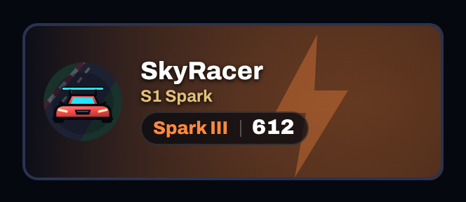 | **Spark**  `card-art.tier.spark`  no rarity · earned season peak tier · withdrawn | **Redraw** | Flat brown panel with one bolt; the lowest tier looks drab rather than bronze.  Redraw: A bronze metal finish (gradient, edge sheen) behind the bolt; the six tiers should step up in finish, not just hue. |
| 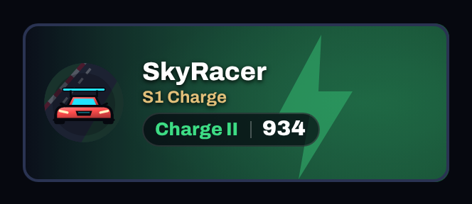 | **Charge**  `card-art.tier.charge`  no rarity · earned season peak tier · withdrawn | **Redraw** | Flat green panel with a single bolt; very close to its siblings.  Redraw: Give each tier its own finish step (bronze → silver → gold → platinum → obsidian → diamond) as the rarity ladder does. |
| 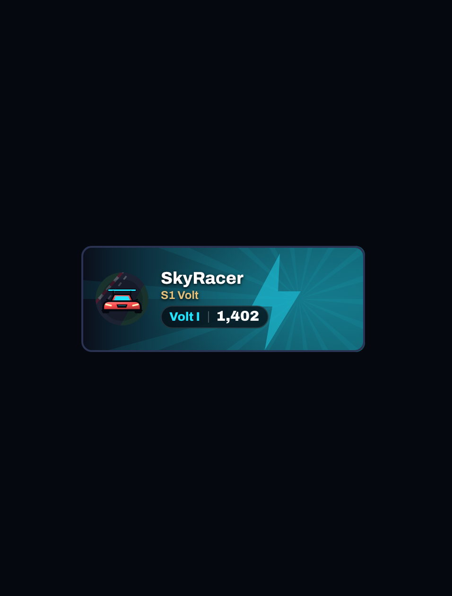 | **Volt**  `card-art.tier.volt`  no rarity · earned season peak tier · withdrawn | **Redraw** | Same template, teal.  Redraw: As Charge: a distinct finish per tier. |
| 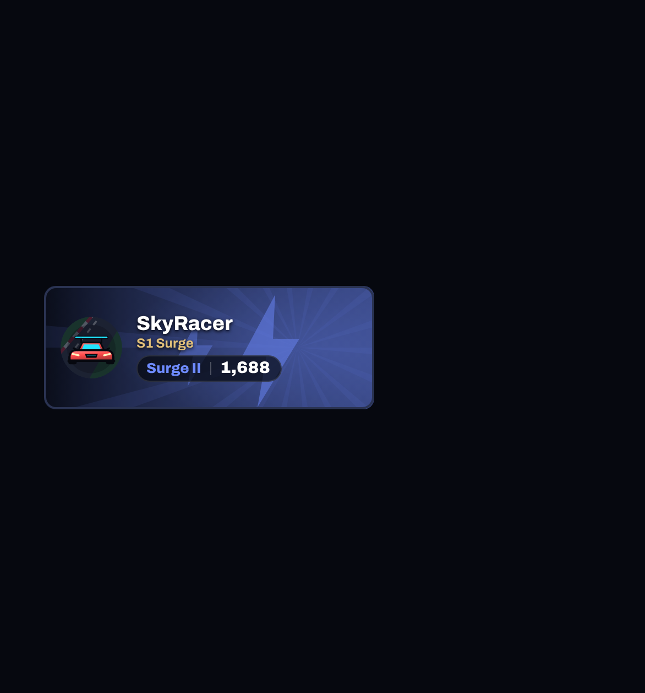 | **Surge**  `card-art.tier.surge`  no rarity · earned season peak tier · withdrawn | **Redraw** | Same template, blue.  Redraw: As Charge. |
| 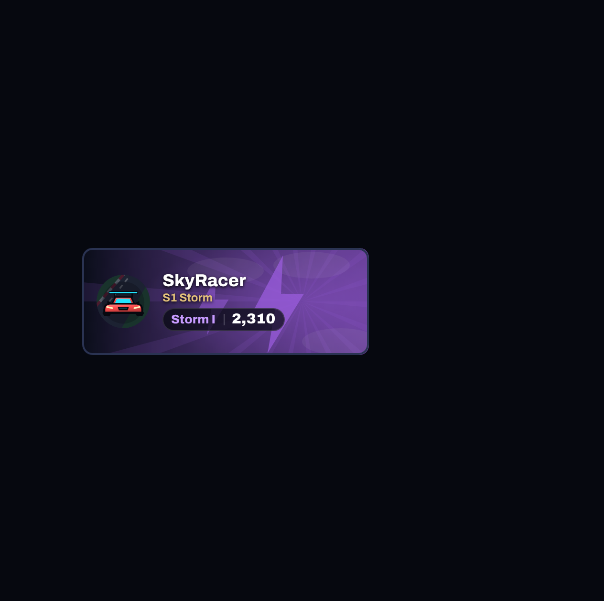 | **Storm**  `card-art.tier.storm`  no rarity · earned season peak tier · withdrawn | **Redraw** | Same template, purple.  Redraw: As Charge. |
| 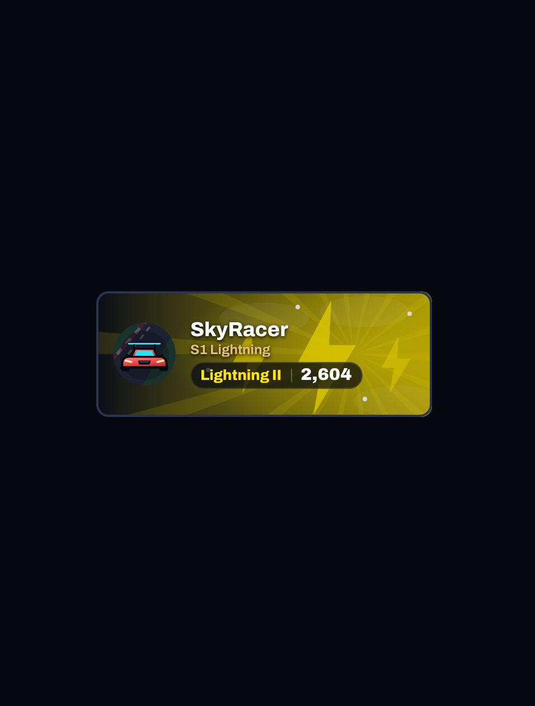 | **Lightning**  `card-art.tier.lightning`  no rarity · earned season peak tier · live | **Redraw** | Added by this audit: kept by the review, but the seven tier arts must be one set stepping up in finish; Lightning is the old flat template, so it is redrawn with its siblings. |
| 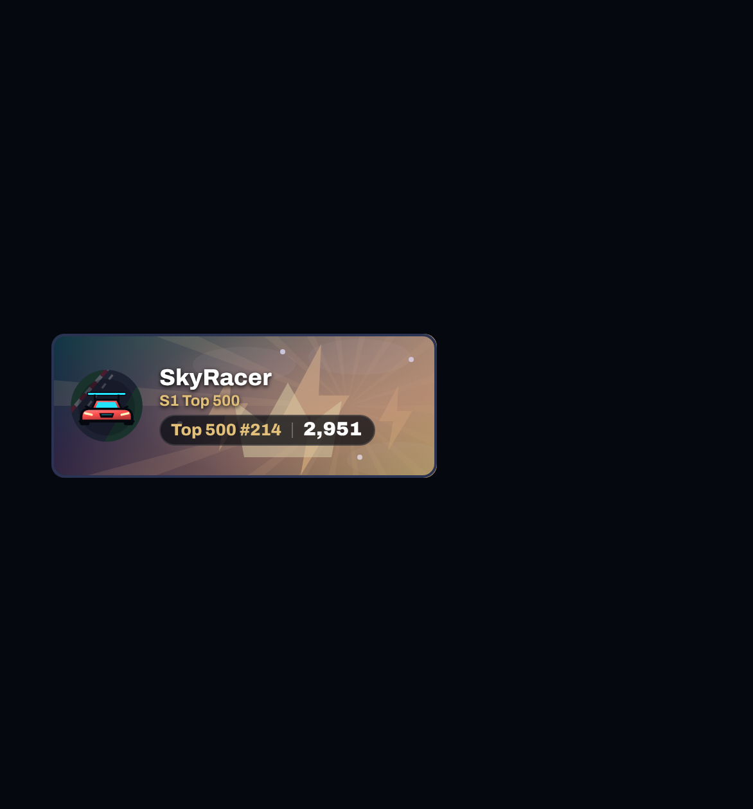 | **Top 500**  `card-art.tier.top-500`  no rarity · earned season peak tier · withdrawn | **Redraw** | The rarest card art is a washed-out beige; it looks less special than Lightning.  Redraw: The most prestigious art in the game: diamond-plate or prism finish, animated sheen, a crown mark. |
| 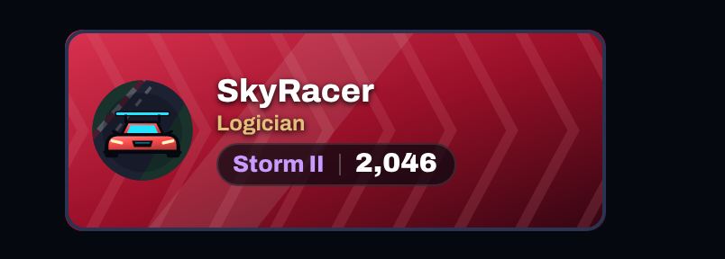 | **Crimson**  `card-art.crimson`  Epic · Shop, 1,000 coins · live | **Redraw** | Added by this audit: kept by the review, but it is two flat red chevrons at 1,000 coins; beside the art kit's 3D finish it reads as a free starter. |
| 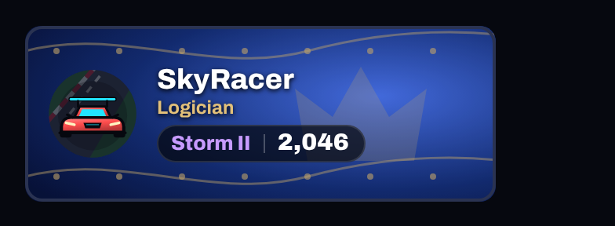 | **Royal**  `card-art.royal`  Epic · Shop, 1,000 coins · withdrawn | **Redraw** | The crown is a faint smudge behind the pill; at phone size it reads as a stain.  Redraw: A crisp gold crown outline and filigree border; keep the navy. |
| 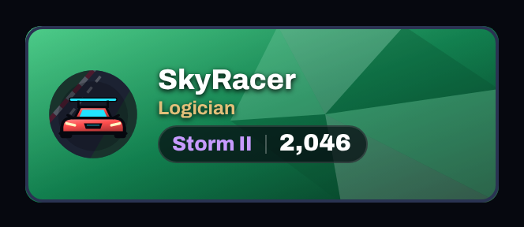 | **Emerald**  `card-art.emerald`  Epic · Shop, 1,000 coins · live | **Redraw** | Added by this audit: kept by the review, but a flat green panel with one diagonal at 1,000 coins; no depth, no light. |
| 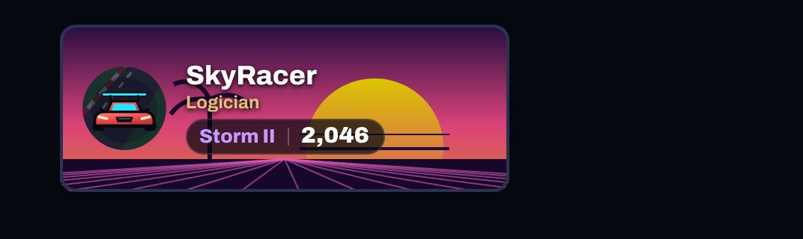 | **Sunset**  `card-art.sunset`  Epic · Shop, 1,000 coins · live | **Keep** | Clear synthwave sun and grid; strong at every size. |
| 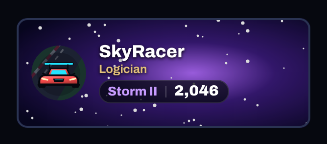 | **Galaxy**  `card-art.galaxy`  Epic · Shop, 1,000 coins · live | **Keep** | Deep nebula with stars; good. |
| 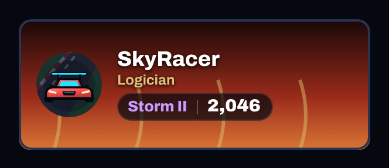 | **Lava**  `card-art.lava`  Epic · Shop, 1,000 coins · withdrawn | **Redraw** | A flat orange gradient with two faint arcs; Epic at 1,000 coins but looks like a free starter.  Redraw: Molten cracks with an inner glow over dark rock, ember specks. |
| 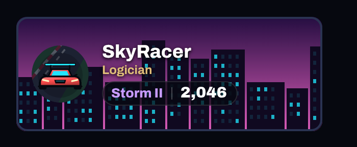 | **Neon City**  `card-art.neon-city`  Elite · Shop, 1,600 coins · live | **Keep** | Skyline with lit windows; good, the name stays readable. |
| 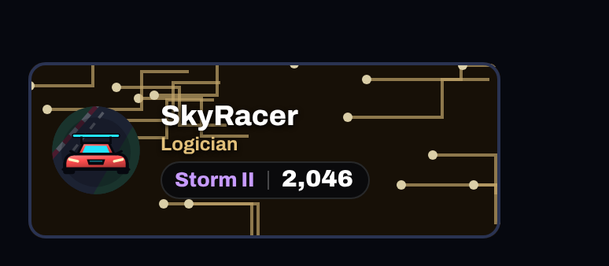 | **Gold Circuit**  `card-art.gold-circuit`  Elite · Shop, 1,600 coins · live | **Keep** | Gold traces on black; premium and on brand. |
| 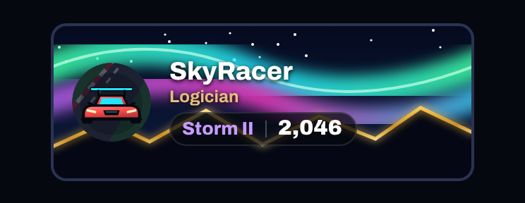 | **Aurora**  `card-art.aurora`  Legendary · Shop, 2,800 coins · live | **Keep** | Legendary: animated aurora over mountains; clearly the best of the shop's card arts. |
| 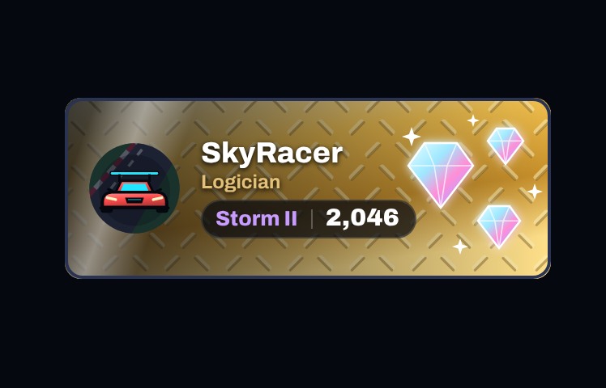 | **Diamond Plate**  `card-art.diamond-plate`  Legendary · Shop, 2,800 coins · withdrawn | **Redraw** | Legendary, but the diamonds are clip-art stickers over a gold tread plate and crowd the right side.  Redraw: Fewer, faceted diamonds set into the plate with real highlights; a slow light sweep across the plate. |
| 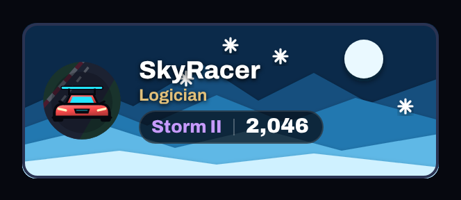 | **Frost**  `card-art.frost`  Elite · Shop, 1,600 coins · withdrawn | **Redraw** | A snowflake is drawn through the player's name ('Sky*Racer') and the moon competes with it.  Redraw: Move the flakes and moon to the right third, away from the name; keep the mountains. |
| 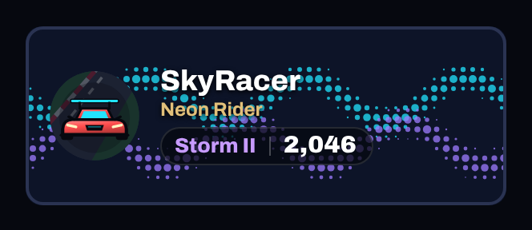 | **Neon Wave**  `card-art.neon-wave`  Rare · Pass free 32 · live | **Keep** | Free-track Rare: dotted neon waves, fine for its level. |
| 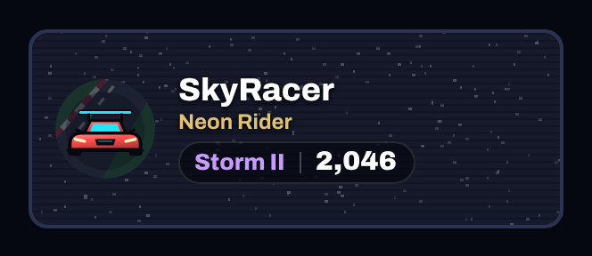 | **Static**  `card-art.static`  Rare · Pass premium 14 · withdrawn | **Redraw** | Premium level 14 Rare, but it is near-black noise you barely see on a phone.  Redraw: Visible TV static bands with a scan line and a little colour bleed. |
| 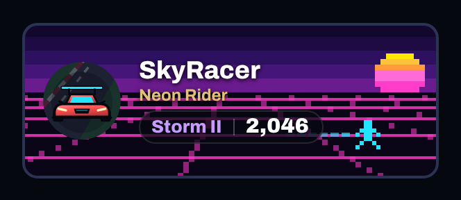 | **Grid Runner**  `card-art.grid-runner`  Epic · Pass premium 44 · live | **Keep** | Retro runner on a grid; good. |
| 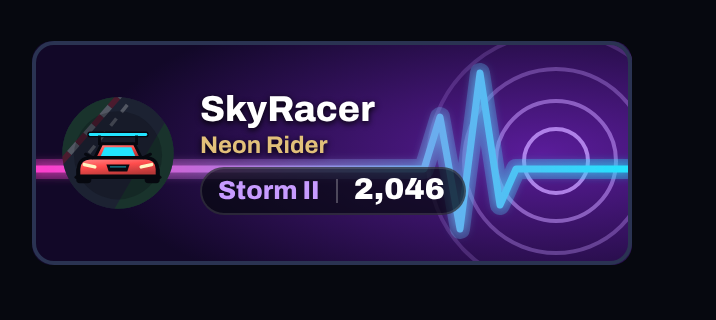 | **Neon Pulse**  `card-art.neon-pulse`  Elite · Pass premium 10 · live | **Keep** | Heartbeat line and rings; clean and on theme. |
| 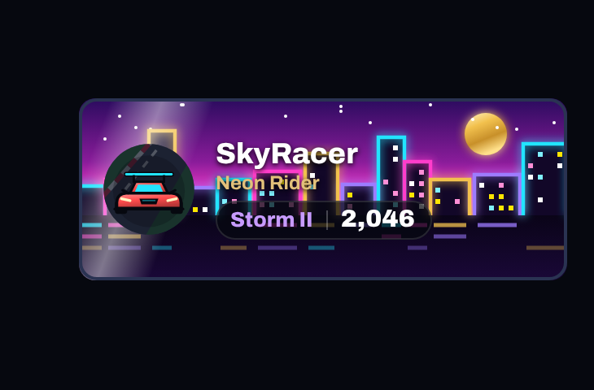 | **Neon Skyline**  `card-art.neon-skyline`  Legendary · Pass free 60 · withdrawn | **Redraw** | Legendary (free level 60): the buildings and lit windows run behind the name and title, which then read poorly.  Redraw: Keep the skyline to the right half or darken the left behind the name. |
| 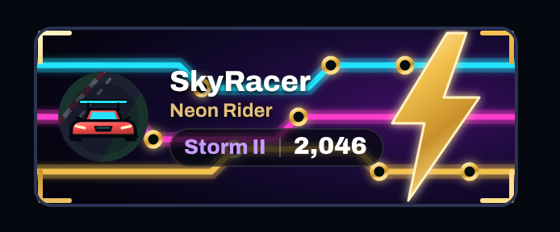 | **Neon Circuit**  `card-art.neon-circuit`  Legendary · Pass premium 60 · live | **Keep** | Legendary: bold neon circuit and bolt; strong. |

## Frames (17)

| | Item | Verdict | Why |
|---|---|---|---|
| 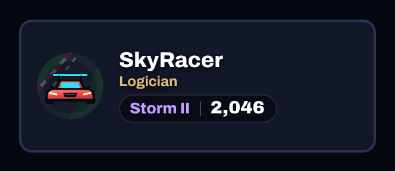 | **Plain**  `frame.plain`  no rarity · free starter · live | **Keep** | The default thin outline; correct for a default. |
| 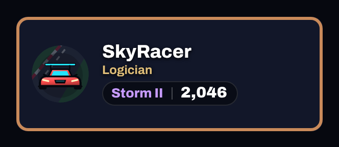 | **Bronze**  `frame.bronze`  Common · Pass free 6 · withdrawn | **Redraw** | A plain orange line (Common, free level 6); nothing says 'bronze'.  Redraw: A metal bronze bevel with small corner studs. |
| 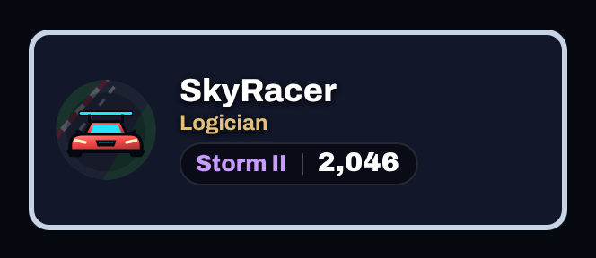 | **Silver**  `frame.silver`  Rare · Pass free 26 · withdrawn | **Redraw** | A plain grey line (Rare, free level 26).  Redraw: A brushed-silver bevel with a light sweep at the corners. |
| 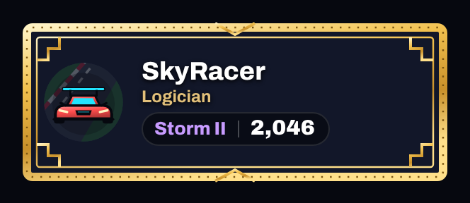 | **Gold**  `frame.gold`  Epic · Shop, 1,000 coins · live | **Keep** | Ornate gold with corner brackets; reads premium. |
| 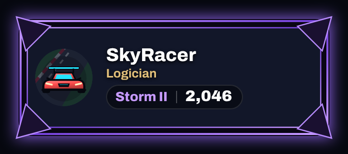 | **Obsidian**  `frame.obsidian`  Elite · Shop, 1,600 coins · withdrawn | **Redraw** | Elite at 1,600, but the triangle corners look like folded paper and the violet edge is faint.  Redraw: A glossy black frame with a crisp violet edge light and faceted corners. |
| 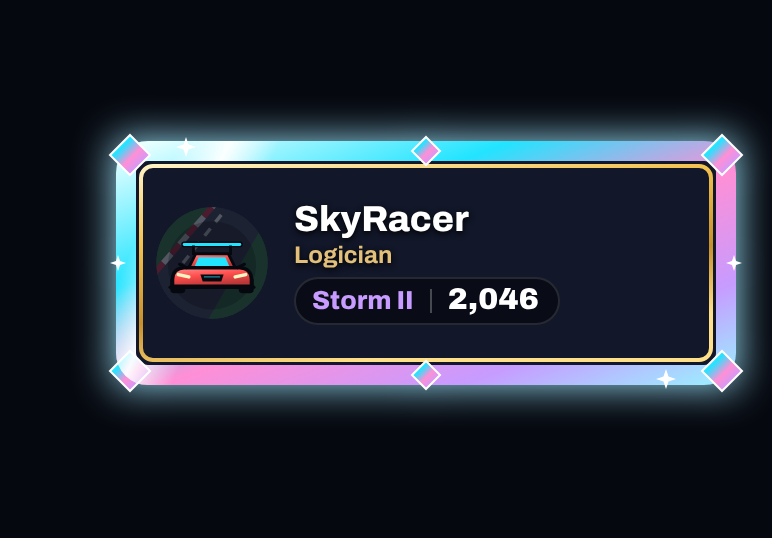 | **Diamond**  `frame.diamond`  Legendary · Shop, 2,800 coins · live | **Keep** | Legendary: prism edge with diamond corners; strong. |
| 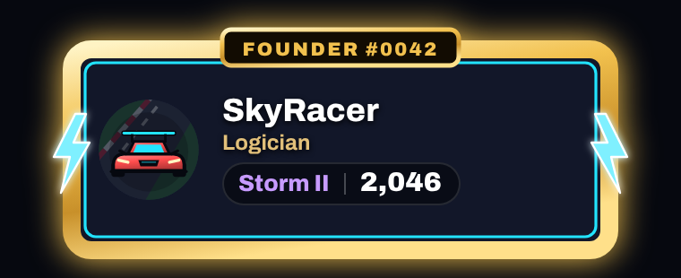 | **Founding**  `frame.founding`  no rarity · earned founding player · withdrawn | **Redraw** | Earned; beautiful on the card, but on the 44 px nameplate strip the 'FOUNDER #0042' plaque is unreadable and the bolt tabs run into the score.  Redraw: A strip variant: no plaque text (or a small bolt mark) and nothing outside the strip's box. |
| 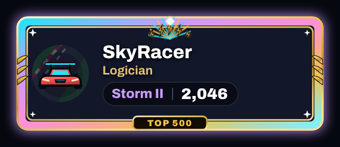 | **Top 500**  `frame.top-500`  no rarity · earned top 500 · withdrawn | **Redraw** | Earned, but its plaque shows the sample's fixed 'TOP 500 #214' (not the player's place), the crown is cut off at the top, and on the strip it covers the score.  Redraw: Draw the player's own place (or no number), keep the crown inside the card's box, and a strip variant that stays inside the name area. Nothing grants it yet. |
| 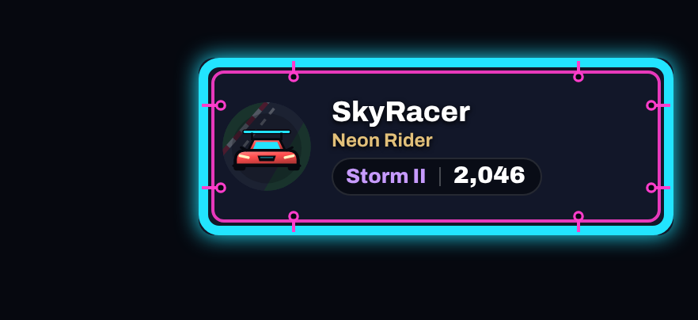 | **Neon Circuit**  `frame.neon-circuit`  Elite · Pass premium 34 · live | **Keep** | Elite (premium level 34): animated neon tubes; strong. |
| (no art: draws the Plain frame) | **Championship**  `frame.championship`  no rarity · tournament · withdrawn | **Redraw** | PLACEHOLDER: no art at all; equipping it draws the Plain frame.  Redraw: Draw it (animated, the most prestigious frame) before any Championship is held; until then don't grant it. |
|  | **Season 1 Spark**  `frame.s1-spark`  no rarity · earned season peak tier · withdrawn | **Redraw** | PLACEHOLDER art (a generated metal outline with a 'SEASON 1' tab); the tab is unreadable on the strip.  Redraw: Draw the seven Season 1 frames as a set, each with its tier's emblem; the tab hidden on the strip. |
| 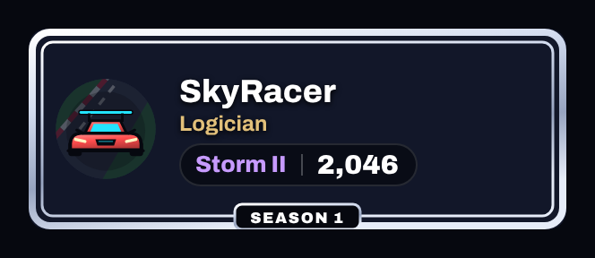 | **Season 1 Charge**  `frame.s1-charge`  no rarity · earned season peak tier · withdrawn | **Redraw** | PLACEHOLDER art.  Redraw: As Spark. |
| 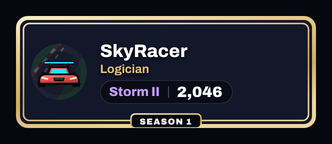 | **Season 1 Volt**  `frame.s1-volt`  no rarity · earned season peak tier · withdrawn | **Redraw** | PLACEHOLDER art.  Redraw: As Spark. |
| 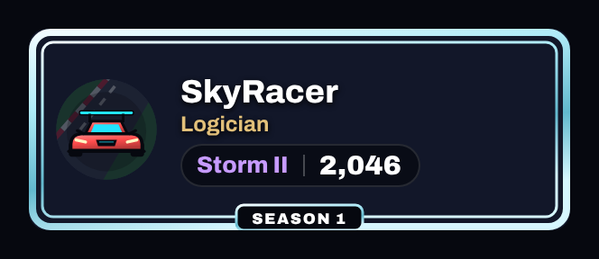 | **Season 1 Surge**  `frame.s1-surge`  no rarity · earned season peak tier · withdrawn | **Redraw** | PLACEHOLDER art.  Redraw: As Spark. |
| 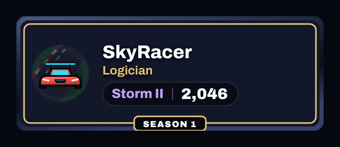 | **Season 1 Storm**  `frame.s1-storm`  no rarity · earned season peak tier · withdrawn | **Redraw** | PLACEHOLDER art.  Redraw: As Spark. |
| 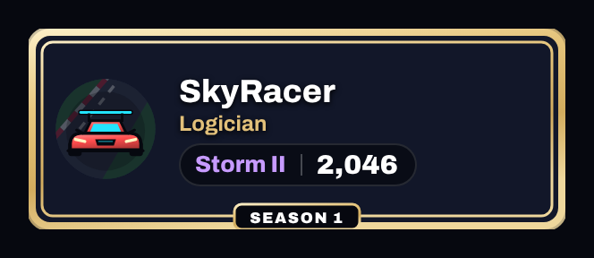 | **Season 1 Lightning**  `frame.s1-lightning`  no rarity · earned season peak tier · withdrawn | **Redraw** | PLACEHOLDER art.  Redraw: As Spark. |
| 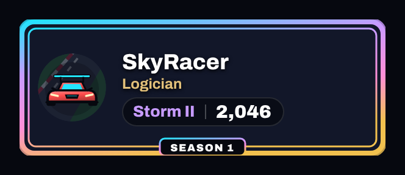 | **Season 1 Top 500**  `frame.s1-top-500`  no rarity · earned season peak tier · withdrawn | **Redraw** | PLACEHOLDER art.  Redraw: As Spark. |

## Name colours (11)

| | Item | Verdict | Why |
|---|---|---|---|
| 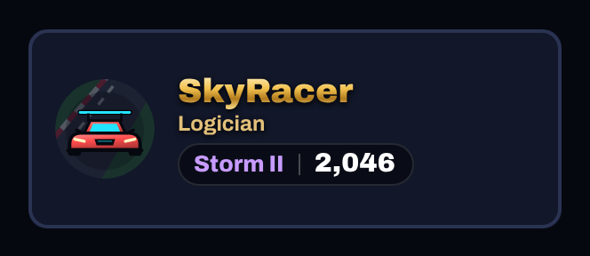 | **Gold Leaf**  `name-colour.gold-leaf`  Epic · Shop, 1,000 coins · live | **Keep** | Metallic gold with a dark edge; premium. |
| 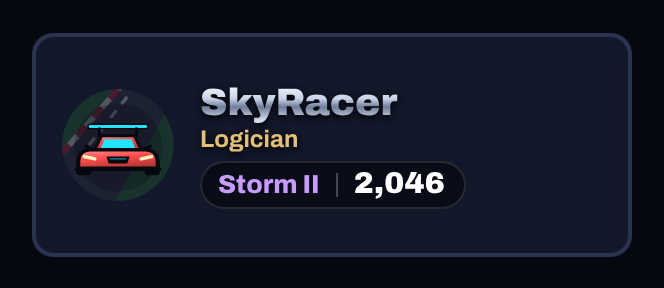 | **Chrome**  `name-colour.chrome`  Epic · Shop, 1,000 coins · withdrawn | **Redraw** | Epic at 1,000, but it reads as plain grey text at phone size.  Redraw: A real chrome gradient (bright top, dark band, bright bottom) with a white glint. |
| 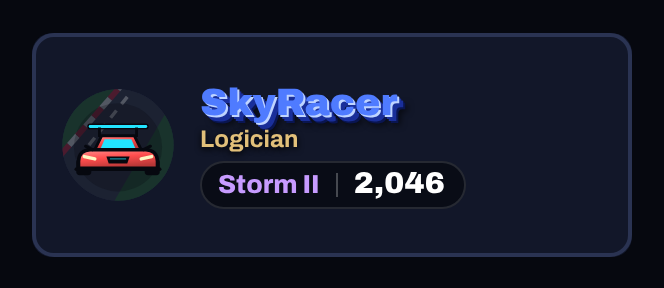 | **Sapphire**  `name-colour.sapphire`  Epic · Shop, 1,000 coins · live | **Keep** | Blue metal with a deep shadow; fine. |
| 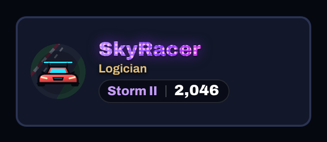 | **Amethyst**  `name-colour.amethyst`  Elite · Shop, 1,600 coins · live | **Keep** | Violet glow; fine. |
|  | **Emerald Glow**  `name-colour.emerald-glow`  Elite · Shop, 1,600 coins · live | **Keep** | Green neon outline; good. |
|  | **Prism**  `name-colour.prism`  Legendary · Shop, 2,800 coins · live | **Keep** | Legendary rainbow gradient (animated); strong. |
|  | **Neon Pink**  `name-colour.neon-pink`  Common · Pass free 10 · withdrawn | **Redraw** | Free level 10 Common: a flat pink fill, the same as a plain colour.  Redraw: A neon tube look: a light core with a pink glow, as Emerald Glow does. |
|  | **Neon Cyan**  `name-colour.neon-cyan`  Rare · Pass premium 3 · withdrawn | **Redraw** | Premium level 3 Rare: a flat cyan fill.  Redraw: As Neon Pink: a glowing tube. |
|  | **Neon Red**  `name-colour.neon-red`  Rare · Pass premium 18 · withdrawn | **Redraw** | Premium level 18 Rare: a flat red fill; red names also read as 'error'.  Redraw: A glowing tube in a warmer red-orange. |
|  | **Electric Orange**  `name-colour.electric-orange`  Epic · Pass premium 35 · withdrawn | **Redraw** | The pixel font (Silkscreen) becomes hard to read on the 44 px strip and long names lose letters.  Redraw: Keep the orange glow in the normal font, or keep pixels only on the full card. |
|  | **Neon Flux**  `name-colour.neon-flux`  Legendary · Pass premium 20 · live | **Keep** | Legendary: animated neon shift; strong. |

## Avatar finishes (7)

| | Item | Verdict | Why |
|---|---|---|---|
|  | **Chrome**  `avatar-finish.chrome`  Epic · Shop, 1,000 coins · withdrawn | **Redraw** | On the card the avatar is ~70 px and the finish changes a small helmet disc; Chrome, Pearl gem and Diamond gem look almost the same.  Redraw: A finish should change the whole avatar (body and scene) with a visible material: reflections for Chrome. |
|  | **Carbon**  `avatar-finish.carbon`  Epic · Shop, 1,000 coins · withdrawn | **Redraw** | Reads as 'dark avatar'; the weave is invisible at card size.  Redraw: A larger, higher-contrast weave and a red accent line. |
|  | **Comic Ink**  `avatar-finish.comic-ink`  Epic · Shop, 1,000 coins · live | **Keep** | Bold outline and halftone read even small; distinctive. |
|  | **Holographic**  `avatar-finish.holographic`  Elite · Shop, 1,600 coins · withdrawn | **Redraw** | Elite: a pastel tint, easily mistaken for a gem colour.  Redraw: A moving rainbow foil (still under Reduce Motion) across the whole avatar. |
|  | **Wireframe**  `avatar-finish.wireframe`  Elite · Shop, 1,600 coins · live | **Keep** | Elite: cyan wireframe reads clearly and looks special. |
|  | **Lightning Core**  `avatar-finish.lightning-core`  Legendary · Shop, 2,800 coins · live | **Keep** | Legendary: ring and sparks; clearly the top finish. |
|  | **Neon Glow**  `avatar-finish.neon-glow`  Elite · Pass premium 40 · withdrawn | **Redraw** | Premium level 40: a pink glow round a small disc.  Redraw: A glow round the whole avatar silhouette, plus a neon rim. |

## Avatar accessory (1)

| | Item | Verdict | Why |
|---|---|---|---|
|  | **Neon Bolt**  `avatar-accessory.neon-bolt`  Epic · Pass premium 52 · withdrawn | **Redraw** | Premium level 52: a tiny bolt over the head; at card size it is a few pixels.  Redraw: Larger (within the avatar box), glowing, and drawn on every avatar shape the same way. |

## Avatar special edition (1)

| | Item | Verdict | Why |
|---|---|---|---|
|  | **Neon Captain Joulz**  `avatar-special-edition.neon-captain-joulz`  Elite · Pass premium 1 · live | **Keep** | Premium level 1 (the pass's headline): pink neon helmet; distinctive. |

## Reaction packs (9)

| | Item | Verdict | Why |
|---|---|---|---|
|  | **Banter**  `reaction.banter`  Epic · Shop, 1,000 coins · live | **Keep** | Four clear stickers; readable at chat size. |
|  | **Retro Arcade**  `reaction.retro-arcade`  Epic · Shop, 1,000 coins · withdrawn | **Redraw** | Epic at 1,000: four plain boxes with small pixel words ('GLHF' is hard to read).  Redraw: Fuller pixel stickers (coin, 1UP, heart) with colour and a pixel shadow. |
|  | **Captain's Calls**  `reaction.captains-calls`  Epic · Shop, 1,000 coins · withdrawn | **Redraw** | Epic at 1,000: plain white speech bubbles with ~7 px text; the cheapest-looking pack.  Redraw: Captain Joulz himself in each sticker (the approved ready and win poses) with a short line. |
|  | **Holo Stickers**  `reaction.holo-stickers`  Elite · Shop, 1,600 coins · live | **Keep** | Elite: holographic stickers; good. |
|  | **Spark**  `reaction.spark`  Common · Pass free 22 · withdrawn | **Redraw** | Free level 22: a 'pack' of a single star.  Redraw: Two to four emotes per pack, or call it a single emote. |
|  | **Zap**  `reaction.zap`  Rare · Pass premium 8 · withdrawn | **Redraw** | Premium level 8: a single bolt.  Redraw: As Spark. |
|  | **Clutch**  `reaction.clutch`  Rare · Pass premium 28 · withdrawn | **Redraw** | Premium level 28: one sticker.  Redraw: As Spark. |
|  | **Neon Signs**  `reaction.neon-signs`  Epic · Pass premium 22 · withdrawn | **Redraw** | 'BRB CRYING' is unreadable at 34 px; the signs' text is thin.  Redraw: Shorter words and thicker neon strokes so each reads at chat size. |
|  | **Live Wire**  `reaction.live-wire`  Elite · Pass premium 49 · live | **Keep** | Elite: animated electric words; strong. |

## Celebrations (7)

| | Item | Verdict | Why |
|---|---|---|---|
|  | **Confetti Pop**  `celebration.confetti-pop`  Epic · Shop, 1,000 coins · live | **Keep** | Bright confetti; reads at once. |
|  | **Spotlight**  `celebration.spotlight`  Epic · Shop, 1,000 coins · withdrawn | **Redraw** | Epic at 1,000: two faint grey cones; most players won't notice it.  Redraw: Warm stage spotlights with dust in the beams and a sweep onto the winner. |
|  | **Fireworks**  `celebration.fireworks`  Elite · Shop, 1,600 coins · live | **Keep** | Elite: clear bursts; good. |
|  | **Shockwave**  `celebration.shockwave`  Elite · Shop, 1,600 coins · withdrawn | **Redraw** | Elite at 1,600: three thin rings; looks unfinished.  Redraw: A visible energy ring with distortion and sparks, in the brand gold. |
|  | **Gold Rush**  `celebration.gold-rush`  Legendary · Shop, 2,800 coins · live | **Keep** | Legendary: coins and crown; strong. |
|  | **Power Surge**  `celebration.power-surge`  Legendary · Pass premium 30 · live | **Keep** | Legendary: lightning and stage glow; strong. |
|  | **Circuit Overload**  `celebration.circuit-overload`  Elite · Pass premium 58 · withdrawn | **Redraw** | Elite (premium level 58, the podium entrance): two flat lines; weak for the pass's late levels.  Redraw: Traces that light up along the podium with nodes flashing, ending in a burst. |

## Tile styles (6)

| | Item | Verdict | Why |
|---|---|---|---|
|  | **Brushed Gold**  `tile-style.brushed-gold`  Epic · Shop, 1,000 coins · live | **Keep** | Gold border; clearly a paid look. |
|  | **Blueprint**  `tile-style.blueprint`  Epic · Shop, 1,000 coins · live | **Keep** | Blue border and grid; distinctive. |
|  | **Obsidian Glass**  `tile-style.obsidian-glass`  Elite · Shop, 1,600 coins · live | **Keep** | Violet glass edge; good. |
|  | **Circuit Trace**  `tile-style.circuit-trace`  Common · Pass free 16 · withdrawn | **Redraw** | Free level 16: almost identical to the plain tile.  Redraw: Visible traces across the tile's border. |
|  | **Neon Dots**  `tile-style.neon-dots`  Rare · Pass premium 38 · live | **Keep** | Pink neon dotted edge; fine. |
|  | **Neon Grid**  `tile-style.neon-grid`  Epic · Pass premium 7 · live | **Keep** | Cyan glow; fine. |

## Card backs (3)

| | Item | Verdict | Why |
|---|---|---|---|
|  | **Royal Damask**  `card-back.royal-damask`  Epic · Shop, 1,000 coins · live (restored 13 Nov) | **Redraw** | A handsome back, but today it shows only in Full House (practice only since 1 Nov), on one small card.  Redraw: Show backs in more games (section 5) before selling it; the art itself can stay. |
|  | **Holo Foil**  `card-back.holo-foil`  Elite · Shop, 1,600 coins · live (restored 13 Nov) | **Redraw** | Elite at 1,600: attractive, but seen only in Full House practice.  Redraw: As Royal Damask. |
|  | **Neon card back**  `card-back.neon`  Epic · Pass premium 4 · live (restored 13 Nov) | **Redraw** | Premium level 4: seen only in Full House practice.  Redraw: As Royal Damask. |

## Game skins (20)

| | Item | Verdict | Why |
|---|---|---|---|
|  | **Midnight Felt**  `game-skin.full-house.midnight-felt`  Epic · Shop, 1,000 coins · withdrawn | **Redraw** | Full House is retired from rooms (practice only); a 1,000-coin table for a practice-only game. Joe, 13 Nov: stops being sold; owned felts stay usable.  Redraw: Leaves the Card Table bundle (README section 6: Proposal A puts the Aurora card art in its place). |
|  | **Crimson Velvet**  `game-skin.full-house.crimson-velvet`  Epic · Shop, 1,000 coins · withdrawn | **Redraw** | As Midnight Felt (Joe, 13 Nov: stops being sold; owned felts stay usable).  Redraw: As Midnight Felt. |
|  | **Neon felt**  `game-skin.full-house.neon-felt`  Epic · Pass premium 12 · withdrawn | **Redraw** | Premium pass level 12 for a practice-only game.  Redraw: Replace the pass level with a Five Hands or Summit look, or coins. |
|  | **Watermelon**  `game-skin.crazy-golf.watermelon`  Epic · Shop, 1,000 coins · withdrawn | **Redraw** | The ball is about 8 px across on a phone; the skin is barely visible during play.  Redraw: Show it where it can be seen: a larger ball draw is not allowed (nothing bigger), so add a short trail and a bigger skinned ball on the hole-in and the reveal. |
|  | **Disco**  `game-skin.crazy-golf.disco`  Epic · Shop, 1,000 coins · withdrawn | **Redraw** | As Watermelon: invisible at play size.  Redraw: As Watermelon. |
|  | **Neon Glow**  `game-skin.crazy-golf.neon-glow`  Rare · Pass free 14 · withdrawn | **Redraw** | Free level 14: as Watermelon, though its glow helps a little.  Redraw: As Watermelon. |
|  | **Plasma**  `game-skin.crazy-golf.plasma`  Epic · Pass premium 32 · withdrawn | **Redraw** | As Watermelon; the approved plasma glow is fainter than the art.  Redraw: Match the approved glow (section 4) and add the trail. |
|  | **Pixel Pool**  `game-skin.cue-ball.pixel-pool`  Epic · Shop, 1,000 coins · withdrawn | **Redraw** | At play size the balls are ~16 px; the approved pixel digits read as smudges.  Redraw: Pixel digits drawn on whole device pixels (3 × 5) as the art shows; a pixel cue. |
|  | **Galaxy Set**  `game-skin.cue-ball.galaxy-set`  Elite · Shop, 1,600 coins · withdrawn | **Redraw** | Elite at 1,600: at play size the nebula balls read as dark dots and the numbers vanish.  Redraw: Lighter nebula with brighter stars and a clear number disc; it must stay as legible as the default set. |
|  | **Neon 8-ball**  `game-skin.cue-ball.neon-8-ball`  Rare · Pass free 36 · withdrawn | **Redraw** | Free level 36: changes one ball; hardly noticed.  Redraw: Add the neon cue and a neon pocket flash when the 8 drops. |
|  | **Neon ball set**  `game-skin.cue-ball.neon-ball-set`  Epic · Pass premium 42 · withdrawn | **Redraw** | Rims show, but the approved glow is missing.  Redraw: The approved outer glow inside the ball's 2 px allowance (section 4). |
|  | **Comet**  `game-skin.top-bins.comet`  Epic · Shop, 1,000 coins · live | **Keep** | The ball sits large near the camera; the comet ball reads well. |
|  | **Retro Leather**  `game-skin.top-bins.retro-leather`  Epic · Shop, 1,000 coins · live | **Keep** | A clear leather ball; good. |
|  | **Neon football**  `game-skin.top-bins.neon-football`  Epic · Pass premium 16 · live | **Keep** | Neon panels read; good. |
|  | **Racing Stripes**  `game-skin.apex.racing-stripes`  Epic · Shop, 1,000 coins · live | **Keep** | The car is large on screen; stripes read clearly. |
|  | **Molten Gold**  `game-skin.apex.molten-gold`  Legendary · Shop, 2,800 coins · live | **Keep** | Legendary: gold car with shine; clearly premium. |
|  | **Neon paint**  `game-skin.apex.neon-paint`  Epic · Pass premium 47 · live | **Keep** | Neon pink car; reads well. |
|  | **Glacier**  `game-skin.curl-champ.glacier`  Epic · Shop, 1,000 coins · withdrawn | **Redraw** | Only the player's own stone changes, and at the far end it is a few pixels; the handle the art shows is a flat bar.  Redraw: The approved handle shape (section 4) and a frosty trail while sliding. |
|  | **Aurora**  `game-skin.curl-champ.aurora`  Elite · Shop, 1,600 coins · withdrawn | **Redraw** | As Glacier; the aurora swirl on the stone top is lost at play size.  Redraw: As Glacier, with a stronger aurora band. |
|  | **Neon stones**  `game-skin.curl-champ.neon-stones`  Epic · Pass premium 25 · withdrawn | **Redraw** | As Glacier.  Redraw: As Glacier, with the approved neon handle. |

## World themes (4)

| | Item | Verdict | Why |
|---|---|---|---|
|  | **Apex: Neon Night**  `world-theme.apex.neon-night`  Legendary · Pass premium 45 · withdrawn | **Redraw** | Legendary: the night circuit looks good, but the approved chasing kerbs and pulsing lights are slower and dimmer than the art.  Redraw: Match the approved motion (section 4). |
|  | **Crazy Golf: Neon Course**  `world-theme.crazy-golf.neon-course`  Legendary · Pass free 50 · withdrawn | **Redraw** | Legendary (free level 50): strong, but the windmill's neon sails are flat compared with the art.  Redraw: The approved sails (section 4). |
|  | **Curl Champ: Neon Rink**  `world-theme.curl-champ.neon-rink`  Elite · Pass premium 24 · withdrawn | **Redraw** | Elite: dark ice with pink lines; plain next to the other three themes.  Redraw: Ice with a faint reflected neon city, glowing house rings that pulse once when a stone stops. |
|  | **Cue Ball: Neon Table**  `world-theme.cue-ball.neon-table`  Elite · Pass premium 54 · live | **Keep** | Elite: a convincing neon table; strong. |

# Beyond the catalogue

## Avatars (32)

| | Item | Verdict | Why |
|---|---|---|---|
|  | **Captain Joulz** `avatar.captain-joulz` · free | **Keep** | Approved wave 1 avatar art; every player's base look, kept. Flat vector line art rather than the kit's 3D (see “For Joe” in the gallery). |
|  | **Gemstone** `avatar.gemstone` · free | **Keep** | Approved wave 1 avatar art; every player's base look, kept. Flat vector line art rather than the kit's 3D (see “For Joe” in the gallery). |
|  | **Hover** `avatar.hover` · free | **Keep** | Approved wave 1 avatar art; every player's base look, kept. Flat vector line art rather than the kit's 3D (see “For Joe” in the gallery). |
|  | **Apex** `avatar.apex` · free | **Keep** | Approved wave 1 avatar art; every player's base look, kept. Flat vector line art rather than the kit's 3D (see “For Joe” in the gallery). |
|  | **Pinball** `avatar.pinball` · free | **Keep** | Approved wave 1 avatar art; every player's base look, kept. Flat vector line art rather than the kit's 3D (see “For Joe” in the gallery). |
|  | **Crazy Golf** `avatar.crazy-golf` · free | **Keep** | Approved wave 1 avatar art; every player's base look, kept. Flat vector line art rather than the kit's 3D (see “For Joe” in the gallery). |
|  | **Iron Wall** `avatar.iron-wall` · free | **Keep** | Approved wave 1 avatar art; every player's base look, kept. Flat vector line art rather than the kit's 3D (see “For Joe” in the gallery). |
|  | **Wavefront** `avatar.wavefront` · free | **Keep** | Approved wave 1 avatar art; every player's base look, kept. Flat vector line art rather than the kit's 3D (see “For Joe” in the gallery). |
|  | **Breaker** `avatar.breaker` · free | **Keep** | Approved wave 1 avatar art; every player's base look, kept. Flat vector line art rather than the kit's 3D (see “For Joe” in the gallery). |
|  | **Fission** `avatar.fission` · free | **Keep** | Approved wave 1 avatar art; every player's base look, kept. Flat vector line art rather than the kit's 3D (see “For Joe” in the gallery). |
|  | **Tempo** `avatar.tempo` · free | **Keep** | Approved wave 1 avatar art; every player's base look, kept. Flat vector line art rather than the kit's 3D (see “For Joe” in the gallery). |
|  | **Nucleus** `avatar.nucleus` · free | **Keep** | Approved wave 1 avatar art; every player's base look, kept. Flat vector line art rather than the kit's 3D (see “For Joe” in the gallery). |
|  | **Blackout** `avatar.blackout` · free | **Keep** | Approved wave 1 avatar art; every player's base look, kept. Flat vector line art rather than the kit's 3D (see “For Joe” in the gallery). |
|  | **Hanoi** `avatar.hanoi` · free | **Keep** | Approved wave 1 avatar art; every player's base look, kept. Flat vector line art rather than the kit's 3D (see “For Joe” in the gallery). |
|  | **Polypotions** `avatar.polypotions` · free | **Keep** | Approved wave 1 avatar art; every player's base look, kept. Flat vector line art rather than the kit's 3D (see “For Joe” in the gallery). |
|  | **Safe Cracker** `avatar.safe-cracker` · free | **Keep** | Approved wave 1 avatar art; every player's base look, kept. Flat vector line art rather than the kit's 3D (see “For Joe” in the gallery). |
|  | **Coral Pop** `avatar.coral-pop` · free | **Keep** | Approved wave 1 avatar art; every player's base look, kept. Flat vector line art rather than the kit's 3D (see “For Joe” in the gallery). |
|  | **Swish** `avatar.swish` · free | **Keep** | Approved wave 1 avatar art; every player's base look, kept. Flat vector line art rather than the kit's 3D (see “For Joe” in the gallery). |
|  | **Flightpath** `avatar.flightpath` · free | **Keep** | Approved wave 1 avatar art; every player's base look, kept. Flat vector line art rather than the kit's 3D (see “For Joe” in the gallery). |
|  | **Home Run** `avatar.home-run` · free | **Keep** | Approved wave 1 avatar art; every player's base look, kept. Flat vector line art rather than the kit's 3D (see “For Joe” in the gallery). |
|  | **Cue Ball** `avatar.cue-ball` · free | **Keep** | Approved wave 1 avatar art; every player's base look, kept. Flat vector line art rather than the kit's 3D (see “For Joe” in the gallery). |
|  | **Blockzone** `avatar.blockzone` · free | **Keep** | Approved wave 1 avatar art; every player's base look, kept. Flat vector line art rather than the kit's 3D (see “For Joe” in the gallery). |
|  | **Spacewalk** `avatar.spacewalk` · free | **Keep** | Approved wave 1 avatar art; every player's base look, kept. Flat vector line art rather than the kit's 3D (see “For Joe” in the gallery). |
|  | **Meteor** `avatar.meteor` · free | **Keep** | Approved wave 1 avatar art; every player's base look, kept. Flat vector line art rather than the kit's 3D (see “For Joe” in the gallery). |
|  | **Moon Climb** `avatar.moon-climb` · free | **Keep** | Approved wave 1 avatar art; every player's base look, kept. Flat vector line art rather than the kit's 3D (see “For Joe” in the gallery). |
|  | **Curl Champ** `avatar.curl-champ` · free | **Keep** | Approved wave 1 avatar art; every player's base look, kept. Flat vector line art rather than the kit's 3D (see “For Joe” in the gallery). |
|  | **Top Bins** `avatar.top-bins` · free | **Keep** | Approved wave 1 avatar art; every player's base look, kept. Flat vector line art rather than the kit's 3D (see “For Joe” in the gallery). |
|  | **Lightbender** `avatar.lightbender` · free | **Keep** | Approved wave 1 avatar art; every player's base look, kept. Flat vector line art rather than the kit's 3D (see “For Joe” in the gallery). |
|  | **Cryptogrid** `avatar.cryptogrid` · free | **Keep** | Approved wave 1 avatar art; every player's base look, kept. Flat vector line art rather than the kit's 3D (see “For Joe” in the gallery). |
|  | **High Rise** `avatar.high-rise` · free | **Keep** | Approved wave 1 avatar art; every player's base look, kept. Flat vector line art rather than the kit's 3D (see “For Joe” in the gallery). |
|  | **Rainbow Bridge** `avatar.rainbow-bridge` · free | **Keep** | Approved wave 1 avatar art; every player's base look, kept. Flat vector line art rather than the kit's 3D (see “For Joe” in the gallery). |
|  | **Orbit** `avatar.orbit` · free | **Keep** | Approved wave 1 avatar art; every player's base look, kept. Flat vector line art rather than the kit's 3D (see “For Joe” in the gallery). |

## Gems (10)

| | Item | Verdict | Why |
|---|---|---|---|
|  | **Amber** · unlocked by stars | **Keep** | A three-stop jewel tint on the avatar's main colour; reads as metal and stone at card size. |
|  | **Rose Quartz** · unlocked by stars | **Keep** | A three-stop jewel tint on the avatar's main colour; reads as metal and stone at card size. |
|  | **Ruby** · unlocked by stars | **Keep** | A three-stop jewel tint on the avatar's main colour; reads as metal and stone at card size. |
|  | **Jade** · unlocked by stars | **Keep** | A three-stop jewel tint on the avatar's main colour; reads as metal and stone at card size. |
|  | **Amethyst** · unlocked by stars | **Keep** | A three-stop jewel tint on the avatar's main colour; reads as metal and stone at card size. |
|  | **Aquamarine** · unlocked by stars | **Keep** | A three-stop jewel tint on the avatar's main colour; reads as metal and stone at card size. |
|  | **Sapphire** · unlocked by stars | **Keep** | A three-stop jewel tint on the avatar's main colour; reads as metal and stone at card size. |
|  | **Pearl** · unlocked by stars | **Keep** | A three-stop jewel tint on the avatar's main colour; reads as metal and stone at card size. |
|  | **Obsidian** · unlocked by stars | **Keep** | A three-stop jewel tint on the avatar's main colour; reads as metal and stone at card size. |
|  | **Diamond** · unlocked by stars | **Keep** | A three-stop jewel tint on the avatar's main colour; reads as metal and stone at card size. |

## Badges (54)

| | Item | Verdict | Why |
|---|---|---|---|
|  | **First Win** `first-win` · common | **Keep** | Approved reward art (design foundation F5, docs/art/README.md): metal, inks and glow from the tokens. |
|  | **Placed** `placed` · common | **Keep** | Approved reward art (design foundation F5, docs/art/README.md): metal, inks and glow from the tokens. |
|  | **Hot Streak** `hot-streak` · rare | **Keep** | Approved reward art (design foundation F5, docs/art/README.md): metal, inks and glow from the tokens. |
|  | **Comeback Kid** `comeback-kid` · rare | **Keep** | Approved reward art (design foundation F5, docs/art/README.md): metal, inks and glow from the tokens. |
|  | **Clean Sweep** `clean-sweep` · epic | **Keep** | Approved reward art (design foundation F5, docs/art/README.md): metal, inks and glow from the tokens. |
|  | **Podium Regular** `podium-regular` · epic | **Keep** | Approved reward art (design foundation F5, docs/art/README.md): metal, inks and glow from the tokens. |
|  | **Unstoppable** `unstoppable` · elite | **Keep** | Approved reward art (design foundation F5, docs/art/README.md): metal, inks and glow from the tokens. |
|  | **Giant Slayer** `giant-slayer` · elite | **Keep** | Approved reward art (design foundation F5, docs/art/README.md): metal, inks and glow from the tokens. |
|  | **Storm Chaser** `storm-chaser` · elite | **Keep** | Approved reward art (design foundation F5, docs/art/README.md): metal, inks and glow from the tokens. |
|  | **Lightning Strikes** `lightning-strikes` · legendary | **Keep** | Approved reward art (design foundation F5, docs/art/README.md): metal, inks and glow from the tokens. |
|  | **Top 500** `top-500` · legendary | **Keep** | Approved reward art (design foundation F5, docs/art/README.md): metal, inks and glow from the tokens. |
|  | **First Star** `first-star` · common | **Keep** | Approved reward art (design foundation F5, docs/art/README.md): metal, inks and glow from the tokens. |
|  | **Flawless** `flawless` · rare | **Keep** | Approved reward art (design foundation F5, docs/art/README.md): metal, inks and glow from the tokens. |
|  | **All-Rounder** `all-rounder` · rare | **Keep** | Approved reward art (design foundation F5, docs/art/README.md): metal, inks and glow from the tokens. |
|  | **Logic Master** `logic-master` · epic | **Keep** | Approved reward art (design foundation F5, docs/art/README.md): metal, inks and glow from the tokens. |
|  | **Word Master** `word-master` · epic | **Keep** | Approved reward art (design foundation F5, docs/art/README.md): metal, inks and glow from the tokens. |
|  | **Number Master** `number-master` · epic | **Keep** | Approved reward art (design foundation F5, docs/art/README.md): metal, inks and glow from the tokens. |
|  | **Pattern Master** `pattern-master` · epic | **Keep** | Approved reward art (design foundation F5, docs/art/README.md): metal, inks and glow from the tokens. |
|  | **Speed Master** `speed-master` · epic | **Keep** | Approved reward art (design foundation F5, docs/art/README.md): metal, inks and glow from the tokens. |
|  | **Attention Master** `attention-master` · epic | **Keep** | Approved reward art (design foundation F5, docs/art/README.md): metal, inks and glow from the tokens. |
|  | **Action Master** `action-master` · epic | **Keep** | Approved reward art (design foundation F5, docs/art/README.md): metal, inks and glow from the tokens. |
|  | **Retro Master** `retro-master` · epic | **Keep** | Approved reward art (design foundation F5, docs/art/README.md): metal, inks and glow from the tokens. |
|  | **Sports Master** `sports-master` · epic | **Keep** | Approved reward art (design foundation F5, docs/art/README.md): metal, inks and glow from the tokens. |
|  | **Cards Master** `cards-master` · epic | **Keep** | Approved reward art (design foundation F5, docs/art/README.md): metal, inks and glow from the tokens. |
|  | **Strategy Master** `strategy-master` · epic | **Keep** | Approved reward art (design foundation F5, docs/art/README.md): metal, inks and glow from the tokens. |
|  | **Perfectionist** `perfectionist` · elite | **Keep** | Approved reward art (design foundation F5, docs/art/README.md): metal, inks and glow from the tokens. |
|  | **Grand Master** `grand-master` · legendary | **Keep** | Approved reward art (design foundation F5, docs/art/README.md): metal, inks and glow from the tokens. |
|  | **Daily Habit** `daily-habit` · common | **Keep** | Approved reward art (design foundation F5, docs/art/README.md): metal, inks and glow from the tokens. |
|  | **Dedicated** `dedicated` · rare | **Keep** | Approved reward art (design foundation F5, docs/art/README.md): metal, inks and glow from the tokens. |
|  | **Daily Top 100** `daily-top-100` · rare | **Keep** | Approved reward art (design foundation F5, docs/art/README.md): metal, inks and glow from the tokens. |
|  | **Century** `century` · elite | **Keep** | Approved reward art (design foundation F5, docs/art/README.md): metal, inks and glow from the tokens. |
|  | **Daily Champion** `daily-champion` · legendary | **Keep** | Approved reward art (design foundation F5, docs/art/README.md): metal, inks and glow from the tokens. |
|  | **Entrant** `entrant` · common | **Keep** | Approved reward art (design foundation F5, docs/art/README.md): metal, inks and glow from the tokens. |
|  | **Trophy Hunter** `trophy-hunter` · rare | **Keep** | Approved reward art (design foundation F5, docs/art/README.md): metal, inks and glow from the tokens. |
|  | **Arena Ace** `arena-ace` · epic | **Keep** | Approved reward art (design foundation F5, docs/art/README.md): metal, inks and glow from the tokens. |
|  | **Champion** `champion` · epic | **Keep** | Approved reward art (design foundation F5, docs/art/README.md): metal, inks and glow from the tokens. |
|  | **Arena Champion** `arena-champion` · elite | **Keep** | Approved reward art (design foundation F5, docs/art/README.md): metal, inks and glow from the tokens. |
|  | **Score Attack Champion** `score-attack-champion` · elite | **Keep** | Approved reward art (design foundation F5, docs/art/README.md): metal, inks and glow from the tokens. |
|  | **Swiss Champion** `swiss-champion` · elite | **Keep** | Approved reward art (design foundation F5, docs/art/README.md): metal, inks and glow from the tokens. |
|  | **Knockout Champion** `knockout-champion` · legendary | **Keep** | Approved reward art (design foundation F5, docs/art/README.md): metal, inks and glow from the tokens. |
|  | **Serial Winner** `serial-winner` · legendary | **Keep** | Approved reward art (design foundation F5, docs/art/README.md): metal, inks and glow from the tokens. |
|  | **Challenger** `challenger` · common | **Keep** | Approved reward art (design foundation F5, docs/art/README.md): metal, inks and glow from the tokens. |
|  | **Challenge Seeker** `challenge-seeker` · rare | **Keep** | Approved reward art (design foundation F5, docs/art/README.md): metal, inks and glow from the tokens. |
|  | **Challenge Expert** `challenge-expert` · epic | **Keep** | Approved reward art (design foundation F5, docs/art/README.md): metal, inks and glow from the tokens. |
|  | **Category Clear** `category-clear` · elite | **Keep** | Approved reward art (design foundation F5, docs/art/README.md): metal, inks and glow from the tokens. |
|  | **Completionist** `completionist` · legendary | **Keep** | Approved reward art (design foundation F5, docs/art/README.md): metal, inks and glow from the tokens. |
|  | **Revenge** `revenge` · common | **Keep** | Approved reward art (design foundation F5, docs/art/README.md): metal, inks and glow from the tokens. |
|  | **Photo Finish** `photo-finish` · rare | **Keep** | Approved reward art (design foundation F5, docs/art/README.md): metal, inks and glow from the tokens. |
|  | **Buzzer Beater** `buzzer-beater` · rare | **Keep** | Approved reward art (design foundation F5, docs/art/README.md): metal, inks and glow from the tokens. |
|  | **Speed Demon** `speed-demon` · epic | **Keep** | Approved reward art (design foundation F5, docs/art/README.md): metal, inks and glow from the tokens. |
|  | **Friendly** `friendly` · common | **Keep** | Approved reward art (design foundation F5, docs/art/README.md): metal, inks and glow from the tokens. |
|  | **Party Host** `party-host` · rare | **Keep** | Approved reward art (design foundation F5, docs/art/README.md): metal, inks and glow from the tokens. |
|  | **Gem Hunter** `gem-hunter` · rare | **Keep** | Approved reward art (design foundation F5, docs/art/README.md): metal, inks and glow from the tokens. |
|  | **Founding Player** `founding-player` · legendary | **Keep** | Approved reward art (design foundation F5, docs/art/README.md): metal, inks and glow from the tokens. |

## Trophies, medals and tier emblems (15)

| | Item | Verdict | Why |
|---|---|---|---|
|  | **Bronze trophy** | **Keep** | Approved reward art (F5), drawn in the metals the redraws match. |
|  | **Silver trophy** | **Keep** | Approved reward art (F5), drawn in the metals the redraws match. |
|  | **Gold trophy** | **Keep** | Approved reward art (F5), drawn in the metals the redraws match. |
|  | **Championship trophy** | **Keep** | Approved reward art (F5), drawn in the metals the redraws match. |
|  | **Gold medal** | **Keep** | Approved reward art (F5), drawn in the metals the redraws match. |
|  | **Silver medal** | **Keep** | Approved reward art (F5), drawn in the metals the redraws match. |
|  | **Bronze medal** | **Keep** | Approved reward art (F5), drawn in the metals the redraws match. |
|  | **Spark emblem** | **Keep** | Approved reward art (F5), drawn in the metals the redraws match. |
|  | **Charge emblem** | **Keep** | Approved reward art (F5), drawn in the metals the redraws match. |
|  | **Volt emblem** | **Keep** | Approved reward art (F5), drawn in the metals the redraws match. |
|  | **Surge emblem** | **Keep** | Approved reward art (F5), drawn in the metals the redraws match. |
|  | **Storm emblem** | **Keep** | Approved reward art (F5), drawn in the metals the redraws match. |
|  | **Lightning emblem** | **Keep** | Approved reward art (F5), drawn in the metals the redraws match. |
|  | **Top 500 emblem** | **Keep** | Approved (mockup 03, W3a's tier). |
|  | **Season 1 emblem** (`SeasonEmblem`: the tier emblem with its S1 mark) | **Keep** | The tier emblems above with a season mark; nothing of its own to redraw. |

## Titles (41)

Text only (the card's title line in `--jz-gold`): **Keep**. They are words, not art; the card's own type carries them.
