# Cosmetics redraws: gallery (second pass, 15 Nov 2026)

Every redrawn item, today's art beside the redraw, drawn by the app's own components and renderers at phone size
under Reduce Motion (stills: the Legendaries' sweeps and the frames' running light don't show). The audit that chose
them: [AUDIT.md](AUDIT.md).

**Players see no change tonight.** Each item draws its new art only when its switch in
`src/config/cosmeticRedraws.ts` is `true`; every switch is `false`. Turning one on is that one line. Withdrawn items
stay withdrawn whatever their switch says: restoring one is its own line, `economy.restore_item`
(docs/economy/withdrawn.md). Nothing here changes who owns an item, what is offered, or any price.

**How they are made** (the second pass, [ART-DIRECTION.md](ART-DIRECTION.md); the five first samples in
[SAMPLES.md](SAMPLES.md)): every item is rendered in Blender (Cycles, `bpy` 5.3, physically based materials, studio or
scene light, depth of field, atmosphere) by its script in `docs/design/cosmetics-redraws/blender/` into
`public/cosmetics/redrawn/`; card pieces are composed by `scripts/cosmetic-redraws/v2/` (the name side shaded, a strip
veil under the name on the leaderboard strip, plaque words on the full card only) and built by
`bun scripts/cosmetic-redraws.ts` into `src/design/identity/redrawnArt.data.ts`; the in-game looks paint their renders
into the games' cached layers (`src/lib/arcade/skins/`, through `sceneImages.ts`). Pictures:
`bun scripts/cosmetic-redraws/identity-shots.tsx` and `bun scripts/cosmetic-redraws/game-looks-shots.ts`; this page
`bun scripts/cosmetic-redraws/gallery-doc.ts`. Gallery pictures: 1.86 MB.

## Card arts (23)

### Joulz Navy

`card-art.joulz-navy` · no rarity · free starter · **withdrawn**. Navy lacquer with a champagne-gold bolt inlay under soft studio light.

| Today | Redrawn |
|---|---|
|  | 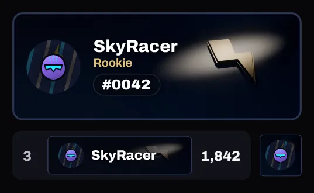 |

Switch: off: Joe's "Royal Navy" may mean this item or Royal; kept as today until he says. To use it: `"card-art.joulz-navy": true,` in `src/config/cosmeticRedraws.ts`; to offer it again: `SELECT economy.restore_item('card-art.joulz-navy', 'redrawn, approved <date>');`

### Bolt Stripes

`card-art.bolt-stripes` · no rarity · free starter · **withdrawn**. Diagonal gold inlay stripes in navy lacquer.

| Today | Redrawn |
|---|---|
|  | 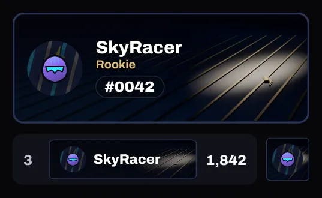 |

**Switch: on** (Joe, 15 Nov 2026); restored by `20261118100000_restore_approved_redraws.sql`

### Grid

`card-art.grid` · no rarity · free starter · **withdrawn**. A floor of navy glass tiles in perspective.

| Today | Redrawn |
|---|---|
|  |  |

**Switch: on** (Joe, 15 Nov 2026); restored by `20261118100000_restore_approved_redraws.sql`

### Waves

`card-art.waves` · no rarity · free starter · **withdrawn**. Navy satin in soft waves.

| Today | Redrawn |
|---|---|
| 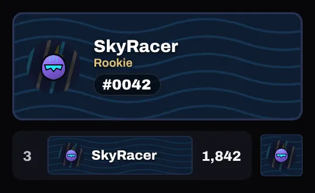 |  |

**Switch: on** (Joe, 15 Nov 2026); restored by `20261118100000_restore_approved_redraws.sql`

### Hexes

`card-art.hexes` · no rarity · free starter · **withdrawn**. Raised hex tiles in perspective.

| Today | Redrawn |
|---|---|
| 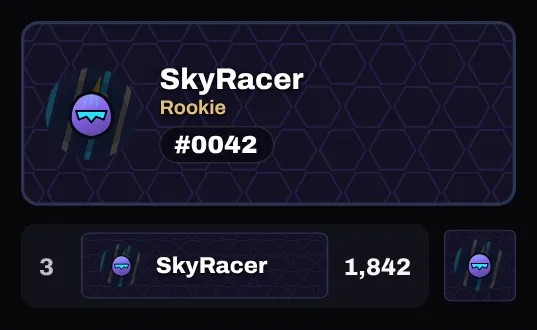 |  |

**Switch: on** (Joe, 15 Nov 2026); restored by `20261118100000_restore_approved_redraws.sql`

### Dots

`card-art.dots` · no rarity · free starter · **withdrawn**. A halftone of gold studs fading across navy.

| Today | Redrawn |
|---|---|
| 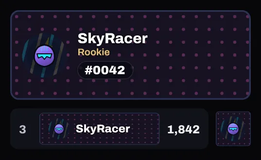 |  |

**Switch: on** (Joe, 15 Nov 2026); restored by `20261118100000_restore_approved_redraws.sql`

### Sunrise

`card-art.sunburst` · no rarity · free starter · **withdrawn**. Shown as Sunrise (Joe, 15 Nov): a dusk sun over a sea of cloud.

| Today | Redrawn |
|---|---|
|  |  |

**Switch: on** (Joe, 15 Nov 2026); restored by `20261118100000_restore_approved_redraws.sql`

### Spark

`card-art.tier.spark` · no rarity · earned season peak tier · **withdrawn**. Spark: an anvil with a white-hot bar, sparks spraying in the forge's glow.

| Today | Redrawn |
|---|---|
| 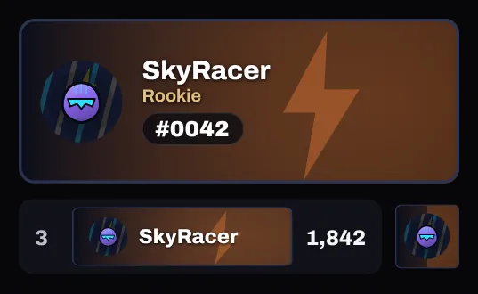 |  |

**Switch: on** (Joe, 15 Nov 2026); restored by `20261118100000_restore_approved_redraws.sql`

### Charge

`card-art.tier.charge` · no rarity · earned season peak tier · **withdrawn**. Charge: a glass cell holding a green plasma column, steel caps, cables.

| Today | Redrawn |
|---|---|
|  |  |

**Switch: on** (Joe, 15 Nov 2026); restored by `20261118100000_restore_approved_redraws.sql`

### Volt

`card-art.tier.volt` · no rarity · earned season peak tier · **withdrawn**. Volt: two copper coils with cyan arcs between them.

| Today | Redrawn |
|---|---|
|  |  |

**Switch: on** (Joe, 15 Nov 2026); restored by `20261118100000_restore_approved_redraws.sql`

### Surge

`card-art.tier.surge` · no rarity · earned season peak tier · **withdrawn**. Surge: a dark wave rolling in, its crest lit blue, spray.

| Today | Redrawn |
|---|---|
| 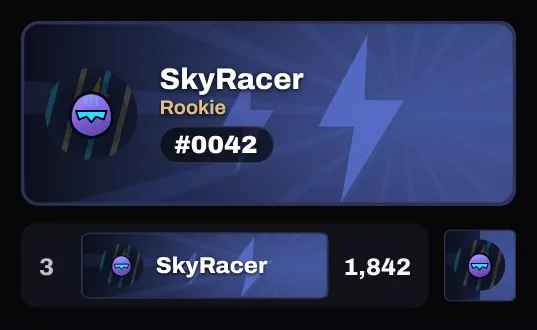 | 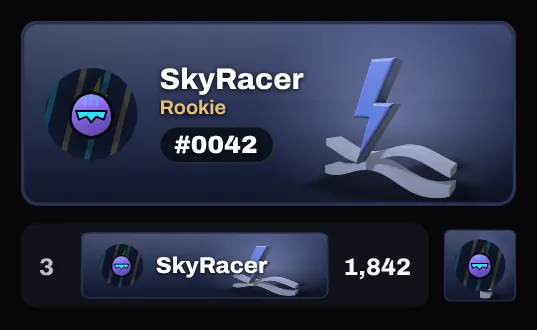 |

**Switch: on** (Joe, 15 Nov 2026); restored by `20261118100000_restore_approved_redraws.sql`

### Storm

`card-art.tier.storm` · no rarity · earned season peak tier · **withdrawn**. Storm: a violet storm cloud base, forks of lightning, a ground strike; a flash every few seconds.

| Today | Redrawn |
|---|---|
|  | 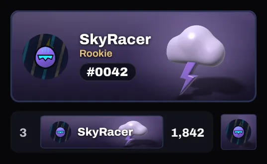 |

**Switch: on** (Joe, 15 Nov 2026); restored by `20261118100000_restore_approved_redraws.sql`

### Lightning

`card-art.tier.lightning` · no rarity · earned season peak tier · live. Lightning: storm clouds lit from inside by a branching gold strike over a dark sea; a flash every few seconds.

| Today | Redrawn |
|---|---|
|  |  |

**Switch: on** (Joe, 15 Nov 2026)

### Top 500

`card-art.tier.top-500` · no rarity · earned season peak tier · **withdrawn**. Polished (Joe, 15 Nov): a larger crown on a tall stepped pedestal under a shaft of gold light, crimson drapes, gold columns, gold dust; a slow light sweep.

| Today | Redrawn |
|---|---|
|  |  |

Switch: off: polished for Joe's approval. To use it: `"card-art.tier.top-500": true,` in `src/config/cosmeticRedraws.ts`; to offer it again: `SELECT economy.restore_item('card-art.tier.top-500', 'redrawn, approved <date>');`

### Crimson

`card-art.crimson` · Epic · Shop, 1,000 coins · live. Redone (Joe, 15 Nov): a crimson velvet theatre curtain in heavy folds, gathered by a gold rope and tassel, gold fringe, warm stage light.

| Today | Redrawn |
|---|---|
| 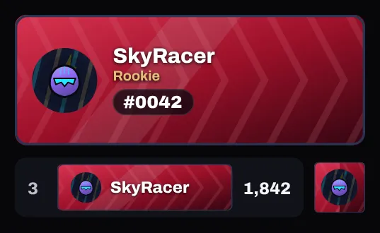 |  |

Switch: off: redone for Joe's approval. To use it: `"card-art.crimson": true,` in `src/config/cosmeticRedraws.ts`

### Galaxy

`card-art.galaxy` · Epic · Shop, 1,000 coins · live. A spiral galaxy of ~300,000 star particles, a filamentary nebula, stars at three depths with depth of field.

| Today | Redrawn |
|---|---|
|  | 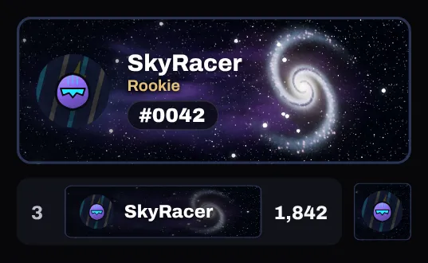 |

**Switch: on** (Joe, 15 Nov 2026)

### Royal

`card-art.royal` · Epic · Shop, 1,000 coins · **withdrawn**. Polished (Joe, 15 Nov): a gold crown with sapphires and diamonds on navy velvet with gold braid, a sceptre, navy drapes.

| Today | Redrawn |
|---|---|
|  |  |

Switch: off: polished for Joe's approval. To use it: `"card-art.royal": true,` in `src/config/cosmeticRedraws.ts`; to offer it again: `SELECT economy.restore_item('card-art.royal', 'redrawn, approved <date>');`

### Emerald

`card-art.emerald` · Epic · Shop, 1,000 coins · live. Polished (Joe, 15 Nov): large brilliant emerald crystals with an inner glow, back-lit, and a step-cut stone.

| Today | Redrawn |
|---|---|
| 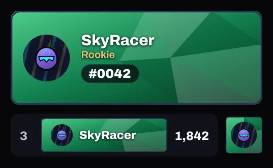 |  |

Switch: off: polished for Joe's approval. To use it: `"card-art.emerald": true,` in `src/config/cosmeticRedraws.ts`

### Lava

`card-art.lava` · Epic · Shop, 1,000 coins · **withdrawn**. Black crust with glowing cracks and a molten channel, steam and embers.

| Today | Redrawn |
|---|---|
|  | 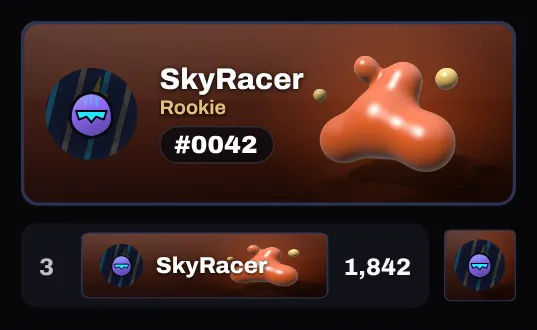 |

**Switch: on** (Joe, 15 Nov 2026); restored by `20261118100000_restore_approved_redraws.sql`

### Diamond Plate

`card-art.diamond-plate` · Legendary · Shop, 2,800 coins · **withdrawn**. Redone (Joe, 15 Nov): steel tread plate set with brilliant-cut diamonds, one large stone in front, white sparkle; a slow light sweep.

| Today | Redrawn |
|---|---|
| 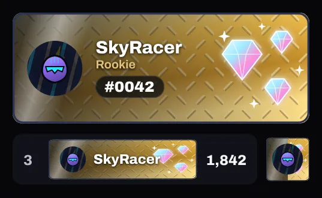 | 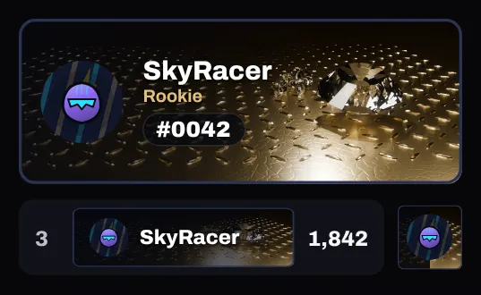 |

Switch: off: redone for Joe's approval. To use it: `"card-art.diamond-plate": true,` in `src/config/cosmeticRedraws.ts`; to offer it again: `SELECT economy.restore_item('card-art.diamond-plate', 'redrawn, approved <date>');`

### Frost

`card-art.frost` · Elite · Shop, 1,600 coins · **withdrawn**. Polished (Joe, 15 Nov): a lake furred with rime over clear ice, rime at the spires' feet, frost glitter, a colder dawn.

| Today | Redrawn |
|---|---|
| 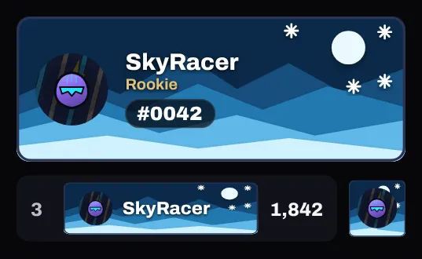 |  |

Switch: off: polished for Joe's approval. To use it: `"card-art.frost": true,` in `src/config/cosmeticRedraws.ts`; to offer it again: `SELECT economy.restore_item('card-art.frost', 'redrawn, approved <date>');`

### Neon Skyline

`card-art.neon-skyline` · Legendary · Pass free level 60 · **withdrawn**. Polished (Joe, 15 Nov): calmer: the right-hand towers only, a clean dusk sky behind the name, three neon accents, the moon; a slow light sweep.

| Today | Redrawn |
|---|---|
| 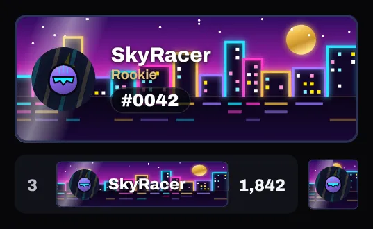 | 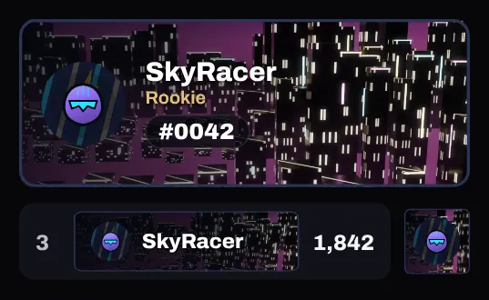 |

Switch: off: polished for Joe's approval. To use it: `"card-art.neon-skyline": true,` in `src/config/cosmeticRedraws.ts`; to offer it again: `SELECT economy.restore_item('card-art.neon-skyline', 'redrawn, approved <date>');`

### Static

`card-art.static` · Rare · Pass premium level 14 · **withdrawn**. Redone to keep its idea (TV static): a vintage walnut TV in a dark room, its curved glass full of fine static and scanlines.

| Today | Redrawn |
|---|---|
|  | 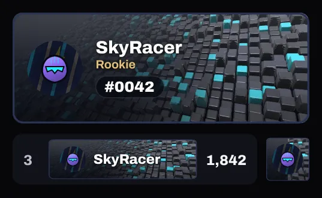 |

Switch: off: redone keeping the original's idea, for Joe's approval. To use it: `"card-art.static": true,` in `src/config/cosmeticRedraws.ts`; to offer it again: `SELECT economy.restore_item('card-art.static', 'redrawn, approved <date>');`

## Frames (13)

### Bronze

`frame.bronze` · Common · Pass free level 6 · **withdrawn**. Warm satin bronze, plain (everyday).

| Today | Redrawn |
|---|---|
| 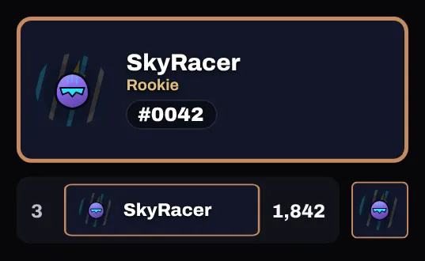 |  |

**Switch: on** (Joe, 15 Nov 2026); restored by `20261118100000_restore_approved_redraws.sql`

### Silver

`frame.silver` · Rare · Pass free level 26 · **withdrawn**. Polished silver with fine engraved lines.

| Today | Redrawn |
|---|---|
|  | 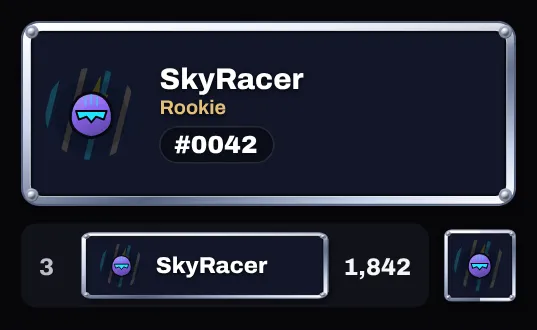 |

**Switch: on** (Joe, 15 Nov 2026); restored by `20261118100000_restore_approved_redraws.sql`

### Obsidian

`frame.obsidian` · Elite · Shop, 1,600 coins · **withdrawn**. Black volcanic glass with violet light along the inner edge, glass shards at the corners.

| Today | Redrawn |
|---|---|
|  | 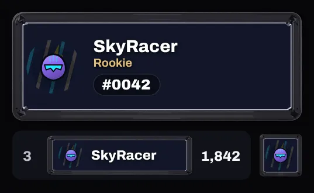 |

**Switch: on** (Joe, 15 Nov 2026); restored by `20261118100000_restore_approved_redraws.sql`

### Founding

`frame.founding` · no rarity · earned founding player · **withdrawn**. Polished (Joe, 15 Nov): luminous metal, sparkling stones, a soft aura and twinkles. Cast champagne gold: engraved band, four set diamonds, an enamel crest with a raised bolt between laurels, and a plaque with the player's own number (full card only); a light runs over the metal.

| Today | Redrawn |
|---|---|
|  |  |

Switch: off: polished for Joe's approval. To use it: `"frame.founding": true,` in `src/config/cosmeticRedraws.ts`; to offer it again: `SELECT economy.restore_item('frame.founding', 'redrawn, approved <date>');`

### Top 500

`frame.top-500` · no rarity · earned top 500 · **withdrawn**. Polished (Joe, 15 Nov): luminous metal, sparkling stones, a soft aura and twinkles. Heavy dark gold with filigree and a crimson enamel inlay, a gold coronet with pearls and a ruby, ruby cabochons; a TOP 500 plaque; a light runs over it.

| Today | Redrawn |
|---|---|
|  | 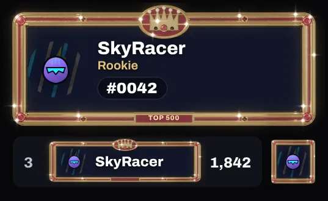 |

Switch: off: polished for Joe's approval. To use it: `"frame.top-500": true,` in `src/config/cosmeticRedraws.ts`; to offer it again: `SELECT economy.restore_item('frame.top-500', 'redrawn, approved <date>');`

### Championship

`frame.championship` · no rarity · tournament · **withdrawn**. Polished (Joe, 15 Nov): luminous metal, sparkling stones, a soft aura and twinkles. Platinum outer band and gold inner band with navy enamel, a gold trophy on a platinum sunburst inside a laurel wreath, diamond-set stars; a CHAMPION plaque; a light runs over it.

| Today | Redrawn |
|---|---|
| 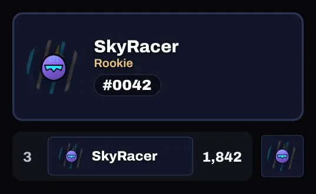 | 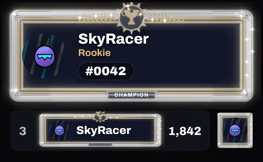 |

Switch: off: polished for Joe's approval. To use it: `"frame.championship": true,` in `src/config/cosmeticRedraws.ts`; to offer it again: `SELECT economy.restore_item('frame.championship', 'redrawn, approved <date>');`

### Season 1 Spark

`frame.s1-spark` · no rarity · earned season peak tier · **withdrawn**. Polished (Joe, 15 Nov): luminous metal, sparkling stones, a soft aura and twinkles. Season 1 Spark: copper with copper enamel (the calmest of the family).

| Today | Redrawn |
|---|---|
|  | 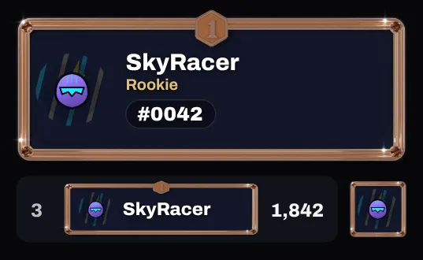 |

Switch: off: polished for Joe's approval. To use it: `"frame.s1-spark": true,` in `src/config/cosmeticRedraws.ts`; to offer it again: `SELECT economy.restore_item('frame.s1-spark', 'redrawn, approved <date>');`

### Season 1 Charge

`frame.s1-charge` · no rarity · earned season peak tier · **withdrawn**. Polished (Joe, 15 Nov): luminous metal, sparkling stones, a soft aura and twinkles. Season 1 Charge: platinum with emerald enamel.

| Today | Redrawn |
|---|---|
| 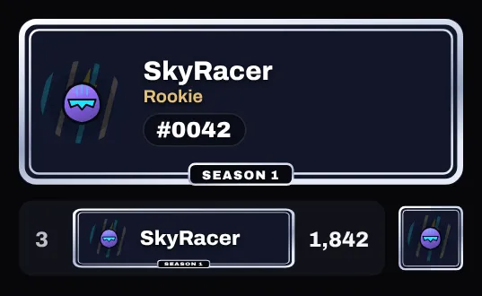 | 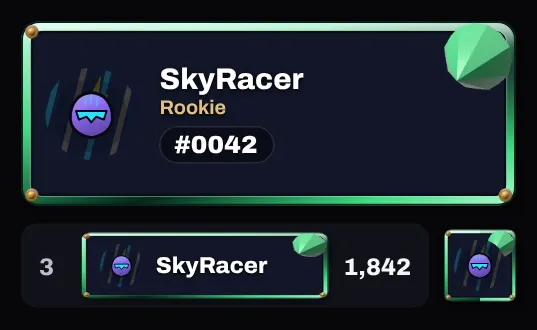 |

Switch: off: polished for Joe's approval. To use it: `"frame.s1-charge": true,` in `src/config/cosmeticRedraws.ts`; to offer it again: `SELECT economy.restore_item('frame.s1-charge', 'redrawn, approved <date>');`

### Season 1 Volt

`frame.s1-volt` · no rarity · earned season peak tier · **withdrawn**. Polished (Joe, 15 Nov): luminous metal, sparkling stones, a soft aura and twinkles. Season 1 Volt: platinum with cyan enamel.

| Today | Redrawn |
|---|---|
| 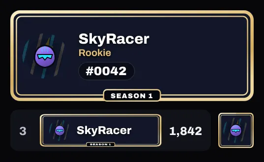 |  |

Switch: off: polished for Joe's approval. To use it: `"frame.s1-volt": true,` in `src/config/cosmeticRedraws.ts`; to offer it again: `SELECT economy.restore_item('frame.s1-volt', 'redrawn, approved <date>');`

### Season 1 Surge

`frame.s1-surge` · no rarity · earned season peak tier · **withdrawn**. Polished (Joe, 15 Nov): luminous metal, sparkling stones, a soft aura and twinkles. Season 1 Surge: gold with sapphire enamel, extra stones.

| Today | Redrawn |
|---|---|
| 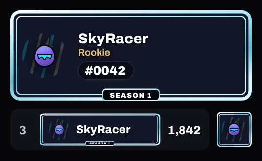 | 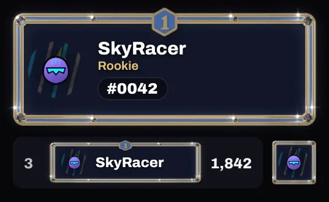 |

Switch: off: polished for Joe's approval. To use it: `"frame.s1-surge": true,` in `src/config/cosmeticRedraws.ts`; to offer it again: `SELECT economy.restore_item('frame.s1-surge', 'redrawn, approved <date>');`

### Season 1 Storm

`frame.s1-storm` · no rarity · earned season peak tier · **withdrawn**. Polished (Joe, 15 Nov): luminous metal, sparkling stones, a soft aura and twinkles. Season 1 Storm: gold with amethyst enamel, a double band; a light runs over it.

| Today | Redrawn |
|---|---|
| 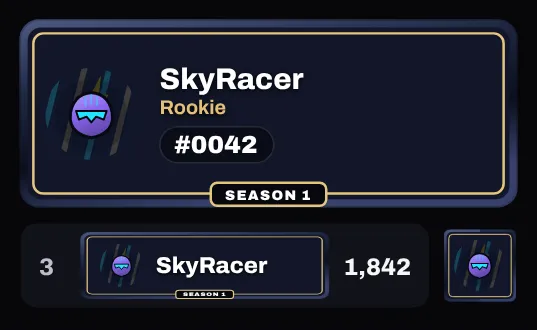 | 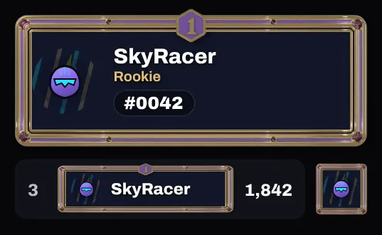 |

Switch: off: polished for Joe's approval. To use it: `"frame.s1-storm": true,` in `src/config/cosmeticRedraws.ts`; to offer it again: `SELECT economy.restore_item('frame.s1-storm', 'redrawn, approved <date>');`

### Season 1 Lightning

`frame.s1-lightning` · no rarity · earned season peak tier · **withdrawn**. Polished (Joe, 15 Nov): luminous metal, sparkling stones, a soft aura and twinkles. Season 1 Lightning: gold with gold-yellow enamel, a double band, extra stones; a light runs over it.

| Today | Redrawn |
|---|---|
| 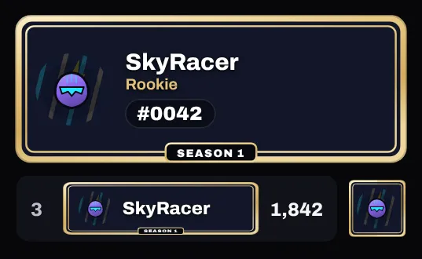 | 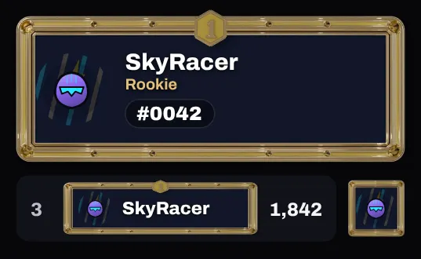 |

Switch: off: polished for Joe's approval. To use it: `"frame.s1-lightning": true,` in `src/config/cosmeticRedraws.ts`; to offer it again: `SELECT economy.restore_item('frame.s1-lightning', 'redrawn, approved <date>');`

### Season 1 Top 500

`frame.s1-top-500` · no rarity · earned season peak tier · **withdrawn**. Polished (Joe, 15 Nov): luminous metal, sparkling stones, a soft aura and twinkles. Season 1 Top 500: black and gold enamel, diamonds, a sunburst behind the hexagonal 1 medallion; a light runs over it.

| Today | Redrawn |
|---|---|
| 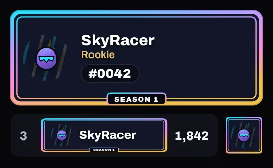 |  |

Switch: off: polished for Joe's approval. To use it: `"frame.s1-top-500": true,` in `src/config/cosmeticRedraws.ts`; to offer it again: `SELECT economy.restore_item('frame.s1-top-500', 'redrawn, approved <date>');`

## Name colours (5)

### Chrome

`name-colour.chrome` · Epic · Shop, 1,000 coins · **withdrawn**. Letters filled with rendered polished chrome, a dark edge.

| Today | Redrawn |
|---|---|
| 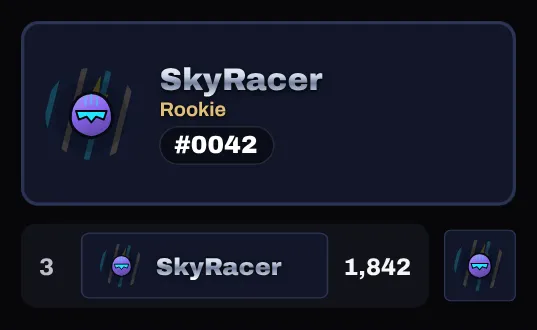 | 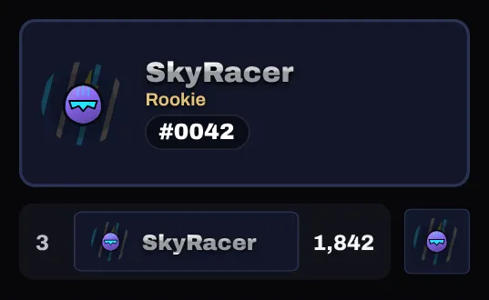 |

**Switch: on** (Joe, 15 Nov 2026); restored by `20261118100000_restore_approved_redraws.sql`

### Neon Pink

`name-colour.neon-pink` · Common · Pass free level 10 · **withdrawn**. Keeps its idea: a lit pink neon tube with a pale hot core and a dark edge.

| Today | Redrawn |
|---|---|
|  | 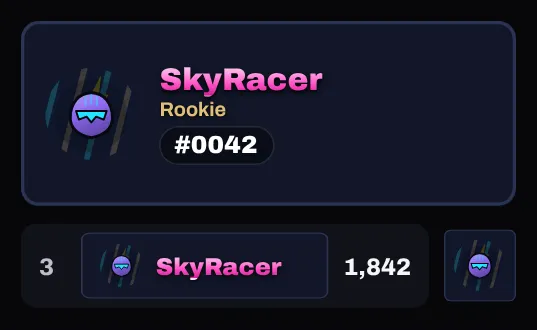 |

Switch: off: redone keeping the original's idea, for Joe's approval. To use it: `"name-colour.neon-pink": true,` in `src/config/cosmeticRedraws.ts`; to offer it again: `SELECT economy.restore_item('name-colour.neon-pink', 'redrawn, approved <date>');`

### Neon Cyan

`name-colour.neon-cyan` · Rare · Pass premium level 3 · **withdrawn**. Keeps its idea: a lit cyan neon tube with a pale hot core and a dark edge.

| Today | Redrawn |
|---|---|
|  |  |

Switch: off: redone keeping the original's idea, for Joe's approval. To use it: `"name-colour.neon-cyan": true,` in `src/config/cosmeticRedraws.ts`; to offer it again: `SELECT economy.restore_item('name-colour.neon-cyan', 'redrawn, approved <date>');`

### Neon Red

`name-colour.neon-red` · Rare · Pass premium level 18 · **withdrawn**. Keeps its idea: a lit red neon tube with a pale hot core and a dark edge.

| Today | Redrawn |
|---|---|
|  |  |

Switch: off: redone keeping the original's idea, for Joe's approval. To use it: `"name-colour.neon-red": true,` in `src/config/cosmeticRedraws.ts`; to offer it again: `SELECT economy.restore_item('name-colour.neon-red', 'redrawn, approved <date>');`

### Electric Orange

`name-colour.electric-orange` · Epic · Pass premium level 35 · **withdrawn**. Keeps its idea: the pixel face (Silkscreen) filled with rendered anodised orange, a dark edge, a soft glow.

| Today | Redrawn |
|---|---|
|  |  |

Switch: off: redone keeping the original's idea, for Joe's approval. To use it: `"name-colour.electric-orange": true,` in `src/config/cosmeticRedraws.ts`; to offer it again: `SELECT economy.restore_item('name-colour.electric-orange', 'redrawn, approved <date>');`

## Avatar finishes (4)

### Carbon

`avatar-finish.carbon` · Epic · Shop, 1,000 coins · **withdrawn**. Woven carbon under a clear coat, a carbon rim.

| Today | Redrawn |
|---|---|
| 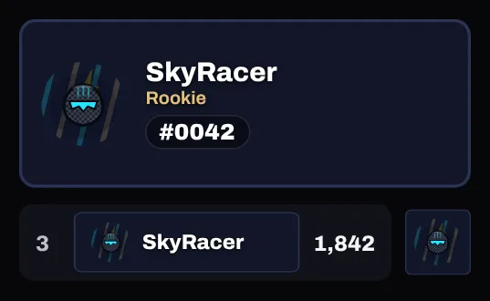 | 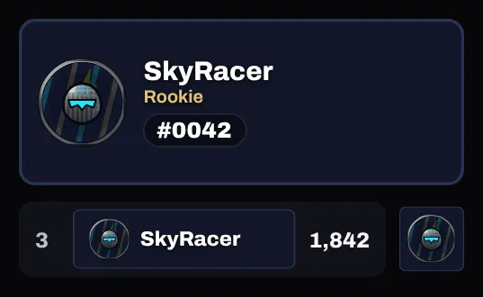 |

**Switch: on** (Joe, 15 Nov 2026); restored by `20261118100000_restore_approved_redraws.sql`

### Chrome

`avatar-finish.chrome` · Epic · Shop, 1,000 coins · **withdrawn**. Rendered chrome on the avatar's shapes, a matching rim round the circle.

| Today | Redrawn |
|---|---|
|  |  |

**Switch: on** (Joe, 15 Nov 2026); restored by `20261118100000_restore_approved_redraws.sql`

### Holographic

`avatar-finish.holographic` · Elite · Shop, 1,600 coins · **withdrawn**. Iridescent foil, a foil rim.

| Today | Redrawn |
|---|---|
|  |  |

**Switch: on** (Joe, 15 Nov 2026); restored by `20261118100000_restore_approved_redraws.sql`

### Neon Glow

`avatar-finish.neon-glow` · Elite · Pass premium level 40 · **withdrawn**. The player's own colour with glass-tube reflections and a ring in that colour.

| Today | Redrawn |
|---|---|
|  |  |

**Switch: on** (Joe, 15 Nov 2026); restored by `20261118100000_restore_approved_redraws.sql`

## Avatar accessory (1)

### Neon Bolt

`avatar-accessory.neon-bolt` · Epic · Pass premium level 52 · **withdrawn**. Keeps its idea: a clearly cyan neon bolt above the circle, as large as its slot allows.

| Today | Redrawn |
|---|---|
| 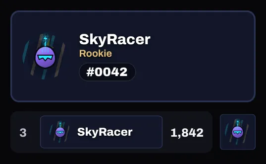 |  |

Switch: off: redone keeping the original's idea, for Joe's approval. To use it: `"avatar-accessory.neon-bolt": true,` in `src/config/cosmeticRedraws.ts`; to offer it again: `SELECT economy.restore_item('avatar-accessory.neon-bolt', 'redrawn, approved <date>');`

## Reaction packs (6)

### Spark

`reaction.spark` · Common · Pass free level 22 · **withdrawn**. Keeps its idea: the star character with glossy eyes, a smile and blush, and two gold sparkles.

| Today | Redrawn |
|---|---|
|  |  |

Switch: off: redone keeping the original's idea, for Joe's approval. To use it: `"reaction.spark": true,` in `src/config/cosmeticRedraws.ts`; to offer it again: `SELECT economy.restore_item('reaction.spark', 'redrawn, approved <date>');`

### Zap

`reaction.zap` · Rare · Pass premium level 8 · **withdrawn**. Keeps its idea: a cyan neon bolt with a white-hot core, its face, speed lines and a yellow spark.

| Today | Redrawn |
|---|---|
|  |  |

Switch: off: redone keeping the original's idea, for Joe's approval. To use it: `"reaction.zap": true,` in `src/config/cosmeticRedraws.ts`; to offer it again: `SELECT economy.restore_item('reaction.zap', 'redrawn, approved <date>');`

### Clutch

`reaction.clutch` · Rare · Pass premium level 28 · **withdrawn**. A gold plaque with CLUTCH! engraved.

| Today | Redrawn |
|---|---|
|  | 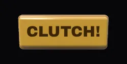 |

**Switch: on** (Joe, 15 Nov 2026); restored by `20261118100000_restore_approved_redraws.sql`

### Captain's Calls

`reaction.captains-calls` · Epic · Shop, 1,000 coins · **withdrawn**. White ceramic speech bubbles, each phrase on one line.

| Today | Redrawn |
|---|---|
| 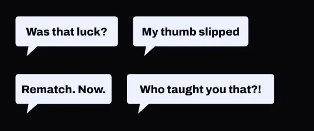 |  |

**Switch: on** (Joe, 15 Nov 2026); restored by `20261118100000_restore_approved_redraws.sql`

### Retro Arcade

`reaction.retro-arcade` · Epic · Shop, 1,000 coins · **withdrawn**. Keeps its idea: a rendered CRT plate with the pixel heart and pixel words (1UP, LAG!!, GLHF) under scanlines.

| Today | Redrawn |
|---|---|
| 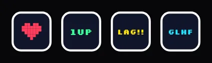 |  |

Switch: off: redone keeping the original's idea, for Joe's approval. To use it: `"reaction.retro-arcade": true,` in `src/config/cosmeticRedraws.ts`; to offer it again: `SELECT economy.restore_item('reaction.retro-arcade', 'redrawn, approved <date>');`

### Neon Signs

`reaction.neon-signs` · Epic · Pass premium level 22 · **withdrawn**. Dark sign boxes ringed with lit neon tubes.

| Today | Redrawn |
|---|---|
| 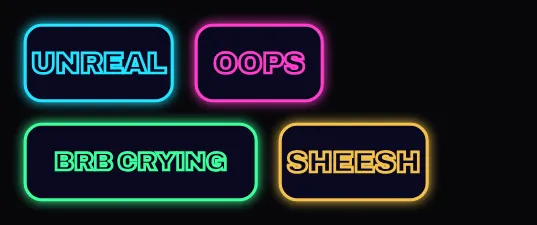 | 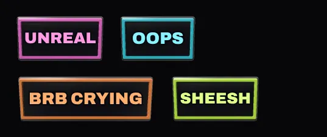 |

**Switch: on** (Joe, 15 Nov 2026); restored by `20261118100000_restore_approved_redraws.sql`

## Celebrations (3)

### Spotlight

`celebration.spotlight` · Epic · Shop, 1,000 coins · **withdrawn**. Captain Joulz (modelled in Blender) in his win pose on the podium under two spotlights in haze.

| Today | Redrawn |
|---|---|
| 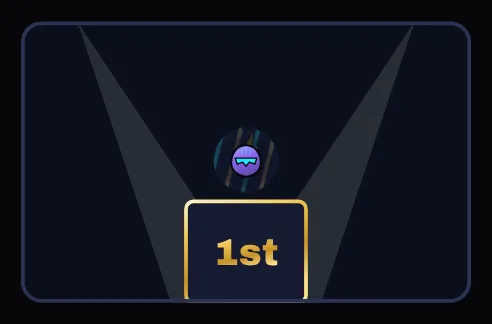 | 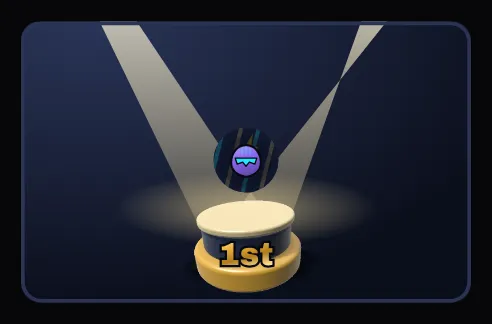 |

Switch: off: Captain Joulz on the podium, for Joe's approval. To use it: `"celebration.spotlight": true,` in `src/config/cosmeticRedraws.ts`; to offer it again: `SELECT economy.restore_item('celebration.spotlight', 'redrawn, approved <date>');`

### Shockwave

`celebration.shockwave` · Elite · Shop, 1,600 coins · **withdrawn**. Captain Joulz on the podium, rings of light across a glass floor.

| Today | Redrawn |
|---|---|
|  | 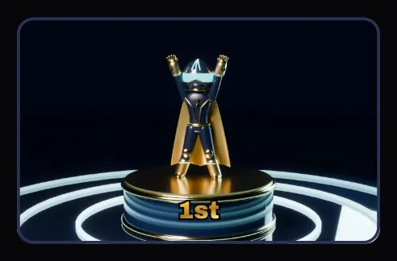 |

Switch: off: Captain Joulz on the podium, for Joe's approval. To use it: `"celebration.shockwave": true,` in `src/config/cosmeticRedraws.ts`; to offer it again: `SELECT economy.restore_item('celebration.shockwave', 'redrawn, approved <date>');`

### Circuit Overload

`celebration.circuit-overload` · Elite · Pass premium level 58 · **withdrawn**. Captain Joulz on the podium on a lit gold circuit board with a pulsing surge.

| Today | Redrawn |
|---|---|
|  |  |

Switch: off: Captain Joulz on the podium, for Joe's approval. To use it: `"celebration.circuit-overload": true,` in `src/config/cosmeticRedraws.ts`; to offer it again: `SELECT economy.restore_item('celebration.circuit-overload', 'redrawn, approved <date>');`

## Tile style (1)

### Circuit Trace

`tile-style.circuit-trace` · Common · Pass free level 16 · **withdrawn**. A rendered circuit board round the game's tile scene.

| Today | Redrawn |
|---|---|
|  |  |

**Switch: on** (Joe, 15 Nov 2026); restored by `20261118100000_restore_approved_redraws.sql`

## Card backs (3)

### Royal Damask

`card-back.royal-damask` · Epic · Shop, 1,000 coins · live. Gold-foil damask, a medallion with a raised bolt.

| Today | Redrawn |
|---|---|
|  |  |

**Switch: on** (Joe, 15 Nov 2026)

### Holo Foil

`card-back.holo-foil` · Elite · Shop, 1,600 coins · live. Diagonal prism foil with a pearl star.

| Today | Redrawn |
|---|---|
|  |  |

**Switch: on** (Joe, 15 Nov 2026)

### Neon card back

`card-back.neon` · Epic · Pass premium level 4 · live. Dark glass with a cyan tube, pink traces, a white bolt.

| Today | Redrawn |
|---|---|
|  |  |

**Switch: on** (Joe, 15 Nov 2026)

## Game skins (14)

### Watermelon

`game-skin.crazy-golf.watermelon` · Epic · Shop, 1,000 coins · **withdrawn**. A clear-coated sphere with ragged rind stripes.

| Today | Redrawn |
|---|---|
|  |  |

**Switch: on** (Joe, 15 Nov 2026); restored by `20261118100000_restore_approved_redraws.sql`

### Disco

`game-skin.crazy-golf.disco` · Epic · Shop, 1,000 coins · **withdrawn**. A mirror-tile ball lit by coloured lights.

| Today | Redrawn |
|---|---|
|  |  |

**Switch: on** (Joe, 15 Nov 2026); restored by `20261118100000_restore_approved_redraws.sql`

### Neon Glow

`game-skin.crazy-golf.neon-glow` · Rare · Pass free level 14 · **withdrawn**. A lit glass ball with dimples.

| Today | Redrawn |
|---|---|
|  |  |

**Switch: on** (Joe, 15 Nov 2026); restored by `20261118100000_restore_approved_redraws.sql`

### Plasma

`game-skin.crazy-golf.plasma` · Epic · Pass premium level 32 · **withdrawn**. Plasma filaments inside violet glass.

| Today | Redrawn |
|---|---|
|  |  |

**Switch: on** (Joe, 15 Nov 2026); restored by `20261118100000_restore_approved_redraws.sql`

### Pixel Pool

`game-skin.cue-ball.pixel-pool` · Epic · Shop, 1,000 coins · **withdrawn**. The pixel balls lit cell by cell, a pixel highlight.

| Today | Redrawn |
|---|---|
|  |  |

**Switch: on** (Joe, 15 Nov 2026); restored by `20261118100000_restore_approved_redraws.sql`

### Galaxy Set

`game-skin.cue-ball.galaxy-set` · Elite · Shop, 1,600 coins · **withdrawn**. The galaxy balls under rendered resin light.

| Today | Redrawn |
|---|---|
|  |  |

**Switch: on** (Joe, 15 Nov 2026); restored by `20261118100000_restore_approved_redraws.sql`

### Neon 8-ball

`game-skin.cue-ball.neon-8-ball` · Rare · Pass free level 36 · **withdrawn**. The 8 under rendered glass light.

| Today | Redrawn |
|---|---|
|  |  |

**Switch: on** (Joe, 15 Nov 2026); restored by `20261118100000_restore_approved_redraws.sql`

### Neon ball set

`game-skin.cue-ball.neon-ball-set` · Epic · Pass premium level 42 · **withdrawn**. Every ball under rendered glass light in its colour.

| Today | Redrawn |
|---|---|
|  |  |

**Switch: on** (Joe, 15 Nov 2026); restored by `20261118100000_restore_approved_redraws.sql`

### Glacier

`game-skin.curl-champ.glacier` · Epic · Shop, 1,000 coins · **withdrawn**. Icy granite tops with a frost disc.

| Today | Redrawn |
|---|---|
|  |  |

**Switch: on** (Joe, 15 Nov 2026); restored by `20261118100000_restore_approved_redraws.sql`

### Aurora

`game-skin.curl-champ.aurora` · Elite · Shop, 1,600 coins · **withdrawn**. Dark granite with a pink and cyan inlay.

| Today | Redrawn |
|---|---|
|  |  |

**Switch: on** (Joe, 15 Nov 2026); restored by `20261118100000_restore_approved_redraws.sql`

### Neon stones

`game-skin.curl-champ.neon-stones` · Epic · Pass premium level 25 · **withdrawn**. Granite with lit tube inlays.

| Today | Redrawn |
|---|---|
|  |  |

**Switch: on** (Joe, 15 Nov 2026); restored by `20261118100000_restore_approved_redraws.sql`

### Midnight Felt

`game-skin.full-house.midnight-felt` · Epic · Shop, 1,000 coins · **withdrawn**. Rendered midnight twill.

| Today | Redrawn |
|---|---|
|  |  |

**Switch: on** (Joe, 15 Nov 2026); restored by `20261118100000_restore_approved_redraws.sql`

### Crimson Velvet

`game-skin.full-house.crimson-velvet` · Epic · Shop, 1,000 coins · **withdrawn**. Rendered crimson velvet nap.

| Today | Redrawn |
|---|---|
|  |  |

**Switch: on** (Joe, 15 Nov 2026); restored by `20261118100000_restore_approved_redraws.sql`

### Neon felt

`game-skin.full-house.neon-felt` · Epic · Pass premium level 12 · **withdrawn**. Rendered dark twill with its neon edge.

| Today | Redrawn |
|---|---|
|  |  |

**Switch: on** (Joe, 15 Nov 2026); restored by `20261118100000_restore_approved_redraws.sql`

## World themes (3)

### Apex: Neon Night

`world-theme.apex.neon-night` · Legendary · Pass premium level 45 · **withdrawn**. The track through a rendered neon city: a night sky, a 360° far skyline in haze, a near band of lit towers, skyscrapers along the road.

| Today | Redrawn |
|---|---|
|  |  |

**Switch: on** (Joe, 15 Nov 2026); restored by `20261118100000_restore_approved_redraws.sql`

### Crazy Golf: Neon Course

`world-theme.crazy-golf.neon-course` · Legendary · Pass free level 50 · **withdrawn**. Grained night turf under the lit tubes.

| Today | Redrawn |
|---|---|
|  |  |

**Switch: on** (Joe, 15 Nov 2026); restored by `20261118100000_restore_approved_redraws.sql`

### Curl Champ: Neon Rink

`world-theme.curl-champ.neon-rink` · Elite · Pass premium level 24 · **withdrawn**. Rendered ice with depth under the lit rink.

| Today | Redrawn |
|---|---|
|  |  |

**Switch: on** (Joe, 15 Nov 2026); restored by `20261118100000_restore_approved_redraws.sql`
