# Cosmetics redraws: gallery (phase 2 step 4, 15 Nov 2026)

Every redrawn item, today's art beside the redraw, drawn by the app's own components and renderers at phone size
under Reduce Motion (stills: the Legendaries' sweeps and the frames' running light don't show). The audit that chose
them: [AUDIT.md](AUDIT.md).

**Players see no change tonight.** Each item draws its new art only when its switch in
`src/config/cosmeticRedraws.ts` is `true`; every switch is `false`. Turning one on is that one line. Withdrawn items
stay withdrawn whatever their switch says: restoring one is its own line, `economy.restore_item`
(docs/economy/withdrawn.md). Nothing here changes who owns an item, what is offered, or any price.

**How they are made.** The art kit's pipeline and finish: every object is a 3D scene in the kit's raymarcher (one
gloss material, one key light from the top left, a soft contact shadow), `docs/design/cosmetics-redraws/source/`
(`render.html` the renderer, `scenes.ts` every piece's scene, colours and camera, `render.ts` writes
`public/cosmetics/redrawn/<piece>.webp`); the compositions are `scripts/cosmetic-redraws/` (`card.ts`, `cosmetics.ts`),
built by `bun scripts/cosmetic-redraws.ts` into `src/design/identity/redrawnArt.data.ts`; the in-game looks are canvas
painters in `src/lib/arcade/skins/` (the shared gloss in `gloss.renderer.ts`). Pictures:
`bun scripts/cosmetic-redraws/identity-shots.tsx` and `bun scripts/cosmetic-redraws/game-looks-shots.ts`; this page
`bun scripts/cosmetic-redraws/gallery-doc.ts`. Gallery pictures: 1.69 MB.

## Card arts (22)

### Joulz Navy

`card-art.joulz-navy` · no rarity · free starter · **withdrawn**. A glossy gold bolt on lit navy.

| Today | Redrawn |
|---|---|
|  |  |

Use the new art: in `src/config/cosmeticRedraws.ts`, `"card-art.joulz-navy": true,`  
Restore it (offer it again): `SELECT economy.restore_item('card-art.joulz-navy', 'redrawn, approved <date>');`

### Bolt Stripes

`card-art.bolt-stripes` · no rarity · free starter · **withdrawn**. Raised navy bars in perspective with a gold bolt among them.

| Today | Redrawn |
|---|---|
| 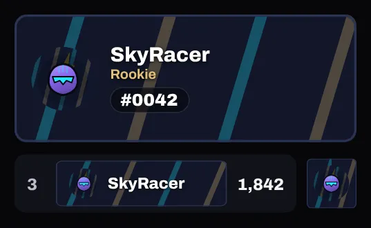 |  |

Use the new art: in `src/config/cosmeticRedraws.ts`, `"card-art.bolt-stripes": true,`  
Restore it (offer it again): `SELECT economy.restore_item('card-art.bolt-stripes', 'redrawn, approved <date>');`

### Grid

`card-art.grid` · no rarity · free starter · **withdrawn**. A field of glossy tiles in perspective, a few lit cyan.

| Today | Redrawn |
|---|---|
| 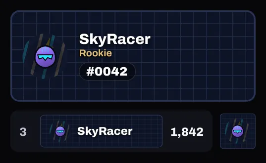 | 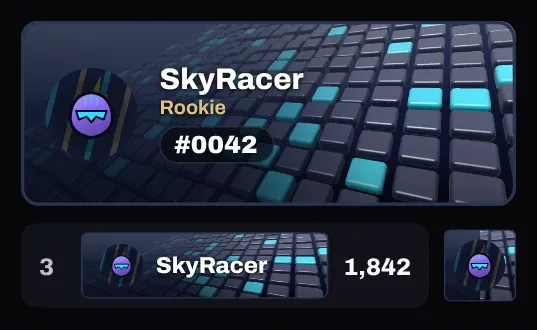 |

Use the new art: in `src/config/cosmeticRedraws.ts`, `"card-art.grid": true,`  
Restore it (offer it again): `SELECT economy.restore_item('card-art.grid', 'redrawn, approved <date>');`

### Waves

`card-art.waves` · no rarity · free starter · **withdrawn**. Three glossy wave ribbons, blue and teal.

| Today | Redrawn |
|---|---|
|  | 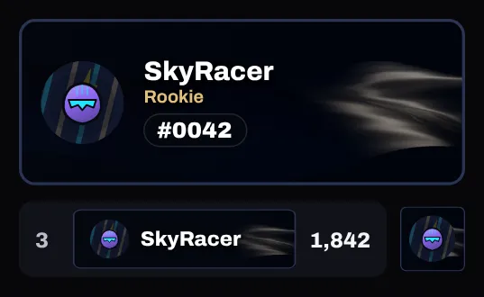 |

Use the new art: in `src/config/cosmeticRedraws.ts`, `"card-art.waves": true,`  
Restore it (offer it again): `SELECT economy.restore_item('card-art.waves', 'redrawn, approved <date>');`

### Hexes

`card-art.hexes` · no rarity · free starter · **withdrawn**. Raised hex tiles at varying heights, a few lit pink.

| Today | Redrawn |
|---|---|
|  | 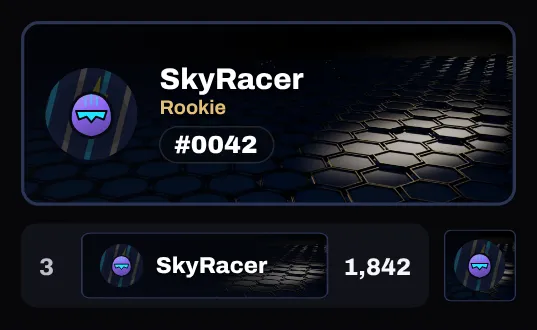 |

Use the new art: in `src/config/cosmeticRedraws.ts`, `"card-art.hexes": true,`  
Restore it (offer it again): `SELECT economy.restore_item('card-art.hexes', 'redrawn, approved <date>');`

### Dots

`card-art.dots` · no rarity · free starter · **withdrawn**. A field of glossy domes, a few lit pink.

| Today | Redrawn |
|---|---|
|  | 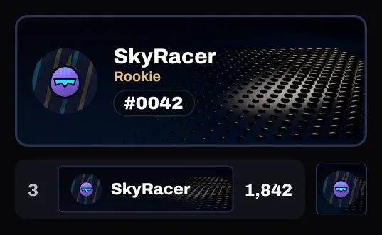 |

Use the new art: in `src/config/cosmeticRedraws.ts`, `"card-art.dots": true,`  
Restore it (offer it again): `SELECT economy.restore_item('card-art.dots', 'redrawn, approved <date>');`

### Sunburst

`card-art.sunburst` · no rarity · free starter · **withdrawn**. A gold sun with rays fanning out, on warm amber.

| Today | Redrawn |
|---|---|
| 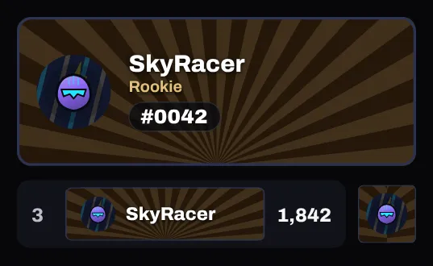 | 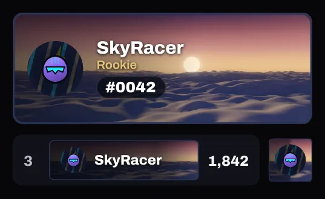 |

Use the new art: in `src/config/cosmeticRedraws.ts`, `"card-art.sunburst": true,`  
Restore it (offer it again): `SELECT economy.restore_item('card-art.sunburst', 'redrawn, approved <date>');`

### Spark

`card-art.tier.spark` · no rarity · earned season peak tier · **withdrawn**. The Spark tier: a copper bolt with sparks, in the tier's colour.

| Today | Redrawn |
|---|---|
|  | 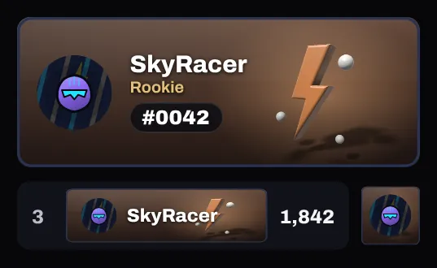 |

Use the new art: in `src/config/cosmeticRedraws.ts`, `"card-art.tier.spark": true,`  
Restore it (offer it again): `SELECT economy.restore_item('card-art.tier.spark', 'redrawn, approved <date>');`

### Charge

`card-art.tier.charge` · no rarity · earned season peak tier · **withdrawn**. The Charge tier: a glossy cell with its bolt.

| Today | Redrawn |
|---|---|
| 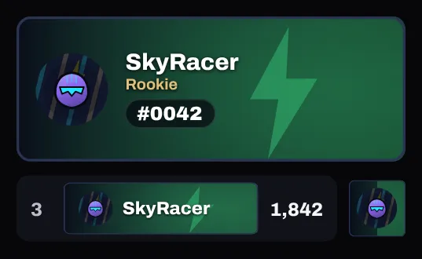 | 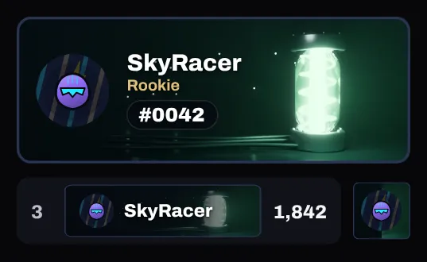 |

Use the new art: in `src/config/cosmeticRedraws.ts`, `"card-art.tier.charge": true,`  
Restore it (offer it again): `SELECT economy.restore_item('card-art.tier.charge', 'redrawn, approved <date>');`

### Volt

`card-art.tier.volt` · no rarity · earned season peak tier · **withdrawn**. The Volt tier: a bolt through a ring.

| Today | Redrawn |
|---|---|
| 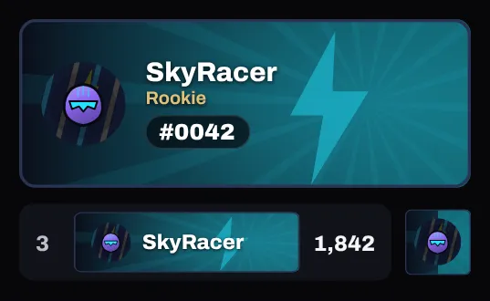 | 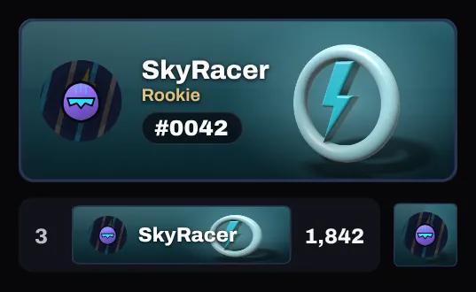 |

Use the new art: in `src/config/cosmeticRedraws.ts`, `"card-art.tier.volt": true,`  
Restore it (offer it again): `SELECT economy.restore_item('card-art.tier.volt', 'redrawn, approved <date>');`

### Surge

`card-art.tier.surge` · no rarity · earned season peak tier · **withdrawn**. The Surge tier: a bolt over two waves.

| Today | Redrawn |
|---|---|
|  |  |

Use the new art: in `src/config/cosmeticRedraws.ts`, `"card-art.tier.surge": true,`  
Restore it (offer it again): `SELECT economy.restore_item('card-art.tier.surge', 'redrawn, approved <date>');`

### Storm

`card-art.tier.storm` · no rarity · earned season peak tier · **withdrawn**. The Storm tier: a cloud with its bolt.

| Today | Redrawn |
|---|---|
| 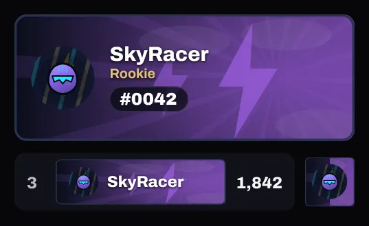 |  |

Use the new art: in `src/config/cosmeticRedraws.ts`, `"card-art.tier.storm": true,`  
Restore it (offer it again): `SELECT economy.restore_item('card-art.tier.storm', 'redrawn, approved <date>');`

### Lightning

`card-art.tier.lightning` · no rarity · earned season peak tier · live. The Lightning tier: twin bolts.

| Today | Redrawn |
|---|---|
| 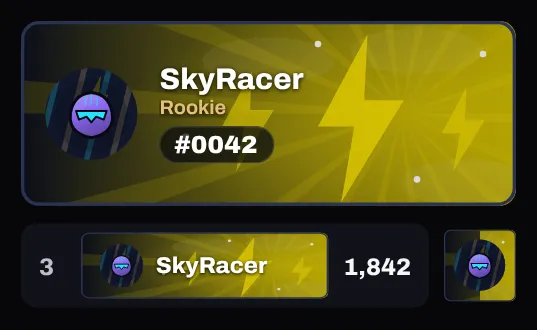 | 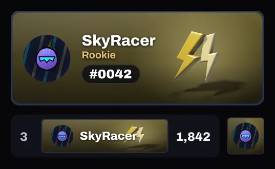 |

Use the new art: in `src/config/cosmeticRedraws.ts`, `"card-art.tier.lightning": true,`

### Top 500

`card-art.tier.top-500` · no rarity · earned season peak tier · **withdrawn**. Top 500: a gold crown with a jewel, with a slow light sweep.

| Today | Redrawn |
|---|---|
| 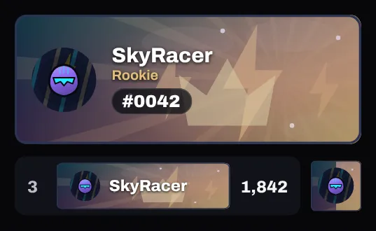 | 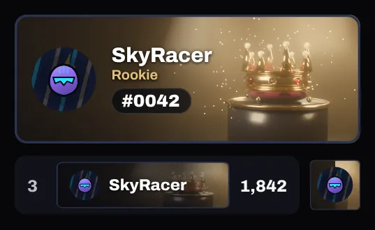 |

Use the new art: in `src/config/cosmeticRedraws.ts`, `"card-art.tier.top-500": true,`  
Restore it (offer it again): `SELECT economy.restore_item('card-art.tier.top-500', 'redrawn, approved <date>');`

### Crimson

`card-art.crimson` · Epic · Shop, 1,000 coins · live. Crimson blades fanned out, glossy red.

| Today | Redrawn |
|---|---|
|  | 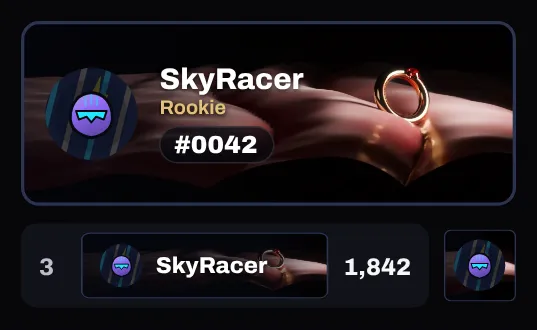 |

Use the new art: in `src/config/cosmeticRedraws.ts`, `"card-art.crimson": true,`

### Royal

`card-art.royal` · Epic · Shop, 1,000 coins · **withdrawn**. A gold crown on a violet cushion.

| Today | Redrawn |
|---|---|
| 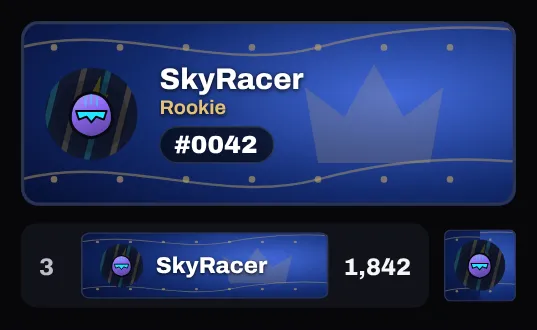 | 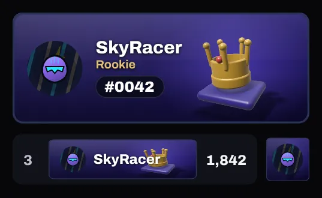 |

Use the new art: in `src/config/cosmeticRedraws.ts`, `"card-art.royal": true,`  
Restore it (offer it again): `SELECT economy.restore_item('card-art.royal', 'redrawn, approved <date>');`

### Emerald

`card-art.emerald` · Epic · Shop, 1,000 coins · live. An emerald with two small stones.

| Today | Redrawn |
|---|---|
|  | 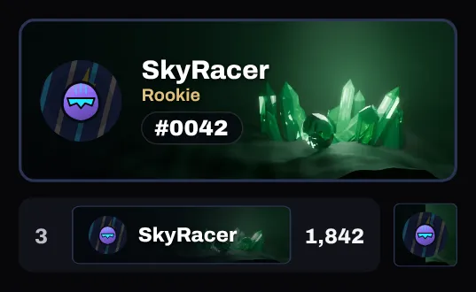 |

Use the new art: in `src/config/cosmeticRedraws.ts`, `"card-art.emerald": true,`

### Lava

`card-art.lava` · Epic · Shop, 1,000 coins · **withdrawn**. Glossy molten blobs with drops of gold.

| Today | Redrawn |
|---|---|
| 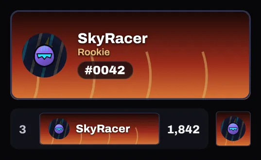 |  |

Use the new art: in `src/config/cosmeticRedraws.ts`, `"card-art.lava": true,`  
Restore it (offer it again): `SELECT economy.restore_item('card-art.lava', 'redrawn, approved <date>');`

### Diamond Plate

`card-art.diamond-plate` · Legendary · Shop, 2,800 coins · **withdrawn**. Gold tread plate with pink and ice gems, with a slow light sweep.

| Today | Redrawn |
|---|---|
|  |  |

Use the new art: in `src/config/cosmeticRedraws.ts`, `"card-art.diamond-plate": true,`  
Restore it (offer it again): `SELECT economy.restore_item('card-art.diamond-plate', 'redrawn, approved <date>');`

### Frost

`card-art.frost` · Elite · Shop, 1,600 coins · **withdrawn**. An ice-crystal cluster on frosty blue, nothing near the name.

| Today | Redrawn |
|---|---|
|  | 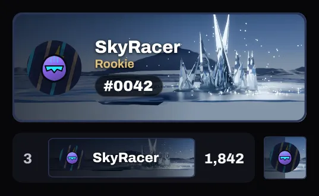 |

Use the new art: in `src/config/cosmeticRedraws.ts`, `"card-art.frost": true,`  
Restore it (offer it again): `SELECT economy.restore_item('card-art.frost', 'redrawn, approved <date>');`

### Neon Skyline

`card-art.neon-skyline` · Legendary · Pass free level 60 · **withdrawn**. A lit city at dusk with a gold moon, on the right only, with a slow light sweep.

| Today | Redrawn |
|---|---|
|  |  |

Use the new art: in `src/config/cosmeticRedraws.ts`, `"card-art.neon-skyline": true,`  
Restore it (offer it again): `SELECT economy.restore_item('card-art.neon-skyline', 'redrawn, approved <date>');`

### Static

`card-art.static` · Rare · Pass premium level 14 · **withdrawn**. A field of grey blocks at random heights, a few lit cyan.

| Today | Redrawn |
|---|---|
| 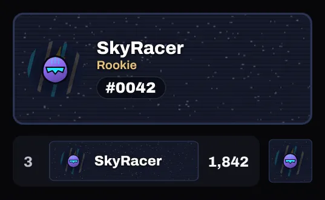 |  |

Use the new art: in `src/config/cosmeticRedraws.ts`, `"card-art.static": true,`  
Restore it (offer it again): `SELECT economy.restore_item('card-art.static', 'redrawn, approved <date>');`

## Frames (13)

### Bronze

`frame.bronze` · Common · Pass free level 6 · **withdrawn**. Bevelled bronze lit from the top left, bronze studs.

| Today | Redrawn |
|---|---|
|  | 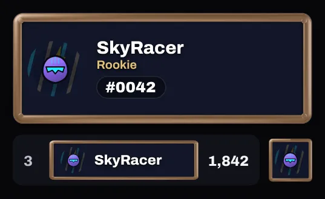 |

Use the new art: in `src/config/cosmeticRedraws.ts`, `"frame.bronze": true,`  
Restore it (offer it again): `SELECT economy.restore_item('frame.bronze', 'redrawn, approved <date>');`

### Silver

`frame.silver` · Rare · Pass free level 26 · **withdrawn**. Bevelled silver, silver studs.

| Today | Redrawn |
|---|---|
| 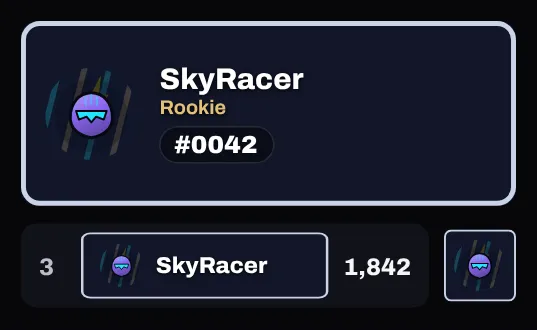 |  |

Use the new art: in `src/config/cosmeticRedraws.ts`, `"frame.silver": true,`  
Restore it (offer it again): `SELECT economy.restore_item('frame.silver', 'redrawn, approved <date>');`

### Obsidian

`frame.obsidian` · Elite · Shop, 1,600 coins · **withdrawn**. Dark glass bevel with a violet edge and an inner line, obsidian studs.

| Today | Redrawn |
|---|---|
| 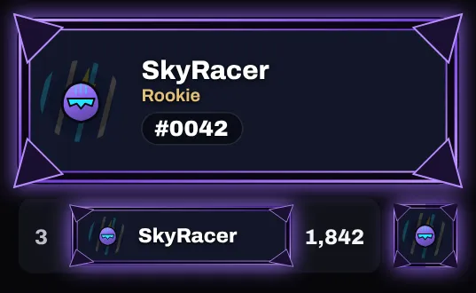 |  |

Use the new art: in `src/config/cosmeticRedraws.ts`, `"frame.obsidian": true,`  
Restore it (offer it again): `SELECT economy.restore_item('frame.obsidian', 'redrawn, approved <date>');`

### Founding

`frame.founding` · no rarity · earned founding player · **withdrawn**. Gold double bevel, a gold bolt crest, a light running round. The FOUNDER plaque is gone (unreadable on the strip).

| Today | Redrawn |
|---|---|
| 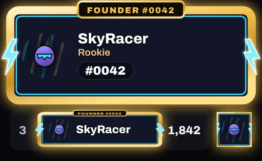 | 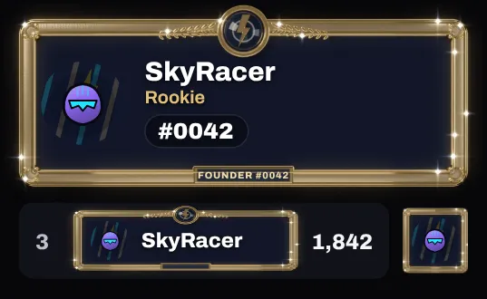 |

Use the new art: in `src/config/cosmeticRedraws.ts`, `"frame.founding": true,`  
Restore it (offer it again): `SELECT economy.restore_item('frame.founding', 'redrawn, approved <date>');`

### Top 500

`frame.top-500` · no rarity · earned top 500 · **withdrawn**. Gold double bevel, a crown crest, gem studs, a light running round; nothing outside the card.

| Today | Redrawn |
|---|---|
| 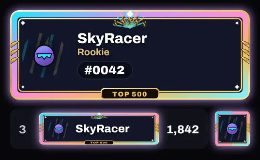 |  |

Use the new art: in `src/config/cosmeticRedraws.ts`, `"frame.top-500": true,`  
Restore it (offer it again): `SELECT economy.restore_item('frame.top-500', 'redrawn, approved <date>');`

### Championship

`frame.championship` · no rarity · tournament · **withdrawn**. Gold double bevel, a trophy crest, a light running round (today it has no art and draws Plain).

| Today | Redrawn |
|---|---|
|  |  |

Use the new art: in `src/config/cosmeticRedraws.ts`, `"frame.championship": true,`  
Restore it (offer it again): `SELECT economy.restore_item('frame.championship', 'redrawn, approved <date>');`

### Season 1 Spark

`frame.s1-spark` · no rarity · earned season peak tier · **withdrawn**. Season 1 Spark: tier-coloured bevel, the tier's gem as crest. No unreadable SEASON 1 tab.

| Today | Redrawn |
|---|---|
| 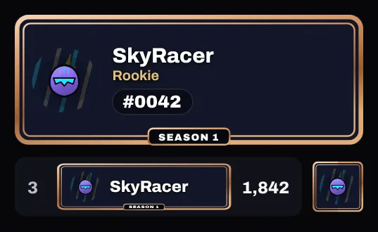 |  |

Use the new art: in `src/config/cosmeticRedraws.ts`, `"frame.s1-spark": true,`  
Restore it (offer it again): `SELECT economy.restore_item('frame.s1-spark', 'redrawn, approved <date>');`

### Season 1 Charge

`frame.s1-charge` · no rarity · earned season peak tier · **withdrawn**. Season 1 Charge: as Spark, in green.

| Today | Redrawn |
|---|---|
|  |  |

Use the new art: in `src/config/cosmeticRedraws.ts`, `"frame.s1-charge": true,`  
Restore it (offer it again): `SELECT economy.restore_item('frame.s1-charge', 'redrawn, approved <date>');`

### Season 1 Volt

`frame.s1-volt` · no rarity · earned season peak tier · **withdrawn**. Season 1 Volt: as Spark, in cyan.

| Today | Redrawn |
|---|---|
|  | 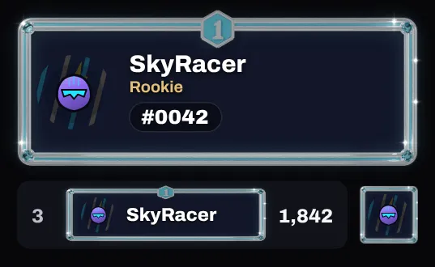 |

Use the new art: in `src/config/cosmeticRedraws.ts`, `"frame.s1-volt": true,`  
Restore it (offer it again): `SELECT economy.restore_item('frame.s1-volt', 'redrawn, approved <date>');`

### Season 1 Surge

`frame.s1-surge` · no rarity · earned season peak tier · **withdrawn**. Season 1 Surge: as Spark, in blue.

| Today | Redrawn |
|---|---|
|  |  |

Use the new art: in `src/config/cosmeticRedraws.ts`, `"frame.s1-surge": true,`  
Restore it (offer it again): `SELECT economy.restore_item('frame.s1-surge', 'redrawn, approved <date>');`

### Season 1 Storm

`frame.s1-storm` · no rarity · earned season peak tier · **withdrawn**. Season 1 Storm: double bevel in violet, a light running round.

| Today | Redrawn |
|---|---|
|  |  |

Use the new art: in `src/config/cosmeticRedraws.ts`, `"frame.s1-storm": true,`  
Restore it (offer it again): `SELECT economy.restore_item('frame.s1-storm', 'redrawn, approved <date>');`

### Season 1 Lightning

`frame.s1-lightning` · no rarity · earned season peak tier · **withdrawn**. Season 1 Lightning: double bevel in gold-yellow, a light running round.

| Today | Redrawn |
|---|---|
|  |  |

Use the new art: in `src/config/cosmeticRedraws.ts`, `"frame.s1-lightning": true,`  
Restore it (offer it again): `SELECT economy.restore_item('frame.s1-lightning', 'redrawn, approved <date>');`

### Season 1 Top 500

`frame.s1-top-500` · no rarity · earned season peak tier · **withdrawn**. Season 1 Top 500: double gold bevel, a light running round.

| Today | Redrawn |
|---|---|
|  | 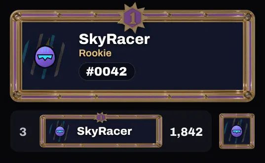 |

Use the new art: in `src/config/cosmeticRedraws.ts`, `"frame.s1-top-500": true,`  
Restore it (offer it again): `SELECT economy.restore_item('frame.s1-top-500', 'redrawn, approved <date>');`

## Name colours (5)

### Chrome

`name-colour.chrome` · Epic · Shop, 1,000 coins · **withdrawn**. True chrome: a bright horizon band and a dark edge.

| Today | Redrawn |
|---|---|
|  |  |

Use the new art: in `src/config/cosmeticRedraws.ts`, `"name-colour.chrome": true,`  
Restore it (offer it again): `SELECT economy.restore_item('name-colour.chrome', 'redrawn, approved <date>');`

### Neon Pink

`name-colour.neon-pink` · Common · Pass free level 10 · **withdrawn**. Glossy pink with a dark edge.

| Today | Redrawn |
|---|---|
| 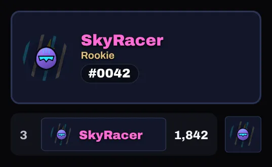 |  |

Use the new art: in `src/config/cosmeticRedraws.ts`, `"name-colour.neon-pink": true,`  
Restore it (offer it again): `SELECT economy.restore_item('name-colour.neon-pink', 'redrawn, approved <date>');`

### Neon Cyan

`name-colour.neon-cyan` · Rare · Pass premium level 3 · **withdrawn**. Glossy cyan with a dark edge.

| Today | Redrawn |
|---|---|
| 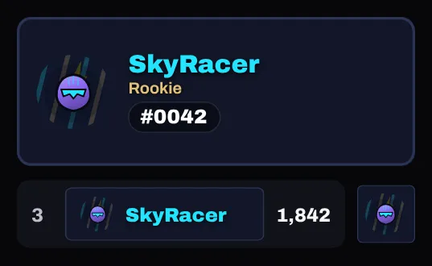 | 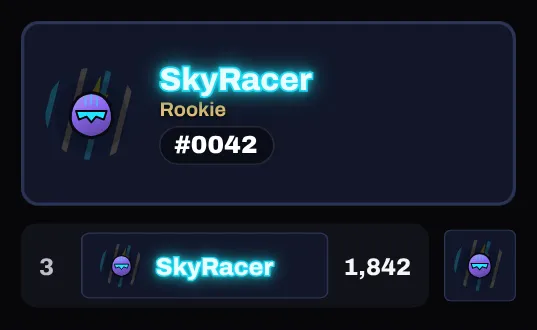 |

Use the new art: in `src/config/cosmeticRedraws.ts`, `"name-colour.neon-cyan": true,`  
Restore it (offer it again): `SELECT economy.restore_item('name-colour.neon-cyan', 'redrawn, approved <date>');`

### Neon Red

`name-colour.neon-red` · Rare · Pass premium level 18 · **withdrawn**. Glossy red with a dark edge.

| Today | Redrawn |
|---|---|
| 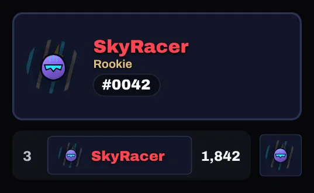 | 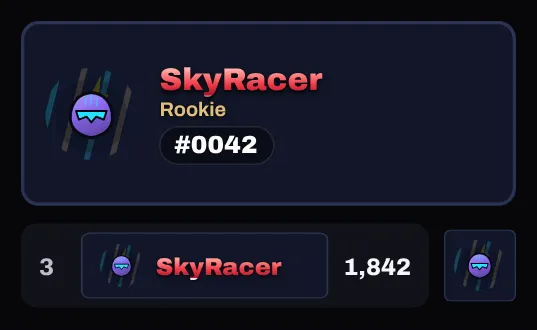 |

Use the new art: in `src/config/cosmeticRedraws.ts`, `"name-colour.neon-red": true,`  
Restore it (offer it again): `SELECT economy.restore_item('name-colour.neon-red', 'redrawn, approved <date>');`

### Electric Orange

`name-colour.electric-orange` · Epic · Pass premium level 35 · **withdrawn**. Glossy orange to gold in Archivo (the pixel face lost letters on the strip).

| Today | Redrawn |
|---|---|
| 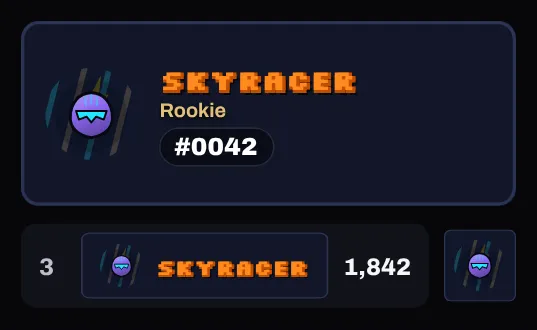 | 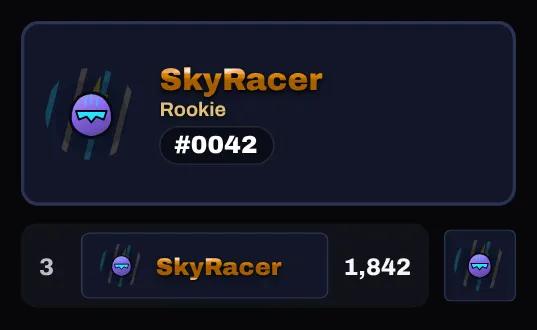 |

Use the new art: in `src/config/cosmeticRedraws.ts`, `"name-colour.electric-orange": true,`  
Restore it (offer it again): `SELECT economy.restore_item('name-colour.electric-orange', 'redrawn, approved <date>');`

## Avatar finishes (4)

### Carbon

`avatar-finish.carbon` · Epic · Shop, 1,000 coins · **withdrawn**. Woven carbon under a clear coat, a carbon rim.

| Today | Redrawn |
|---|---|
|  |  |

Use the new art: in `src/config/cosmeticRedraws.ts`, `"avatar-finish.carbon": true,`  
Restore it (offer it again): `SELECT economy.restore_item('avatar-finish.carbon', 'redrawn, approved <date>');`

### Chrome

`avatar-finish.chrome` · Epic · Shop, 1,000 coins · **withdrawn**. Mirror chrome on the avatar, a gloss highlight and a chrome rim round the circle.

| Today | Redrawn |
|---|---|
| 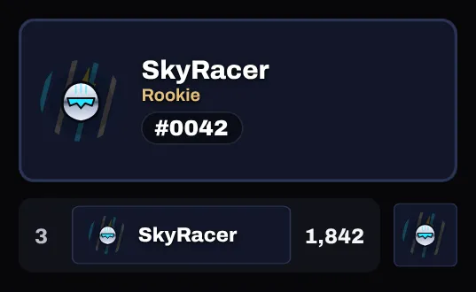 | 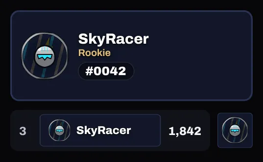 |

Use the new art: in `src/config/cosmeticRedraws.ts`, `"avatar-finish.chrome": true,`  
Restore it (offer it again): `SELECT economy.restore_item('avatar-finish.chrome', 'redrawn, approved <date>');`

### Holographic

`avatar-finish.holographic` · Elite · Shop, 1,600 coins · **withdrawn**. Pastel foil with moving light bands, a foil rim.

| Today | Redrawn |
|---|---|
| 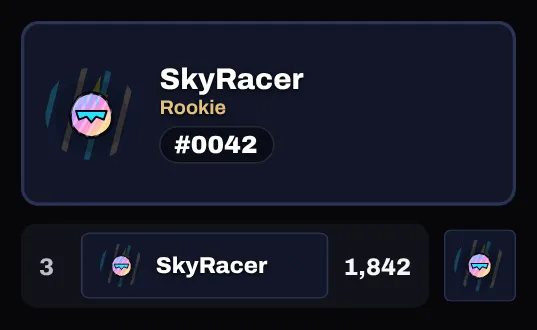 | 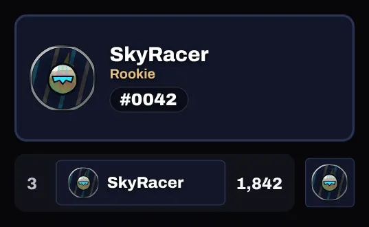 |

Use the new art: in `src/config/cosmeticRedraws.ts`, `"avatar-finish.holographic": true,`  
Restore it (offer it again): `SELECT economy.restore_item('avatar-finish.holographic', 'redrawn, approved <date>');`

### Neon Glow

`avatar-finish.neon-glow` · Elite · Pass premium level 40 · **withdrawn**. The player's own colour lit as a tube, with a ring of the same light.

| Today | Redrawn |
|---|---|
| 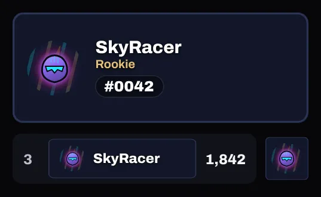 | 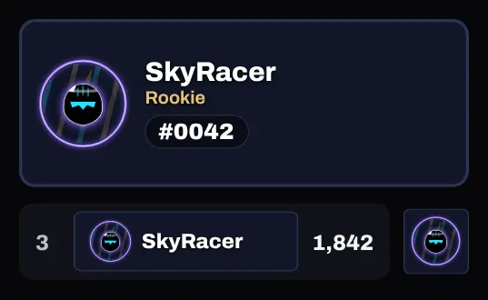 |

Use the new art: in `src/config/cosmeticRedraws.ts`, `"avatar-finish.neon-glow": true,`  
Restore it (offer it again): `SELECT economy.restore_item('avatar-finish.neon-glow', 'redrawn, approved <date>');`

## Avatar accessory (1)

### Neon Bolt

`avatar-accessory.neon-bolt` · Epic · Pass premium level 52 · **withdrawn**. A 3D cyan bolt above the circle.

| Today | Redrawn |
|---|---|
|  | 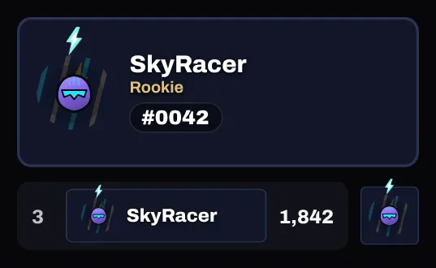 |

Use the new art: in `src/config/cosmeticRedraws.ts`, `"avatar-accessory.neon-bolt": true,`  
Restore it (offer it again): `SELECT economy.restore_item('avatar-accessory.neon-bolt', 'redrawn, approved <date>');`

## Reaction packs (6)

### Spark

`reaction.spark` · Common · Pass free level 22 · **withdrawn**. A glossy gold star.

| Today | Redrawn |
|---|---|
|  |  |

Use the new art: in `src/config/cosmeticRedraws.ts`, `"reaction.spark": true,`  
Restore it (offer it again): `SELECT economy.restore_item('reaction.spark', 'redrawn, approved <date>');`

### Zap

`reaction.zap` · Rare · Pass premium level 8 · **withdrawn**. A glossy cyan bolt.

| Today | Redrawn |
|---|---|
| 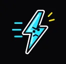 | 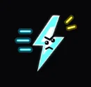 |

Use the new art: in `src/config/cosmeticRedraws.ts`, `"reaction.zap": true,`  
Restore it (offer it again): `SELECT economy.restore_item('reaction.zap', 'redrawn, approved <date>');`

### Clutch

`reaction.clutch` · Rare · Pass premium level 28 · **withdrawn**. A gold plaque reading CLUTCH!

| Today | Redrawn |
|---|---|
|  |  |

Use the new art: in `src/config/cosmeticRedraws.ts`, `"reaction.clutch": true,`  
Restore it (offer it again): `SELECT economy.restore_item('reaction.clutch', 'redrawn, approved <date>');`

### Captain's Calls

`reaction.captains-calls` · Epic · Shop, 1,000 coins · **withdrawn**. Glossy speech bubbles, each phrase on one line.

| Today | Redrawn |
|---|---|
|  |  |

Use the new art: in `src/config/cosmeticRedraws.ts`, `"reaction.captains-calls": true,`  
Restore it (offer it again): `SELECT economy.restore_item('reaction.captains-calls', 'redrawn, approved <date>');`

### Retro Arcade

`reaction.retro-arcade` · Epic · Shop, 1,000 coins · **withdrawn**. Four glossy key caps: a heart, 1UP, LAG!!, GLHF.

| Today | Redrawn |
|---|---|
|  |  |

Use the new art: in `src/config/cosmeticRedraws.ts`, `"reaction.retro-arcade": true,`  
Restore it (offer it again): `SELECT economy.restore_item('reaction.retro-arcade', 'redrawn, approved <date>');`

### Neon Signs

`reaction.neon-signs` · Epic · Pass premium level 22 · **withdrawn**. Four framed sign boards, each word in its own colour.

| Today | Redrawn |
|---|---|
|  |  |

Use the new art: in `src/config/cosmeticRedraws.ts`, `"reaction.neon-signs": true,`  
Restore it (offer it again): `SELECT economy.restore_item('reaction.neon-signs', 'redrawn, approved <date>');`

## Celebrations (3)

### Spotlight

`celebration.spotlight` · Epic · Shop, 1,000 coins · **withdrawn**. A gold podium drum under two swaying beams and a pool of light.

| Today | Redrawn |
|---|---|
|  |  |

Use the new art: in `src/config/cosmeticRedraws.ts`, `"celebration.spotlight": true,`  
Restore it (offer it again): `SELECT economy.restore_item('celebration.spotlight', 'redrawn, approved <date>');`

### Shockwave

`celebration.shockwave` · Elite · Shop, 1,600 coins · **withdrawn**. Rings bursting out from the podium drum.

| Today | Redrawn |
|---|---|
|  |  |

Use the new art: in `src/config/cosmeticRedraws.ts`, `"celebration.shockwave": true,`  
Restore it (offer it again): `SELECT economy.restore_item('celebration.shockwave', 'redrawn, approved <date>');`

### Circuit Overload

`celebration.circuit-overload` · Elite · Pass premium level 58 · **withdrawn**. Gold circuit traces with pulses running in, gold bolts above.

| Today | Redrawn |
|---|---|
|  |  |

Use the new art: in `src/config/cosmeticRedraws.ts`, `"celebration.circuit-overload": true,`  
Restore it (offer it again): `SELECT economy.restore_item('celebration.circuit-overload', 'redrawn, approved <date>');`

## Tile style (1)

### Circuit Trace

`tile-style.circuit-trace` · Common · Pass free level 16 · **withdrawn**. Raised gold traces and pads on a dark green board.

| Today | Redrawn |
|---|---|
|  |  |

Use the new art: in `src/config/cosmeticRedraws.ts`, `"tile-style.circuit-trace": true,`  
Restore it (offer it again): `SELECT economy.restore_item('tile-style.circuit-trace', 'redrawn, approved <date>');`

## Card backs (3)

### Royal Damask

`card-back.royal-damask` · Epic · Shop, 1,000 coins · live. Gold-ink damask, a lit gold frame with studs, a gold medallion with a raised bolt.

| Today | Redrawn |
|---|---|
|  |  |

Use the new art: in `src/config/cosmeticRedraws.ts`, `"card-back.royal-damask": true,`

### Holo Foil

`card-back.holo-foil` · Elite · Shop, 1,600 coins · live. Pearl foil with prism bands, a silver frame, a white star.

| Today | Redrawn |
|---|---|
|  |  |

Use the new art: in `src/config/cosmeticRedraws.ts`, `"card-back.holo-foil": true,`

### Neon card back

`card-back.neon` · Epic · Pass premium level 4 · live. Dark glass with a fine grid, a cyan frame, pink traces, a white-cored bolt.

| Today | Redrawn |
|---|---|
|  |  |

Use the new art: in `src/config/cosmeticRedraws.ts`, `"card-back.neon": true,`

## Game skins (14)

### Watermelon

`game-skin.crazy-golf.watermelon` · Epic · Shop, 1,000 coins · **withdrawn**. A glossy watermelon ball: ragged rind stripes.

| Today | Redrawn |
|---|---|
|  |  |

Use the new art: in `src/config/cosmeticRedraws.ts`, `"game-skin.crazy-golf.watermelon": true,`  
Restore it (offer it again): `SELECT economy.restore_item('game-skin.crazy-golf.watermelon', 'redrawn, approved <date>');`

### Disco

`game-skin.crazy-golf.disco` · Epic · Shop, 1,000 coins · **withdrawn**. Lit mirror tiles, brighter to the top left.

| Today | Redrawn |
|---|---|
|  |  |

Use the new art: in `src/config/cosmeticRedraws.ts`, `"game-skin.crazy-golf.disco": true,`  
Restore it (offer it again): `SELECT economy.restore_item('game-skin.crazy-golf.disco', 'redrawn, approved <date>');`

### Neon Glow

`game-skin.crazy-golf.neon-glow` · Rare · Pass free level 14 · **withdrawn**. A translucent cyan ball with shaded dimples.

| Today | Redrawn |
|---|---|
|  |  |

Use the new art: in `src/config/cosmeticRedraws.ts`, `"game-skin.crazy-golf.neon-glow": true,`  
Restore it (offer it again): `SELECT economy.restore_item('game-skin.crazy-golf.neon-glow', 'redrawn, approved <date>');`

### Plasma

`game-skin.crazy-golf.plasma` · Epic · Pass premium level 32 · **withdrawn**. A violet ball with a glowing core and white-cored arcs.

| Today | Redrawn |
|---|---|
|  |  |

Use the new art: in `src/config/cosmeticRedraws.ts`, `"game-skin.crazy-golf.plasma": true,`  
Restore it (offer it again): `SELECT economy.restore_item('game-skin.crazy-golf.plasma', 'redrawn, approved <date>');`

### Pixel Pool

`game-skin.cue-ball.pixel-pool` · Epic · Shop, 1,000 coins · **withdrawn**. Pixel balls shaded in whole pixels, a pixel highlight.

| Today | Redrawn |
|---|---|
|  |  |

Use the new art: in `src/config/cosmeticRedraws.ts`, `"game-skin.cue-ball.pixel-pool": true,`  
Restore it (offer it again): `SELECT economy.restore_item('game-skin.cue-ball.pixel-pool', 'redrawn, approved <date>');`

### Galaxy Set

`game-skin.cue-ball.galaxy-set` · Elite · Shop, 1,600 coins · **withdrawn**. The galaxy balls with full gloss.

| Today | Redrawn |
|---|---|
|  |  |

Use the new art: in `src/config/cosmeticRedraws.ts`, `"game-skin.cue-ball.galaxy-set": true,`  
Restore it (offer it again): `SELECT economy.restore_item('game-skin.cue-ball.galaxy-set', 'redrawn, approved <date>');`

### Neon 8-ball

`game-skin.cue-ball.neon-8-ball` · Rare · Pass free level 36 · **withdrawn**. The 8 as glass lit from inside, gloss and a bright rim.

| Today | Redrawn |
|---|---|
|  |  |

Use the new art: in `src/config/cosmeticRedraws.ts`, `"game-skin.cue-ball.neon-8-ball": true,`  
Restore it (offer it again): `SELECT economy.restore_item('game-skin.cue-ball.neon-8-ball', 'redrawn, approved <date>');`

### Neon ball set

`game-skin.cue-ball.neon-ball-set` · Epic · Pass premium level 42 · **withdrawn**. Every ball as glass lit from inside in its colour.

| Today | Redrawn |
|---|---|
|  |  |

Use the new art: in `src/config/cosmeticRedraws.ts`, `"game-skin.cue-ball.neon-ball-set": true,`  
Restore it (offer it again): `SELECT economy.restore_item('game-skin.cue-ball.neon-ball-set', 'redrawn, approved <date>');`

### Glacier

`game-skin.curl-champ.glacier` · Epic · Shop, 1,000 coins · **withdrawn**. Polished granite with an icy top.

| Today | Redrawn |
|---|---|
|  |  |

Use the new art: in `src/config/cosmeticRedraws.ts`, `"game-skin.curl-champ.glacier": true,`  
Restore it (offer it again): `SELECT economy.restore_item('game-skin.curl-champ.glacier', 'redrawn, approved <date>');`

### Aurora

`game-skin.curl-champ.aurora` · Elite · Shop, 1,600 coins · **withdrawn**. Polished granite with an aurora disc.

| Today | Redrawn |
|---|---|
|  |  |

Use the new art: in `src/config/cosmeticRedraws.ts`, `"game-skin.curl-champ.aurora": true,`  
Restore it (offer it again): `SELECT economy.restore_item('game-skin.curl-champ.aurora', 'redrawn, approved <date>');`

### Neon stones

`game-skin.curl-champ.neon-stones` · Epic · Pass premium level 25 · **withdrawn**. Polished granite with lit tube inlays.

| Today | Redrawn |
|---|---|
|  |  |

Use the new art: in `src/config/cosmeticRedraws.ts`, `"game-skin.curl-champ.neon-stones": true,`  
Restore it (offer it again): `SELECT economy.restore_item('game-skin.curl-champ.neon-stones', 'redrawn, approved <date>');`

### Midnight Felt

`game-skin.full-house.midnight-felt` · Epic · Shop, 1,000 coins · **withdrawn**. Woven midnight cloth with nap, a lit rail, stitching.

| Today | Redrawn |
|---|---|
|  |  |

Use the new art: in `src/config/cosmeticRedraws.ts`, `"game-skin.full-house.midnight-felt": true,`  
Restore it (offer it again): `SELECT economy.restore_item('game-skin.full-house.midnight-felt', 'redrawn, approved <date>');`

### Crimson Velvet

`game-skin.full-house.crimson-velvet` · Epic · Shop, 1,000 coins · **withdrawn**. Crimson velvet with nap, a lit rail, stitching.

| Today | Redrawn |
|---|---|
|  |  |

Use the new art: in `src/config/cosmeticRedraws.ts`, `"game-skin.full-house.crimson-velvet": true,`  
Restore it (offer it again): `SELECT economy.restore_item('game-skin.full-house.crimson-velvet', 'redrawn, approved <date>');`

### Neon felt

`game-skin.full-house.neon-felt` · Epic · Pass premium level 12 · **withdrawn**. Dark cloth with a lit cyan tube edge.

| Today | Redrawn |
|---|---|
|  |  |

Use the new art: in `src/config/cosmeticRedraws.ts`, `"game-skin.full-house.neon-felt": true,`  
Restore it (offer it again): `SELECT economy.restore_item('game-skin.full-house.neon-felt', 'redrawn, approved <date>');`

## World themes (3)

### Apex: Neon Night

`world-theme.apex.neon-night` · Legendary · Pass premium level 45 · **withdrawn**. A deep sky with a horizon glow, a moon, lit towers; the road unchanged.

| Today | Redrawn |
|---|---|
|  |  |

Use the new art: in `src/config/cosmeticRedraws.ts`, `"world-theme.apex.neon-night": true,`  
Restore it (offer it again): `SELECT economy.restore_item('world-theme.apex.neon-night', 'redrawn, approved <date>');`

### Crazy Golf: Neon Course

`world-theme.crazy-golf.neon-course` · Legendary · Pass free level 50 · **withdrawn**. Lit night turf; rails and hazards as lit tubes on the same lines.

| Today | Redrawn |
|---|---|
|  |  |

Use the new art: in `src/config/cosmeticRedraws.ts`, `"world-theme.crazy-golf.neon-course": true,`  
Restore it (offer it again): `SELECT economy.restore_item('world-theme.crazy-golf.neon-course', 'redrawn, approved <date>');`

### Curl Champ: Neon Rink

`world-theme.curl-champ.neon-rink` · Elite · Pass premium level 24 · **withdrawn**. Ice with depth and a lit arena; every ring and line where it was.

| Today | Redrawn |
|---|---|
|  |  |

Use the new art: in `src/config/cosmeticRedraws.ts`, `"world-theme.curl-champ.neon-rink": true,`  
Restore it (offer it again): `SELECT economy.restore_item('world-theme.curl-champ.neon-rink', 'redrawn, approved <date>');`
