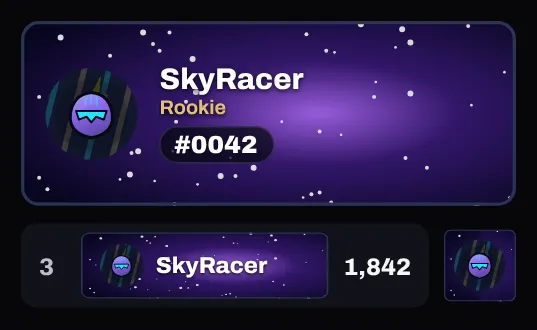
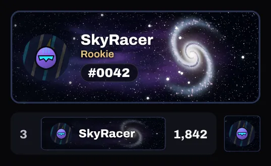
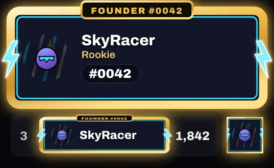
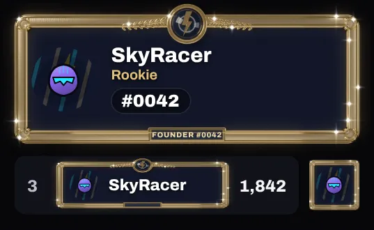
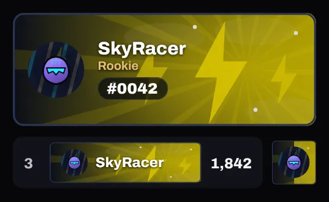
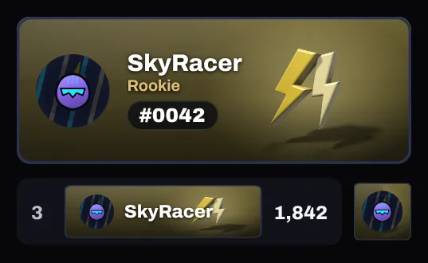
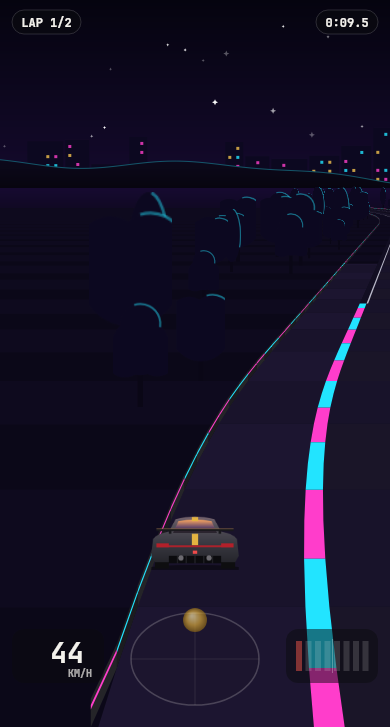
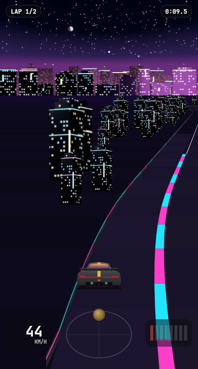
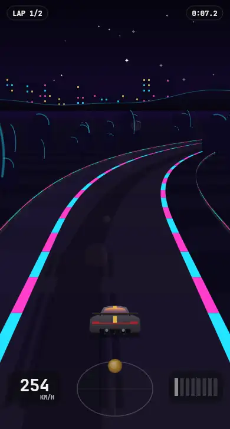
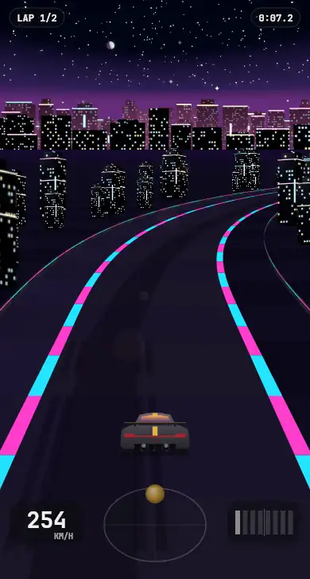

# Cosmetics redraws: the five samples (15 Nov 2026)

The second pass's first proof of [ART-DIRECTION.md](ART-DIRECTION.md): five items rendered in Blender (Cycles, `bpy`
5.3, physically based materials, studio or scene light, depth of field, atmosphere), each beside today's version.
Every one is behind its switch and **off**: players see no change. Turning one on is one line (below each).

Card items are shown as players see them: the full card (Profile), the leaderboard strip row (the name must always
read there) and the Friends list's mini card. Game looks are the full game screen at phone size, and a short clip.

## 1. Galaxy card art (`card-art.galaxy`, Shop, Epic, 1,000 coins, live)

A spiral galaxy built from about 300,000 star particles (blue young arms, a gold core, pink star-forming knots, dust
lanes) on a tilted disc, a filamentary nebula volume lit from within, thousands of stars at three depths, the near
ones out of focus. Script `blender/galaxy.py`; 900 × 336, 42 KB.

| Today | Redrawn |
|---|---|
|  |  |

Switch: `"card-art.galaxy": true,` in `src/config/cosmeticRedraws.ts`.

## 2. Founding frame (`frame.founding`, earned by Founding Players, withdrawn)

A trophy of a frame: a cast champagne-gold band swept from a bevelled profile (an outer bead, a guilloche-engraved
field, a polished inner bead), four brilliant-cut stones in gold collets, a crest medallion (gold rim, navy enamel, a
raised gold bolt) between two laurel sprays, and a navy-enamel plaque with the player's own number engraved live
("FOUNDER #0042", on the full card only). A light runs over the metal (stopped under Reduce Motion). Script
`blender/frame_founding.py`; 960 × 396 with its shadow, 40 KB.

| Today | Redrawn |
|---|---|
|  |  |

Switch: `"frame.founding": true,`. Restore (offer again): `SELECT economy.restore_item('frame.founding', 'redrawn, approved <date>');`.

## 3. Lightning tier card art (`card-art.tier.lightning`, earned by season peak tier)

The moment of a strike: storm clouds as a volume lit from inside by a branching gold bolt, forks spreading through the
cloud base, rain, the strike landing in a dark sea; graded navy shadows, gold light. A distant flash crosses the card
every few seconds (stopped under Reduce Motion). Script `blender/tier_lightning.py`; 900 × 336, 14 KB.

| Today | Redrawn |
|---|---|
|  |  |

Switch: `"card-art.tier.lightning": true,`.

## 4. Apex's Neon Night world theme (`world-theme.apex.neon-night`, Pass premium, Legendary)

The track runs through a city: a Blender-rendered night sky, a seamless 360° far skyline in a violet street haze, a
near band of dark glass towers with lit windows, neon signs and roof beacons, and lit skyscrapers along the road in
place of the trees. The road, kerbs, lights, car and HUD are untouched (the same draw calls; only the cached
scenery layers change). Script `blender/apex_neon_night.py`; six images, 230 KB in all (sky 6 KB, far 79 KB,
near 63 KB, towers 5–6 KB each). Drawn by `src/lib/arcade/skins/racing.skins.ts` once loaded; until then the
first pass's painters.

| Today | Redrawn |
|---|---|
|  |  |
|  |  |

Switch: `"world-theme.apex.neon-night": true,`.

## 5. Crazy Golf's default course (every player's look, not a cosmetic)

See [samples/crazy-golf/](samples/crazy-golf/) (filled in below once its pictures are made).

Switch: `"default.crazy-golf.course": true,` in `REDRAWN_DEFAULT_LOOKS` (`src/config/cosmeticRedraws.ts`).
