# Game key art · gallery

Phase 2 step 4 (15 Nov 2026). Glossy 3D key art for all 83 live games, one square tile (320 × 320) and one wide hero
(960 × 600) each, made in the art kit's renderer. How it was made and how to re-render: [README.md](README.md).
**Not wired into the app.**

## Today against new

The Games catalogue (Cue Ball as the game of the day, then six tiles) and Cue Ball's game page, with today's live
board previews (`public/tiles/`) on the left and the new key art on the right.

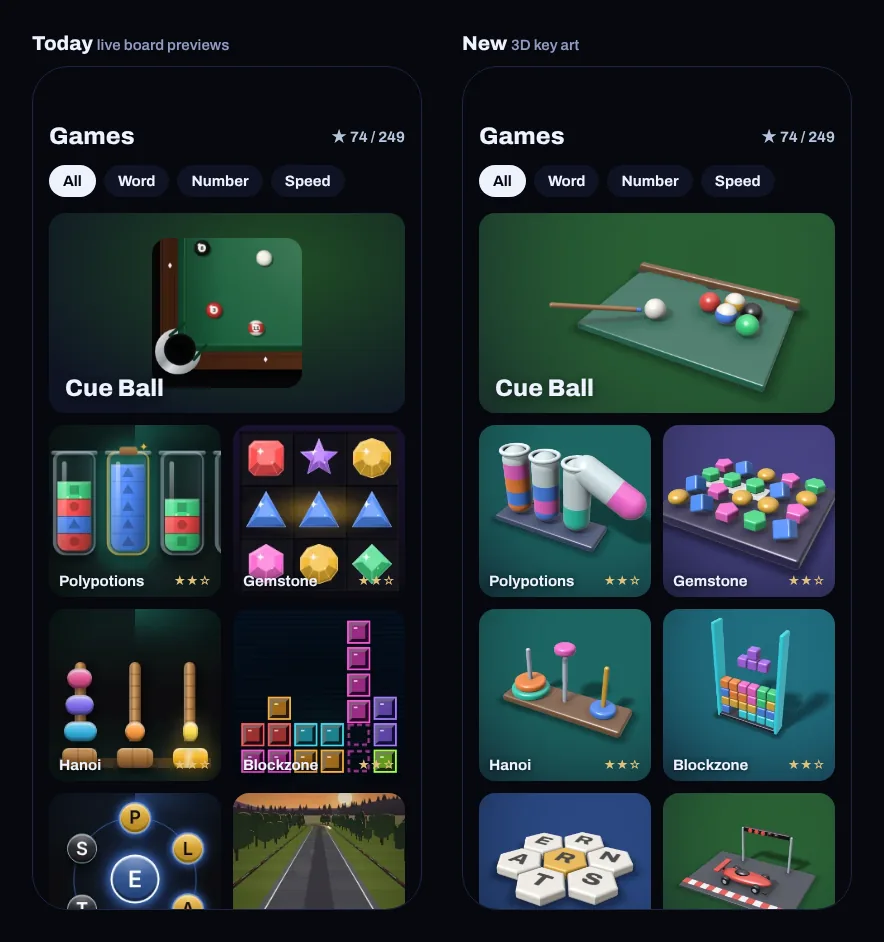

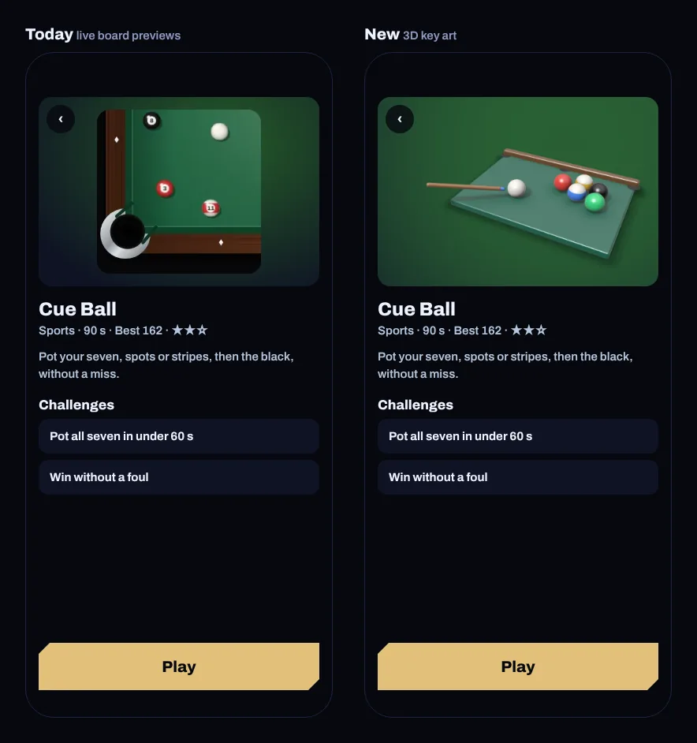

## Contact sheets

Each game's tile and hero, shown small, by category (arcade games by group).

### Word

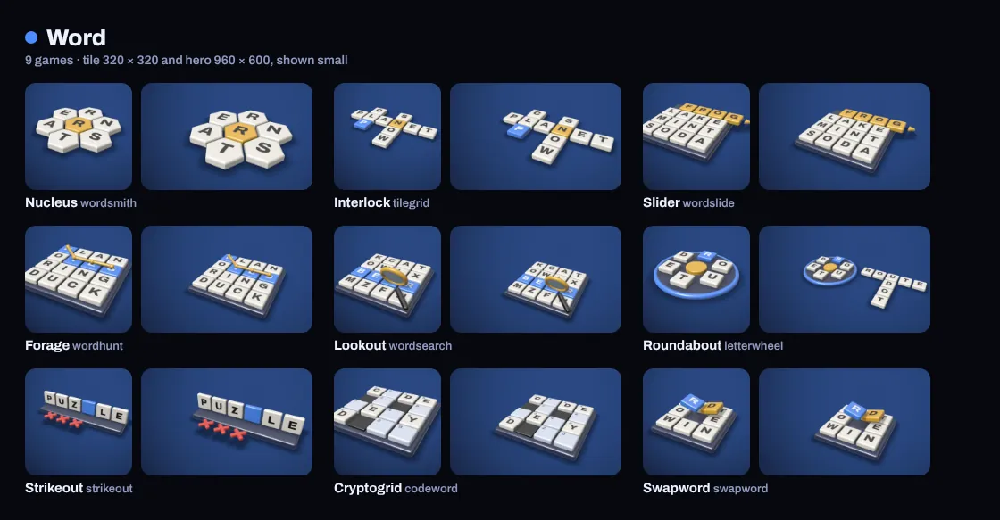

### Number

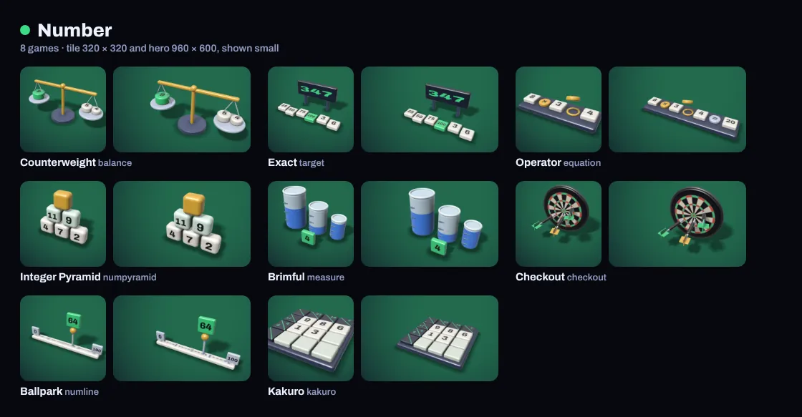

### Speed

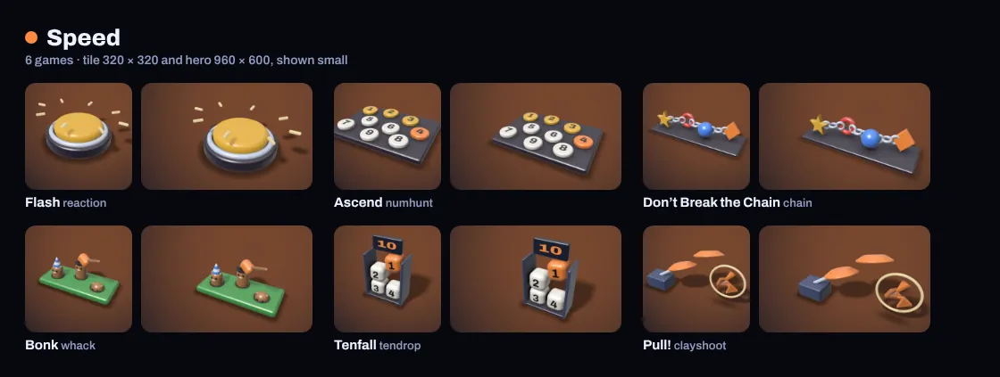

### Attention

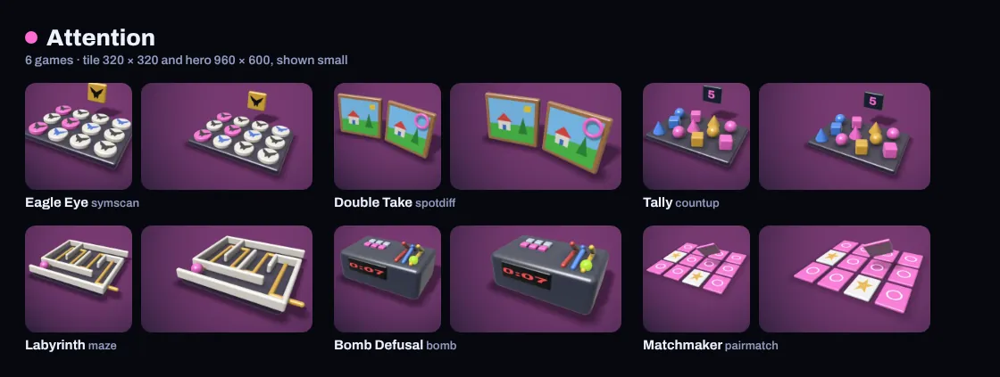

### Pattern

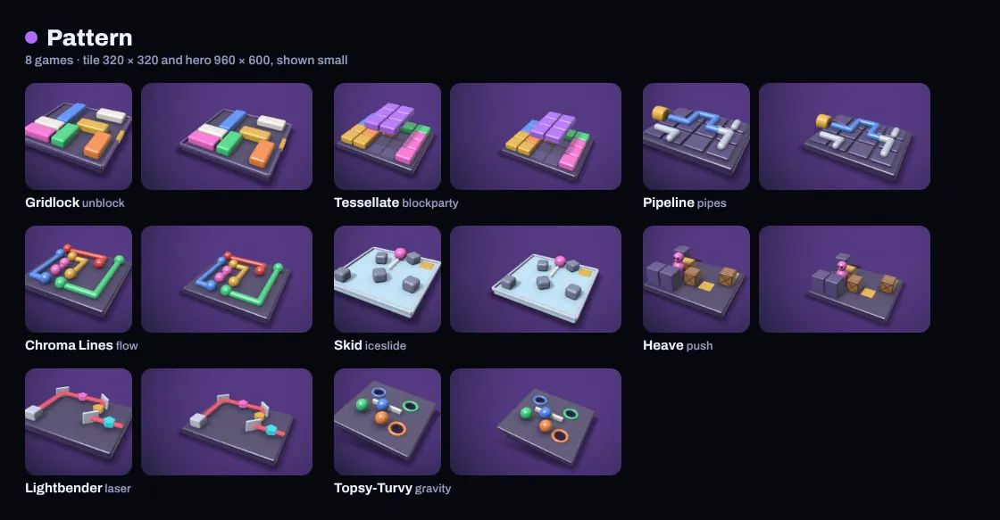

### Logic

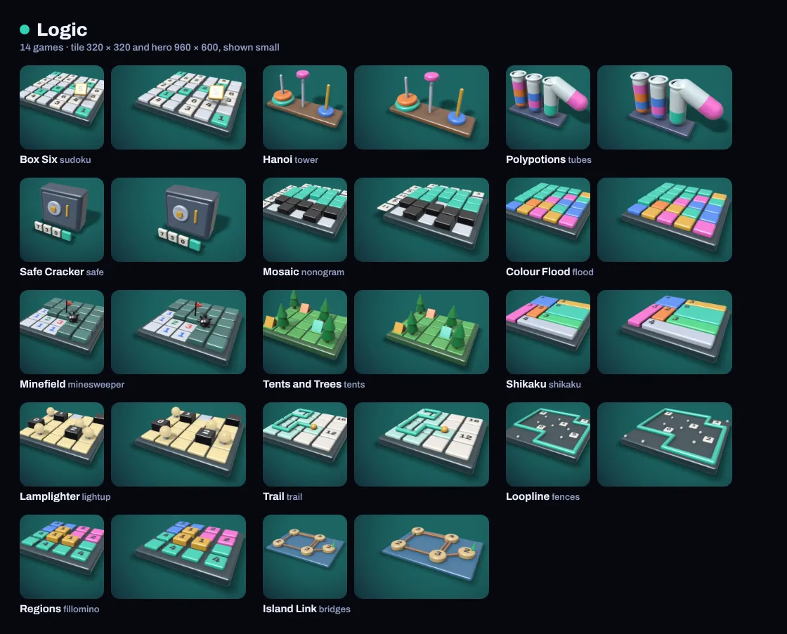

### Arcade · Retro

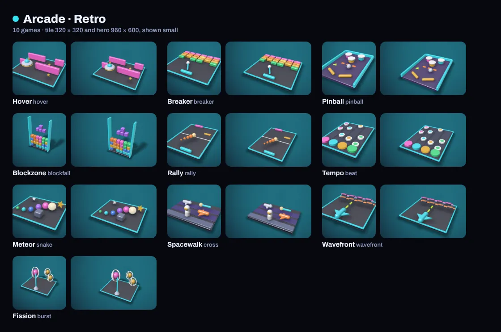

### Arcade · Sports

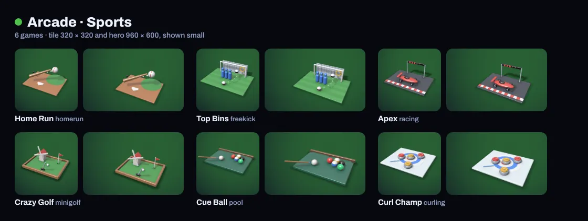

### Arcade · Cards & Board

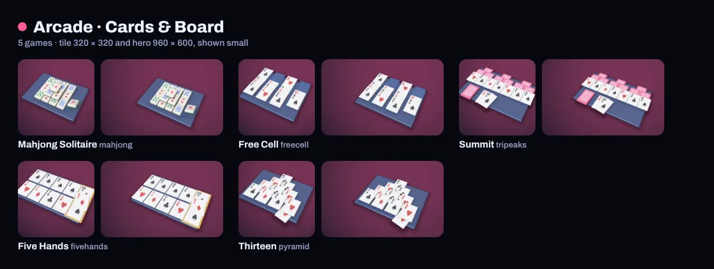

### Arcade · Action

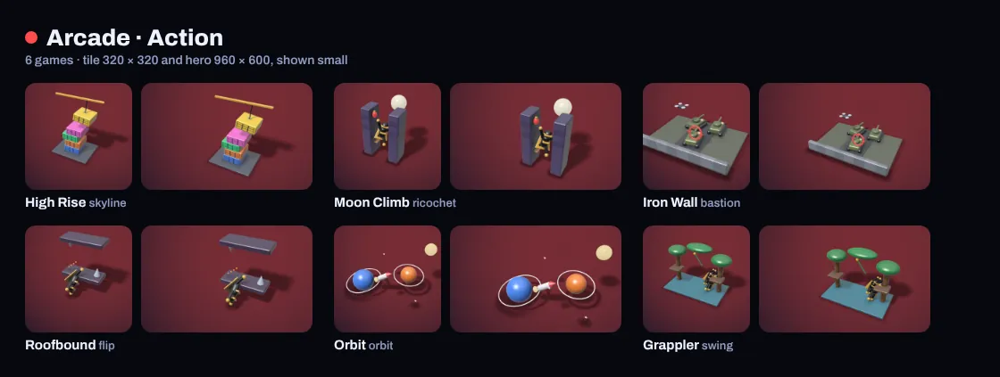

### Arcade · Strategy

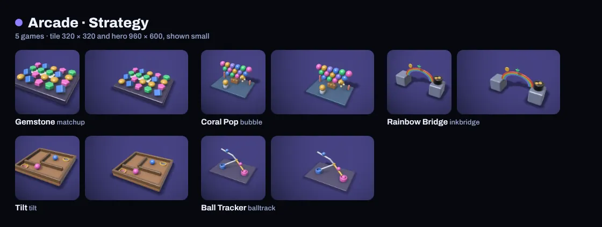

## Every file

`tile/<id>.webp` and `hero/<id>.webp`, where `<id>` is the game's id in `src/lib/duel/catalogue.ts` (Cue Ball is
`pool`, Polypotions `tubes`). The full list is `source/games.data.mjs`.
