# Action: game concepts

Concept pictures only (phase 2, step 4): nothing here is in the app. Each game is drawn mid-play at phone
proportions (390 × 844, shown 720 px tall) on today's board, pieces and layout, with a placeholder band where the
game header goes. Rendered in Blender 5.3 (Cycles, CPU) from the scripts in [`source/`](source/), with bloom, the
header band and the HUD pills added in post.

Per Joe's note of 15 Nov 2026, both looks keep each game's own colours, style and character:

- **A, Today upgraded**: today's colours, style and layout at full finish (real materials, lighting, depth, detail).
- **B, Bolder**: the same game and identity, pushed further (richer materials, more atmosphere, more drama).

None of this category's games is a flagship, so none has a third look. Today's frames are the game reviews'
mid-play captures.

| Game | Today | A: Today upgraded | B: Bolder |
|---|---|---|---|
| [Roofbound](#roofbound) | 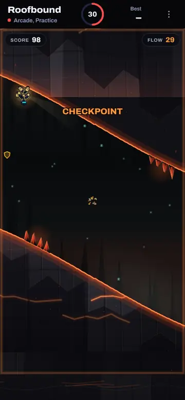 | 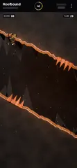 | 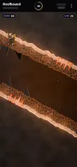 |
| [Grappler](#grappler) | 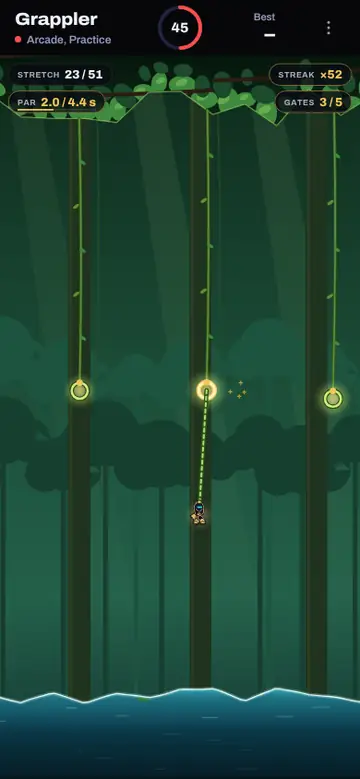 | 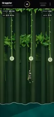 | 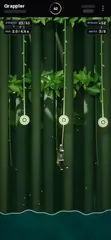 |
| [Moon Climb](#moon-climb) | 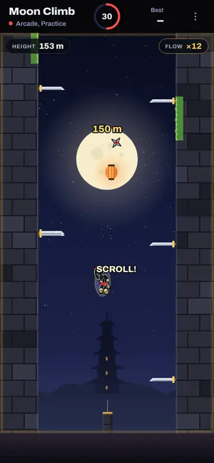 | 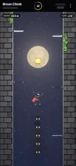 | 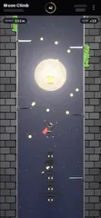 |
| [Iron Wall](#iron-wall) | 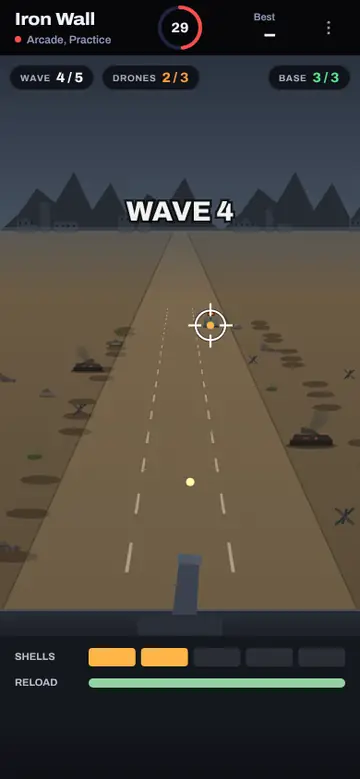 | 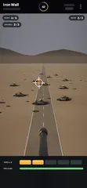 | 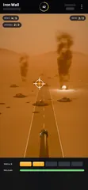 |
| [High Rise](#high-rise) | 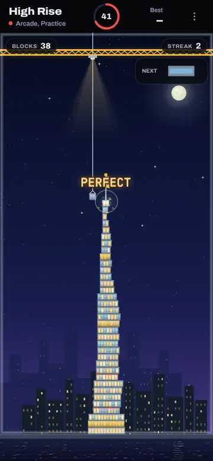 | 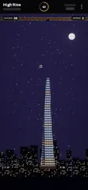 | 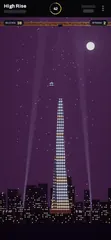 |
| [Orbit](#orbit) | 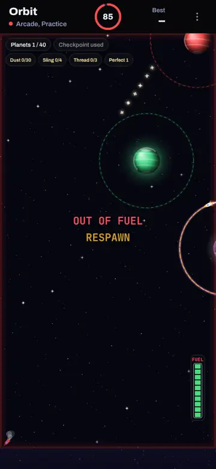 | 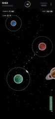 | 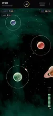 |

## Roofbound

`flip` · scene: [`source/games/flip.py`](source/games/flip.py)

| Today | A: Today upgraded | B: Bolder |
|---|---|---|
|  | 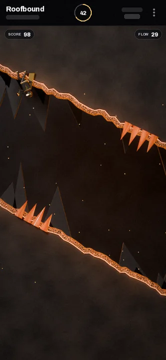 | 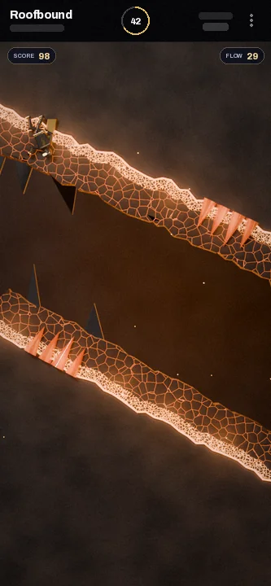 |

- **A:** Today's charcoal cave and diagonal corridor in real basalt: a thin molten rim along each edge, orange-red obsidian spikes, angular grey rock behind, the runner in Captain-style suit on the ceiling.
- **B:** The rock turns to a live lava crust: glowing crack networks spread from both edges, a hotter core glow in the corridor and embers in the air.

## Grappler

`swing` · scene: [`source/games/swing.py`](source/games/swing.py)

| Today | A: Today upgraded | B: Bolder |
|---|---|---|
|  | 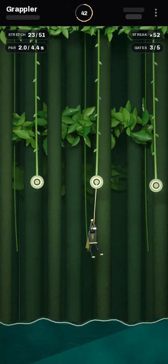 | 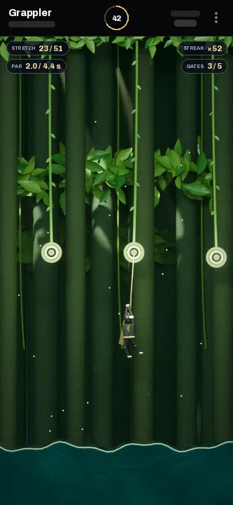 |

- **A:** Today's jungle canopy in real foliage: three-deep trunk layers fading into green haze, hundreds of leaves, vines with lime grab rings, the hero hanging over a glossy teal river.
- **B:** Denser mist with sun shafts cutting through the canopy and fireflies drifting between the vines.

## Moon Climb

`ricochet` · scene: [`source/games/ricochet.py`](source/games/ricochet.py)

| Today | A: Today upgraded | B: Bolder |
|---|---|---|
|  | 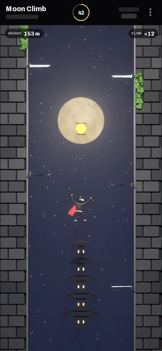 | 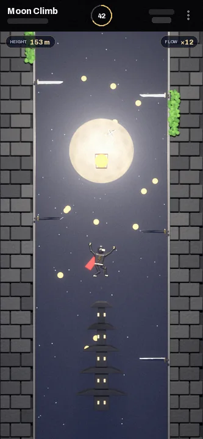 |

- **A:** Today's temple shaft in carved slate brick with moss, steel katanas with gold guards and wrapped hilts, a cratered warm moon, the paper lantern rising across it and the pagoda in the mist.
- **B:** Thicker moonlit mist and a sky full of far lanterns rising behind the walls.

## Iron Wall

`bastion` · scene: [`source/games/bastion.py`](source/games/bastion.py)

| Today | A: Today upgraded | B: Bolder |
|---|---|---|
|  | 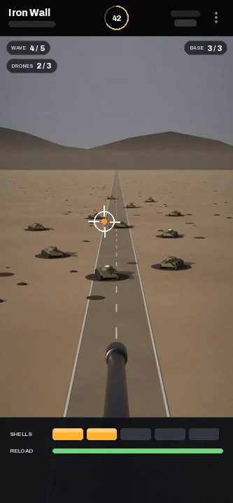 |  |

- **A:** Today's first-person road at true perspective: a desert plain, modelled tanks (tracks, turrets, glowing weak spots) advancing in a wave, mountains on the horizon, the cannon barrel and the SHELLS / RELOAD panel.
- **B:** A dust-storm sunset: burning wrecks with volumetric smoke plumes and a fire glow on the road.

## High Rise

`skyline` · scene: [`source/games/skyline.py`](source/games/skyline.py)

| Today | A: Today upgraded | B: Bolder |
|---|---|---|
|  | 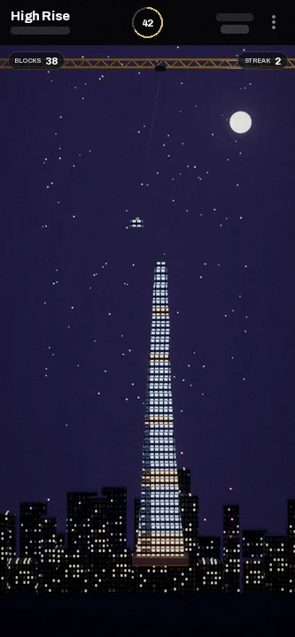 | 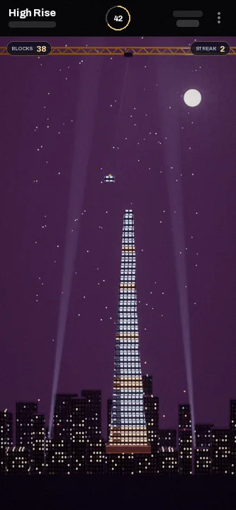 |

- **A:** Today's tapering tower as stacked glass-and-steel floors with lit windows (blue with gold bands), the yellow lattice crane and the next floor on its cable, the moon and a lit skyline over the harbour.
- **B:** A warmer violet night with searchlights sweeping up past the tower and more haze.

## Orbit

`orbit` · scene: [`source/games/orbit.py`](source/games/orbit.py)

| Today | A: Today upgraded | B: Bolder |
|---|---|---|
|  | 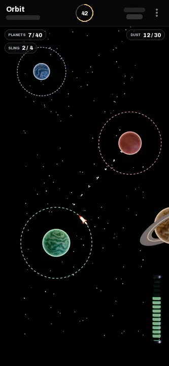 |  |

- **A:** Today's planets with their dashed orbits, rendered as banded and rocky worlds with atmosphere rims; a modelled rocket on the green planet's orbit, stardust to the next planet, the glass fuel gauge.
- **B:** A green and violet nebula behind the course for depth and colour.
