# Attention: game concepts

Phase 2, step 4. Concept pictures only: nothing here is in the app. Each game is shown as it is today beside two
looks, at the phone's 390 × 844 proportions, mid-play, with a plain band at the top standing in for the game header.
Every board is the live game's board (same grid, pieces and layout as the review screenshot), rendered in Blender with
Cycles. Scenes: [source/attention.py](source/attention.py).

- **A, Today, upgraded.** Today's plum room, charcoal panels with pink edges and gold actions, and each game's own
  pieces made of real things.
- **B, Bolder.** The same, darker and more dramatic: lacquer and polished metal, magenta edge light, more glare.

| Game | Today | A, Today, upgraded | B, Bolder |
|---|---|---|---|
| **Bomb Defusal** | 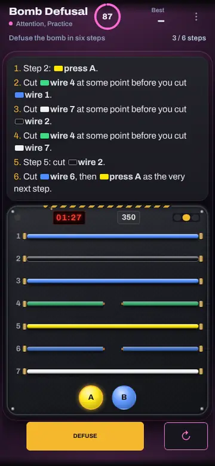 | 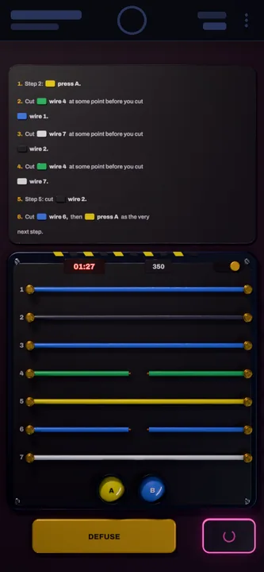 | 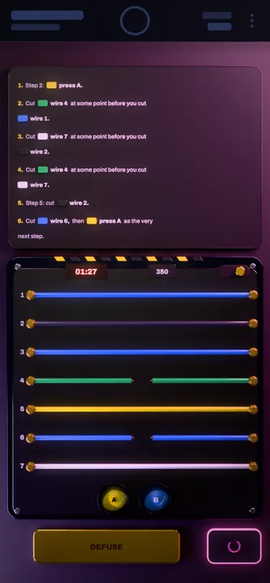 |
| | | The device in brushed steel with screws and a hazard strip, red LEDs behind smoked glass, insulated wires on brass posts (4 and 6 cut to copper), domed A and B; the clues on a dark card with colour chips. | A darker case and lacquered wires, the LEDs and pink edges glowing. |
| **Tally** | 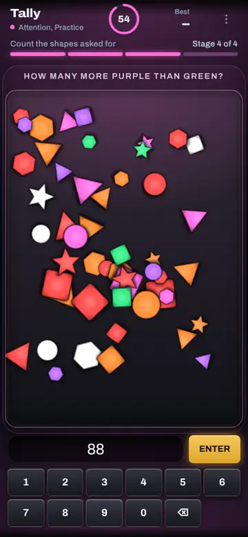 | 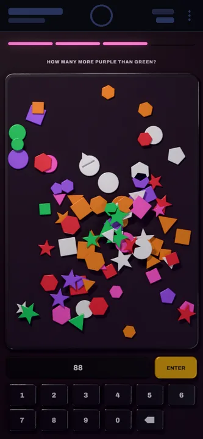 | 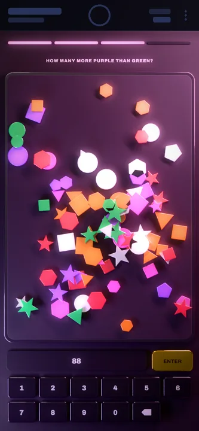 |
| | | Today's six colours and six shapes as lacquered pieces heaped on a felt tray in a glossy frame; real keys below. | Glossier pieces and a deeper felt, magenta light across the heap. |
| **Labyrinth** | 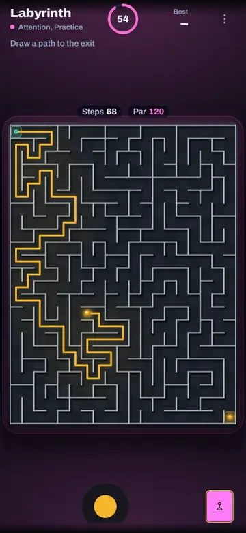 | 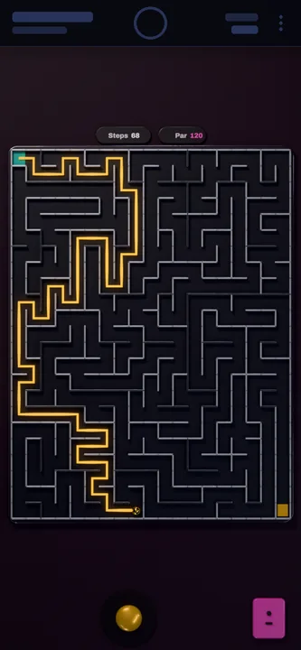 | 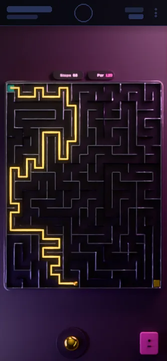 |
| | | The 19 × 23 maze as raised satin-metal walls on a slate floor, the route so far a lit gold thread ending at a gold ball; the exit a gold plate. | Brighter walls on a darker floor, the thread brighter. |
| **Matchmaker** | 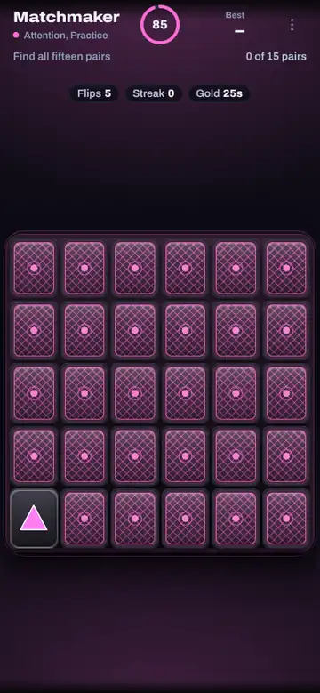 | 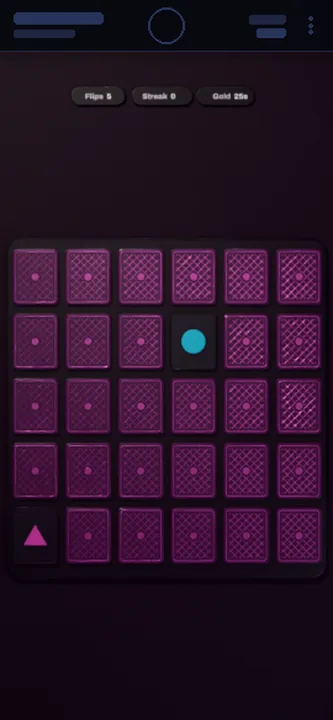 | 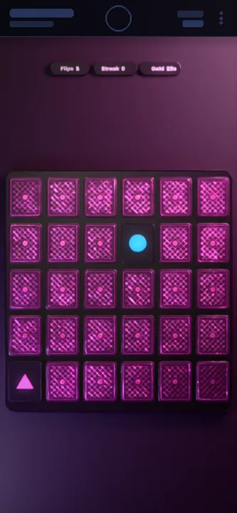 |
| | | Thirty lacquered cards with pink foil cross-hatch backs, as today's; two turned up showing their shapes. | Deeper plum backs and brighter foil. |
| **Double Take** | 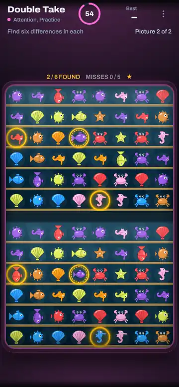 | 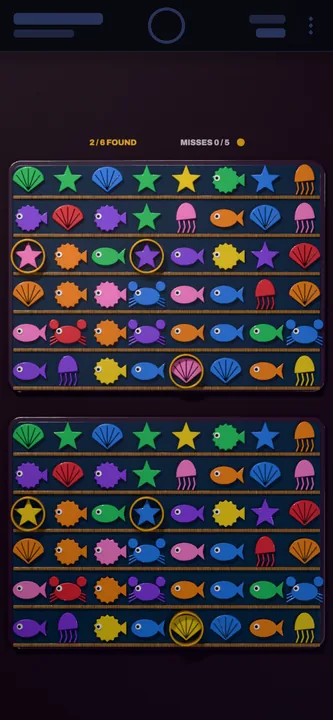 | 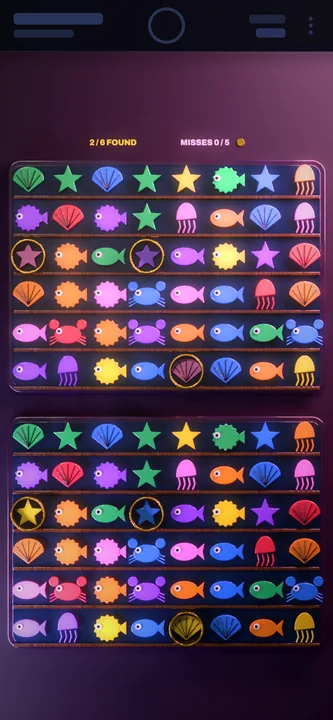 |
| | | The two rock-pool pictures as enamel sea creatures on oak shelves over deep water; found differences ringed in gold. | Darker water and wood, glossier enamel. |
| **Eagle Eye** | 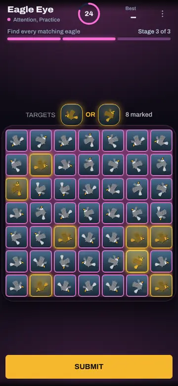 | 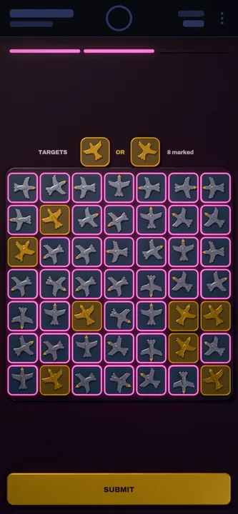 | 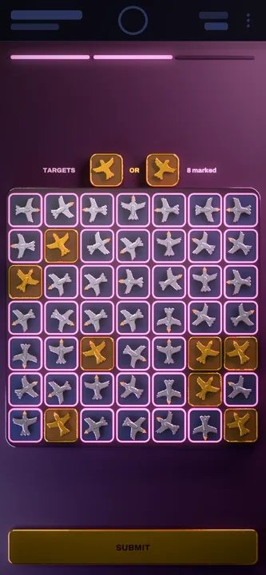 |
| | | Slate tiles with cast pewter eagles, each tile edged pink as today; marked eagles gold on gold-tinted tiles; the two targets above. | Lit pink edges and brighter metal. |

Thumbnails (120 × 260) are in `attention/thumbs/`.
