# Cards & Board: game concepts (phase 2, step 4)

Concept pictures only: nothing here is in the app. Each game is shown mid-play at phone proportions (390 × 844, the
top band is a stand-in for the game header, the small chips stand in for the HUD), rendered in Blender (Cycles) from
the scripts in [source/cards-board/](source/cards-board/). Following Joe's note of 15 Nov 2026, every look keeps the
game's own colours, pieces and layout:

- **A · Today, upgraded**: today's game as it is, rendered with real materials, light and depth. The main one.
- **B · Bolder**: the same game and colours pushed further: richer materials, more atmosphere, more drama.

The four card games share one table (`source/cards-board/table.py`): today's royal-blue felt, the dashed panel
outline, white cards and the navy back with the gold medallion. Court cards carry an original monogram plaque rather
than traditional portraits. "Today" is the review's mid-play frame
([game-reviews/cards-board.md](../game-reviews/cards-board.md)).

## Free Cell (`freecell`)

| Today | A · Today, upgraded | B · Bolder |
|---|---|---|
| 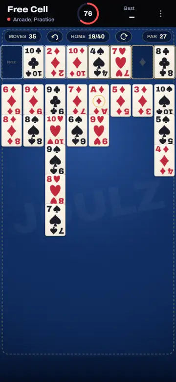 | 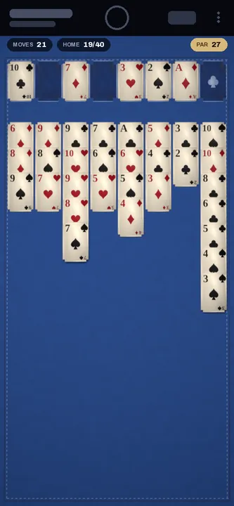 | 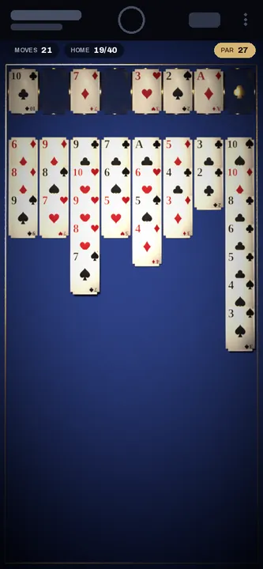 |

- **A**: blue baize under one soft overhead light, today's dashed outline as a real stitched seam, free cells and homes
  pressed into the felt (homes marked with a debossed suit), linen-finish cards with a large index and a lifted top card.
- **B**: deeper sapphire velvet with a single key light and dark edges, the panel seam and every empty place as a thin
  gold inlay, gilt-edged cards, gold suit marks on the homes.
- Layout as today (one top row of four cells and four homes, eight columns), with the cards a little taller and spaced
  further down the column, as the review suggests, so less of the felt is empty.

## Summit (`tripeaks`)

| Today | A · Today, upgraded | B · Bolder |
|---|---|---|
| 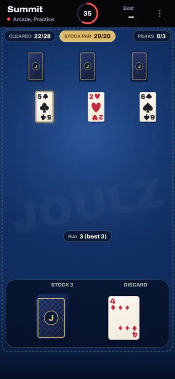 | 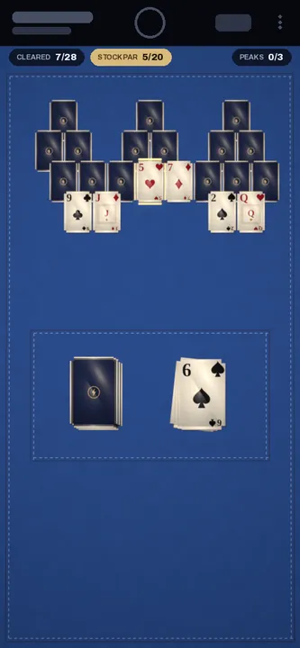 | 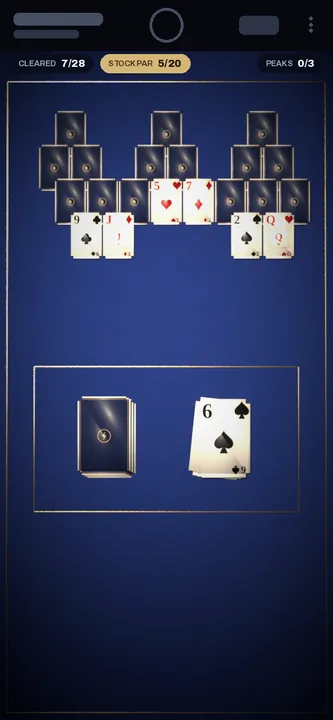 |

- **A**: the three peaks (rows of 3, 6, 9, 10) with today's soft gold glow round the playable card, the stock fanned
  and the discard showing the run's last three cards, in today's dashed stock panel.
- **B**: the same deal in the velvet-and-gold treatment, the glow left to the light alone, gilt card edges.
- Peaks spaced taller than today so the face-down rows read as a pyramid, and the stock panel moved up into the empty
  half of the table.

## Thirteen (`pyramid`)

| Today | A · Today, upgraded | B · Bolder |
|---|---|---|
| 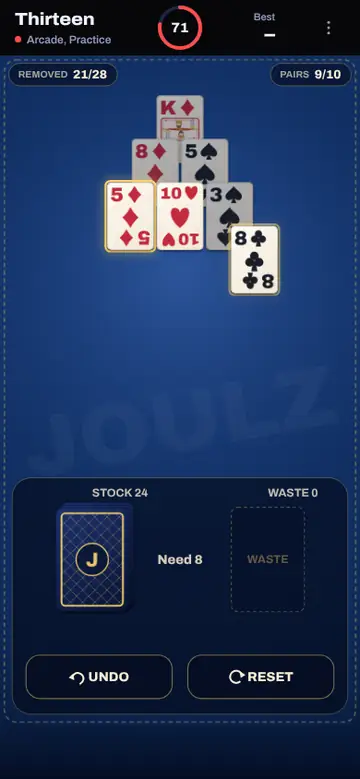 | 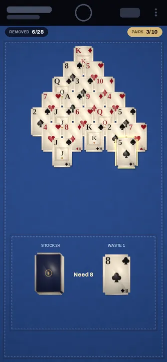 | 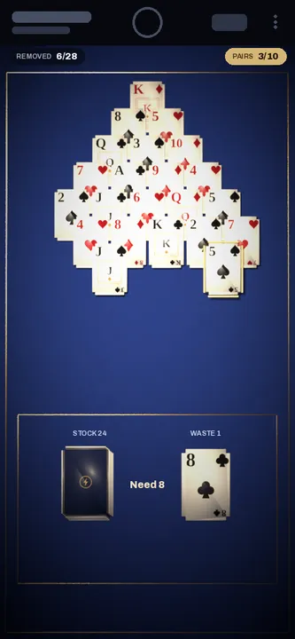 |

- **A**: the 28-card pyramid mid-play (five of the bottom row gone, a 5 lifted and outlined, "Need 8"), stock and waste
  in today's panel with larger cards.
- **B**: the velvet table, gold inlay panel and gilt cards; the selected card catches the key light.
- Notes: the overlapping rows still show half of each card's centre pip; a later pass could dim covered cards, as the
  review suggests.

## Five Hands (`fivehands`)

| Today | A · Today, upgraded | B · Bolder |
|---|---|---|
| 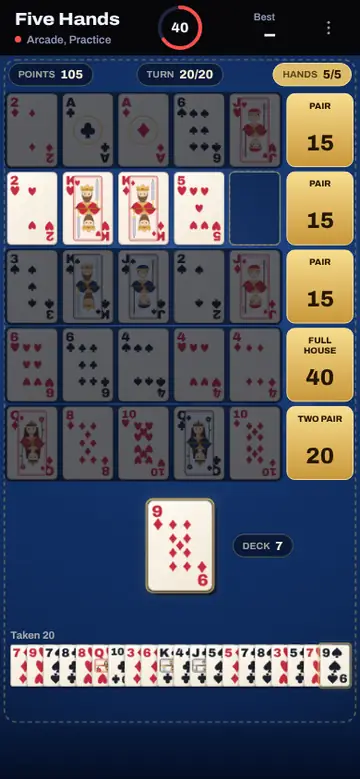 | 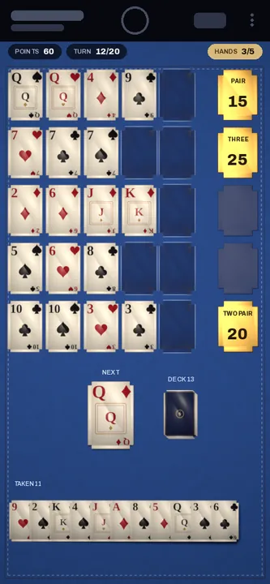 | 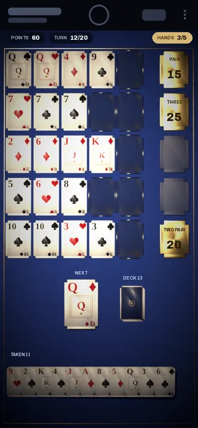 |

- **A**: five rows of five with today's gold hand badges made as satin-gold plaques (dimmed while a row has no hand),
  the next card and the deck below, and the discards as a readable fanned strip instead of today's crushed row.
- **B**: brushed-gold plaques that catch the light, velvet, gilt card edges and a darker vignette.

## Mahjong Solitaire (`mahjong`)

| Today | A · Today, upgraded | B · Bolder |
|---|---|---|
| 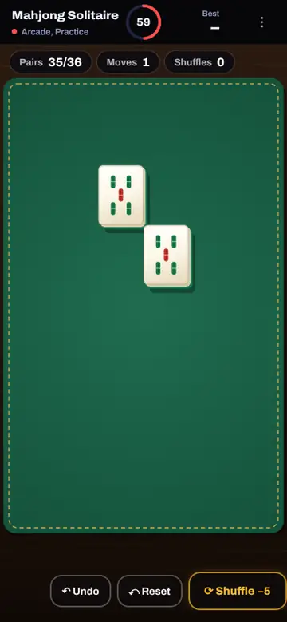 | 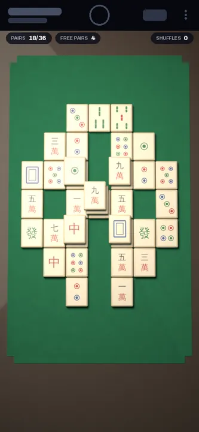 | 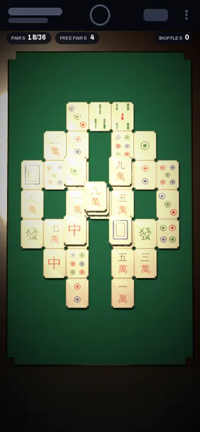 |

- **A**: today's green mat in a dark wooden surround, the stack (36 tiles left over three layers) as real bevelled
  bone tiles on a green backing, with today's faces (circles, bamboo, characters, honours) and soft contact shadows.
- **B**: a jade velvet mat with a thin gold rim on lacquered wood, a warm lamp from the top left and a darker room.
- Notes: today's mid-play frame shows only two tiles left; the concept shows a fuller board so the layering reads.
