# Logic: game concepts

Phase 2, step 4: concept pictures only; nothing here is in the app. Each game keeps today's layout, colours and pieces,
made premium (Joe, 15 Nov 2026): **A, today upgraded** (the main one) and **B, bolder**; Polypotions and Box Six add a
**C** flagship idea. Rendered in Blender (Cycles) at 390 × 844 proportions, mid-play; the dark band at the top is a
placeholder for the header. Today's screenshot (from the game reviews) is first in each row. Sources: [source/](source/).

## Box Six

| Today | A · Today, upgraded | B · Bolder | C · Flagship idea |
|---|---|---|---|
| 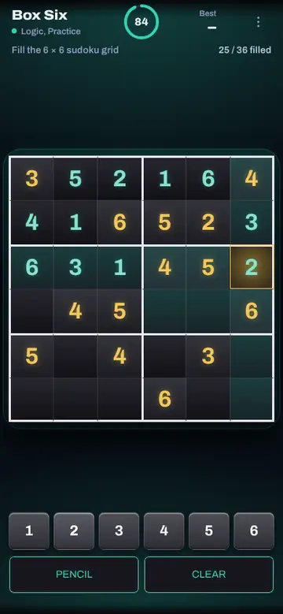 | 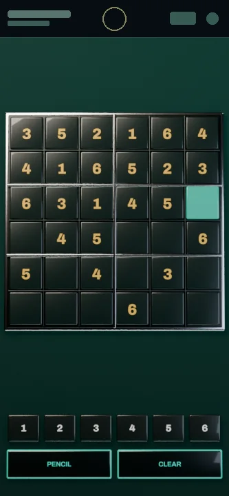 | 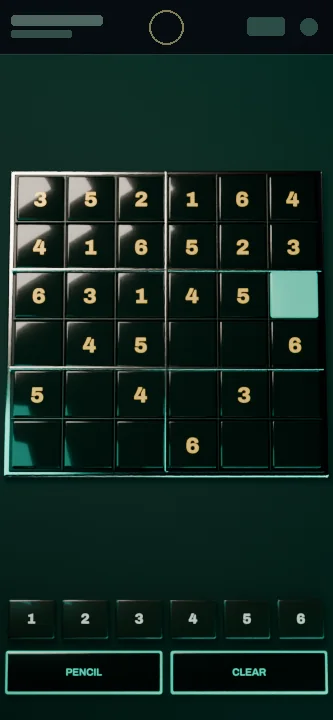 | 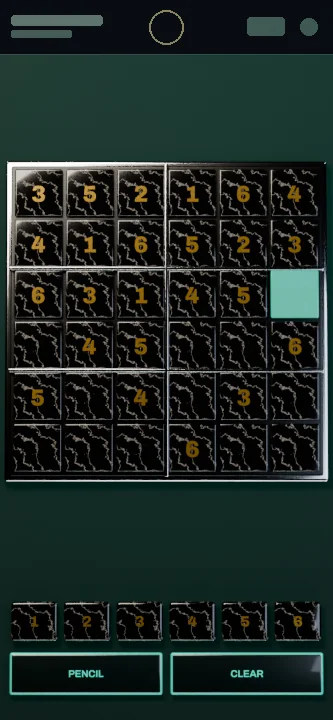 |

- **A · Today, upgraded**: Today's dark tiles and gold digits as lacquered tiles with glowing gold numerals; the white box lines become polished silver strips; the teal selection is tinted glass.
- **B · Bolder**: The same board leaned in under a single pool of light: deeper black lacquer, brighter gold, a glowing teal edge.
- **C · Flagship idea**: Flagship idea, "gold leaf on black marble": Nero marble tiles whose pale veins echo today's white grid, raised gold-leaf numerals, a silver frame and teal glass for the selection.

## Hanoi

| Today | A · Today, upgraded | B · Bolder |
|---|---|---|
| 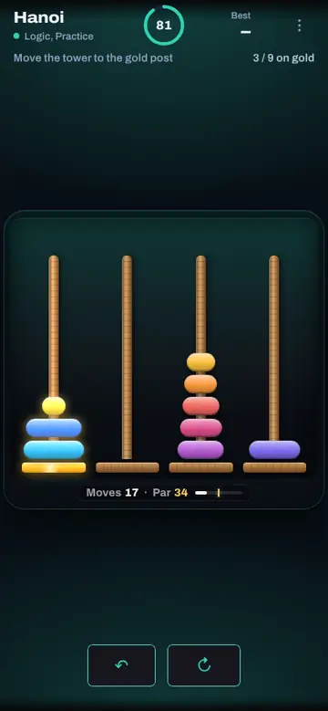 | 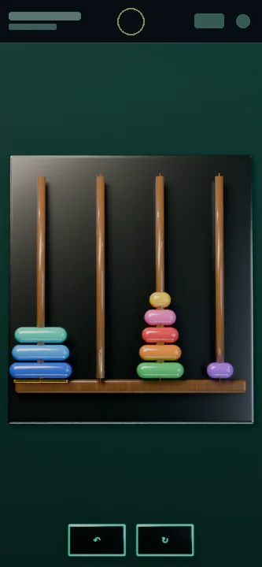 | 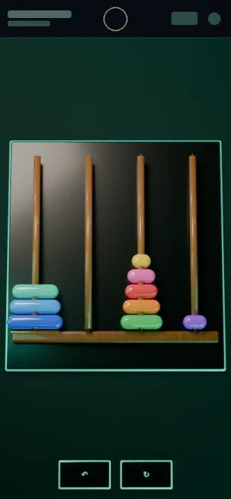 |

- **A · Today, upgraded**: Today's wooden posts and bright rounded rings as turned oak and glossy lacquered rings, the gold post's base a real gold plate.
- **B · Bolder**: Rings with a candy-glass glow and a stronger key light, so the stacks read like jewels on a stage.

## Polypotions

| Today | A · Today, upgraded | B · Bolder | C · Flagship idea |
|---|---|---|---|
| 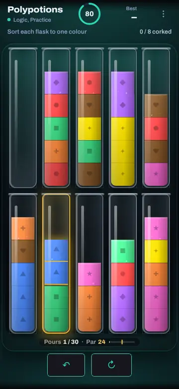 | 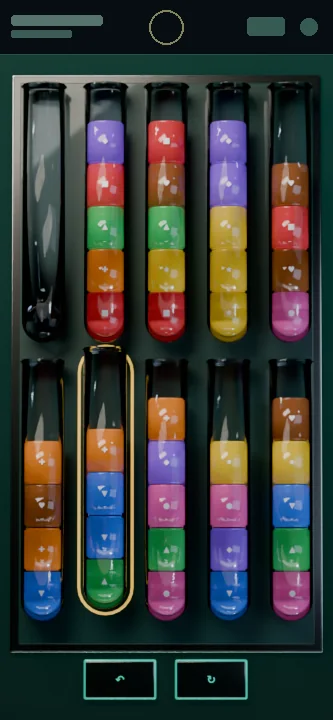 | 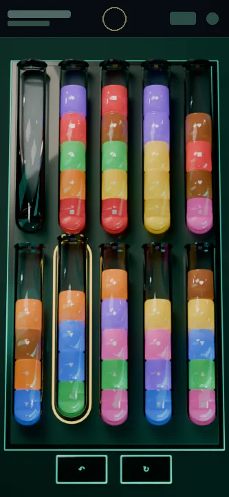 | 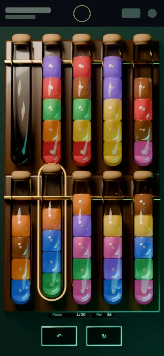 |

- **A · Today, upgraded**: Today's flasks as real thin-walled test tubes with coloured liquid layers, each keeping its colour-blind symbol; the picked flask has today's gold ring.
- **B · Bolder**: Brighter, glowing liquids and clearer glass with a deeper surround: the same flasks as a lit lab display.
- **C · Flagship idea**: Flagship idea, "the apothecary": cork-stoppered vials in a walnut rack with brass rails, tinctures that glow from within, the same colours, symbols and gold selection.

## Safe Cracker

| Today | A · Today, upgraded | B · Bolder |
|---|---|---|
| 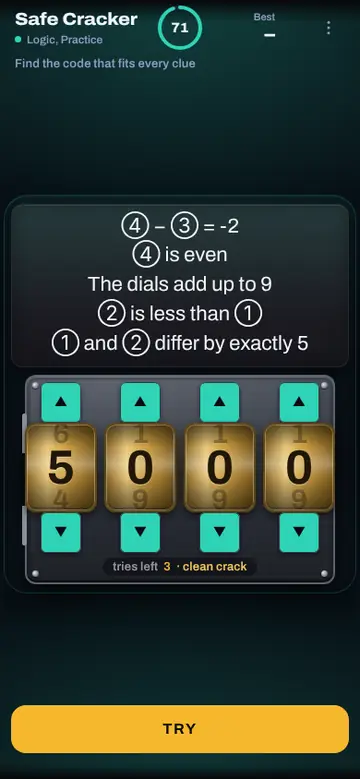 | 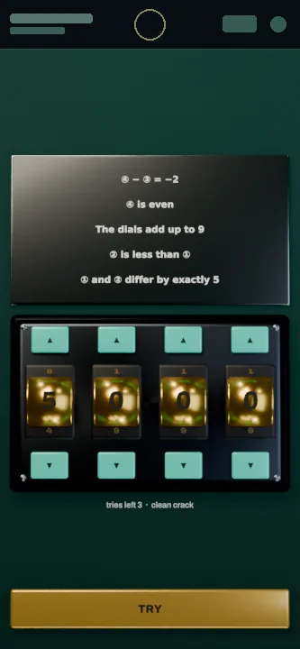 | 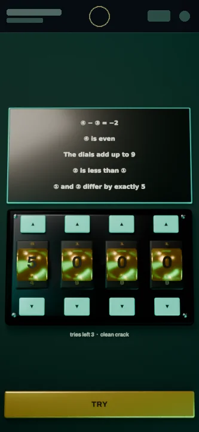 |

- **A · Today, upgraded**: Today's clue card, gold number drums and teal arrows as a brushed-steel safe door with rivets, real gold drums showing the next and last digit, and a gold TRY bar.
- **B · Bolder**: Darker steel and a spotlit dial bank; the drums and teal arrows glow more.

## Mosaic

| Today | A · Today, upgraded | B · Bolder |
|---|---|---|
| 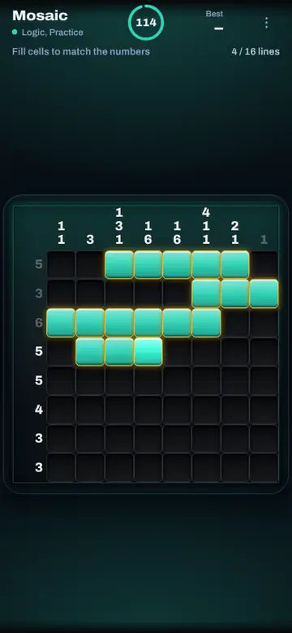 | 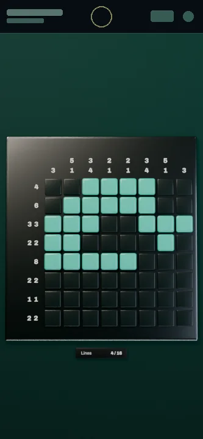 | 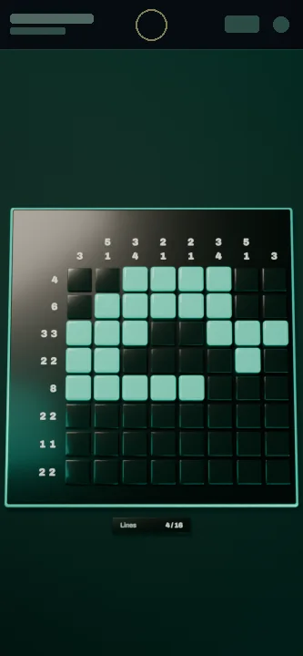 |

- **A · Today, upgraded**: Today's teal filled squares as glazed ceramic tiles with a hand-made ripple on dark cells; clues stay white.
- **B · Bolder**: The teal tiles become lit glass, as if light comes through the picture.

## Colour Flood

| Today | A · Today, upgraded | B · Bolder |
|---|---|---|
| 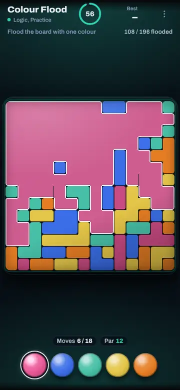 | 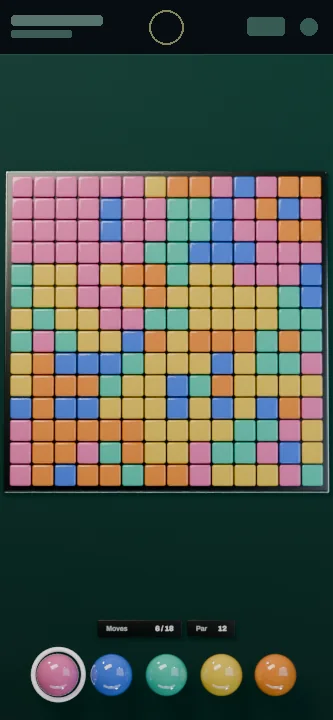 | 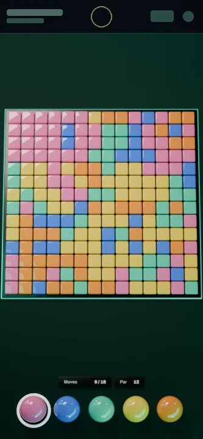 |

- **A · Today, upgraded**: Today's five colours as glazed tiles, the flooded region raised a step so its edge reads; the pickers are glossy glass marbles.
- **B · Bolder**: Deeper, glowing glazes and lit marbles under a tighter light.

## Minefield

| Today | A · Today, upgraded | B · Bolder |
|---|---|---|
| 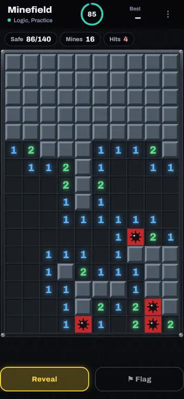 | 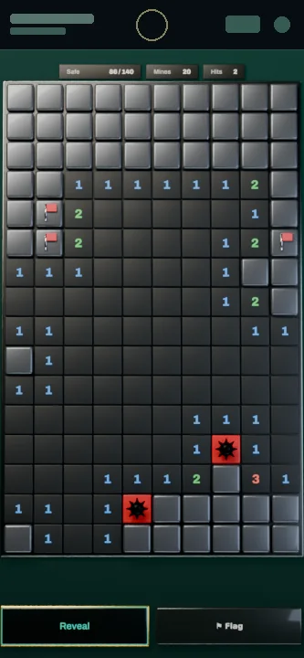 | 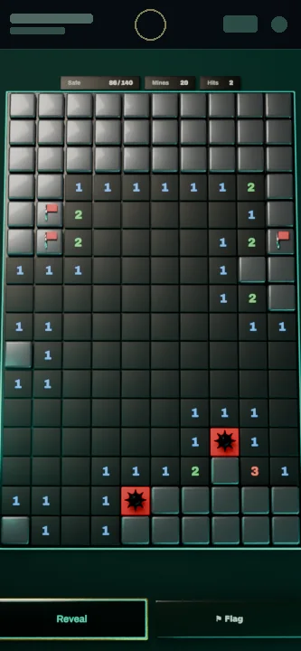 |

- **A · Today, upgraded**: Today's grey raised plates as brushed-steel plates, revealed squares sunk dark with today's number colours, iron mines on red, cloth flags on pins.
- **B · Bolder**: The same field leaned in, numbers glowing, with the hits burning red.

## Tents and Trees

| Today | A · Today, upgraded | B · Bolder |
|---|---|---|
| 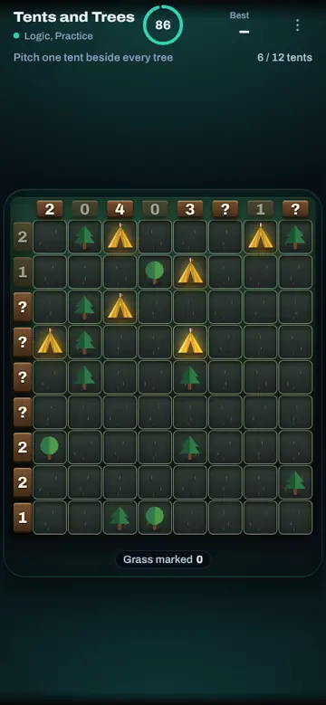 | 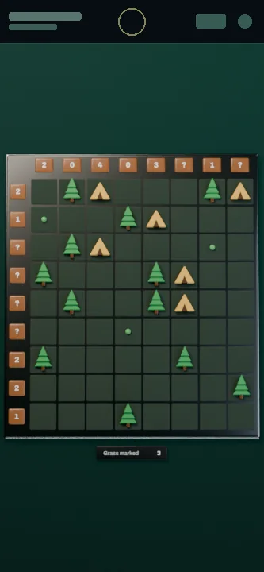 | 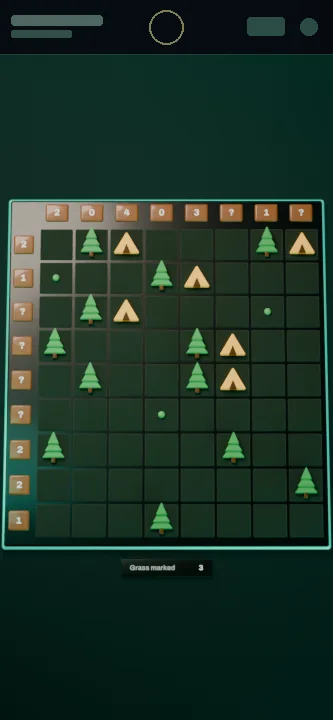 |

- **A · Today, upgraded**: Today's green grid, tree icons and gold tents in relief: layered pine shapes, canvas tents with a door, wooden clue tags.
- **B · Bolder**: Night camp: the tents glow warm from inside on darker turf.

## Shikaku

| Today | A · Today, upgraded | B · Bolder |
|---|---|---|
| 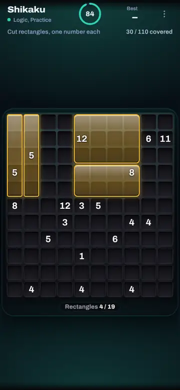 | 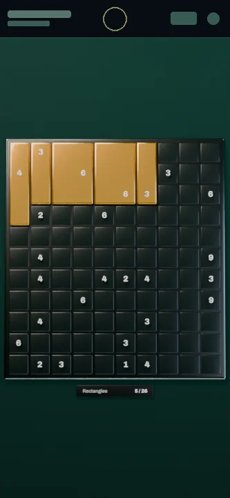 | 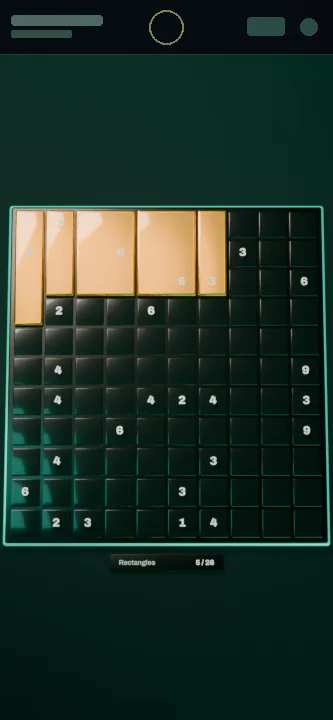 |

- **A · Today, upgraded**: Today's gold rectangles as gold-tinted glass slabs with polished gold rims over dark cells; numbers stay white.
- **B · Bolder**: The slabs glow from within, the board leaned in.

## Lamplighter

| Today | A · Today, upgraded | B · Bolder |
|---|---|---|
| 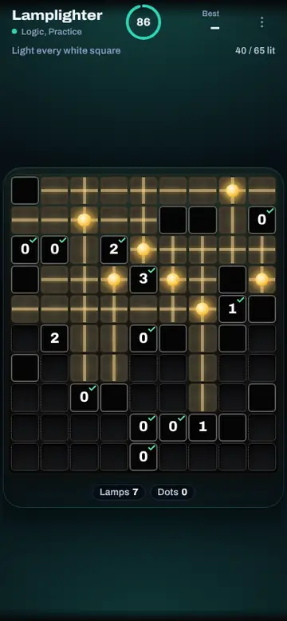 | 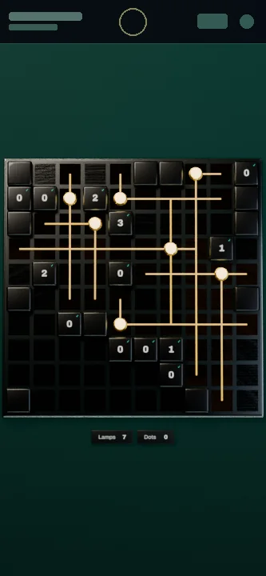 | 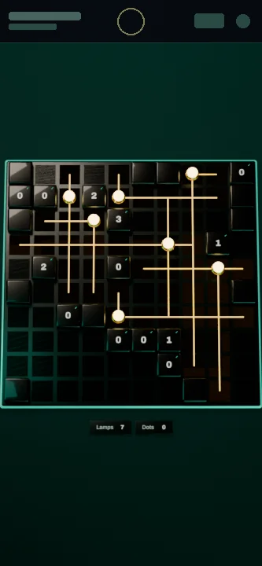 |

- **A · Today, upgraded**: Today's black walls and gold lamps: raised black blocks, brass lamps with real light, thin gold beams along the lit rows and columns.
- **B · Bolder**: Lower ambient light so the lamps and beams carry the scene.

## Trail

| Today | A · Today, upgraded | B · Bolder |
|---|---|---|
| 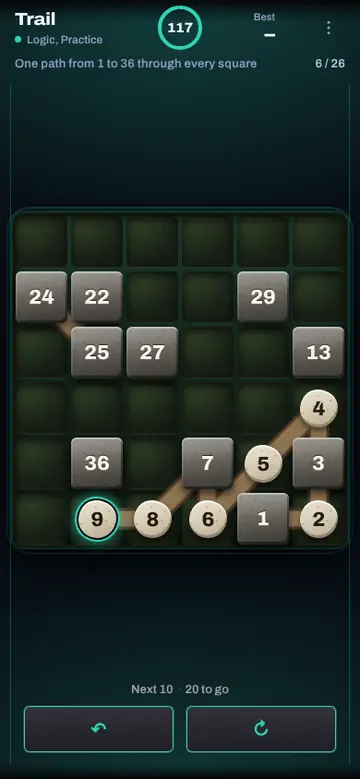 | 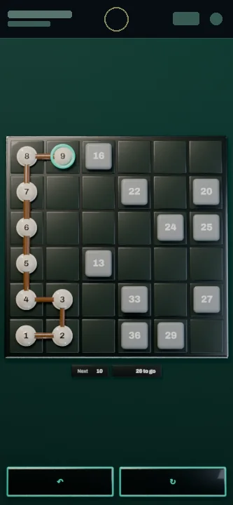 | 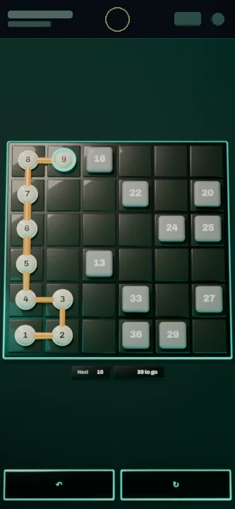 |

- **A · Today, upgraded**: Today's stone number tiles, cream path discs and wooden path as carved stone, ceramic discs and a polished wooden rail; the head disc keeps today's teal ring.
- **B · Bolder**: The path becomes a glowing amber line, the board leaned in.

## Loopline

| Today | A · Today, upgraded | B · Bolder |
|---|---|---|
| 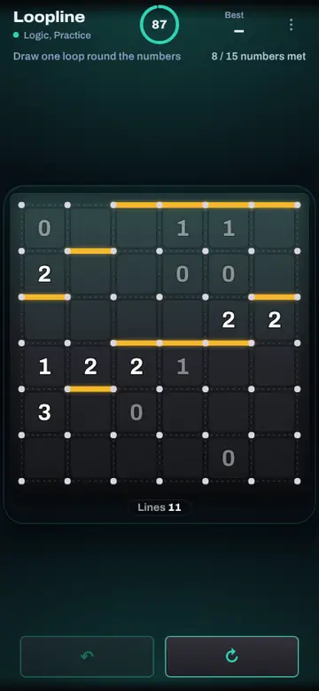 | 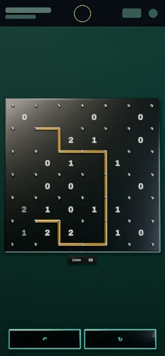 | 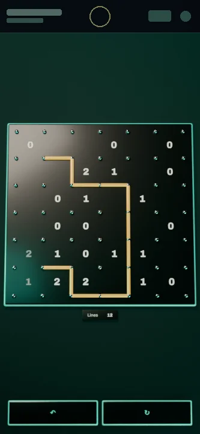 |

- **A · Today, upgraded**: Today's dots and gold lines as silver pegs and gold wire; numbers stay white once met, grey before.
- **B · Bolder**: The wire becomes a glowing gold line under a spotlight.

## Regions

| Today | A · Today, upgraded | B · Bolder |
|---|---|---|
| 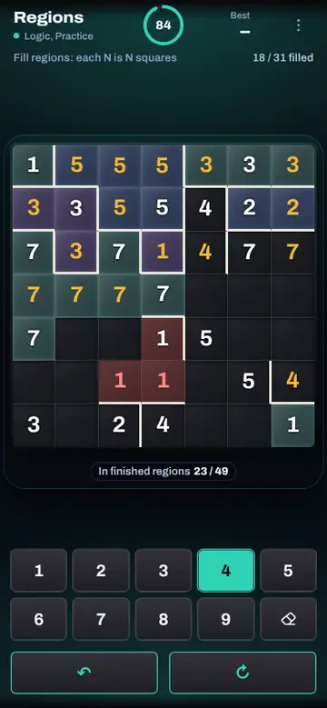 | 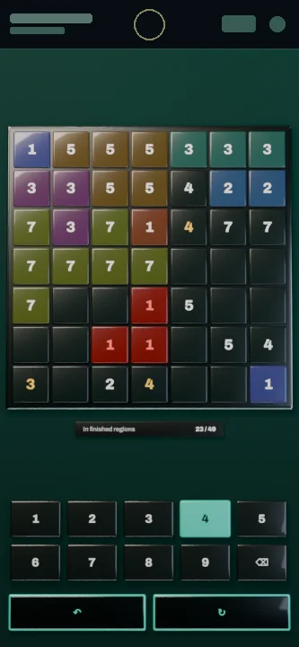 | 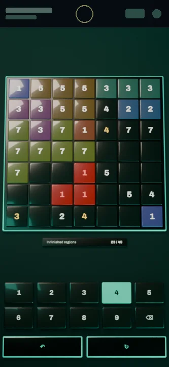 |

- **A · Today, upgraded**: Today's tinted regions as coloured glaze on the tiles, clashes in red, gold and white numerals, the teal selected key.
- **B · Bolder**: Brighter tints and glowing numerals, leaned in.

## Island Link

| Today | A · Today, upgraded | B · Bolder |
|---|---|---|
| 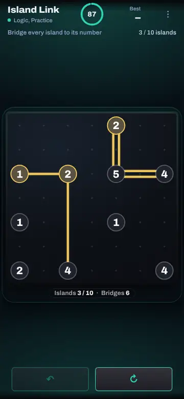 | 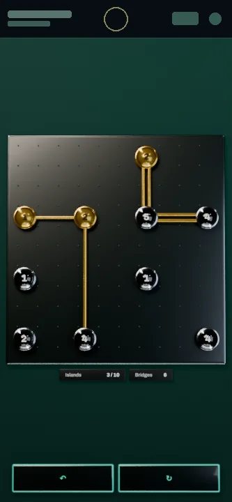 | 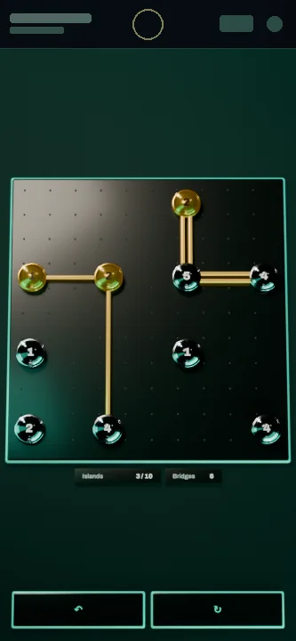 |

- **A · Today, upgraded**: Today's island discs as black enamel in silver bezels (gold when complete) joined by polished gold rods.
- **B · Bolder**: The gold rods and full islands glow; the board is spotlit.
