# Number: game concepts

Phase 2, step 4: concept pictures only; nothing here is in the app. Each game keeps today's layout, colours and pieces,
made premium (Joe, 15 Nov 2026): **A, today upgraded** (the main one) and **B, bolder**; Polypotions and Box Six add a
**C** flagship idea. Rendered in Blender (Cycles) at 390 × 844 proportions, mid-play; the dark band at the top is a
placeholder for the header. Today's screenshot (from the game reviews) is first in each row. Sources: [source/](source/).

## Counterweight

| Today | A · Today, upgraded | B · Bolder |
|---|---|---|
| 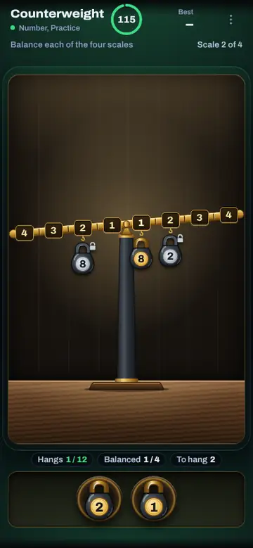 | 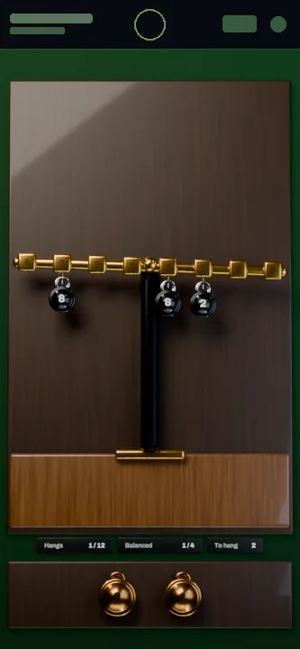 | 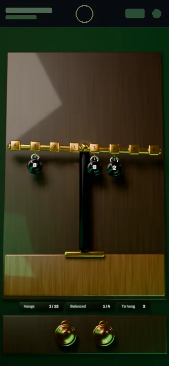 |

- **A · Today, upgraded**: Today's wooden room, gold notched beam and numbered weights as walnut panelling, a brass beam with numbered tags, iron weights on chains, bronze weights in the tray.
- **B · Bolder**: A warm lamp over the pivot and a darker room; the brass catches more light.

## Exact

| Today | A · Today, upgraded | B · Bolder |
|---|---|---|
| 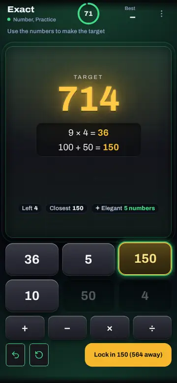 | 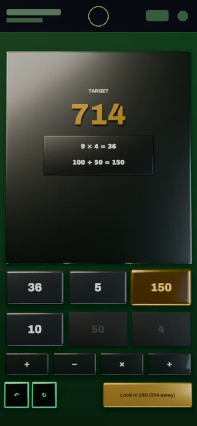 | 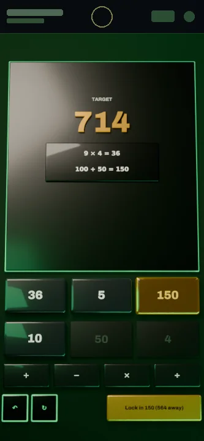 |

- **A · Today, upgraded**: Today's big gold target, steps panel and number tiles as a cast-gold 714, dark glass tiles, the chosen tile in gold.
- **B · Bolder**: The gold glows harder against a darker panel.

## Operator

| Today | A · Today, upgraded | B · Bolder |
|---|---|---|
| 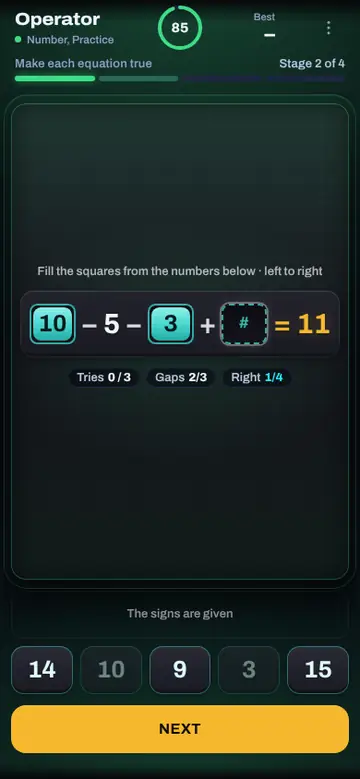 | 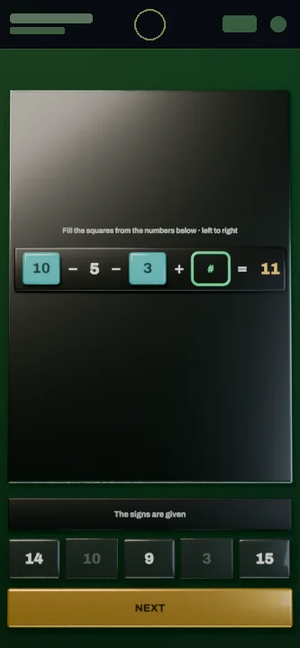 | 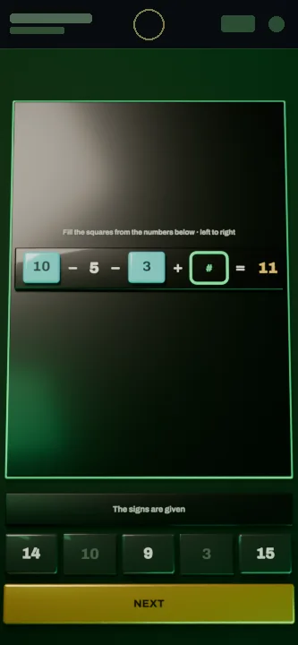 |

- **A · Today, upgraded**: Today's teal number tiles, dashed gap and gold result on a dark panel, with stone number tiles below and the gold NEXT bar.
- **B · Bolder**: The teal tiles and gap outline glow, the panel spotlit.

## Integer Pyramid

| Today | A · Today, upgraded | B · Bolder |
|---|---|---|
| 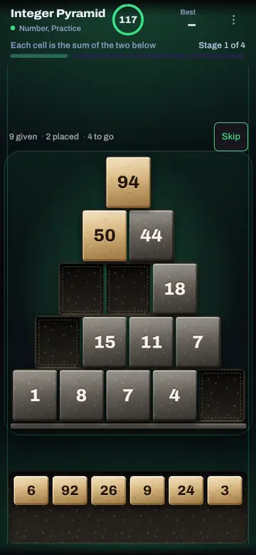 | 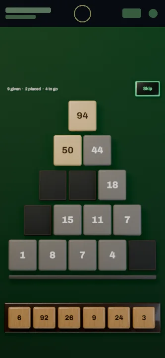 | 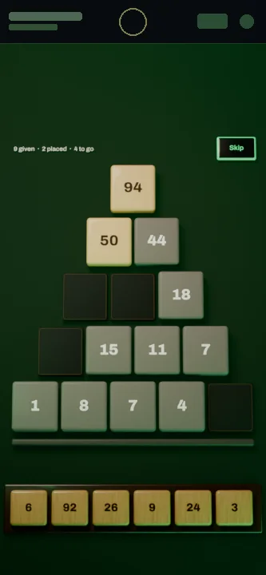 |

- **A · Today, upgraded**: Today's stone blocks, tan placed blocks and wooden tray tiles as cut stone, sandstone and wood.
- **B · Bolder**: The placed blocks warm with light, the pyramid leaned in.

## Brimful

| Today | A · Today, upgraded | B · Bolder |
|---|---|---|
| 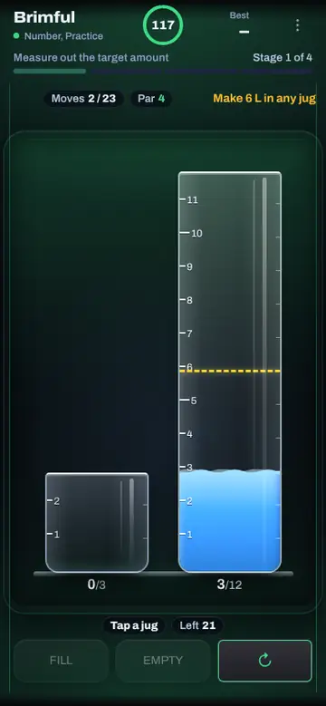 | 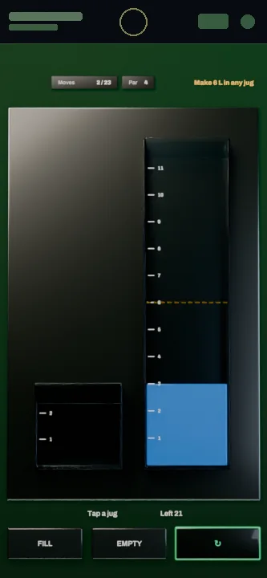 | 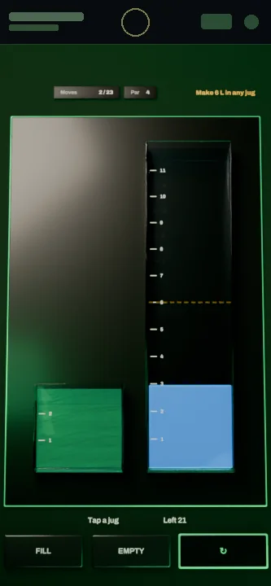 |

- **A · Today, upgraded**: Today's two jugs as glass jars with tick marks and a gold target line, the blue water as real water.
- **B · Bolder**: The water glows and the glass catches a stronger light.

## Checkout

| Today | A · Today, upgraded | B · Bolder |
|---|---|---|
| 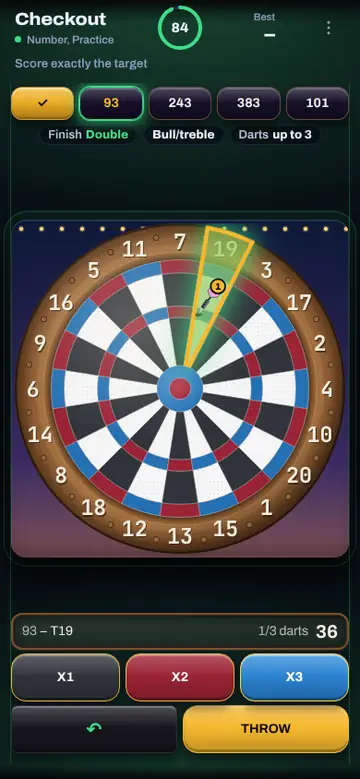 | 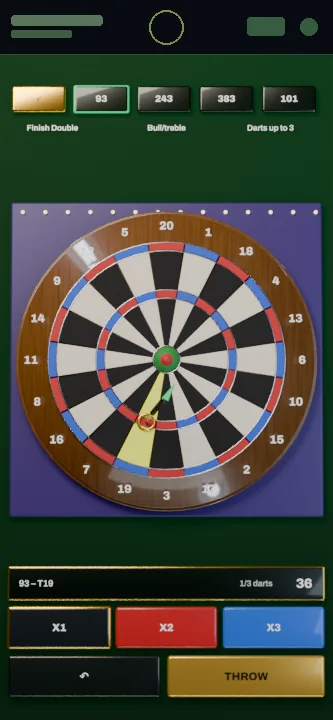 | 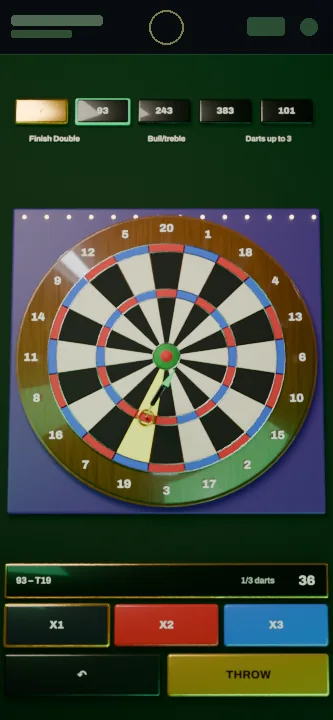 |

- **A · Today, upgraded**: Today's purple cabinet, numbered wooden ring and red/blue board as a real sisal board with wire spiders, a dart in the lit treble, bulbs round the cabinet, today's chips and X1/X2/X3 buttons.
- **B · Bolder**: The cabinet glows deeper purple and the hit segment and buttons glow.

## Ballpark

| Today | A · Today, upgraded | B · Bolder |
|---|---|---|
| 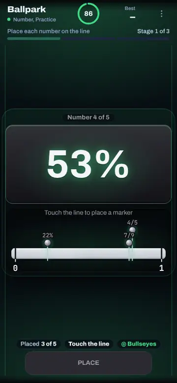 | 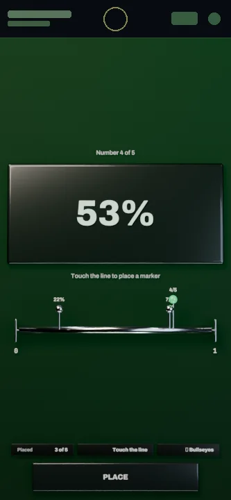 | 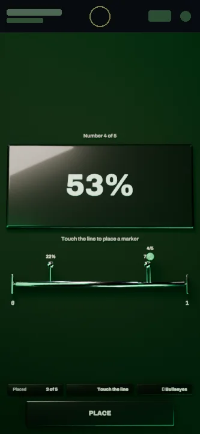 |

- **A · Today, upgraded**: Today's big glowing number card, line and markers as a lit glass card, a chrome rail and pins with today's labels.
- **B · Bolder**: A stronger glow on the number and the teal marker.

## Kakuro

| Today | A · Today, upgraded | B · Bolder |
|---|---|---|
| 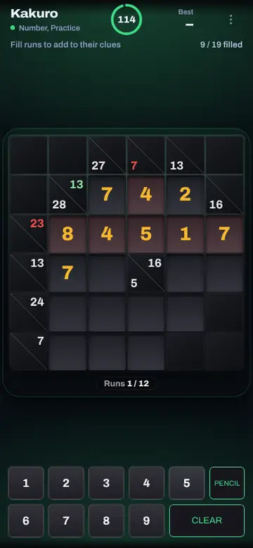 | 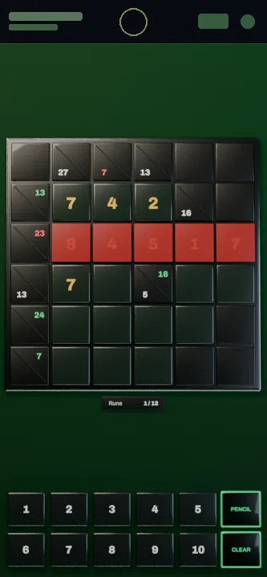 | 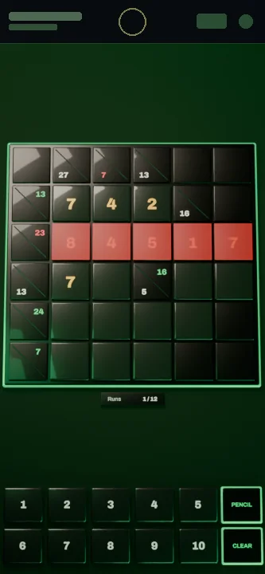 |

- **A · Today, upgraded**: Today's clue cells with diagonal splits, gold digits and the red broken run, as dark tiles with glowing gold numerals.
- **B · Bolder**: Brighter gold and red, leaned in.
