# Pattern: game concepts

Phase 2, step 4: concept pictures only; nothing here is in the app. Each game keeps today's layout, colours and pieces,
made premium (Joe, 15 Nov 2026): **A, today upgraded** (the main one) and **B, bolder**; Polypotions and Box Six add a
**C** flagship idea. Rendered in Blender (Cycles) at 390 × 844 proportions, mid-play; the dark band at the top is a
placeholder for the header. Today's screenshot (from the game reviews) is first in each row. Sources: [source/](source/).

## Gridlock

| Today | A · Today, upgraded | B · Bolder |
|---|---|---|
| 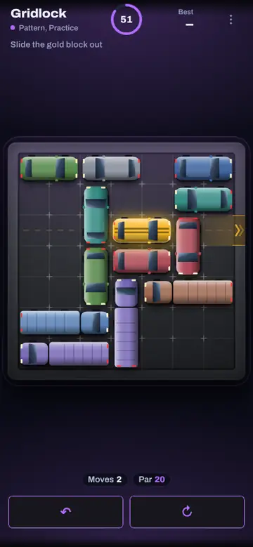 | 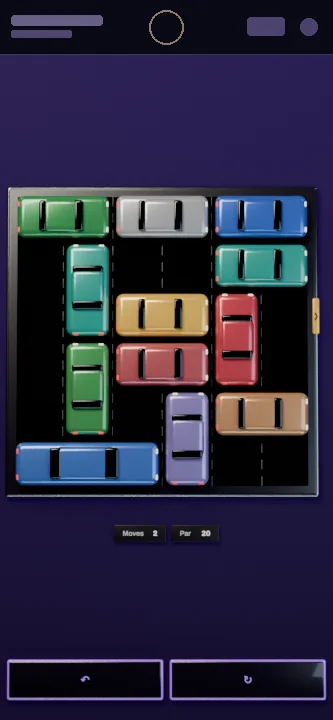 | 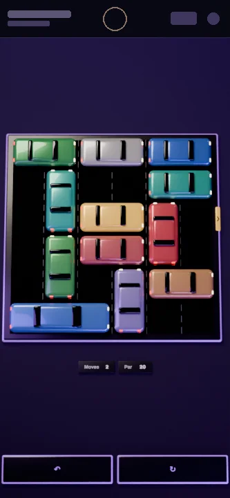 |

- **A · Today, upgraded**: Today's top-down cars as glossy painted cars with cabins, glass and lights on asphalt; the gold car and exit stay gold.
- **B · Bolder**: Night drive: headlights and tail lights glow and the gold car shines.

## Tessellate

| Today | A · Today, upgraded | B · Bolder |
|---|---|---|
| 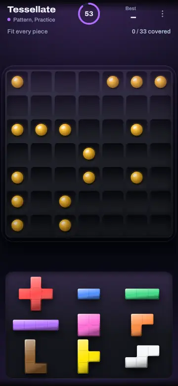 | 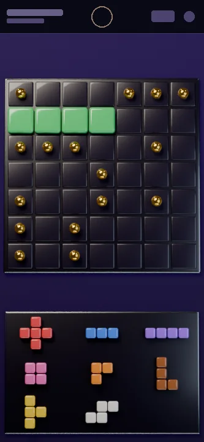 | 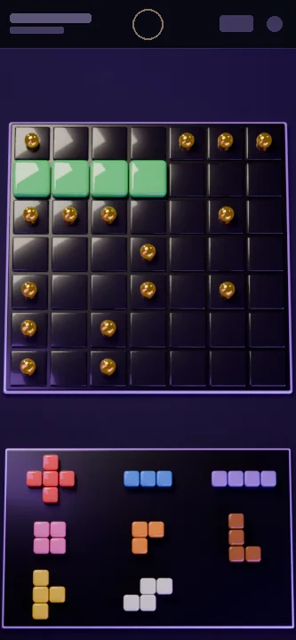 |

- **A · Today, upgraded**: Today's gold pegs and coloured pieces as polished gold balls and lacquered blocks.
- **B · Bolder**: The pieces glow like coloured glass, the board leaned in.

## Pipeline

| Today | A · Today, upgraded | B · Bolder |
|---|---|---|
| 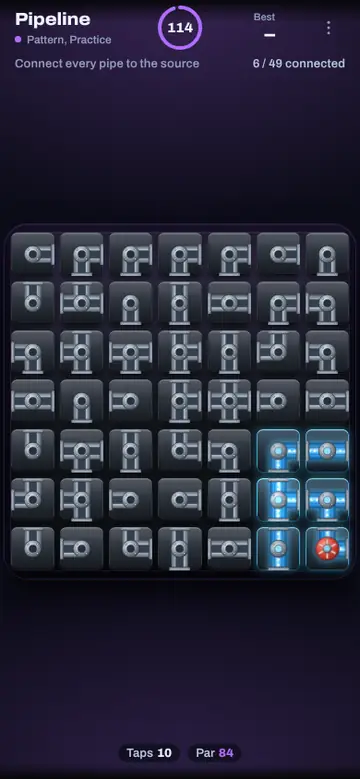 | 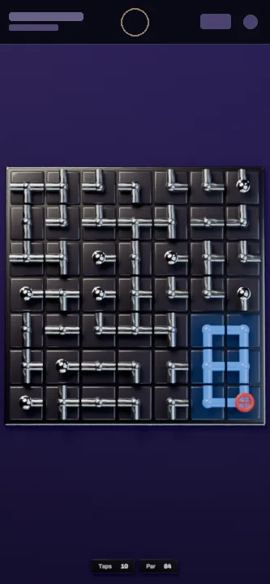 | 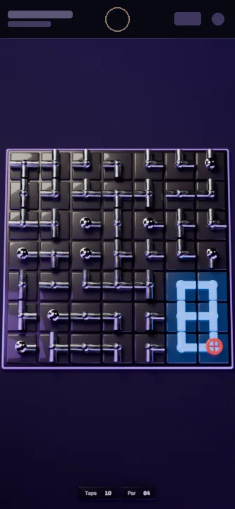 |

- **A · Today, upgraded**: Today's grey pipe tiles as brushed steel, the connected run as glowing blue water, the red source valve.
- **B · Bolder**: The water glows brighter against the darker steel.

## Chroma Lines

| Today | A · Today, upgraded | B · Bolder |
|---|---|---|
| 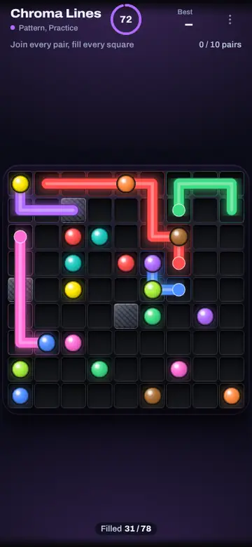 | 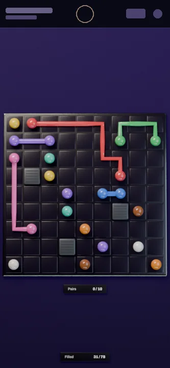 | 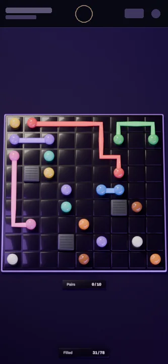 |

- **A · Today, upgraded**: Today's neon lines and coloured dots as glowing coloured tubes and glossy beads; walls hatched steel.
- **B · Bolder**: Full neon: the lines glow strongly.

## Skid

| Today | A · Today, upgraded | B · Bolder |
|---|---|---|
| 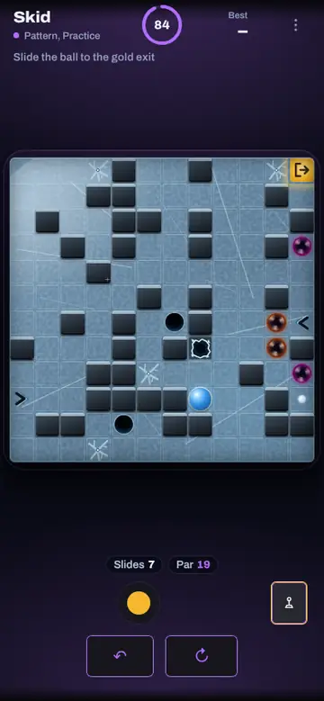 | 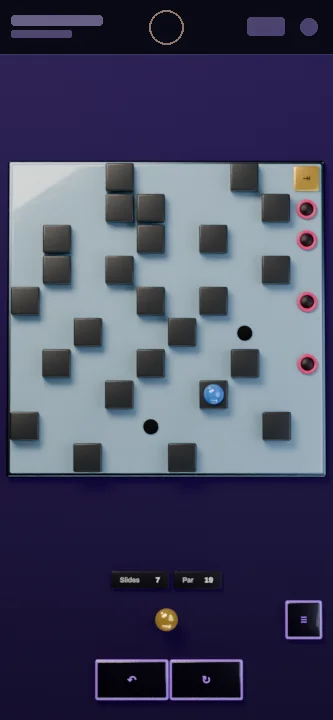 | 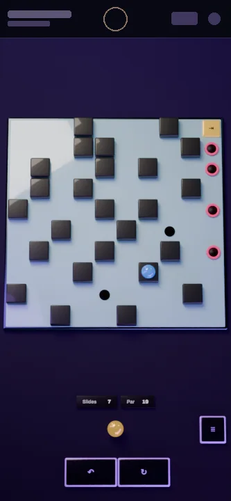 |

- **A · Today, upgraded**: Today's pale ice board, dark blocks, blue ball and gold exit as frosted ice, granite blocks and a glossy steel ball.
- **B · Bolder**: The ice lit from within with cold light.

## Heave

| Today | A · Today, upgraded | B · Bolder |
|---|---|---|
| 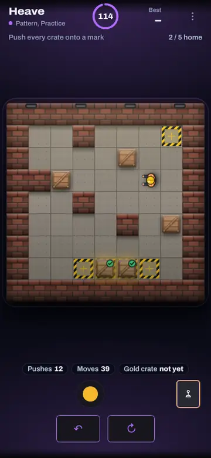 | 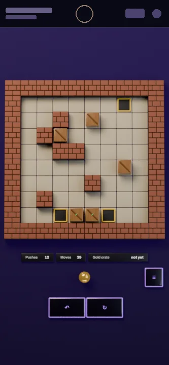 | 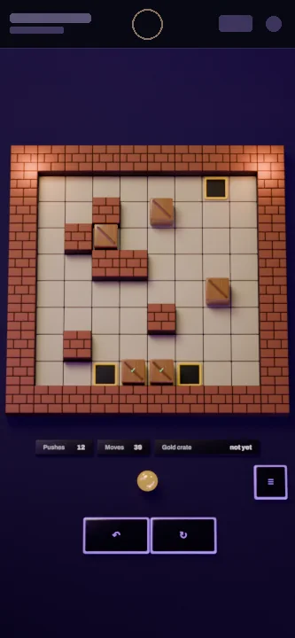 |

- **A · Today, upgraded**: Today's brick walls, sand floor, crates and hazard marks as real brick, sandstone, wooden crates and taped targets; the gold player token.
- **B · Bolder**: Two warm wall lamps light the room.

## Lightbender

| Today | A · Today, upgraded | B · Bolder |
|---|---|---|
| 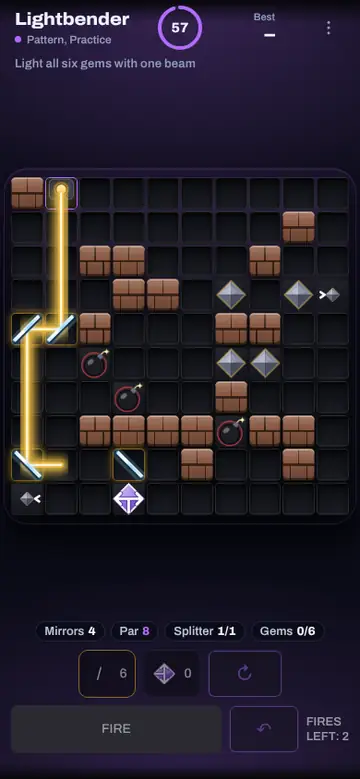 | 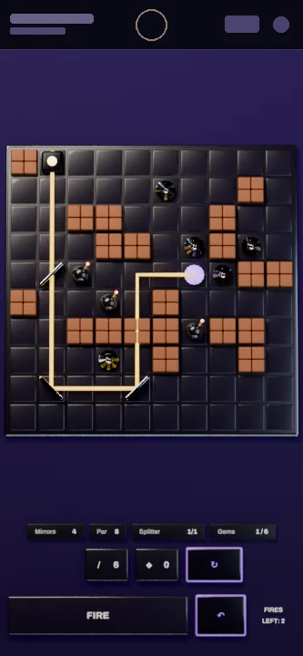 | 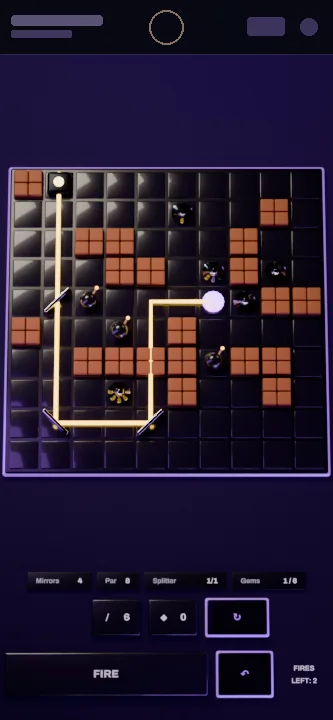 |

- **A · Today, upgraded**: Today's copper bricks, mirrors, gems, bombs and gold beam as real brick, silvered mirrors, cut gems (lit when hit) and a glowing beam.
- **B · Bolder**: Lower light so the beam and lit gem carry the scene.

## Topsy-Turvy

| Today | A · Today, upgraded | B · Bolder |
|---|---|---|
| 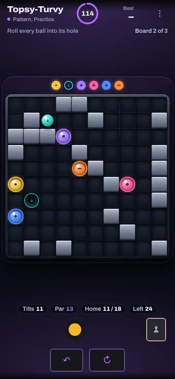 | 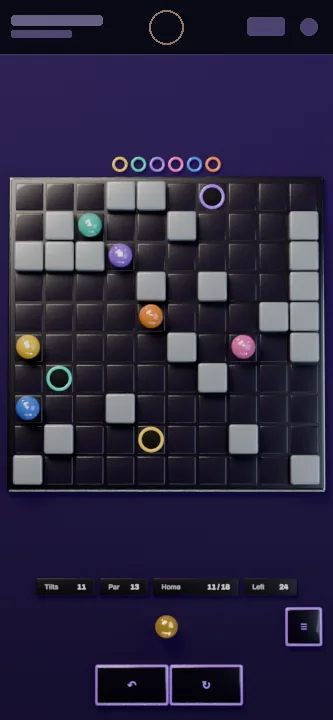 | 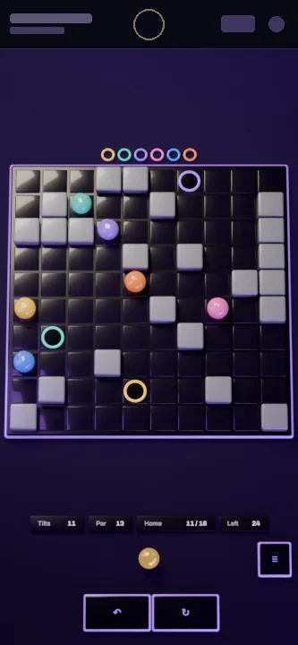 |

- **A · Today, upgraded**: Today's grey blocks and coloured balls with symbols as stone blocks and glass marbles, holes as rimmed cups.
- **B · Bolder**: The marbles and hole rims glow.
