# Retro: game concepts

Concept pictures only (phase 2, step 4): nothing here is in the app. Each game is drawn mid-play at phone
proportions (390 × 844, shown 720 px tall) on today's board, pieces and layout, with a placeholder band where the
game header goes. Rendered in Blender 5.3 (Cycles, CPU) from the scripts in [`source/`](source/), with bloom, the
header band and the HUD pills added in post.

Per Joe's note of 15 Nov 2026, both looks keep each game's own colours, style and character:

- **A, Today upgraded**: today's colours, style and layout at full finish (real materials, lighting, depth, detail).
- **B, Bolder**: the same game and identity, pushed further (richer materials, more atmosphere, more drama).

None of this category's games is a flagship, so none has a third look. Today's frames are the game reviews'
mid-play captures.

| Game | Today | A: Today upgraded | B: Bolder |
|---|---|---|---|
| [Hover](#hover) | 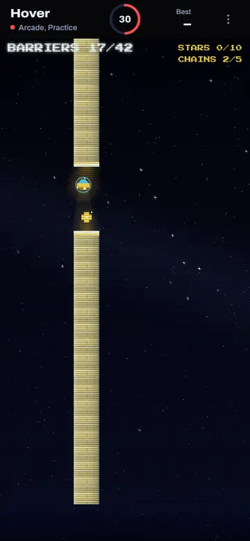 | 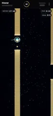 | 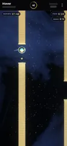 |
| [Breaker](#breaker) | 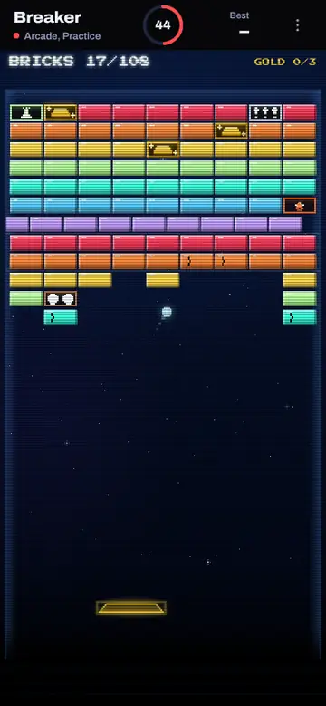 | 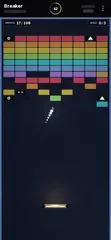 | 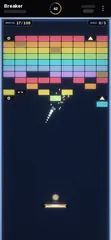 |
| [Rally](#rally) | 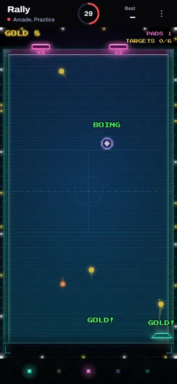 | 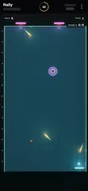 | 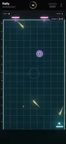 |
| [Wavefront](#wavefront) | 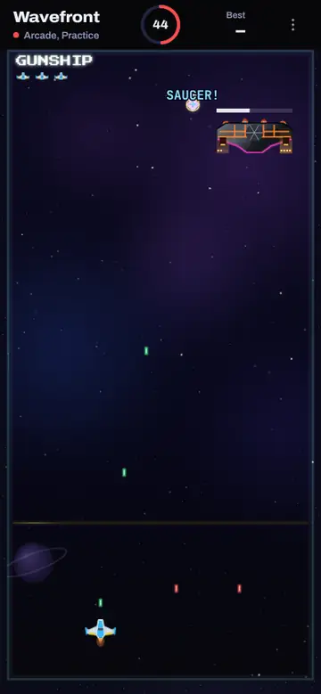 | 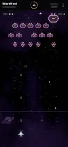 | 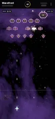 |
| [Fission](#fission) | 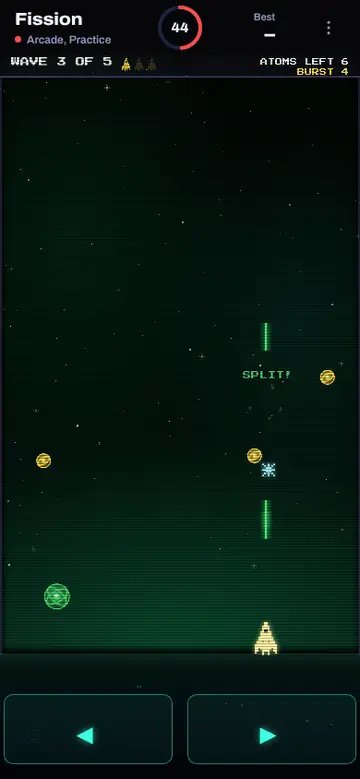 | 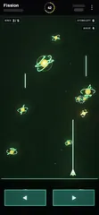 |  |
| [Tempo](#tempo) | 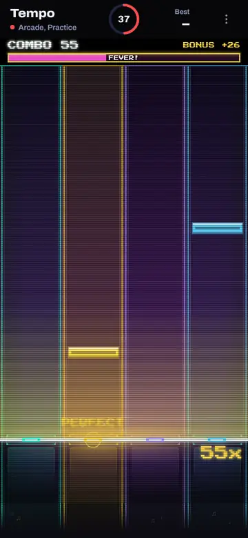 | 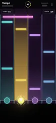 | 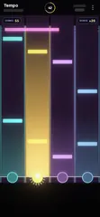 |
| [Meteor](#meteor) | 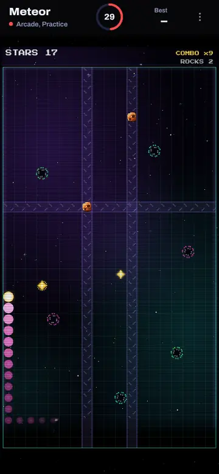 | 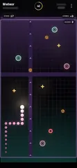 | 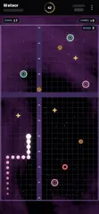 |
| [Spacewalk](#spacewalk) | 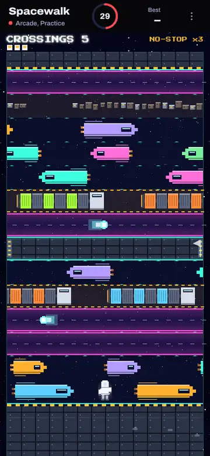 | 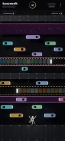 | 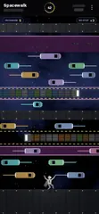 |
| [Pinball](#pinball) | 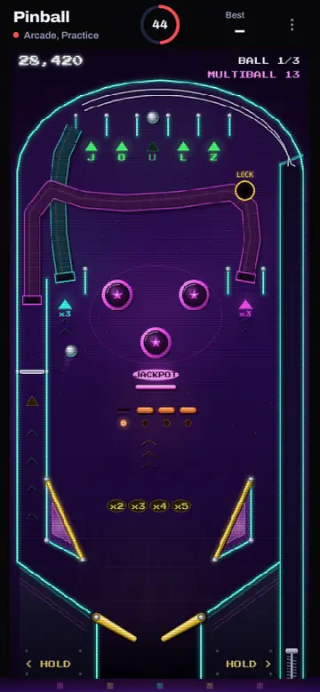 |  | 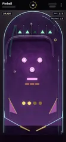 |
| [Blockzone](#blockzone) | 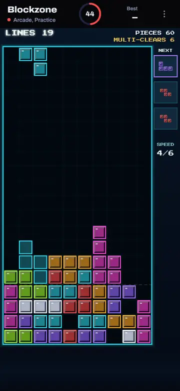 |  | 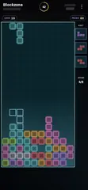 |

## Hover

`hover` · scene: [`source/games/hover.py`](source/games/hover.py)

| Today | A: Today upgraded | B: Bolder |
|---|---|---|
|  | 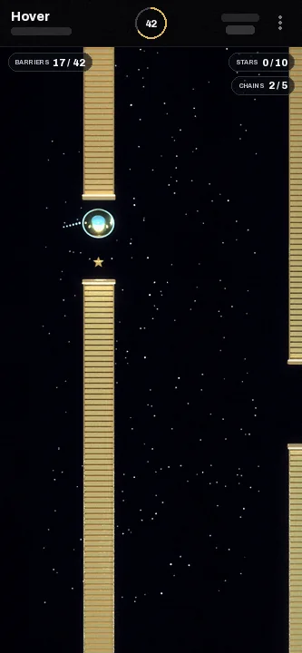 |  |

- **A:** Today's pale-gold barrier as a stacked pillar of amber plates with lit gap lips; the saucer gold with a cyan dome and light ring; the gold star in the gap; deep starfield.
- **B:** A blue nebula and haze behind, brighter plates and lips.

## Breaker

`breaker` · scene: [`source/games/breaker.py`](source/games/breaker.py)

| Today | A: Today upgraded | B: Bolder |
|---|---|---|
|  | 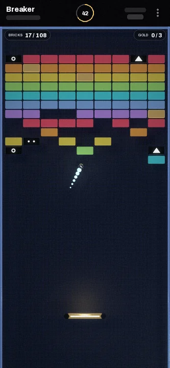 | 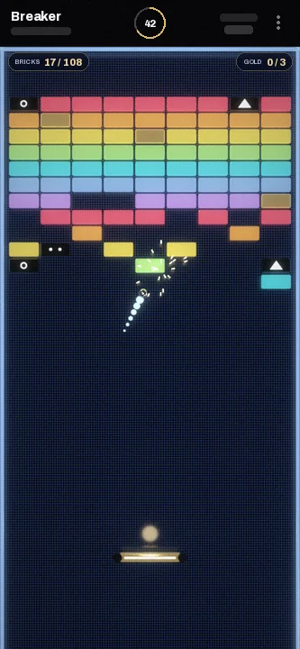 |

- **A:** Today's 9 × 12 rainbow wall as bevelled lit-glass bricks (gold bricks in polished gold, special bricks as dark glass with white icons) on the dark blue grid, a chrome ball with a light trail, the gold paddle.
- **B:** A glossy board reflecting the wall, brighter bricks and a brick shattering into sparks beside the ball.

## Rally

`rally` · scene: [`source/games/rally.py`](source/games/rally.py)

| Today | A: Today upgraded | B: Bolder |
|---|---|---|
|  |  | 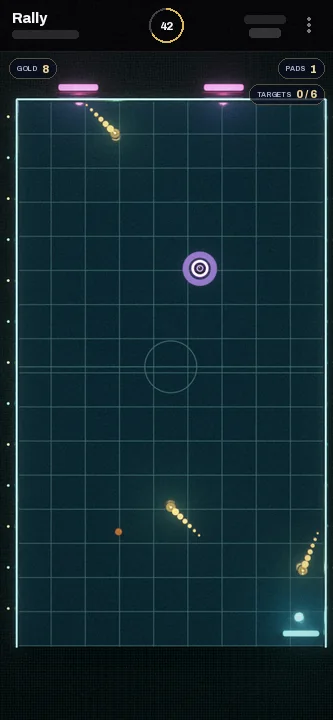 |

- **A:** Today's teal court as a lit acrylic surface with LED edge rails, raised pink pads, the purple bumper as a real post with a ring light, gold balls with trails, the cyan paddle.
- **B:** A darker court lit from its edges and grid, with haze over the play.

## Wavefront

`wavefront` · scene: [`source/games/wavefront.py`](source/games/wavefront.py)

| Today | A: Today upgraded | B: Bolder |
|---|---|---|
|  | 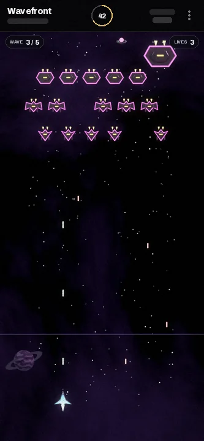 | 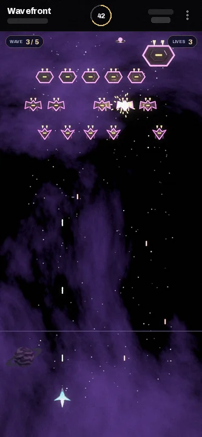 |

- **A:** Today's formation in gunmetal hulls with magenta neon edges, orange furnace seams and exhausts (Dart, Raptor, Bulwark, the gunship), the white fighter, shots in flight, the ringed planet.
- **B:** A full violet nebula and a ship exploding into debris mid-formation.

## Fission

`burst` · scene: [`source/games/burst.py`](source/games/burst.py)

| Today | A: Today upgraded | B: Bolder |
|---|---|---|
|  | 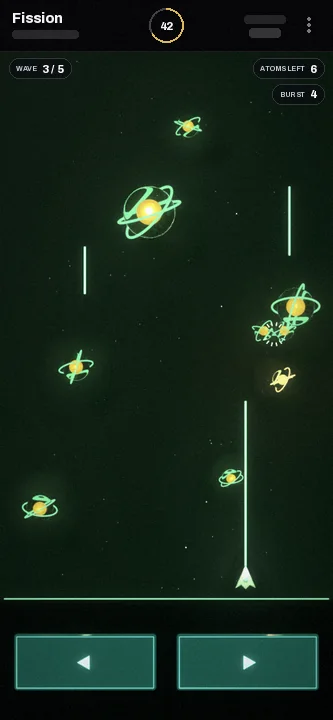 | 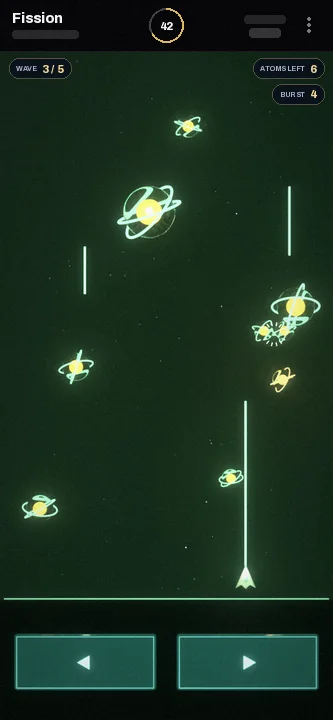 |

- **A:** Today's green phosphor field with atoms as golden cores in glass shells with orbit rings (one golden atom), an atom splitting, green beams, the cream walker and the two glass arrow keys.
- **B:** A darker field so the atoms, rings and beams glow brighter.

## Tempo

`beat` · scene: [`source/games/beat.py`](source/games/beat.py)

| Today | A: Today upgraded | B: Bolder |
|---|---|---|
|  | 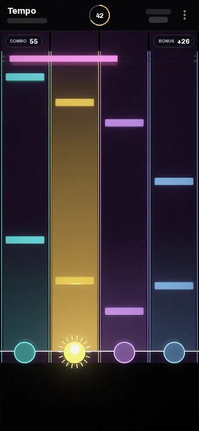 | 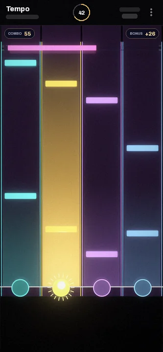 |

- **A:** Today's four lanes with coloured edges, glass note bars, a PERFECT burst on the gold fever lane, the hit pads and the fever tube filling pink.
- **B:** More glow in each lane's wash and a brighter fever column, with haze.

## Meteor

`snake` · scene: [`source/games/snake.py`](source/games/snake.py)

| Today | A: Today upgraded | B: Bolder |
|---|---|---|
|  | 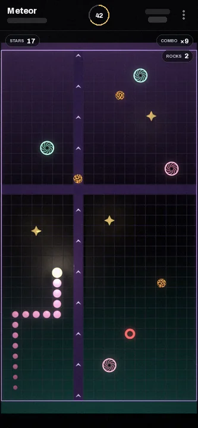 |  |

- **A:** Today's 19 × 34 field with the violet-to-teal wash, the comet as a gold head and fading pink beads turning through the grid, faceted gold stars, molten rocks, swirling wormholes and the speed lanes.
- **B:** The field opened onto a violet nebula, with a wake behind the comet's head.

## Spacewalk

`cross` · scene: [`source/games/cross.py`](source/games/cross.py)

| Today | A: Today upgraded | B: Bolder |
|---|---|---|
|  | 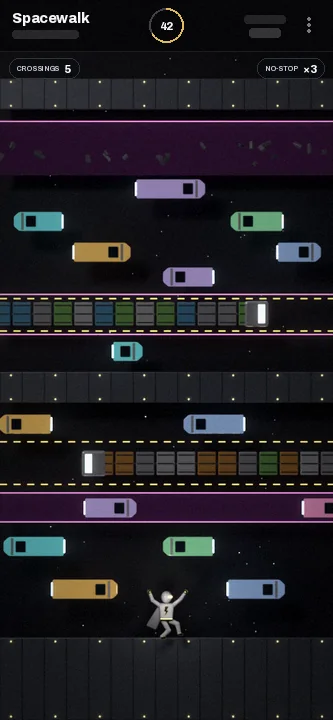 | 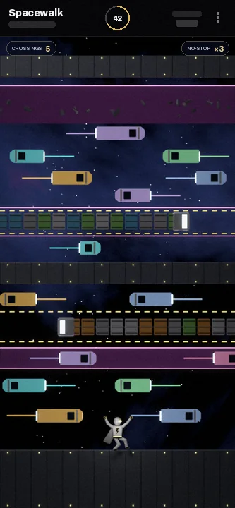 |

- **A:** Today's lanes as station decks with lights, sleek ships in today's colours, cargo freighters of real containers on plasma-bordered lanes, debris and the astronaut about to hop.
- **B:** A nebula sky, engine trails behind every ship and brighter plasma lanes.

## Pinball

`pinball` · scene: [`source/games/pinball.py`](source/games/pinball.py)

| Today | A: Today upgraded | B: Bolder |
|---|---|---|
|  | 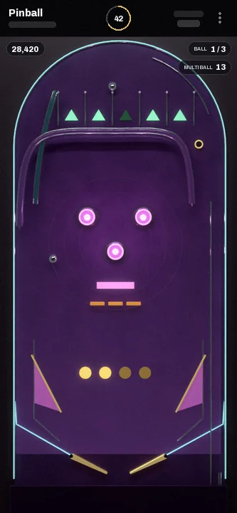 | 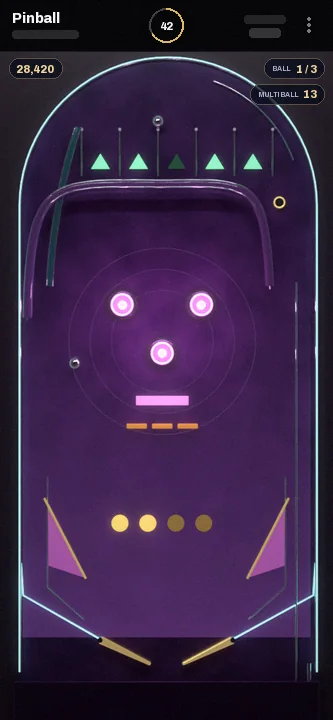 |

- **A:** Today's purple table with a clear-coat playfield, chrome rails and cyan neon arch, J-O-U-L-Z rollovers, the clear purple and teal ramps, real pop bumpers, drop targets, slings, gold flippers and two chrome balls.
- **B:** A darker table in neon haze, so the lights and the lit inserts carry the scene.

## Blockzone

`blockfall` · scene: [`source/games/blockfall.py`](source/games/blockfall.py)

| Today | A: Today upgraded | B: Bolder |
|---|---|---|
|  | 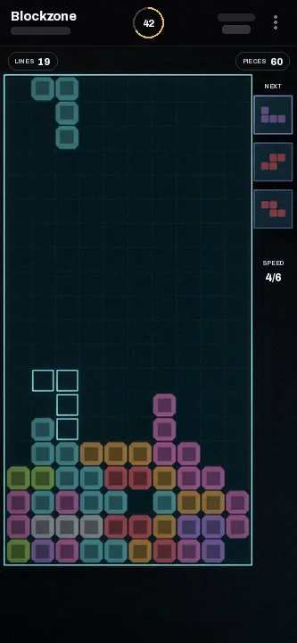 |  |

- **A:** Today's 10 × 20 well and seven neon hues as chamfered glass blocks with lit insets, the falling piece and ghost, the cyan-lit frame and the three NEXT trays.
- **B:** Brighter blocks and a glow rising from the stack inside the well.
