# Speed: game concepts

Phase 2, step 4. Concept pictures only: nothing here is in the app. Each game is shown as it is today beside two
looks, at the phone's 390 × 844 proportions, mid-play, with a plain band at the top standing in for the game header.
Every board is the live game's board (same pieces and layout as the review screenshot), rendered in Blender with
Cycles. Scenes: [source/speed.py](source/speed.py).

- **A, Today, upgraded.** Today's warm brown wood room, orange accents and each game's own pieces made of real
  things.
- **B, Bolder.** The same games pushed: richer lacquer and polish, lower and warmer light, more glare and depth.

| Game | Today | A, Today, upgraded | B, Bolder |
|---|---|---|---|
| **Don't Break the Chain** | 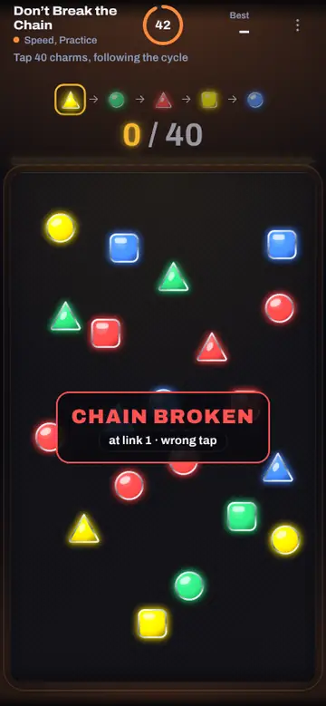 | 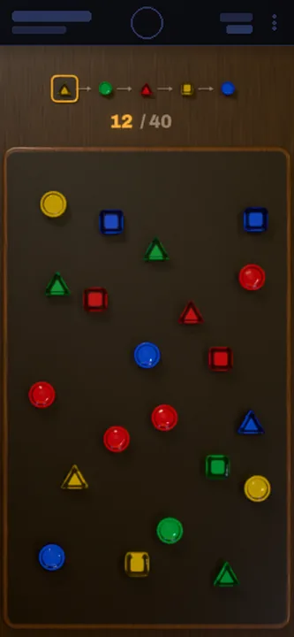 | 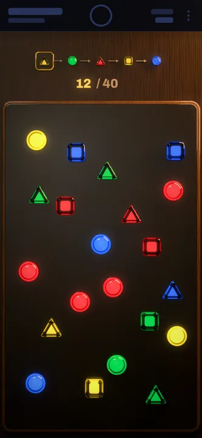 |
| | | The charms as coloured glass (spheres, cushions, triangles) with a lit core, on a dark board in a wooden frame; the cycle above, 12 / 40 made. | Brighter cores and glassier charms in a darker frame. |
| **Ascend** | 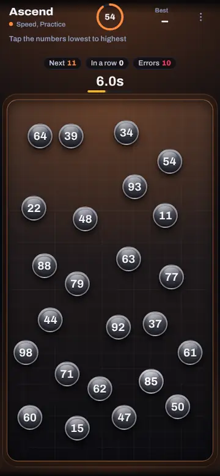 | 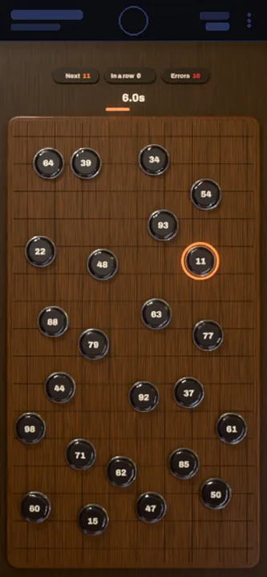 | 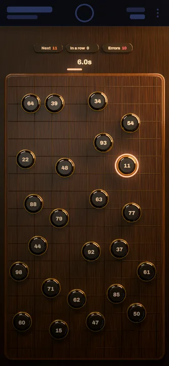 |
| | | The 24 numbers as domed onyx counters with steel rims on a walnut board with today's faint grid; 11, the next, ringed orange. | Darker walnut, brass rims, warmer light. |
| **Flash** | 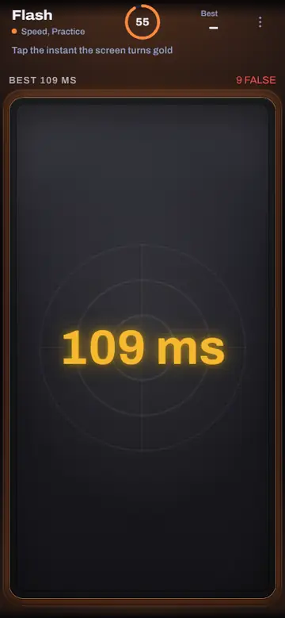 | 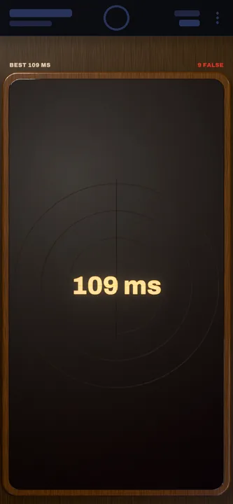 | 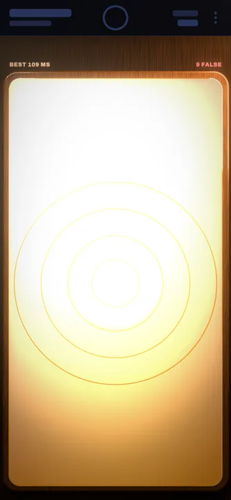 |
| | | The readout as today's mid-play frame: dark glass in a wooden frame, etched target rings, 109 ms lit amber. | The moment that matters instead: the glass flooding gold from behind, the frame catching the light. |
| **Tenfall** | 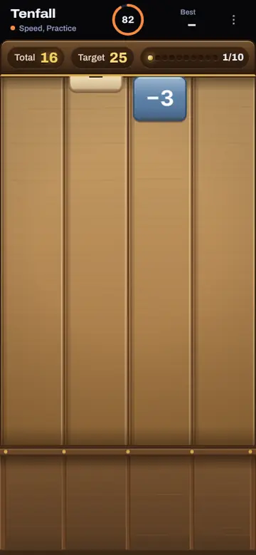 | 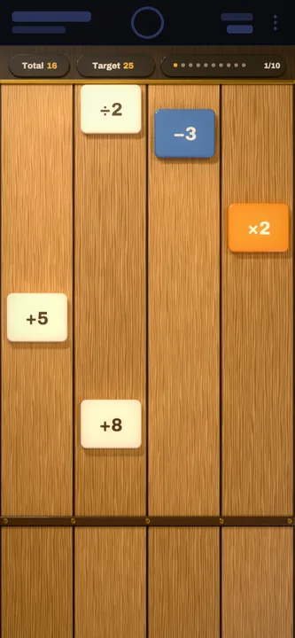 | 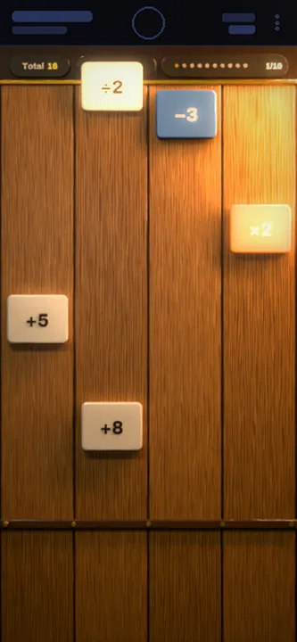 |
| | | Four oak chutes under a brass rail, the tiles as cream, blue and orange enamel; the shelf with brass studs. | Darker, oiled wood and glossier tiles under a warm light. |
| **Bonk** | 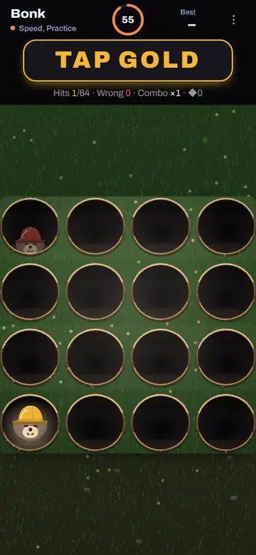 | 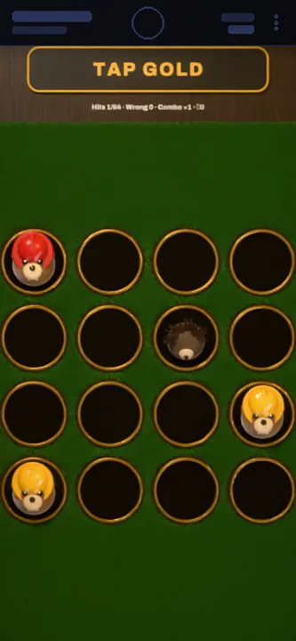 | 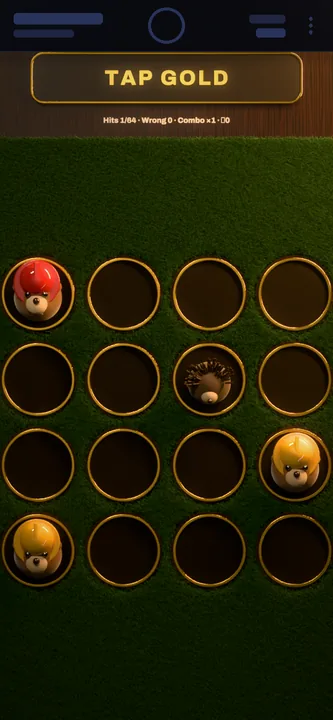 |
| | | A real lawn with sixteen brass-rimmed holes; gophers in gold and red hard hats looking up out of their holes, and a hedgehog; TAP GOLD on a gold-edged plate. | A deeper, dusk-lit lawn and polished hats. |
| **Pull!** | 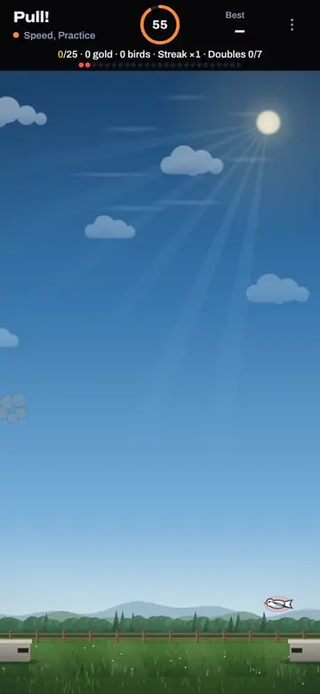 | 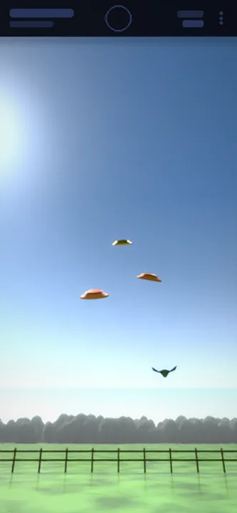 | 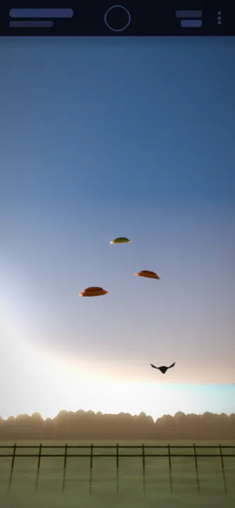 |
| | | Today's sunny range under a real sky: a pair of orange clays and the gold clay in flight, a bird crossing, haze over the treeline, the rail fence. | Late afternoon: a low sun, warm haze and a deeper sky. |

Thumbnails (120 × 260) are in `speed/thumbs/`.
