# Sports: game concepts (phase 2, step 4)

Concept pictures only, rendered in Blender (Cycles) from `source/sports/`: nothing here is in the app. Each game is
shown mid-play at 390 × 844 proportions with a placeholder band for the app's header, beside today's screenshot.
**A · Today, upgraded** keeps today's colours, style, pieces and layout, rendered with real materials, light and
depth. **B · Bolder** is the same game and identity pushed further. Cue Ball, Crazy Golf and Apex have a third look.
HUD chips, buttons and meters are drawn flat over the renders as stand-ins for the app's own interface.

## Cue Ball (`pool`)

<table><tr><th>Today</th><th>A · Today, upgraded</th><th>B · Bolder</th><th>C · Heritage</th></tr><tr>
<td>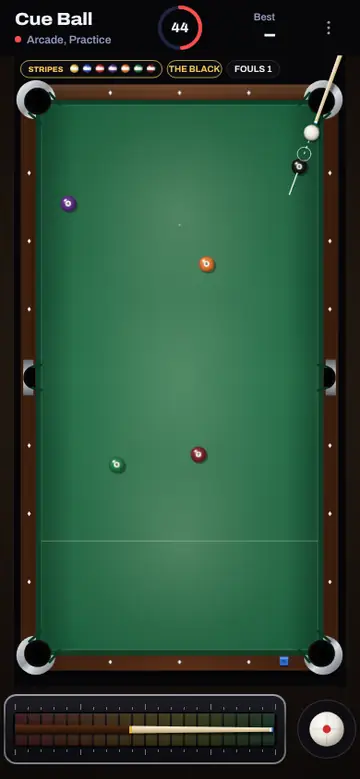</td>
<td>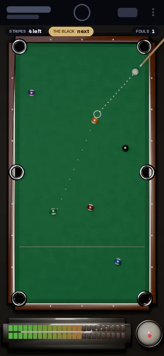</td>
<td>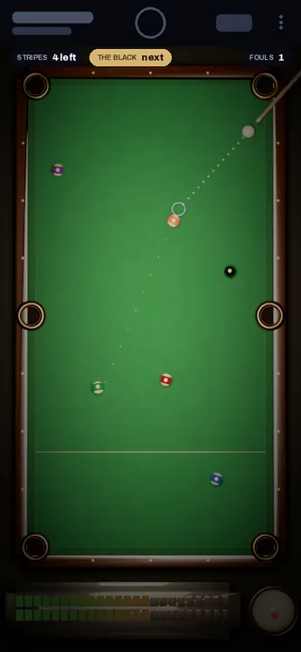</td>
<td>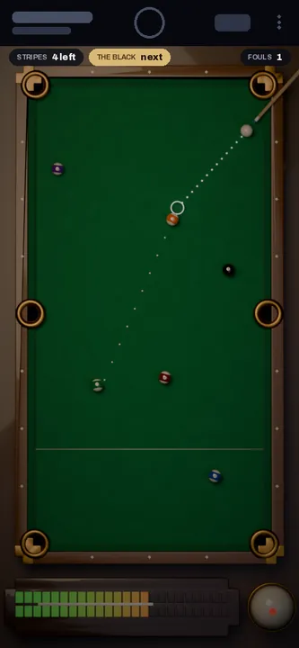</td>
</tr></table>

- **A**: today's table made real: lacquered mahogany rails with pearl diamond sights, green baize cloth, chrome
  pocket caps, glossy resin balls with your stripes and the black, a maple-and-ebony cue, the dotted aim and ghost
  ball, the LED power meter and spin ball below; even overhead table lamps.
- **B**: the same table in a dark hall under one low pendant: rosewood and brass, a pool of light on the cloth that
  falls off to the rails.
- **C**: heritage parlour table: carved walnut with brass corner castings, leather pocket nets, ivory-toned balls,
  a walnut control panel, warm window light over a parquet floor.
- Notes: pocket caps are simple rings rather than shaped cups; the cue's shadow and the panel need a finer pass.

## Curl Champ (`curling`)

<table><tr><th>Today</th><th>A · Today, upgraded</th><th>B · Bolder</th></tr><tr>
<td>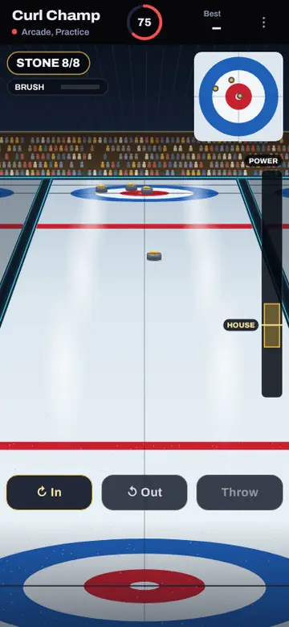</td>
<td>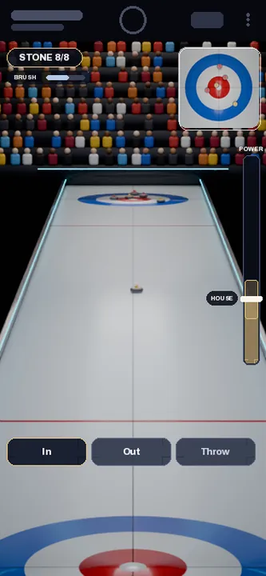</td>
<td>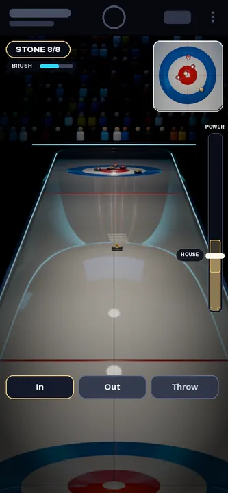</td>
</tr></table>

- **A**: today's view down the sheet: pebbled white ice, the blue / white / red houses, red hog lines, the
  cyan-lit boards, a crowd behind the far end; granite stones with red and yellow tops (three reds and two of yours
  in the house, your eighth on its way); the house view top right is a real top-down render of the same scene.
- **B**: an arena at night: spotlights in pools down the sheet, glossy ice reflecting the board lights, sweep
  marks ahead of the stone, the crowd in the dark.
- Notes: the crowd is simple blocks at this distance; the spot pools in B could be softer.

## Home Run (`homerun`)

<table><tr><th>Today</th><th>A · Today, upgraded</th><th>B · Bolder</th></tr><tr>
<td>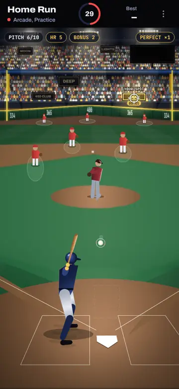</td>
<td>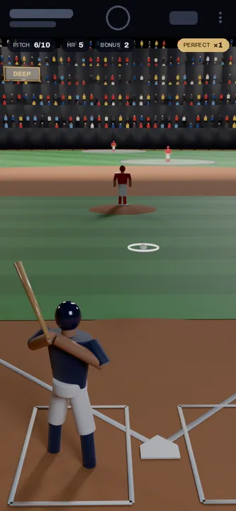</td>
<td>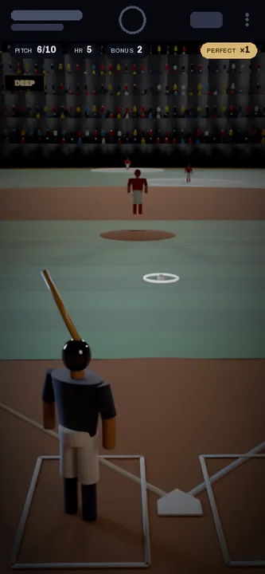</td>
</tr></table>

- **A**: today's batter's-eye view at night: the navy batter in the foreground, chalked boxes and plate, the
  pitcher on the mound, red fielders with catch circles, the green wall with its distances, gold signs and a full
  stand under light towers, the pitch inside its closing ring.
- **B**: darker sky and harder white light, glowing signs and light banks, a wet sheen on the grass, a cool rim on
  the batter.
- Notes: the figures are stylised capsules (faceless, like today's); they are the weakest part and would need
  sculpted, still-stylised players before this look ships.

## Top Bins (`freekick`)

<table><tr><th>Today</th><th>A · Today, upgraded</th><th>B · Bolder</th></tr><tr>
<td>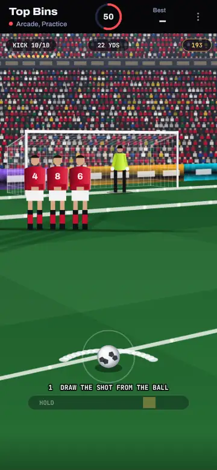</td>
<td>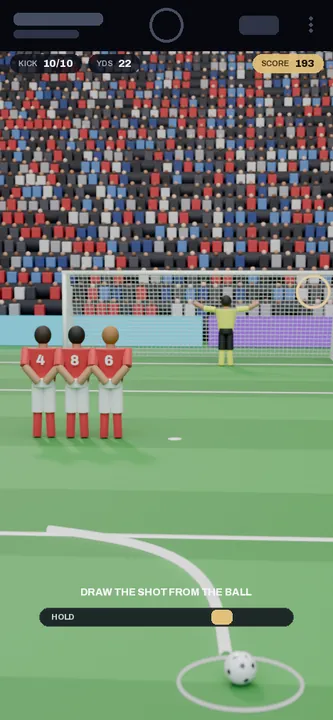</td>
<td>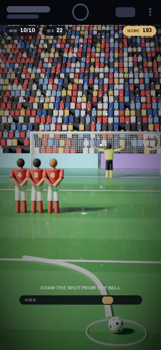</td>
</tr></table>

- **A**: today's free kick from 22 yards: the wall of three (4, 8, 6) in red, the keeper in yellow, the goal with a
  real net, purple and cyan LED boards, the floodlit stand, mown stripes and lines, the ball in its ring with the
  drawn stroke, the gold corner hoop, the HOLD bar.
- **B**: a night match: one hard floodlight bank, brighter LED boards, camera flashes in the stand, dew on the
  grass and a darker frame.
- Notes: same figure caveat as Home Run; the crowd reads busy and could be calmer.

## Crazy Golf (`minigolf`)

<table><tr><th>Today</th><th>A · Today, upgraded</th><th>B · Bolder</th><th>C · Tabletop model</th></tr><tr>
<td>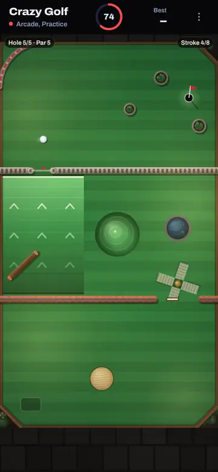</td>
<td>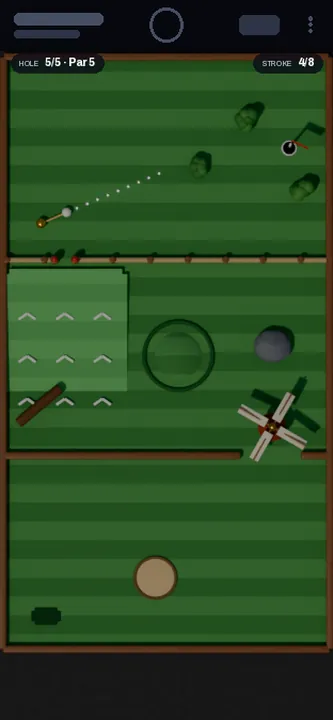</td>
<td>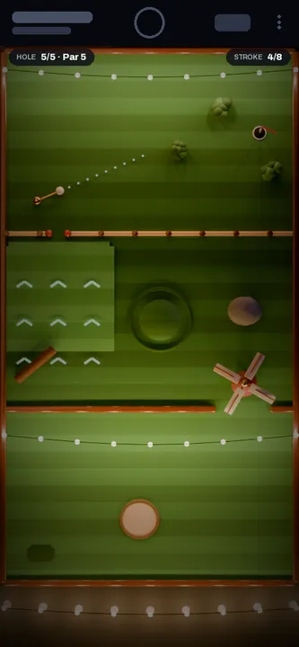</td>
<td>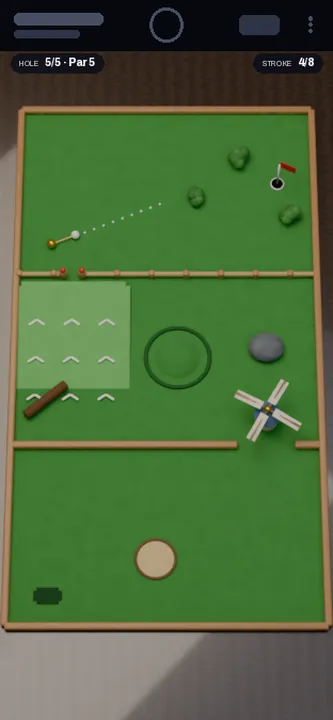</td>
</tr></table>

- **A**: hole 5 as today, from above in sunlight: striped turf, wooden rails, the rope rail and its gate, the ramp
  with chevrons and a log, the dome hill, a boulder, the windmill at the doorway casting its shadow, the sand trap,
  tee mat, cup and flag, the ball with its aim and gold pull handle.
- **B**: the same hole at dusk under festoon lights strung across the course, warm bulbs on a cool evening.
- **C**: the hole as a hand-built tabletop model: felt turf, light wood rails, tilted with a shallow depth of field
  on a dark plinth.
- Notes: the dome hill and sand read faintly from straight above; B's dusk tint is muddy and needs a grade.

## Apex (`racing`)

<table><tr><th>Today</th><th>A · Today, upgraded</th><th>B · Bolder</th><th>C · After the rain</th></tr><tr>
<td>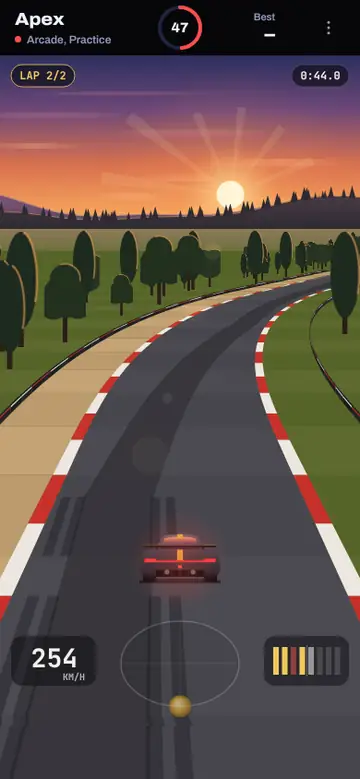</td>
<td>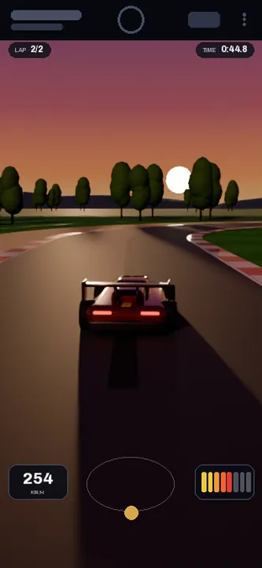</td>
<td>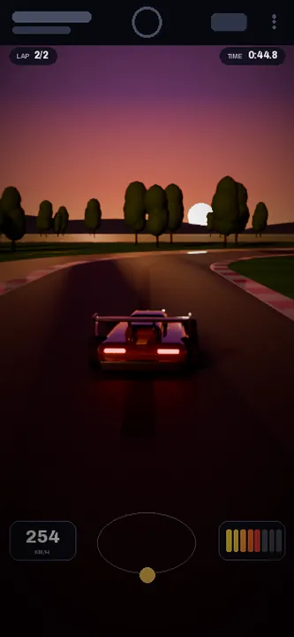</td>
<td>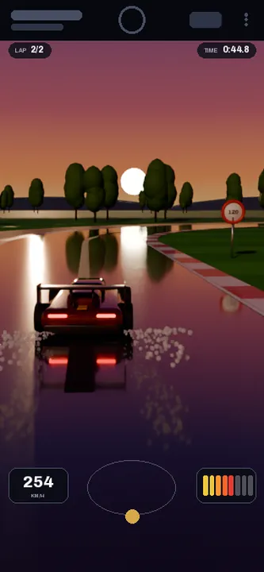</td>
</tr></table>

- **A**: today's chase camera at sunset: an original dark red prototype car from behind (rear wing, wide tyres,
  orange stripe, tail lights), red and white kerbs, sand verge, the red-ringed corner sign, a tree line and hills
  against an orange-to-violet sky; speed, joystick and rev lights below.
- **B**: the last of the light: a deeper violet sky, the sun on the horizon, motion blur on the tarmac, the tail
  lights bleeding red.
- **C**: after a shower: a mirror-wet track holding the sunset and the trees, the tail lights reflected, a fine
  mist off the rear tyres.
- Notes: the car is built from rounded blocks and wants a real surfaced body; the sun's soft glow did not render
  (the disc alone shows).
