# Strategy: game concepts (phase 2, step 4)

Concept pictures only, nothing here is in the app. Each game is shown mid-play at 390 × 844 (the grey band at the top
stands in for the game header; the HUD chips are drawn flat, as the interface draws them). **A · Today, upgraded** keeps
today's colours, layout and pieces and renders them as real materials; **B · Bolder** is the same game pushed further.
Gemstone has a third look. Rendered in Blender (Cycles); scripts in `source/strategy/`.

## Tilt (`tilt`)

<table><tr><th>Today</th><th>A · Today, upgraded</th><th>B · Bolder</th></tr><tr>
<td>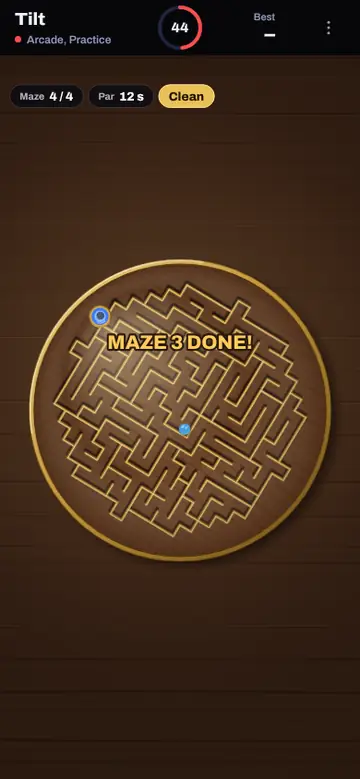</td>
<td>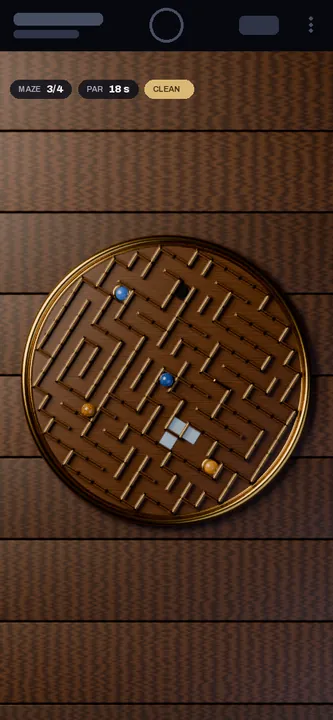</td>
<td>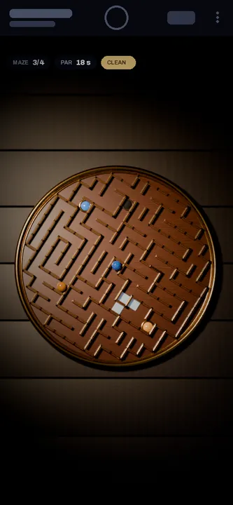</td>
</tr></table>

- **A:** today's walnut disc and plank table as lacquered wood; the turned square maze with walnut walls capped in brass,
  a polished brass rim, glass marbles (blue and amber) heading for enamel cups, a brass key and gate, a pit and an ice
  patch.
- **B:** an ebony table in one warm pool of light, deeper reddish lacquer, a dial-engraved bezel, a slight tilt with depth
  of field and a dark vignette.
- Notes: shown on a maze-3 board (15 cells across) so the walls read; maze 4 (19 cells) would be denser. The dial ticks
  on B are faint at phone size.

## Gemstone (`matchup`)

<table><tr><th>Today</th><th>A · Today, upgraded</th><th>B · Bolder</th><th>C · Jeweller's tray</th></tr><tr>
<td>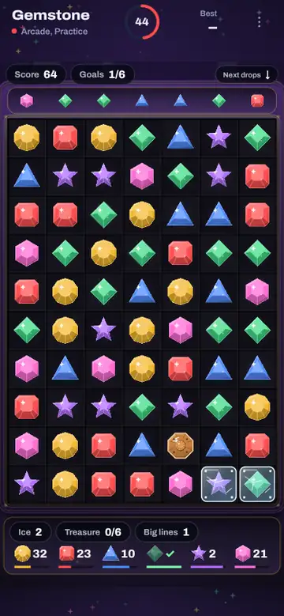</td>
<td>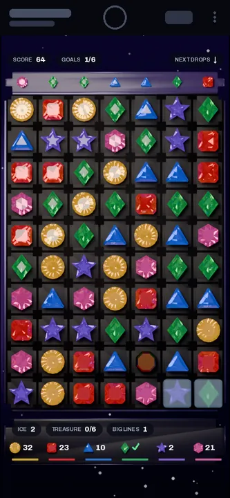</td>
<td>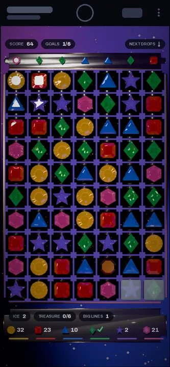</td>
<td>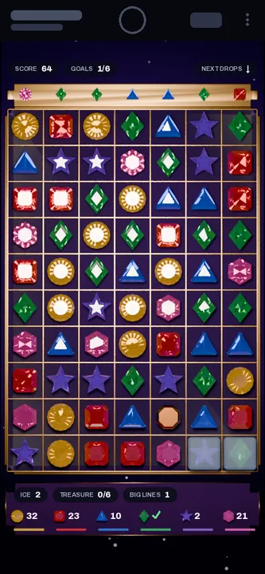</td>
</tr></table>

- **A:** today's purple starry backdrop, near-black cells and the six stones (yellow round, red cushion, green rhombus,
  blue trillion, purple star, pink hexagon) as real cut stones with refraction, plus the bronze treasure and two frosted
  ice cells; goal strip above, counts below.
- **B:** a deeper nebula, black cells floating on glowing violet seams, a champagne-gold rim and a harder sparkle light.
- **C:** the board as a purple velvet jeweller's tray with brass dividers and a brass goal plaque under a warm loupe
  light; the most "premium object" of the three.
- Notes: the round brilliant's facets read as a sunburst at this size; a real cut with more crown facets would sparkle
  better. Ice reads as frosted glass blocks rather than ice.

## Coral Pop (`bubble`)

<table><tr><th>Today</th><th>A · Today, upgraded</th><th>B · Bolder</th></tr><tr>
<td>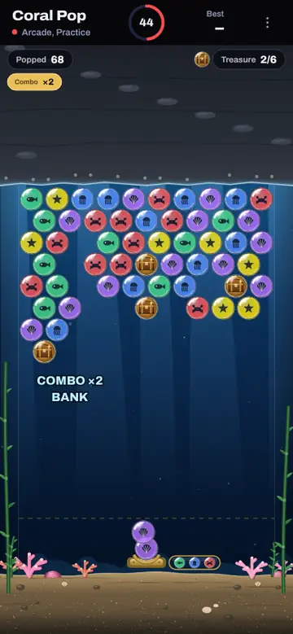</td>
<td>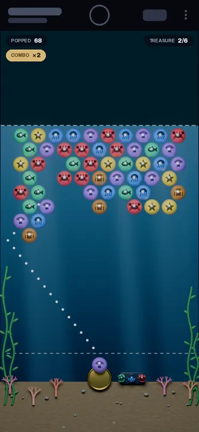</td>
<td>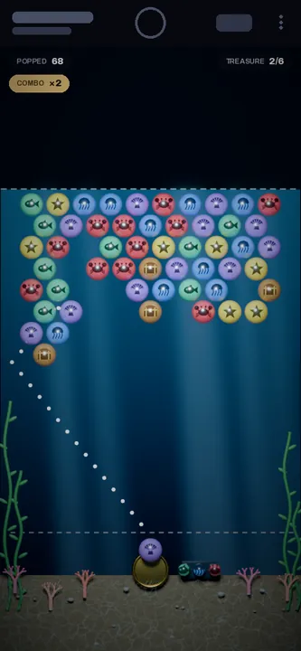</td>
</tr></table>

- **A:** today's reef row for row (teal fish, yellow star, blue jellyfish, red crab and purple shell bubbles, chests) as
  glossy candy-glass spheres with the creature printed inside, sunlit blue water with soft shafts, the dashed warning
  line, the gold shooter and next tray, kelp, coral and a sand floor.
- **B:** darker, deeper water with stronger light shafts, caustics on the sand, a brighter glowing aim trail, more glow in
  the bubbles.
- Notes: the creature marks are original simple silhouettes. B's caustics are a procedural pattern and still a little
  regular; a real caustic pass (or a painted one) would be better.

## Rainbow Bridge (`inkbridge`)

<table><tr><th>Today</th><th>A · Today, upgraded</th><th>B · Bolder</th></tr><tr>
<td>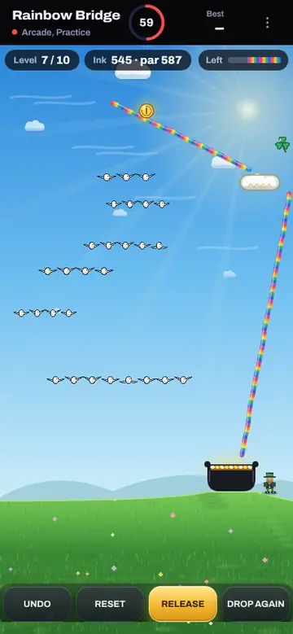</td>
<td>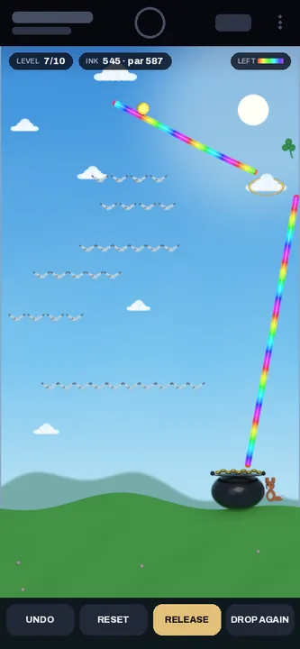</td>
<td>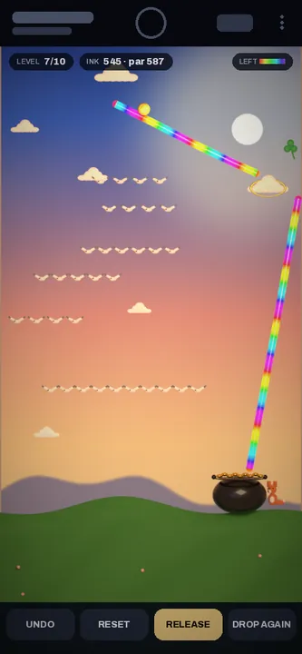</td>
</tr></table>

- **A:** today's bright blue sky and sun, small clouds, the six rows of white birds (now small gulls), the two drawn lines
  as glossy spectrum tubes, the coin, the clover, the bounce cloud in a gold ring and the black pot of gold on green hills;
  the action row drawn flat as today.
- **B:** golden hour: a navy-to-peach sky, warm-tinted clouds and birds, the rainbow lines glowing harder, a darker hill.
- Notes: today's little figure beside the pot is replaced by an original small fox (no look-alike of any known
  character). The hill's grass is a noise material, not modelled blades; it reads a little flat.

## Ball Tracker (`balltrack`)

<table><tr><th>Today</th><th>A · Today, upgraded</th><th>B · Bolder</th></tr><tr>
<td>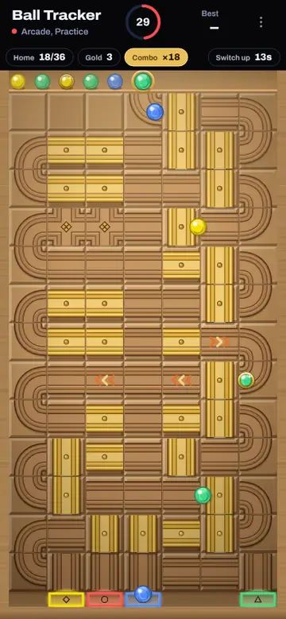</td>
<td>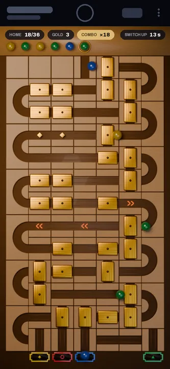</td>
<td>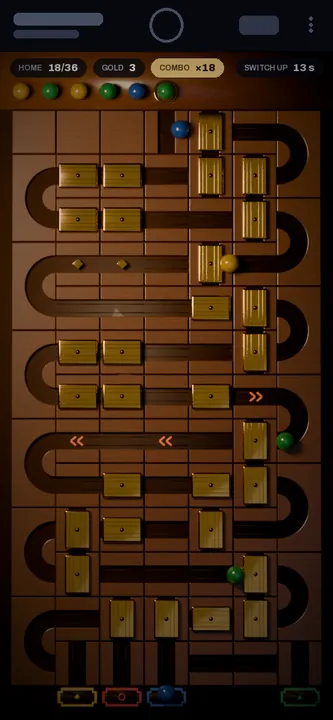</td>
</tr></table>

- **A:** today's 7 × 13 board in light maple with real routed channels and U-turn loops down both edges, fine groove lines,
  fluted brass turnable tubes with pivot pins, orange booster chevrons, glass marbles, the waiting row along the top and
  four enamel cups (diamond, circle, square, triangle) along the bottom.
- **B:** the same board in dark oiled walnut under a warm low light, polished brass and deeper shadows.
- Notes: the top-row corner piece is simplified to a straight drop. A's maple is a touch pale; the cups row at the bottom
  is under-lit in B.
