# Word: game concepts

Phase 2, step 4. Concept pictures only: nothing here is in the app. Each game is shown as it is today beside two
looks, at the phone's 390 × 844 proportions, mid-play, with a plain band at the top standing in for the game header.
Every board is the live game's board (same grid, pieces, letters and layout as the review screenshot), rendered in
Blender with Cycles. Scenes: [source/word.py](source/word.py).

- **A, Today, upgraded.** Today's navy room, glossy black tiles with white letters, yellow-gold and blue highlights,
  as they are, made of real things: glazed ceramic tiles with soft bevels, enamel gold, a lit glass edge where
  today draws a blue ring, recessed wells for empty squares, depth of field.
- **B, Bolder.** The same game and colours pushed further: black glass tiles with polished edges, polished gold,
  a darker room with sapphire rim light and more glare.

| Game | Today | A, Today, upgraded | B, Bolder |
|---|---|---|---|
| **Nucleus** | 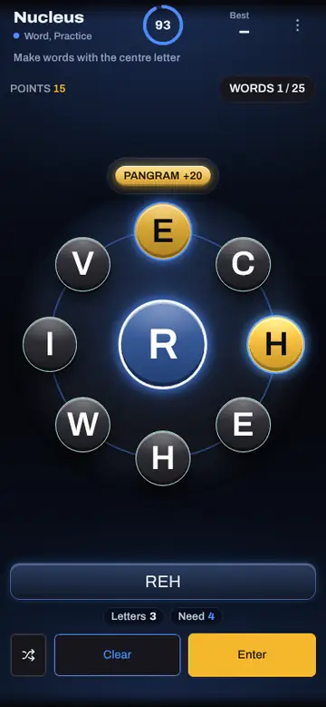 | 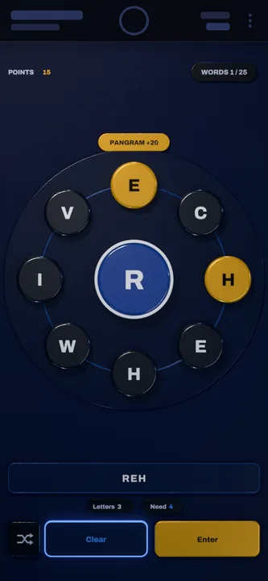 | 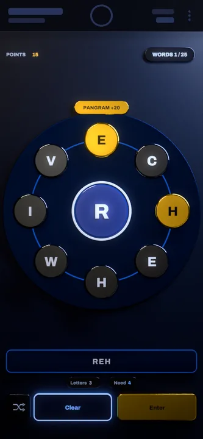 |
| | | Letters as glazed discs round a lacquered navy centre on a turned tray; the picked letters gold with a blue glow beneath. | Black glass discs and polished gold; the ring and the centre lit sapphire. |
| **Interlock** | 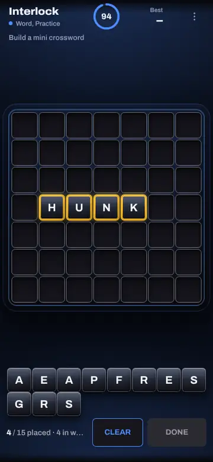 | 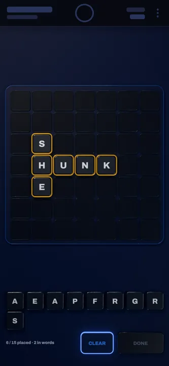 | 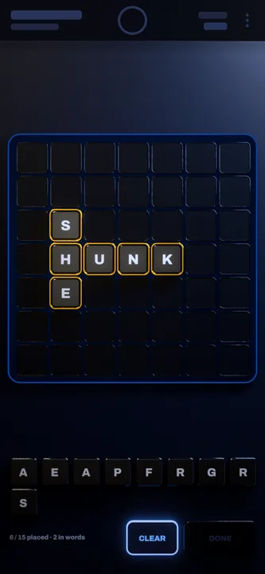 |
| | | The 7 × 7 board as a framed tray of recessed squares; placed tiles sit proud with a gold edge. | A sapphire-edged metal tray; glass tiles with polished gold rims. |
| **Slider** | 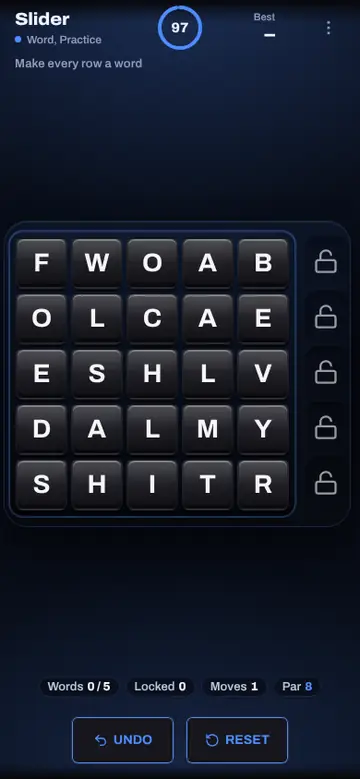 | 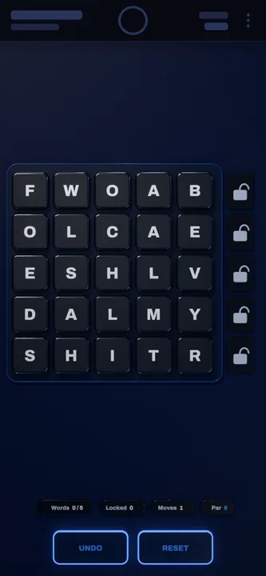 | 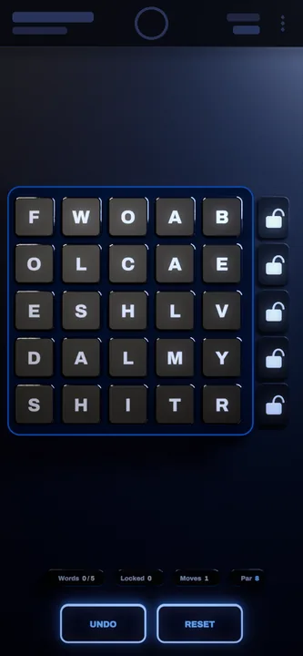 |
| | | Glazed tiles in a lit tray, each row's padlock in its own slot beside it. | Glass tiles in a metal frame lit blue at the edge; brighter padlocks. |
| **Forage** | 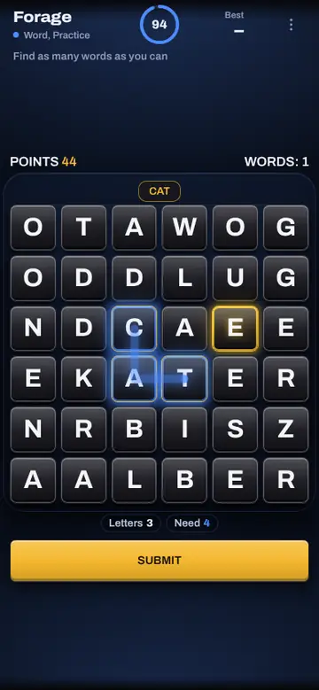 | 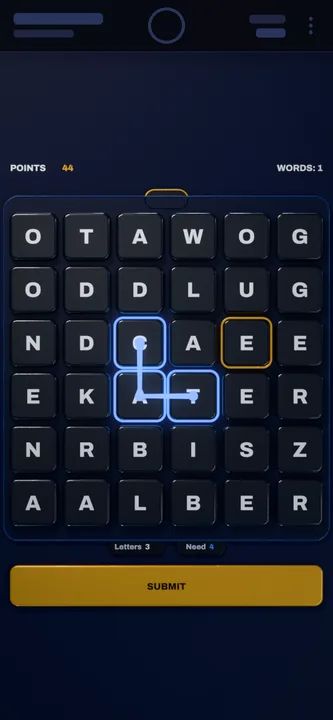 | 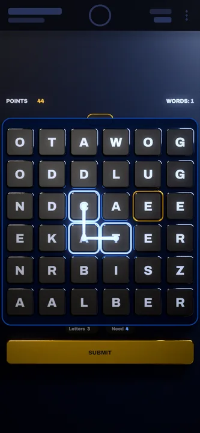 |
| | | The traced word as a lit blue line between blue-edged tiles; the golden tile ringed in gold. | The same in black glass, the trace brighter and the room darker. |
| **Lookout** | 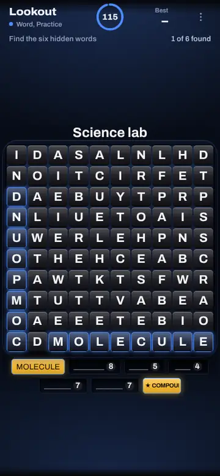 | 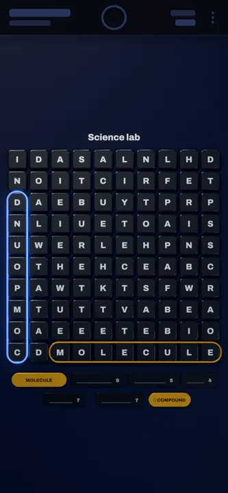 | 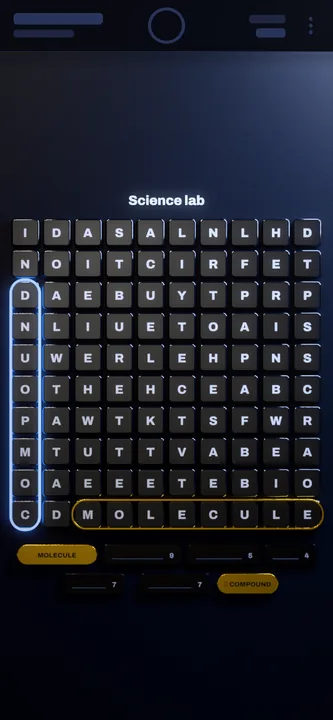 |
| | | A hundred small glazed tiles; found words held in raised gold and blue capsules, the chips below as tags. | Glass tiles; the capsules glow; deeper vignette. |
| **Roundabout** | 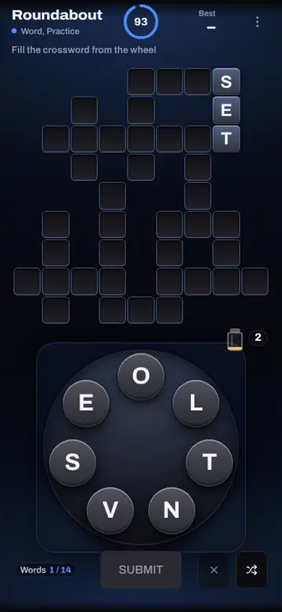 | 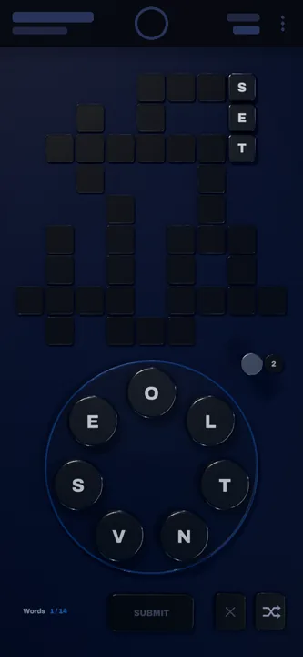 | 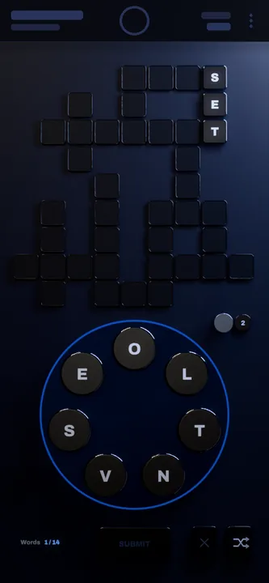 |
| | | The crossword as recessed wells, filled squares as tiles; the wheel a turned tray; the bonus jar real glass with gold coins. | A lit sapphire wheel rim and glass tiles. |
| **Strikeout** | 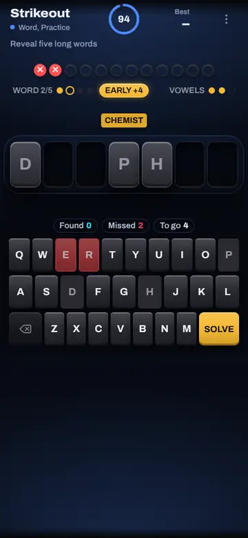 | 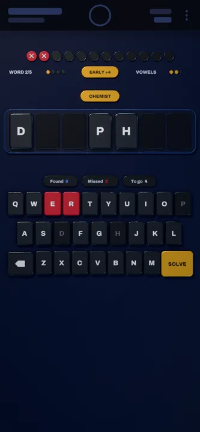 | 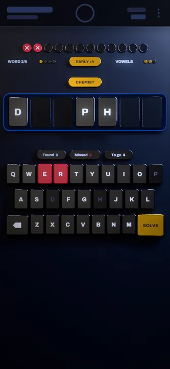 |
| | | Strike counters as red enamel studs, the word as tiles in a lit slot, the keyboard as real keys with depth. | Glass keys and studs, the word slot edged in blue light. |
| **Cryptogrid** | 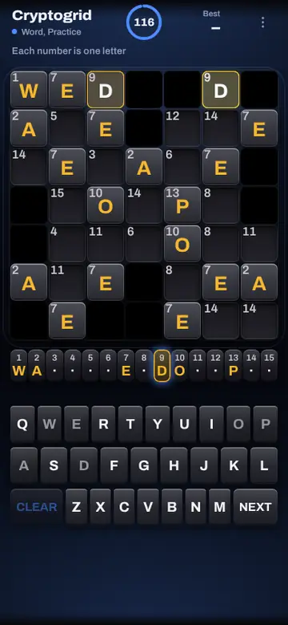 | 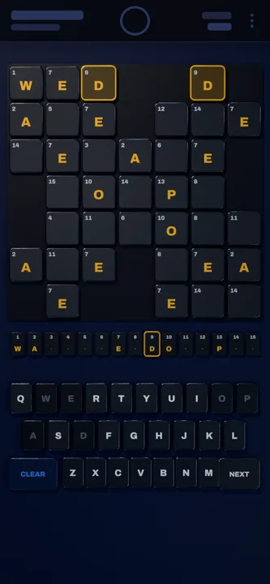 | 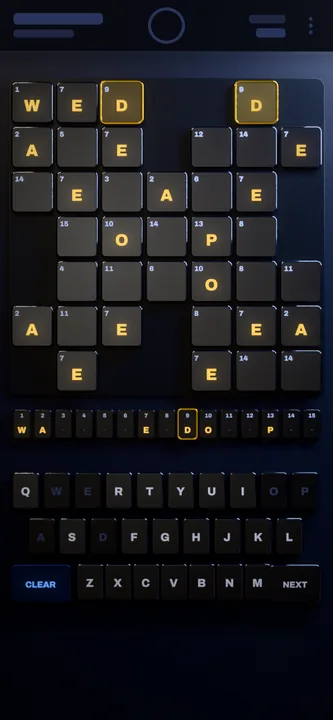 |
| | | Numbered tiles with cracked letters in gold, the picked number tinted and ringed gold; the strip as small tags. | The same in glass, gold letters lit. |
| **Swapword** | 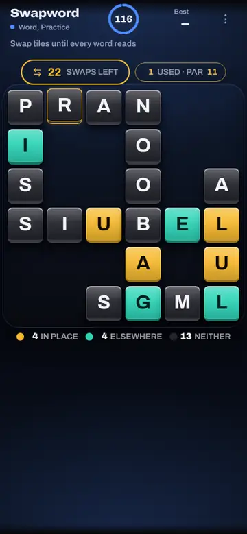 | 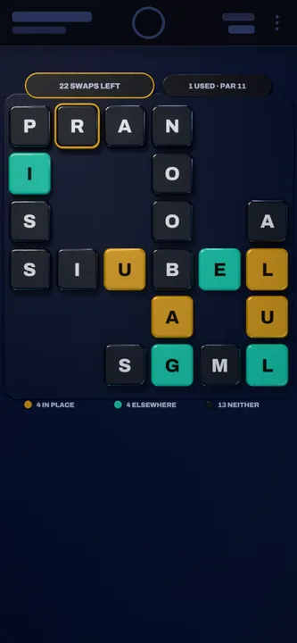 | 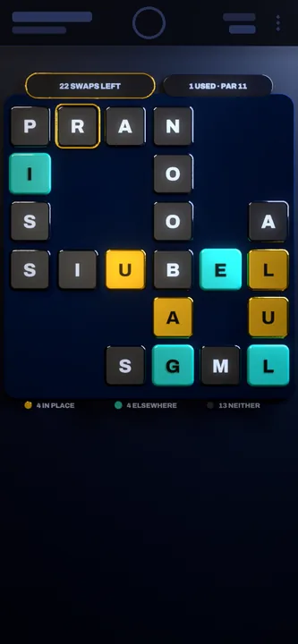 |
| | | The figure-eight in glazed tiles: gold, teal and black glazes exactly as today's colour hints. | Polished gold and glassy teal, brighter against black glass. |

Thumbnails (120 × 260) are in `word/thumbs/`.
