# Action: game reviews (phase 2, step 4)

Six live games: Roofbound, Grappler, Moon Climb, Iron Wall, High Rise and Orbit. No game is retired from this group.

The screenshots are from a local dev server on main dd9acbe6 (15 Nov 2026), in practice mode at 390 × 844, shrunk to
360 wide. **Start** is the round intro, **Mid** is halfway through the round, **End** is the answer reveal. The mid-play
and end frames come from each game's Near-perfect skill-band bot, played through the audit tool. Orbit has no bot
for its live stamp, so it got scripted taps, and its frames show what happens to someone who taps blindly.

## Summary

| Game | Biggest feedback win | Biggest change | Difficulty notes |
|---|---|---|---|
| Roofbound | A flip whoosh, plus a landing "thud" that turns gold on a sweet spot | Show the flow streak as a counter next to the runner, not as a number in the HUD | Easy: slower speed cap and no moving spikes. Expert: a faster cap and tighter sweet spots. Needs a proved deal per level. |
| Grappler | A rope snap on each grab, and a streak meter that pops every 8 | Draw the hero bigger; it is about 10 px on a phone | Easy: longer reach and no pterodactyl. Expert: more sliding vines and a shorter stall limit. Needs a proved deal per level. |
| Moon Climb | Make a hit cost something you can see | Make hits count: 11 hits still scored 191 | Levels are cheap (the tower is built in the sim). Easy: fewer blades. Expert: ice walls and faster lanterns. |
| Iron Wall | Tank-destroyed burst with a label, plus a short camera kick on a kill | Make the far tanks easier to read: they are tiny at the horizon | Easy: slower waves and a wider green zone. Expert: faster waves and more armour. |
| High Rise | A landing squash and a growing "PERFECT" chain | Don't end the run on the first miss: a Near-perfect bot died at 40 floors | Easy: wider blocks and a slower slide. Expert: a faster slide and earlier wind. |
| Orbit | An "OUT OF FUEL" sputter sound and a fuel warning before the tank runs dry | A first-time player runs out of fuel and the run ends at 5 s with 3 points | Easy: a bigger tank and a slower zigzag. Expert: a smaller tank. Needs a proved bank per level. |

## How to read the difficulty sections

- **Normal** is today's game on its live stamp.
- **A level is a new stamp.** Each level is its own deal, stored in the puzzle like any stamp, so older rounds replay as they did. Rated rooms stay on Normal.
- **Stars.** 175+ earns a star on Easy, Normal and Hard. 175+ on Expert earns a crown (`docs/practice-progress.md`).
- **What each level must keep.** 200 must stay reachable on every level. Easy should give an average player a real shot at a star. Expert should need elite play for 175.
- **Proved deals.** Roofbound, Grappler and Orbit deal rooms from a proved deal or bank, and Iron Wall's 200 is proved by its oracle on every seed. A level that changes play needs its own proof. Those runs take from minutes up to about an hour each.
- **Hard and Expert challenges.** A few are already written into the challenge catalogue, switched off until levels arrive. A level must keep each of them possible:
  - Grappler "King of the swingers" (Expert)
  - Moon Climb "Moonwalker" (Hard)
  - High Rise "Skyscraper" (Expert)
  - Orbit "Stargazer" (Hard)

The proposed feedback uses the planned effects kit: tap, pick up, drop or place, slide, pour or flow, match or clear, wrong, combo or streak, score count-up, near-miss and round-end payoff. It also follows the style guide's rules:
- A physical action takes at most 900 ms, and the next input is accepted straight away.
- Nothing decorative is drawn over the board while a game runs. Effects belong to the thing that moved.

---

## Roofbound (`flip`)

**Now.** Run through a lava cave and tap to flip between floor and ceiling to dodge spikes. It is on `flipRev 12`, plays for 60 s, and rooms deal only the 256 courses whose witness scores 200.

| Start | Mid-play | End |
|---|---|---|
| 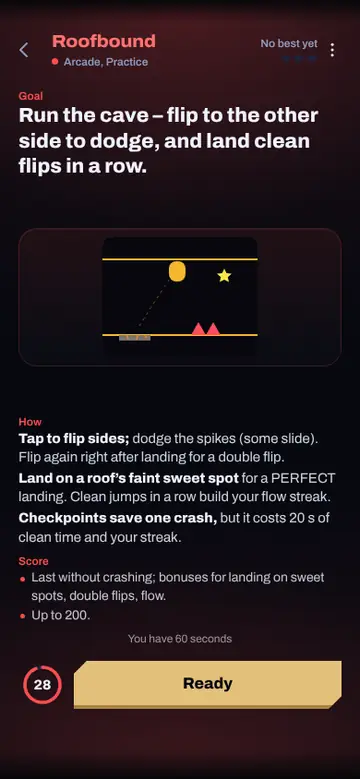 | 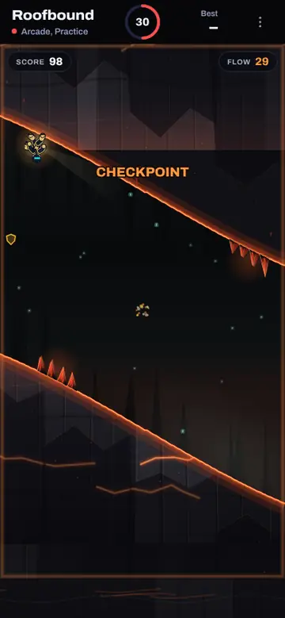 | 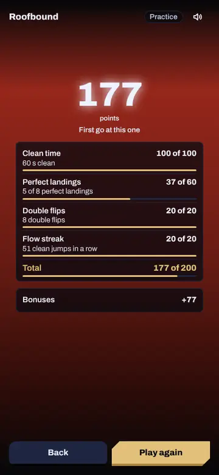 |

What each action does today:

| Action | Shows | Sounds |
|---|---|---|
| Tap (flip) | Runner swaps sides, no effect | `flip.flip` has no recording; library `arc_gravity_flip` |
| Flip again soon after landing (double flip) | "DOUBLE FLIP!" text | shared combo banner file |
| Land on a sweet spot | molten-orange "PERFECT" for 0.6 s | shared spark chime |
| Pass a checkpoint | "CHECKPOINT" banner | shared file |
| Crash saved by a checkpoint | "SAVED!" pop | shared file, no haptic |
| Every 10 s alive | "n SECONDS" banner | shared file |
| End crash | red edge pulse | library `arc_crash` + haptic |

- The flow streak (clean jumps in a row) has no sound and no pop; it shows only as FLOW in the HUD.
- The intro still is an old flat drawing (yellow line, pink spikes) that looks nothing like the cave.
- The reveal adds a "Bonuses +77" row under the total, which repeats the parts above it.

**Feedback.**
- *Flip:* a short gravity whoosh rising or falling with the direction. A brief stretch of the runner along the flip; a faint motion trail of two frames.
- *Landing (drop or place):* a small dust puff and a soft thud. On a sweet spot, the puff turns gold, the thud gets a bright chime on top, and "PERFECT" sits on the landing spot, not mid-screen.
- *Flow streak:* a small counter riding beside the runner ("×12"). It ticks up with a rising note on each clean landing, every 10th with a brighter step. On a break, the counter cracks and falls away with a dull tone.
- *Double flip:* a two-note "flip-flip" and a ring at the runner.
- *Near-miss:* a quick white glint on a spike the runner passes within a few pixels, with a short "tsss".
- *Checkpoint saved crash:* the runner flashes and blinks back to the checkpoint with a rewind sound and an `impact` haptic.
- *Round-end payoff:* "SURVIVED!" with the flow best counting up, then the reveal.

**Changes.**
- Record real sounds for flip, crash and flow. They are the three moments the player meets most often.
- Replace the intro still with a frame of the real cave, or record the demo (it has been stopped since flipRev 11).
- Drop the reveal's "Bonuses" row; the parts already add up.
- The cave's tilt (it bends from 10 s) makes the runner small against a large slanted world. Consider a slightly closer camera; it is display only.

**Difficulty.**

| | Easy | Normal | Hard | Expert |
|---|---|---|---|---|
| Speed cap (`V8_SPEED_CAP`) | 2048 | 2560 | 2816 | 3072 |
| Speed step | every 4 s | every 3 s | every 3 s | every 2.5 s |
| Moving spikes from | none | 12 s | 8 s | 5 s |
| Sweet spot width | 2 ticks | 1 tick | 1 tick | 1 tick, and 10 spots |
| Checkpoint cost | 10 s | 20 s | 20 s | no checkpoints |

- Score lines stay the same.
- Each level needs its own proved deal (`scripts/flip-deal.ts`).

---

## Grappler (`swing`)

**Now.** Swing vine to vine through a jungle canopy. Hold to grab the nearest lit vine; let go to fly. It has six dark platform runs and a pterodactyl for the last quarter. It is on `swingRev 17`, plays for 90 s, and rooms deal 120 proved courses.

| Start | Mid-play | End |
|---|---|---|
| 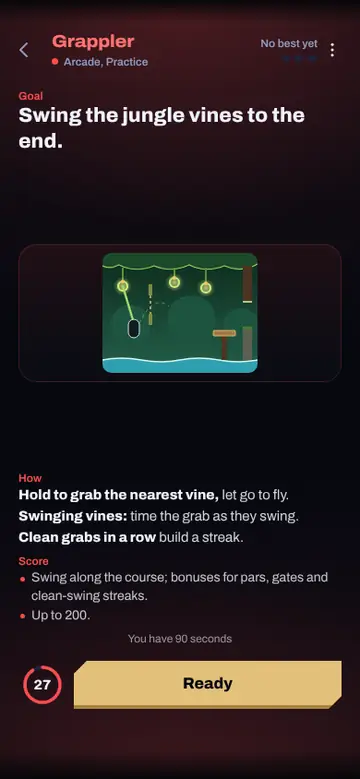 | 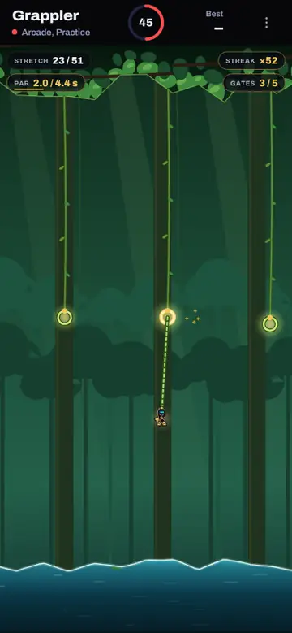 | 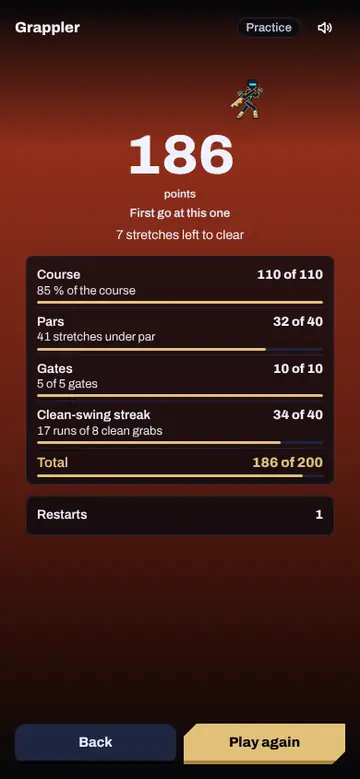 |

Sounds today:
- Every core moment has its own recording: grab (vine creak), release, land, gate, streak block, splash and pterodactyl.
- The jungle ambience plays under the music.

Visuals today:

| Moment | Shows |
|---|---|
| Lighting a gate | "SPEED GATE!" |
| Clearing a stretch | "CLEAR!" or "−x s UNDER PAR" |
| A streak block of 8 paying | nothing; only the HUD's ×52 changes |
| A miss | red edge pulse + haptic |

**Feedback.**
- *Grab (pick up):* the vine flexes and its glow flares at the grab point, with a short rope snap as it pulls taut.
- *Release (slide or flow):* a whoosh pitched by speed. Above 3.5 px a tick, add a faint speed streak, so the player learns what lights a gate.
- *Streak:* a small arc meter under the HUD's STREAK fills over 8 grabs. When it pays, it bursts with a rising arpeggio.
- *Near-miss:* a vine just out of reach glows red for a beat, so the player sees why the grab failed.
- *Pterodactyl:* a shadow sweeps across the screen first, then the wing loop starts.
- *Round-end payoff:* "COURSE CLEARED!", then the stretch count tallying up.

**Changes.**
- **The hero is drawn at about 10 px** in a 450-wide world; on a phone the hero and rope are hard to follow. Draw them larger, as was done for Roofbound on 8 Nov.
- The HUD labels also draw at about 8 px.
- The HUD says STRETCH 23/51, and the reveal says "7 stretches left to clear" at "85 % of the course". The doc says 45 stretches. Check which count is right, and say one plain thing in the reveal.
- The intro still is the old cave design; record the demo on swingRev 17.
- `docs/arcade-standard/swing.md` still says the streak and sliding vines have no sound. Update it.

**Difficulty.**

| | Easy | Normal | Hard | Expert |
|---|---|---|---|---|
| Reach (`REACH`) | 260 px | 220 px | 220 px | 200 px |
| Sliding vines per quarter | 0, 2, 3, 4 | 0, 4, 6, 8 | 2, 6, 8, 10 | 4, 8, 10, 12 |
| Streak stall limit | 200 ticks | 150 | 130 | 110 |
| Pterodactyl | none | last quarter | last quarter, faster | last third |
| Dark runs | lit | 6 dark | 6 dark | 8 dark |

- "King of the swingers" (70 % of the course on Expert) must stay possible.
- Each level needs its own proved deal (`swing-slide-deal.ts`).

---

## Moon Climb (`ricochet`)

**Now.** A ninja (Captain Joulz) leaps between two temple walls by moonlight. Tap to leap, tap again in the air to double jump, ride sky lanterns, and avoid blades and shurikens. It is on `ricoRev 3` and plays for 60 s.

| Start | Mid-play | End |
|---|---|---|
| 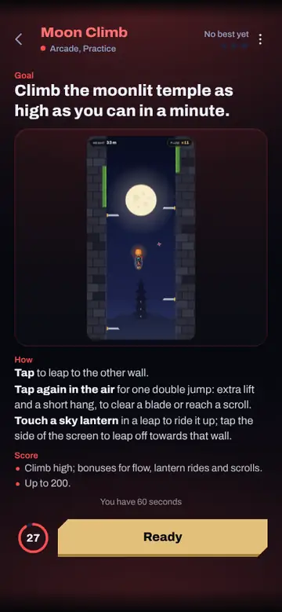 | 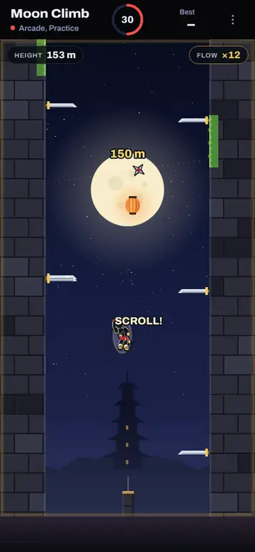 | 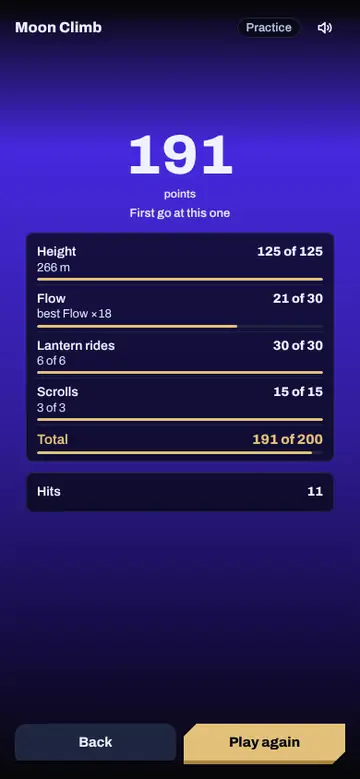 |

Today:

| Moment | Shows | Sounds |
|---|---|---|
| Leap | — | its own recording |
| Double jump | — | its own recording |
| Landing (stone, moss, ice, ledge) | — | a recording for each surface |
| Lantern | "LANTERN RIDE!" | recording |
| Flow step | "FLOW ×N" pop | recording |
| Scroll | "SCROLL!" | recording |
| Every 50 m | banner | shared file |
| Hit | screen shake, red edge | recording + haptic |

This is the best-served game in the group for sound.

**Feedback.**
- *Leap:* a small kick of dust off the wall.
- *Double jump:* a ring of air under the feet.
- *Landing on moss or ice:* a scuff trail while sliding. This makes the 16 px "flow broken by sliding" rule visible: the trail turns red when the flow breaks.
- *Lantern:* the lantern brightens and sways under the ninja.
- *Scroll:* it flies into the HUD's count.
- *Hit:* the ninja tumbles down the 3 m with a falling whistle, and the lost height shows as a short red "−3 m" beside the HUD.

**Changes.**
- **Hits cost almost nothing.** The Near-perfect bot took 11 hits and still scored 191, with height full at 266 m. Players will learn that blades don't matter. Two options:
  - Cap height lower (a stamp change).
  - Add a clean-climb part.

  Joe's call. At the least, show hits on the reveal as a part, not just a stat.
- The HUD shows only HEIGHT and FLOW. Add rides and scrolls (n/6, n/3); they are a third of the score.
- Record the intro demo (never recorded).
- Fix the stale comments: `music_ricochet` in the manifest, and `ricochet.md`'s "library until Joe's files".

**Difficulty.** The tower is dealt in the sim with its own witness, so levels need no bank, only a witness-proved build.

| | Easy | Normal | Hard | Expert |
|---|---|---|---|---|
| Blades and shurikens | about half | today | about 1.3× | 1.6×, faster shurikens |
| Moss / ice share of walls | 30 / 10 % | 60 / 40 % | more ice | mostly ice |
| Lanterns | 6, slower | 6 | 6 | 4, faster |
| Hit knock-down | 2 m | 3 m | 3 m | 4 m |
| Height full at | 200 m | 245 m | 245 m | 260 m |

- "Moonwalker" (245 m on Hard) must stay possible.

---

## Iron Wall (`bastion`)

**Now.** A first-person turret holds a road against five waves of 30 tanks and three drones. Drag to aim (the crosshair sits 120 px above the thumb), lift to fire. It has five shells, and a tap in the green zone gives a fast reload. It is on `bastionRev 3` and plays for 60 s.

| Start | Mid-play | End |
|---|---|---|
| 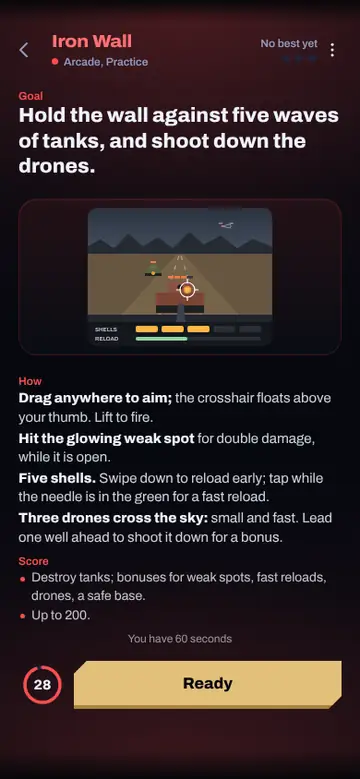 | 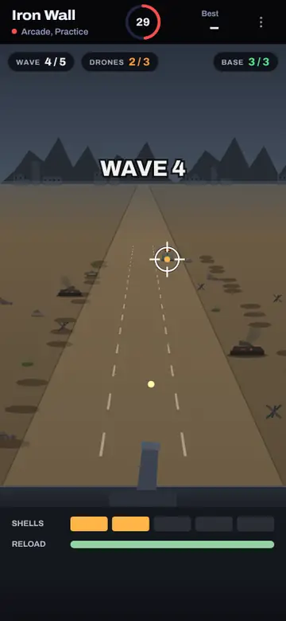 | 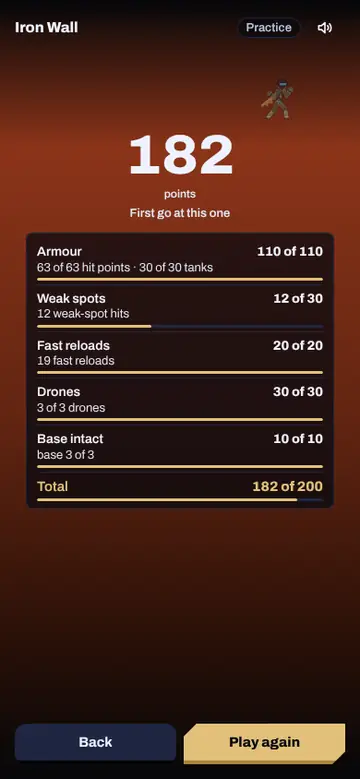 |

Today:
- Every slot has a recording except the dry fire, which falls back to a tick: cannon, hit, weak spot, kill, miss, reload, fast reload, jam, wave, drone loop, drone down and base hit.
- No screen shake, by design.
- A kill draws a burst with no label.
- A weak-spot hit shows "WEAK SPOT" only on every 5th hit.
- A miss draws flak puffs and a red edge.

**Feedback.**
- *Fire:* a short camera kick (2–3 px for 80 ms; the barrel is the thing that moved, so this is not decoration) and a muzzle flash at the barrel.
- *Shell in flight:* a small shadow on the road, so the 18–30-tick lead is learnable. Where a shell will land is the whole skill.
- *Hit:* sparks and a dent where it struck. A weak-spot hit flashes gold every time, with a higher "ting".
- *Kill:* a burst with debris, and "+n" hit points rising from the tank.
- *Fast reload:* the needle glows green and the shells snap in one by one with clicks.
- *Jam:* the needle turns red and shakes, with a grinding clunk.
- *Near-miss:* a shell landing within a tank-length gets a dusty "close" puff.
- *Base hit:* a heavy rumble, and a crack across the bottom panel that stays.
- *Round-end payoff:* the waves tally, then "WALL HELD".

**Changes.**
- **Far tanks are hard to read**: at the horizon they are a few pixels across. The 3 Nov view change helped, but consider a light outline or a type badge (Scout, Medium, Heavy) over far tanks.
- The help says "Swipe down to reload early". Nothing on screen teaches the swipe; show it once at the first empty magazine.
- `bastion.md` says 100 px for the crosshair lift; the code uses 120. Update the doc.
- Record the intro demo.

**Difficulty.**

| | Easy | Normal | Hard | Expert |
|---|---|---|---|---|
| Wave pace (`BT3_WAVE_PACE`) | 36–80 % | 44–104 % | 50–120 % | 60–135 % |
| Green zone (`BT3_ZONE_W`) | 70 ‰ | 45 ‰ | 40 ‰ | 30 ‰ |
| Weak spots open | 75 of 90 ticks | 60 of 90 | 50 of 90 | 40 of 90 |
| Base hits allowed | 4 | 3 | 3 | 2 |
| Heavy tanks | fewer | today | more | more, faster |

- The 200 must be re-proved by the oracle on each level (`scripts/bastion-oracle.ts`).

---

## High Rise (`skyline`)

**Now.** Tap to drop a sliding block onto a tower. A perfect drop grows the block; a block that misses the tower entirely ends the run. Wind starts at block 20. It is on `skylineRev 10` and plays for 60 s.

| Start | Mid-play | End |
|---|---|---|
| 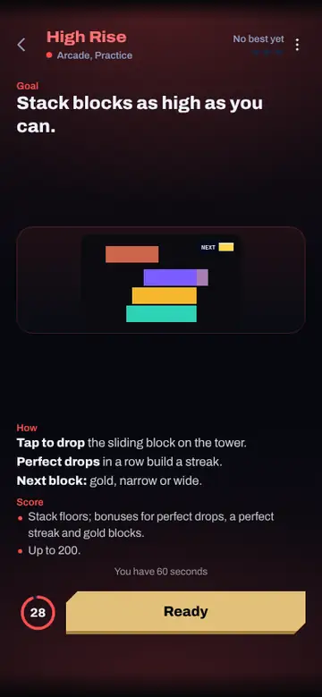 | 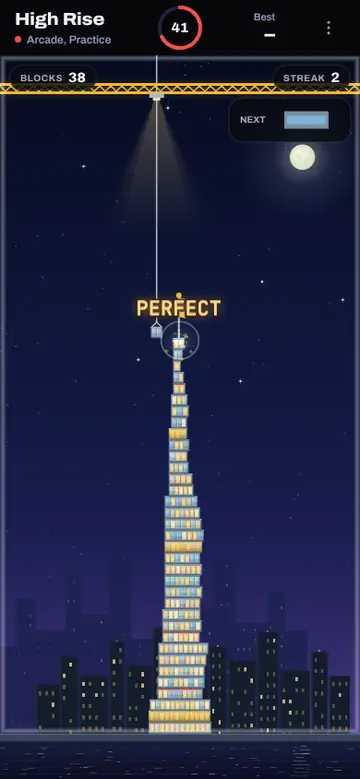 | 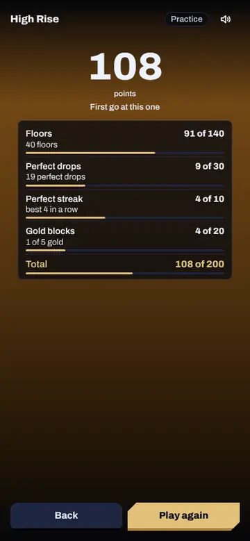 |

Today:
- The drop and the miss have no recordings; they play library clank and crash sounds.
- A perfect drop flashes "PERFECT" with a ring.
- The streak banner shows from the 3rd perfect.
- Every 10 floors, a banner shows and the camera pulls back.
- Wind is announced with "FLAG UP: WATCH THE WIND!".

**Feedback.**
- *Drop:* the block falls with a whistle, and the tower squashes 2 px and settles (drop or place).
- *Trim:* the overhang that is cut off falls away, spinning, with a crumble. Today it is the thing players most need to see.
- *Perfect:* a clean "tock" at a pitch that rises up the streak (combo), a gold ring at the join, and the block growing visibly.
- *Near-miss:* a block landing with only a sliver of overlap wobbles and creaks.
- *Gold block:* a coin chime.
- *Round-end payoff:* the camera pulls back over the whole tower, and the floor count counts up.

**Changes.**
- **One miss ends the run, and the run is short for everyone.** In this capture the Near-perfect bot was out at 40 floors (108 points). The docs list the middle skill levels 45–65 points under target (average 44, good 67).
  - Suggest: a miss costs a life, with three lives (or two), and an ending only on the last.
  - Or let a narrow sliver keep the tower alive longer.
  - Either is a stamp change.
- Record the drop and miss sounds.
- The tower becomes a thin needle once blocks shrink. A minimum width, or a "wide" block more often after a long run of trims, would keep it readable.
- The intro demo is stopped. `introDemo.functions.ts` accepts only skylineRev 9 demos while rev 10 is dealt; this is harmless, but note it.

**Difficulty.** Levels are cheap: there is no bank.

| | Easy | Normal | Hard | Expert |
|---|---|---|---|---|
| Slide speed | 640 → 1280 | 768 → 1536 | 900 → 1700 | 1024 → 1900 |
| Perfect tolerance | 5 px | 3 px | 3 px | 2 px |
| Start width | 240 px | 200 px | 180 px | 160 px |
| Wind from block | 30 | 20 | 15 | 10 |
| Lives | 3 | 1 (or 3 if changed) | 1 | 1 |

- "Skyscraper" (61 floors on Expert) needs Expert to stay possible: keep 60 s with no time loss.

---

## Orbit (`orbit`)

**Now.** The rocket orbits planets on its own. Tap to let go; it flies straight, and any orbit it reaches catches it. Fuel drains in flight and refills on a catch. Forty planets lead to the sun, with SET CHECKPOINT available once. It is on `orbitRev 14`, plays for 90 s, and rooms deal 96 proved zigzag courses.

| Start | Mid-play (scripted taps) | End |
|---|---|---|
| 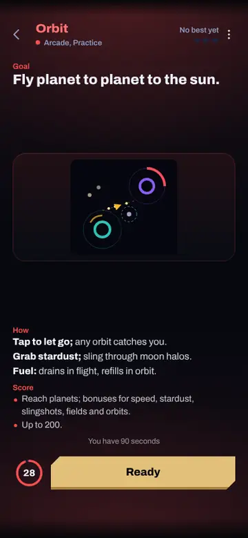 | 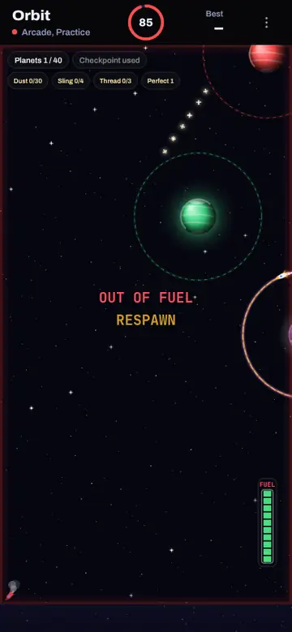 | 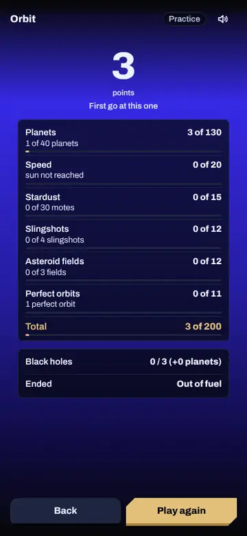 |

Today:

| Moment | Shows | Sounds |
|---|---|---|
| Launch | — | library thruster |
| Catch | spark burst on every 5th catch | recording |
| Every 10 planets | shooting star | recording |
| Slingshot, threaded field, perfect orbit | pops with shared sounds | shared sounds |
| Out of fuel | 0.6 s sputter, "OUT OF FUEL" | **no sound** |
| Crash or respawn | red edge | library + haptic |

**What the capture shows.** A blind first try catches one planet, runs dry, and the round ends at 5 s with 3 points out of 90 s. The screen shows "OUT OF FUEL / RESPAWN" while the reveal says "Ended: Out of fuel". This is the harshest first minute of any game in the group.

**Feedback.**
- *Launch:* a thruster puff and the fuel bar starting to drain, with a soft hiss whose pitch falls as fuel drops.
- *Low fuel (near-miss):* below a quarter tank, the bar pulses red, the rocket flame flickers and a beeping starts. Give the player a chance to see it coming.
- *Catch (pick up):* every catch gets a small ring and a "clunk-whirr" lock. Today only every 5th gets a burst.
- *Out of fuel:* a sputter, a cough and a fizzle, then the rocket drifting.
- *Stardust:* the sparkle trail is good. Add a soft tick per mote.
- *Round-end payoff:* reaching the sun gets a bloom of light and "ALL 40 PLANETS!", with the planets counting up.

**Changes.**
- **Out of fuel ends the run at once** unless a checkpoint was set. A newcomer will not have set one. Suggest one of:
  - An automatic respawn at the last planet that costs time (as other games do).
  - A free first checkpoint.
- **Wrong numbers in the pops:** "SLINGSHOT! +4" and "PERFECT ORBIT +1" show orbitRev 12's values. On the live stamp a slingshot is worth 3, and a perfect orbit 11/21 of a point (`orbit.renderer.ts:1299`, `:1304`). Gate them on the stamp or drop the numbers.
- **Likely bug:** `misses: 1 - state.respawns` (`orbit.renderer.ts:1153`, also `:780`) goes down on a crash, so the success layer's capture chain never resets. It looks like `state.respawns` was meant.
- The HUD pills are tiny on a phone (about 8 px: "Dust 0/30", "Sling 0/4"). Fewer pills, or two larger ones, would read better.
- The "Checkpoint used" pill showed after blind taps hit the corner button. A first-time player can spend the checkpoint by accident.
- The intro still is old art; record the demo.
- There is no skill-band bot for orbitRev 14, so its bands were measured on other stamps. Add one before tuning.

**Difficulty.**

| | Easy | Normal | Hard | Expert |
|---|---|---|---|---|
| Fuel (`ORBIT_FUEL_MAX`) | 240 ticks | 160 | 140 | 120 |
| Zigzag step | 40–150 px | 60–220 px | 80–240 px | 100–260 px |
| Black holes and belts from | planet 25 | 21 / 31 | 15 / 25 | 11 / 21 |
| Checkpoints | automatic every 10 planets | one | one | none |

- "Stargazer" (all stardust on Hard) must stay possible.
- Each level needs its own proved bank (`scripts/orbit-fuel-bank.ts`).
