# Attention: game reviews

Phase 2, step 4. 6 live games. Screenshots are phone size (390 × 844, shown at 360 px): **start** of play,
**mid-play** after a few taps, and the **round end** (a part-played run that ran out of time). Taken on a local
dev server through each game's `?game=` practice link; nothing in the app was changed.

Effects kit words used below: **tap, pick up, drop/place, slide, pour/flow, match/clear, wrong, combo/streak,
score count-up, near-miss, round-end payoff.** A physical action takes 900 ms at most and the next input is taken
at once; no effect over the board while the clock runs except the action itself.

## Summary

| Game | Biggest feedback win | Biggest change | Difficulty notes |
|---|---|---|---|
| Eagle Eye | A soft mark sound per eagle (today only the generic tick) | Submit with no marks skips a grid on a double tap | Grid size, look-alike share |
| Double Take | A distinct "found" chime (today generic) | Re-tapping the same wrong square shakes again but counts nothing | Differences, kinds, grid |
| Tally | Keypad clicks (today silent) | Shapes on screen can overlap more than the deal checked | Tray size, near-miss groups |
| Labyrinth | A footstep tick with a trail; dead-end bump | Fast drags that skip a square stop the route | Maze size, dead ends |
| Bomb Defusal | The bomb actually reacts to a wrong step | Help says one wrong step explodes; nothing happens live | Clues, wires, steps |
| Matchmaker | One wrong sound on a miss (today two) | Look-alike colours (red/orange, pink/purple) | Pairs, colours, flip-back |

**Across the category**

- **Clocks.** Double Take and Tally are dealt 60 s (catalogue 30 s and 45 s); Bomb Defusal 90 s (catalogue 75 s).
  Players see the dealt clock, but the Games page and lists show the catalogue's.
- **Hits sound generic.** Eagle Eye marks, Double Take finds and Bomb Defusal's button presses have no sound of
  their own (`symscan.mark`, `spotdiff.found`, `spotdiff.miss`, `bomb.press` have no file).
- **Attention games want restraint**: the feedback should confirm a tap without pulling the eye from the board. Small
  sounds, effects on the tapped item only, one moment at the end.

---

## Eagle Eye

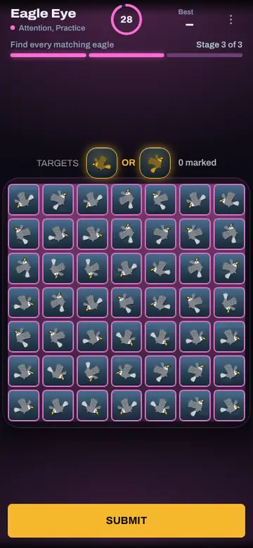 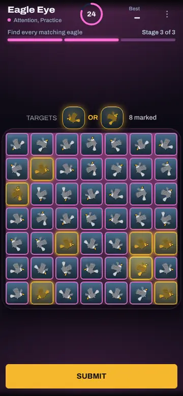 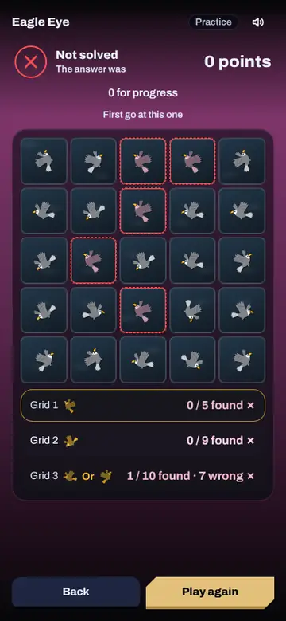

**Now.** Tap every eagle facing the target direction across three grids (5 × 5, 6 × 6, 7 × 7); 60 % of the others
face 45° off, and the last grid has two targets. 30 s. Wrong marks show only on the reveal.

| Action | Shows today | Sounds today |
|---|---|---|
| Mark / unmark | 200 ms pop | `move` only |
| Submit grids 1–2 | Next grid | `stage_complete` |
| Final submit | Marked eagles take off | `symscan.takeoff` + eagle cry |

**Feedback.** Mark: *tap* — a soft feather tick and a ring on the eagle. Unmark: a lighter reverse tick. Submit a
grid: *clear* — correct eagles take off with a whoosh (as at the end today, now per grid), a grid with no wrong
marks gets a quiet *combo* sparkle. Missed eagles stay and pulse once on the reveal (*near-miss*: "2 missed").

**Changes.**
- Submit has no debounce and works with zero marks; a double tap skips the next grid. Disable Submit for 400 ms
  after a grid appears. The screenshots show it: a few stray taps in the first second jumped straight to grid 3,
  and the reveal scores grids 1 and 2 as "0 / 5 found" and "0 / 9 found".
- On the 7 × 7 grid each eagle is about 40 px and the 45° look-alikes are hard to tell apart; the target chips
  above the grid are smaller still. Draw the eagles bolder (a clear beak and tail) and the chips larger.
- The grid has a 332 px floor, so on short phones it can be cut off.

**Difficulty.**
| Level | Grids | Targets | Look-alikes |
|---|---|---|---|
| Easy | 4 × 4, 5 × 5, 6 × 6 | 4–7 | 30 % at 45° |
| Normal | 5 × 5, 6 × 6, 7 × 7 | 5–9, two kinds last | 60 % (today) |
| Hard | 6 × 6, 7 × 7, 8 × 8 | 6–10, two kinds from grid 2 | 75 % |
| Expert | 7 × 7 × 3 | two kinds every grid | 80 %, 25 s |

## Double Take

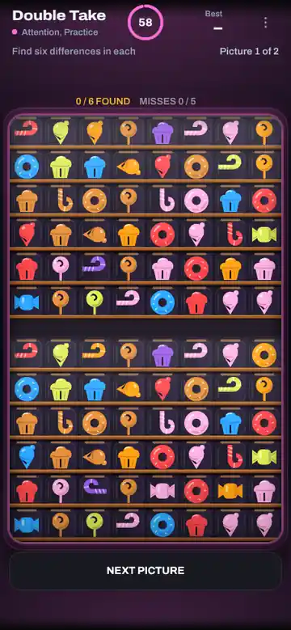 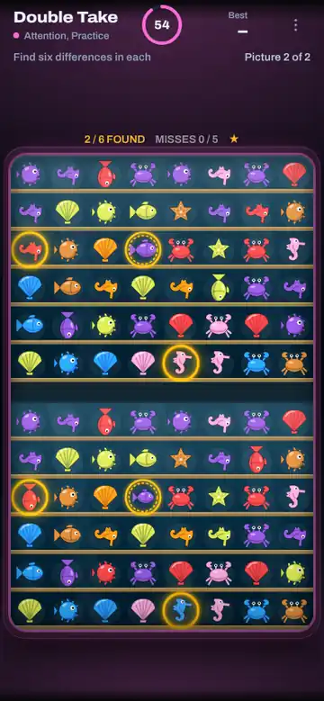 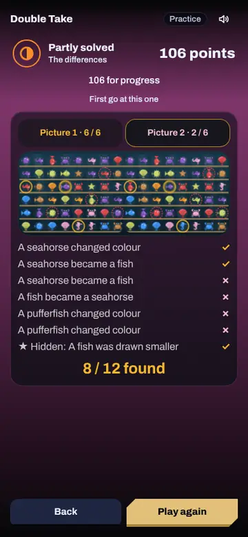

**Now.** Two pictures (sweet shop, rock pool), each an 8 × 6 grid of shapes with six differences (colour, kind or
turn); one picture hides a seventh, a slightly smaller shape. Dealt 60 s. Five misses a picture before the finish
is lost.

| Action | Shows today | Sounds today |
|---|---|---|
| Hit | Ring draws in | `correct` + `move` |
| Miss | Arena shakes, red outline | `wrong` |
| Hidden seventh | ★ in HUD | `correct` |
| All six | Glow sweep | `spotdiff.allFound` |
| Next picture | Slides in | `move.appear` |

**Feedback.** Hit: *match* — a pen-circle draws on both pictures with a light chime (its own sound, not the
generic `correct`); the found counter ticks. Two finds within 2 s: *combo* tone up a step. Miss: a short *wrong*
on the tapped square only (not the whole arena shaking; it pulls the eye off the board). Hidden seventh: a
distinct sparkle. Picture done: *clear* — the pictures slide out.

**Changes.**
- Re-tapping the same wrong square replays the shake and sound but adds no miss. Ignore repeat taps silently.
- "Misses n / 5" reads like lives, but going over ends nothing; it only loses the finish. Say "5 misses allowed
  for a finish".
- The rock-pool picture is busy and its shapes small; the reveal's two boards are drawn tiny. Let the reveal show one
  picture at a time, full width.
- The hidden seventh only counts before the sixth find (the picture moves on at six). Not explained in play.

**Difficulty.**
| Level | Grid | Differences | Kinds |
|---|---|---|---|
| Easy | 6 × 5 | 5 | Colour and kind only |
| Normal | 8 × 6 | 6 + hidden (today) | All three |
| Hard | 8 × 6 | 7 + hidden | Subtler colour pairs |
| Expert | 9 × 7 | 8 + hidden | Turns weighted up |

## Tally

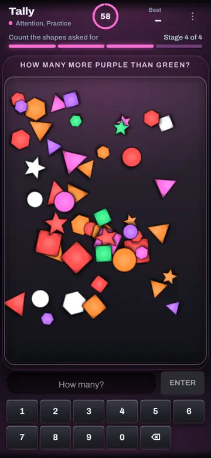 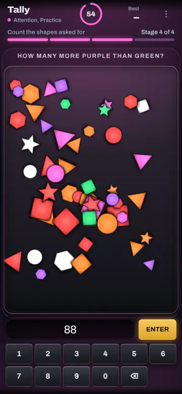 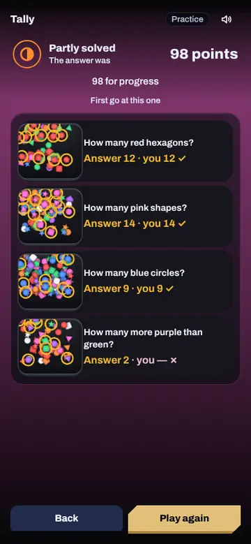

**Now.** Count shapes of a colour on trays of 50, 80 and 110, then a fourth: "how many more X than Y". Near-miss
groups (same shape or same colour) sit within 1–2 of the answer. Typed on a keypad. Dealt 60 s.

| Action | Shows today | Sounds today |
|---|---|---|
| Keypad | Digits | Silent |
| Enter | Next tray slides in | `stage_complete` + `countup.trayIn` |
| Final answer | Counters tick and lock | tick, lock |

**Feedback.** Key: *tap* click. Tap a shape on the tray: an optional count mark (a small dot that stays, with a
tick) so careful players can count by touch — this changes play, so worth Joe's call. Enter: *clear* (the tray
slides away). Reveal: *score count-up* — each tray's matching shapes light one by one while the true count ticks
up next to the player's; off by one is a *near-miss* ("so close: 11, you said 12").

**Changes.**
- Shapes are placed and checked for overlap on a 300 × 260 plan, then drawn at a fixed 28–64 px on a tray of any
  shape, so on a phone they can overlap more than the check allowed.
- Brown shapes are named "white" somewhere in the colour list.
- In the screenshot the shapes bunch in the middle and pile on each other; counting them is a test of untangling
  rather than attention.

**Difficulty.**
| Level | Trays | Shapes | Near-miss groups |
|---|---|---|---|
| Easy | 3 | 30 / 50 / 70 | 1 |
| Normal | 4 | 50 / 80 / 110 / 50 | 2 (today) |
| Hard | 4 | 70 / 100 / 130 / 70 | 3 |
| Expert | 4 | 90 / 120 / 150 / 90 | 3, smaller shapes |

## Labyrinth

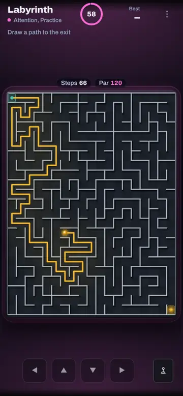 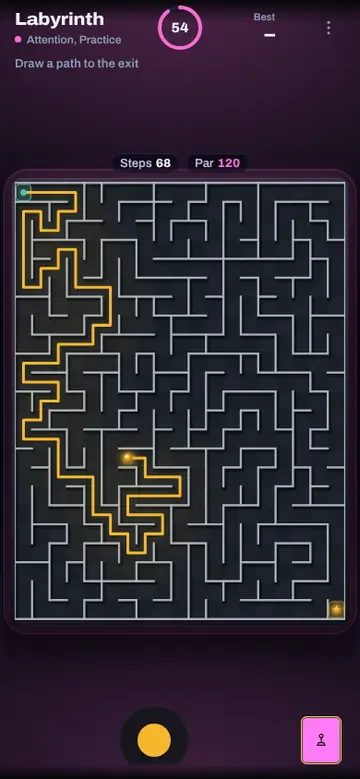 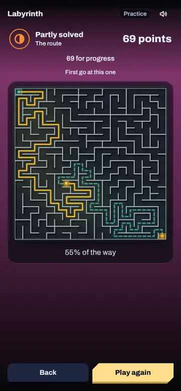

**Now.** Trace from start to exit in a 19 × 23 maze (route 70–147 squares, many turns and long dead ends).
Steps vs par shown. Drag or arrow pad. 60 s.

| Action | Shows today | Sounds today |
|---|---|---|
| Step | Trail grows | `move` |
| Into a wall | Shake | `shared.reject` |
| Exit | Route traces in light | `correct` + trace |

**Feedback.** Step: *slide* — the trail draws with a soft tick, slightly higher per junction passed. Wall: a dull
bump, the trail end flashes (no whole-board shake). Back-tracking: the trail retracts with a lighter tick.
Reaching a dead end's tip: a short falling note (a cue to turn back). Exit: *round-end payoff* (today's trace).

**Changes.**
- A fast drag that skips a square is refused and the route stops growing. Fill in the skipped squares along a
  straight line.
- Each backtrack counts against par; fine, but say so.
- The same small control-switch icon as in Skid and Heave sits beside the arrow pad; a stray tap swaps the arrows
  for a swipe dot.

**Difficulty.**
| Level | Maze | Route | Dead ends |
|---|---|---|---|
| Easy | 13 × 15 | 40–70 | 4+ |
| Normal | 19 × 23 | 70–147 (today) | 8+ (3 long) |
| Hard | 21 × 27 | 120–180 | 12+ (5 long) |
| Expert | 21 × 27 | 150+ | exit hidden until near, 75 s |

## Bomb Defusal

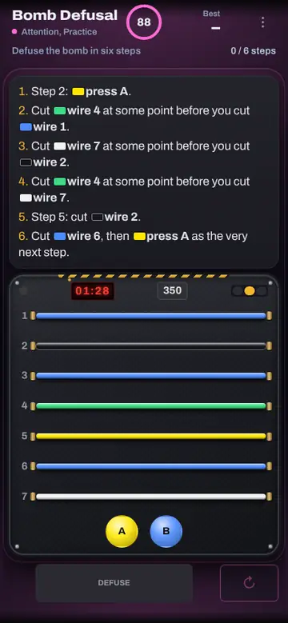 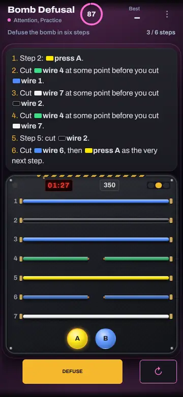 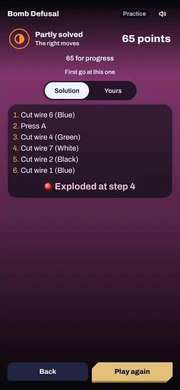

**Now.** A bomb with seven wires, buttons A and B, a serial, a light and a switch. Six clues fix one six-step
order of cuts and presses; then tap DEFUSE. Bank of 300. Dealt 90 s.

| Action | Shows today | Sounds today |
|---|---|---|
| Cut | Snap, sparks | `bomb.cut` |
| Press | Cap press, gold ring | `move` only |
| DEFUSE | LED freezes | `lock` + `bomb.defuse` |
| Reset | Wires back | `move` |

**Feedback.** Cut: *drop/place* with a snip and sparks (keep). Press: a heavy click. Step counter: six pips fill.
A wrong step: today nothing happens until the reveal. Either keep it hidden (a memory/logic test) and say so, or
make the bomb react: the timer beeps faster and the light flicks red (*wrong*). DEFUSE right: *round-end payoff*
(the timer stops, a long relieved tone). Wrong: the reveal's explosion.

**Changes.**
- Help says "one wrong step and it explodes", but nothing happens live and Reset lets you retry freely. Match the
  help to the game, or the game to the help.
- More than six steps can be made, and buttons pressed again.
- Wire tap targets are a text row plus an 8 px wire; make the whole row the target.
- The six clues are a dense block of small text; number each with a step pip and colour the wire names as chips
  (partly done) so the eye can find them.

**Difficulty.**
| Level | Clues | Steps | Wires |
|---|---|---|---|
| Easy | 4 | 4 | 5 |
| Normal | 6–7 | 6 | 7 (today) |
| Hard | 7–8 | 7 | 7 |
| Expert | 8–9 | 8 | 8, one wrong step ends it |

## Matchmaker

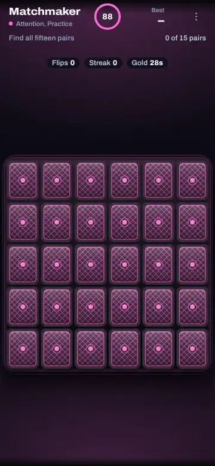 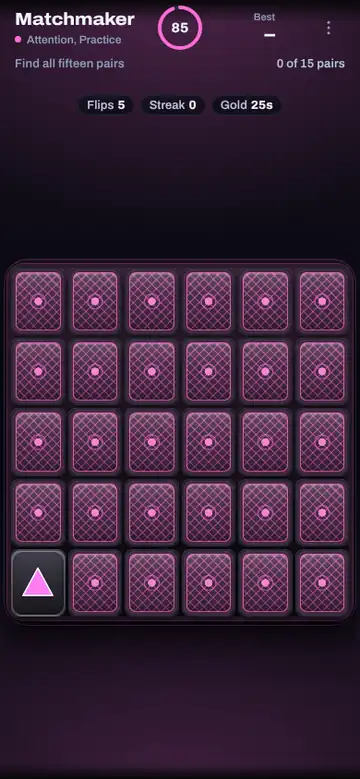 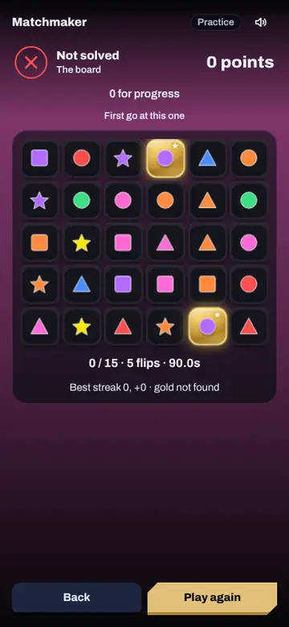

**Now.** Memory pairs: 15 pairs on a 6 × 5 board (4 shapes × 7 colours). One pair is gold and pays if matched in
the first 30 s. A miss flips back after 600 ms. 90 s.

| Action | Shows today | Sounds today |
|---|---|---|
| Flip | 3D flip | `move` |
| Match | Glow; streak tone from 2 | `correct` (+ streak) |
| Gold match | Card wave | `pairmatch.cardWave` |
| Miss | Red outline, shake | `wrong` + reject (two sounds) |
| Finish | Card wave | same as gold |

**Feedback.** Flip: *tap* with a card flick. Match: *match/clear* — both cards lift and lock face up with a
chime; streak tones climb (keep). Miss: one soft *wrong*, cards flip back. Gold pair: its own shimmer (today it
shares the finish sound). Finish: *round-end payoff* (the wave, then the streak and gold bonuses count up).

**Changes.**
- Two wrong sounds on a miss.
- Taps are blocked during the 600 ms flip-back; let a tap on a third card cancel the wait.
- Red/orange and pink/purple are both in the palette; other games ban these pairs as look-alikes.
- The gold match and the finish share one sound.
- The board sits low with a large empty band above it; the cards could be a third larger.

**Difficulty.**
| Level | Pairs | Board | Flip-back |
|---|---|---|---|
| Easy | 8 | 4 × 4 | 900 ms |
| Normal | 15 | 6 × 5 | 600 ms (today) |
| Hard | 18 | 6 × 6 | 500 ms, more shared shapes |
| Expert | 21 | 7 × 6 | 400 ms |
