# Cards & Board: game reviews (phase 2, step 4)

This group has five live games: Free Cell, Mahjong Solitaire, Summit, Five Hands and Thirteen. Three games in it are
retired and not reviewed: Full House, Golf Solitaire and Muggins. Minefield moved to Logic on 13 Nov 2026, so it is
reviewed with the puzzle categories.

The screenshots were taken from a local dev server on main dd9acbe6 (15 Nov 2026), in practice mode at 390 × 844, shrunk to 360 px wide:

- **Start**: the round intro.
- **Mid-play**: halfway through the clock, or later if the bot cleared early.
- **End**: the reveal.

The Near-perfect skill-band bot played every run. The level rules are the same as in `action.md`: each level is a new stamp, 175+ earns a star (a crown on Expert), 200 must stay reachable, and rated play stays on Normal.

## Shared Cards & Board findings

- **Cards jump; nothing slides.** Only Free Cell's automatic moves home fly. Every card a player moves vanishes and
  reappears, and the destination glows gold for about 0.3 s. This is the group's single biggest feedback gap. A real
  card game lives on the slide, the snap into place and the flip.
- **No haptics at all** during play. Only the end-of-round buzzer and the podium vibrate.
- **Every sound has a real file**, though many games borrow each other's card recordings.
- **Half the felt is empty.** Free Cell, Summit and Thirteen use the top half and leave a large blank table below. Cards could be bigger.
- **A dead end isn't explained.**
  - Summit ends with no message when the stock runs out with no play.
  - Thirteen ends the run the moment it is stuck, even though Undo is unlimited (see Thirteen).
  - Free Cell never says "no moves left".

## Summary

| Game | Biggest feedback win | Biggest change | Difficulty notes |
|---|---|---|---|
| Free Cell | Cards slide to their spot; a home pile "snaps" with a rising pitch | Bigger cards: the bottom half of the felt is empty | Natural ladder: cells and deck size. Each level needs its own solved bank. |
| Mahjong Solitaire | A matched pair flies together and clicks | Reset fires on touch with no confirm; a wrong second tile shows nothing | Cheap: built per seed. Layout and hint are the levers. |
| Summit | A run "ladder" sound and the card arcing to the discard | A silent, unexplained end when stuck | Hard: switch off the playable glow. Stock par needs re-proving per level. |
| Five Hands | The hand name stamping onto the row; the column pick dealing in its points | The POINTS chip shows raw points, not the score | Cheap (no bank). Easy: show column values. |
| Thirteen | The pair lifting off together with a "13" | **The run ends the instant you're stuck, even with Undo available** | Cheap (built per seed). Easy: 3 stock passes. |

---

## Free Cell (`freecell`)

**Now.** Freecell with 40 cards (Ace to 10), eight columns of five, 4 free cells and 120 s. A tap sends a card to its best spot; you can also drag. Undo and Reset are unlimited, but each costs a move. Par is the bank deal's shortest solve. Stamp `freecellRev 5`.

| Start | Mid-play | End |
|---|---|---|
| 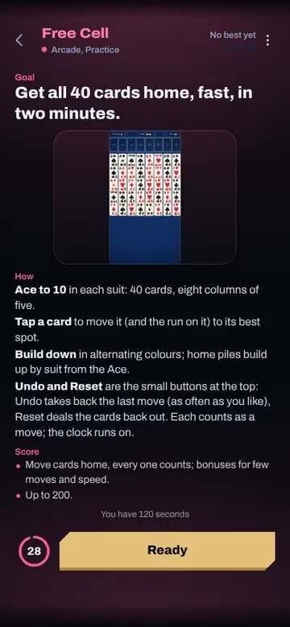 | 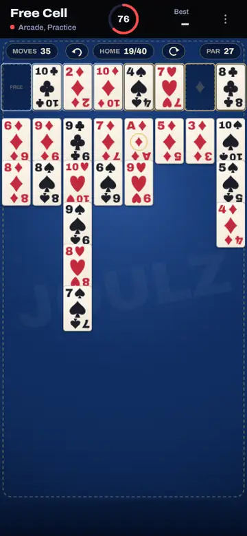 | 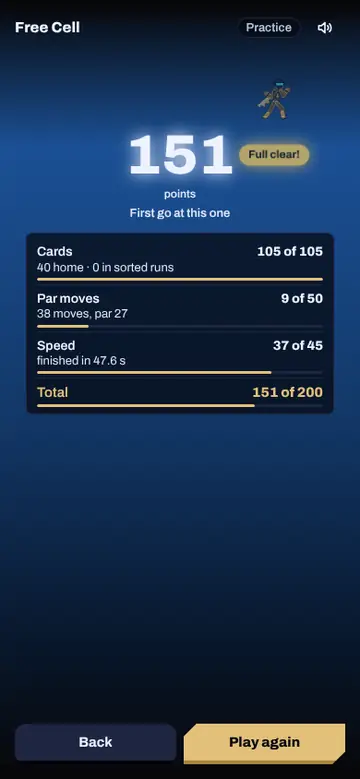 |

**What happens today.**
- A move makes the card jump and the target glow, with a place sound.
- A card going home plays a pitch that rises as more cards reach home.
- Safe cards fly home on their own (the only animation in the group), with a cascade sound when two or more go.
- An illegal move gives a red edge and an invalid sound. When it failed for lack of free cells, a toast also explains, for example "Need a free cell to move 2 cards".
- Undo plays the place sound. Reset plays nothing of its own.

**Feedback.**
- *Tap / pick up:* the card lifts 4 px with a shadow. A drag shows the whole run lifting.
- *Place / slide:* the card slides over 120–160 ms along a short arc and snaps with a soft card "tap". Tapped and dragged moves look the same.
- *Home (match):* the card snaps onto its pile with a chime that climbs per card in that suit, so a full suit sounds like a scale.
- *Wrong:* the card wobbles back to where it came from, rather than only the edge pulse.
- *Combo:* when two or more cards go home in a row, the flight cascade shows "×n".
- *Undo:* the card slides back the way it came.
- *Round-end payoff:* the classic bouncing-cards cascade (a short one, ≤ 900 ms), then "ALL HOME!".

**Changes.**
- **Bigger cards.** At 48 × 76 the columns fill only the top half of the table. With 40 cards there is room for about 56 × 88.
- **Undo and Reset are tiny round icons** inside the HUD row, beside MOVES and PAR. Reset is one tap with no confirm, and it costs par points. Make them labelled buttons like Mahjong's, and ask before Reset.
- In this run Near-perfect play got 9 of 50 for par (38 moves against par 27). The par part may be stricter than the "near-perfect" label suggests. Re-measure.
- There is no "no moves left" hint. Suggest a quiet "No moves: Undo?" when the board is truly stuck.

**Difficulty.**

| | Easy | Normal | Hard | Expert |
|---|---|---|---|---|
| Deck | 32 (Ace–8) | 40 (Ace–10) | 52 | 52 |
| Free cells | 5 | 4 | 4 | 3 |
| Undo | unlimited | unlimited (costs a move) | unlimited (costs a move) | 3 |
| Clock | 120 s | 120 s | 150 s | 150 s |

- Each level needs its own solved bank (`bun scripts/freecell-bank.ts`). A 52-card bank exists for older stamps and could be re-proved.

---

## Mahjong Solitaire (`mahjong`)

**Now.** 72 tiles in four layers, played over 120 s. Tap two free tiles with the same face to take them as a pair. Shuffle costs 5 points. Undo is free. Reset returns the original deal. Every stack is built clearable from the seed. Stamp `mahjongRev 2`.

| Start | Mid-play (near the end) | End |
|---|---|---|
| 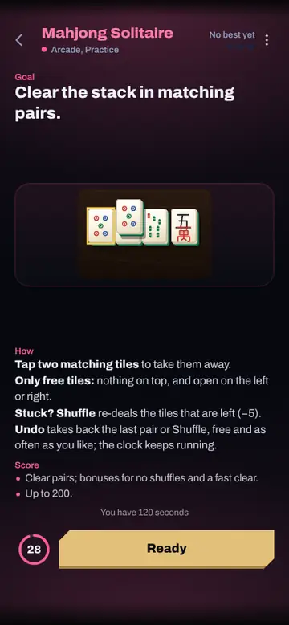 | 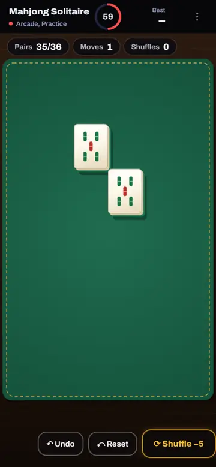 | 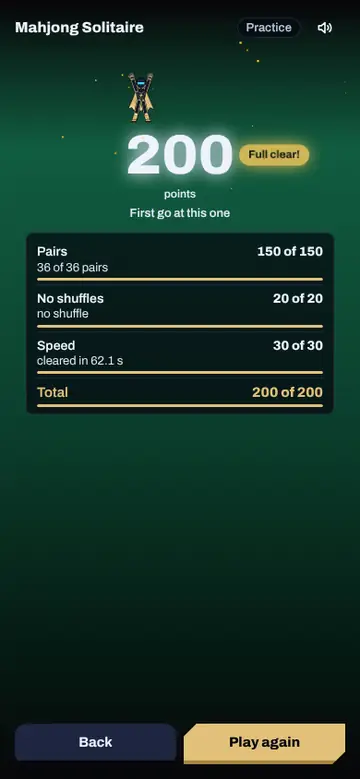 |

**What happens today.**
- Selecting a tile draws a pulsing gold outline and plays a select sound.
- A taken pair lifts and fades gold over 0.4 s, with a match sound.
- A blocked tile flashes red and plays a blocked sound.
- A second tile that doesn't match only moves the selection. There is no visual cue; only the invalid sound.
- Shuffle washes the mat gold.
- Undo and Reset borrow a tick and a zap.

**Feedback.**
- *Pick up:* the tile lifts 3 px with a shadow.
- *Match:* the two tiles slide towards each other, click, and fly off in an arc. The pitch rises with each pair taken quickly in a row (combo).
- *Wrong pair:* both tiles shake once with a soft clack.
- *Blocked:* the tile or tiles that block it flash briefly. This teaches the "free tile" rule.
- *Shuffle:* the remaining tiles spin in place and land again.
- *Near the end:* when 6 tiles remain, the mat brightens.
- *Round-end payoff:* the last pair bursts into a tile shower, then "CLEARED!".

**Changes.**
- **Reset fires on touch-start with no confirmation** (`src/puzzles/mahjong.tsx:156`). Ask first.
- Add `misses` for the wrong second tile (`MAHJONG_FX.misses`), so it gets the same red pulse as a blocked tile.
- Give Undo and Reset their own sounds: a tile slide back, and a whoosh.
- The HUD's "Moves 1" counts the free pairs left on the board. It reads like a move counter. Call it "Free pairs".
- Near-perfect play cleared in 62 s and scored 200. The 120 s clock is generous for good players. That is fine for practice, but it lets the top levels bunch.

**Difficulty.** Levels are cheap: the deal is built per seed in the sim.

| | Easy | Normal | Hard | Expert |
|---|---|---|---|---|
| Tiles | 56, three layers | 72 | 72 | 88, five layers |
| Faces dealt four times | 2 | 6 | 10 | 12 |
| Hint | free-pair glow after 8 s | none | none | none |
| Shuffle cost | 2 | 5 | 8 | 10 |

- "Tile rush" (clear a Hard stack within 65 s) must stay possible.

---

## Summit (`tripeaks`)

**Now.** TriPeaks played over 60 s: three peaks of 28 cards. Play a face-up card one higher or lower than the discard; Ace and King wrap. Tap the stock for a new discard. A stock par is shown in the HUD. Stamp `tripeaksRev 3`.

| Start | Mid-play | End |
|---|---|---|
| 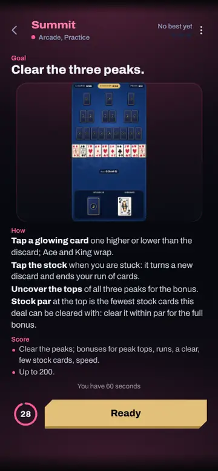 | 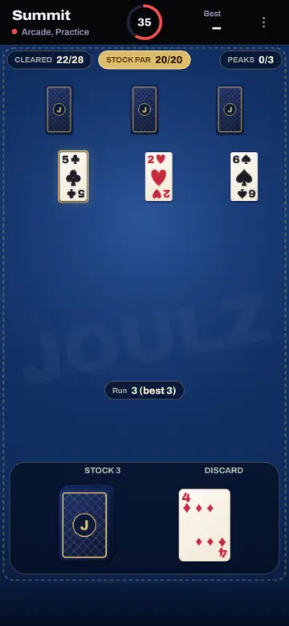 | 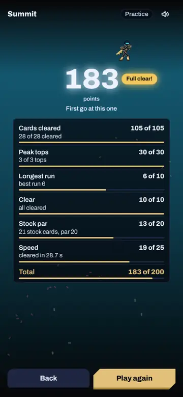 |

**What happens today.**
- A played card jumps to the discard, which glows.
- The run's sound climbs a semitone per card, up to an octave. This is good.
- "RUN n" appears from 5 cards.
- Clearing a peak shows "PEAK!".
- Every playable card glows all the time.
- When the stock is empty and nothing can be played, the run ends with no message.

**Feedback.**
- *Play (slide):* the card arcs to the discard in ≤ 160 ms and lands on top with a snap. The card it uncovered flips over with a flip sound.
- *Run:* a small "×n" ladder beside the discard grows with each card. Breaking it with a stock turn shows it crumbling.
- *Stock:* the card slides off the stock and flips.
- *Peak:* the peak top's card flies up with a sparkle.
- *Wrong:* the card nudges towards the discard and springs back.
- *Stuck:* "No plays left", with a held tone, before the reveal.
- *Round-end payoff:* the cleared peaks light one after the other, then the score count-up.

**Changes.**
- **The stuck end is silent** (`tripeaks.ts:238`). Say why the round ended.
- Cards are the smallest in the group (39 × 70, an index of about 14 px on a 375 phone). The lower half of the felt is empty, so make them larger.
- In the mid frame, PEAKS reads 0/3 at 22/28 cleared, with all three tops still face down, yet the reveal shows 3 of 3. The tops only turn when both cards under them go, so this is right. A newcomer will still not see why the tops are face down: show the tops half-revealed.
- Stock par works out the fewest turns on a full clear, but players may not read "STOCK PAR 20/20" as turns used out of par. Suggest "Stock 20 · par 20".

**Difficulty.**

| | Easy | Normal | Hard | Expert |
|---|---|---|---|---|
| Playable glow | on | on | off | off |
| Wrap Ace/King | yes | yes | yes | no |
| Undo | 3 | none | none | none |
| Speed full by | 25 s | 20 s | 20 s | 16 s |

- Turning the glow off is display only. Every other change re-proves the bank and stock pars (about 25 minutes on one core).
- "Summit sprint" (a Hard clear within 20 s) must stay possible.

---

## Five Hands (`fivehands`)

**Now.** Poker in rows over 60 s. Five rows start with one card each. On each of 20 turns, place your card in a row; the next card goes face up to the discards. Rows fill evenly. When the rows are full, tap a column as a sixth hand. Score = (rows + column) × 1.4, capped at 200. Stamp `fiveHandsRev 3`.

| Start | Mid-play | End |
|---|---|---|
| 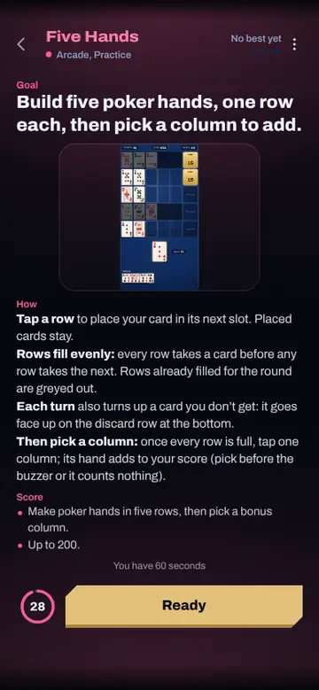 | 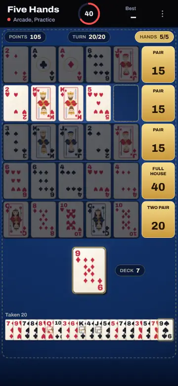 | 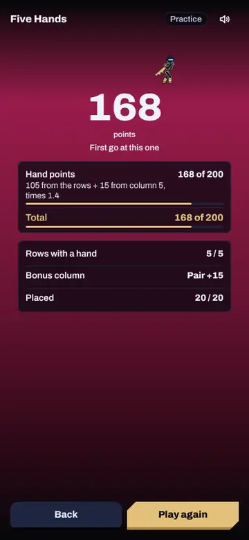 |

**What happens today.**
- A placed card glows in its slot.
- A completed hand pops its name, and its badge turns gold with the points.
- Straights and better get a bigger sound.
- The column pick shows "COLUMN 3 · PAIR +15", with a final sound. The pick itself is silent.

**Feedback.**
- *Place:* the card slides from the "next" spot into the row and snaps.
- *Discard (flow):* the turned card flips onto the discard row.
- *Hand made (match):* the five cards flash in turn left to right, then the hand name stamps onto the badge. A bigger hand gets a bigger stamp and sound.
- *Column pick:* the column's five cards lift one by one with ticks, then its points fly into the total.
- *Round-end payoff:* "+15 × 1.4" shown as a short count-up into the final score.

**Changes.**
- **The POINTS chip shows raw hand points** (105 in the mid frame), not the score (168 at the end). Show the score, or say "105 × 1.4".
- The "Taken 20" discard row overlaps into an unreadable strip at the bottom. Players use it to count what is left in the deck. Show a compact count by rank instead.
- Badge hand names are 10 px.
- The middle skill levels bunch (Good, Great and Near-perfect medians 133, 133 and 140). The game has little room for skill beyond reading the deck.

**Difficulty.** Cheap: there is no bank, and 200 is already not promised.

| | Easy | Normal | Hard | Expert |
|---|---|---|---|---|
| Next-card preview | 2 cards | 1 | 1 | 1 |
| Column values while picking | shown | not shown | not shown | not shown |
| Multiplier | × 1.6 | × 1.4 | × 1.4 | × 1.3 |
| Clock | 75 s | 60 s | 50 s | 45 s |

- "High roller" (170+ on Hard) must stay possible.

---

## Thirteen (`pyramid`)

**Now.** Pyramid solitaire over 90 s. Remove free pairs that add to 13; a King goes alone; the waste's top card pairs too. The stock is turned once. Undo and Reset are unlimited. Every deal is built from the seed with a proof. Stamp `pyramidRev 2`.

| Start | Mid-play | End |
|---|---|---|
| 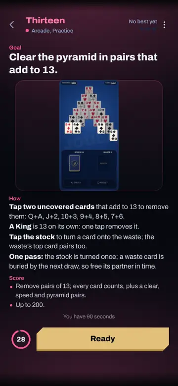 | 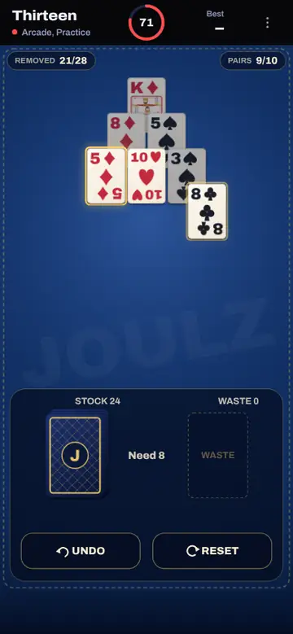 | 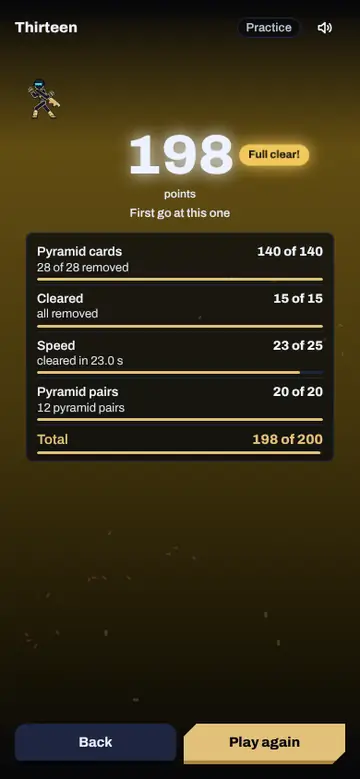 |

**What happens today.**
- Selecting a card makes it glow, along with every card that could pair with it, and shows "Need 8" between the piles.
- A pair vanishes with a "13" pop. A King shows "KING".
- A wrong pair plays two sounds at once (select and invalid).
- Undo and Reset borrow a tick and a zap.
- `pyramid.turn` never plays.

**Feedback.**
- *Select (pick up):* the card lifts with a shadow (keep the partner glow on Easy and Normal).
- *Pair (match):* the two cards slide together, overlap, and fly off with "13" between them. The sound rises within a quick chain.
- *King:* the card spins off alone with a regal flourish.
- *Draw:* the stock card flips onto the waste.
- *Wrong:* both cards shake, with one sound.
- *Uncovered:* a card whose last cover goes brightens from its dimmed state.
- *Round-end payoff:* the pyramid's empty outline lights from the bottom up, then "CLEARED!".

**Changes.**
- **Likely bug: when stuck, the run ends at once** (`pyramid.ts:528`, `ended = 3`), with no message, even though Undo is unlimited. A player at a dead end can't undo out of it. Suggest letting the run carry on with "No moves: Undo or Reset", and ending only at the buzzer.
- Play one sound for a wrong pair, not two.
- Near-perfect play cleared in 23 s of a 90 s round. A clock of 60 s would suit the game better (a stamp change).

**Difficulty.** Cheap: deals are built per seed in the sim.

| | Easy | Normal | Hard | Expert |
|---|---|---|---|---|
| Stock passes | 3 | 1 | 1 | 1 |
| Partner glow | on | on | off | off |
| Kings | 3–4 | 2–4 | 2–3 | 2 |
| Quick-player filter | none | modes 0, 1, 3 | + mode 2 | stricter |
