# Logic: game reviews

Phase 2, step 4. 14 live games. Screenshots are phone size (390 × 844, shown at 360 px): **start** of play,
**mid-play** after a few moves, and the **round end** (a part-played run that ran out of time). Taken on a local
dev server through each game's `?game=` practice link; nothing in the app was changed.

Effects kit words used below: **tap, pick up, drop/place, slide, pour/flow, match/clear, wrong, combo/streak,
score count-up, near-miss, round-end payoff.** The style guide's rules apply to all of it: a physical action takes
900 ms at most and the next input is taken at once; no effect over the board while the clock runs except the
action itself; reduce motion turns every movement into a short fade.

## Summary

| Game | Biggest feedback win | Biggest change | Difficulty notes |
|---|---|---|---|
| Box Six | A sound and a settle on every digit placed (today silent) | Show a clash when a digit breaks a row, column or box | Easy 4×4; Expert 6×6 with fewer givens, graded by a solver |
| Hanoi | A sound when a ring lands (today silent) | Rings drop with a short arc instead of jumping | Levels by start distance (minimum moves) and posts |
| Polypotions | The real pour: lift, tilt, arc, settle (style guide timing) | Undo and Reset shouldn't burn a pour | Bank already graded by minimum moves; split it |
| Safe Cracker | After a wrong try, mark which clues it broke | Hold-to-spin click overlaps itself; cap it | Levels by clue count and clue kinds |
| Mosaic | Sound on fill and ×; drag to paint a run | A × should never count as a mistake | Easy 6×6, Expert 10×10 |
| Colour Flood | A sound on every flood (today silent), wave timed to its size | Show par beside moves everywhere | Bank already graded by par; colours 4 / 5 / 6 |
| Minefield | A softer, clearer mine hit; a cascade that ripples outwards | HUD and reveal count safe squares differently | Mines 14 / 20 / 26 / 30 |
| Tents and Trees | Sounds on tent and grass (today only "clear" plays) | Grass marks must not count as mistakes | Pairs and hidden counts drive levels |
| Shikaku | Sounds on draw and remove (today silent); varied fills | Neighbouring rectangles can share a colour | Grid size and rectangle count |
| Lamplighter | A warm "lamp on" with the light sweeping out | Dot notes must not count as mistakes | Wall count and numbered share |
| Trail | A soft step tone rising as the path grows | Intro example is a live board with its answer | Givens 14 / 10 / 8 / 6 |
| Loopline | A closing "click" when the loop closes | Clearing a ✕ plays the wrong sound | Solver grade band already exists |
| Regions | A chord when a region completes, pitched by size | Erasing and Undo are silent | Solver grade band already exists |
| Island Link | A bridge that visibly builds from island to island | Half-drag preview does nothing and says nothing | Solver grade band already exists |

**Across the category**

- **Silent placing.** In ten games the main "place" action has no sound file (`sudoku.place`, `tower.drop`,
  `tubes.pour`, `nonogram.fill`, `flood.spread`, `tents.pitch`, `shikaku.place`, `lightup.lamp`, `trail.step`,
  `safe.solve`). Only the shared `move` tick plays. In Mosaic, Tents and Lamplighter the only distinct sound is
  clearing a cell. This is the single biggest feedback gap.
- **Notes count as mistakes.** Mosaic (×), Tents (grass), Lamplighter (dot) and Loopline (✕) cycle through the
  scored mark on the way to the note mark, so writing a note on an empty square costs 2.5 of the clean bonus. A
  careful player is punished for being careful. Fix in the input (a long press or a mode for notes) or in the
  grader (only count marks that stay for more than a moment).
- **Two sounds on solve.** Most games play the generic correct/lock sound and their own solve sound in the same
  frame. Keep one: the game's own.
- **Silent shakes.** Wrong moves in Shikaku, Tents, Trail and Safe Cracker shake with no sound; others play
  `wrong`. Pick one rule (the `wrong` sound, quietly, with every shake).
- **Reveal "×" glyph.** Reveals show lines like "17 × moves · par 34" and "1 × of 30 pours"; the × reads as a
  typo. Plain "17 moves · par 34" is clearer.

---

## Box Six

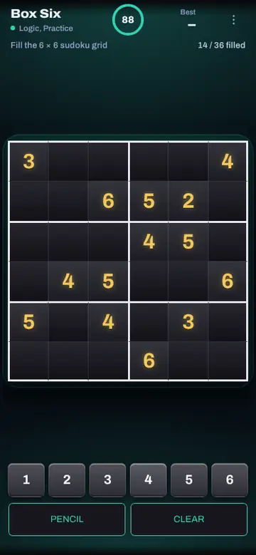 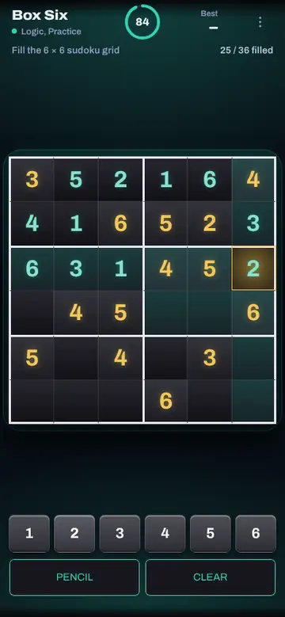 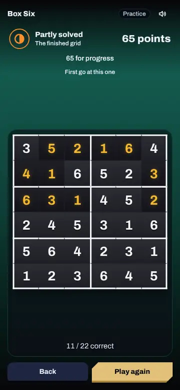

**Now.** A 6 × 6 sudoku (2 × 3 boxes) with 13–15 givens, 90 s. Select a cell, tap a digit; Pencil for notes;
Clear.

| Action | Shows today | Sounds today |
|---|---|---|
| Select a cell | Row, column and box tint | Silent |
| Enter a digit | Small pop | `move` tick only (`sudoku.place` has no file) |
| Same digit again | Clears | Silent |
| Pencil / notes / Clear | Small notes | Silent |
| Solve | Rows then boxes light up | Glow sweep plus a second "correct" sound |

**Feedback.** Digit placed: *drop/place* (the number settles with a 1.08 → 1 squash and a soft wooden tap).
A row, column or box completed: *match/clear* (a light runs along it, a rising note; three in one move is a
*combo*). Clash: *wrong* (the clashing digits pulse red once, a low tick). Pencil: a quieter tap. Solve:
*round-end payoff* (the grid's lines turn gold from the last cell outwards), then the score *count-up*.

**Changes.**
- No clash shown during play, yet every wrong digit ever typed costs the clean bonus. Either show clashes (and
  keep the penalty) or drop the penalty. Showing clashes is the friendlier choice.
- The "14 / 36 filled" line counts the givens, so it starts at about 13. Count only the player's cells ("1 / 22").
- In the reveal, cells the player left empty are drawn in the givens' colour, so they look given. Draw them empty.
- Difficulty today is only a random number of givens; nothing grades the logic needed.

**Difficulty.**
| Level | Grid | Givens | Notes |
|---|---|---|---|
| Easy | 4 × 4 (2 × 2 boxes) | 6–8 | Clashes shown, digits auto-hidden from the pad when used up |
| Normal | 6 × 6 | 13–15 | Today |
| Hard | 6 × 6 | 10–12, needs one pair/pointing step | Clashes shown, no auto-hide |
| Expert | 6 × 6 | 9–10, solver-graded | Clashes only on Check; 120 s |

Needs a small logic grader (singles only vs pairs) to make Hard and Expert fair; size alone isn't enough.

## Hanoi

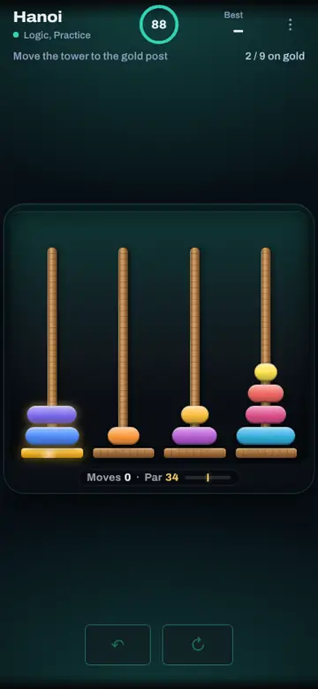 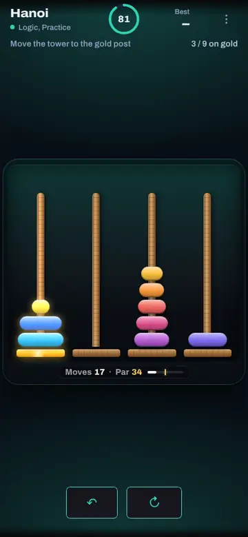 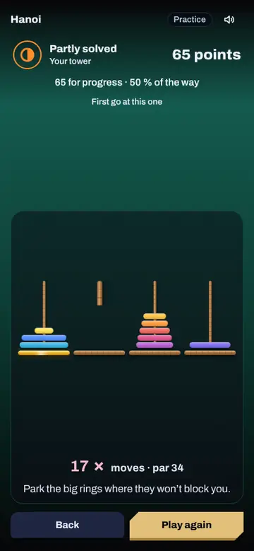

**Now.** Nine rings spread over 3 or 4 posts; move them all to the gold post, never a bigger ring on a smaller.
Par is the exact minimum (20–40). 90 s, Undo and Reset.

| Action | Shows today | Sounds today |
|---|---|---|
| Tap a post | Top ring lifts and bobs | `tower.lift` (select click) |
| Tap a legal post | Ring jumps to it | `move` only (`tower.drop` has no file) |
| Illegal post | Shake, lift cancelled | `wrong` |
| Deselect, Undo, Reset | Nothing extra | Silent |
| Solve | — | Two sounds at once |

**Feedback.** Lift: *pick up* (ring rises clear of the post with a small shadow). Drop: *drop/place* — the ring
travels in a short arc over the posts and lands with a wooden clunk pitched by ring size (big ring low, small
ring high). Ring onto the gold post in final order: *match* (the ring glints gold). Illegal: *wrong* (ring
bounces back up, low buzz; the lift is kept so the player can try again — today it is cancelled). Moves at par
with the tower complete: *round-end payoff* (the tower stacks gold bottom to top). Near-miss on time-out: "3
moves from done".

**Changes.**
- Keep the lift after an illegal move rather than cancelling it.
- In the round-end screenshot the second post is drawn as a short stub in the reveal board. Worth a look.
- The reveal tip "Park the big rings where they won't block you" is the same every time; fine for now, but it
  should be one of several or none.
- The coin flip between 3 and 4 posts changes the game a lot from round to round. Fix the post count per level.

**Difficulty.**
| Level | Posts | Rings | Minimum moves |
|---|---|---|---|
| Easy | 4 | 7 | 10–18 |
| Normal | 3 or 4 | 9 | 20–40 (today) |
| Hard | 3 | 9 | 30–45 |
| Expert | 3 | 10 | 45–60, 120 s |

The solver's exact distance makes this one of the easiest games to level fairly.

## Polypotions

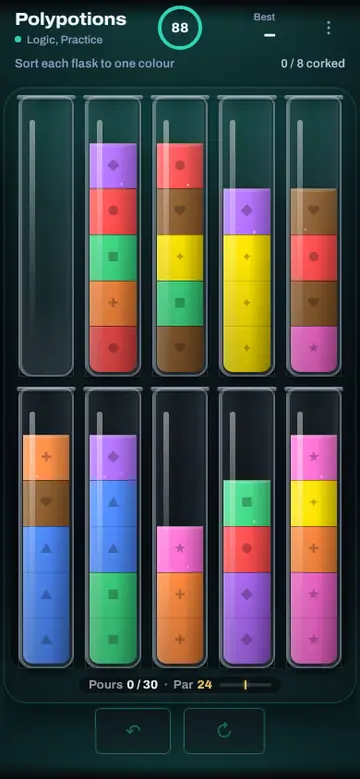 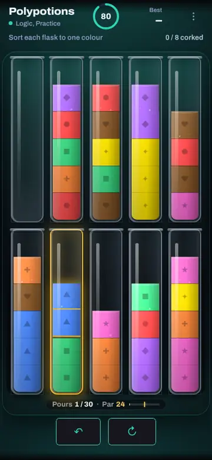 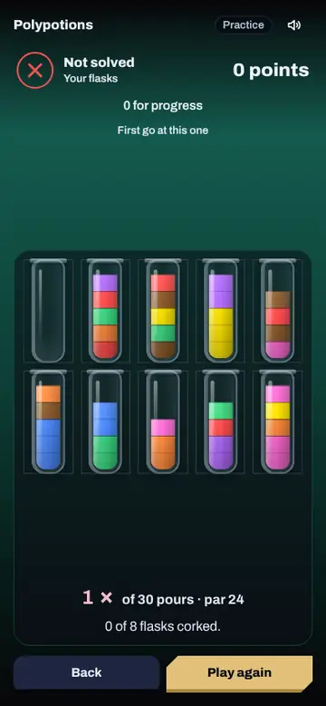

**Now.** Ten flasks, eight colours, five layers each; pour until each flask is one colour. Boards from a bank
of 1,000 with minimums of 17–26; pour limit about minimum + 6. 90 s, Undo and Reset.

| Action | Shows today | Sounds today |
|---|---|---|
| Tap a flask | Top layers rise, outline | `tubes.lift` |
| Tap another | Layers jump across with a fill animation | `move` only (`tubes.pour` has no file) |
| Flask complete | Cork pops in | `tubes.cork` |
| Bad pour | Shake, lift kept | `wrong` |
| Undo, Reset, out of pours | — | Silent |

**Feedback.** The style guide already sets this one: lift 120 ms, tilt 160, pour 300–500 by amount, settle 220,
return 180; a tap during it is queued. *Pour/flow*: the liquid leaves the lip in an arc and the level in the
target rises, with a glug pitched by the layer's height. Flask complete: *match/clear* (cork, a bright ring, a
pop). Two flasks corked within a few seconds: *combo*. Wrong: the flask tips, nothing pours, it rights itself.
Round end: every flask's cork glints in turn.

**Changes.**
- Undo and Reset each use up a pour, and running out ends the board. Undo should give the pour back (Heave
  already does) or the limit should be explained on screen.
- The round-end line reads "1 × of 30 pours · par 24"; say "1 of 30 pours used · par 24".
- Running out of pours auto-submits in silence; it needs a clear "Out of pours" moment.

**Difficulty.**
| Level | Flasks / colours | Layers | Minimum | Pours allowed |
|---|---|---|---|---|
| Easy | 6 / 4 | 4 | 8–12 | min + 10 |
| Normal | 10 / 8 | 5 | 17–26 | min + 6 (today) |
| Hard | 10 / 8 | 5 | 24–26 | min + 4 |
| Expert | 11 / 9 | 5 | 26+ | min + 3, one spare flask fewer |

The bank stores each board's minimum, so Normal and Hard can come from today's bank.

## Safe Cracker

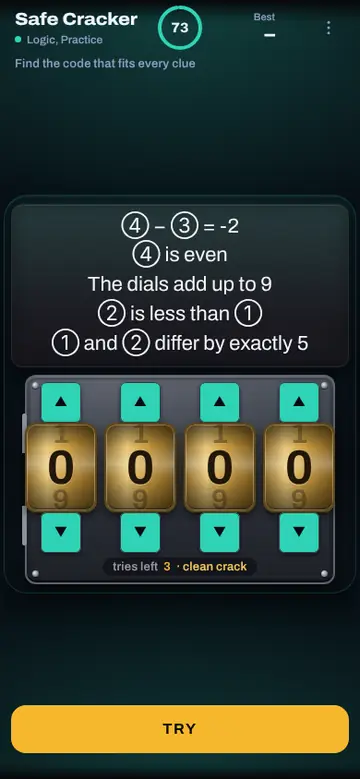 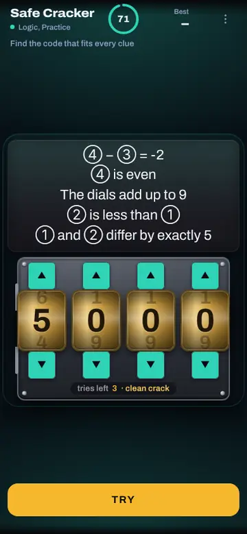 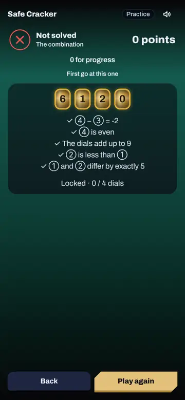

**Now.** Four dials, five clues ("② is less than ①", "the dials add up to 9"), three tries; exactly one code
fits. 75 s.

| Action | Shows today | Sounds today |
|---|---|---|
| Arrow or swipe a dial | Drum rolls | `safe.click` every step (overlaps when held) |
| Try, wrong | Door shakes | `wrong` |
| Try, right | Door swings open | `pz_safe_open` |

**Feedback.** Dial step: *tap* with a short mechanical tick (cap it at one per 60 ms so a hold doesn't smear).
After every change, each clue the current code satisfies gets a small tick — or, to keep the challenge, only
after a Try. A wrong Try: *near-miss* if one dial was off ("3 of 4 right" is too generous; better: the clues the
code broke flash red). A right Try: *round-end payoff* (bolts slide back one by one, the door swings, gold
inside).

**Changes.**
- Today a wrong Try tells you nothing beyond "wrong". Marking the clues it broke makes the second and third try
  a thinking step instead of a guess.
- `safe.click` is a half-second file with no gap limit; held arrows layer it.
- The Try button is a bright yellow unlike the champagne gold elsewhere.
- "clean crack" vanishes after the first wrong try with no explanation.

**Difficulty.**
| Level | Dials | Clues | Clue kinds |
|---|---|---|---|
| Easy | 3 | 4 | Even/odd, more/less, sum |
| Normal | 4 | 5 | Today's mix |
| Hard | 4 | 5 | Primes, squares, differences, "all different" weighted up |
| Expert | 5 | 6 | All kinds, 2 tries |

## Mosaic

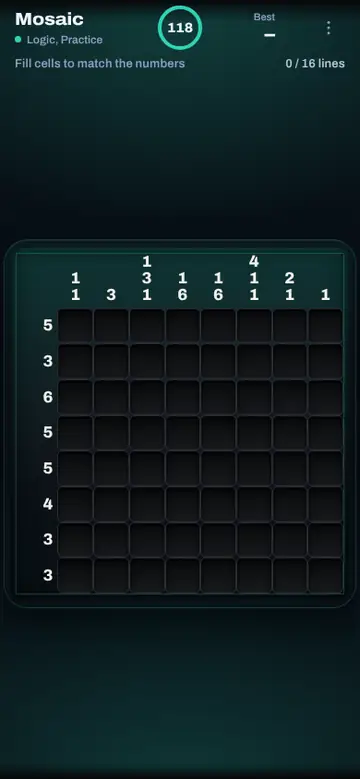 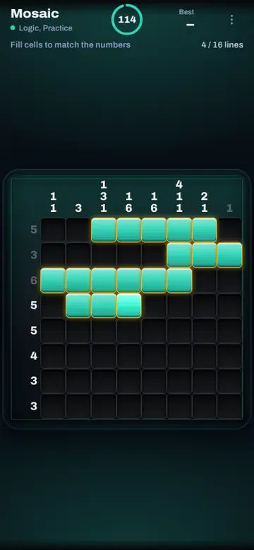 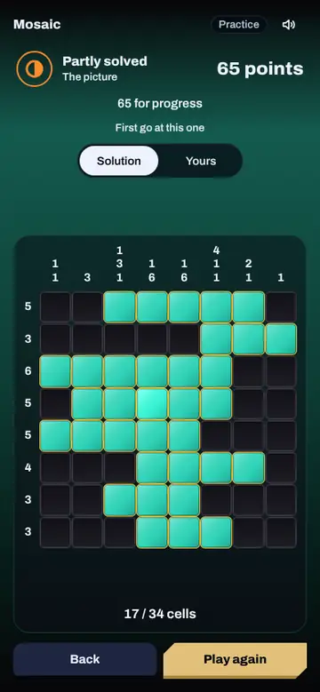

**Now.** An 8 × 8 nonogram (22–36 filled squares, one run of 3–6 in each row), 120 s. Tap cycles fill → × →
empty.

| Action | Shows today | Sounds today |
|---|---|---|
| Tap: fill | Tile pops in | `move` only |
| Tap: × | Small × | `move` only |
| Tap: clear | Tile out | `nonogram.clear` (the only distinct sound) |
| Line matches its clue | Clue dims | Silent |
| Solve | Tile flip | Lock plus solve sound |

**Feedback.** Fill: *drop/place* (tile presses in, soft tap). Drag across a line: *slide* (paint the run, a
rising tick per square). Line complete: *match/clear* (the clue turns gold, a chime; two lines at once a *combo*).
× : a quieter pencil scratch. Solve: *round-end payoff* (the picture flips to full colour row by row).

**Changes.**
- Marking × on an empty square passes through "filled" and costs the clean bonus. Fix the cycle or the grader.
- No drag-to-paint: 64 squares one tap at a time is slow and fiddly. Add drag (first square decides fill or ×).
- The reveal is titled "The picture" but boards are random noise. Either deal real pictures (the 7 × 7
  pictogram bank exists) or rename to "The grid". Real pictures would make the payoff far better.
- A dimmed clue means the line matches its numbers, not that it is right; it can mislead.

**Difficulty.**
| Level | Grid | Notes |
|---|---|---|
| Easy | 6 × 6 picture | Clues dim and lines lock when right |
| Normal | 8 × 8 | Today |
| Hard | 10 × 10 | Line-solvable only, 150 s |
| Expert | 10 × 10 | Needs two-line reasoning; 150 s |

Needs a line-solver grade (today only uniqueness is checked).

## Colour Flood

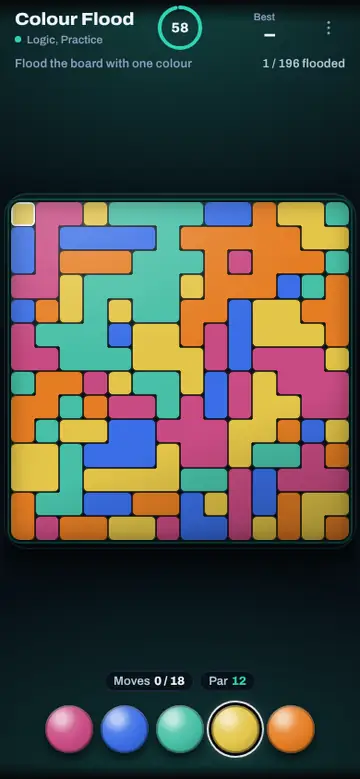 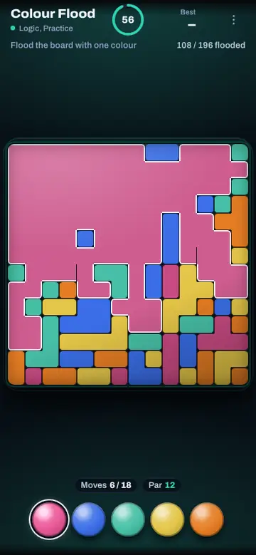 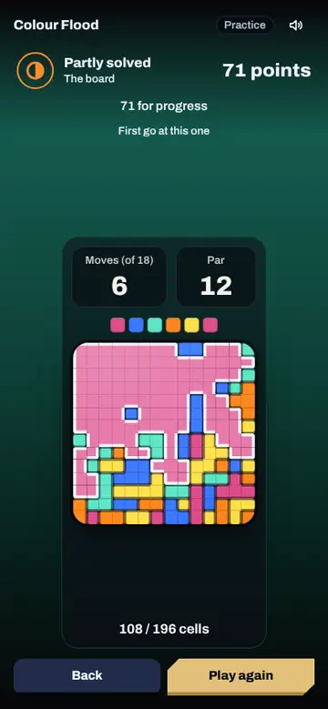

**Now.** A 14 × 14 board of five colours; pick a colour to flood from the top-left corner; fill the board within
par + 6 moves. Bank of 400 boards, par 10–14. 60 s.

| Action | Shows today | Sounds today |
|---|---|---|
| Tap a colour pot | Ripple across new squares | `move` only (`flood.spread` has no file) |
| Current colour | Shake | `shared.reject` |
| Solve | Glow sweep | Lock plus solve |
| Out of moves | Ends | Silent |

**Feedback.** Flood: *pour/flow* — the colour spreads outwards from the edge in a wave, with a whoosh whose length
and pitch rise with the number of squares taken (big gulps feel big). A move that takes 20+ squares: *combo*
sparkle at the front. The last two moves when close to par: the move counter glows (*near-miss*). Solve: the whole
board pulses once in the final colour.

**Changes.**
- The round-end board is drawn small with lots of empty space round it; it could fill the width.
- The help says running out of moves "scores 0", but unfinished runs score for progress. Fix the text.
- Par is shown in the frame's pill but not in the plain status line.

**Difficulty.**
| Level | Board | Colours | Par | Moves allowed |
|---|---|---|---|---|
| Easy | 10 × 10 | 4 | 7–9 | par + 8 |
| Normal | 14 × 14 | 5 | 10–14 | par + 6 (today) |
| Hard | 14 × 14 | 6 | 14–18 | par + 4 |
| Expert | 18 × 18 | 6 | 18–22 | par + 3, 75 s |

## Minefield

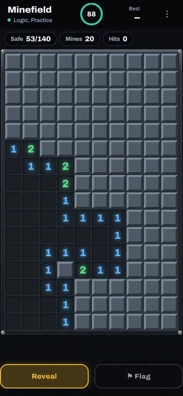 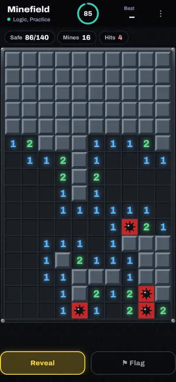 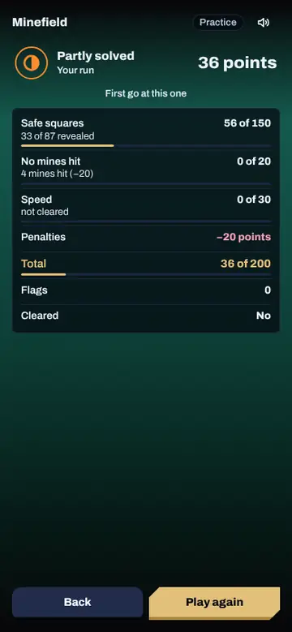

**Now.** A 10 × 16 minesweeper with 20 mines; an opening is revealed for you and every board can be solved by
logic alone. Reveal / Flag switch, long press flags, tap a satisfied number to open around it. 90 s run.

| Action | Shows today | Sounds today |
|---|---|---|
| Reveal | Square opens | `minesweeper.reveal` (6+ squares: `cascade`) |
| Flag / unflag | Flag | `minesweeper.flag` / `unflag` |
| Mine | White flash, red mine | `minesweeper.hit` (falls back to a zap) |
| Board clear | Gold ripple | Falls back to the chime |
| Flag tap on an open square, tap an unsatisfied number | Nothing | Silent |

**Feedback.** Reveal: *tap* with a dry click. Cascade: *slide* — squares open in a ripple outwards from the tap,
the tick rising in pitch with the count. Flag: *drop/place* (the flag pops up, cloth flick). Unsatisfied number
tapped: a tiny shake of that number. Mine: *wrong*, but heavy — a short thud and a dull red pulse, not a bright
zap. Clear: *round-end payoff* (remaining mines defuse one by one with soft clicks).

**Changes.**
- The HUD "Safe 86/140" counts the free opening; the reveal's "33 of 87 revealed" doesn't. Use one count.
- The HUD's Mines counter drops when a mine is hit (16 after 4 hits); it should count flags placed, not hits.
- A tap in Flag mode on a number opens its neighbours; surprising. Flag mode should only flag.
- `docs/arcade-standard/minesweeper.md` still describes the old 25-mine Arcade version up top.

**Difficulty.**
| Level | Grid | Mines | Opening |
|---|---|---|---|
| Easy | 8 × 12 | 12 | 25–40 squares |
| Normal | 10 × 16 | 20 | 20–60 (today) |
| Hard | 10 × 16 | 26 | 15–30 |
| Expert | 12 × 18 | 34 | 10–20, more solver steps |

Every level keeps the "no guessing" proof; the solver's step count can grade boards within a level.

## Tents and Trees

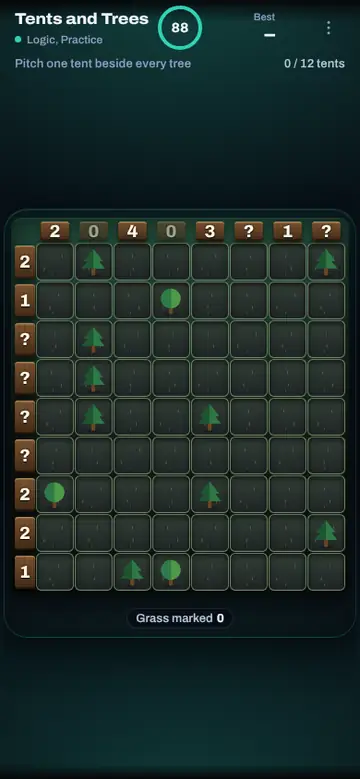 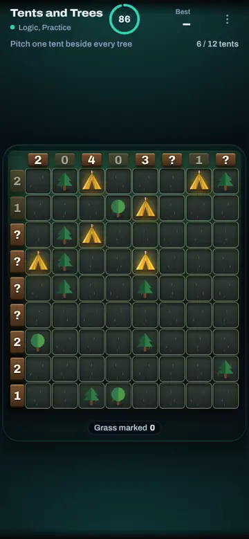 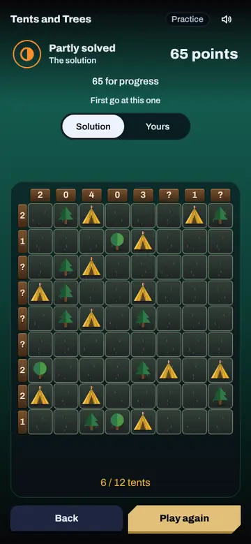

**Now.** An 8 × 9 field with 12–13 trees; place one tent beside each tree, tents never touching, row and
column counts (a third hidden as "?"). Tap cycles tent → grass → empty. 90 s.

| Action | Shows today | Sounds today |
|---|---|---|
| Tent | Pops up | `move` only |
| Grass | Grass mark | `move` only |
| Clear | — | `tents.clear` (the only distinct sound) |
| Tent touching a tent | That square shakes, still placed | Silent |
| Count met | Sign dims | Silent |

**Feedback.** Tent: *drop/place* (canvas pops up, a soft fabric flap). Tent paired with its tree: a faint line
joins them. Touching tents: *wrong* (both wobble, low tick). Row/column count met: *match* (the sign turns gold,
a chime). Grass: a quiet rustle. Solve: *round-end payoff* (lanterns light in every tent).

**Changes.**
- Grass on a square that isn't a tent costs the clean bonus because the cycle passes through "tent". Fix.
- No warning for a tent with no tree next to it.
- "?" signs aren't explained in help.
- The intro example is 8 × 8 but live boards are 8 × 9.
- The "Grass marked" pill tells the player little; "Tents 5 / 12" is more useful.

**Difficulty.**
| Level | Field | Pairs | Hidden counts |
|---|---|---|---|
| Easy | 6 × 6 | 7 | none |
| Normal | 8 × 9 | 12–13 | a third (today) |
| Hard | 8 × 9 | 13 | half |
| Expert | 10 × 10 | 18 | half, 120 s |

## Shikaku

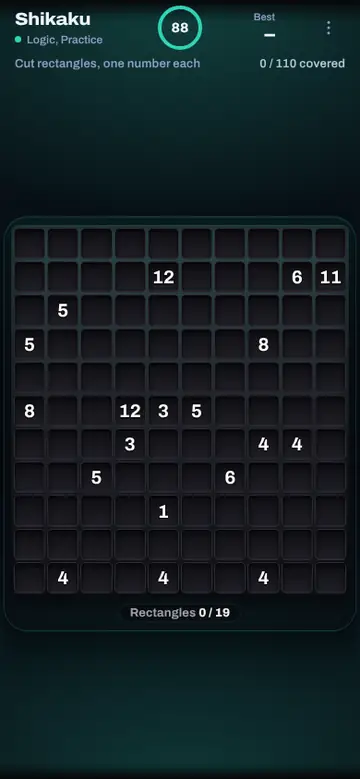 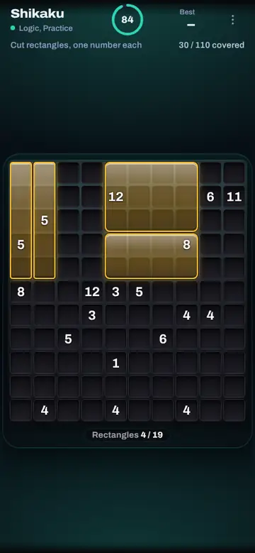 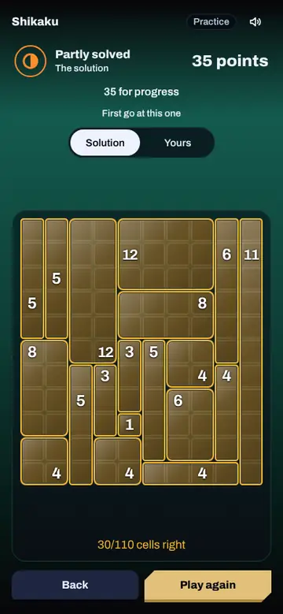

**Now.** A 10 × 11 grid of numbers; drag rectangles so each holds one number equal to its area and every square
is covered. 17–21 rectangles. 90 s.

| Action | Shows today | Sounds today |
|---|---|---|
| Drag corner to corner | Outline preview, then a pane | `move` only |
| Tap a rectangle | Removed | `move` only |
| Invalid | Board shakes | Silent |
| Solve | Glow sweep | Correct plus solve |

**Feedback.** Dragging: *slide* (the outline snaps square by square with a tick; turns green when the area
matches the number inside). Release on a valid shape: *drop/place* (the pane fills with a soft thunk).
Invalid: *wrong* (the outline flashes red, low tick, no shake of the whole board). Remove: a reverse pop. Solve:
the panes ripple from corner to corner.

**Changes.**
- Rectangles alternate between two fills by placement order, so neighbours can match. Colour by a 4-colour map.
- The help never says a tap removes a rectangle.
- The reveal draws every rectangle in the same gold, so the solution is hard to read.
- The intro example (eleven 1 × 10 strips) doesn't look like a real board.

**Difficulty.**
| Level | Grid | Rectangles | Max area |
|---|---|---|---|
| Easy | 7 × 7 | 9–11 | 8 |
| Normal | 10 × 11 | 17–21 | 12 (today) |
| Hard | 10 × 11 | 14–16 (bigger shapes) | 16 |
| Expert | 12 × 12 | 20–24 | 16, 120 s |

## Lamplighter

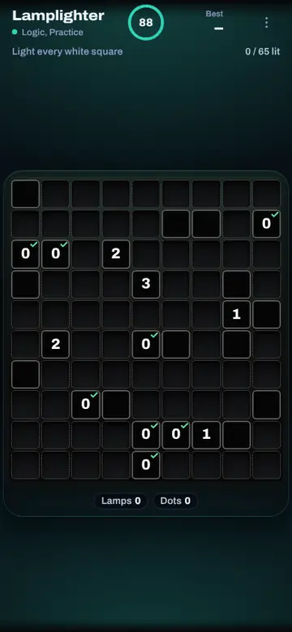 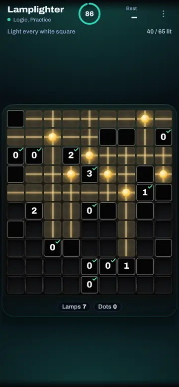 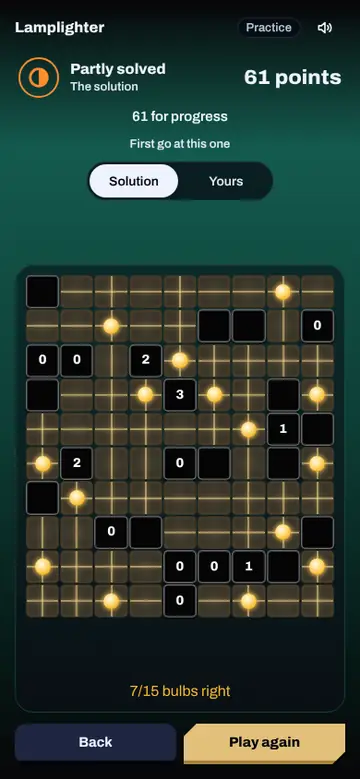

**Now.** Light Up on a 9 × 10 grid with 20–25 walls (half numbered): place lamps so every square is lit, no
lamp sees another, numbers count the lamps beside them. Tap cycles lamp → dot → empty. 90 s.

| Action | Shows today | Sounds today |
|---|---|---|
| Lamp | Light spreads along its beams | `move` only |
| Dot | Dot | `move` only |
| Clear | — | `lightup.clear` |
| Tap a wall | — | `shared.reject` |
| Lamps clash | Red beams pulse | Silent |
| Wall met / over | ✓ / red | Silent |

**Feedback.** Lamp: *drop/place* plus *pour/flow* — a warm "switch" click and the light sweeping out along its
row and column over 200 ms. Clash: *wrong* (both lamps flicker red with a buzz). Number satisfied: *match*
(the wall gets a gold ✓ and a tick). Dark squares left near the end: *near-miss* ("4 squares dark"). Solve: all
lamps brighten together.

**Changes.**
- The dot note passes through "lamp" and costs the clean bonus. Fix.
- Clashes have no sound.
- Every 0 wall shows its ✓ from the start (nothing next to it yet), so the board opens with a scatter of ticks
  that mean nothing. Tick a 0 only once its neighbours are all lit or dotted.

**Difficulty.**
| Level | Grid | Walls | Numbered |
|---|---|---|---|
| Easy | 7 × 7 | 12–15 | 70 % |
| Normal | 9 × 10 | 20–25 | 50 % (today) |
| Hard | 9 × 10 | 18–22 | 35 % |
| Expert | 11 × 11 | 26–30 | 30 %, 120 s |

## Trail

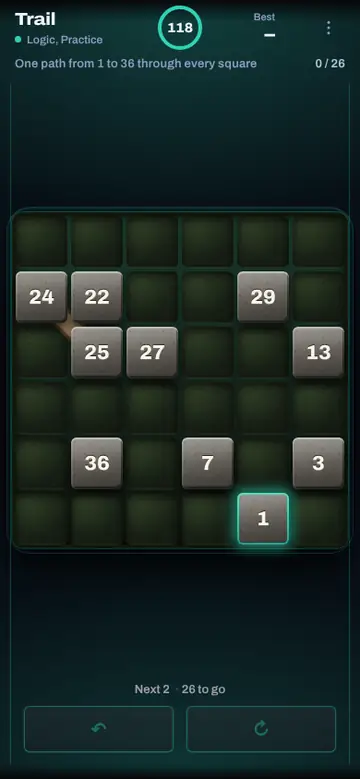 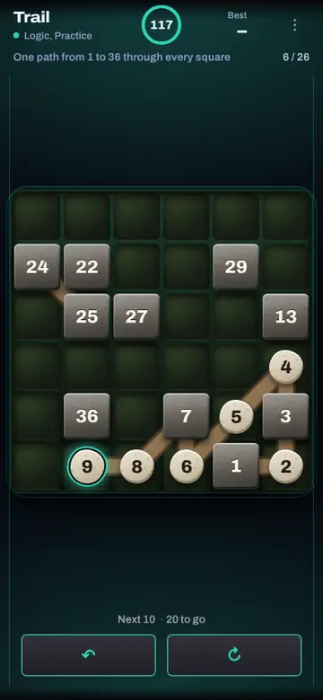 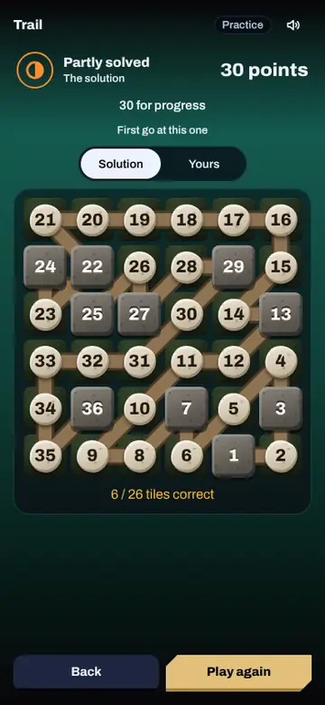

**Now.** Number a 6 × 6 grid 1 to 36 in a king-move path (any of eight neighbours); 10 numbers are fixed. Tap or
drag from the path's end. Bank of 300 boards. 120 s, Undo and Reset.

| Action | Shows today | Sounds today |
|---|---|---|
| Step | Stone pops, segment drawn | `move` only |
| Refused step | Square shakes | Silent |
| Step back | Undoes | Silent |
| Solve | Glow sweep | Correct plus solve |

**Feedback.** Step: *slide* (the line draws to the new square, a soft note that climbs a scale as the count rises,
wrapping every octave). Reaching a fixed number on the right count: *match* (it glows gold, chime). Refused:
*wrong* (short shake and low tick). Solve: *round-end payoff* (the path lights 1 to 36 in one fast run).

**Changes.**
- The intro example is the first board in the live bank, shown to everyone with its full answer. Swap it for a
  board that is never dealt.
- Any undo loses the whole clean bonus; the other games take 2.5 per mistake. Make it per undo.
- The scoring is Number's, but the game lives in Logic (a leftover from the move).
- The board sits in the top half with a large empty band above Undo/Reset; the board could grow by a third.

**Difficulty.**
| Level | Grid | Fixed numbers |
|---|---|---|
| Easy | 5 × 5 | 9 |
| Normal | 6 × 6 | 10 (today) |
| Hard | 6 × 6 | 7 |
| Expert | 7 × 7 | 9, 150 s |

The 300-board bank isn't graded; grading it by solver branching would let one bank serve Normal and Hard.

## Loopline

 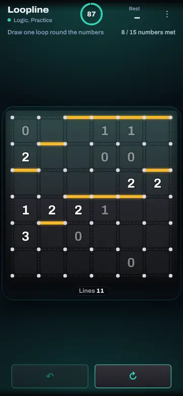 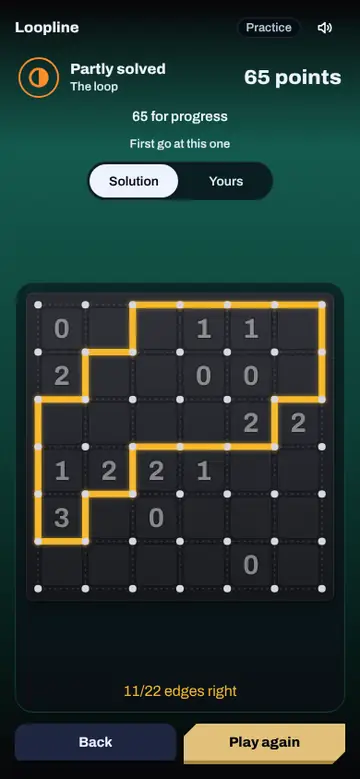

**Now.** Slitherlink on a 6 × 6 grid: draw one closed loop along the dots; each number says how many of its four
sides the loop uses. Tap an edge cycles line → ✕ → empty; drag draws. 90 s, Undo and Reset.

| Action | Shows today | Sounds today |
|---|---|---|
| Line | Edge drawn | `fences.draw` |
| ✕ | Cross | `fences.cross` |
| Clear a ✕ | Cross gone | `fences.cross` again (wrong cue) |
| Clue state | Met / over / open colours | Silent |
| Undo, Reset | — | Silent |

**Feedback.** Line: *slide* (the edge draws from the near dot, a pen tick). Clue met: *match* (the number turns
gold). Clue over: *wrong* (red, low tick). Loop closes: a satisfying click and a light running round the loop;
if it's the right loop that is the *round-end payoff*, if not the loop flashes once and numbers that fail glow.

**Changes.**
- Clearing a ✕ plays the "cross" sound; drag-erase does too. Clearing should sound like clearing.
- A paint that changes nothing still fires its sound.
- ✕ notes count as mistakes (see the category note).

**Difficulty.** The generator already grades by branch points (0–6) and clue count.
| Level | Grid | Grade | Clues |
|---|---|---|---|
| Easy | 5 × 5 | 0–1 | ≥ 14 |
| Normal | 6 × 6 | 0–6 | ≥ 15 (today) |
| Hard | 7 × 7 | 3–8 | ≥ 18 |
| Expert | 8 × 8 | 6–12 | ≥ 22, 120 s |

## Regions

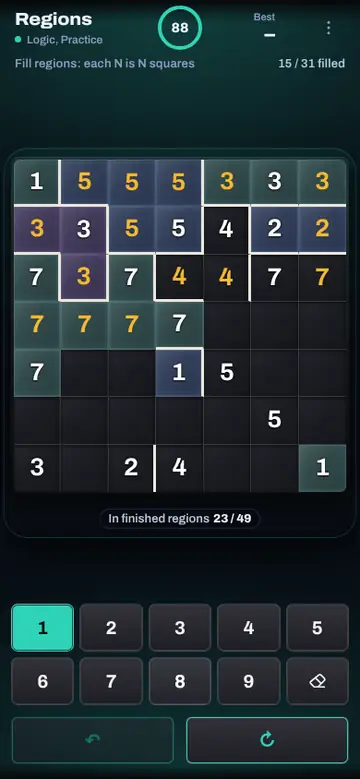 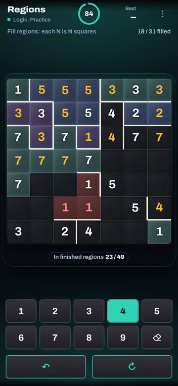 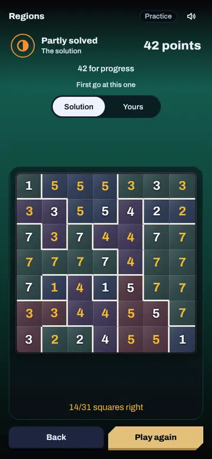

**Now.** Fillomino on 7 × 7: fill numbers so each region of N squares holds N, no two same-size regions touching.
Pick a number on the pad, then tap or drag squares. 90 s, Undo and Reset.

| Action | Shows today | Sounds today |
|---|---|---|
| Pick a number | Pad highlight | Silent |
| Paint | Number in, region tint | `fillomino.place` |
| Region complete | Shaded | `fillomino.region` |
| Too big | Red | Silent |
| Erase, Undo, Reset | — | Silent |

**Feedback.** Paint: *drop/place* (block tap). Drag stroke: *slide* (a tick a square, rising). Region complete:
*match/clear* — a chord pitched by its size (1 high, 7 low), the region's border thickens. Oversize: *wrong*
(red pulse, low tick). Solve: *round-end payoff* (regions fill with their tints in size order).

**Changes.**
- Erase, Undo and Reset are silent.
- A drag stroke that crosses wrong squares logs each as a mistake; one stroke should count as one.

**Difficulty.** Graded by solver branching (8–120 nodes today).
| Level | Grid | Grade | Givens |
|---|---|---|---|
| Easy | 6 × 6 | 0–20 | 16–22 |
| Normal | 7 × 7 | 8–120 | 14–26 (today) |
| Hard | 7 × 7 | 60–200 | 12–18 |
| Expert | 8 × 8 | 150+ | 12–16, 120 s |

## Island Link

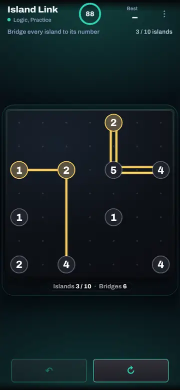 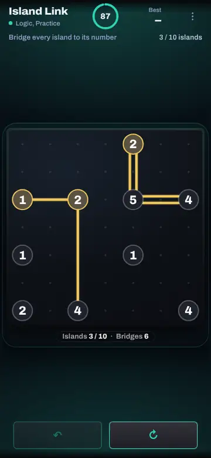 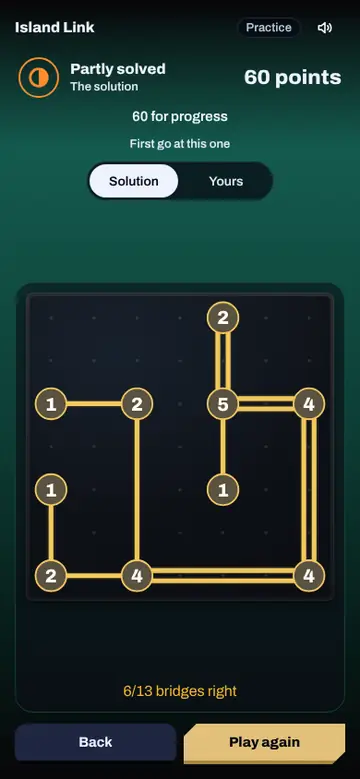

**Now.** Hashi on 7 × 7 with 10–14 islands: join islands with single or double bridges so each island's number
is met and all islands connect. Drag from an island toward a neighbour; repeating cycles 0 → 1 → 2 → 0. 90 s,
Undo and Reset.

| Action | Shows today | Sounds today |
|---|---|---|
| Drag past halfway | Bridge 1 → 2 → none | `bridges.build` / `remove` |
| Crossing bridge | Refused | `shared.reject` |
| Drag short of halfway | Preview line, then nothing | Silent |
| Plain tap | Nothing | Silent |
| Island met / over | Colours | Silent |

**Feedback.** Bridge: *drop/place* — planks lay down from one island to the other in 200 ms with a wooden knock
(a double bridge two knocks). Island met: *match* (ring turns gold). All islands joined: a light runs across
every bridge (*round-end payoff*). Short drag: the preview snaps back with a small rubber-band sound so the
player knows nothing happened.

**Changes.**
- Removing a single bridge by dragging cycles through a double first, which counts as a mistake.
- "Drag island to island" in help, but it builds at halfway; say "drag towards an island".
- A tap on a bridge could cycle it (faster than dragging again).

**Difficulty.** Graded by branch points (0–4).
| Level | Grid | Islands | Grade |
|---|---|---|---|
| Easy | 6 × 6 | 7–9 | 0 |
| Normal | 7 × 7 | 10–14 | 0–4 (today) |
| Hard | 8 × 8 | 14–18 | 2–6 |
| Expert | 9 × 9 | 18–24 | 4–8, 120 s |
