# Number: game reviews

Phase 2, step 4. 8 live games. Screenshots are phone size (390 × 844, shown at 360 px): **start** of play,
**mid-play** after a few moves, and the **round end** (a part-played run that ran out of time). Taken on a local
dev server through each game's `?game=` practice link; nothing in the app was changed.

Effects kit words used below: **tap, pick up, drop/place, slide, pour/flow, match/clear, wrong, combo/streak,
score count-up, near-miss, round-end payoff.** A physical action takes 900 ms at most and the next input is taken
at once; no effect over the board while the clock runs except the action itself.

## Summary

| Game | Biggest feedback win | Biggest change | Difficulty notes |
|---|---|---|---|
| Counterweight | Beam that tilts in proportion to how far off it is, with a creak | Running out of hangs plays the "balanced" sound | Weights, notches and scale count per level |
| Exact | Each combine as a physical merge (two tiles slide together) | Lock with no steps locks a 0 | Target range and how many numbers the answer needs |
| Operator | Sounds on every fill (today silent) and on each try used | Re-entering the same fill burns another try | Number range, gaps and signs per level |
| Integer Pyramid | Show a wrong sum as soon as a pair is full | No live sign of a wrong tile at all | Rows (4 / 5) and empty cells |
| Brimful | A real pour with a filling level and a glug | Running out of moves on one jug ends the whole run | Jug count and minimum moves |
| Checkout | Darts that thud into the wedge you aimed at | Overshoot has no bust; "120 − D-7" double minus | Board types per level |
| Ballpark | A satisfying "pin" on each place and a reveal fly-in | Tapping the number card moves the marker | Range and number types per level |
| Kakuro | A chord when a run completes, a buzz on a broken run | Clean bonus punishes digits the board can't show are wrong | Grid size and solver grade |

**Across the category**

- **The real clocks differ from the catalogue** for two games: Counterweight is dealt 120 s (catalogue 90 s) and
  Ballpark 90 s (catalogue 75 s). The puzzle's own clock wins, so players see the longer one, but the Games page
  and any list built from the catalogue show the shorter.
- **Silent placing again.** `balance.drop`, `equation.drop`, `numpyramid.place`, `measure.pour`, `measure.fill`,
  `measure.empty`, `numline.place` and `checkout.tick` have no sound file; only the generic `move` tick plays.
- **Stage games** (Counterweight 4 scales, Operator 4 equations, Integer Pyramid 4 boards, Brimful 4 boards,
  Checkout 5 boards, Ballpark 3 lines) share one moment: the stage completes. Make it one consistent
  *match/clear*: the finished stage lifts and slides away, a rising two-note, a pip fills in the stage counter.
  Skip and fail should sound different from that (today Operator's skip and Counterweight's fail sound like a
  win).
- **Two-at-once sounds**: Ballpark's place plays three sounds; most finishes play the generic correct plus their own.

---

## Counterweight

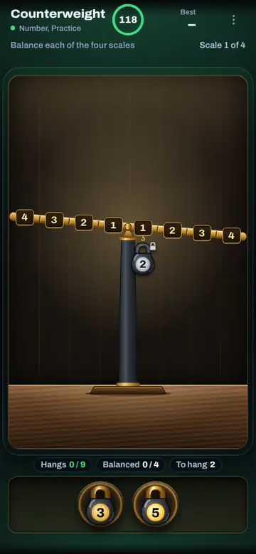 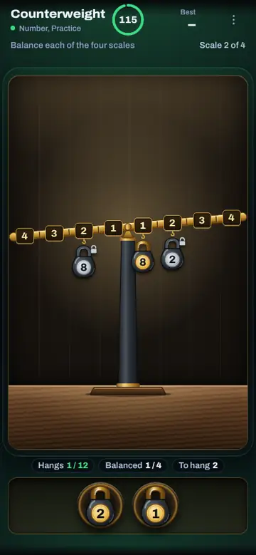 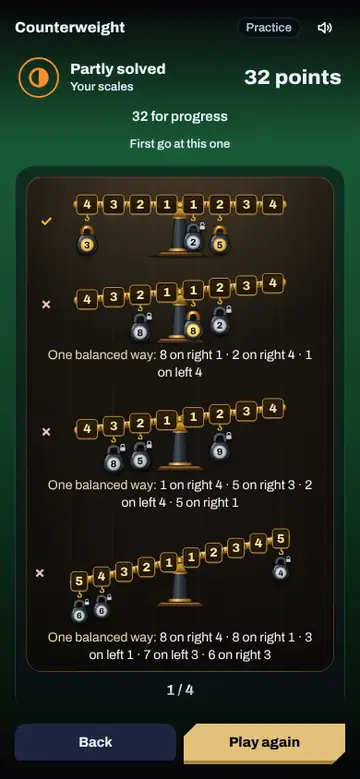

**Now.** Hang kettlebells on notches so weight × distance is equal on both sides; four scales in order, each with
a hang limit (9 / 12 / 15 / 18). Dealt 120 s.

| Action | Shows today | Sounds today |
|---|---|---|
| Tap a weight | Ring | `balance.select` |
| Tap a lit notch | Weight drops, beam tilts (5–12°) | `move` only (`balance.drop` has no file) |
| Scale balances | Hold, beam levels | `correct` + `balance.level` |
| Double-tap a hung weight | Back to tray | `balance.select` then `move` |
| Tap a notch with nothing picked | Nothing | Silent |
| Out of hangs | Next scale | `balance.level` (the success sound) |

**Feedback.** Pick up: the bell lifts off the tray. Hang: *drop/place* — it swings onto the hook with a metal
clink, the beam settles with a small overshoot and a wooden creak. The tilt angle should say how far off you are
(today it hits its 12° cap almost at once on the heavy scales). Balanced: *match/clear* (the beam locks level, a
bright bell, the pointer turns gold). Close but not level (off by one unit of torque): *near-miss* (pointer
trembles at the centre). Out of hangs: a dull thunk, the scale greys and slides away.

**Changes.**
- Out of hangs plays the balanced sound. Give it its own.
- Show the torque on each side ("18 | 15") under the beam, or at least scale the tilt to the difference.
- Double-tap to remove is hidden; let a tap on a hung weight pick it up again.
- Moving a hung weight to another notch costs a hang; allow a free move or say so.
- Help says "peg"; the screen says notches.
- Tap a notch with nothing selected does nothing; a small "pick a weight first" nudge on the tray.
- The scale sits small inside a tall wooden backdrop with lots of empty space; the beam and its numbers could be
  half as big again.

**Difficulty.**
| Level | Scales | Tray weights | Notches | Hangs |
|---|---|---|---|---|
| Easy | 3 | 2 / 2 / 3 | 1–3 | generous |
| Normal | 4 | 2 / 3 / 4 / 5 | 1–4 (1–5 last) | today |
| Hard | 4 | 3 / 4 / 5 / 6 | 1–5 | today − 2 each |
| Expert | 4 | 4 / 5 / 6 / 6, all unique arrangements | 1–5 | today − 3, torque hidden |

## Exact

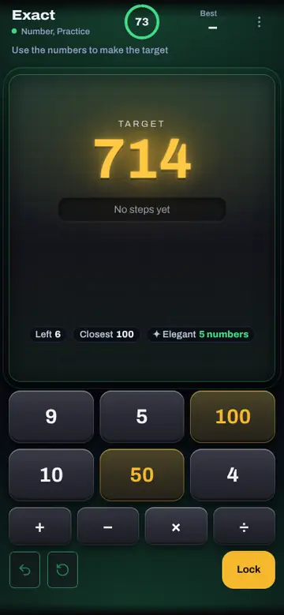 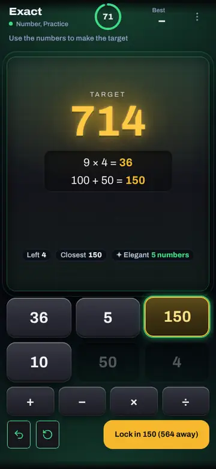 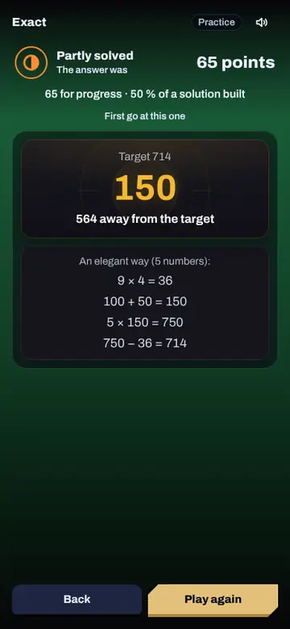

**Now.** Six numbers (one or two of 25/50/75/100, the rest 1–10) and a three-digit target; combine with + − × ÷,
whole positive results only. Every target needs five or six numbers. 75 s, free Undo and Reset.

| Action | Shows today | Sounds today |
|---|---|---|
| Tap a tile | Lifts | `target.select` |
| Tap an operator | Highlight | Silent |
| Tap a second tile | Result pops, used tile sinks, history line | `target.combine` + `move` |
| Illegal combine | Shake, red | `wrong` |
| Hit the target | Tile flies into the target, burst | `target.solve` + `lock` |
| Lock | "Lock in 812 (4 away)" | — |

**Feedback.** Operator: a small *tap* click. Combine: *slide* — the two tiles slide together and merge into the
result with a pop pitched by its size. A result that gets within 10 of the target: *near-miss* glow on the target
("4 away"). Hitting it: *round-end payoff* (the result tile flies home, the target flips gold). Undo: the merge
plays backwards.

**Changes.**
- Lock is live with no steps made; a tap locks 0 points. Disable it until there's a step.
- The operator can't be toggled off.
- The Lock button already says "Lock in 150 (564 away)", good; but it's lit gold from the first second, which
  invites an early tap.

**Difficulty.**
| Level | Tiles | Target | Answer needs |
|---|---|---|---|
| Easy | 6 | 101–300 | 3–4 numbers |
| Normal | 6 | 101–999 | 5–6 (today) |
| Hard | 6, one large | 300–999 | 6 numbers, no 5-number route |
| Expert | 6, small only | 500–999 | 6 numbers, 60 s |

## Operator

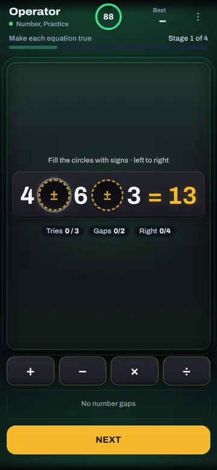 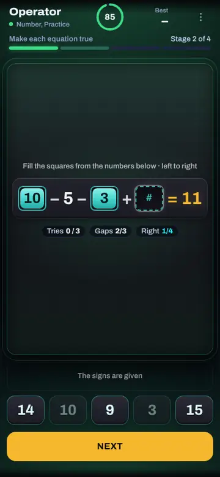 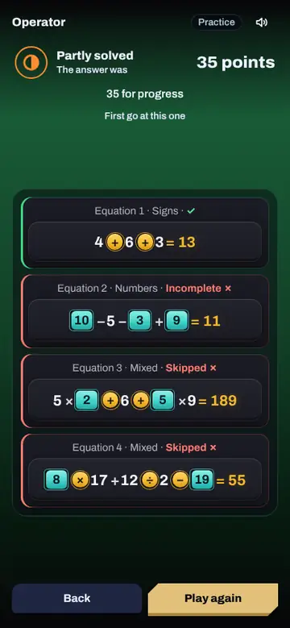

**Now.** Four equations worked left to right, each with gaps: equation 1 signs only, 2 numbers from a tray of
five (two decoys), 3 and 4 a mix. Three tries per equation; Next skips. 90 s.

| Action | Shows today | Sounds today |
|---|---|---|
| Tap a sign or number | Fills the leftmost empty gap of that kind | `move` only |
| Full but wrong | Shake | `shared.reject`, a try used |
| True | Green glow, slide on | `equation.correct` + `stage_complete` |
| Tap a filled gap | Empties | `move` |
| Tap an empty gap | Nothing | Silent |
| Next (skip) | Slide on | Same as solving |

**Feedback.** Fill: *drop/place* — the tile drops into its gap with a click; the running total updates under the
line as you go (worked left to right). Wrong full line: *wrong* — the line flashes red, and one of three try pips
cracks. True: *match/clear* (the equals sign glows gold, a two-note). Skip: a flat swish, no success sound.
Four right first time: *combo* on the last.

**Changes.**
- Re-entering the same fill after clearing one gap burns another try. Only count a try for a new fill.
- Let a tap on an empty gap select it, so the player chooses where the next tile goes.
- Skip sounds like a solve.
- Skipped equations can't be revisited; allow going back while time is left.
- The equation sits mid-screen in a large empty panel, with a "No number gaps" placeholder taking a whole row on
  equation 1. Let the equation and its keys sit together.

**Difficulty.**
| Level | Numbers | Gaps | Signs |
|---|---|---|---|
| Easy | 2–9 | 1–2 per line | + − × |
| Normal | 2–20 | today | today, ÷ on line 4 |
| Hard | 2–25 | one more gap a line | ÷ allowed from line 3 |
| Expert | 2–30 | all gaps mixed, 2 decoys a line | 2 tries |

## Integer Pyramid

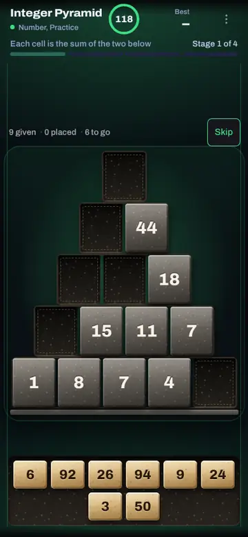 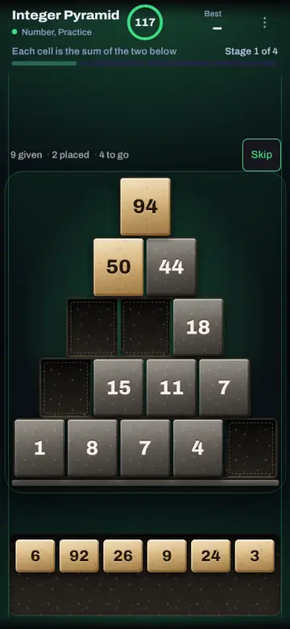 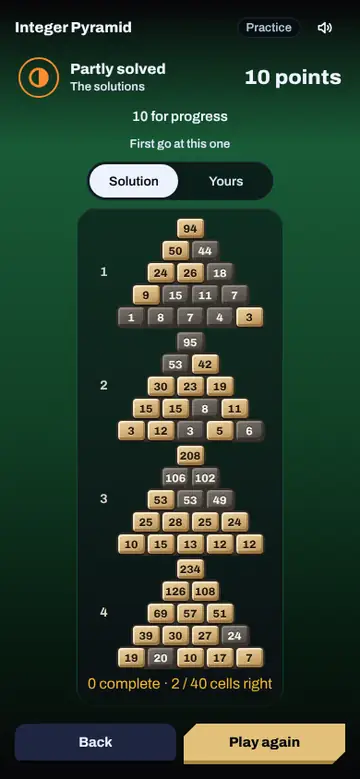

**Now.** Five-row pyramids where each stone is the sum of the two below; fill the empty stones from a tray (the
missing numbers plus 2 decoys). Four boards, Skip allowed. 120 s.

| Action | Shows today | Sounds today |
|---|---|---|
| Drag or tap a tile onto a stone | Sets | `move` only |
| Drop on a placed tile | Swaps | `move` |
| Back to tray / double-tap | Unplaced | `move` |
| Board complete | Stones turn gold bottom row first | `correct` + `stage_complete` |
| Wrong tile | Nothing | Silent |

**Feedback.** Place: *drop/place* (stone thunk). When both stones under a filled stone are filled, the sum is
checked: right gives a faint gold seam (*match*), wrong a red crack line between the three stones (*wrong*). A
full row right: *combo* tone. Board complete: today's gold sweep is good; add a rising arpeggio, one note a row.

**Changes.**
- A full but wrong pyramid sits there with no signal, while the clean bonus silently counts every wrong tile ever
  placed. Show the sum check above (and keep the bonus) or drop the bonus.
- Skip on board 4 actually ends the round; its label should change to "Finish".
- A tray of up to 15 tiles wraps to three rows on a phone.
- The reveal shrinks all four pyramids into one column of tiny stones; show one pyramid at a time with a switcher.

**Difficulty.**
| Level | Rows | Empty stones | Bottom row values | Decoys |
|---|---|---|---|---|
| Easy | 4 | 4–6 | 1–9 | 1 |
| Normal | 5 | 6–13 by board | 1–20 | 2 (today) |
| Hard | 5 | 10–13 | 4–20 | 3 |
| Expert | 6 | 14–18 | 4–25 | 3 |

New levels need new bank boards (today's bank is all 5-row).

## Brimful

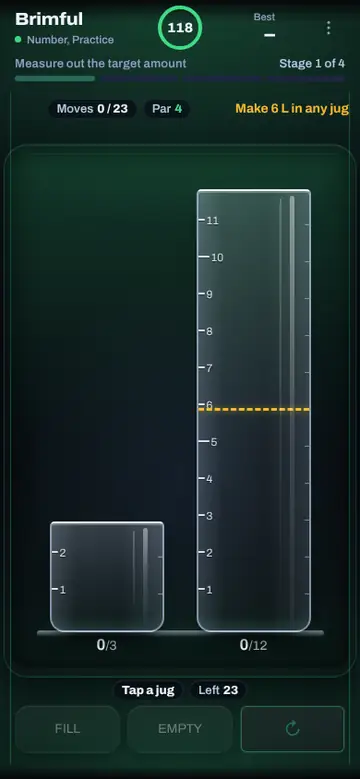 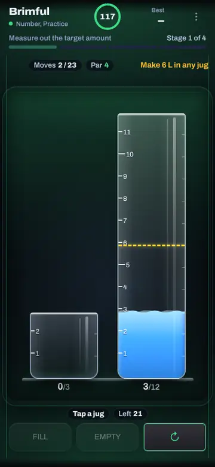 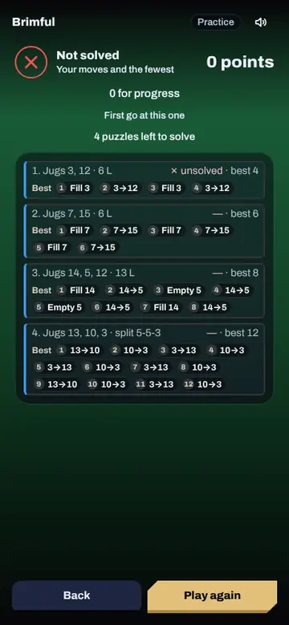

**Now.** Water-jug puzzles: four boards (two jugs and a tap; two jugs; three jugs; no tap, split the water
evenly). Par is the minimum; the move limit is generous. Reset is free. 120 s.

| Action | Shows today | Sounds today |
|---|---|---|
| Tap a jug | Lifts | `measure.select` |
| Tap another | Stream, levels ease | `move` only |
| Fill / Empty | Tap stream | `move` only |
| Refused | Jug shakes | `wrong` |
| Board solved | Hold | `correct` + `stage_complete` |
| Out of moves | Run ends | — |

**Feedback.** Same family as Polypotions: *pour/flow* — lift, tilt, a stream with a rising glug as the target
fills, the level wobbling as it settles. Fill from the tap: a running-water sound sized to the amount. Empty: a
splash. Target amount reached: *match/clear* (the jug's line glows, a bright plink). One move from the target:
*near-miss* hint on the matching jug.

**Changes.**
- Running out of moves on any board ends the whole run, and there's no Skip, so a stuck player never sees boards
  2–4. Add Skip (as Integer Pyramid) or end only that board.
- Help says every action is a move, but Reset isn't.
- The reveal is a dense list of moves ("1 → 3", "Fill 7"); show each puzzle's best line as a few small jug
  pictures instead.

**Difficulty.**
| Level | Boards | Jugs | Minimum moves |
|---|---|---|---|
| Easy | 3 | 2 + tap | 3–5 |
| Normal | 4 | today | 4–14 rising |
| Hard | 4 | 3 from board 2 | 8–16 |
| Expert | 4 | 3, no tap from board 3 | 12–18, limit par + 4 |

## Checkout

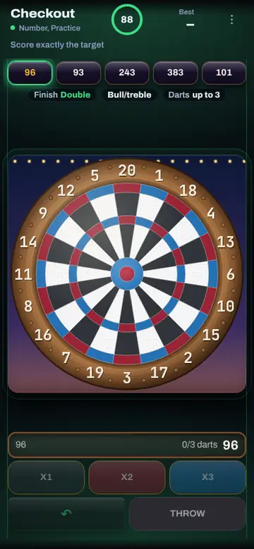 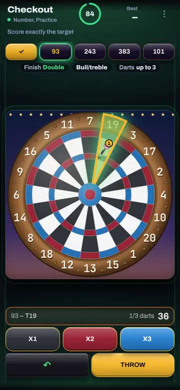 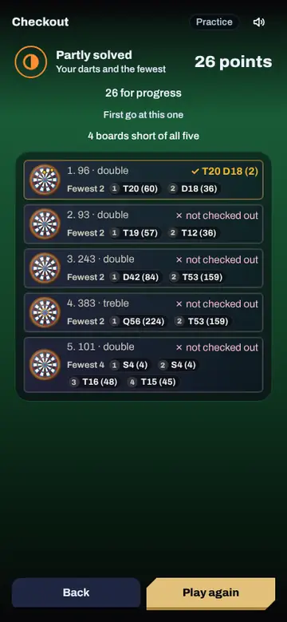

**Now.** Five darts boards; pick a wedge, then a ring (single, double, treble), to score exactly the target and
finish in the stated ring. Boards get stranger: shuffled numbers, uneven values, ×4 ring, negative wedges.
Any order. 90 s.

| Action | Shows today | Sounds today |
|---|---|---|
| Tap a wedge | Aim | `checkout.aim` |
| Ring button | Dart thuds in | `checkout.thud` |
| Undo | Dart out | Silent |
| Wrong Throw | Score bar shakes | `wrong` |
| Right Throw | ✓ or ★ on the tab, next board | `correct` + `checkout.stage` |
| Switch tab | — | Silent |

**Feedback.** Dart: *drop/place* — the dart flies from the bottom in an arc to the chosen ring and thuds, the
remaining score counts down (*score count-up* in reverse). Overshoot: *wrong* — "Bust" and the darts drop out.
Finish on the right ring: *match/clear* (the board rings, a crowd "oh!" on a big finish). Undo: dart pulled
with a light tug.

**Changes.**
- Overshooting only turns the number a warning colour; you can keep throwing. Add a bust that clears the darts.
- Negative wedges render as "120 − D-7" (two minus signs).
- Ring buttons stay disabled until a wedge is picked, with no hint why.
- The 900 ms auto-advance timer isn't cleared if the screen leaves (minor).

**Difficulty.**
| Level | Boards |
|---|---|
| Easy | 3 standard boards, finish on any ring |
| Normal | Today's five |
| Hard | Five, two with uneven values, two with negatives |
| Expert | Five, exact dart counts on every board, 75 s |

## Ballpark

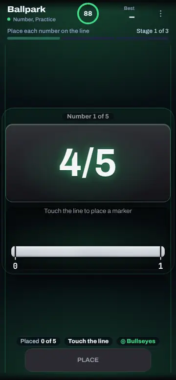 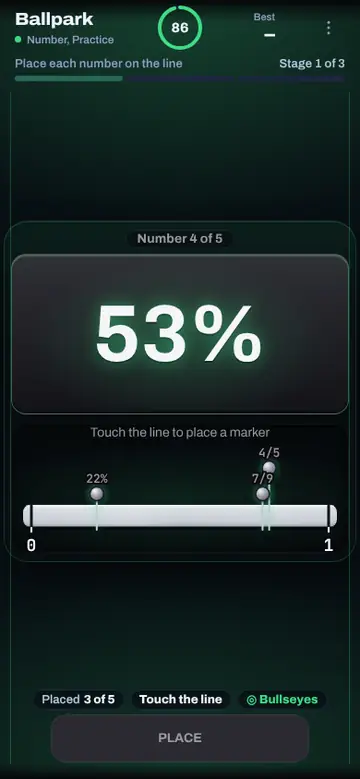 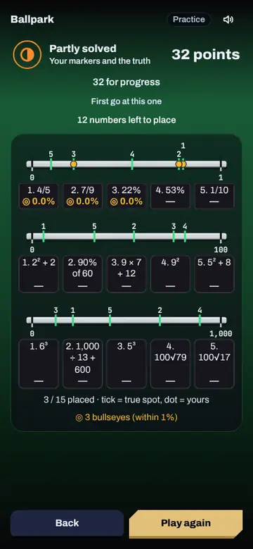

**Now.** Estimate where a number sits on a line labelled only at its ends: three lines of five (0–1 with
fractions and percents; 0–100 with sums and products; −50 to 50 or 0 to 1,000). Dealt 90 s. No accuracy shown
until the end, by design.

| Action | Shows today | Sounds today |
|---|---|---|
| Touch or drag | Marker and magnifier | Silent |
| Place | Drop | `tick` + `place` + `move` (three at once) |
| New line | Slides in | `stage_complete` |
| Last place | Glint sweep, rings | glow sweep + five ticks |

**Feedback.** Drag: a faint tick as the marker crosses each tenth of the line. Place: *drop/place* — one clean
pin sound and the marker stamps in. Line done: the line slides away (*clear*). End: *round-end payoff* — each
answer flies in to its true spot with a line from your marker; bullseyes (within 1 %) sparkle, the score
*counts up* as they land.

**Changes.**
- The whole arena takes pointer input, including the number card, so tapping the card moves the marker.
- Three sounds on every place; keep one.
- The number card is huge and the line it's placed on is a thin bar in a small box; the line is what the player
  aims at and should get the space.
- Taps beyond the ends clamp silently to 0 or 1.

**Difficulty.**
| Level | Lines | Numbers |
|---|---|---|
| Easy | 0–10 and 0–100 | Whole numbers, simple fractions |
| Normal | Today's three | Today |
| Hard | 0–1, −100 to 100, 0–1,000 | Roots, powers, harder fractions |
| Expert | Today's plus a 0–10,000 log-feel line | One labelled end only hidden until halfway |

## Kakuro

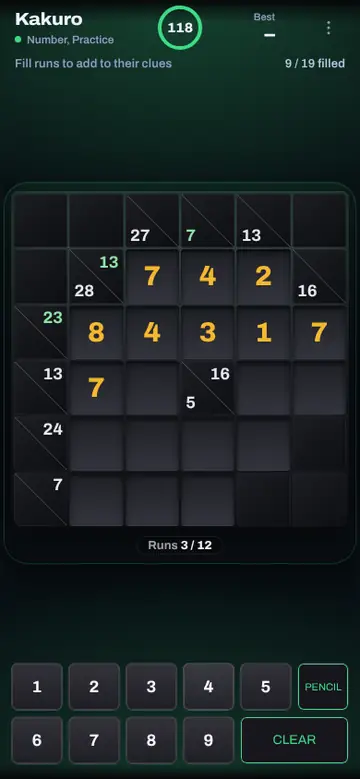 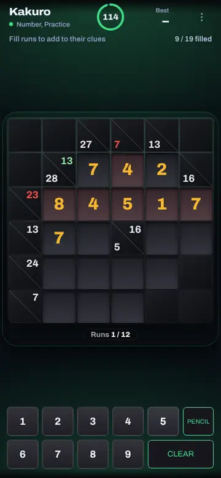 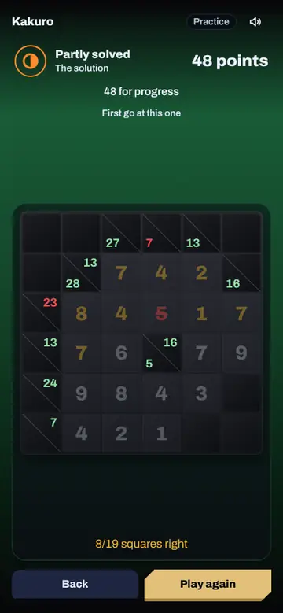

**Now.** A 6 × 6 cross-sum grid (19–21 white squares); each run adds to its clue, no digit repeated in a run.
Pencil marks, Clear. 120 s.

| Action | Shows today | Sounds today |
|---|---|---|
| Tap a square | Selected, its runs lit | Silent |
| Enter a digit | Pop | `kakuro.place` |
| Pencil | Small marks | Silent |
| Run broken | Red square and clue | Silent |
| Run complete | Green | `kakuro.run` |
| Solve | Run-by-run light | `correct` + `kakuro.solve` |

**Feedback.** Digit: *drop/place* (a soft tap). Broken run: *wrong* (the clue pulses red with a low tick, once).
Run complete and right: *match* (the clue turns gold, a two-note pitched by the run's length). Two runs at once:
*combo*. Solve: *round-end payoff* (runs light across then down).

**Changes.**
- The clean bonus treats any digit that differs from the stored solution as wrong, even if no run rule is broken
  yet; the player can't see it. Count only digits that break a rule.
- Pencil marks draw as small as 7 px: too small to read.
- After entering a digit, move to the next empty square in the run.

**Difficulty.** The generator grades boards (branch points).
| Level | Grid | White squares | Grade |
|---|---|---|---|
| Easy | 5 × 5 | 12–14 | 0 |
| Normal | 6 × 6 | 19–21 | 0–10 (today) |
| Hard | 7 × 7 | 26–30 | 4–12 |
| Expert | 8 × 8 | 34–40 | 8+, 150 s |
