# Pattern: game reviews

Phase 2, step 4. 8 live games. Screenshots are phone size (390 × 844, shown at 360 px): **start** of play,
**mid-play** after a few moves, and the **round end** (a part-played run that ran out of time). Taken on a local
dev server through each game's `?game=` practice link; nothing in the app was changed.

Effects kit words used below: **tap, pick up, drop/place, slide, pour/flow, match/clear, wrong, combo/streak,
score count-up, near-miss, round-end payoff.** A physical action takes 900 ms at most and the next input is taken
at once; no effect over the board while the clock runs except the action itself.

## Summary

| Game | Biggest feedback win | Biggest change | Difficulty notes |
|---|---|---|---|
| Gridlock | A sound on a tap that can't move (today a silent shake) | Reveal shows the start board as "Yours" after Undo | Bank already stores minimum moves |
| Tessellate | A satisfying snap with the cells it fills lighting | Double tap rotates **and** flips | Solutions count and pegs |
| Pipeline | Water visibly runs into each newly joined pipe | Show leaks live; allow turning both ways | Grid size, scramble share |
| Chroma Lines | One sound for a joined pair (today two at once) | A stray touch on a finished pair wipes it | Grid, pairs, walls |
| Skid | A sound when a slide hits a wall straight away | Undo doesn't give the slide back | Bank stores minimum slides |
| Heave | Real sounds for steps and pushes (today silent) | Par isn't shown during play | Crates and minimum pushes |
| Lightbender | Sounds for place, turn and fire (today silent) | Gems pill drops to 0 when the beam fades | Mirrors, bombs, shots |
| Topsy-Turvy | A tilt that makes no move should do nothing | Real clock is 120 s, catalogue says 90 | Balls, boards, tilt limit |

**Across the category**

- **Every draft change plays `move`.** All eight stages report drafts, so every action ticks; many of the
  game's own cues have no file (`pipes.rotate`, `iceslide.slide`, `push.step`, `push.push`, `laser.place`,
  `laser.turn`, `laser.fire`, `gravity.tilt`, `unblock.solve`). The generic tick is carrying the category.
- **Undo is three different rules.** In Gridlock, Skid and Topsy-Turvy an undone move still counts; in Heave it
  is given back; in Lightbender Undo only removes the last placed piece. Pick one rule (give the move back, keep a
  separate "undos" count if needed) and say it in the help.
- **Full-speed times are very tight** in Chroma Lines (20 s of 75) and Lightbender (15 s of 60).
- **Par display** is uneven: Gridlock, Pipeline, Skid and Topsy show it; Heave doesn't.
- **Reveal labels.** Under the Solution tab, the line below the board is the player's own count ("0/9 pieces in
  place", "× 1/49 connected", "× 0/10 pairs on route"). It reads as if it describes the solution. Show it only on
  Yours, or label it "You: 0 / 9". The stray "×" also reads as a typo ("1 / 3 × boards" in Topsy-Turvy).
- **Control switch.** Skid, Heave and Topsy-Turvy have a small icon beside the arrow pad that swaps the pad for a
  swipe pad (a single gold dot). The icon doesn't say what it does, and a stray tap hides the arrows (it happened
  in the mid-play screenshots below). Label it, or move it to the game menu.

---

## Gridlock

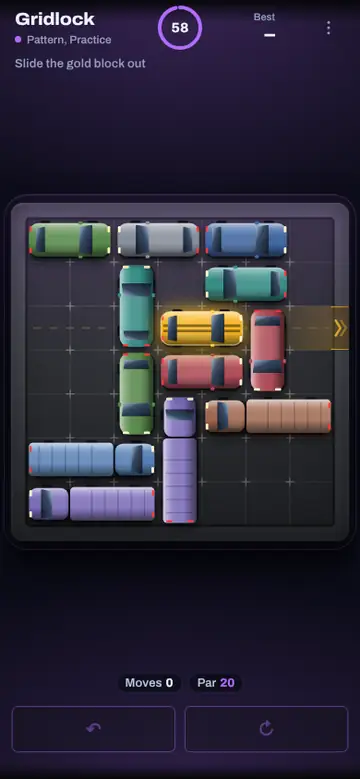 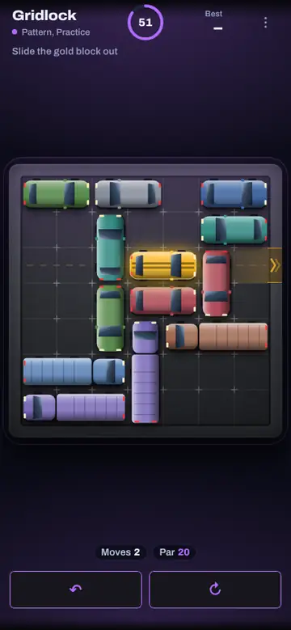 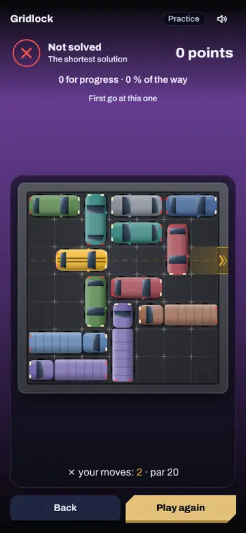

**Now.** Slide blocks on a 7 × 7 lot to drive the gold block out. Boards need 15–22 moves; par is the exact
minimum. 60 s, Undo and Reset.

| Action | Shows today | Sounds today |
|---|---|---|
| Drag a block | Ghost, lift, glide, settle | `unblock.slide` + `move` |
| Tap or drag that goes nowhere | Shake | Silent |
| Undo / Reset | Block moves back | `unblock.slide` + `move` |
| Solve | Gold block drives out with streaks | `pz_car_escape` then `lock` |

**Feedback.** Drag: *slide* — a short scrape whose length matches the distance, a soft bump as the block stops.
Blocked: *wrong* — a dull knock against the blocker (today silent). The gold block's lane cleared: a glint along
the exit. Solve: *round-end payoff* (today's drive-out is good; drop the silent `unblock.solve` slot).

**Changes.**
- After an Undo or Reset, the reveal's "Yours" board shows the start layout and "your moves" is too high (the
  undo markers are counted as moves).
- Help mentions "the bar's gold mark"; the screen shows pills.
- Help doesn't say Undo doesn't give the move back.

**Difficulty.**
| Level | Lot | Minimum moves | Blocks |
|---|---|---|---|
| Easy | 6 × 6 | 6–12 | 8–10 |
| Normal | 7 × 7 | 15–22 (today) | 10–13 |
| Hard | 7 × 7 | 22–30 | 12–14 |
| Expert | 7 × 7 | 30–40 | 13–15, 75 s |

The bank rows store the minimum, so levels can come from the same table once harder boards are added.

## Tessellate

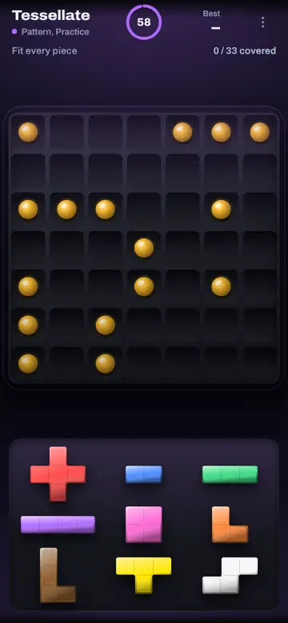 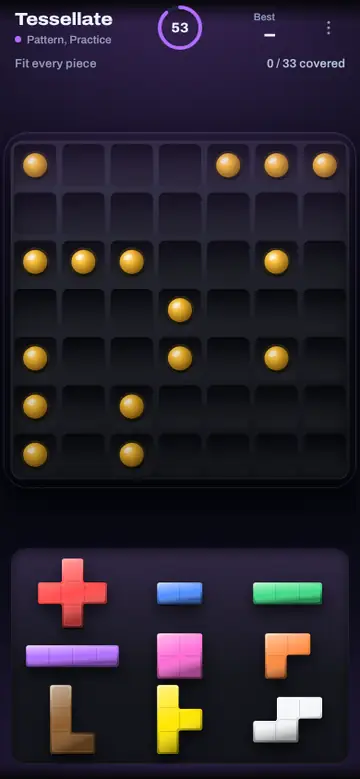 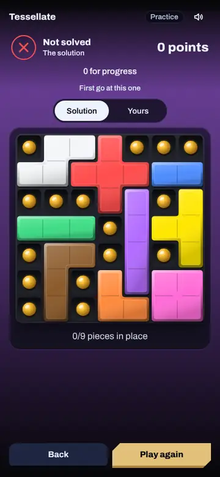

**Now.** Pack nine pieces onto a 7 × 7 board around 16 fixed pegs. Tap a tray piece to turn it, double-tap to
flip, drag to place. 60 s. No undo or reset.

| Action | Shows today | Sounds today |
|---|---|---|
| Tap | Turns | `blockparty.turn` |
| Double tap | Turns then flips | turn + flip |
| Drag | Outline where it lands | — |
| Drop, legal | Snaps, ring | `blockparty.place` + `move` |
| Drop, illegal | Shake | Silent |
| Tap a placed piece | Back to tray | `move` |
| Board full | Rings, shine | `blockparty.solve` |

**Feedback.** Turn: a quick spin with a click. Pick up: the piece lifts and grows slightly under the finger. Drop:
*drop/place* — a firm snap and the covered cells flash once. Illegal: *wrong* — a dull thud and the piece slides
back to the tray. Last gap filled: *round-end payoff* (shine across, as today).

**Changes.**
- A double tap rotates and then flips, because the first tap already rotated. Wait out the double-tap window
  before rotating, or flip on a separate button.
- Flipping isn't in the help or intro.
- Every pick-up costs the "right first time" bonus, with no undo.
- "Drag a piece's anchor" in help reads oddly.

**Difficulty.**
| Level | Board | Pieces | Solutions |
|---|---|---|---|
| Easy | 6 × 6 | 6 | 20+ |
| Normal | 7 × 7 | 9 | 5–60 (today) |
| Hard | 7 × 7 | 9 | 2–5 |
| Expert | 8 × 8 | 11 | 1–3 |

## Pipeline

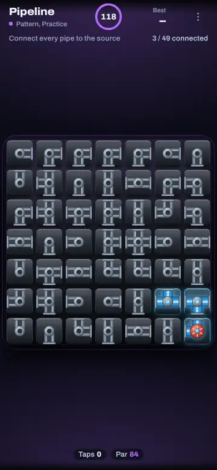 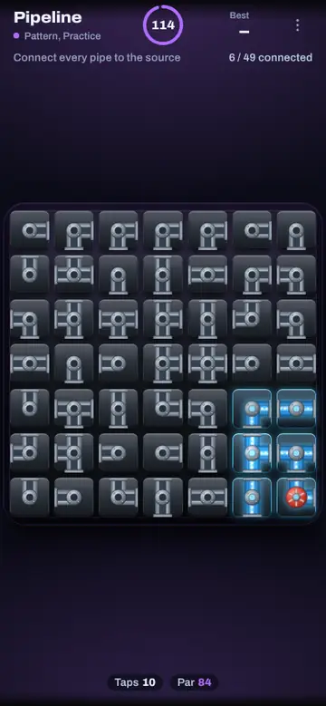 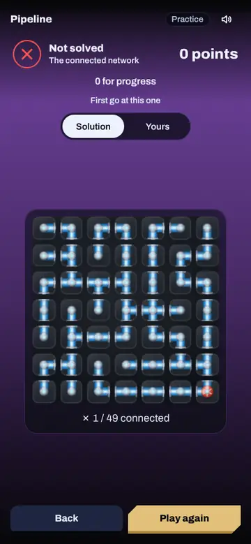

**Now.** Turn pipe tiles on a 7 × 7 grid (a quarter turn clockwise per tap) until water reaches every pipe. Par
is the fewest taps. 120 s.

| Action | Shows today | Sounds today |
|---|---|---|
| Tap | Quarter turn | `move` only |
| Water reaches new pipes | Ripple, tile flashes | `pipes.flow` |
| Solve | Water rushes out | correct + solve |

**Feedback.** Turn: *tap* with a metallic ratchet. New pipes joined: *pour/flow* — water visibly runs into each
newly joined pipe along the path (200 ms a tile), a gurgle sized to how many joined. A long join (6+ pipes):
*combo*. A turn that disconnects pipes: the water drains back with a falling note. Solve: the whole network
fills and the source bubbles.

**Changes.**
- Leaks aren't shown during play (they are in the intro and reveal). Show open ends live.
- Par is 84 taps on this board, which is a lot to keep in your head; the Taps / Par pills sit far below the
  board with an empty band between. Bring them up to the board.
- Taps only turn clockwise, so a quarter turn back costs three taps. Add a swipe or long press to turn the other
  way.
- The "connected" counter and the unfinished credit measure different things and can disagree.

**Difficulty.**
| Level | Grid | Scrambled |
|---|---|---|
| Easy | 5 × 5 | 60 % |
| Normal | 7 × 7 | 80 %+ (today) |
| Hard | 8 × 8 | 90 % |
| Expert | 9 × 9 | 95 %, leaks hidden |

## Chroma Lines

 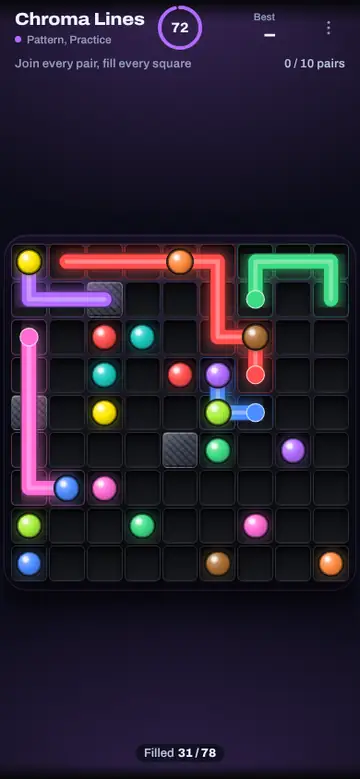 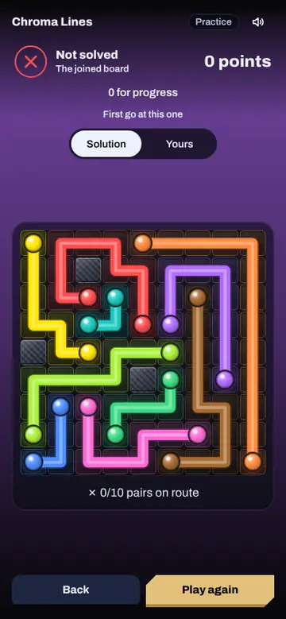

**Now.** Draw lines joining 10–12 colour pairs on a 9 × 9 grid with 2–4 walls; lines can't cross and every
square must be filled. One solution. 75 s.

| Action | Shows today | Sounds today |
|---|---|---|
| Drag from a dot | Tube follows | `move` per square |
| Back up | Rubs out | `move` |
| Illegal step | Board shakes | `shared.reject` |
| Pair joined | Dot pops, pulse along line | `correct` + `flow.connect` |
| Tap a dot | Clears that line | `move` |
| Solve | Paths pulse, glow | correct twice + solve |

**Feedback.** Drawing: *slide* with a soft liquid tone that rises as the line grows. Joined: *match* — one sound,
a pulse along the line (drop the extra `correct`). Every square filled: *round-end payoff*. Board filled except
one pair: *near-miss*.

**Changes.**
- Touching a finished dot restarts its line at once; a stray touch wipes it and counts as a redraw. Only restart
  on a drag, not a touch.
- Drawing over another colour doesn't cut it back; the player has to clear it by hand. Cutting is the usual rule
  and would make the game smoother.
- Only "Filled" is shown, not pairs joined.
- Twelve colours in small cells; white/silver and yellow/lime are close. Add a symbol in each dot.
- Full speed by 20 s of 75 is very tight.

**Difficulty.**
| Level | Grid | Pairs | Walls |
|---|---|---|---|
| Easy | 6 × 6 | 5–6 | 0 |
| Normal | 9 × 9 | 10–12 | 2–4 (today) |
| Hard | 9 × 9 | 8–9 (longer paths) | 4–6 |
| Expert | 10 × 10 | 12–14 | 4–6 |

## Skid

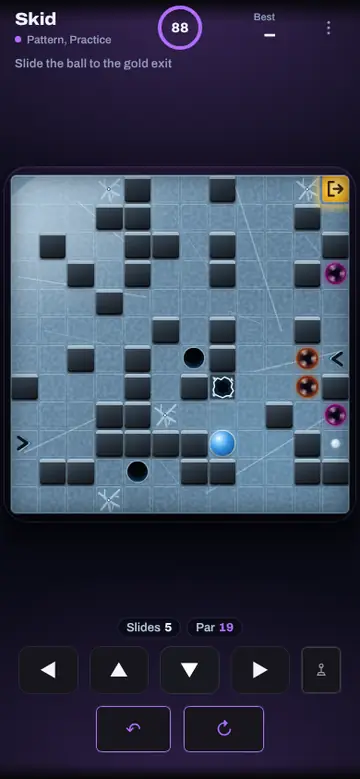 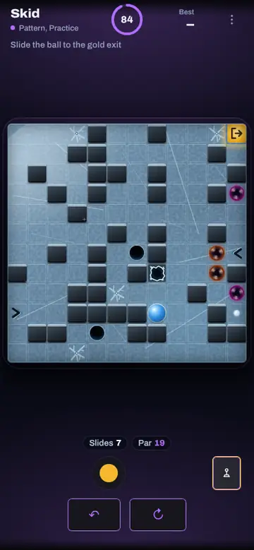 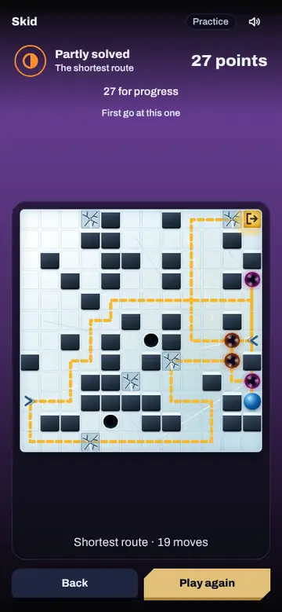

**Now.** Slide a ball on a 12 × 12 ice maze until it stops at the exit; walls, holes, arrows, portals and thin
ice that cracks. Shortest route 18–26 slides; par shown. 90 s, Undo, Reset, swipe or arrow pad.

| Action | Shows today | Sounds today |
|---|---|---|
| Swipe / arrow | Ball slides with frost trail | `move` only |
| Portal | Both ends flare | `iceslide.portal` |
| Thin ice | Cracks | `iceslide.crack` |
| Hole | Ball spins down, red outline | `iceslide.fall` + `wrong` |
| Into a wall straight away | Nothing | Silent |
| Undo / Reset | Ball back | `move` |
| Solve | Gold burst | correct + solve |

**Feedback.** Slide: *slide* — an ice hiss that lasts as long as the slide, a thump when it stops. No move: a tiny
bump against the wall with a dull tap. Exit reached: *round-end payoff* (the ice shatters, as today). At par with
one slide to go: *near-miss* glow on the exit.

**Changes.**
- Undo and Reset don't give slides back; the Slides pill keeps rising. See the category note.
- A slide straight into a wall does nothing and says nothing.

**Difficulty.**
| Level | Grid | Minimum slides | Hazards |
|---|---|---|---|
| Easy | 8 × 8 | 8–12 | No holes, no thin ice |
| Normal | 12 × 12 | 18–26 (today) | All |
| Hard | 12 × 12 | 24–30 | More holes |
| Expert | 14 × 14 | 28–36 | All, 120 s |

## Heave

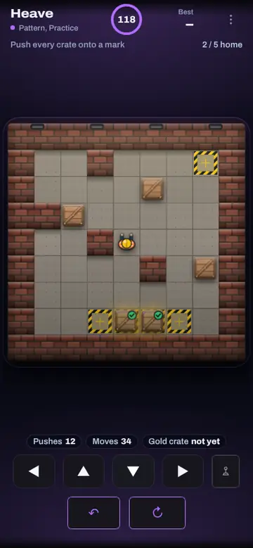 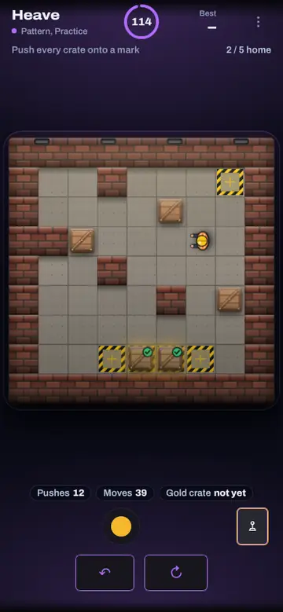 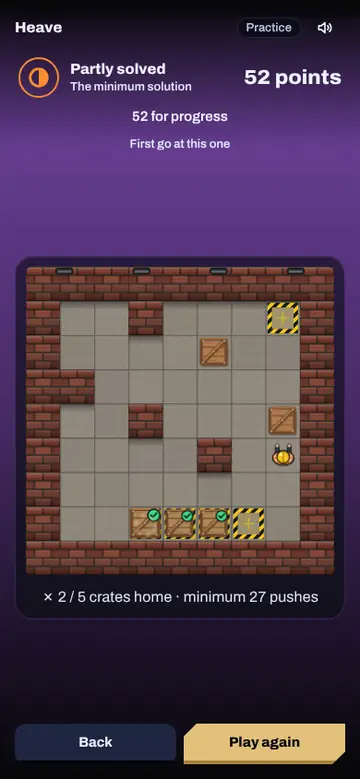

**Now.** Sokoban: push five crates onto marks in a 9 × 9 warehouse; one crate and mark are gold. Minimum
pushes 18–27. 120 s, Undo (a real undo), Reset, swipe or pad.

| Action | Shows today | Sounds today |
|---|---|---|
| Step | Worker walks | `move` only |
| Push | Crate moves | `move` only |
| Wall or stuck crate | Shake | `shared.reject` |
| Crate on a mark | Thump, dust | `push.home` |
| Gold on gold | "on its mark" | `correct` |
| Gold pushed off | — | Silent |
| Solve | Crates thump in turn | solve + correct |

**Feedback.** Step: a light footstep. Push: *slide* — a heavy scrape, the crate a beat behind the worker. Crate
home: *drop/place* (thump, dust, the mark glows). Crate pushed into a corner it can't leave: *wrong* — a warning
creak and the crate tints, so the player knows to undo (deadlock hint; optional on Expert). Solve: *round-end
payoff* (lights on).

**Changes.**
- Help mentions "fewest pushes (par)", but par isn't shown during play. Add the Pushes / Par pills the others
  have.
- Pushing the gold crate off its mark is silent.

**Difficulty.**
| Level | Crates | Minimum pushes | Deadlock hint |
|---|---|---|---|
| Easy | 3 | 8–14 | Yes |
| Normal | 5 | 18–27 (today) | Yes |
| Hard | 5 | 25–32 | No |
| Expert | 6 | 30–40 | No, 150 s |

## Lightbender

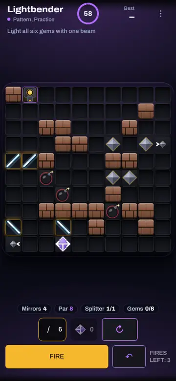 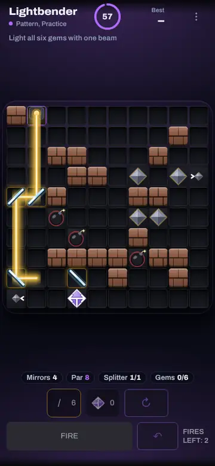 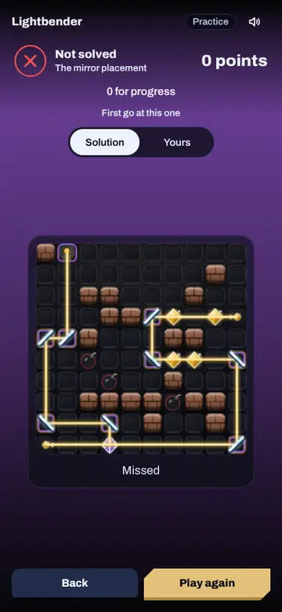

**Now.** Place mirrors and a splitter on a 10 × 10 grid to steer a beam through six gems (two light from one side
only), avoiding 3–4 bombs. 7–8 mirrors in the solution, 2 spare; three shots. 60 s.

| Action | Shows today | Sounds today |
|---|---|---|
| Place | Mirror animates in | `move` only |
| Tap a placed piece | Turns | `move` only |
| Illegal spot | Shake | `wrong` |
| Fire | Beam travels | gem tones rising, splitter |
| Bomb | Fizz, blast | `laser.bomb` |
| Miss | Beam fades after 1.5 s | `wrong` |
| Solve | Flare | solve + correct |

**Feedback.** Place: *drop/place* — a glass click. Turn: a crisp ratchet. Fire: *pour/flow* — the beam draws with
a hum, each gem it lights rings a rising note (today's best moment; keep it), the splitter a chord. Bomb: *wrong*,
loud but short. Five of six gems lit: *near-miss* ("1 gem dark"). Solve: *round-end payoff*.

**Changes.**
- The Gems pill counts only the shot on screen, so it falls back to 0 / 6 when the beam fades. Keep the best
  shot's count.
- Undo only removes the last placed piece; it doesn't undo turns or moves.
- After the third shot the board stays editable with nothing to do; only a tiny "Fires left: 0" says so.
- Full speed by 15 s of 60 is extremely tight.

**Difficulty.**
| Level | Mirrors | Spare | Bombs | Shots |
|---|---|---|---|---|
| Easy | 4–5 | 3 | 1–2 | 5 |
| Normal | 7–8 | 2 | 3–4 | 3 (today) |
| Hard | 8–9 | 1 | 4–5 | 3 |
| Expert | 9–10 | 0 | 5–6 | 2 |

## Topsy-Turvy

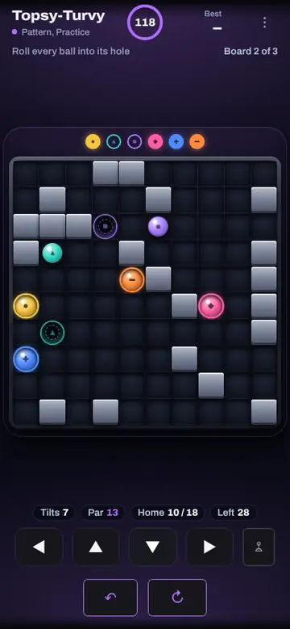 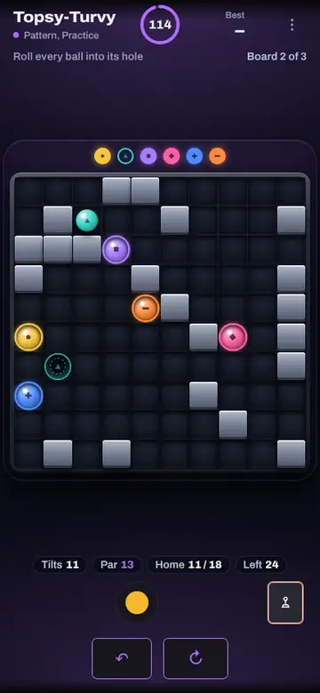 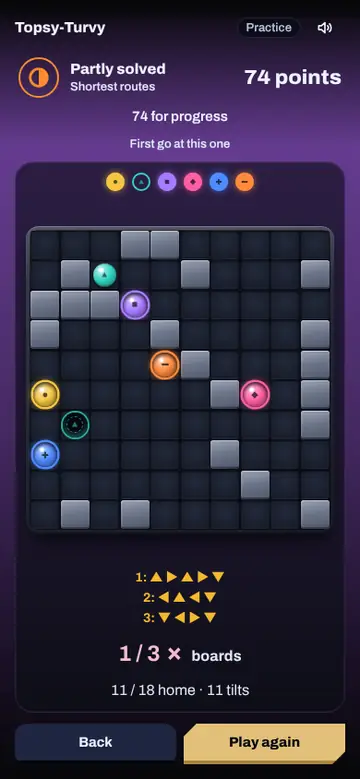

**Now.** Tilt a 10 × 10 tray so six balls roll into their own-colour holes; three boards in a row, each needing
4–7 tilts. A ball home blocks the others. Par shown. Dealt 120 s (the catalogue says 90).

| Action | Shows today | Sounds today |
|---|---|---|
| Arrow | Tray leans, balls roll | `pz_gravity_pull` + `move` |
| Tilt that moves nothing | Same | Same (not counted) |
| Ball home | Lock ring | `playLock` + `gravity.lock` |
| Board cleared | Hold, next board | `correct` |
| Out of tilts | Banner | Silent |
| Solve | Balls light in turn | `gravity.solve` |

**Feedback.** Tilt: *slide* — the tray leans and the balls roll with a rumble that lasts as long as they move,
each stopping with a click. Ball home: *drop/place* (a drop into the hole, a bright pip; two in one tilt a
*combo*). A tilt that moves nothing: only a small lean and no sound. Board cleared: *match/clear* (the tray flips
away). Out of tilts: a closing clunk.

**Changes.**
- The catalogue says 90 s; the deal carries 120 s. Fix the catalogue.
- Tilt limits are about twice what any player needs; they're worked out from an old route with stars.
- The Tilts pill counts every board and undone tilts.

**Difficulty.**
| Level | Balls | Boards | Minimum tilts |
|---|---|---|---|
| Easy | 3 | 2 | 2–4 |
| Normal | 6 | 3 | 4–7 (today) |
| Hard | 6 | 3 | 6–9, limit par + 4 |
| Expert | 8 | 3 | 7–10, limit par + 2 |
