# Retro: game reviews (phase 2, step 4)

This file reviews the ten live Retro games: Hover, Breaker, Rally, Wavefront, Fission, Tempo, Meteor, Spacewalk,
Pinball and Blockzone. No Retro game is retired.

The screenshots come from a local dev server on main dd9acbe6 (15 Nov 2026), in practice mode at 390 × 844, shrunk to
360 px wide:

- **Start** is the round intro.
- **Mid** is halfway through the round.
- **End** is the answer reveal.

The mid and end frames are each game's Near-perfect skill-band bot, played through the audit tool.

The rules for levels, stars and proved deals are the same as in `action.md`:

- Each level is a new stamp.
- 175+ earns a star on Easy, Normal or Hard, and a crown on Expert.
- 200 must stay reachable on every level.
- Rated play stays on Normal.

None of the ten games deals from a proved bank, so levels are cheaper here than in the other groups. Five of them
have no proof of 200 on every seed (audit issue 20), and that does not get worse with levels.

## Shared Retro findings

- **The intro stills don't match the game.** Hover, Breaker, Rally, Fission, Tempo, Meteor and Pinball show simple
  old drawings: magenta barriers, a blue wall, a pink circle. The live game looks quite different. Eight of the ten
  intro demos are stopped, and Blockzone has never had one. Replacing the stills with a real frame of today's game would
  be a cheap, quick win before any demo is recorded.
- **The core moments sound the least crafted.** Hover's gate, star and crash, Breaker's paddle, brick hit and ball
  lost, Rally's hit and miss, Fission's shot, hit and life lost, and Meteor's eat and crash have no recording of their
  own. Each falls back to a library `arc_retro_*` beep. Those are the sounds heard most, so they are worth recording
  first.
- **The HUD's side counts step down to 8 px** (`retroHud`). On a 375 px phone that is hard to read, and the pixel font
  makes it harder. A 10 px floor is suggested.
- **No Retro game shakes the screen.** That suits the rule against effects drawn over the board. The "physical"
  feedback the kit wants (squash, puff, flash on the thing that moved) is mostly missing.

## Summary

| Game | Biggest feedback win | Biggest change | Difficulty notes |
|---|---|---|---|
| Hover | A gate "pass" chime that rises along a run of clean gates | A crash ends the run, so weak players score about 5 | Easy: wider gaps and 3 shields; Expert: narrow gaps from the start |
| Breaker | A paddle "thock" and brick sounds of its own | **Too slow to clear**: the Near-perfect bot lost no ball and broke 72 of 108 bricks (93 points) | Easy: fewer rows; Expert: faster ball and more 3-hit bricks |
| Rally | A ball-warmth trail plus a pitch that rises with the rally | Spin pays nothing and nobody learns it | Easy: wider paddle that shrinks slower; Expert: earlier bumpers |
| Wavefront | A hit flash on each ship and a kill pop | Too little skill range (weak 144, flawless about 196) because firing is automatic | Easy: slower waves; Expert: more armour and divers from wave 2 |
| Fission | A bigger split pop and a "wasted shot" fizzle | Atoms are small and wave-clear bonuses are rarely earned (11 of 35 at Near-perfect) | Easy: 4 lives and bigger atoms; Expert: faster atoms |
| Tempo | A lane-colour hit burst on the line | A miss-heavy run can floor the core at 0 | Easy: wider windows and 4 lanes; Expert: faster fall time |
| Meteor | A "crunch" on each star with rising pitch inside the combo window | The core fills early (full at 28 stars), so the top skill levels bunch | Easy: slower and fewer rocks; Expert: more rocks and a quicker speed-up |
| Spacewalk | Already well served; add a hop puff | Core full at 76 against a Near-perfect median of 96 | Easy: thinner traffic; Expert: denser traffic from crossing 1 |
| Pinball | A flipper "clack" with a flash on the flipper | 200 is rare even for the flawless bot (a second J-O-U-L-Z set seldom fits in 90 s) | Easy: ball save and wider outlanes closed; Expert: 2 balls |
| Blockzone | A line-clear sweep and a lock "click" with a squash | Top-out has no haptic; the opening sound is missing | Easy: slower gravity and 5 previews; Expert: faster gravity and shorter lock delay |

---

## Hover (`hover`)

**Now.** A flappy saucer threads scrolling barrier gaps for 60 s. Tap or hold to rise. A crash ends the run.
Stamp `hoverRev 10`.

| Start | Mid-play | End |
|---|---|---|
| 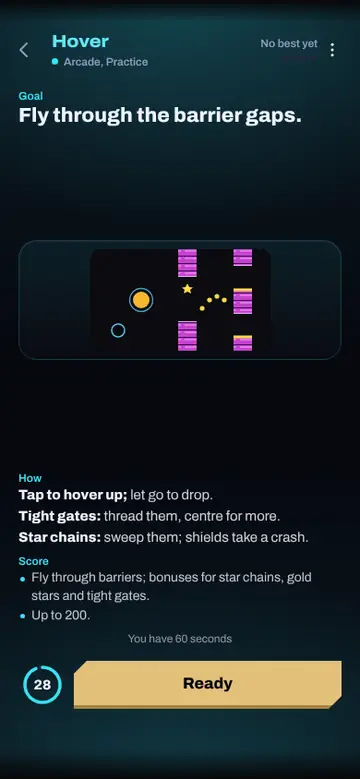 | 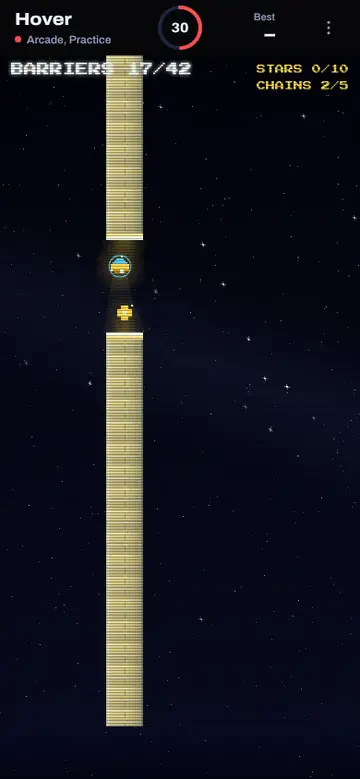 | 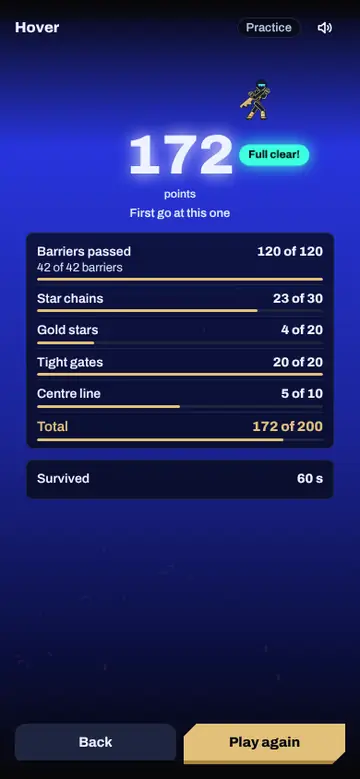 |

**What happens today.**
- Passing a barrier plays a library note.
- Gold stars and chains play library coins, with pops such as "GOLD STAR!", "STAR CHAIN!" and "TIGHT GATE!".
- Every 7th barrier shows a "ZONE n" banner with its own recording.
- A crash plays a library explosion, a red edge pulse and a haptic.

The mid frame shows how bare the screen is: one gold brick tower in a big starfield, and the saucer small.

**Feedback.**
- *Tap:* a tiny thrust flame under the saucer and a soft "puff" on each tap. The saucer tilts slightly up, then down
  as it falls.
- *Gate:* a clean chime that rises a step for each gate passed without touching the centre band's edges (combo).
- *Centre:* "DEAD CENTRE!" flashes the gate's rim.
- *Near-miss:* scraping within 3 px of a barrier gives sparks off the barrier and a "zing".
- *Shield:* it shatters visibly round the saucer, so the player knows a crash was saved.
- *Round-end payoff:* the saucer flies off the top with a whoosh, and the barrier count counts up.

**Changes.**
- One crash ends the run (audit issue 13: weak median 8). Suggest a third shield on every run, or three lives with a
  time cost. This needs a stamp.
- The HUD reads "STARS 0/10" at mid-play while the reveal counts gold stars as "4 of 20". Check what the HUD's STARS
  counts and give it the reveal's name.
- Record gate, star and crash.

**Difficulty.**

| | Easy | Normal | Hard | Expert |
|---|---|---|---|---|
| Gap start → minimum | 180 → 130 px | 150 → 100 | 140 → 90 | 130 → 85 |
| Scroll speed cap | 1,100 | 1,331 | 1,450 | 1,600 |
| Shields | 3 | 2 | 2 | 1 |
| Moving barriers from | barrier 30 | 23 | 16 | 10 |

---

## Breaker (`breaker`)

**Now.** A brick breaker on a 9 × 12 wall of 108 bricks, played for 90 s. Drag the paddle, and tap to fire a caught
power-up. Three gold bricks need 4 hits each. Stamp `brkRev 11`.

| Start | Mid-play | End |
|---|---|---|
| 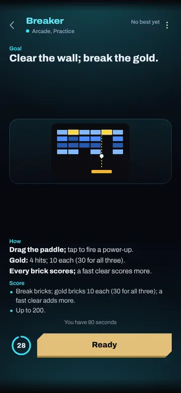 | 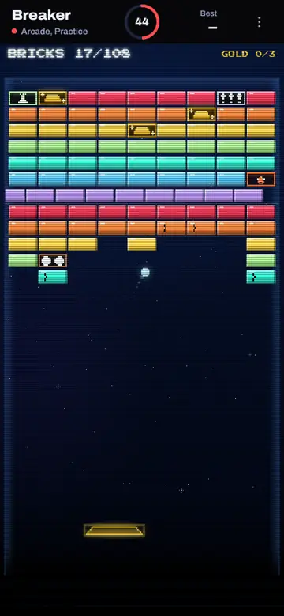 | 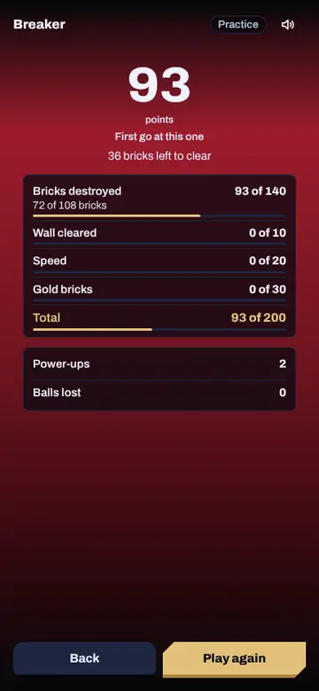 |

**What happens today.**
- A brick break plays a pixel burst with a shared file.
- Every 10 bricks, "ROW CLEAR!" shows with its own file.
- Paddle, brick hit, power-up and ball lost all play library sounds.

**Feedback.**
- *Paddle hit:* a "thock" pitched by where the ball struck, and a 2 px dip of the paddle.
- *Brick hit (not broken):* the brick flashes white and shows a crack, so 2- and 3-hit bricks read their state.
- *Break:* the burst as today, plus a pitch that steps up within a quick volley (combo).
- *Gold brick:* each of the 4 hits gets a deeper crack and a metallic "tang".
- *Power-up caught:* the capsule pops into an icon over the paddle, showing what tapping will fire.
- *Ball lost:* the ball fades with a falling tone, and the relaunch countdown (3 s) shows on the paddle.
- *Round-end payoff:* "WALL CLEARED!" with the remaining time turning into speed points.

**Changes.**
- **The wall is too much for the clock.** In this capture the Near-perfect bot lost no ball in 90 s and broke 72 of
  108 bricks: 93 points, 0 gold, no clear. At mid-play only 17 bricks were gone. The docs already note that the flawless
  bot reaches 200 on 3 of 30 seeds. Suggest one of:
  - fewer rows (9 × 9);
  - a faster starting ball;
  - the first few rows as single-hit bricks.

  Each needs a stamp and new bands.
- Record paddle, brick hit and ball lost.

**Difficulty.**

| | Easy | Normal | Hard | Expert |
|---|---|---|---|---|
| Rows | 8 | 12 (or the fix above) | 12 | 12 |
| Ball start → cap | 4.2 → 7.6 | 4.6 → 8.6 | 5.0 → 9.2 | 5.4 → 9.8 |
| Paddle | 100 px | 84 | 76 | 68 |
| 3-hit bricks | none | rows 12–18 | more | more |

- "Wall breaker" (clear the wall on Hard) is impossible today unless the pacing changes first.

---

## Rally (`rally`)

**Now.** Solo pong on a tall court, played for 60 s. Only gold balls score. Missing the blue ball ends the run. Pink
pads, gold targets and bumpers arrive over time, and a swipe at contact adds spin. Stamp `rallyRev 12`.

| Start | Mid-play | End |
|---|---|---|
| 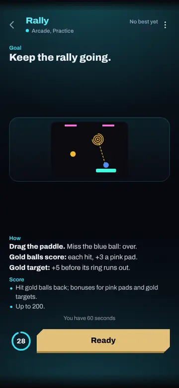 | 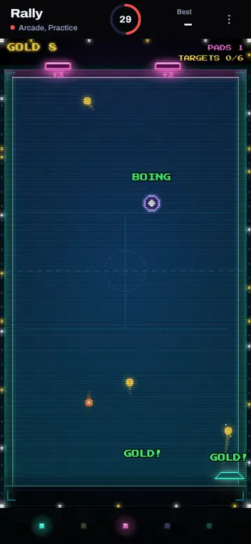 | 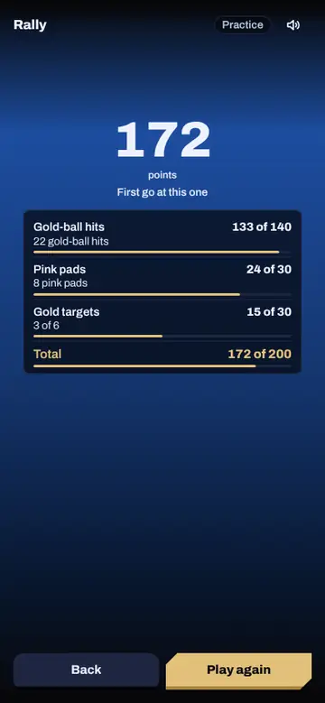 |

**What happens today.**
- A blue return lights a lamp and plays a library blip.
- A gold hit shows "GOLD!".
- Pads play their own file.
- A bumper shows "BOING".
- A miss plays a library explosion and a haptic.

**Feedback.**
- *Return:* a "pok" whose pitch rises with the rally count, and a paddle flash in the ball's colour.
- *Spin swipe:* a curl trail on the ball and a "fwip", so the player sees spin happen.
- *Gold:* a coin chime and the gold ball's trail.
- *Near-miss:* a ball caught by the paddle's last 4 px gets an edge spark.
- *Miss:* the ball drops past with a falling tone, then the run ends.
- *Round-end payoff:* the gold count counts up.

**Changes.**
- Spin does nothing for the score, and the bots never use it. Teach it with a target that only a curved shot can
  reach, or drop it from the help.
- The PADS and TARGETS counts top right are about 8 px.
- Bands are off target (weak 73, top bunched at 174–184).
- Record hit and miss.

**Difficulty.**

| | Easy | Normal | Hard | Expert |
|---|---|---|---|---|
| Paddle start → minimum | 140 → 60 px | 120 → 40 | 110 → 40 | 100 → 36 |
| Ball speed cap | × 1.9 | × 2.2 | × 2.4 | × 2.6 |
| Bumpers from | 45 s | 30 s / 45 s | 20 s / 35 s | 15 s / 30 s |

- "Rally king" (23 gold balls on Hard) must stay possible.

---

## Wavefront (`wavefront`)

**Now.** A gallery shooter played for 90 s. Drag to move, and the ship fires on its own. There are five formation
waves, a gunship after wave 3, a mothership boss and saucers. Stamp `wavRev 13`.

| Start | Mid-play | End |
|---|---|---|
| 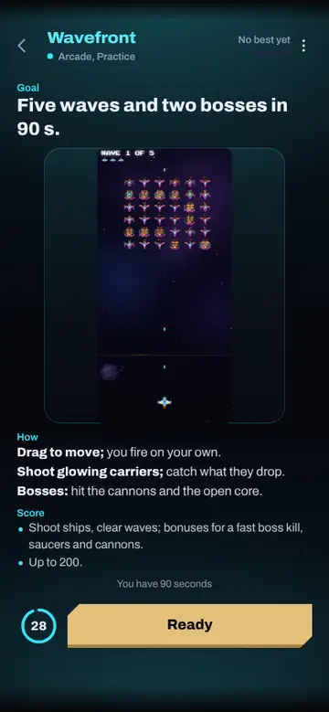 | 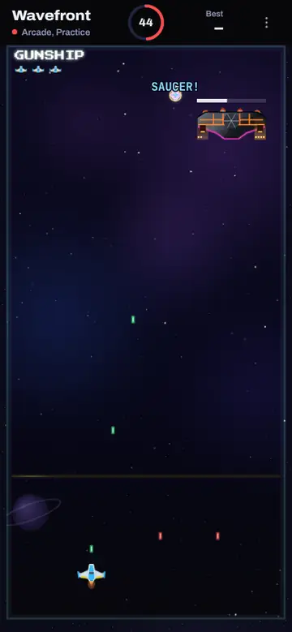 | 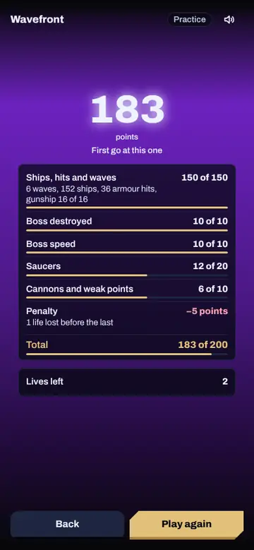 |

**What happens today.**
- Most events have files: fire, wave cleared, saucer, boss down, march and danger loop.
- Ship destroyed, big explosion, boss hit and life lost play library sounds.
- The intro still is a real game frame, the best intro in the group.

**Feedback.**
- *Hit (armour):* the ship flashes white and loses a plate visibly.
- *Kill:* a pixel burst plus a quick pitch-stepped pop per kill in a volley.
- *Weak point (cannon, core):* a gold flash and a heavier hit sound.
- *Power-up:* a ring round the player and a voice-like chirp.
- *Enemy bolt near-miss:* a bolt passing within 4 px flashes and plays a "zip".
- *Round-end payoff:* the boss explodes in stages, then "BOSS DOWN!" and the waves tally.

**Changes.**
- Firing is automatic, so one drag and then idle scores 15–37, and weak to flawless spans only 52 points (audit issue
  11). Options:
  - make firing a held button with heat;
  - make the core count accuracy.

  Both need a stamp.
- The mid frame is sparse: few ships, lots of empty space. The "Not done" list (larger hit cells, a wider formation)
  would fill it.
- **Possible bug:** the demo stop rule at `introDemo.functions.ts:165` accepts only `wavRev` 12, while rooms deal 13.

**Difficulty.**

| | Easy | Normal | Hard | Expert |
|---|---|---|---|---|
| Lives | 4 | 3 | 3 | 2 |
| Enemy bolt speed | 40 | 50 | 58 | 66 |
| Divers from | wave 4 | wave 3 | wave 2 | wave 1 |
| Boss HP | 28 | 36 | 42 | 48 |

- "Not a scratch" (boss with no life lost, Hard) must stay possible.

---

## Fission (`burst`)

**Now.** Bubble-splitting, played for 90 s. Walk with the ◀ ▶ buttons, and tap the arena to fire a beam up. There are
five fixed waves of 87 atoms and golden atoms, and wasted beams cost points. Stamp `burstRev 11`.

| Start | Mid-play | End |
|---|---|---|
| 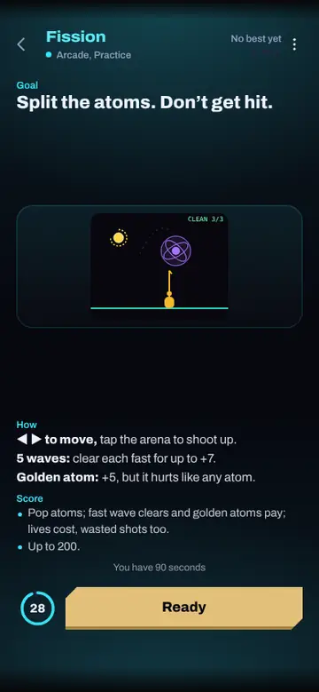 | 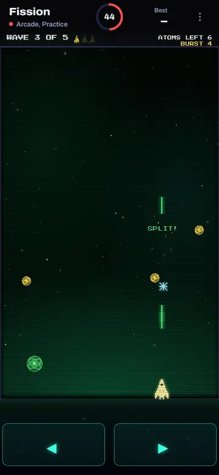 | 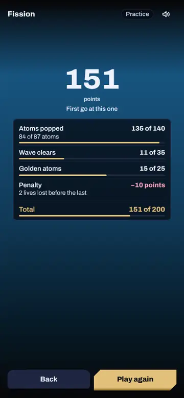 |

**What happens today.**
- A wave clear shows a light sweep with its own file.
- Shot, hit, power-ups and life lost play library sounds.
- A golden atom gives a gold flash.

**Feedback.**
- *Shot:* a beam that leaves a brief glow column.
- *Split:* the atom bursts into two with a "pop" that drops in pitch as the size gets smaller, and the halves kick
  apart.
- *Wasted beam* (reaches the ceiling with no hit, now a cost): a small fizzle at the ceiling and a dull "tsk", so the
  penalty is learnable.
- *Near-miss:* an atom passing just over the head gets a wobble and a hum.
- *Life lost:* a flash on the player and the life icon breaking.
- *Round-end payoff:* "WAVE n CLEARED" with the quick-clear bonus ticking in.

**Changes.**
- Atoms are drawn small (the smallest 8 px) in a tall arena. The "Not done" list already names larger atoms (a stamp).
- Wave clears pay only within a quick time. The Near-perfect bot popped 84 of 87 atoms yet earned 11 of 35. Either
  show the quick-clear timer on screen during each wave, or loosen it.
- The 76 px arrow row is fine, but walking with buttons while tapping the arena to shoot is a lot of thumbs. Suggest a
  drag-to-walk option.
- **Possible bug:** the demo stop rule at `introDemo.functions.ts:170` pins `burstRev` 10, while rooms deal 11.

**Difficulty.**

| | Easy | Normal | Hard | Expert |
|---|---|---|---|---|
| Lives | 4 | 3 | 3 | 2 |
| Atom radii | +25 % | 32 / 22 / 14 / 8 | today | today, faster bounce |
| Quick time per atom | 0.9 s | 0.6 s | 0.5 s | 0.45 s |
| Free wasted beams | 40 | 20 | 15 | 10 |

---

## Tempo (`beat`)

**Now.** A rhythm game on a 75 s song. Notes fall in four lanes, five from 40 s. There are taps, holds, swipe arrows,
double taps and a fever meter. Stamp `beatRev 11`.

| Start | Mid-play | End |
|---|---|---|
| 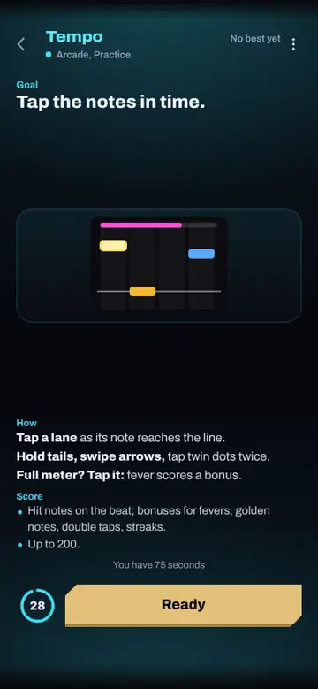 | 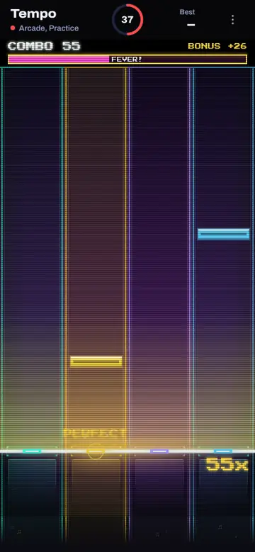 | 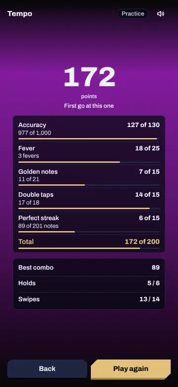 |

**What happens today.**
- Every hit plays an 8-bit note pitched by lane, flashes the lane and shows PERFECT, GOOD or OK.
- Misses and combo steps have files.
- The music is locked to the chart.

This is the best-served Retro game.

**Feedback.**
- *Hit:* a burst on the line in the lane's colour, sized by the judgement (Perfect bigger). The "PERFECT" word sits
  just above the line, not across the lanes.
- *Hold:* the tail glows while held and crackles on release.
- *Swipe:* an arrow streak in the swipe's direction.
- *Miss:* the note greys and drops through the line with a muted thud.
- *Combo:* the count grows with a subtle pulse every 10.
- *Fever:* the lanes warm to gold with a riser sound.
- *Round-end payoff:* "FULL COMBO!" if earned, then accuracy counting up.

**Changes.**
- Misses can floor the core at 0: a third of the notes Perfect gives 0, and every note OK gives 32 of 130 (audit issue
  12). Suggest an accuracy line that never goes under 0 per note.
- Taps with no note cost nothing, so mashing is free. Accuracy guards against it, but a light penalty would be clearer.
- There are no computer keys (an open decision for Joe). D F J K would be standard.

**Difficulty.** This is the clearest level ladder in the group.

| | Easy | Normal | Hard | Expert |
|---|---|---|---|---|
| Windows (Perfect / Good / OK) | 5 / 10 / 16 ticks | 4 / 8 / 13 | 3 / 7 / 11 | 3 / 6 / 9 |
| Fall time | 110 ticks | 90 | 75 | 60 |
| Lanes | 4 | 4 → 5 at 40 s | 5 from 20 s | 5 |
| Swipes and holds | fewer | today | more | more |

---

## Meteor (`snake`)

**Now.** Snake as a comet on a 19 × 34 field, played for 60 s. Swipe to turn. There are rocks that land after a red
shadow, wormholes, speed lanes and gold stars. A crash ends the run. Stamp `snakeRev 12`.

| Start | Mid-play | End |
|---|---|---|
| 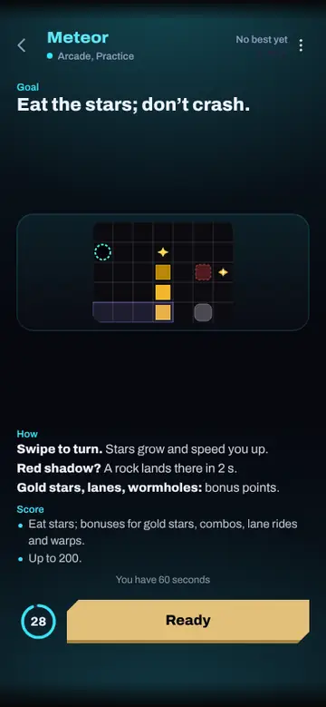 | 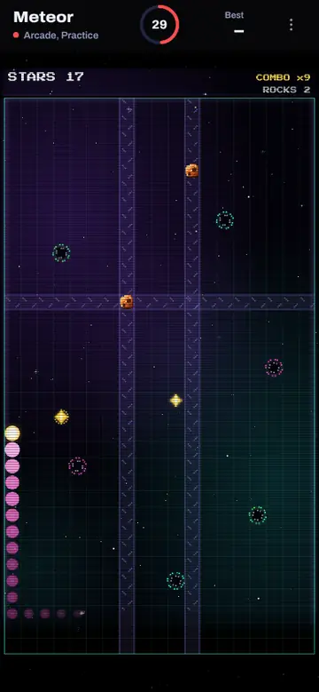 | 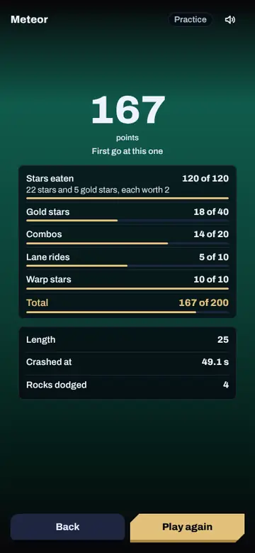 |

**What happens today.**
- Eating a star plays a library blip.
- Every 10 stars, the tail changes colour.
- A rock landing shows "DODGED!".
- A crash plays a library explosion.
- Gold stars, combos, lanes and warps have no sound of their own.
- The music is borrowed (`music_eatgrow`).

**Feedback.**
- *Turn:* a soft tick and a little flare at the head.
- *Eat:* a crunch with a pitch that rises inside the 3 s combo window (combo), and the tail growing one segment with
  a ripple.
- *Gold star:* a fading ring that shows how much it is still worth.
- *Lane ride:* a speed streak on the tail and a whoosh.
- *Warp:* the comet blinks out and in with a "vwoop".
- *Rock near-miss:* a rock landing next to the head gives a dust puff and a rumble.
- *Crash:* the comet breaks into segments.
- *Round-end payoff:* "ALL EATEN!", or the length counting up.

**Changes.**
- The core is full at 28 stars and 87 % of Near-perfect runs fill it, so the top levels are 5–9 apart (audit issue
  14). `snake.md`'s "Known limits" suggests core 110 and gold 50.
- The Near-perfect bot crashed at 49 s and still scored 167. A crash ending the run hurts weak players far more.
  Suggest a crash costing length and 3 s, with a run of three.
- Give Meteor its own music bed.

**Difficulty.**

| | Easy | Normal | Hard | Expert |
|---|---|---|---|---|
| Step 9 → min | 10 → 5 ticks | 9 → 4 | 8 → 4 | 8 → 3 |
| Rocks max | 6 | 11 | 14 | 16 |
| Rock warning | 3 s | 2 s | 1.6 s | 1.3 s |
| Shower | none | at 20 stars | at 15 | at 12, 5 rocks |

---

## Spacewalk (`cross`)

**Now.** A crossing game in pixel space, played for 60 s. Swipe up to hop. Cross the traffic lanes to the station deck
again and again, each crossing busier. There are three lives and a no-stop streak. Stamp `crossRev 12`.

| Start | Mid-play | End |
|---|---|---|
| 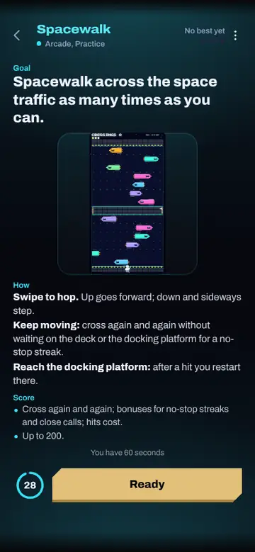 | 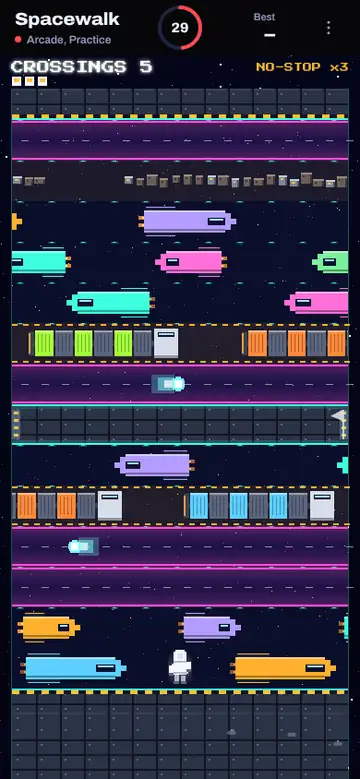 | 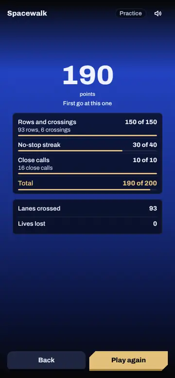 |

**What happens today.**
- Joe's November recordings cover hop, crossing, freighter, comets, debris, streak, close call and hit.
- Pops include "CLEAN CROSSING!", "NO-STOP ×n" and "CLOSE CALL!".

This is one of the best-served games for sound.

**Feedback.**
- *Hop:* a tiny jet puff under the astronaut and a 1-frame squash on landing.
- *Close call:* a white streak on the ship that passed, as well as the pop.
- *Crossing:* the deck lights up under the astronaut.
- *Streak:* a counter above the astronaut rather than mid-screen.
- *Round-end payoff:* the crossings tally.

**Changes.**
- The core is full at 76 units against a Near-perfect median of 96, so Near-perfect and above all max the core
  (audit issue 14). The bot here crossed 93 rows.
- The astronaut is small against the ships. That is fine for the game, but the hit box should read clearly: a faint
  ring at the feet.
- **Possible bug:** the demo stop rule (`introDemo.functions.ts:186`) pins `crossRev` 11, while rooms deal 12.

**Difficulty.**

| | Easy | Normal | Hard | Expert |
|---|---|---|---|---|
| First crossing density | 4/12 | 6/12 | 9/12 | 12/12 |
| Top density | 11/12 | 15/12 | 17/12 | 19/12 |
| Lives | 4 | 3 | 3 | 2 |
| Hit cost | 10 | 15 | 15 | 20 |

---

## Pinball (`pinball`)

**Now.** A full pinball table with three balls, played for 90 s. Hold the left or right half to flip. There are
J-O-U-L-Z lanes, two ramps, a lock and multiball, jackpots and a skill shot. Stamp `pinRev 6`.

| Start | Mid-play | End |
|---|---|---|
| 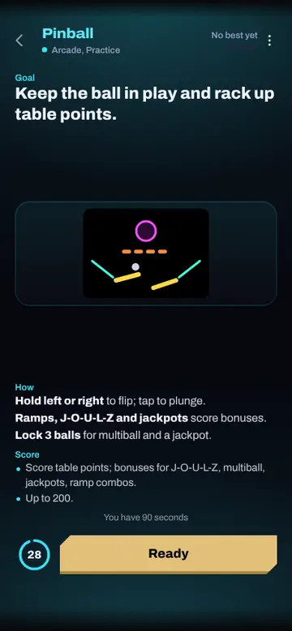 | 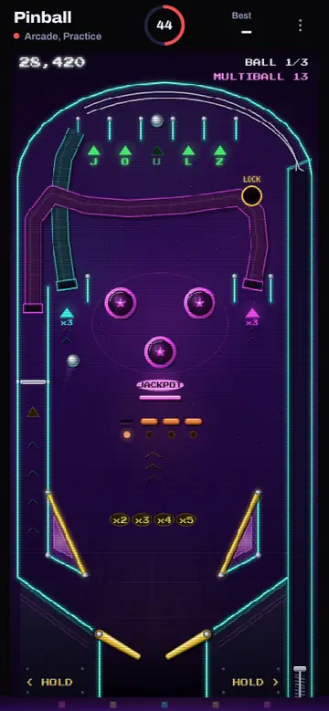 | 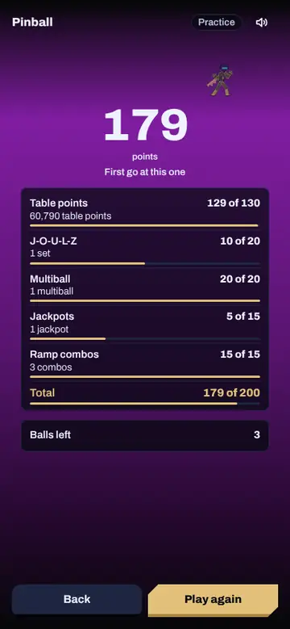 |

**What happens today.**
- Every slot has its own recording.
- Bumpers ripple the border lights.
- J-O-U-L-Z flashes the border gold three times.
- Lamps under the table follow the action.

**Feedback.**
- *Flipper:* a "clack" and a bright flash on the flipper face for 80 ms.
- *Bumper:* the cap flashes and swells 2 px.
- *Ramp:* the ramp's light chases the ball up.
- *Drain near-miss:* a save off the outlane post gets a spark.
- *Lock:* the lock lamp flares, with "BALL n LOCKED".
- *Round-end payoff:* the table points roll up, mechanical-counter style.

**Changes.**
- 200 is rare even for the flawless bot (median 190), because a second J-O-U-L-Z set seldom fits in 90 s. Suggest
  J-O-U-L-Z at 20 for one set.
- The help says "tap to plunge", but any press on the plunger launches it. Make the help say so.
- The table labels are still small at 390 wide.
- Minor: `ARCADE_FX_SPECS.pinball` points at rev-1 effects ("MULTIPLIER x"). Live play uses `PINBALL4_FX`.

**Difficulty.**

| | Easy | Normal | Hard | Expert |
|---|---|---|---|---|
| Balls | 4 + 10 s ball save | 3 | 3 | 2 |
| Gravity | 34 | 40 | 44 | 48 |
| Multiball | 25 s | 20 s | 18 s | 15 s |
| Core full at | 50,000 | 61,000 | 61,000 | 66,000 |

---

## Blockzone (`blockfall`)

**Now.** A falling-block puzzle in a 10 × 20 well, played for 90 s. Drag to move, tap to turn, drag down to soft-drop
and flick down to hard-drop. There are three previews and no hold. A top-out ends the run early. Stamp `blockfallRev 2`.

| Start | Mid-play | End |
|---|---|---|
| 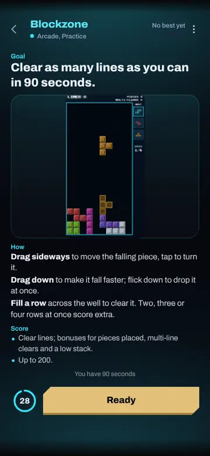 | 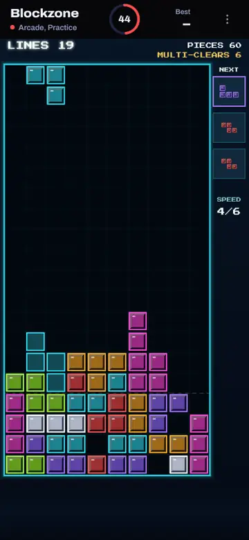 | 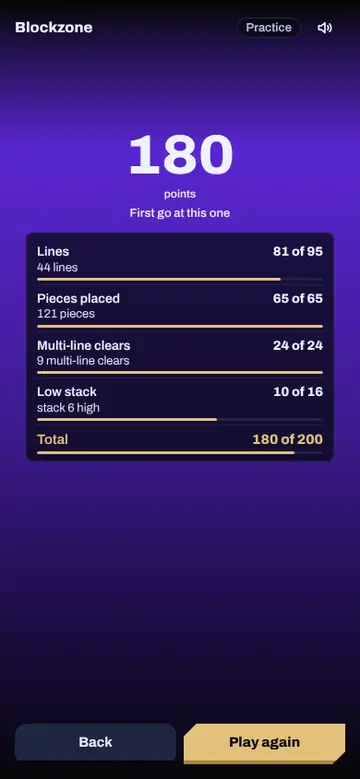 |

**What happens today.**
- Joe's files cover move, turn, lock, clear, big clear and top-out.
- Line clears flash with "+1", "n LINES!" or "FOUR AT ONCE!".
- A big clear gets the `success` haptic.
- The speed step is a library note.

**Feedback.**
- *Move and turn:* as today, plus a 1-frame outline flash on turn so a turn near a wall is clearly accepted or
  refused. A refused turn gets a dull "dunk".
- *Hard drop:* a streak from the piece's old spot down to where it lands.
- *Lock:* the piece flashes white for one frame with a squash on landing.
- *Clear:* a sweep across the row before it vanishes, with the rows above dropping visibly.
- *Near-miss* (stack within 3 rows of the top): the well's rim glows red with a heartbeat.
- *Round-end payoff:* the lines count up.

**Changes.**
- A top-out has no `impact` haptic, unlike the other nine games.
- There is no opening sound (`retroStart`), unlike the other nine.
- The intro still is from rev 1 (old colours). Record a demo.
- The "Great" level sits at 148 against a target of about 160 (left for beta data).
- Stale doc: `docs/sound-cues/moon-climb-blockzone.md` still lists library sounds.

**Difficulty.**

| | Easy | Normal | Hard | Expert |
|---|---|---|---|---|
| Gravity steps | 60 → 36 ticks | 48 → 24 | 40 → 18 | 30 → 12 |
| Lock delay | 40 ticks | 30 | 24 | 18 |
| Previews | 5 | 3 | 3 | 1 |
| Lines full at | 40 | 51 | 51 | 56 |
