# Speed: game reviews

Phase 2, step 4. 6 live games. Screenshots are phone size (390 × 844, shown at 360 px): **start** of play,
**mid-play** after a few taps, and the **round end** (a part-played run that ran out of time). Taken on a local
dev server through each game's `?game=` practice link; nothing in the app was changed. Bonk, Tenfall and Pull!
run on the arcade engine (canvas); their mid-play frames come from scripted taps, so they show a weak run.

Effects kit words used below: **tap, pick up, drop/place, slide, pour/flow, match/clear, wrong, combo/streak,
score count-up, near-miss, round-end payoff.** A physical action takes 900 ms at most and the next input is taken
at once.

## Summary

| Game | Biggest feedback win | Biggest change | Difficulty notes |
|---|---|---|---|
| Flash | A crisp hit sound with the reaction time (today only the generic tick) | Decoys and the gold flash are silent; that is right, keep it | Decoys, windows |
| Ascend | A rising note per right number | The every-15 s shuffle is nearly invisible and silent | Count, shuffle interval |
| Don't Break the Chain | Already the best feedback in the category | FASTER banner shows at the wrong links | Window lengths, reverse run |
| Bonk | A loud, clear rule-flip moment | Red-hat hits get no spark | Pop speed, flips, hedgehogs |
| Tenfall | A clear "ten!" when a target clears | Resets cost nothing on a finished run | Operators, speed |
| Pull! | A distinct gold-clay shatter | Quick-hit window near the edge is harsh | Speed, pairs, birds |

**Across the category**

- **Speed games live on sound timing.** Every hit must sound within one frame of the tap; the generic `move`
  is throttled to 60 ms, which is fine as a fallback but not as the main hit sound (Flash uses it today).
- **Streaks are the natural combo.** Chain (rising semitones) does this well; Flash, Ascend and Bonk could share
  that idea: each consecutive good tap a step up the scale, reset on a miss.
- **Arcade clocks.** Bonk, Tenfall and Pull! show run + 3 s in the catalogue (63, 93, 63); the runs are 60, 90, 60.

---

## Flash

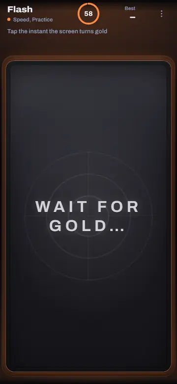 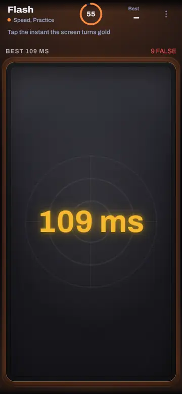 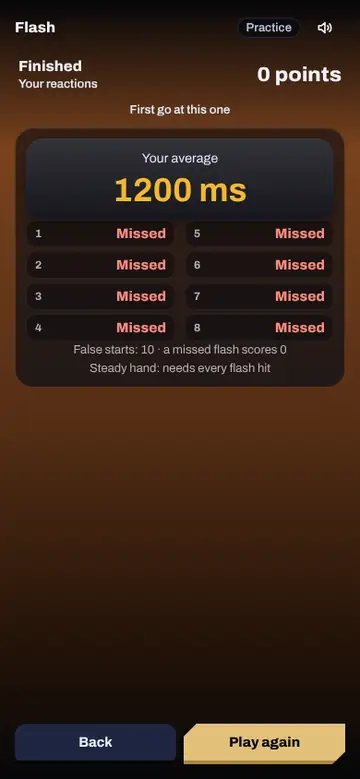

**Now.** Tap the moment the screen turns gold; 5–8 golds with 1–3 decoys before each (teal, red, blue, or
gold-like: light orange, a border, the word GOLD, half the screen). A tap within 100 ms is a false start.

| Action | Shows today | Sounds today |
|---|---|---|
| Gold appears / decoy / miss | Colour; "Missed" | Silent |
| Hit | "312 ms", ripple | `move` only |
| False start | Shake, "False start" | `shared.reject` |
| End, 120+ | Gold pulse | `reaction.goldPulse` |

**Feedback.** Keep the flashes silent (a sound would give the answer away). Hit: *tap* — a crisp, short snap
sound and the ms readout popping up, coloured by speed (under 250 ms gold). Three fast hits in a row: *combo*
tone climbing. A tap on a decoy: *wrong*, short. End: *score count-up* of the average with each flash's time
dropping in as a bar.

**Changes.**
- The hit sound is the generic move tick.
- The run ends at the last flash, well before 60 s, and the count is hidden by design; a "flashes left" would
  make it guessable, so keep it hidden, but end on a clear "Done" moment.

**Difficulty.**
| Level | Flashes | Decoys each | Gold-like decoys |
|---|---|---|---|
| Easy | 5 | 0–1 | None |
| Normal | 5–8 | 1–3 | Each kind once (today) |
| Hard | 6–8 | 2–3 | Weighted up |
| Expert | 8 | 2–4 | All kinds, gold shown 1 s |

## Ascend

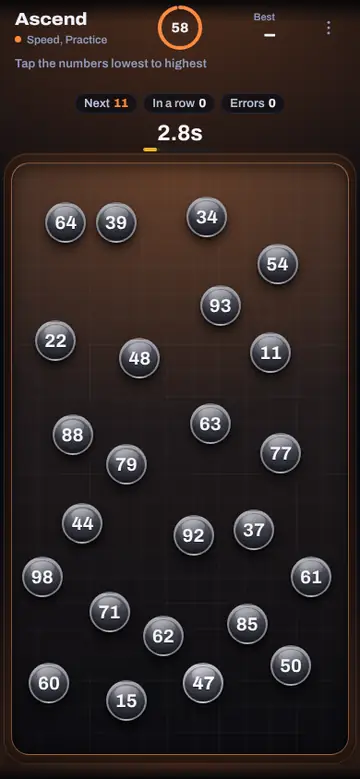 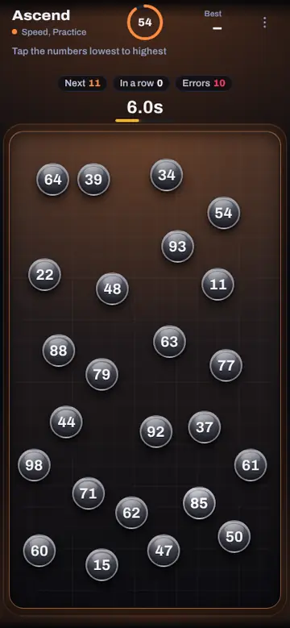 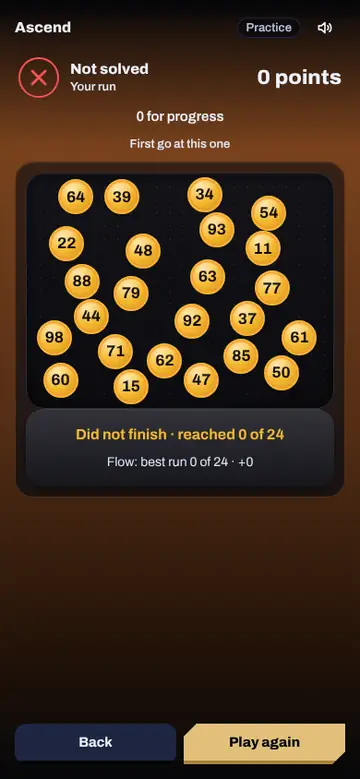

**Now.** Tap 24 numbers (10–99) in rising order; every disc moves to a new spot every 15 s. 60 s.

| Action | Shows today | Sounds today |
|---|---|---|
| Right tap | Disc turns gold, glow | quiet `tick` |
| Wrong | Red disc 200 ms, shake | `wrong` |
| Re-tap a done disc | Ignored | `move` |
| Shuffle | 200 ms pulse | Silent |
| Finish | Discs pop | `numhunt.discsPop` |

**Feedback.** Right tap: *tap* — a note a step higher each time (24 steps, two octaves), the disc stays gold.
Fast run of five: *combo*. Wrong: short *wrong* on that disc only. Shuffle: a clear *slide* — every disc glides to
its new place over 300 ms with a whoosh, and a 1 s warning ring before it. Finish: *round-end payoff* (discs pop
in order).

**Changes.**
- The shuffle is nearly invisible and silent; players lose their place without knowing why.
- Re-tapping a done disc still ticks; make it silent.
- The round-end board draws every disc gold even when none were reached, so it looks like a full clear. Draw
  reached discs gold and the rest grey.
- Help says untapped numbers move and tapped ones vanish; in fact every disc moves and tapped ones stay.

**Difficulty.**
| Level | Numbers | Shuffle |
|---|---|---|
| Easy | 16 (1–30) | none |
| Normal | 24 (10–99) | every 15 s (today) |
| Hard | 30 | every 10 s |
| Expert | 30, descending | every 8 s |

## Don't Break the Chain

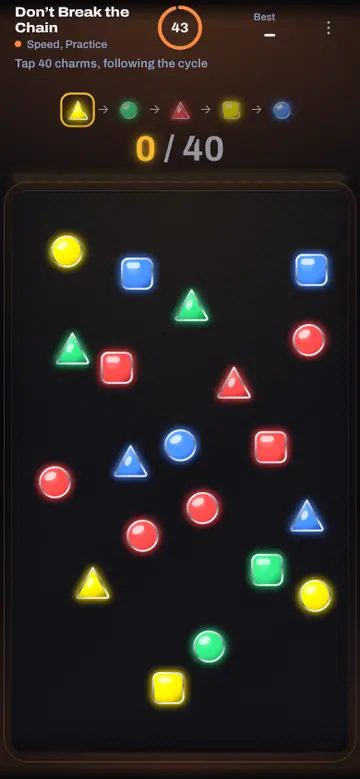 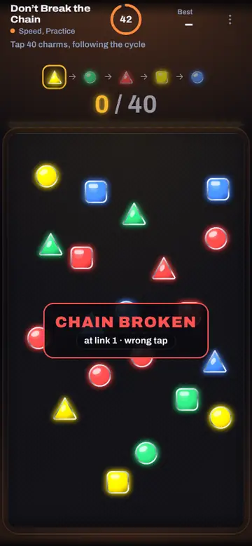 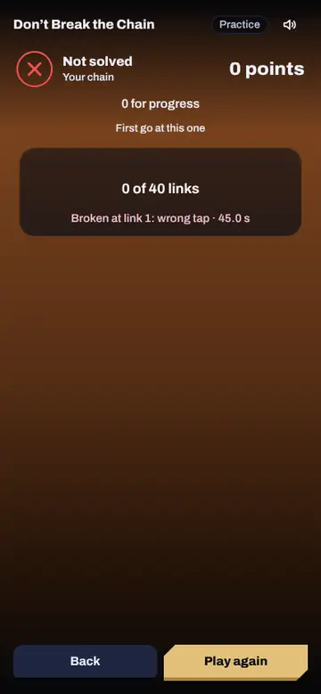

**Now.** Tap charms in a repeating five-charm cycle to make 40 links; the board reshuffles every 5 links, links
21–25 run in reverse, the window shrinks from 3 s to 2.5 s to 2 s. 45 s.

| Action | Shows today | Sounds today |
|---|---|---|
| Link | Glow, pulse | `chain.linkTone` rising a semitone |
| Warning | Ticks at 500 / 250 ms | ticks |
| FASTER / reverse | Banner | `chain.faster` / `chain.reverse` |
| Break | Chain falls, red | `chain.breakTone` |
| Reshuffle | 650 ms preview | Silent |
| Finish | Shine | `chain.finishShine` |

**Feedback.** Already strong: rising tones are a natural *combo*, the break is a clear *wrong*. Add: a soft
*slide* whoosh when the board reshuffles, and on the last 5 links a heartbeat under the tones (*near-miss*
tension).

**Changes.**
- The "CHAIN BROKEN" banner is drawn over the middle of the board while the round still runs; the style guide
  keeps effects off the board. Put it on the chain strip at the top.
- The FASTER banner fires at links 10, 20 and 30, but the window actually shrinks at 14 and 27. Show it when it
  happens.

**Difficulty.**
| Level | Links | Windows | Reverse |
|---|---|---|---|
| Easy | 30 | 3.5 / 3 / 2.5 s | none |
| Normal | 40 | 3 / 2.5 / 2 s (today) | links 21–25 |
| Hard | 40 | 2.5 / 2 / 1.6 s | 21–25 and 31–35 |
| Expert | 50 | 2 / 1.6 / 1.3 s | two reverse runs, look-alike colours |

## Bonk

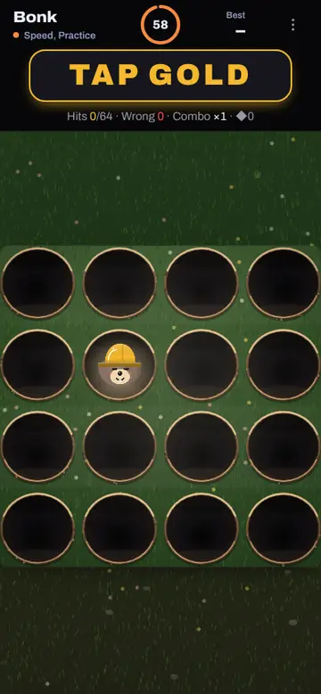 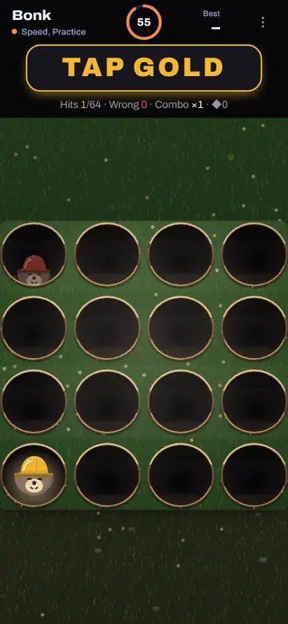 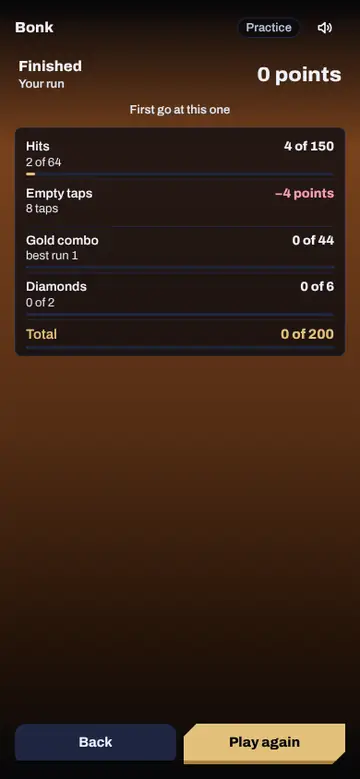

**Now.** Whack-a-mole on a 4 × 4 grid: bonk gophers wearing the named hat colour (gold or red); the rule flips
3–5 times. Hedgehogs (don't), two diamonds (bonus). Gophers get quicker. 60 s run.

| Action | Shows today | Sounds today |
|---|---|---|
| Right hit | Gold ring, glow | `correct` |
| Wrong hat | Red flash | `wrong` |
| Hedgehog | — | explosion |
| Empty burrow | — | `whack.emptyTap` |
| Pop up / sink | — | pop / sink |
| Diamond | — | pitched chime |
| Rule flip | Banner scales 400 ms, ring | `tick` only |

**Feedback.** Hit: *tap* — a cartoon bonk, the gopher squashes, a spark. Combo: rising bonks (exists as
`bonkStreak`). Rule flip: the key event deserves the biggest cue in the game — a whistle, the banner slams in
over the top for 600 ms, the hat colour flashes on every burrow rim (outside the gophers, so the board stays
readable). Hedgehog: *wrong*, heavy. Diamond: sparkle.

**Changes.**
- The success spark draws only for gold-hat targets, so correct red-hat hits get none.
- The rule flip is a tick and a small banner; easy to miss.
- The screenshots show four rows of eight burrows, with the outer ones cut off by the screen's edges, though the
  game has a 4 × 4 grid. The scenery round the world appears to paint extra burrows that look just like the real
  ones. Players will tap them. Keep decoration clearly different from anything tappable.

**Difficulty.**
| Level | Up time | Max up | Flips | Hedgehogs |
|---|---|---|---|---|
| Easy | 1.1 → 0.8 s | 2 | 2 | 5 % |
| Normal | 0.9 → 0.6 s | 3 | 3–5 (today) | 10 % |
| Hard | 0.8 → 0.5 s | 3 | 5–7 | 15 % |
| Expert | 0.7 → 0.45 s | 4 | 7–9 | 20 % |

## Tenfall

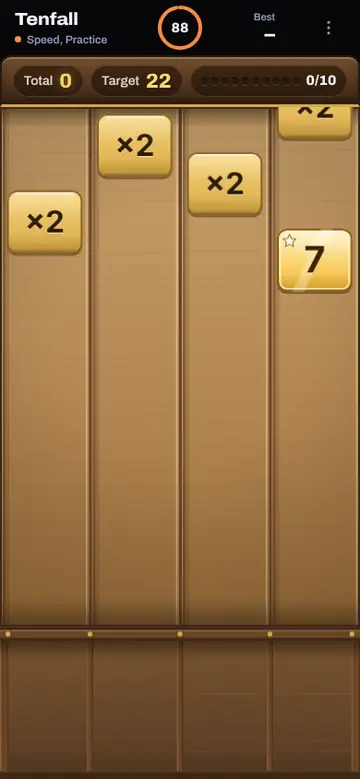 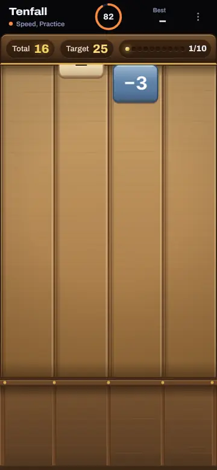 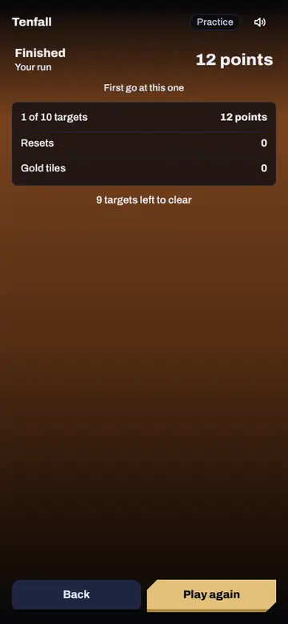

**Now.** Number tiles fall in four columns; tap them to change a running total (×2, ÷2, ÷3, −n…) until it
equals the target. Ten targets, rising from about 20 to 140. Overshooting resets the total to 0. 90 s run.

| Action | Shows today | Sounds today |
|---|---|---|
| Apply | Total changes | `tendrop.apply` |
| Target hit | Gold hold | `correct` + `tendrop.clear` |
| Overshoot | Red flash | `wrong` + `tendrop.reset` |
| Refused (÷ not exact) | Shake | `tick` |
| Gold ten | — | `tendrop.ten` |
| Empty tap | — | Silent |

**Feedback.** Apply: *tap* plus a *score count-up* of the total (fast ticks to the new value). Within 5 of the
target: *near-miss* glow on the target. Hit: *match/clear* — the total and target collide, "TEN!" style burst,
the next target drops in. Overshoot: *wrong*, the total shatters to 0.

**Changes.**
- Resets cost nothing on a finished run.
- An empty tap is silent; a soft tap is enough.
- Tiles entering at the top are cut off under the HUD strip; they should appear below it.

**Difficulty.**
| Level | Targets | Operators | Speed |
|---|---|---|---|
| Easy | 8, up to 60 | + and − only | slow |
| Normal | 10, up to 140 | today's mix | today |
| Hard | 10, up to 200 | more ÷3 | +15 % |
| Expert | 12, up to 300 | all | +30 % |

## Pull!

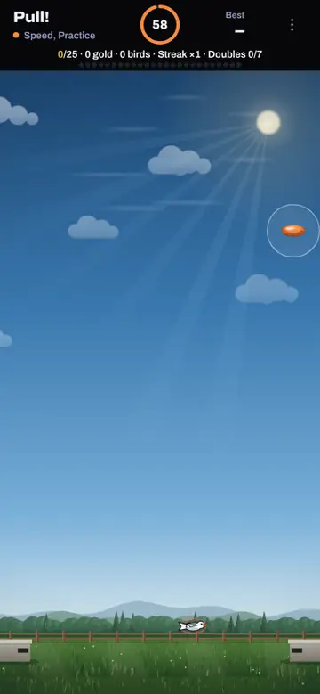 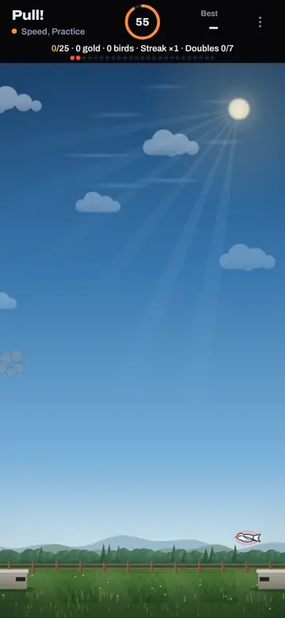 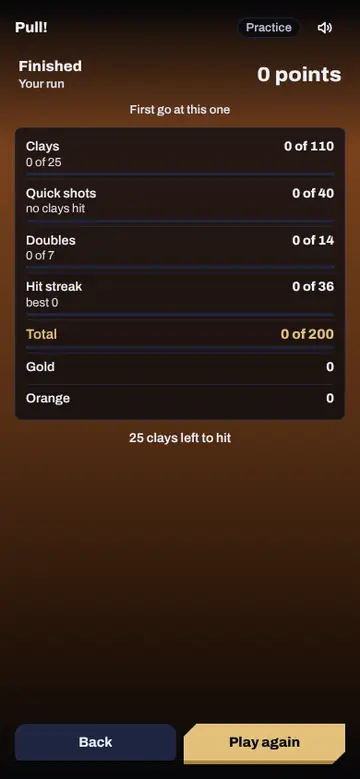

**Now.** Clay pigeon shooting: tap clays (22 orange, 3 faster gold) as they fly; 11 singles then 7 pairs. Don't
hit the 14–16 birds. 60 s run.

| Action | Shows today | Sounds today |
|---|---|---|
| Launch | — | `clay.launch` |
| Hit | Shards | `pz_clay_hit` |
| Gold hit | Shards | same as orange |
| Empty shot | Puff | `missPuff` |
| Bird | Feathers | startle |
| Double | Banner | `banner.combo` |

**Feedback.** Hit: *tap* — gunshot and shatter in one, shards in the clay's colour. Gold: a brighter shatter and
a chime (today identical to orange). Double: *combo* (exists). Clay escaping: a soft *near-miss* whistle as it
leaves. Bird: *wrong*, feathers (keep).

**Changes.**
- Gold hits sound the same as orange.
- The HUD is one line of small text ("0/25 · 0 gold · 0 birds · Streak ×1 · Doubles 0/7"); hard to read mid-shot.
  Show the two numbers that matter (clays, streak) as pills and leave the rest for the reveal.
- Full quick-hit credit needs a hit within 0.25 s of launch, which means near the edge of the screen. Harsh.

**Difficulty.**
| Level | Clays | Pairs | Birds | Speed |
|---|---|---|---|---|
| Easy | 20 | 3 | 6 | −20 % |
| Normal | 25 | 7 | 14–16 | today |
| Hard | 28 | 10 | 16, overlapping | +10 % |
| Expert | 30 | 12, some triples | 18 | +20 % |
