# Sports: game reviews (phase 2, step 4)

The Sports group has six live games: Crazy Golf, Cue Ball, Curl Champ, Home Run, Top Bins and Apex. Ringer, Swish and
Flightpath are retired, so they are not reviewed. Pull! is a Speed game that is also listed in Sports; it is reviewed
with Speed, and there is a note at the end.

**Screenshots.** Taken on a local dev server on main dd9acbe6 (15 Nov 2026), in practice mode at 390 × 844, shrunk to
360 px wide:
- **Start** is the round intro.
- **Mid** is the halfway point.
- **End** is the reveal.

The Near-perfect skill-band bot played every run.

**Level rules.** These are the same as in `action.md`:
- Each level is a new stamp.
- A score of 175 or more earns a star, or a crown on Expert.
- 200 must stay reachable on every level.
- Rated play stays on Normal.

**Proved deals.** Every Sports game deals from a proved bank or deal, so a level that changes play needs its own
re-proved bank. That is the main cost of levels here. Crazy Golf's bank, for example, takes about 50 minutes on
4 jobs. Aiming aids that only change what is drawn need no stamp, so the cheapest way to make a level easier is
often a longer preview line, not new physics.

## Shared Sports findings

- **Sound is the strongest of any group.** Batch 6 gave every game crowd loops, strikes, pots, goals and roars.
  Only Home Run's swing and Apex's clean sector fall back to library sounds.
- **The intro stills are old views.** Home Run's shows the earlier side-on batter, Curl Champ's a plain sheet and
  Crazy Golf's a single flat hole. None of the six intro demos has been recorded.
- **Haptics are patchy.** Cue Ball has haptics for pots and fouls, Top Bins and Home Run for goals and home runs,
  and Apex for a wall hit. Crazy Golf and Curl Champ have none.

## Summary

| Game | Biggest feedback win | Biggest change | Difficulty notes |
|---|---|---|---|
| Crazy Golf | A first-bounce preview and a cup "rattle" before a hole | The aim line doesn't predict bounces on a course built round bounces | Easy: a longer aim line with a first bounce; Expert: windmills faster. Bank per level. |
| Cue Ball | Show side spin on the preview; the pocket "drop" is good | The black was potted too soon in a Near-perfect run, so the rule needs to be clearer on the table | Easy: a longer ghost line; Expert: no cue-ball path. Bank per level. |
| Curl Champ | Sweep strokes drawn on the ice in front of the stone | The house view sits over the crowd and is small; Throw stays live while a stone travels | Easy: reds further out; Expert: reds closer. Costly to re-prove. |
| Home Run | Record the swing; show a ball-flight trail to the spot | The sign labels and YOUR SPOT text are tiny | Easy: a ±1-tick PERFECT window; Expert: faster pitches. Deal per level. |
| Top Bins | A net bulge and a keeper dive that read at a glance | The pixel-font hint ("DRAW THE SHOT FROM THE BALL") is out of style | Easy: a wider gold zone; Expert: a quicker keeper. Deal per level. |
| Apex | Speed lines and a rumble on kerbs | The car is small at the bottom; record the clean-sector sound | Easy: softer gravel and lower signs; Expert: no signs. Deal per level. |

---

## Crazy Golf (`minigolf`)

**Now.** Five crazy-golf holes seen from above, with a windmill, tunnels, sand, a dome hill, banked curves and a
castle gate. Pull back from the ball and let go to putt. 120 s, stamp `golfRev 2`, stroke limit par + 3.

| Start | Mid-play | End |
|---|---|---|
| 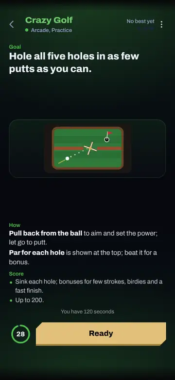 | 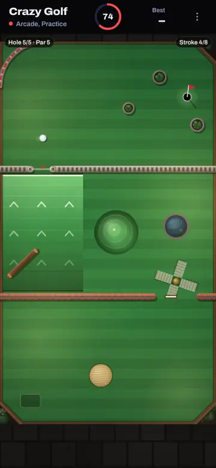 | 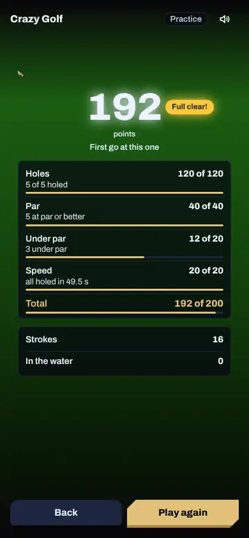 |

**What happens today.**
- *Aiming:* a straight dotted line, a gold pull handle and a % pill that goes from green to red.
- *Sounds:* putt, roll loop, rail bounce, boulder, bush, water, holed and birdie all have files.
- *Pops:* "PAR", "BIRDIE!", "EAGLE!" and "HOLE IN ONE!" at the cup.
- *Haptics:* none.

**Feedback.**
- *Aim (pick up):* the pull handle stretches a rubber band from the ball, and its tone rises slightly with power. On
  Easy the line shows its first bounce.
- *Putt:* a short "tock", and the ball's speed shown as a faint trail.
- *Bounce:* a small white flash on the rail with the click it already makes.
- *Near-miss:* a ball that rolls over the cup's lip makes a "rattle" and wobbles.
- *Holed:* the ball drops with the flag lifting, a 3-frame confetti burst on a birdie or better, and a `success`
  haptic.
- *Water:* a splash ring and a "plip". The ball re-spots with a fade.
- *Round-end payoff:* the scorecard row for the five holes fills in, with par and strokes.

**Changes.**
- The aim line is straight and doesn't predict bounces, yet the holes are built round bounces. A first-bounce preview
  is display only.
- The desktop comment says "W/S the power", but only the arrow keys work (`src/puzzles/minigolf.tsx:138`).
- Hole and stroke text ("Hole 5/5 · Par 5", "Stroke 4/8") is about 9 px top-left and top-right.

**Difficulty.**

| | Easy | Normal | Hard | Expert |
|---|---|---|---|---|
| Aim preview | first bounce | straight | straight, shorter | straight, shortest |
| Stroke limit | par + 4 | par + 3 | par + 3 | par + 2 |
| Windmill | slower | today | today | faster |
| Speed full by | 60 s | 53 s | 50 s | 45 s |

- "Under, under" (hole all five under par on Hard) must stay possible.

---

## Cue Ball (`pool`)

**Now.** Pool solo. The seed gives you spots or stripes: pot your seven, then the black. Drag to turn the cue, pull
the meter to shoot and place spin on a large cue ball. 90 s, stamp `poolRev 4`.

| Start | Mid-play | End |
|---|---|---|
| 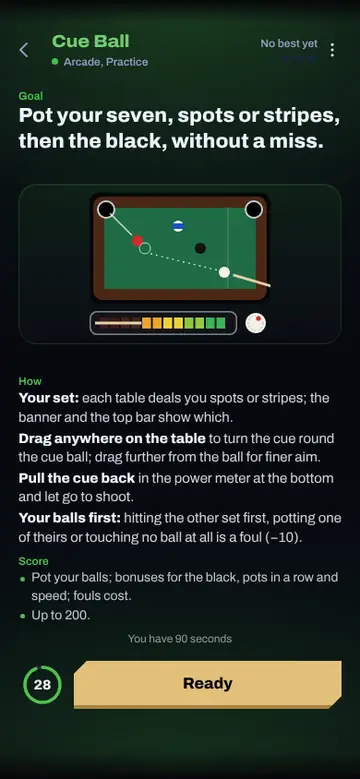 | 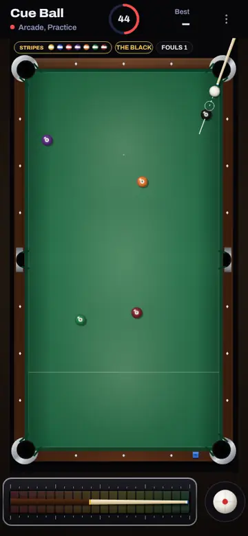 | 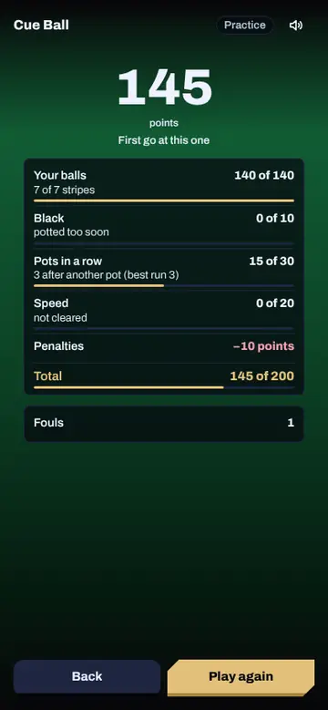 |

**What happens today.**
- *Aiming:* a ghost ball, the object ball's line and the cue ball's line after contact, bent for follow and draw.
  Side spin is not shown.
- *Shot:* the cue draws back as you pull, and pots drop into the pocket.
- *Sounds:* chalk, soft or hard strike, click, cushion, pocket, foul and black all have files.
- *Pops:* "n IN A ROW", "NOW THE BLACK", "CLEARED!".
- *Haptics:* on pots and fouls.

**Feedback.**
- *Aim:* the preview as today, plus the side-spin bend.
- *Strike:* the cue's thrust with a short screen-free "crack" and a chalk puff.
- *Ball contact:* a tiny flash at the contact point.
- *Pot:* as today, the drop is good. Add the ball flying to the HUD rack.
- *Near-miss:* a jaw rattle off a pocket point plays a "clatter" and the ball shivers.
- *Foul:* the cue ball glows red, and "FOUL −10" shows by the ball, not mid-table.
- *Streak:* the "IN A ROW" count grows by the rack.
- *Round-end payoff:* the black drops, then "CLEARED!" with the speed time.

**Changes.**
- In this run the Near-perfect bot potted all 7 but then "Black: potted too soon" (0 of 10), with 0 speed and
  a foul. The rule is right, but players need to see it on the table: dim the black until your seven are down,
  with "NOW THE BLACK" lighting it.
- Show side spin in the preview.
- The doc's parts table (`pool.md:146`) still shows rev 1–2 values.
- Open decisions for Joe in the doc: the core is full at 5 of 7, and a miss foul costs −5.

**Difficulty.**

| | Easy | Normal | Hard | Expert |
|---|---|---|---|---|
| Preview line | long, with object ball path | today | object ball line shorter | ghost ball only |
| Spin strength | today | 1.75× | 1.75× | 1.75× |
| Foul cost | 5 | 10 | 10 | 15 |
| Clock | 120 s | 90 s | 90 s | 75 s |

---

## Curl Champ (`curling`)

**Now.** Throw eight stones against three seeded red stones in the house. Slide along the hog line, drag the target,
pick In or Out, set the power bar and Throw, then brush left or right while the stone travels. A stone counts only if
it lies nearer the button than every red. 120 s, stamp `curlRev 4`.

| Start | Mid-play | End |
|---|---|---|
| 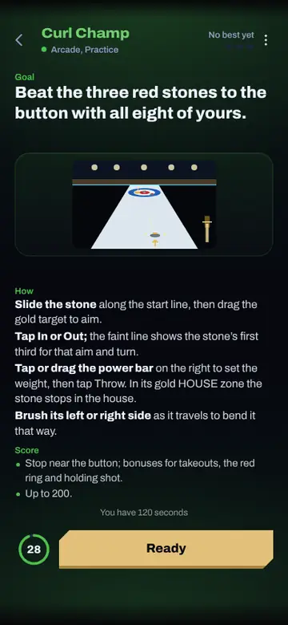 | 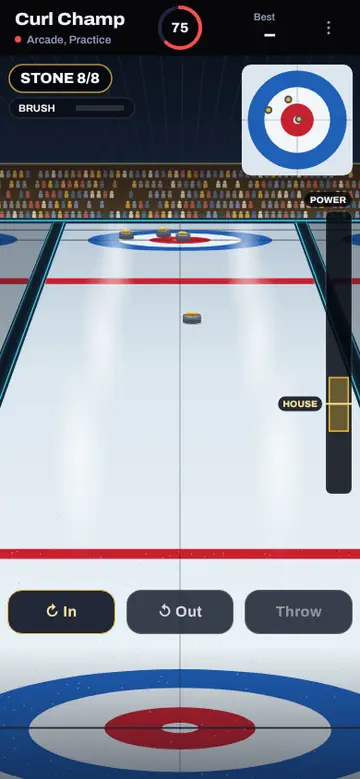 | 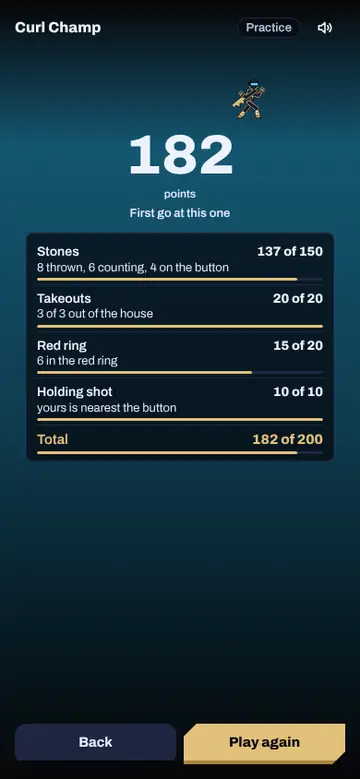 |

**What happens today.**
- *Aiming:* a faint aim line for the first third, and a gold HOUSE zone on the power bar.
- *Sounds:* release, slide loop, sweep loop, hit, boards, applause and shot stone all have files.
- *Pops:* "ON THE BUTTON!", "TAKEOUT!", "SHOT STONE!".
- *Haptics:* none.

**Feedback.**
- *Power set:* the bar's marker clicks into place with a notch tone, louder in the HOUSE zone.
- *Throw (slide):* the slide loop as today, plus faint sweep strokes drawn on the ice ahead of the stone while
  brushing, so the bend has a cause.
- *Hit:* a "clack", with the red stone's slide and a ring where they met.
- *Takeout:* the red slides off with a crowd "ooh".
- *Counting:* when a stone comes to rest counting, draw a ring from the button to it in gold.
- *Near-miss:* a stone stopping just outside counting gets a grey ring and a soft "aw".
- *Round-end payoff:* the house view zooms, and counting stones light one by one with ticks.

**Changes.**
- The small house view (top-right) sits over the crowd and is the only place the result reads clearly. Draw it
  larger, or zoom the main view to the house as the stone stops.
- Throw stays enabled while a stone travels, though it does nothing then. Grey it out.
- The power bar is 22 × 300 px on the right edge, tight for a thumb. Its marker drag works, but a wider grab
  area would help.
- The intro demo needs recording, and a stale comment sits at `sportsFx.renderer.ts:148`.

**Difficulty.** Re-proving is costly: curlRev 4 kept only 66 of 140 candidates.

| | Easy | Normal | Hard | Expert |
|---|---|---|---|---|
| Reds from the button | 60–130 cm | 35–110 | 30–90 | 20–70 |
| HOUSE zone on the bar | shown | shown | shown | hidden |
| Aim line | full path | first third | first third | none |
| Zero at | 140 cm | 120 | 120 | 100 |

---

## Home Run (`homerun`)

**Now.** Ten pitches. Before each one, tap a spot on the field or stands, then tap again as the ring closes on the
ball. Perfect timing sends the ball to your spot; early pulls it left and late pushes it right and short. Fielders
catch anything that lands in their circles, and one sign is lit as the bonus. 60 s, stamp `homerunRev 4`.

| Start | Mid-play | End |
|---|---|---|
| 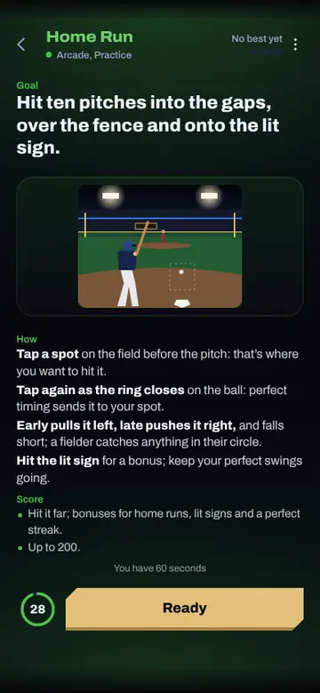 | 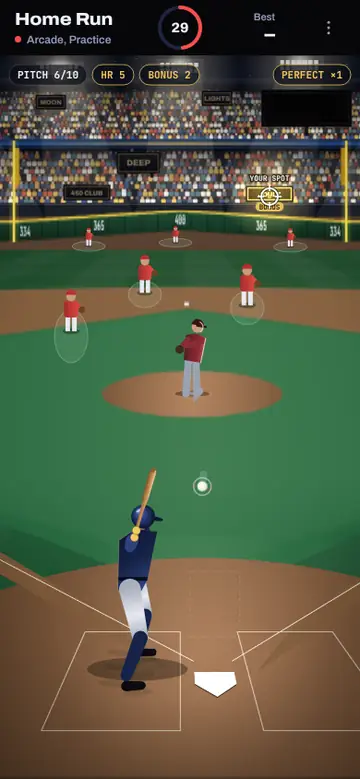 | 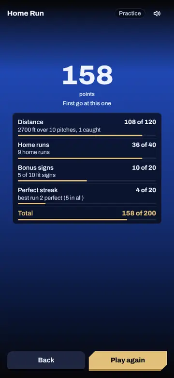 |

**What happens today.**
- *Before the swing:* a closing ring on the ball, the pitch name and the YOUR SPOT reticle (red "· FIELDER" when it
  sits in a catch circle).
- *After the swing:* an EARLY / PERFECT / LATE chip and a call banner along the bottom.
- *Sounds:* crowd, pitch, crack, homer and roar, sign, foul, catch and groan, whiff and strike all have files. The
  swing itself has no file and plays a library tap.
- *Haptics:* on a home run.

**Feedback.**
- *Spot (place):* the reticle drops with a "thunk" and a short pulse.
- *Swing:* record a bat whoosh. The bat trail shows for 3 frames.
- *Contact:* the crack as today, plus a white flash at the contact point sized by timing quality.
- *Flight (flow):* a trail from the plate to where the ball lands, with the spot reticle to compare. That is the
  whole skill, and today it is hard to follow.
- *Sign:* the sign lights up and shakes.
- *Caught:* the fielder's glove closes, with the groan.
- *Perfect streak:* the "PERFECT ×n" chip grows and climbs a note.
- *Round-end payoff:* the ten landing spots shown together on the field, then distance counting up.

**Changes.**
- The sign labels (MOON, LIGHTS, DEEP…) and "YOUR SPOT" draw at about 7–8 px. Make them larger.
- Spot depth is coarse on a phone (about 10 ft a pixel at 300 ft).
- The intro still shows the older side-on batter.
- PERFECT is the exact tick (17 ms), an open decision in the doc. ±1 tick would lift Near-perfect to 194.

**Difficulty.**

| | Easy | Normal | Hard | Expert |
|---|---|---|---|---|
| PERFECT window | ±1 tick | exact | exact | exact |
| On-spot window | ±2 ticks | ±1 | ±1 | exact |
| Fielder circles | smaller | today | today | larger |
| Pitches | fastballs and changeups | mixed | mixed, faster | faster, more bend |

---

## Top Bins (`freekick`)

**Now.** Ten free kicks. Draw one stroke out from the ball: where it ends sets the target, and how it bends sets the
curl. Then hold the power bar and release in the gold. The gold corner hoop shrinks kick by kick. 90 s, stamp
`freekickRev 4`.

| Start | Mid-play | End |
|---|---|---|
| 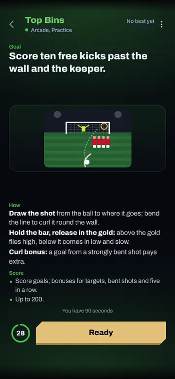 | 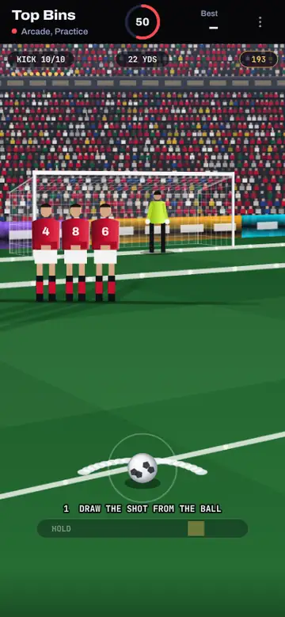 | 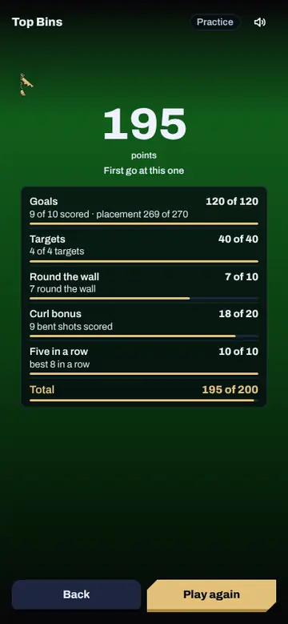 |

**What happens today.**
- *Stroke:* bright while drawing, then faint and dashed, with a target marker and curl-preview dots.
- *Power bar:* reads CLEAN STRIKE / TOO MUCH / TOO LITTLE.
- *Sounds:* crowd, whistle, kick, post, wall, save, goal, roar and target all have files.
- *Haptics:* on a goal.

**Feedback.**
- *Draw:* the stroke as today, with a soft rising whistle as the bend grows.
- *Power hold:* a rising tone with the bar, and a tick when it passes through gold.
- *Strike:* the "thump", and a short motion blur on the ball.
- *Goal:* the net bulges where the ball hit, with the roar. Today the goal moment is a burst only.
- *Save:* the keeper's full dive, then the ball spills.
- *Near-miss:* off the post plays the clang, and the post shakes.
- *Target / hoop:* the hoop flashes gold and shrinks visibly for the next kick.
- *Five in a row:* the crowd chants.
- *Round-end payoff:* the ten kicks as dots on the goal frame.

**Changes.**
- The "1 DRAW THE SHOT FROM THE BALL" hint is in the pixel arcade font, which is Retro's, not Sports'. Use Archivo
  like the rest of the Sports HUD.
- The mid frame shows 10/10 kicks done with 50 s left. Near-perfect play uses about half the clock, so the clock could
  be shorter, which would be a stamp change.
- Near-perfect scores 184 (target about 175), 3 under elite, so the top bunches. This is an open decision.

**Difficulty.**

| | Easy | Normal | Hard | Expert |
|---|---|---|---|---|
| Gold zone | 680–820 | 720–800 | 735–790 | 745–780 |
| Keeper reaction / top speed | slower | today | quicker | quicker, faster |
| Wall | 3 | 3–5 | 4–5 | 5 |
| Hoop shrinks to | 85 % | 70 % | 60 % | 50 % |

---

## Apex (`racing`)

**Now.** Two laps of a seeded circuit from a chase camera at sunset. F1 start lights, then one-thumb steering and
throttle. Corner speed signs advise how fast to take each corner. 99 s, stamp `racingRev 3`.

| Start | Mid-play | End |
|---|---|---|
| 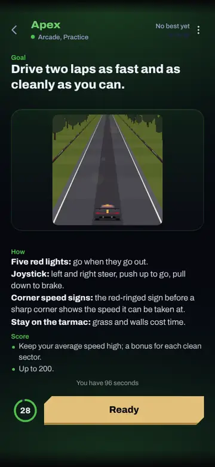 | 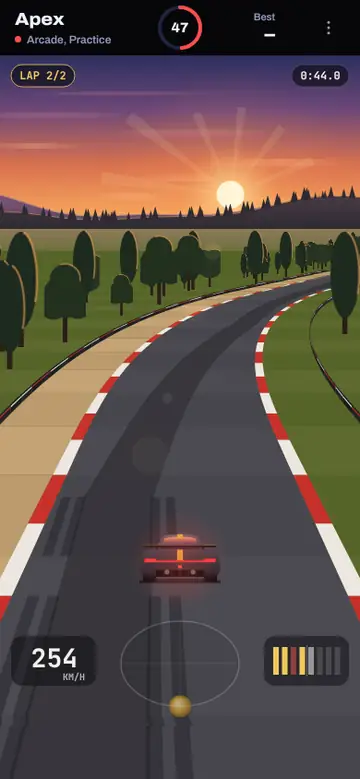 | 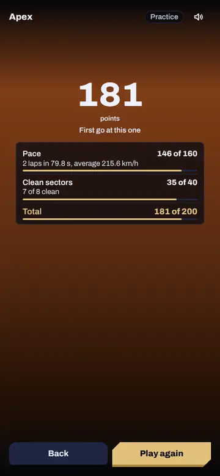 |

**What happens today.**
- *Track:* start lights, red-ringed corner signs and 150/100/50 brake boards.
- *Car:* turns up to 5° into a turn.
- *Stick:* a faint ring and knob.
- *Sounds:* lights, go, an engine pitched by speed, kerb, grass, squeal, wall, lap and finish all have files. A
  clean sector falls back to a library coin.
- *Haptics:* on a wall hit.
- *Rooms:* the 3 nearest ghost cars are shown.

**Feedback.**
- *Throttle:* speed lines at the screen's edges above 200 km/h. These belong to the speed, so they are not decoration.
- *Kerb:* a rumble, plus a `tick` haptic run on the kerb.
- *Grass:* dust from the wheels and a speed drop shown on the speedo in red.
- *Corner:* the sign flashes green when taken within its speed, and red when over.
- *Clean sector:* record a sector "beep" and flash the sector marker on the timing bar.
- *Near-miss:* scraping a wall without stopping shows sparks off the car's side.
- *Round-end payoff:* the chequered flag, the lap times and the average speed counting up.

**Changes.**
- The car is small at the bottom of a tall view, with the stick ring right under it. Raise the camera or enlarge the
  car slightly.
- Record the clean-sector sound.
- The speed readout (254 KM/H) and the sector bar are fine. The LAP pill and timer are small.
- The bots don't read the signs, so the bands are bot-limited. The `racing.md` sound section is stale.

**Difficulty.**

| | Easy | Normal | Hard | Expert |
|---|---|---|---|---|
| Speed kept on gravel | 80 % | 65 % | 60 % | 50 % |
| Corner signs | shown, plus a braking marker | shown | shown | hidden |
| Pace full at | 205 km/h | 221.5 | 221.5 | 228 |
| Track | wider | today | narrower run-off | narrower run-off, tighter hairpins |

- "Grand slam" (all eight sectors clean on Expert) must stay possible.

---

## Pull! (`clayshoot`), listed also in Sports

Pull! is reviewed with Speed, its main category. For the Sports picture:

- It is on `clayRev 9`, a 60 s run: tap to shoot 25 clays and avoid the birds.
- It scores on its own capped shape, not the arcade standard.
- The shatter sounds `clayshoot.shatter` and `goldShatter` have no files, so a hit plays the puzzle clay sound.
- Its intro demo is stopped.
