# Strategy: game reviews (phase 2, step 4)

This file reviews the five live Strategy games: Tilt, Gemstone, Coral Pop, Rainbow Bridge and Ball Tracker. High Rise
moved back to Action on 3 Nov 2026, so it is reviewed in `action.md`.

**How the screenshots were made.** They come from a local dev server on main dd9acbe6 (15 Nov 2026), played in
practice mode at 390 × 844 and shrunk to 360 wide. "Start" is the intro, "mid-play" is halfway through, and "end" is
the reveal. The Near-perfect skill-band bot played every run.

**Level rules.** These are the same as in `action.md`:
- Each level is a new stamp.
- A score of 175 or more earns a star, or a crown on Expert.
- 200 must stay reachable at every level.
- Rated play stays on Normal.

**Which games need a proof per level.** Tilt, Rainbow Bridge and Ball Tracker deal rooms from proved lists or banks,
so each of their levels needs its own proof. Gemstone and Coral Pop are generated from the seed, so their levels are
cheap.

## Shared Strategy findings

- **No success haptics.** Only the round buzzer vibrates. A marble reaching its cup, a gem cascade or a reef
  cleared would all suit a light `success`.
- **Many core sounds fall back to library sounds.** Tilt (roll, knock, cup), Coral Pop (load, pop), Rainbow Bridge
  (draw, pot) and Ball Tracker (roll, switch, home) do this. Gemstone is the best covered.
- **Pops sit over the board.** Tilt's "MAZE 3 DONE!" lands on the maze, and Coral Pop's "COMBO ×2 BANK" lands on
  the reef. The style guide asks for no effect over a board while the game runs. Put these by the thing that happened
  or in the HUD strip.
- **The intro stills are old abstract drawings.** Tilt's is a line disc, Gemstone's is coloured dots, and Coral Pop's
  is three dots. Four of the five demos are stopped. Ball Tracker's older demo still plays.

## Summary

| Game | Biggest feedback win | Biggest change | Difficulty notes |
|---|---|---|---|
| Tilt | A marble "clink" into its cup, with the cup lighting up | Maze 4 is small and dense on a phone; the "done" pop covers the maze | Easy: 3 mazes and no pits. Expert: ice everywhere. The deal is re-proved per level (~25 min). |
| Gemstone | Treasure falling with a glint as it nears the bottom | Treasure is the hardest part to read: Near-perfect play brought down 1 of 6 | Cheap. Easy: 5 colours. Expert: 7 colours and more ice. |
| Coral Pop | A pop chain that rises in pitch through a cluster | Near-perfect play left 20 bubbles: the reef is hard to clear in 90 s | Cheap. Easy: 4 colours and a slower descent. Expert: 6 colours. |
| Rainbow Bridge | Ink drawing with a sound and a fill on the meter | The rows of birds clutter the sky | Easy: 1.5× ink. Expert: more birds and live levels from level 7. A deal per level. |
| Ball Tracker | Each marble home gets a ding in its own colour | Marbles and cups are small; the board is dense | Top skill levels already bunch. A bank per level; Easy and Hard make sense, Expert is doubtful. |

---

## Tilt (`tilt`)

**Now.** Drag left or right to spin a disc maze, so each marble rolls downhill into its own cup. There are 4 mazes.
From maze 3 there are two marbles, and there are keys, gates, pits and ice. The round is 90 s on stamp `tiltRev 12`,
dealt from 347 proved seeds.

| Start | Mid-play | End |
|---|---|---|
| 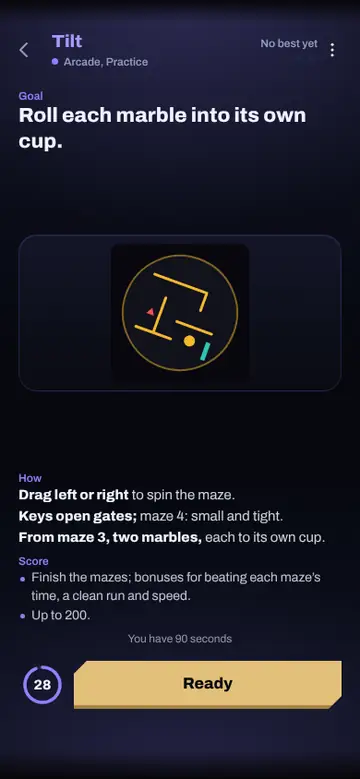 | 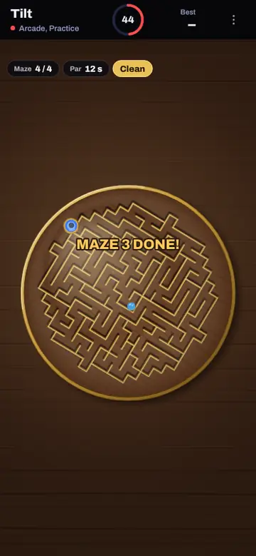 | 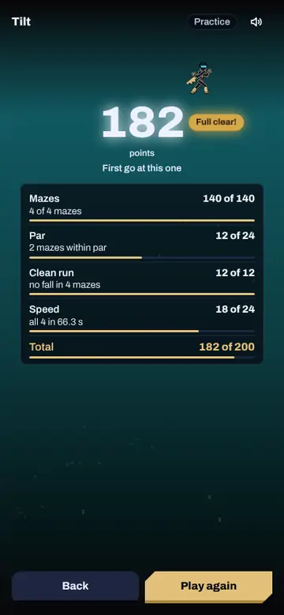 |

**What happens today.**
- Rolling, knocking against a wall and dropping into a cup play library marble and wood sounds.
- A marble in its cup shows "BLUE IN! NOW THE AMBER".
- A finished maze shows "MAZE n DONE!".
- Falling into a pit plays a crash.
- The HUD shows Maze, Par and a gold "Clean" pill.

**Feedback.**
- *Spin (slide):* the disc's rim ticks like a dial as it turns. The marble's roll gets louder with speed.
- *Wall knock:* a soft knock whose pitch depends on speed, and a 1 px nudge of the marble.
- *Cup (place):* the marble spirals into the cup, the cup lights up in the marble's colour, and a clink plays. Add a
  `success` haptic.
- *Key and gate:* the gate swings open, with a latch sound.
- *Pit, near miss:* the marble wobbles on the pit's lip.
- *Pit, fall:* the marble shrinks into the hole.
- *Maze done:* the disc spins away and the next one drops in. Put the "done" text above the disc, not on it.
- *Round-end payoff:* four small discs, each with a tick or its time.

**Changes.**
- Maze 4 is 19 cells at 16 px on a phone. The marble is visible, but the paths are hard to read. The 3 Nov enlargement
  helped the marbles; the walls would need a wider disc.
- "MAZE 3 DONE!" covers the maze.
- The tile and intro still show light wood, not walnut ("Not done" in the polish doc).
- `liveBands.ts:122`'s comment ("25 a maze, to 100") is stale.
- The flawless bot reaches 189, not 200. The oracle proves 200 on dealt seeds, but the bands look low at the top.

**Difficulty.**

| | Easy | Normal | Hard | Expert |
|---|---|---|---|---|
| Mazes | 3 (sizes 11–15) | 4 | 4 | 4, larger (15–21) |
| Pits | 0–1 | 2–3 | 3–4 | 4 |
| Ice patches | 0 | 2–3 | 3–4 | 5 |
| Two marbles from | maze 3 | maze 3 | maze 2 | maze 2 |
| Par scale | 180 % | 150 % | 130 % | 120 % |

"Marble madness" (finish all four Hard mazes within 60 s) must stay possible.

---

## Gemstone (`matchup`)

**Now.** A match-3 on a 7 × 10 board. Six colour goals sit under the board, and six treasures must be brought to the
bottom row. There are 10 frozen cells and special gems. The round is 90 s on stamp `matchupRev 12`.

| Start | Mid-play | End |
|---|---|---|
| 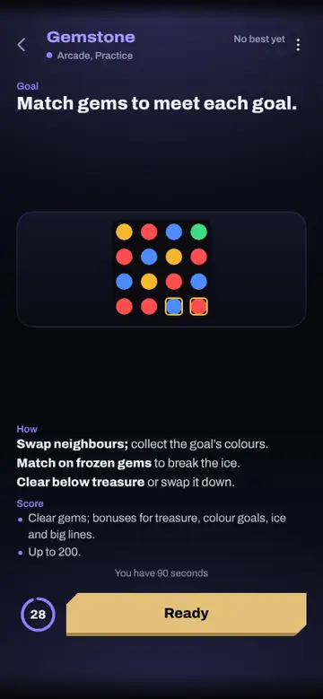 | 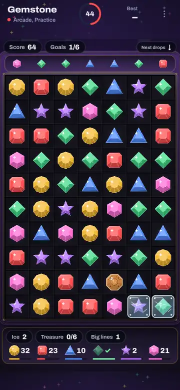 | 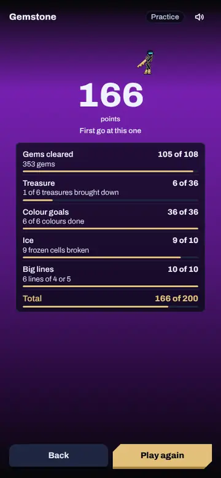 |

**What happens today.**
- Pick, swap, refuse and hint each have their own gem sound.
- Matches shatter, with the pitch rising by cascade depth.
- "CASCADE ×n", "n IN A LINE!" and "JACKPOT GEM!" appear.
- A met goal plays a chime.
- A collected treasure counts with a ding.
- A broken ice cell crackles.
- At the end, "PAR SMASHED!" appears (see the bug below).

**Feedback.**
- *Swap:* as today. The refused swap's bounce back is good.
- *Match:* the gems shatter into shards in their colour. Each colour that counts towards a goal sends a small spark to
  its goal bar, which grows as it lands. That makes the goals legible.
- *Cascade:* a combo tag at the top of the falling column.
- *Ice:* the frozen cell cracks over two hits, so it's clear what's left.
- *Treasure:* it glints and shows a small "↓ 3 rows" hint when a match below it is close. At the bottom it pops up
  into the HUD's Treasure count with a coin sound.
- *Round-end payoff:* the goals tick off one by one.

**Changes.**
- **Bug (likely): "PAR SMASHED!" fires on the wrong number** (`arcadeFxGames.renderer.ts:1474`). It compares match
  points (`s.raw`) with `matchupParRaw`, which on standard states is a gem count of 360 (`matchup.ts:941`). So the
  banner and its 1.36 s sound fire after about 36 plain lines, not when the core fills. Compare `gemsCleared`
  instead.
- **Treasure is the least readable part.** The Near-perfect bot brought down 1 of 6 (6 of 36 points). Players need
  to see which column leads it down; the "↓" hint above would help.
- The HUD's "Score 64" is a 0–200 live score. It is useful, but no other Strategy game shows one. Pick one rule for
  the group.
- Near-perfect play sits at 159–166, below Joe's 170–180 target (an accepted assumption).

**Difficulty.** This is cheap: the board is generated from the seed.

| | Easy | Normal | Hard | Expert |
|---|---|---|---|---|
| Colours | 5 | 6 | 6 | 7 |
| Goal ladder | 15–45 | 20–60 | 25–70 | 30–80 |
| Ice cells | 5 | 10 | 14 | 18 |
| Hint after | 3 s | 5 s | 8 s | off |

"Treasure hunter" (all six treasures on Expert) needs Expert's treasure paths to stay possible. Check this with the
proof run, since 1 of 6 is the Near-perfect result on Normal today.

---

## Coral Pop (`bubble`)

**Now.** A bubble shooter. Drag to aim (a dotted trail bounces off the walls) and let go to shoot. Pop groups of three
or more to clear a 95-bubble reef holding 6 chests. The reef drops a row every 8 shots. The round is 90 s on stamp
`bubbleRev 11`.

| Start | Mid-play | End |
|---|---|---|
| 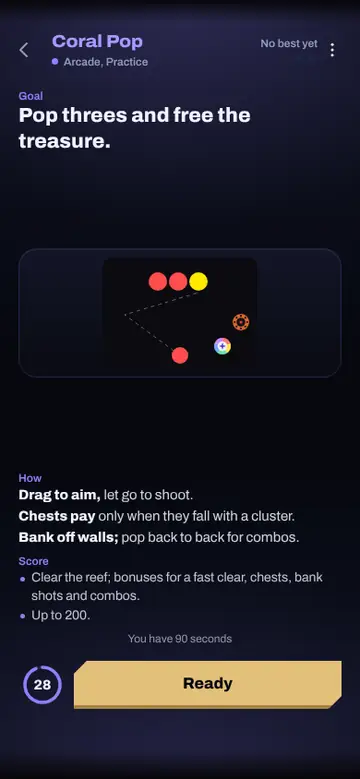 | 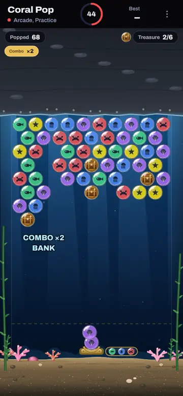 | 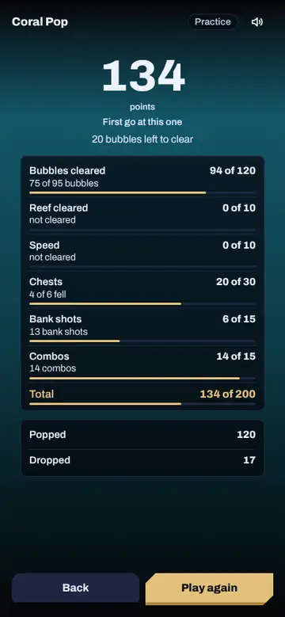 |

**What happens today.**
- Loading and popping play library sea sounds.
- A big pop, a big drop, a rush, the mine, the torpedo, the joker, sticking, the descent and the reef clearing each
  have files.
- "BIG POP ×n", "n DROPPED!" and "COMBO ×n" appear.
- A bank shot shows "BANK" with a zap.

**Feedback.**
- *Aim:* as today.
- *Shot (flow):* a faint bubble trail behind the shot, and a soft "blip" on each wall bounce.
- *Pop (clear):* bubbles in the group pop one after another from the hit point outward, about 30 ms apart, each pop a
  step higher in pitch.
- *Drop:* cut-off bubbles fall with a wobble and splash at the seabed.
- *Chest:* the chest falls, opens with a sparkle and flies to the HUD's Treasure count.
- *Stick (wrong):* a dull "thup" and a short squash.
- *Descent:* the whole reef shifts down with a rumble, and the bottom warning line flashes as it gets close (near
  miss).
- *Round-end payoff:* "REEF CLEARED!" and the bubbles counting up.

**Changes.**
- The reef is hard to clear in 90 s. Near-perfect play left 20 bubbles (134 points, no clear, no speed). Near-perfect
  and elite both tie at about 158 in the bands, and lower levels fell on rev 11. Consider a smaller reef or a slower
  descent (a stamp).
- The mine still draws a ring over one ring of cells but pops only the 4 nearest bubbles. Draw the 4 instead.
- "COMBO ×2 BANK" is drawn mid-reef. Move it to the shooter.

**Difficulty.** This is cheap: the reef is generated from the seed.

| | Easy | Normal | Hard | Expert |
|---|---|---|---|---|
| Colours | 4 | 5 | 5 | 6 |
| Reef | 75 bubbles | 95 | 95 | 110 |
| Descent every | 10 shots | 8 | 7 | 6 |
| Aim trail | two bounces | one bounce | one bounce | short |

"Off the wall" (30 bank shots on Hard) must stay possible.

---

## Rainbow Bridge (`inkbridge`)

**Now.** Draw rainbow lines so a dropped coin rolls into the pot, over 10 levels. There are birds to avoid, cloud
bounces and two clovers a run. Each level has an ink par. On levels 9–10 you keep drawing while the coin falls. The
round is 120 s on stamp `inkRev 14`, dealt from 100 proved seeds.

| Start | Mid-play | End |
|---|---|---|
| 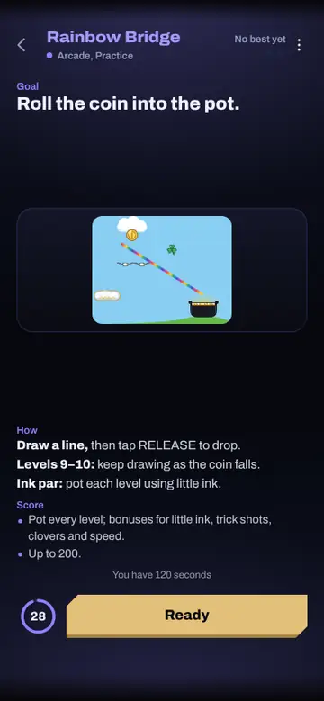 | 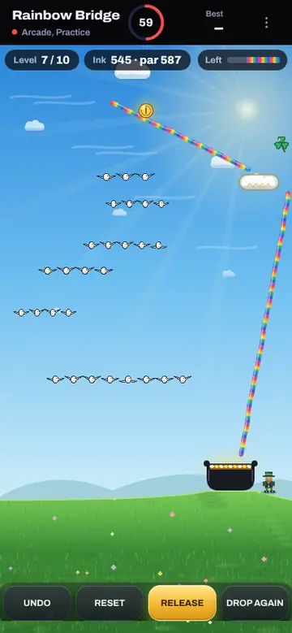 | 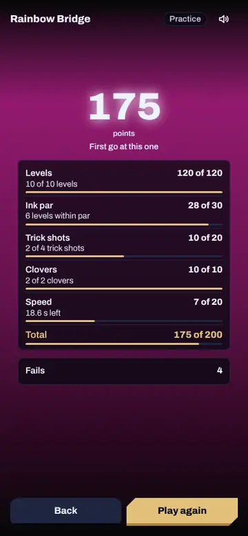 |

**What happens today.**
- Drawing plays a library rainbow sound. A refused stroke gets a red border and "No ink" or "Too close".
- Release, landing, rolling, a cloud bounce, a clover, a trick shot, a failed drop, the live level warning and running
  out of ink each have files.
- Potting the coin plays a library sound.
- Meeting the ink par has no sound or pop.

**Feedback.**
- *Draw (pour or flow):* a soft rising "shimmer" while drawing. The ink meter drains with a fill line, and the par mark
  on the meter shows where par is.
- *Release:* the coin wobbles, then drops.
- *Roll:* as today.
- *Bird, near miss:* a bird the coin passes close to flaps away.
- *Bird, hit:* the bird scatters and the coin bounces off.
- *Pot:* the coin drops into the pot with a jingle and a burst of rainbow coins. A level within ink par adds a small
  "PAR ✓" next to the Ink pill, with a chime.
- *Fail:* the coin falls off the screen with a falling whistle.
- *Round-end payoff:* the 10 level dots fill, then the score counts up.

**Changes.**
- The sky gets busy: the rows of birds (about 56 a run) are drawn as long white strings across the level. Fewer,
  larger, clearer birds would read better.
- Meeting the ink par has no feedback at all.
- The demo has been stopped since inkRev 13, and the re-record list says 13.
- Near-perfect play scores 182–183 against about 175. In this run it scored 175 with 4 fails.

**Difficulty.** Each level needs its own proved deal (`scripts/ink-big-deal.ts`).

| | Easy | Normal | Hard | Expert |
|---|---|---|---|---|
| Ink budget | 1.5× | 1.25× | 1.1× | 1.0× |
| Extra birds | about half | about 56 a run | more | more, moving |
| Live levels from | none | level 9 | level 8 | level 7 |
| Par margin | 25 % | 10 % | 10 % | 5 % |

---

## Ball Tracker (`balltrack`)

**Now.** Tap gold tubes to turn them so 36 marbles reach the cup of their colour. There are gold marbles, boosters,
combos and a countdown before the cups move. The round is 60 s on stamp `btRev 8`, dealt from 299 bank courses.

| Start | Mid-play | End |
|---|---|---|
| 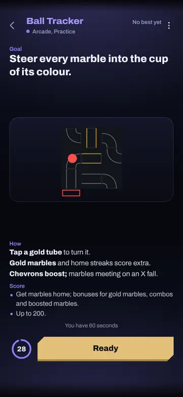 | 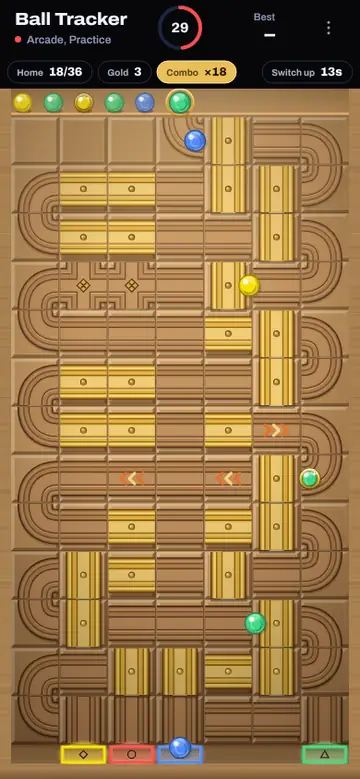 | 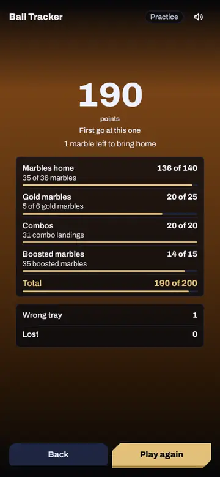 |

**What happens today.**
- Release, every 5th marble home, losing a marble, the countdown, the shuffle and all home each have files.
- Rolling, switching a tube, a marble home and the wrong cup play library sounds.
- Turnable tubes are raised gold.

**Feedback.**
- *Tap a tube:* a quick 90° turn with a ratchet click, even when a marble is inside it, so the marble can be seen to
  move with it.
- *Marble home:* a ding pitched by the marble's colour, and the cup flashing that colour. Add a `success` haptic on
  gold marbles.
- *Wrong cup:* the cup flashes red with a buzz, and the marble bounces out.
- *Boost:* chevrons flash as the marble passes.
- *Combo:* a counter beside the cups that steps up.
- *Countdown:* the cups pulse before they move.
- *Round-end payoff:* the "ALL 36 HOME!" cascade.

**Changes.**
- Marbles and cups are small on a 390 phone (the cups are a thin strip at the bottom). The board is dense with
  tracks. A slightly taller cup row would help the moment that matters most.
- The top skill levels bunch (193, 198 and 200), so the game is nearly solved for good players.
- The arcade-effects doc still says 30 marbles; the code uses 36.

**Difficulty.** Each level needs a new bank and a proved deal.

| | Easy | Normal | Hard | Expert |
|---|---|---|---|---|
| Marbles | 28 | 36 | 42 | — |
| Release every | 1.8 s | 1.4 s | 1.2 s | — |
| Cup moves | none | yes | more often | — |

Expert doesn't add much: the top bots already reach 200, and faster drops on a phone become a test of taps more than
of planning. A three-level game (Easy, Normal, Hard) is suggested.
