# Word: game reviews

Phase 2, step 4. 9 live games. Screenshots are phone size (390 × 844, shown at 360 px): **start** of play,
**mid-play** after a few moves, and the **round end** (a part-played run that ran out of time). Taken on a local
dev server through each game's `?game=` practice link; nothing in the app was changed.

Effects kit words used below: **tap, pick up, drop/place, slide, pour/flow, match/clear, wrong, combo/streak,
score count-up, near-miss, round-end payoff.** A physical action takes 900 ms at most and the next input is taken
at once; no effect over the board while the clock runs except the action itself.

## Summary

| Game | Biggest feedback win | Biggest change | Difficulty notes |
|---|---|---|---|
| Nucleus | Word "flies" into the found list with a pitch by length | Counter and "you missed" list count obscure words | Ring size and the word list used |
| Interlock | A word lights the moment it forms (today) plus a chord by length | Red runs only show for 0.7 s after Done | Word lengths and given tiles |
| Slider | Row clicks into a padlock with a rising note | Undo/Reset fire on touch-down, no confirm | Scramble length |
| Forage | Path tone rising per letter; golden tile sparkle | Help text says tapping the last letter submits; it removes it | 5 × 5 vs 6 × 6, word list |
| Lookout | Line draws with a marker squeak; chip fills | Re-dragging a found word plays `wrong` | Directions allowed, grid size |
| Roundabout | Bonus word gets a happy jar "plink" | A bonus word plays the **wrong** sound | Wheel letters, slot count |
| Strikeout | Letters flip in with a typewriter clack | QWERTY keys about 32 px wide on a 375 phone | Given letters, strikes |
| Cryptogrid | Every matching square fills in a ripple | "Checking…" never clears after a wrong full grid | Given numbers 8 / 6 / 5 / 4 |
| Swapword | Tiles slide past each other and lock gold | Running out of swaps ends in silence | Par range, spare swaps, colour hints |

**Across the category**

- **Misleading sounds.** Roundabout plays `wrong` for a bonus word; Lookout plays `wrong` for re-dragging a word
  you already found; Forage plays two error sounds for one invalid word; Lookout plays two `correct` for the bonus.
  Fixing these four is cheap and makes the games feel fair.
- **Plurals.** Banned in Nucleus, allowed in Forage, which plays almost the same way. Pick one rule for both.
- **Keyboards.** Strikeout and Cryptogrid share a QWERTY pad whose keys are roughly 32 px wide on a 375 px phone,
  under the 44 px target. Key presses are silent.
- **Difficulty is free to add.** The dictionary is already split into three bands (SCOWL 70 for checking, 50
  "everyday" for boards, 10–35 "common answers"). Easy can deal from the common band only, Expert from the wider
  one; checking stays the same.
- **Round end.** Every Word game ends with a list of words; that list should be the *round-end payoff*: found
  words drop in one by one with a soft tick, the longest gets a gold chip, then the score *counts up*.

---

## Nucleus

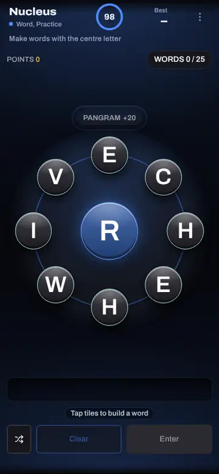 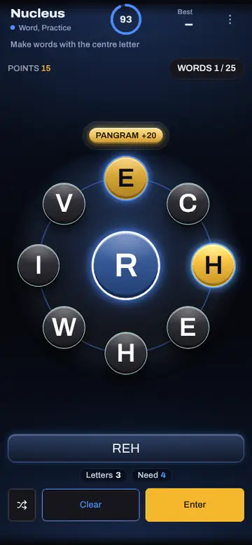 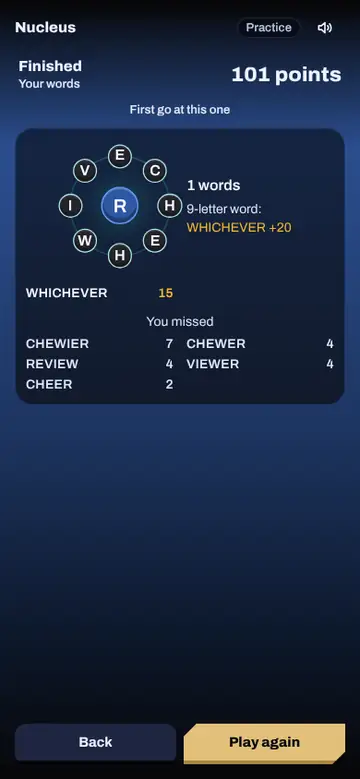

**Now.** A ring of 8–11 letters around a fixed centre letter; make words of 4+ letters that use the centre, no
plurals. One word uses every letter (the pangram). 100 s, free Shuffle.

| Action | Shows today | Sounds today |
|---|---|---|
| Tap a letter | Highlight | Silent |
| Shuffle / Clear | Letters move / clear | Silent |
| Enter, valid | Glow, chip in the list | `correct` + `move` |
| Pangram | Same, plus a moment card | + `shared.momentcard` |
| Enter, invalid | Shake, message | `wrong` |
| Under 4 letters | Shake, message | Silent |

**Feedback.** Letter: *tap* with a soft key click, the letter rising out of the ring. Shuffle: letters *slide* round
the ring. Valid word: *match* — the word lifts and flies to the list, the note's pitch rising with its length (4
low, 9 high); three words inside 10 s is a *combo*. Pangram: its own big moment (the ring spins once, gold).
Invalid: *wrong* — letters shake back into the ring, a soft buzz. Too short should play the same soft buzz.

**Changes.**
- The "Words n / total" counter and the end's "You missed" list count every SCOWL 70 word, obscure ones included.
  Count and show only everyday words (the band boards are built from); accept the rest silently as a bonus.
- Plural rule differs from Forage.
- The round-end card says "1 words"; Forage's says the same. Singular for one.

**Difficulty.**
| Level | Ring | Words in the board | Par |
|---|---|---|---|
| Easy | 7 + centre | 20–40, common band | 30 % of points |
| Normal | 8–11 | 25–120 (today) | 35 % |
| Hard | 9–11 | 30–60 (fewer, longer words) | 40 % |
| Expert | 11 | 25–50, pangram 9+ letters | 45 % |

## Interlock

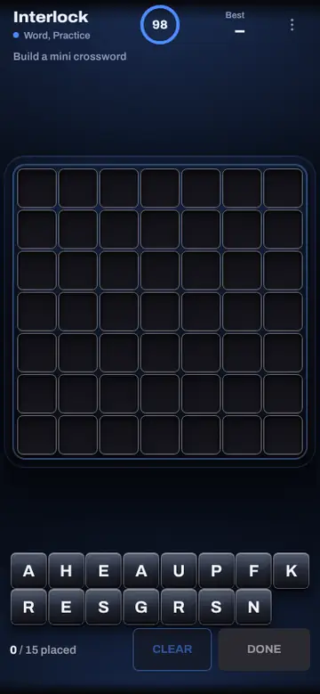 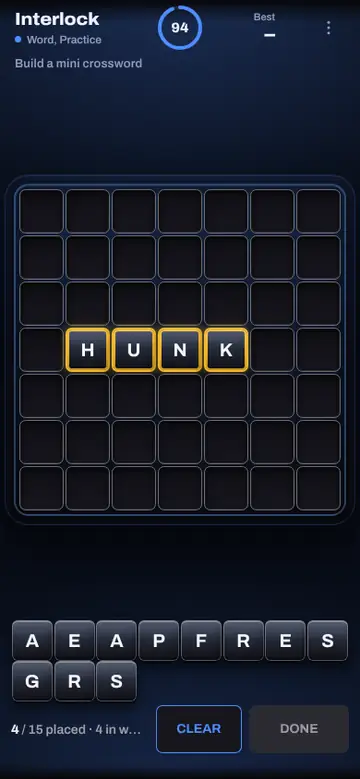 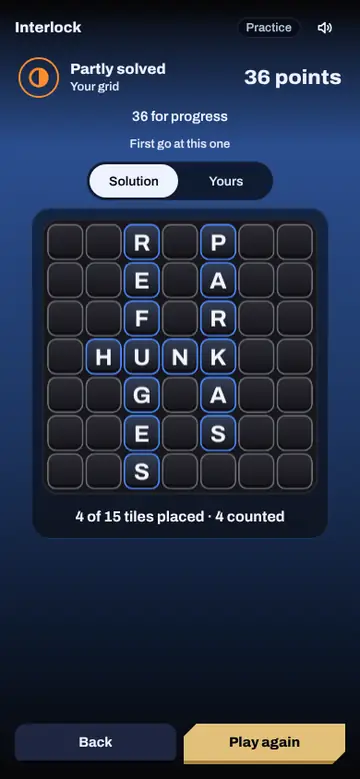

**Now.** Fifteen letter tiles to arrange on a 7 × 7 board into a connected crossword; every run of 3+ must be a
word. The dealt answer is an H shape (one across, two down, 4–7 letters each). 100 s, Clear. Done needs all 15.

| Action | Shows today | Sounds today |
|---|---|---|
| Pick a tray tile | Ring | Silent |
| Place / double-tap back / Clear | Tile moves | `move` |
| A new valid run | Run glows, chip | `correct` |
| Done, valid | Words light in turn | `lock` + finish |
| Done, invalid | Bad squares red for 0.7 s | `wrong` |

**Feedback.** Pick up: the tile lifts with a shadow. Place: *drop/place* (a wooden tile clack). Run forms: *match*
— the run lights and a chord sounds, bigger for longer words; two at once a *combo*. A run that isn't a word:
keep it faint red while it stands (today nothing until Done). Done: *round-end payoff* (words light in order,
then the big-word bonus counts up).

**Changes.**
- Help says "Red runs need fixing", but red only shows for 0.7 s after Done. Show bad runs live.
- Double-tap to take a tile back is easy to miss; a drag back to the tray should work too.
- On short screens the board can clip (cells have a 44 px floor in a box that hides overflow).
- The status line is cut off ("4 / 15 placed · 4 in w…") at 390 px.
- A rare fallback board in the generator can't be laid out and would crash; the fix is to replace that board.

**Difficulty.**
| Level | Words | Letters | Given tiles |
|---|---|---|---|
| Easy | 3 (4–5 letters) | 12 | 2 placed |
| Normal | 3 (4–7) | 15 | 0 (today) |
| Hard | 3 (5–7) | 17 | 0, rarer words |
| Expert | 4 words | 20 | 0, 9 × 9 board |

## Slider

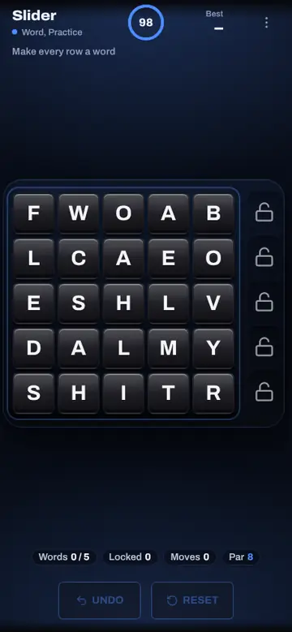 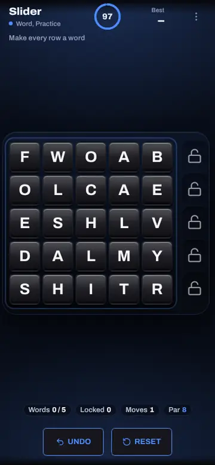 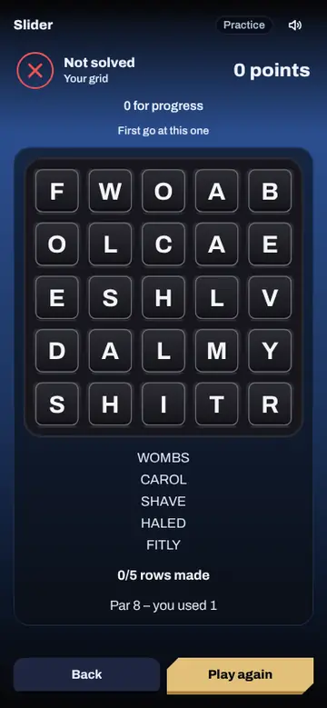

**Now.** A 5 × 5 grid of five five-letter words, scrambled by 5–8 row and column shifts. Swipe rows and columns
to rebuild them; lock a row that reads as a word; with four rows locked, swap tiles in the last. 100 s, Undo and
Reset (both count as moves). Par is the scramble length.

| Action | Shows today | Sounds today |
|---|---|---|
| Swipe | Row/column slides (120 ms) | `move` |
| Swipe a locked row | Shake | `shared.reject` |
| A row becomes a word | Glow, chip | `correct` |
| Lock | Padlock | `pz_padlock` + `move` |
| Solved | Padlocks cascade | padlock + finish |

**Feedback.** Swipe: *slide* with a tile rattle, letters wrapping round the edge. Row becomes a word: *match*
(the row brightens, a two-note). Lock: the padlock snaps with a click. Every row a word: *round-end payoff* (the
padlocks shut top to bottom, a rising scale). At par with three rows done: *near-miss* nudge on the moves pill.

**Changes.**
- Undo and Reset fire on touch-down, Reset has no confirm, and both cost a move. Fire on release and confirm
  Reset.
- Par is the scramble length, not a proven minimum, so "par" can be beaten.
- On a 375 px phone the board plus the lock column is tight (tiles at least 56 px plus a 44 px column).
- The found-word chip pops again for rows that were already words after a reload.
- The board sits low with a large empty band above it; centre it or grow the tiles.

**Difficulty.**
| Level | Grid | Scramble | Locks |
|---|---|---|---|
| Easy | 4 × 4 (four-letter words) | 3–5 | Yes, swaps from 3 locked |
| Normal | 5 × 5 | 5–8 (today) | Yes |
| Hard | 5 × 5 | 8–11, rarer words | Yes, no last-row swaps |
| Expert | 5 × 5 | 10–13 | No locks; Undo costs 2 |

## Forage

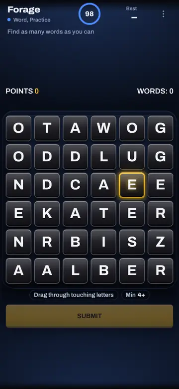 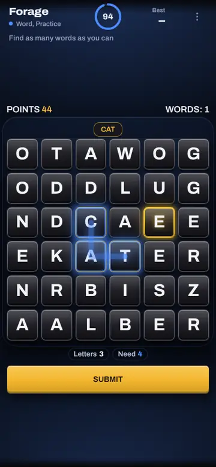 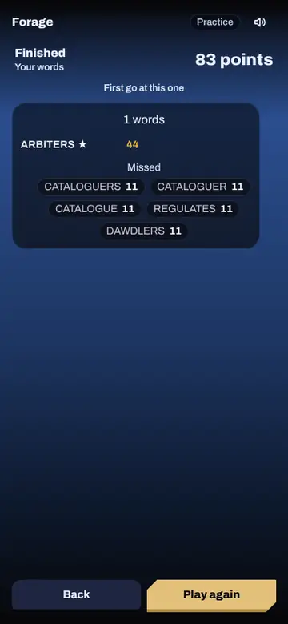

**Now.** A 6 × 6 letter grid with diagonals and a Qu tile; trace words of 4+ letters. One golden tile doubles a
word through it; 6-letter words ×1.5, 7+ ×2. Misses beyond a free allowance cost 3 % each. 100 s.

| Action | Shows today | Sounds today |
|---|---|---|
| Trace | Path lights, line follows | Silent |
| Valid word | Cells glow, chip "WORD ×2 ★ · 14" | `correct` + `move` |
| Invalid | Shake | `wrong` **and** `shared.reject` |
| Too short | Shake, message | `wrong` |

**Feedback.** Trace: *slide* — each new letter a soft note rising up the scale, so a long word sounds long.
Through the golden tile: a sparkle as the path crosses it. Valid: *match* (the path flashes, the word flies to
the list, the points pop beside it). Long word (7+): *combo* — a bigger chord. Invalid: one soft *wrong*.

**Changes.**
- Help says tapping the last letter again submits the word; the code removes that letter instead. Fix the text
  (or the code).
- The miss penalty is invisible; add a "Misses 3 / 14 free" pill.
- Two error sounds for one invalid word.
- Plural rule differs from Nucleus.

**Difficulty.**
| Level | Grid | Words on board | Golden tile |
|---|---|---|---|
| Easy | 5 × 5 | 60+, common band | Yes, misses free |
| Normal | 6 × 6 | 120+ (today) | Yes |
| Hard | 6 × 6 | 80–110 (sparser) | Yes, half the free misses |
| Expert | 6 × 6 | 60–90, 5-letter minimum | No |

## Lookout

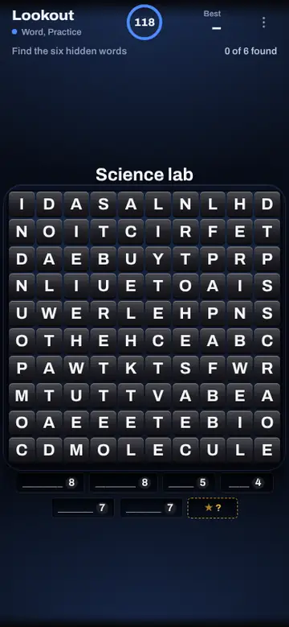 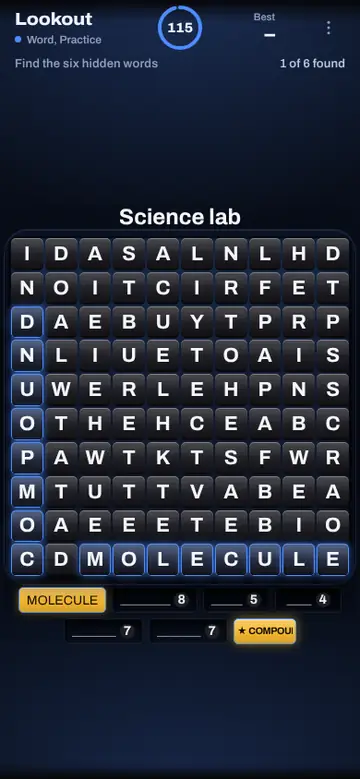 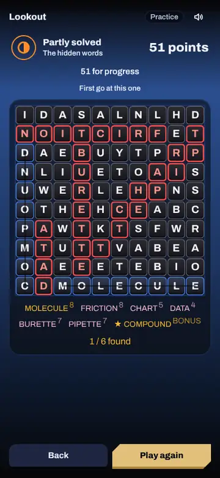

**Now.** A 10 × 10 themed word search, six listed words in any of eight directions plus one hidden bonus word.
Finding the sixth ends the round. 120 s. Bank of 1,521 boards over 76 themes.

| Action | Shows today | Sounds today |
|---|---|---|
| Drag | Straight line, live highlight | `move` on release |
| Found | Gold squares, line through, chip fills | `correct` |
| Bonus | Glow on the star chip | `correct` twice |
| Wrong drag | Red squares 350 ms | `wrong` |
| Re-drag a found word | Nothing | `wrong` |

**Feedback.** Drag: *slide* with a marker squeak as the line grows. Found: *match/clear* — the line inks in, the
chip ticks off with a pen stroke, a chime pitched by word length. Bonus: its own sparkle and a brighter chime.
Wrong: one soft *wrong* and the line fades. Re-drag a found word: a gentle "already found" bump, no error sound.
Sixth word: *round-end payoff* (all lines redraw in order).

**Changes.**
- Long word chips are cut ("★ COMPOU…") once found; let chips wrap to their word.
- The bonus only counts before the sixth word, and finding the sixth ends the round at once. Easy to lose by
  accident. Either keep the round going after six (with a Done) or tell the player.
- Help says a found word is struck through; it's the chip that fills.

**Difficulty.**
| Level | Grid | Directions | Words |
|---|---|---|---|
| Easy | 8 × 8 | Across and down only | 5 |
| Normal | 10 × 10 | All eight (today) | 6 + bonus |
| Hard | 10 × 10 | All eight, more backwards | 8 + bonus |
| Expert | 12 × 12 | All eight | 8, list shows letter counts only |

The bank stores every word's squares, so directions can be counted and boards filtered without a new bank.

## Roundabout

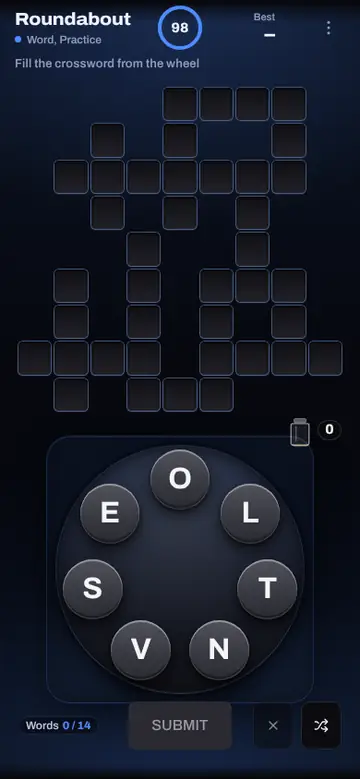 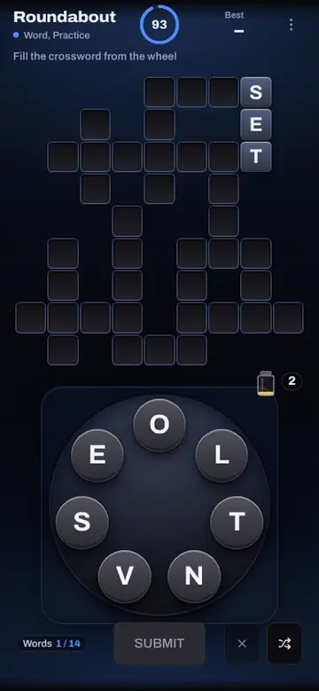 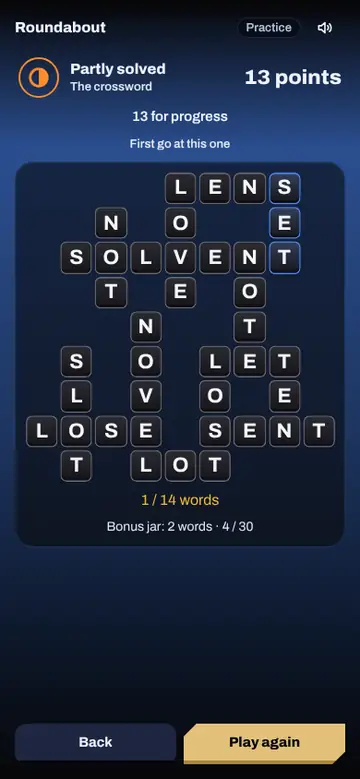

**Now.** A seven-letter wheel and a small crossword of 11–14 slots. Trace letters on the wheel; slot words fill
the grid, other real words go into a bonus jar. First five misses free. 100 s, Shuffle, Clear.

| Action | Shows today | Sounds today |
|---|---|---|
| Trace | Highlight | Silent |
| Release | — | `move` |
| Slot word | Squares glow, chip | `correct` |
| Bonus word | "Bonus · WORD", jar pulses | `tick` **and `wrong`** |
| Already in the jar | Shake | `shared.reject` + `wrong` |
| Not a word | Shake, miss counted | `wrong` |
| Repeat a slot word | Shake (not a miss) | `wrong` |

**Feedback.** Trace: *slide* — a note per letter. Slot word: *drop/place* — the letters fly from the wheel into
their squares, landing one by one. Bonus: *pour* — the word drops into the jar with a coin "plink", the jar fills.
Repeat or already-jarred: a gentle bump, no error. Miss: one *wrong*. Grid done: *round-end payoff* (the wheel
spins, the grid lights corner to corner).

**Changes.**
- A bonus word plays the error sound because the server reports it as "not in this puzzle". This is the most
  misleading sound in the category.
- A miss and a harmless repeat look and sound the same.
- The wheel and grid share the height; on 11 × 9 grids the squares get small.
- Some slot words are odd ("INS").

**Difficulty.**
| Level | Wheel | Slots | Free misses |
|---|---|---|---|
| Easy | 6 letters | 8–9 | 10 |
| Normal | 7 | 11–14 (today) | 5 |
| Hard | 7 | 14, fewer 3-letter slots | 3 |
| Expert | 8 | 16–18 | 2 |

## Strikeout

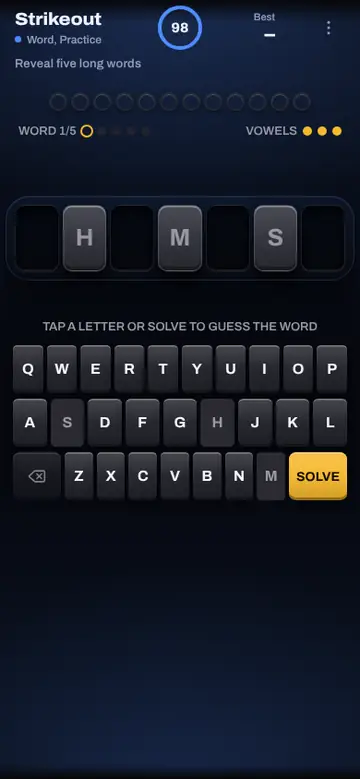 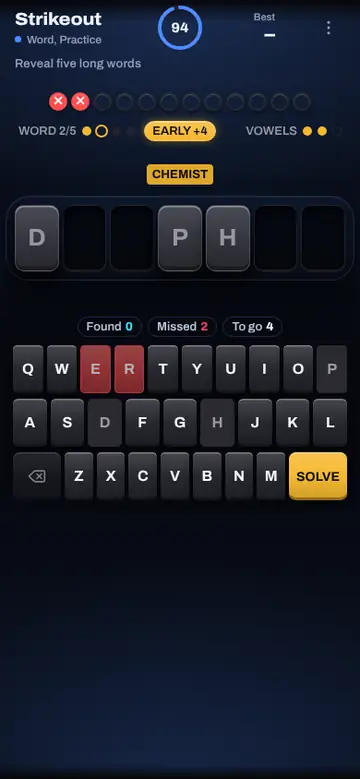 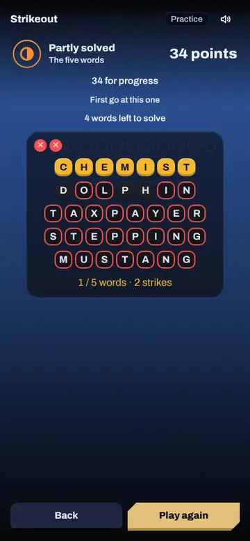

**Now.** Hangman-style: five 7–8 letter words, one at a time, with a couple of consonants shown. Guess letters
(three vowel guesses a word), solve a word whenever you like; 12 strikes for the round. 100 s.

| Action | Shows today | Sounds today |
|---|---|---|
| Letter in the word | Tiles flip in | `place` + `move` |
| Letter not in it | Strike, "strike" text | `shared.reject` + `wrong` |
| Solve typing | Letters | Silent |
| Solve right | Chip, early-solve pill | `correct` |
| Solve wrong | Strike | `wrong` |
| Not a word / no vowels left | Refused, free | `shared.reject` + `wrong` |

**Feedback.** Key: *tap* with a typewriter key. Hit: *drop/place* — each matching tile flips with a clack, one
after another. Strike: *wrong* — a strike mark slams onto the strike row. Early solve with 3+ letters hidden:
*combo* (the hidden letters flip all at once). Last strike left: the row pulses (*near-miss*). Round end: the
five words flip gold.

**Changes.**
- QWERTY keys are about 32 px wide on a 375 phone; key presses are silent.
- The left key changes label between "Delete" and "Back".
- A refused solve (not a word) plays `wrong` though it costs nothing; use a softer bump.
- The keyboard sits mid-screen with about a third of the screen empty below it; move it down to the thumbs and
  let the tiles grow.

**Difficulty.**
| Level | Words | Shown letters | Strikes |
|---|---|---|---|
| Easy | 5 × 6–7 letters, common band | 3 | 15 |
| Normal | 5 × 7–8 | 1–3 (today) | 12 |
| Hard | 5 × 8 | 1 | 10 |
| Expert | 5 × 8–9 | 0 | 8, 2 vowel guesses |

## Cryptogrid

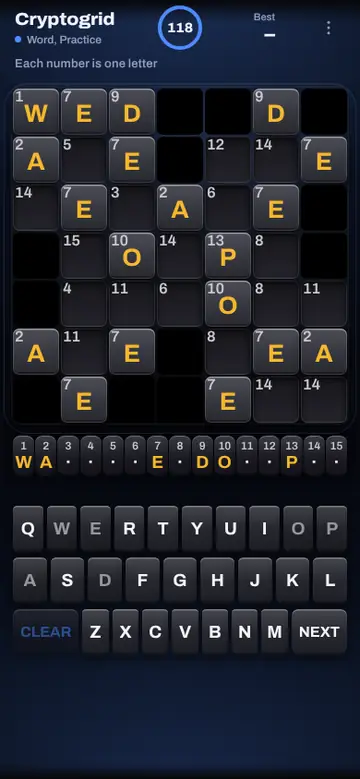 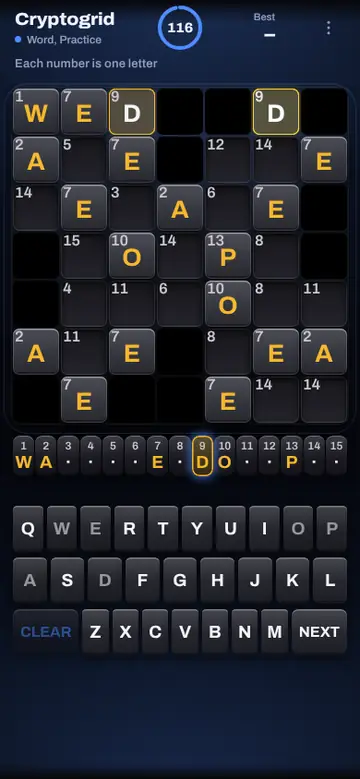 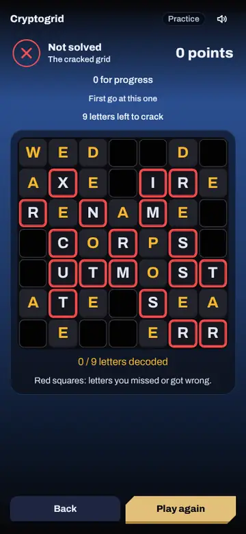

**Now.** A 7 × 7 codeword: each number stands for one letter; six are given. Pick a number, type its letter; every
square with that number fills. Bank of 1,000 boards, each with one solution. 120 s.

| Action | Shows today | Sounds today |
|---|---|---|
| Tap a square | Highlight | Silent |
| Enter a letter | Every matching square fills | `place` + `move` |
| A given letter | Refused on that key | `shared.reject` |
| Letter with nothing selected | Text note | Silent |
| Full but wrong | Shake, note 1.2 s | `wrong` |
| Cracked | Diagonal flip | finish |

**Feedback.** Letter: *drop/place* plus *pour/flow* — the letter appears in every matching square in a quick
ripple from the selected one, ticks rising. A word completed by it: *match* (the word glints). Full and wrong:
*wrong* (letters that don't fit any real word flash). Cracked: *round-end payoff* (diagonal flip, as today).

**Changes.**
- After a wrong full grid the status line goes back to "Checking…" and stays there.
- Selection doesn't move on after a letter; jump to the next unsolved number.
- The clean bonus counts trial letters the player never gets told about.
- Shared narrow keyboard (see the category note); as in Strikeout, it sits high with empty space below.

**Difficulty.**
| Level | Givens | Letters in grid |
|---|---|---|
| Easy | 8 | 14–15 |
| Normal | 6 (today) | 14–18 |
| Hard | 5 | 16–18 |
| Expert | 4 | 17–18, rarer words |

The generator already has an "ease" measure for choosing givens; use it to pick the easiest or hardest set.

## Swapword

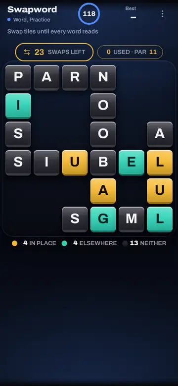  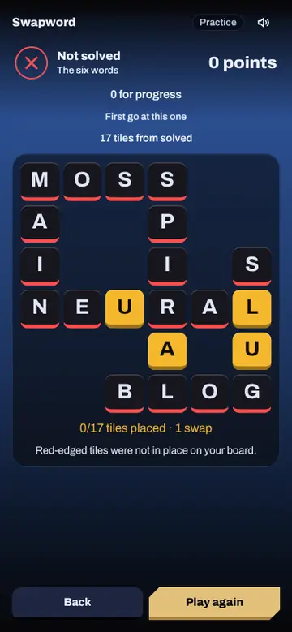

**Now.** A figure-eight of 21 tiles forming six crossing words. Swap tiles to fix them: gold is in place (locked),
teal belongs elsewhere in a word through it, grey fits neither. Par is the proven minimum (9–12); the budget is
par + 12. 120 s.

| Action | Shows today | Sounds today |
|---|---|---|
| Drag or tap two tiles | Swap, "pending" | `move` |
| Tiles turn gold | Glow | `place` |
| Tap a gold tile | Nothing | Silent |
| Out of swaps | Submits after 2 s | Silent |
| Solved | Wave round the eight | finish |

**Feedback.** Swap: *slide* — the two tiles pass each other in a short arc with a wooden clack. Turns gold:
*match* (a bright plink per tile; two in one swap a *combo*). Tap a gold tile: a small locked wiggle. Three swaps
left: the pill pulses (*near-miss*). Out of swaps: a closing "clunk" and the board greys. Solved: the wave, plus
a rising scale.

**Changes.**
- The teal/grey rule is hard to grasp; the intro should show one swap that turns two tiles gold.
- Running out of swaps ends in silence after a 2 s pause.
- Locked gold tiles give no feedback when tapped.

**Difficulty.**
| Level | Par | Spare swaps | Colour hints |
|---|---|---|---|
| Easy | 6–8 | +15 | Gold, teal, grey |
| Normal | 9–12 | +12 (today) | Gold, teal, grey |
| Hard | 11–14 | +8 | Gold and grey only |
| Expert | 12–15 | +5 | Gold only |

## Stage 3: levels (15–16 Nov 2026)

On #432's framework (`docs/design/difficulty/README.md`). Normal is today's game at every point; each game's levels
live in `src/lib/levels/word/<game>.ts` (settings and one plain line a level, shown on the game page, in the round
intro and in the "?" help's Levels block) and its level deal in `src/lib/duel/levels/<game>.server.ts`. Joe's guide (16
Nov 2026): a clear step up from Easy to Expert, Normal comfortable for a strong player, Expert humanly possible to score
well on; the bot numbers are a guide, not a band.

| Game | Easy | Hard | Expert | One answer |
|---|---|---|---|---|
| Nucleus | 9–10 letters, 45–85 everyday words, 120 s | 8–9 letters, 16–24 words, 65 s | 8 letters, 10–14 words, 50 s | open (a word find) |
| Interlock | down words start on the across word, 120 s | 7-letter across word, crossed mid-word, 60 s | as Hard, never on its ends, 50 s | open (any real-word grid) |
| Slider | 2–3 slides from the words, 100 s | 8 slides, 60 s | 8 slides, 45 s | open (any five real words) |
| Forage | 320–700 words on the 6×6, 120 s | 100–140 words, 80 s | 50–80 words, 70 s | open (a word find) |
| Lookout | 8×8, five words, across and down only, 120 s | 10 × 11, seven words any way, 90 s | 10 × 12, eight words and four false starts, 90 s | proved: each word hidden once |
| Roundabout | 6-letter wheel, 7–9 words, 120 s | 12–15 words, up to 9 × 11, 75 s | 16–19 words, up to 9 × 12, 80 s | open (fills aren't unique) |
| Strikeout | 3/2 starting letters on every word, 4 vowels, 14 strikes, 120 s | one starting letter, 2 vowels, 10 strikes, 90 s | none, 2 vowels, 12 strikes, 85 s | proved: one word per pattern; Expert solved by a person-like guesser |
| Cryptogrid | 8 letters start decoded, 120 s | 5, 75 s | 4, 65 s, on the 666 boards a person-like solver cracks from them | proved (full-dictionary solver) |
| Swapword | 5–7 swaps from the answer, 16 spare, 120 s | 13–15 swaps, 6 spare, 55 s | 15–17 swaps, 4 spare, 60 s | proved: one arrangement keeping the start's green tiles |

Taller grids, not smaller squares: Lookout's Hard and Expert keep ten columns and grow to 11 and 12 rows; Roundabout's
are at most nine columns and grow down. Each level has its check (`scripts/<game>-levels-check.ts`): clocks, Normal byte
for byte, the same deal for every player, the boards' rules, the one-answer proof or the open reason, the tuning bands.
Cryptogrid also deals `codewordRev 7`: a full grid that isn't cracked flashes the words on it that aren't real words.
