# Navigation review (phase 2, step 1)

14 Nov 2026 · the navigation frame from the locked style guide (`docs/design/style-guide/`). Only the frame is new:
every page's contents keep today's look until their own step. Pictures are 390 × 844 unless named, 8-bit PNG,
270 KB in all. Redraw them with `bun scripts/shots/nav-review-shots.ts`.

| | |
|---|---|
| 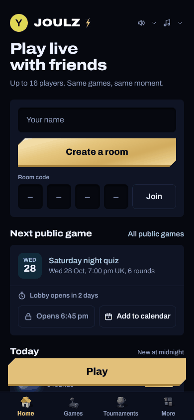 | **Home, a guest.** Avatar top left (colour and initial; it opens the save-your-progress sheet), the gold Play bar above the tab bar, Home current. The Shop's switch is off, so four tabs. |
| 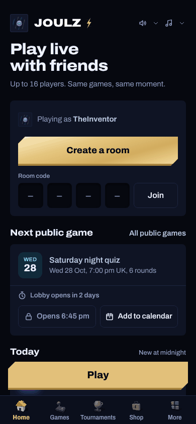 | **Home, an account with the Shop on.** The card's avatar (it opens Profile), the coin counter, five tabs. |
| 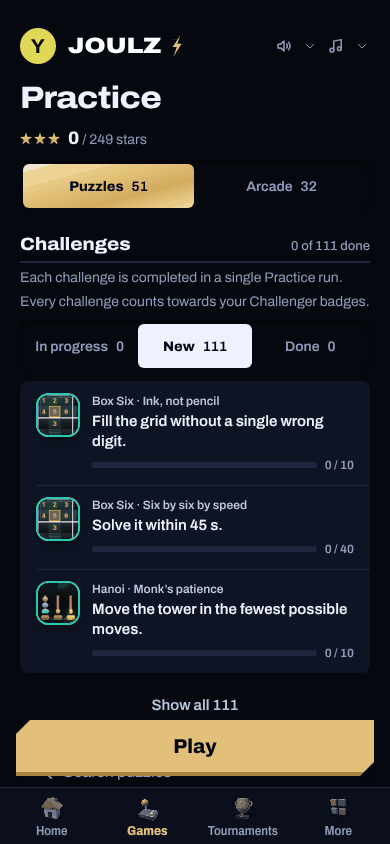 | **Games.** Today's Practice page under the new frame; the Play bar is here too. |
| 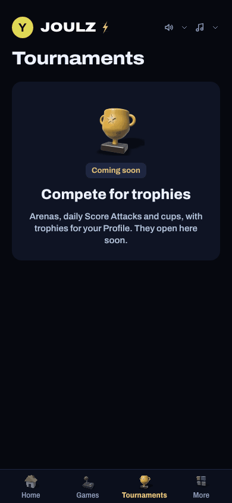 | **Tournaments, coming soon.** For everyone without tournaments. Where public games are scheduled they're listed under the card; with none, no list. Players with tournaments get today's screens unchanged. |
| 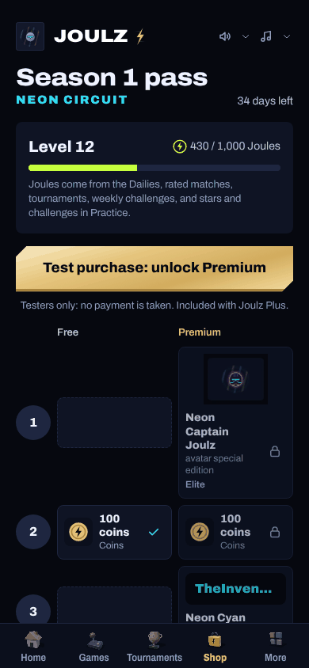 | **Shop** (testers today), Shop current. |
| 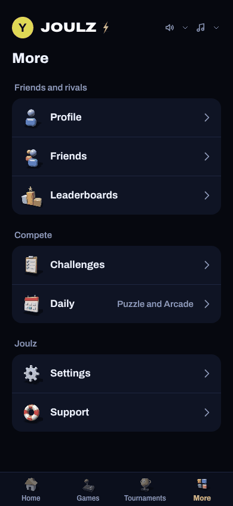 | **More, a guest.** Friends and rivals · Compete · Joulz. Joulz Plus shows only where the Shop is on. |
| 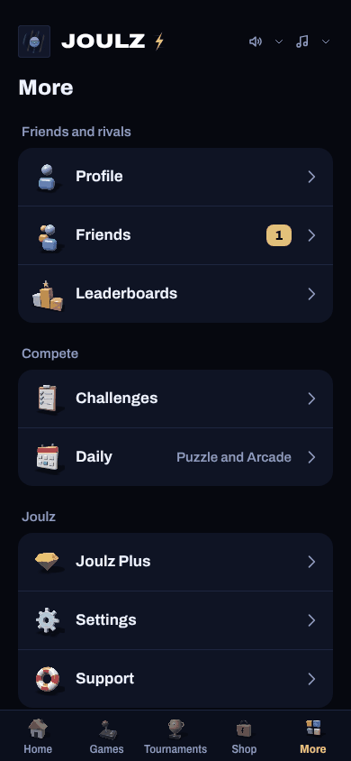 | **More, an account with the Shop on**, Joulz Plus included. |
| 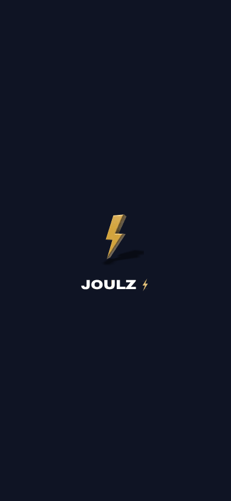 | **Launch screen.** The art kit's bolt and the wordmark, shown only until the app has started. |
| 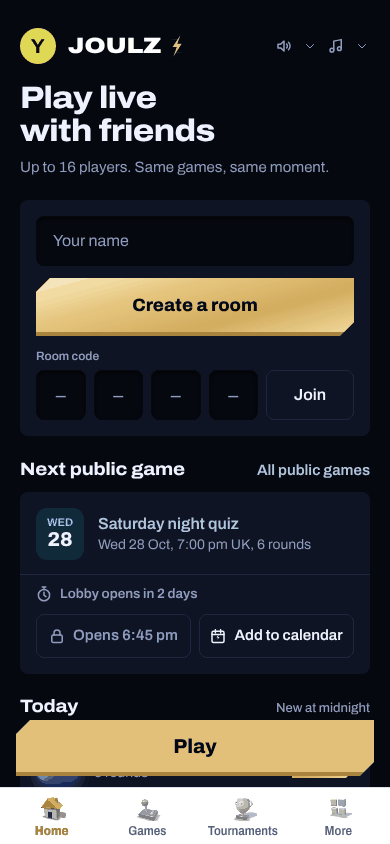 | **Home in the light theme.** Only the frame is light in this step (the tab bar, Play bar, rail, More); pages go light in the components step. |
| 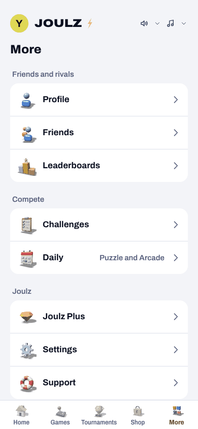 | **More in the light theme** (the navigation's own page, so all of it). |
| 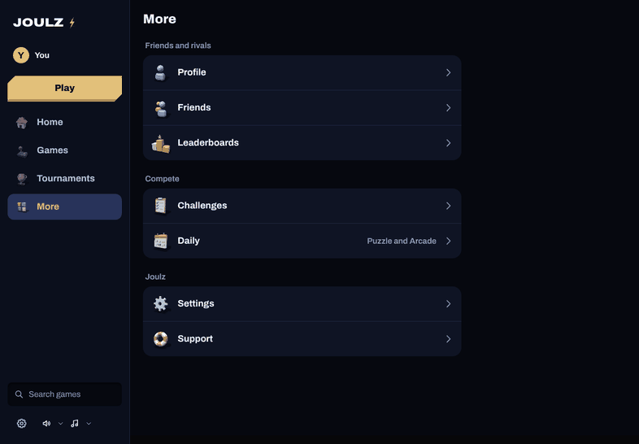 | **Tablet turned sideways (1180 × 820):** the rail. Upright tablets keep the tab bar. |
| 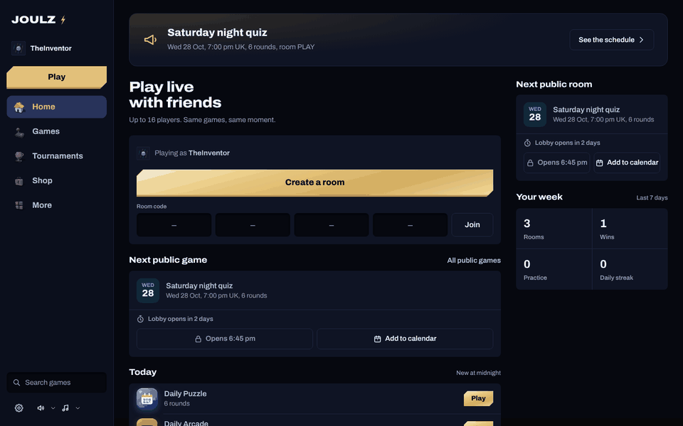 | **Computer (1440 × 900):** the rail with the logo, avatar and name, gold Play, the destinations, then search, settings and sound. |
| 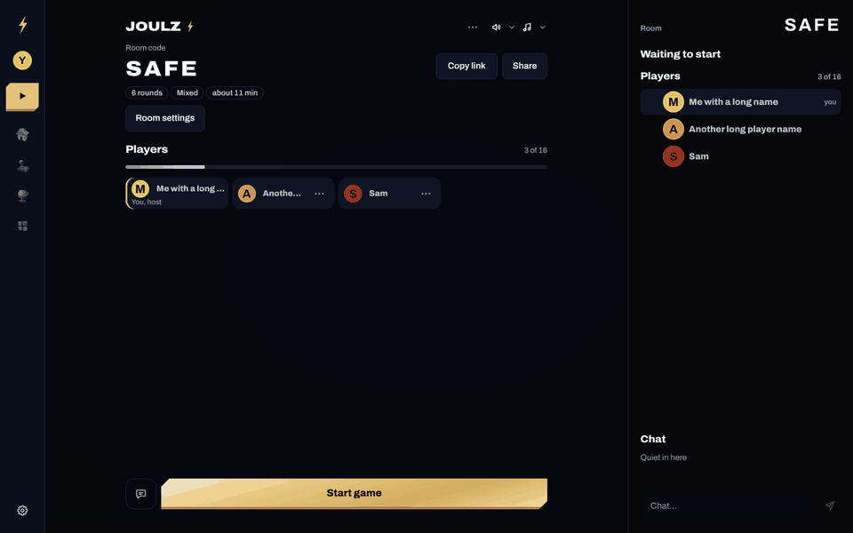 | **Computer, in a room:** the rail collapsed to icons (and in games). |

## How a player reaches every screen

| Screen | Route | How it's reached now |
|---|---|---|
| Home | `/` | Tab: Home (Back from any tab lands here before leaving) |
| Games (Practice) | `/practice` | Tab: Games; Home's Warm up |
| Tournaments | `/tournaments` | Tab: Tournaments (always shown) |
| An event, its rules | `/tournament`, `/tournament-rules` | Tournaments (players with tournaments) |
| Shop | `/shop` | Tab: Shop (where its switch is on); More → Joulz Plus |
| More | `/more` | Tab: More |
| Play | Home's play section | The gold Play bar (Home, Games); the rail's Play |
| Profile | `/profile` | Avatar (an account); More → Profile (everyone) |
| Friends | `/friends` | More → Friends (a guest gets the save-your-progress sheet); Profile's Friends |
| Leaderboards | `/leaderboards` | More → Leaderboards; Profile's boards |
| Daily top 100 | `/daily-board` | The Daily screens; Leaderboards |
| Challenges (full list) | `/practice`, scrolled to the list | More → Challenges |
| Daily | `/daily` | More → Daily; Home's Daily cards |
| Daily archive | `/daily-archive` | Joulz Plus |
| Settings | the settings sheet | More → Settings; Profile's gear; the rail's gear |
| Support | the support address | More → Support |
| Account (sign in, sign up, Settings → Account) | `/account` | The save-your-progress sheet (guest avatar, More → Friends); Settings |
| Customise | `/customise` | Profile → Customise card |
| Friend challenge | `/challenge` | Home's Challenge a friend; Profile's Your challenges; a link |
| Room | `/duel/$code` | Home's Create a room, Join, Rejoin; a room link |
| Rated play, tier ladder | `/rated`, `/tiers` | Home's rated Play card and rank panel (where rated play is open) |
| Beta terms | `/terms` | Settings → Beta terms; the first room, Daily or challenge |
| Dev only | `/dev-crash`, `/dev-design`, `/replay-lab` | development only |

nav-check proves every route file has an entry above and walks the tab, avatar, More and Play-bar paths end to end.
