# Action overhaul: gallery (phase 2, step 4)

Before (main) and after per game, at 390 × 844, plus short clips of play showing the setting changing through the round.
Each game's frames are in its own folder here.

## Roofbound

<!-- roofbound -->

## Grappler

<!-- grappler -->
Drawn by the game's own renderer on a dealt swingRev 17 course played by its oracle's witness
(`bun scripts/shots/swing-overhaul-frames.ts [--root=<main checkout>] [--tag=before|after] [--size=WxH] [--clip]`),
in the play screen's geometry (a 52 px header stand-in). Display only: the same course, rules and score.

| | Start | Two thirds | Near the end |
|---|---|---|---|
| Before (main) |  |  |  |
| After |  |  |  |

- The jungle deepens through the course (`swingJungleDepth`): darker, colder backdrop and moss curtains towards the end;
  every vine, platform and the hero stay at full contrast over it.
- Calmer backdrop, moving water with shine, bigger 12 px grab loops with less glow, a thicker held vine, a dark pool
  under the hero, the HUD chips 1.3× (labels about 11 px on a phone), one stretch count (51) on HUD and reveal.

**Edge to edge** at 375 × 667 (the world is narrower than the screen): before, black strips beside the world; after, the
jungle runs on beside and below it at the world's depth, a platform run's shade and dim included.

| Before (main) | After, start | After, near the end |
|---|---|---|
|  |  |  |

**Clip** (the setting deepening; four 1.5 s windows at the start, a third, two thirds and near the end):

## Moon Climb

<!-- moonclimb -->

The world as drawn on main (before) and on this branch (after), at the same moments of one Near-perfect bot climb on
seed 4100 (the skill-band bot, through the real sim; 390 × 730 world, shown 360 wide). The sim and score are unchanged;
the moon rises and the sky deepens with the height climbed. The HUD's second row shows lantern rides and scrolls.

| | Start (13 m) | 107 m | 197 m | End (235 m) |
|---|---|---|---|---|
| Before |  | 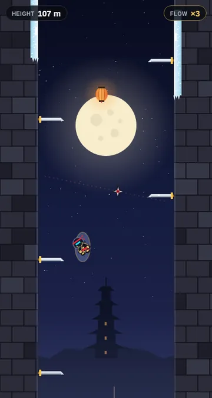 |  | 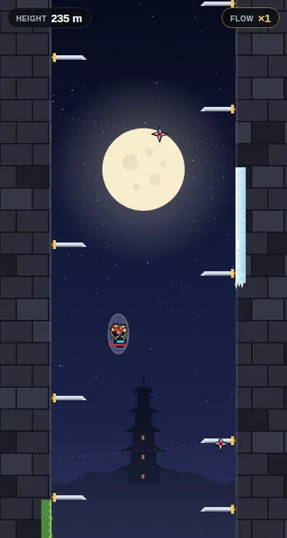 |
| After |  |  |  |  |

Clip (6 s, the whole minute at 10×): 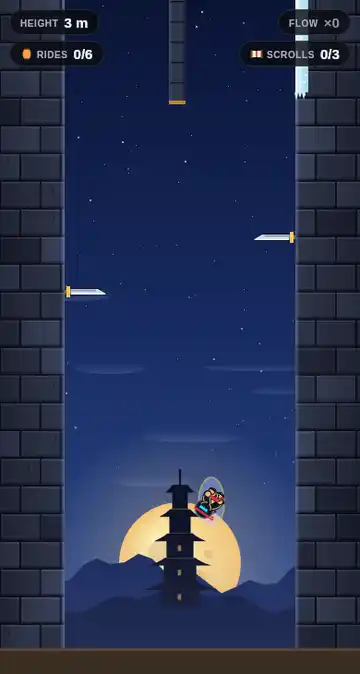

Edge to edge, the play screen at 390 × 844 below the 52 px header (the world and the play screen's fill as the stage
composes them; left at the start, right at 173 m): the slate floor carries on below the world to the screen's bottom,
no step at the world's edge (ricochet-overhaul-check measures it at 414 × 896, 390 × 844, 375 × 667 and a desktop size).

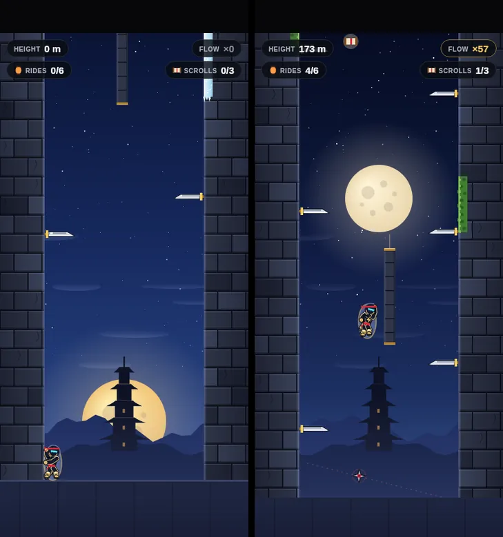

## Iron Wall

<!-- ironwall -->

Display and sound only (no stamp). The same Near-perfect skill-band run (seed 7, bastionRev 3) drawn by main's art
(before) and this branch's (after), each with its scene beyond the world, at waves 1, 3 and 5. The setting goes clear →
dusty desert → battle-smoke storm; far tanks get a pale outline and an S / M / H badge; the panel is navy with gold
labels at 13 px.

| | Wave 1 | Wave 3 | Wave 5 |
| --- | --- | --- | --- |
| Before |  |  | 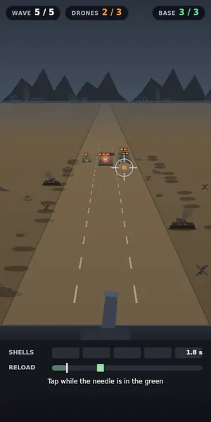 |
| After | 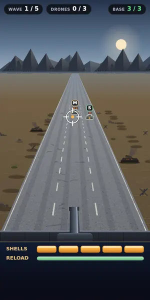 | 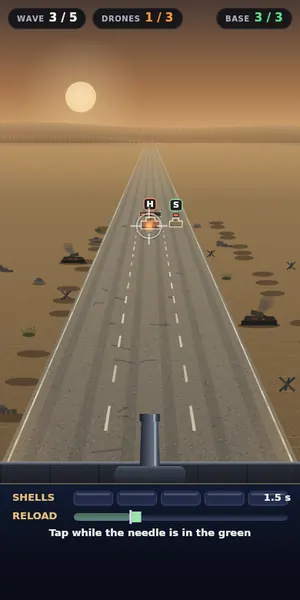 | 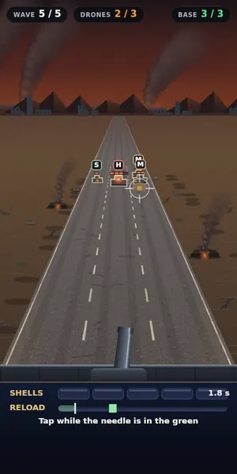 |

Edge to edge (arcade-fill-check's own frame, the real play screen as an iPhone 11 home-screen app, 414 × 896): the
scene and the navy panel run on to the screen's bottom with no seam. Clip (6 s, the whole minute, the scenery carried
past the world's sides): the setting changing wave by wave.

| Edge to edge, 414 × 896 app | Clip: the minute |
| --- | --- |
|  |  |

The clip is made by `bun scripts/shots/bastion-overhaul-clip.ts <dir>` (frames) and encoded as an animated WebP.

## High Rise

<!-- highrise -->

## Orbit

<!-- orbit -->

Drawn from each tree's own sim, renderer and screen fill (`scripts/shots/orbit-overhaul-frames.ts`) on the fixed intro
example, the skill-band bot playing at the elite level, at 390 × 844 below the game header. Before is main a3f40ff7
(orbitRev 14), after is orbitRev 15. The same run, the same ticks.

| | Start (tick 60) | Planet 18 (tick 1300) | Planet 33 (tick 2200) | The sun (tick 2651) |
|---|---|---|---|---|
| Before | 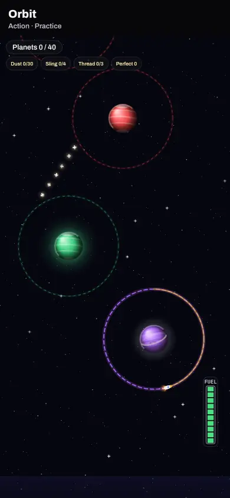 |  |  | 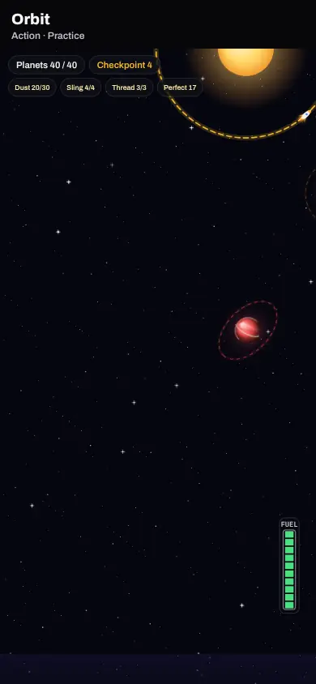 |
| After |  |  | 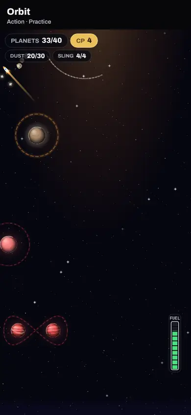 |  |

- **Planets:** rendered-look spheres (banded gas, cratered rock, streaked ice) turning slowly under one light, a thin lit
  limb; clean black space.
- **Setting:** the sun's warmth grows from the top as the run climbs (none at the start, a warm glow by planet 33, the
  sun itself at the end).
- **HUD:** two rows of bigger pills (PLANETS and the checkpoint; DUST and SLING) instead of six small ones.
- **Edge to edge:** before, a navy band shows under the world (bottom of each frame); after, the world's own black space
  and stars carry on to the screen's bottom and sides.

Edge to edge on a wider screen (640 × 900, the world centred, its sides filled):

Clip (6 s, the whole elite run sped up): the course from near space to the sun, the warmth growing.

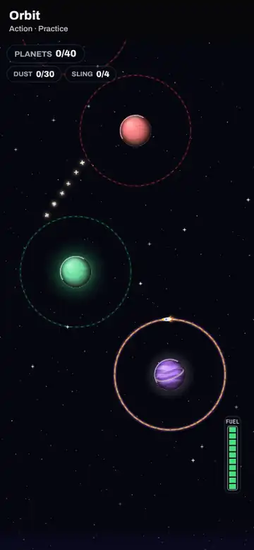

