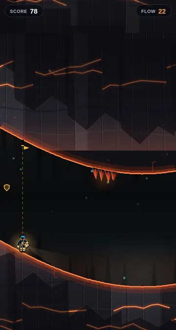
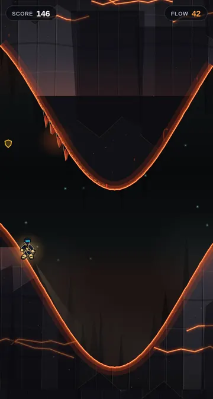
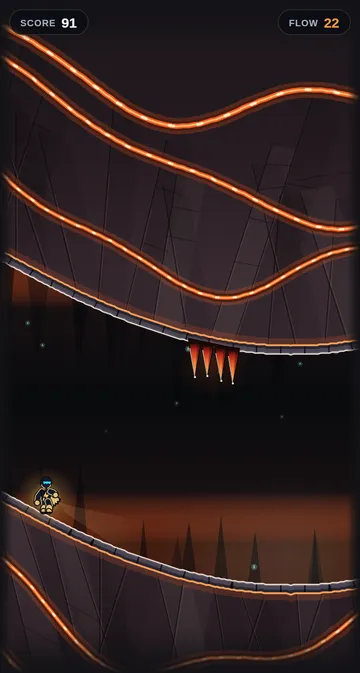
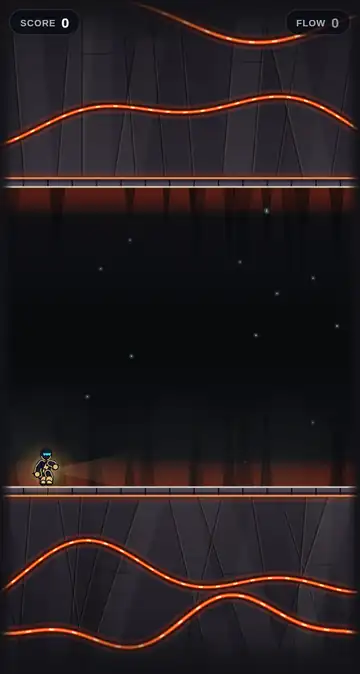

# Action overhaul: gallery (phase 2, step 4)

Before (main) and after per game, at 390 × 844, plus short clips of play showing the setting changing through the round.
Each game's frames are in its own folder here.

## Roofbound

<!-- roofbound -->

The game's own renderer drawing the Near-perfect bot's run on the same dealt course (course 301794028), the 390 × 730
world at 2×, shrunk to 360 wide: **before** is flipRev 12 on main's renderer, **after** flipRev 13 with the overhaul's
cave (`bun scripts/shots/flip-overhaul-frames.ts --rev=12 --tag=before` / `--rev=13 --tag=after`). 10 s, 30 s and 55 s
in, so the setting's change shows down each column: deeper in, the rock warms and the lava runs hotter and brighter.

| | 10 s | 30 s | 55 s |
|---|---|---|---|
| Before |  |  |  |
| After |  |  |  |

- The floor the Captain runs on is a solid stone lip with a crisp lit edge and block joints, the lava seam glowing under it.
- The rock is lit basalt columns with three rivers of lava flowing through it (bright beads run along each channel).
- Spikes are sharp single blades heating to a white-hot tip, outlined dark.
- Edge to edge: the world fades to the bedrock at its edges and the arena scene continues it, here on a 1366 × 768
  computer, 55 s in (the faint veins run off into the rock beside the world):

The whole minute as a time-lapse (one frame every 1⅓ s of play, about 6 s):

## Grappler

<!-- grappler -->

## Moon Climb

<!-- moonclimb -->

## Iron Wall

<!-- ironwall -->

## High Rise

<!-- highrise -->

## Orbit

<!-- orbit -->

