# Action overhaul: gallery (phase 2, step 4)

Before (main) and after per game, at 390 × 844, plus short clips of play showing the setting changing through the round.
Each game's frames are in its own folder here. Every game has three side-by-side comparisons, Today (main) | the
chosen concept | New (`<game>/compare-1.webp` to `compare-3.webp`), drawn by each tree's own renderer.

**Reveals.** The answer reveals are redesigned in stage 2, inside #422's shared reveal layout, and their before and after
shots arrive then. Stage 1 changed only their text: Roofbound's repeated "Bonuses" tile is gone, Moon Climb adds a hits
line, Grappler reads "n of 51 stretches cleared", High Rise counts lives lost.

## Roofbound

<!-- roofbound -->

The game's own renderer drawing the Near-perfect bot's run on the same dealt course (course 301794028), the 390 × 730
world at 2×, shrunk to 360 wide: **before** is flipRev 12 on main's renderer, **after** flipRev 13 with the overhaul's
cave (`bun scripts/shots/flip-overhaul-frames.ts --rev=12 --tag=before` / `--rev=13 --tag=after`). 10 s, 30 s and 55 s
in, so the setting's change shows down each column: deeper in, the rock warms and the lava runs hotter and brighter.

| | 10 s | 30 s | 55 s |
|---|---|---|---|
| Before | 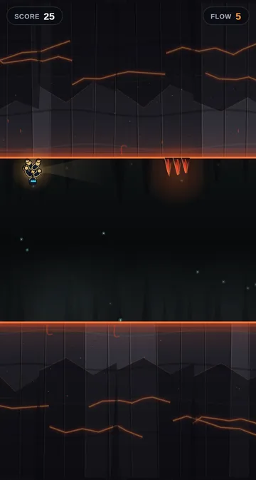 |  |  |
| After | 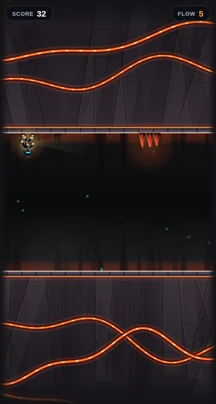 |  | 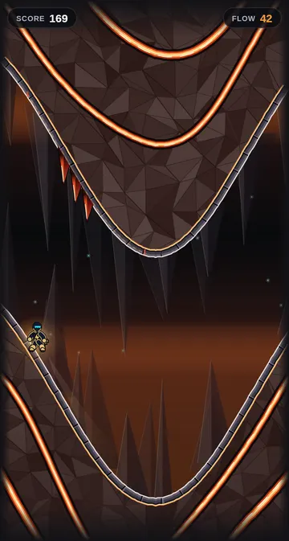 |

Today | Concept A | New, at 10, 30 and 55 s (the materials pass):

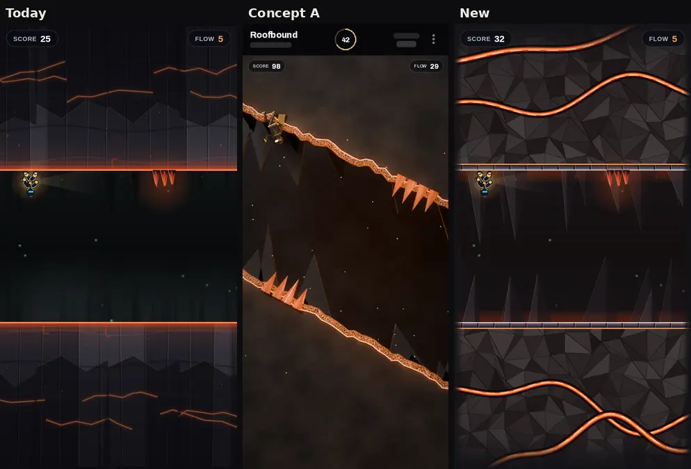
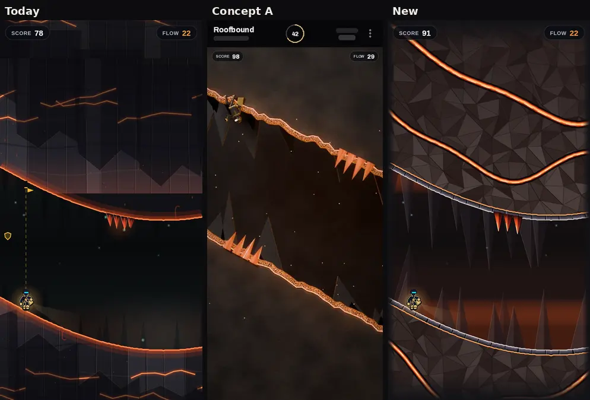

- The rock is faceted basalt (a cached tile, painted once per scale): every facet lit from the upper left by its own
  tilt, crisp pale edges on its lit sides and dark seams on the rest, darkening into the deep and warming with the heat.
- Two channels of glossy molten lava cut through it: a charred crust, the molten body, a bright core and a specular
  streak along the flow's lit side that slides as the lava runs (no halo).
- The floor the Captain runs on is a dressed basalt lip in three bevelled bands with chamfered block joints and a
  crisp top edge, a molten seam under it.
- Spikes are chunky two-faced obsidian: a hot lit face, a deep red far face, a dark outline and a glassy streak near
  the tip. No glow behind them.
- Behind the tunnel, concept A's angular rock shards in two parallax layers (a lit face, a shadowed face, a pale
  edge) and a warm smoky haze that thickens deeper in.
- Edge to edge: the world fades to the bedrock at its edges and the arena scene continues it, here on a 1366 × 768
  computer, 55 s in (the faint veins run off into the rock beside the world):

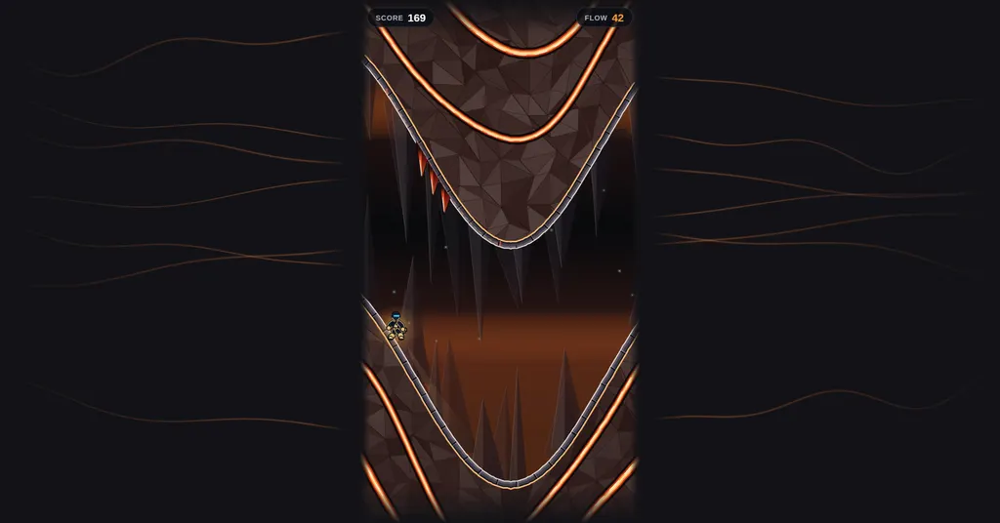

The whole minute as a time-lapse (one frame every 1⅓ s of play, about 6 s):

### Stage 2: effects and reveal

Drawn by the game's own renderer on dealt course 301794028 (the flawless witness, and the Weak bot for the crash), the
390 × 730 world at 2×, cropped round the runner. Every moment is read from the sim's state (`src/lib/arcade/flipFx.ts`);
nothing writes to it, no stamp.

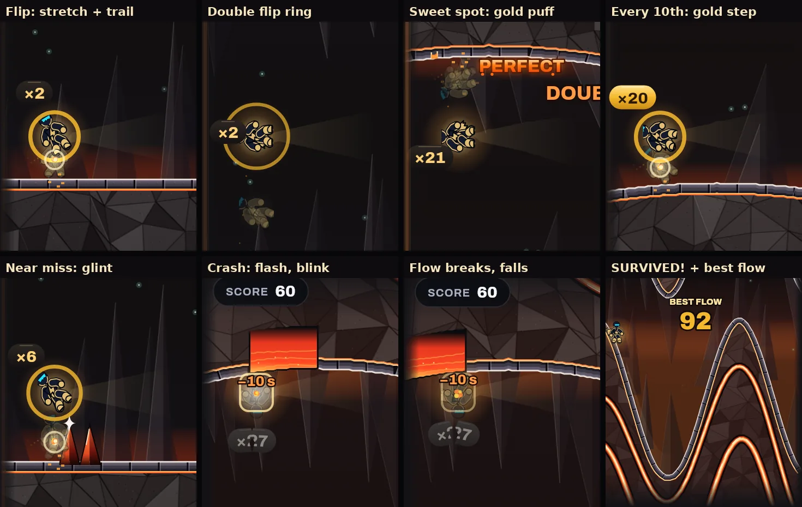

- **Flip**: the runner stretches a little along its arc (at most 1.3 px past its box) with a two-frame trail behind it;
  the whoosh rises to the roof or falls to the floor (`flip.flipUp` / `flip.flipDown`).
- **Double flip**: a gold ring opens round the runner (a second ring on a triple), with the DOUBLE FLIP! pop.
- **Landing**: a dust puff at the landing spot that drifts back with the cave (`flip.land`); on a sweet spot a gold puff
  (`flip.sweetGold`) and the molten PERFECT just ahead of the feet, the chime `flip.sweetLanding`.
- **Flow**: the counter rides over the runner's head ("×12") and swings round behind it in a flip (never ahead, where
  the hazards come from); each clean landing pops it up a step with a rising note (`flip.flowTick`), every 10th turns it
  gold with two glints (`flip.flowTen`); a crash cracks it in two and it dulls and falls away (`flip.flowBreak`).
- **Near miss**: flipping off just before a spike, or landing just past one, within 24 px: a white glint on the blade's
  tip (`flip.nearMiss`; 0–7 a run in the bands).
- **Crash**: a short white flash, then the respawn blink (`flip.respawn`, the impact haptic as before).
- **End**: SURVIVED! with BEST FLOW counting up under it over 800 ms (`flip.flowCount`); the stage holds the answer
  1.2 s so it lands before the reveal.
- **No edge glow** (the shared `ACTION_EDGELESS_GAMES`): Roofbound's `moment` hook (`flipMoment`) draws on the moment
  instead: a crisp gold rule drawing out under a banner (10 SECONDS, SURVIVED!) with a bead at each end, a gold ring at
  a point moment; a double flip's ring is the renderer's, following the runner.
- Reduced motion: no trail, stretch or swing; the puffs, glints and rings hold still and fade; the count shows whole.
  Reduced effects: one trail frame and half the dust.

A few seconds of play (a 20th clean landing, a double flip, then a Weak run's crash and break):
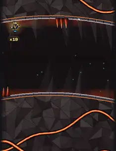

**The reveal**: a picture of the run (the definition's `RunPicture`, drawn by the arcade reveal under the breakdown in
place of the stat tiles). The minute is one strip of the cave: the best flow streak lit
gold where it ran, perfect landings as gold diamonds on the top rail, double flips as rings on the lower rail, crashes
as red marks; under it the four numbers the score is made of, big. Replayed from the stored log with the real sim
(`src/lib/duel/flipTimeline.ts`, the server replay's inputs); the score stays the server's. Before (today) and after,
practice at 390 × 844, a Weak run and the flawless one:

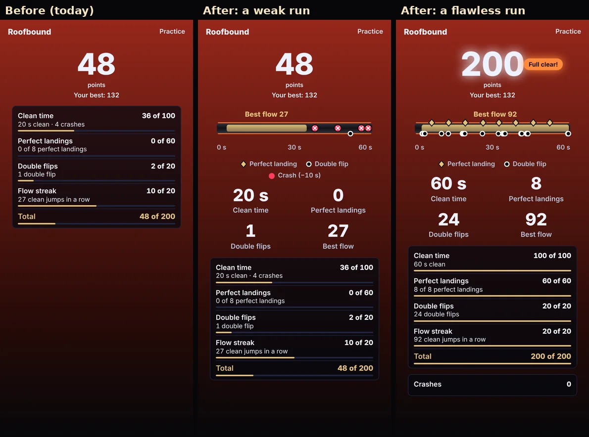

### Stage 3: Expert

An Expert run (flipRev 13, `level: "expert"`), room seed n=10 (course 1208933397), played by the human-limited elite bot
the level tuning used and graded by the server replay: **173**. The last 4 s, the steepest zigzags with spikes riding the
rails at speed, then SURVIVED! with the HUD at the final 173 (the game's own renderer, 5 frames a second;
`bun scripts/shots/action-expert-clip.ts flip 10 --from=56 --secs=4 --width=170 --q=40 --max=78000 --encoder=pillow`):

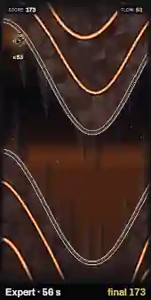

## Grappler

<!-- grappler -->
Drawn by the game's own renderer on a dealt swingRev 17 course played by its oracle's witness
(`bun scripts/shots/swing-overhaul-frames.ts [--root=<main checkout>] [--tag=before|after] [--size=WxH] [--clip]`),
in the play screen's geometry (a 52 px header stand-in). Display only: the same course, rules and score.

**Materials pass** (Today | Concept A | New; all procedural, painted once into cached tiles and sprites, no shipped
images): a three-deep forest (pale far trunks in the haze, mid trunks fading into it, near trunks with bark grooves,
knots and moss streaks, carrying clusters of real lit leaves), leaf clusters along the canopy's underside, twisted
lime vine ropes, enamelled cream-metal grab rings with a specular arc and a gold bead (gold just after a grab, no glow),
a glossy river (the near trunks reflected, a sheen where the light falls, glints), wood-grained platforms on barked posts.

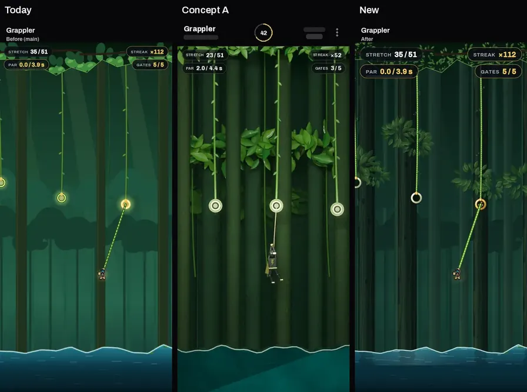

 (375 × 667, near the end: the darkened jungle carried on beside the world)

| | Start | Two thirds | Near the end |
|---|---|---|---|
| Before (main) |  |  |  |
| After | 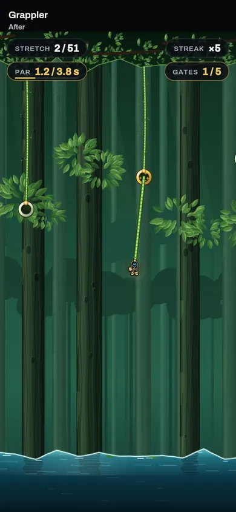 |  |  |

- The jungle deepens through the course (`swingJungleDepth`): darker, colder backdrop and moss curtains towards the end;
  every vine, platform and the hero stay at full contrast over it.
- Calmer backdrop, moving water with shine, bigger 12 px grab loops with less glow, a thicker held vine, a dark pool
  under the hero, the HUD chips 1.3× (labels about 11 px on a phone), one stretch count (51) on HUD and reveal.

**Edge to edge** at 375 × 667 (the world is narrower than the screen): before, black strips beside the world; after, the
jungle runs on beside and below it at the world's depth, a platform run's shade and dim included.

| Before (main) | After, start | After, near the end |
|---|---|---|
| 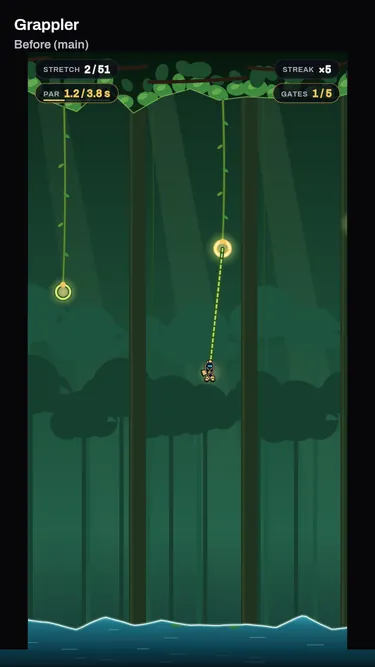 |  | 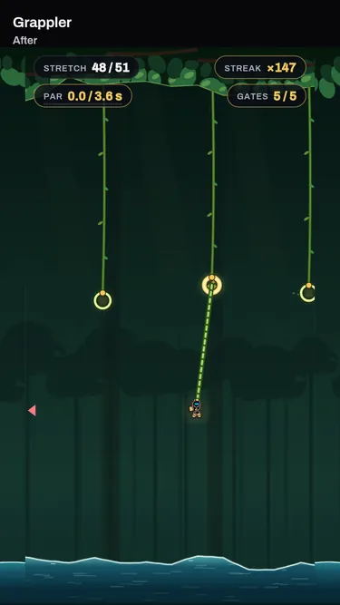 |

**Clip** (the setting deepening; four 1.5 s windows at the start, a third, two thirds and near the end):
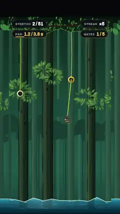

### Stage 2 look pass

Today (main e0aa53f2, swingRev 17) | Concept A | New (swingRev 18 on its own dealt course 0, its oracle's witness;
`bun scripts/shots/swing-overhaul-frames.ts --rev=18 --course=0`), at the start, two thirds and near the end:

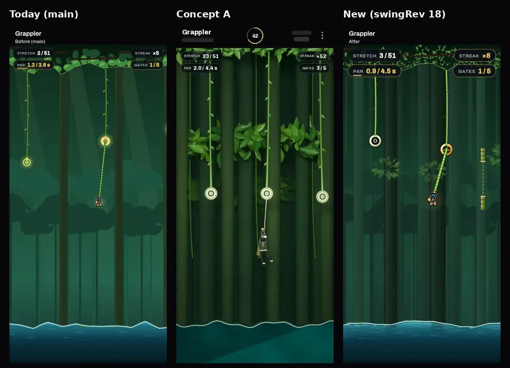

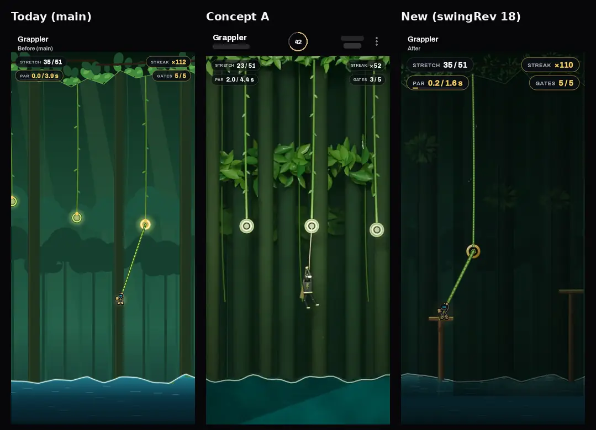

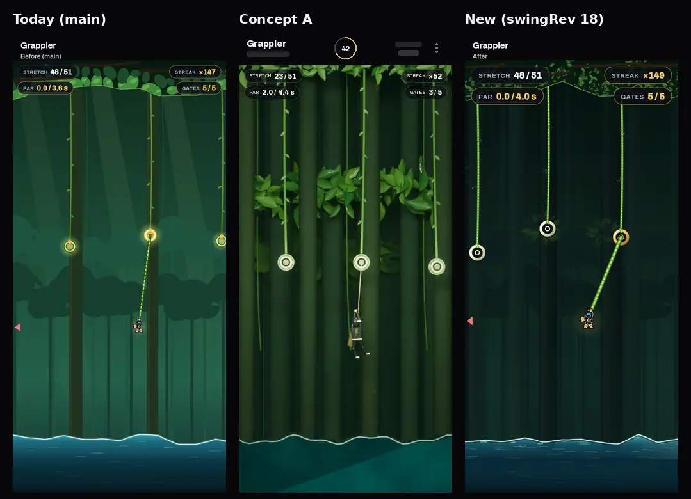

- **The hero and rope bigger** (swingRev 18, a new stamp with re-proved courses): the body 14 px (was 10), Captain Joulz
  drawn 1.4× to fill it, the held vine 1.85×; 120 dealt courses whose flawless run replays to 200; bands within a few
  points of rev 17 at every level (docs/arcade-standard/swing.md).
- **Clearer hooks**: concept A's 14 px target ring, cream enamel on a dark pad with a bullseye, a lime binding; hanging
  vines thicker and cleaner.
- **Glossy water with real movement**: a bright sky band under the surface, wavering trunk and ring reflections, a
  drifting sheen, ripple rings opening and fading, glints on the crests, a dark meniscus under the lit edge.
- **A calmer background**: darker, quieter haze, faint shafts, low-contrast mid and near trunks with dim foliage and
  mist; about half stage 1's luminance spread and edge energy.

**Clip** (the water's movement, the bottom of the play screen over four 1.5 s windows): 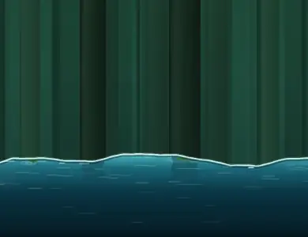

### Stage 2: effects and reveal

Effects (swingRev 18, the game's own renderer on a dealt course's witness; display only, each drawn from the sim moment
it observes):
- the vine flexes as it takes the hero's weight (`swing.ropeSnap`);
- a faint speed streak trails a release fast enough to light a gate (`swing.speedWhoosh`, pitched by speed);
- the arc meter under STREAK fills a segment per clean grab and bursts gold on the eighth (`swing.streakMeter` up a
  pentatonic arpeggio, then `swing.streak`); GATES moved beside PAR so the meter sits under STREAK;
- a vine just out of reach of a press is tinted red for half a second (`swing.outOfReach`);
- the pterodactyl's shadow sweeps across before its screech and wingbeats (`swing.pteroShadow`);
- the end's "COURSE CLEARED!" (or "TIME") with the stretches tallying up (`swing.courseCleared`, `swing.stretchTally`).

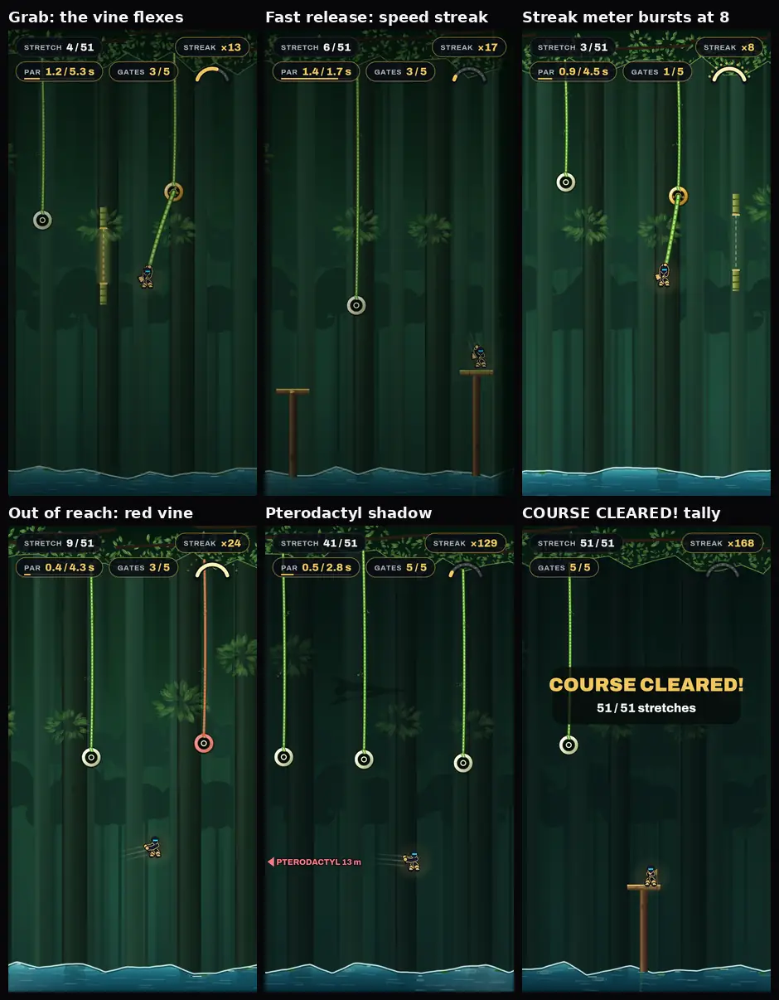

The reveal's run picture (`SwingRunPicture`, the stored run replayed by the server's own replay): course %, stretches,
under par and gates big, then the 51 stretches as one path in three rows (gold under par, lime cleared, dashed where the
run ended, faint never reached; blue drops where the hero fell, a red wedge for a pterodactyl catch, gate posts gold once
lit), then a legend with the best streak. Before is today's reveal lines; an average and a flawless run:

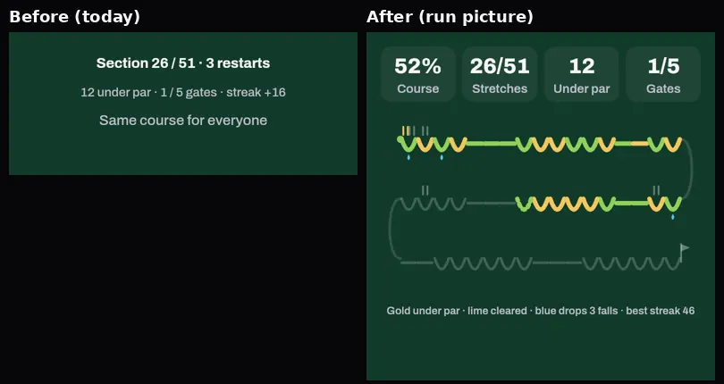

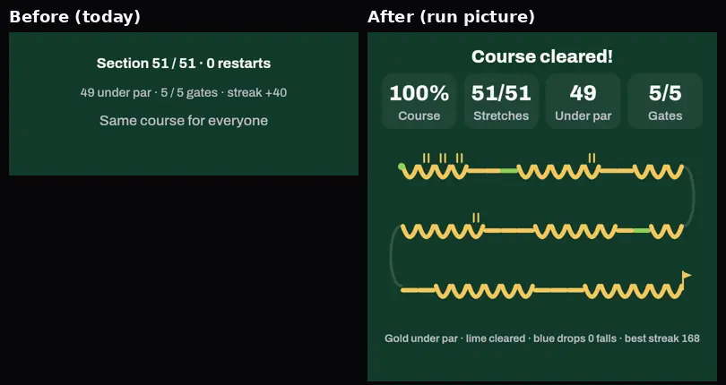

### Stage 3: the canopy and a readable reveal (15 Nov 2026)

Today (main e0aa53f2, swingRev 17) | Concept A | New (swingRev 18, dealt course 0, its oracle's witness;
`bun scripts/shots/swing-overhaul-frames.ts --rev=18 --course=0`), at the start, two thirds and near the end:

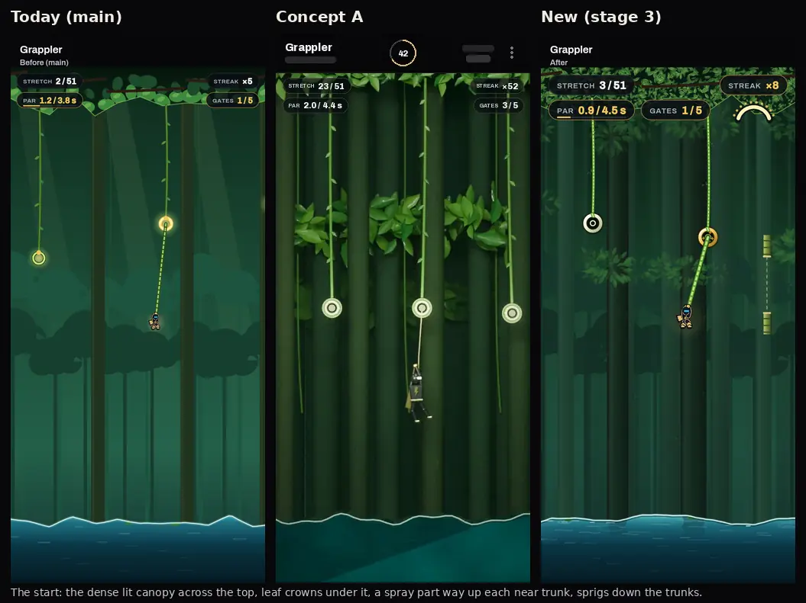

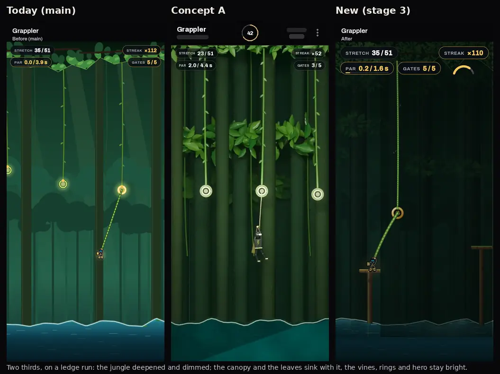

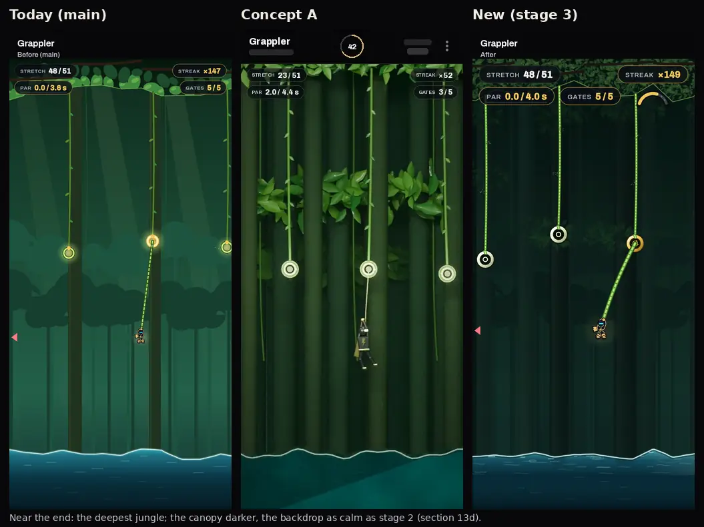

- **A dense canopy** (every jungle revision, display only): four rows of lit leaf clusters packed back into the canopy
  mass (`paintCanopyLeaves`: hundreds of leaves on screen, the front row brightest along the underside, each row behind
  darker), seeded by world x so it never swims; the screen fill beside the world draws the same rows. Its underside is
  still exactly the sim's ceiling line (nothing drawn below it), and it sinks into the deepening jungle with the backdrop.
- **Leaves down the trunks**: each near trunk carries a crown of leaves under the canopy, a spray of clusters on its
  branch part way up (concept A's band across the view) and five sprigs down its length, in the shade's own greens
  (no midribs or sheen), so the vines, rings and hero still read first.
- **Still calm**: the far trunks' sides now fade into the haze, and the backdrop's luminance spread and edge energy stay
  at most 60 % of stage 1's at every camera (swing-overhaul-check 13d). No image shipped: all drawn in code and cached.

**The reveal at phone size.** Today the 51 stretches were 17 to a row, 16 px each on a 375-wide phone, and read as a
squiggle. Now the path folds into rows that keep every stretch at least 34 px wide (8 a row at 375 × 667, 9 at
390 × 844), 46 px apart, with 6 px lines, 11 px drops, 12 px gate posts, a 14 px catch wedge, a 13 px fall count and a
14 px legend. The picture as it sits on each phone (the reveal column's real width, 319 and 334 px), before | after:

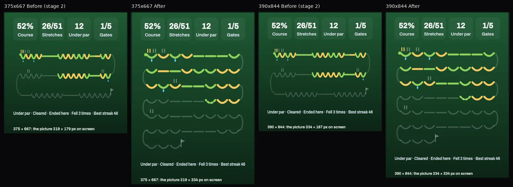

Frames: `bun scripts/shots/swing-reveal-shots.ts [--old=<renderer file>] [--tag=before]`.

## Moon Climb

<!-- moonclimb -->

The world as drawn on main (before) and on this branch (after), at the same moments of one Near-perfect bot climb on
seed 4100 (the skill-band bot, through the real sim; 390 × 730 world, shown 360 wide). The sim and score are unchanged;
the moon rises and the sky deepens with the height climbed. The HUD's second row shows lantern rides and scrolls.

**Materials pass** (today | concept A | new, at 107 m, 197 m and the end): carved moonlit slate (each block's lit
bevel, grain, strata, chipped corners and cracks), wet moss with crisp highlights, glassy ice, polished steel katanas
with a temper line, gold guards and wrapped hilts, blued-steel shurikens with a sheen, paper lanterns lit from within,
a cratered moon and the pagoda in layered mist.

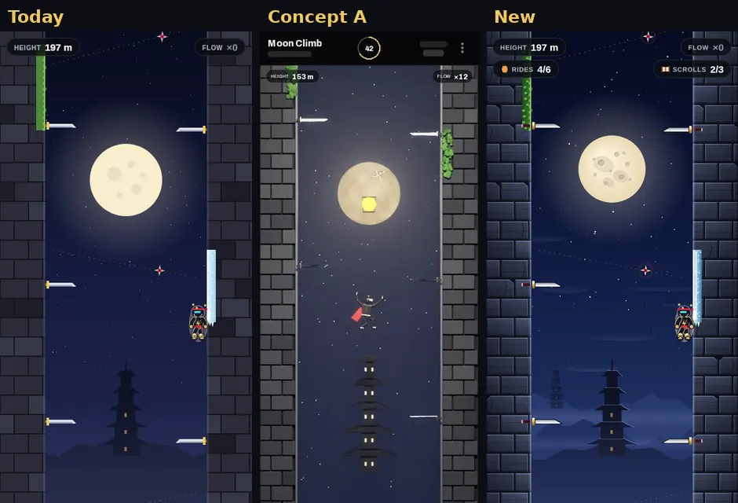

| | Start (13 m) | 107 m | 197 m | End (235 m) |
|---|---|---|---|---|
| Before | 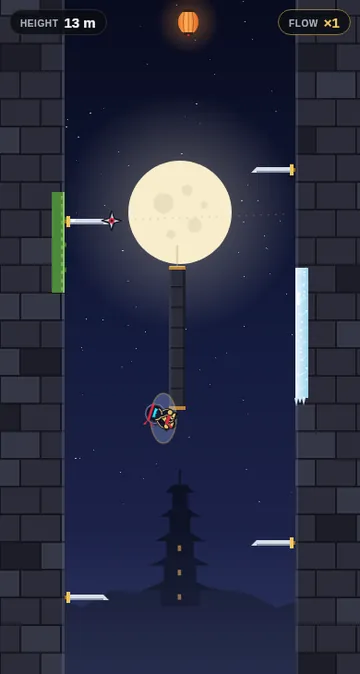 |  |  |  |
| After |  |  |  |  |

Clip (6 s, the whole minute at 10×): 

Edge to edge, the play screen at 390 × 844 below the 52 px header (the world and the play screen's fill as the stage
composes them; left at the start, right at 173 m): the walls' carved slate and the shaft's floor carry on below the world to the screen's bottom,
no step at the world's edge (ricochet-overhaul-check measures it at 414 × 896, 390 × 844, 375 × 667 and a desktop size).

### Stage 2 look pass (15 Nov 2026)

Today (main e0aa53f2) | Concept A | New: the witness climb on seed 11 at the same ticks (ricoRev 3 on main, ricoRev 4 on
this branch, its own tower), the 390 × 730 world at 2×, shrunk. Riding the first lantern at 33 m with the moon rising
over the ridge; about 110 m with the moon behind the shaft; riding a lantern at 240 m under a high moon.

Clip (7 s, the whole minute at 8×): the moon rising and shrinking, wisps drifting across it, far lanterns rising behind
the walls, the raking moonlight moving up the stone with the moon, each lantern lighting the walls near it.

- **Sky**: a deeper five-stop night, a slanting band of star dust, 170 stars of every kind (pinpoints, cool and warm,
  bright ones with a four-point glint), drifting cloud wisps lit where they pass the moon, a moonlit mist band.
- **Moon**: larger (84 → 66 px as it rises, was 66 → 50), a lit sphere with maria and 28 craters (shadowed floors, lit
  far rims, central peaks), amber low down, warm cream high; far paper lanterns rise behind the walls and across it.
- **Pagoda in mist**: three ranges with moonlit crests, two far pagodas, the temple's with warm paper windows.
- **Walls**: blocks stand proud of a lighter mortar bed and cast short shadows on it, faces rounded by the light, crisp
  lit edges; the moon rakes across the stone at its own height every frame; moss and ice catch it along their lips;
  the mid-ledges are the same carved slate with iron bands.
- **Sky lanterns**: translucent paper lit from the flame low in the base, bamboo ribs dark against the light, a crisp
  sheen on the curve, lacquered rim; the warm light falls on the walls and ledges near it, never as a glow round it.
- **The bigger ninja** (ricoRev 4): the body box 34 × 68 (was 26 × 52) and the figure drawn at 17/13 to fill it, the
  hits following exactly what is drawn; no gold rim round it.

### Stage 2: effects and reveal (15 Nov 2026)

Each effect drawn by the game's own renderer from a real ricoRev 4 run (the Average skill-band bot, seed 4100, every
tick drawn on one canvas): a leap's dust off the wall, a double jump's ring of air, a slide on moss past the flow's
limit (the scuff's gouges turn red), a grabbed lantern swaying, a scroll flying to its count (the chip flashes as it
lands), and a hit (the tumble and a red "−3 m" beside the height).

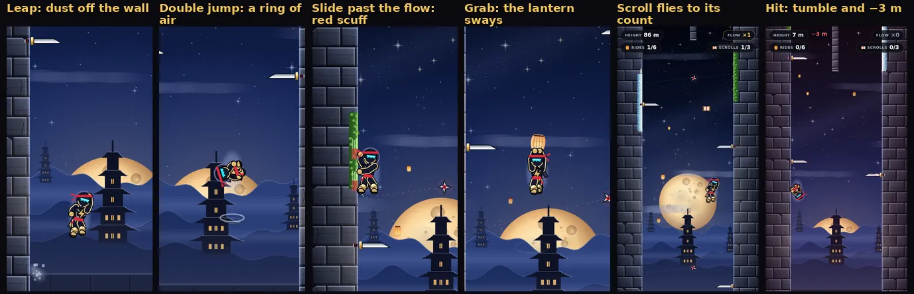

The answer reveal, before and after (a Near-perfect run, seed 4197, 163 points). Before: the breakdown and four stat
tiles. After: the four numbers that explain the score in big type, then the climb drawn as the shaft (the real canvas
picture, `drawMoonRunPicture` from `moonRunSummary`'s replay): the column up to the height reached, the longest Flow
streak's stretch in gold, each hit a red mark with its metres lost, lanterns ridden and scrolls taken beside it, the
full height dashed, a ruler every 50 m. The hits line from stage 1 stays in the breakdown. (The panel is composed from
the real picture and the component's numbers; the stat tiles give way to it in the shared reveal.)

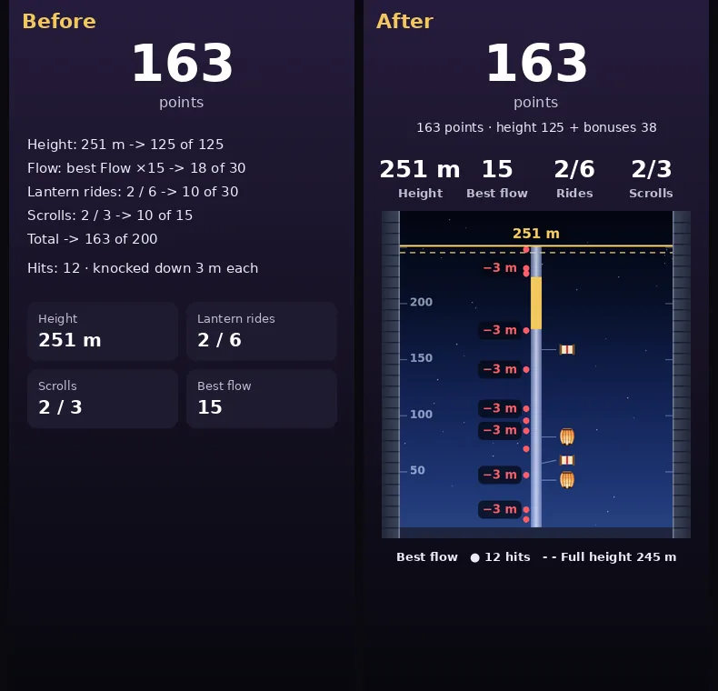

### Stage 3: Expert

An Expert tower (ricoRev 4, `level: "expert"`), dealt seed 1636024891, played by the elite bot under the levels' human
limits and graded by the server replay: **161**. 43–48 s: more blades and ice on the walls, shurikens, a knock-down
(−4 m) and the climb past 200 m (the game's own renderer, 5 frames a second; the caption carries the server's final
score; `bun scripts/shots/action-expert-clip.ts ricochet 1636024891 --from=43 --secs=5 --max=70000`):

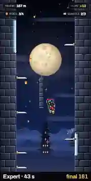

## Iron Wall

<!-- ironwall -->

Display and sound only (no stamp). The same Near-perfect skill-band run (seed 7, bastionRev 3) drawn by main's art
(before) and this branch's (after), each with its scene beyond the world, at waves 1, 3 and 5. The setting goes clear →
dusty desert → battle-smoke storm; far tanks get a pale outline and an S / M / H badge; the panel is navy with gold
labels at 13 px.

**Materials pass** (15 Nov 2026): the road is asphalt (aggregate speckles, worn tyre lanes, tar seams, solid worn edge
lines and worn dashes, sand drifting over the shoulders in the dust); the field has sand grain and wind ripples; peaks
have sunlit faces and the dunes lit ridges; the storm's smoke billows have volume (a lit crown, a dark core, a warm
underside over the fires) and every wreck burns with its own plume; tanks are painted metal (a lit top plane, a crisp lit
front edge, track links, a turret dome lit from above with a specular glint, a ground shadow no wider than the hull);
the barrel is gunmetal with a crisp highlight down its lit side, on a cast mount; the parapet is cast concrete with a lit
coping; the panel's shells are glass capsules (brass shells with a crisp highlight on the top curve, dark glass when
empty) and the reload gauge a recessed channel with a polished steel needle. No glow edges, no glare over the HUD or
the panel's numbers. All drawn in code and cached per setting: no new shipped images.

Today | concept | new, the same moment:

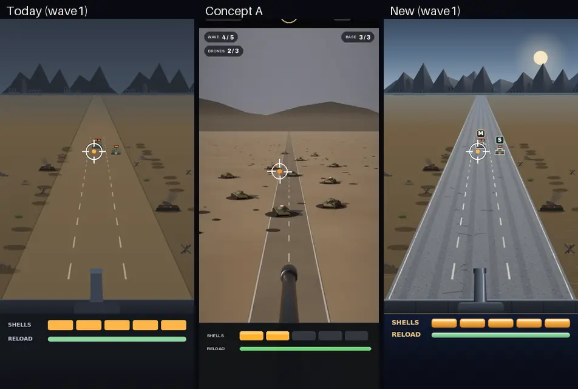

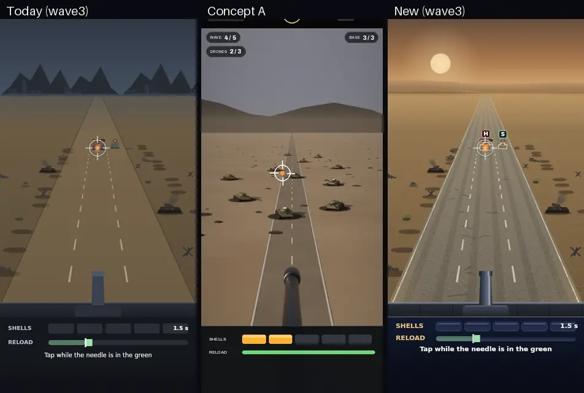

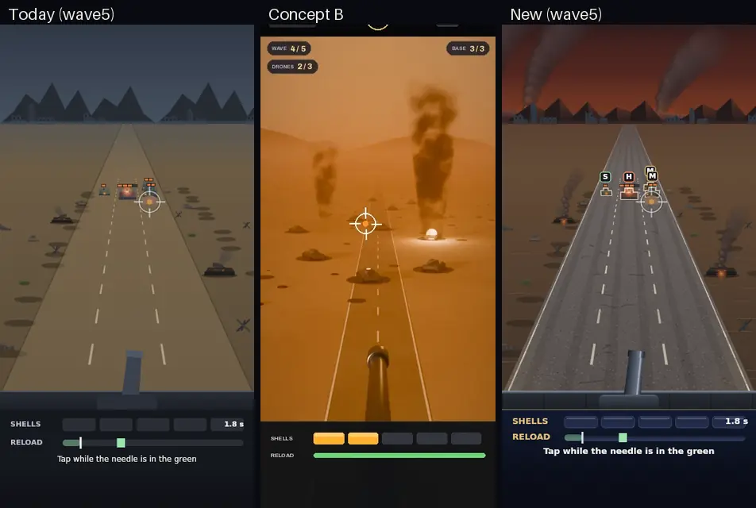

| | Wave 1 | Wave 3 | Wave 5 |
| --- | --- | --- | --- |
| Before |  | 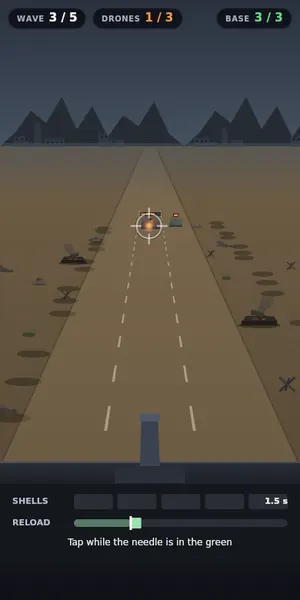 |  |
| After |  |  |  |

Edge to edge (the scene and the world drawn as the stage draws them, in a 375 × 667 phone's arena box, so the sides
show the scenery carried on; arcade-fill-check proved the real play screen at 414 × 896 app and 390 × 844, and
bastion-overhaul-check proves no seam at four sizes in every setting). Clip (6 s, the whole minute): the setting changing
wave by wave.

| Edge to edge, 375 × 667 | Clip: the minute |
| --- | --- |
|  |  |

The clip is made by `bun scripts/shots/bastion-overhaul-clip.ts <dir>` (frames) and encoded as an animated WebP.

### Stage 2: effects and reveal

Display and sound only (no stamp). Each pair is the same tick of a recorded run (bastion-overhaul-rev3.json) drawn by
main's art (5737bbc5, left) and this branch's (right) with `@napi-rs/canvas`; the effects come from the sim's own
state (its cooldown, reload fields, counters and landings), so replays draw them the same. Every one is under 900 ms
and has its sound slot (`docs/sound-cues/arcade-effects.md` "Iron Wall").

Firing (the barrel alone kicks 3 px for 80 ms, a crisp muzzle star for 3 ticks) and a shell in flight (its shadow slides
over the road to the exact landing point):

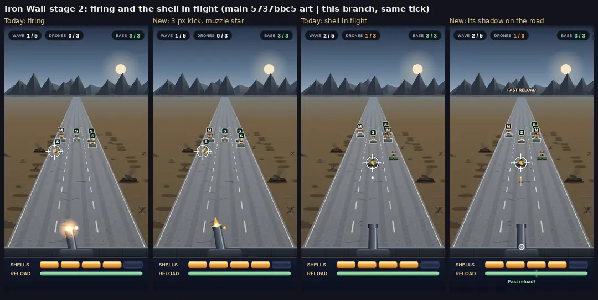

A weak-spot hit (the vent flashes gold every time, sparks; the tank's hit wash is now a third, so nothing glares) and a
kill (flame petals, armour debris, smoke and "+n" rising; gold on a weak-spot kill):

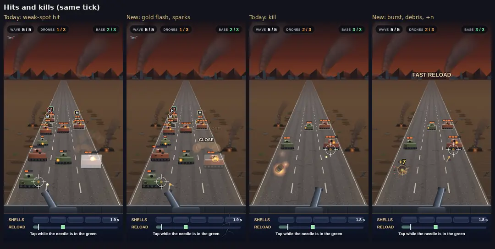

A near miss (a dustier puff, CLOSE), a fast reload's end (the green needle, the shells snapping in one by one with a
click each), a jam (the needle red and shaking) and a base hit (a crack across the panel's glass where the tank came
through, kept all run):

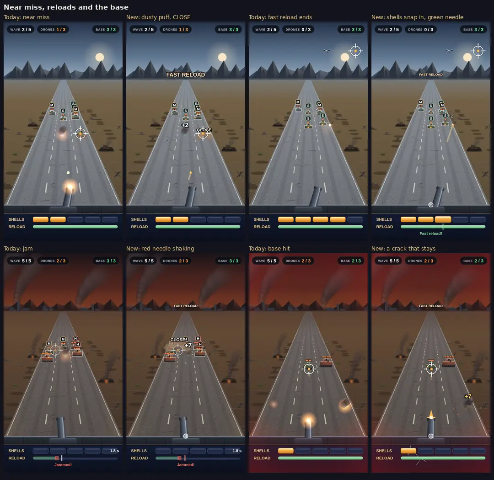

The end card: the field dims, the five waves tally 150 ms apart, then WALL HELD (BASE DOWN if the base fell); the stage
holds the reveal 1.8 s for it. Clip (1.8 s):

| Frames | Clip |
| --- | --- |
| 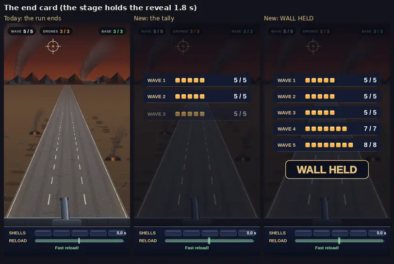 | 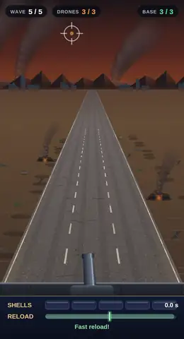 |

The answer reveal: today the arcade reveal shows the score and the part lines only; now Iron Wall adds its own picture
under the score and breakdown (the shared `RunPicture` hook, in place of the stat tiles): four big numbers, then each wave's tanks drawn by the
game's art (in colour: destroyed; faded: not stopped; red plate: reached the wall; a gold dot per weak-spot hit), the
drones and the base. The picture is the real `paintBastionSummary`; the score row and the four numbers are drawn here to
match the reveal's CSS (their markup is proved by bastion-overhaul-check section 10).

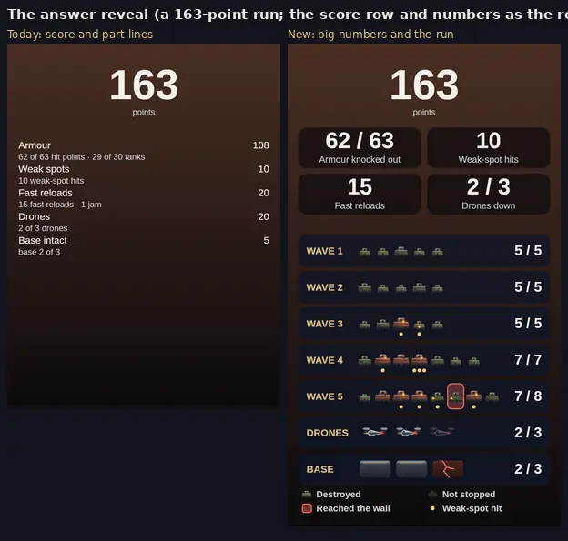

Frames: `bun scripts/shots/bastion-fx-shots.ts --out=<dir>`.

### Stage 3: levels (16 Nov 2026)

Expert (bastionRev 3, Iron Wall as rooms dealt it before the levels) played by the Elite bot under human limits on seed
30710843, server score **172**; 5 s from 40.6 s (wave 5) at 5 frames a second, the game's own art
(`bun scripts/shots/action-expert-clip.ts bastion 30710843 --from=40.6 --secs=5 --q=40 --encoder=pillow
--out=docs/design/pages-review/action/bastion/expert-clip.webp`, 59 KB; Pillow writes every frame whole, since ffmpeg's
changed-rectangle frames break Iron Wall's shifting smoke and sky into blocks):

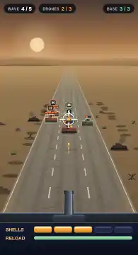

The bigger weak spots of Easy, Normal and Hard drawn inside the tank (Joe, 16 Nov 2026; the hit area, blue, unchanged;
each pair before | after, Expert's unchanged):

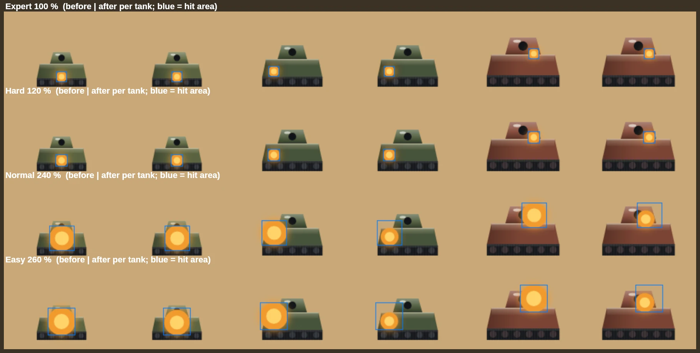

## High Rise

<!-- highrise -->

`skylineRev 11` (lives, the wide-block rescue), the new look and the materials pass (15 Nov 2026). The new frames are drawn
by the game's own renderer with the play screen's fill around it (`bun scripts/shots/skyline-overhaul-clip.ts <dir>
<screenW> <screenH> [every] [sloppy]`, in @napi-rs/canvas, no browser), so they show the world and its fill, not the app's
header; text pops that run on the real clock sit on top of each other in these stills. Today is the game review's frame
from main.

**Materials.** Each floor is a glass curtain wall exactly on the sim's rectangle: deep blue-black glass with the sky caught
on its upper half, steel mullions with a lit side, a polished gold spandrel band (heavier every fifth floor), windows that
light warm and cool as night falls, a crisp highlight line down the tower, a lit left edge and a shaded right edge so each
floor and its overlap read at once. The crane's jib is painted yellow steel, light on its top faces, the two diagonals in
two tones, with bolts. The city is concept A's three layers, held still (the tower climbs past it), and the stone plaza
is a solid foreground with kerb, paving and a footing. The harbour is glossy: a sheen under the quay, the city's lights
and the moon broken into reflections, the dusk's rose on the water. No glow edges, no glare over the HUD.

| Today · Concept A · New |
|---|
|  |
|  |
| 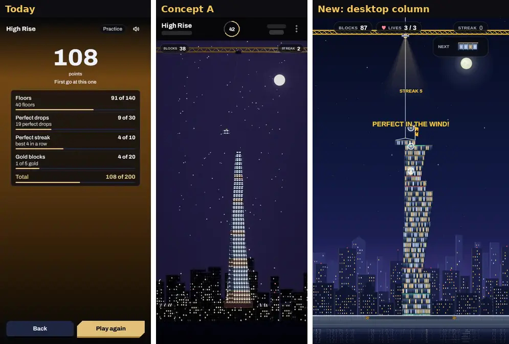 |

| Dusk, the plaza | A life lost ("−1 LIFE", LIVES 2 / 3) | Night, 414 wide, edge to edge | Late night |
|---|---|---|---|
|  |  | 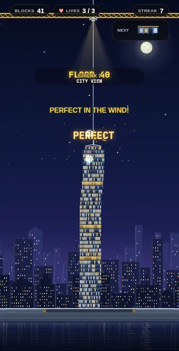 |  |

Edge to edge on a computer's column (640 wide): the sky, the city, the jib and the plaza run on beside the world as one
picture. 

Clip (about 6 s, one frame every 1.5 s of a 60 s run): dusk turning to night and the city lighting up as the tower
climbs: 

Before (main), for reference:   

### Stage 2: effects and reveal

Joe's effects list (docs/arcade-standard/skyline.md "Stage 2"), drawn by the game's own renderer on one scripted skylineRev
11 run (five trims, a rescue, two lost lives, a sliver), in @napi-rs/canvas (`bun scripts/shots/skyline-stage2-shots.ts
<dir>`): the block falling the last floor, the perfect drop's gold ring at the join and the lit grown strip, the trimmed
overhang spinning off with crumbs at the cut, a sliver tipping on its foot, a lost block tumbling under "−1 LIFE", and the
end's count over the whole tower. No edge glow on any of them (the shared layer draws none for the Action games).

The end, a frame every 100 ms: the hook goes, the camera pulls back over the tower and the count rises to the floors
built. 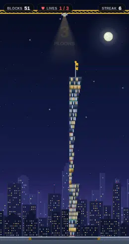

The answer reveal, the same run: today's breakdown and stat tiles | the new picture of the run under the same breakdown,
with Floors, Perfect drops and Best streak big and a legend (gold perfect drops, glass trims, teal wide blocks, red lost
lives, the best streak bracketed). Drawn on the reveal's gradient at the reveal's type sizes; the app's own CSS sets the
text (the picture itself is the real `drawSkylineRunPicture`).

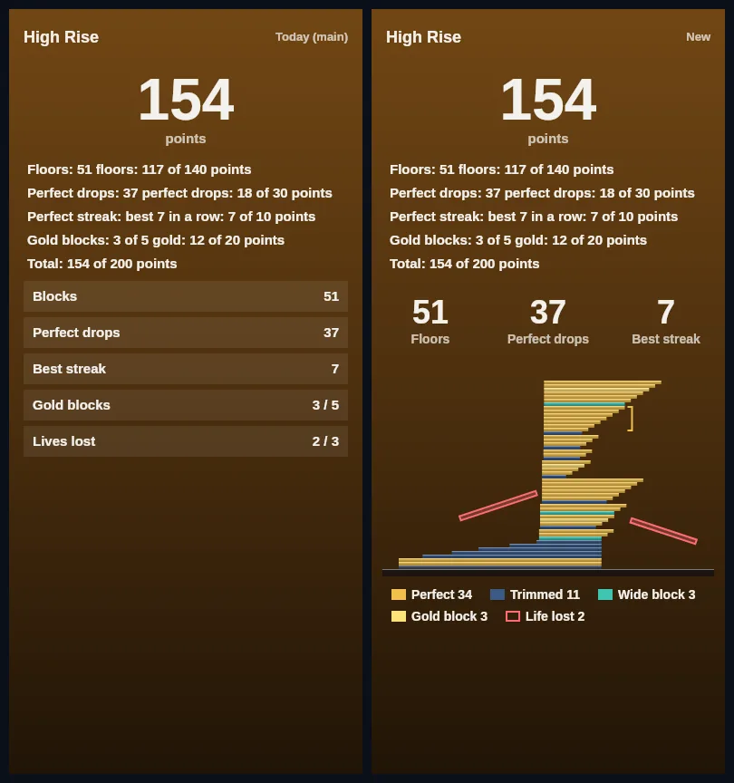

### Stage 3: the reveal's order (15 Nov 2026)

Joe: no block of text lines above the run picture. The shot above drew the stored breakdown as plain lines over the
picture; in the app the breakdown is the shared list (`RevealBreakdown`), and it sat above the picture for every game
with a run picture. Now the shared arcade reveal (`ArcadeReveal`) draws the score, then the game's big numbers and run
picture, then the stored breakdown in the shared list below (in a room, the summary line with See breakdown); the same
for Roofbound, Grappler, Moon Climb, Iron Wall and Orbit, and no change for games without a picture. Practice, the same
154-point run, before (stage 2) | after (`bun scripts/shots/skyline-stage2-shots.ts <dir>`, reveal-s3.png):

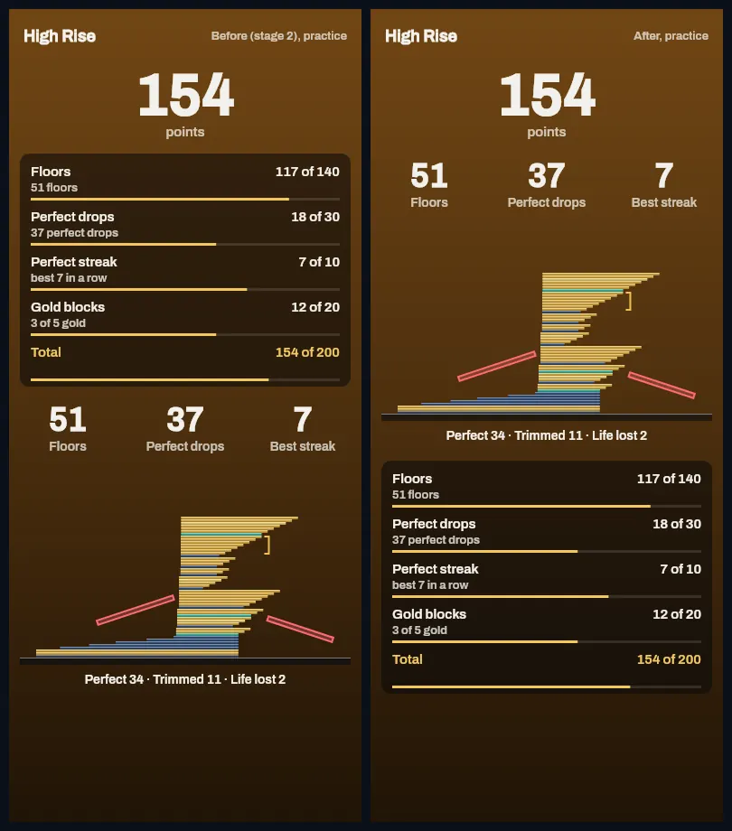

### Stage 3: Expert, 3 lives (16 Nov 2026)

Hard and Expert keep 3 lives; Expert stays harder by its slide, its 2 px perfect drop and wind from block 10
(docs/arcade-standard/skyline.md "Levels"). The human-limited elite's Expert run on room seed n=29 (course 1530145177),
**146** by the server replay, 30–35 s, from block 36, a perfect drop in the wind (the game's own renderer, 5 frames a second;
`bun scripts/shots/action-expert-clip.ts skyline 29 --from=30 --secs=5`, 54 KB):

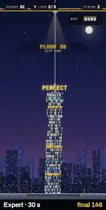

## Orbit

<!-- orbit -->

Drawn from each tree's own sim, renderer and screen fill in @napi-rs/canvas (`scripts/shots/orbit-materials-frames.ts`)
on the fixed intro example, the skill-band bot playing at the elite level, at 390 × 844 below the game header. Before is
main a3f40ff7 (orbitRev 14), after is orbitRev 15 with the materials pass. The same run, the same ticks.

Today | Concept A | New (the materials pass):

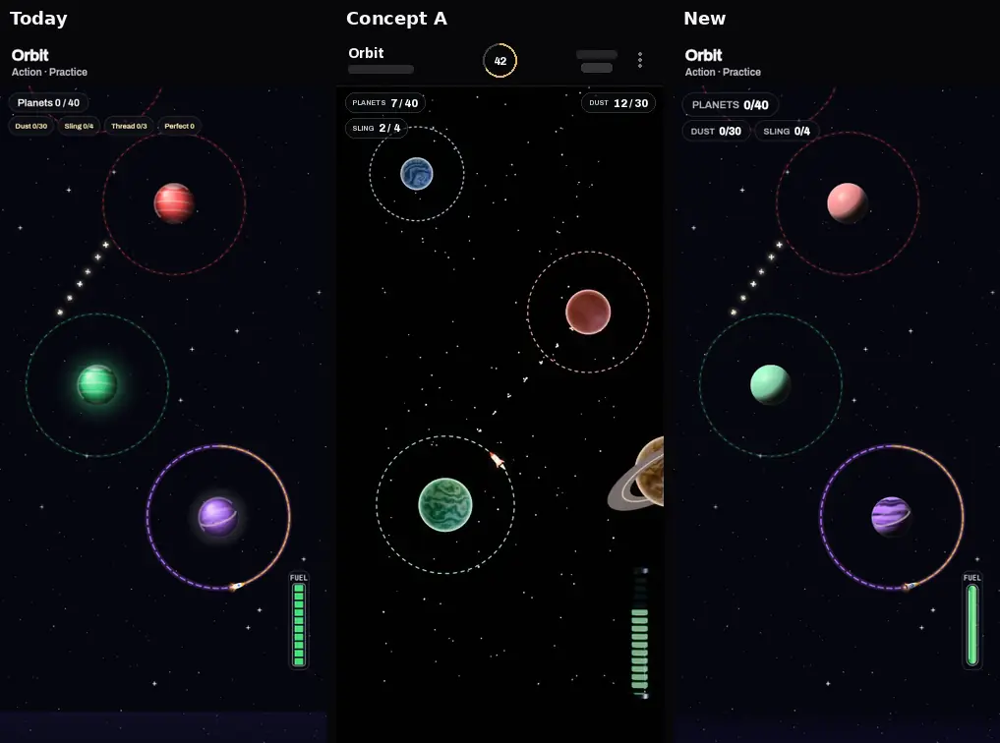

| | Start (tick 60) | Planet 18 (tick 1300) | Planet 33 (tick 2200) | The sun (tick 2651) |
|---|---|---|---|---|
| Before |  |  |  |  |
| After |  |  |  |  |

- **Planets (materials pass):** true spheres projected from six pre-rendered surface maps (two banded gas giants, two
  cratered rocks, an icy world, an ocean world; 43.7 KB of WebP in all), tinted with each planet's colour, turning slowly
  under one sun: a soft terminator into a deep night side, a thin lit atmosphere rim inside the disc (no glow round it),
  a crisp specular on water and ice. Clean black space.
- **Rocket:** brushed-metal hull lit from above, panel seams, gold fins and nose cone, a crisp highlight along its curve,
  a glass porthole with a glint, a dark nozzle bell.
- **Fuel gauge:** a glass tube with a crisp highlight down its curve and quarter ticks; the fuel a glossy liquid column
  (green, amber, red) with a curved meniscus and a moving surface glint.
- **Setting:** the sun's warmth grows from the top as the run climbs (none at the start, a warm glow by planet 33, the
  sun itself at the end).
- **HUD:** two rows of bigger pills (PLANETS and the checkpoint; DUST and SLING) instead of six small ones.
- **Edge to edge:** before, a navy band shows under the world (bottom of each frame); after, the world's own black space
  and stars carry on to the screen's bottom and sides.

Edge to edge on a wider screen (640 × 900, the world centred, its sides filled):

Clip (6 s, the whole elite run sped up): the course from near space to the sun, the warmth growing.

### Stage 2 look pass: Blender-rendered planets

Today is main e0aa53f2 (orbitRev 14's look), Concept A is `orbit-A`, New is this pass: the same run and ticks (700, 1300,
2200), drawn at 2× by `scripts/shots/orbit-materials-frames.ts --dpr=2`.

Every world type in each of the eight seeded colours at the desktop column's scale (2.84 device px a world px,
`scripts/shots/orbit-planet-sheet.ts --ring`), and the turn (sped up about 50×; in play one turn takes 40–80 s):

- **The maps are Blender bakes:** nine procedural Blender materials (noise, voronoi and wave textures) baked by Cycles into
  equirectangular maps by `scripts/orbit-planets-blender.py` (in the repo, fixed seeds, `--check` rebuilds byte for byte):
  two banded gas giants (broad belts and zones, turbulent edges, a storm oval), a marbled world (concept A's green planet),
  a cratered moon, a rust desert (canyons, craters, frost caps), a volcanic world (black basalt plates, orange fissures),
  an ocean world (seas, continents, deserts, cloud, ice caps) and two icy worlds (cracks, frozen seas, caps). Rocks and ice
  also ship a height map. 363 KB of WebP in all (640 × 320 maps, 320 × 160 heights), from 43.7 KB.
- **Lit in the renderer:** each frame is projected (bilinear) at the canvas's own device scale up to 192 px across (a
  radius-28 planet on the desktop column at 2× is 159), lit from one sun at the upper left: a soft terminator into a deep
  night side, the height map's relief catching the light (craters, canyons, ridges), a crisp highlight on water and ice,
  a thin atmosphere rim inside the disc in the planet's own colour. 240 frames a turn (120 on slow devices); reduced
  motion holds the turn. No glow halo; nothing past the collision circle + 2 px.
- **Colours:** the seeded colour stays the planet's identity (its orbit line and rim). Gas giants, the marbled world and
  the moon are tinted by it (the moon only lightly); red and orange rocks are deserts or volcanic worlds, brown deserts,
  blue ocean worlds, green and pink marbled, purple and yellow moons. Icy worlds keep their own blue-white with a blue,
  teal or lilac cast for blue, green and purple seeds and none for the warm seeds, so an icy world is never pink.
- **Rings:** three touching ringlets (a darker middle one reading as the gap), lit on the sun's side, the near half
  casting a thin shadow on the globe, all inside 0.88 of the radius.

### Stage 2: effects and reveal

Drawn by Orbit's own renderer in @napi-rs/canvas on the fixed intro example's course, the skill-band bots playing (elite
to the sun, weak for the slips): `bun scripts/shots/orbit-stage2-shots.ts <out>`.

- **Launch:** a thruster puff where the rocket leaves its orbit (300 ms), with `orbit.launch` and the `orbit.thrust` hiss
  falling in pitch as the fuel drops.
- **Low fuel** (a quarter or less, in flight): the gauge pulses red at 3 Hz, the flame stutters, `orbit.lowFuel` beeps
  every half second while it keeps falling.
- **Every catch:** a crisp lock ring in the planet's colour closing onto it in 180 ms, four white clamps pressing in, gone
  by 520 ms (no glow), with `orbit.planetCaught`'s clunk-whirr.
- **Out of fuel:** the cough (the flame flickering), a fizzle of dying sparks, then the rocket drifting on along its
  heading and turning slowly (it used to fall away); `orbit.outOfFuel`. During orbitRev 15's hold the card says OUT OF
  FUEL once (the words no longer repeat over it).
- **The hold:** a gold arc round the planet draining over the 3 s beside the BACK IN n card, then GO over the planet;
  `orbit.respawnReady`.
- **Stardust:** the existing sparkle per mote, `orbit.stardust` a soft tick each.
- **The sun:** a bloom of warm light from the sun (up in 200 ms, gone by 900), ALL 40 PLANETS! with the planets counting
  up to 40, held; `orbit.sunBloom`. The success layer's own final banner is left out on this view so it isn't said twice.
- **No edge glow** (Orbit is in `ACTION_EDGELESS_GAMES`): every tenth planet and a black hole's jump draw a crisp ring
  opening from where it happened (the spec's `moment` hook), gold or violet. Reduced motion: still marks, no movement.

The answer reveal, before (main: the breakdown and four stat tiles, "Planets 24" being the catches) and after (the run
picture: the key numbers big, then the course map folded into four columns of ten planets, start bottom left and the sun
top right: planets reached in their colours, the flights in gold, a red cross where the tank ran dry, an orange star where
the rocket crashed, stardust and slingshot moons bright where taken):

### Stage 3: bigger planets, the reveal, the sun's end hold

Today is main 36ea8022 (orbitRev 14's look), Concept A is `orbit-A`, New is orbitRev 16: the same run and ticks (700, 1300,
2200), drawn at 2× by `scripts/shots/orbit-materials-frames.ts --dpr=2` (`--root=<main checkout> --rev=14` for Today).

- **Bigger planets (orbitRev 16):** each body 140 % where its own orbit path leaves the rocket its radius and 3 px, never
  smaller; the sun 140 %. Every circle orbit (two thirds of the planets) is 140 %; ellipses about ×1.17; the
  figure-eights' pairs keep their size (their bodies already sit by the crossing). Rings, catches, black holes and the
  courses are unchanged, so the play and the scores are orbitRev 15's. The Blender maps fill the bigger discs (no new
  image bytes).
- **The reveal:** the big numbers and the course map straight under the score, the stored breakdown below them (before:
  stage 2's breakdown lines between the score and the picture). `bun scripts/shots/orbit-stage2-shots.ts <out> --s3`.

- **The sun's end hold:** a finished run waits 1.5 s before the reveal, so the bloom, ALL 40 PLANETS! and the count-up
  (the effects strip's last frame above) show in practice too.

- **Expert:** bank entry #7 (bank seed 833130779; room seed n=1, orbitRev 16 `level: "expert"`), played by the elite bot
  under `ORBIT_HUMAN_LIMITS` and graded by the server replay: **172**, the sun reached. The last 7 s: long zigzags on Expert's
  120-tick tank and no checkpoints, the gauge running to orange and red between catches, then the sun and ALL 40 PLANETS! (the game's own
  renderer, 6 frames a second; `bun scripts/shots/action-expert-clip.ts orbit 7 --from=83 --secs=7 --fps=6 --max=70000`):

