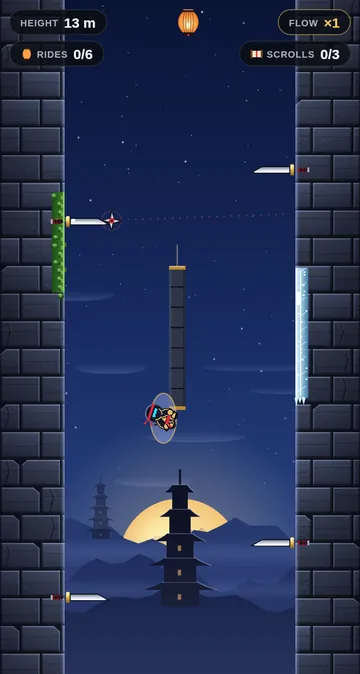

# Action overhaul: gallery (phase 2, step 4)

Before (main) and after per game, at 390 × 844, plus short clips of play showing the setting changing through the round.
Each game's frames are in its own folder here.

## Roofbound

<!-- roofbound -->

## Grappler

<!-- grappler -->

## Moon Climb

<!-- moonclimb -->

The world as drawn on main (before) and on this branch (after), at the same moments of one Near-perfect bot climb on
seed 4100 (the skill-band bot, through the real sim; 390 × 730 world, shown 360 wide). The sim and score are unchanged;
the moon rises and the sky deepens with the height climbed. The HUD's second row shows lantern rides and scrolls.

| | Start (13 m) | 107 m | 197 m | End (235 m) |
|---|---|---|---|---|
| Before |  |  |  |  |
| After |  |  |  |  |

Clip (6 s, the whole minute at 10×): 

Edge to edge, the play screen at 390 × 844 below the 52 px header (the world and the play screen's fill as the stage
composes them; left at the start, right at 173 m): the slate floor carries on below the world to the screen's bottom,
no step at the world's edge (ricochet-overhaul-check measures it at 414 × 896, 390 × 844, 375 × 667 and a desktop size).

## Iron Wall

<!-- ironwall -->

## High Rise

<!-- highrise -->

## Orbit

<!-- orbit -->

