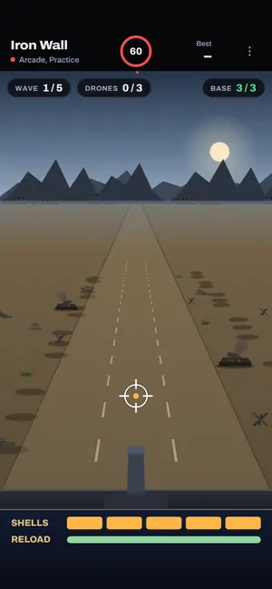
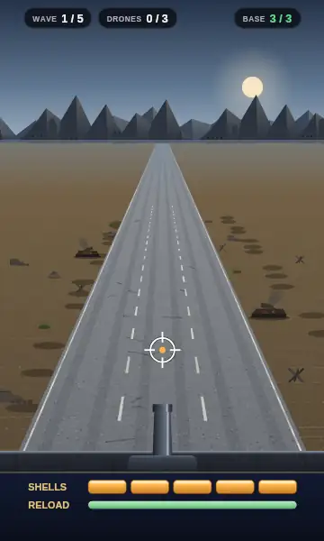

# Action overhaul: gallery (phase 2, step 4)

Before (main) and after per game, at 390 × 844, plus short clips of play showing the setting changing through the round.
Each game's frames are in its own folder here.

## Roofbound

<!-- roofbound -->

## Grappler

<!-- grappler -->

## Moon Climb

<!-- moonclimb -->

## Iron Wall

<!-- ironwall -->

Display and sound only (no stamp). The same Near-perfect skill-band run (seed 7, bastionRev 3) drawn by main's art
(before) and this branch's (after), each with its scene beyond the world, at waves 1, 3 and 5. The setting goes clear →
dusty desert → battle-smoke storm; far tanks get a pale outline and an S / M / H badge; the panel is navy with gold
labels at 13 px.

| | Wave 1 | Wave 3 | Wave 5 |
| --- | --- | --- | --- |
| Before |  |  |  |
| After |  |  |  |

Edge to edge (arcade-fill-check's own frame, the real play screen as an iPhone 11 home-screen app, 414 × 896): the
scene and the navy panel run on to the screen's bottom with no seam. Clip (6 s, the whole minute, the scenery carried
past the world's sides): the setting changing wave by wave.

| Edge to edge, 414 × 896 app | Clip: the minute |
| --- | --- |
|  |  |

The clip is made by `bun scripts/shots/bastion-overhaul-clip.ts <dir>` (frames) and encoded as an animated WebP.

## High Rise

<!-- highrise -->

## Orbit

<!-- orbit -->

