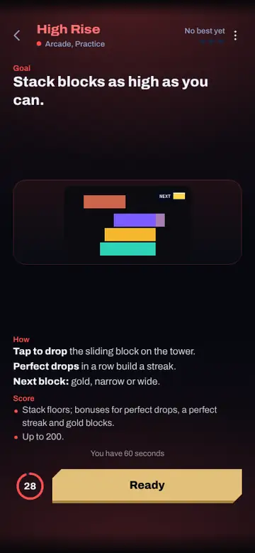
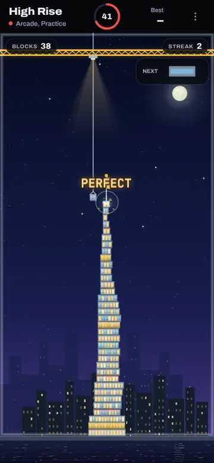
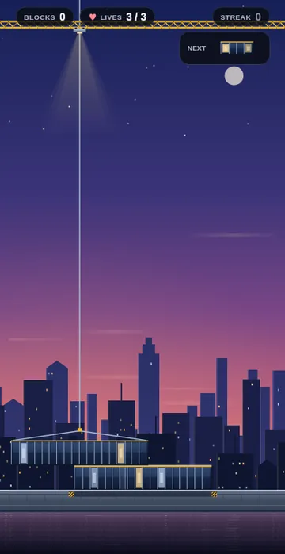
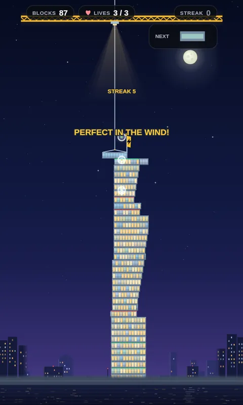
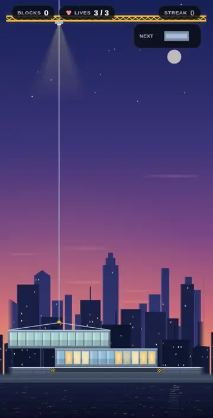

# Action overhaul: gallery (phase 2, step 4)

Before (main) and after per game, at 390 × 844, plus short clips of play showing the setting changing through the round.
Each game's frames are in its own folder here.

## Roofbound

<!-- roofbound -->

## Grappler

<!-- grappler -->

## Moon Climb

<!-- moonclimb -->

## Iron Wall

<!-- ironwall -->

## High Rise

<!-- highrise -->

`skylineRev 11` (lives, the wide-block rescue) and the new look. Before: the game review's frames from main (390 × 844,
intro / mid-play / reveal). After: the game's own renderer with the play screen's fill around it
(`bun scripts/shots/skyline-overhaul-clip.ts <dir> <screenW> <screenH> [every] [sloppy]`), because the in-browser capture
could not run on the shared machine (the dev server was killed for memory twice); `scripts/shots/skyline-overhaul-shots.ts`
draws the same in the real app when a dev server is up.

| Before: start | Before: mid | Before: end |
|---|---|---|
|  |  |  |

| After: dusk, the plaza | After: a life lost ("−1 LIFE", LIVES 2 / 3) | After: night, 414 wide, edge to edge | After: late night |
|---|---|---|---|
|  |  |  |  |

Edge to edge on a computer's column (640 wide): 

Clip (about 6 s, one frame every 1.5 s of a 60 s run): dusk turning to night and the city lighting up as the tower
climbs: 

## Orbit

<!-- orbit -->

