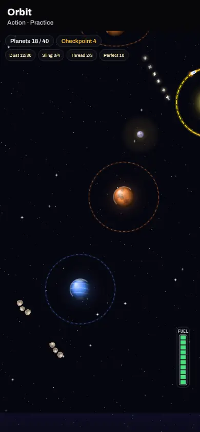
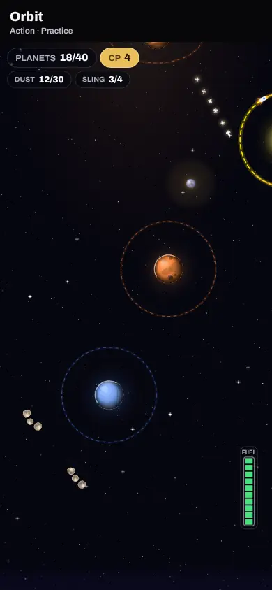
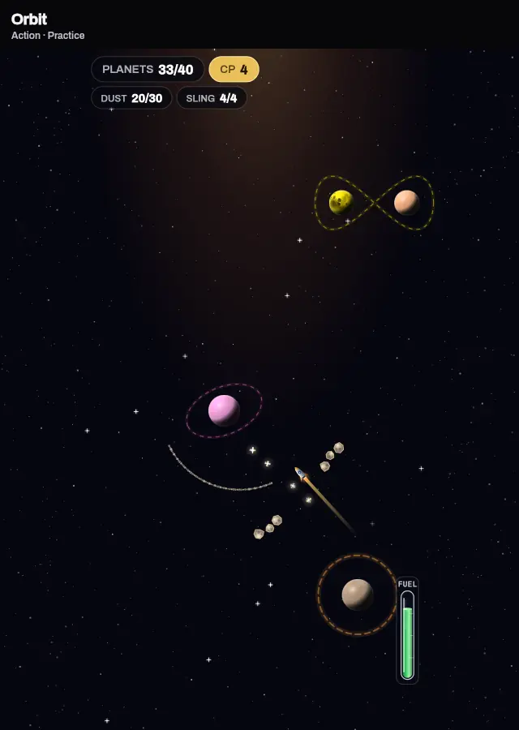

# Action overhaul: gallery (phase 2, step 4)

Before (main) and after per game, at 390 × 844, plus short clips of play showing the setting changing through the round.
Each game's frames are in its own folder here.

## Roofbound

<!-- roofbound -->

## Grappler

<!-- grappler -->

## Moon Climb

<!-- moonclimb -->

## Iron Wall

<!-- ironwall -->

## High Rise

<!-- highrise -->

## Orbit

<!-- orbit -->

Drawn from each tree's own sim, renderer and screen fill (`scripts/shots/orbit-overhaul-frames.ts`) on the fixed intro
example, the skill-band bot playing at the elite level, at 390 × 844 below the game header. Before is main a3f40ff7
(orbitRev 14), after is orbitRev 15. The same run, the same ticks.

| | Start (tick 60) | Planet 18 (tick 1300) | Planet 33 (tick 2200) | The sun (tick 2651) |
|---|---|---|---|---|
| Before |  |  |  |  |
| After |  |  |  |  |

- **Planets:** rendered-look spheres (banded gas, cratered rock, streaked ice) turning slowly under one light, a thin lit
  limb; clean black space.
- **Setting:** the sun's warmth grows from the top as the run climbs (none at the start, a warm glow by planet 33, the
  sun itself at the end).
- **HUD:** two rows of bigger pills (PLANETS and the checkpoint; DUST and SLING) instead of six small ones.
- **Edge to edge:** before, a navy band shows under the world (bottom of each frame); after, the world's own black space
  and stars carry on to the screen's bottom and sides.

Edge to edge on a wider screen (640 × 900, the world centred, its sides filled):

Clip (6 s, the whole elite run sped up): the course from near space to the sun, the warmth growing.

