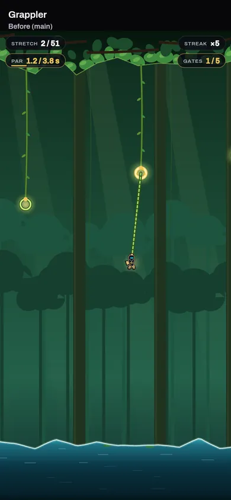
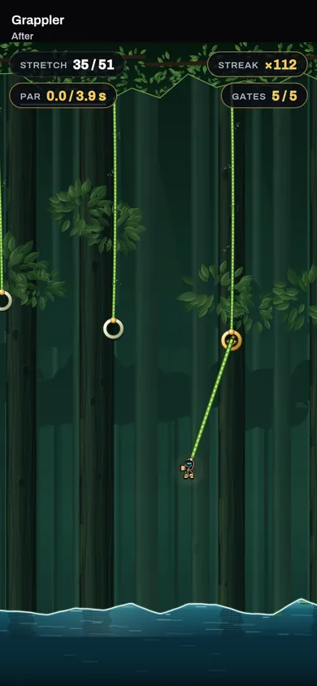
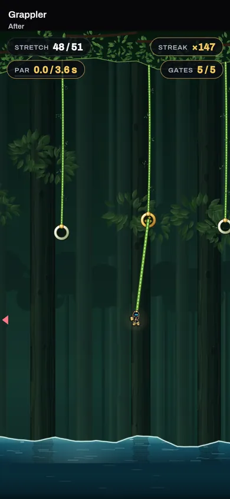

# Action overhaul: gallery (phase 2, step 4)

Before (main) and after per game, at 390 × 844, plus short clips of play showing the setting changing through the round.
Each game's frames are in its own folder here.

## Roofbound

<!-- roofbound -->

## Grappler

<!-- grappler -->
Drawn by the game's own renderer on a dealt swingRev 17 course played by its oracle's witness
(`bun scripts/shots/swing-overhaul-frames.ts [--root=<main checkout>] [--tag=before|after] [--size=WxH] [--clip]`),
in the play screen's geometry (a 52 px header stand-in). Display only: the same course, rules and score.

| | Start | Two thirds | Near the end |
|---|---|---|---|
| Before (main) |  |  |  |
| After |  |  |  |

- The jungle deepens through the course (`swingJungleDepth`): darker, colder backdrop and moss curtains towards the end;
  every vine, platform and the hero stay at full contrast over it.
- Calmer backdrop, moving water with shine, bigger 12 px grab loops with less glow, a thicker held vine, a dark pool
  under the hero, the HUD chips 1.3× (labels about 11 px on a phone), one stretch count (51) on HUD and reveal.

**Edge to edge** at 375 × 667 (the world is narrower than the screen): before, black strips beside the world; after, the
jungle runs on beside and below it at the world's depth, a platform run's shade and dim included.

| Before (main) | After, start | After, near the end |
|---|---|---|
|  |  |  |

**Clip** (the setting deepening; four 1.5 s windows at the start, a third, two thirds and near the end):

## Moon Climb

<!-- moonclimb -->

## Iron Wall

<!-- ironwall -->

## High Rise

<!-- highrise -->

## Orbit

<!-- orbit -->

