# Action overhaul: gallery (phase 2, step 4)

Before (main) and after per game, at 390 × 844, plus short clips of play showing the setting changing through the round.
Each game's frames are in its own folder here. Every game has three side-by-side comparisons, Today (main) | the
chosen concept | New (`<game>/compare-1.webp` to `compare-3.webp`), drawn by each tree's own renderer.

**Reveals.** The answer reveals are redesigned in stage 2, inside #422's shared reveal layout, and their before and after
shots arrive then. Stage 1 changed only their text: Roofbound's repeated "Bonuses" tile is gone, Moon Climb adds a hits
line, Grappler reads "n of 51 stretches cleared", High Rise counts lives lost.

## Roofbound

<!-- roofbound -->

The game's own renderer drawing the Near-perfect bot's run on the same dealt course (course 301794028), the 390 × 730
world at 2×, shrunk to 360 wide: **before** is flipRev 12 on main's renderer, **after** flipRev 13 with the overhaul's
cave (`bun scripts/shots/flip-overhaul-frames.ts --rev=12 --tag=before` / `--rev=13 --tag=after`). 10 s, 30 s and 55 s
in, so the setting's change shows down each column: deeper in, the rock warms and the lava runs hotter and brighter.

| | 10 s | 30 s | 55 s |
|---|---|---|---|
| Before |  |  |  |
| After |  |  |  |

Today | Concept A | New, at 10, 30 and 55 s (the materials pass):

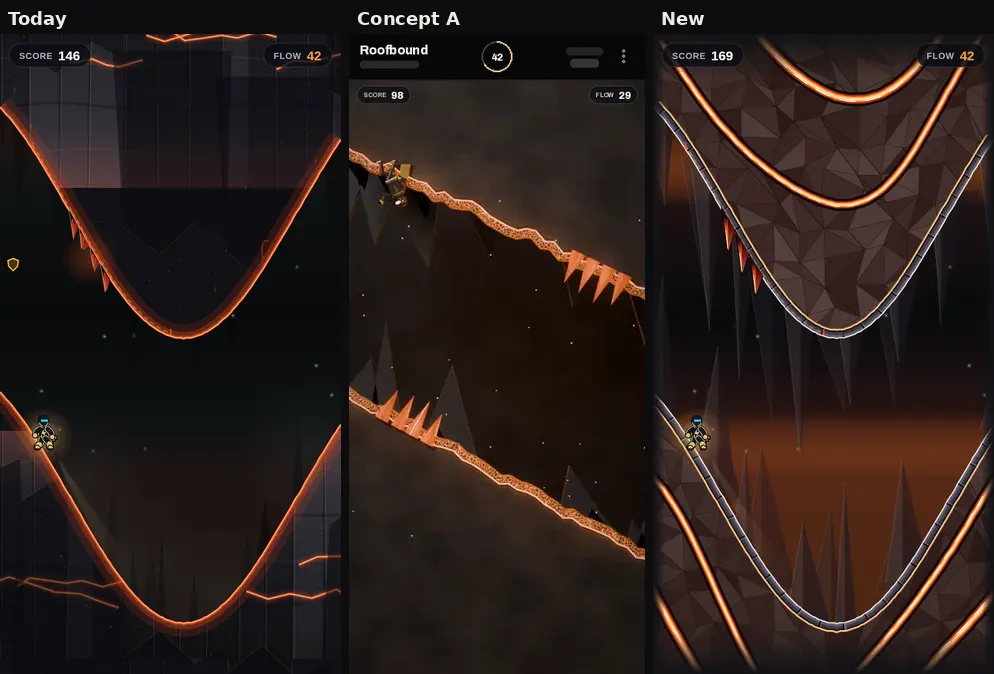

- The rock is faceted basalt (a cached tile, painted once per scale): every facet lit from the upper left by its own
  tilt, crisp pale edges on its lit sides and dark seams on the rest, darkening into the deep and warming with the heat.
- Two channels of glossy molten lava cut through it: a charred crust, the molten body, a bright core and a specular
  streak along the flow's lit side that slides as the lava runs (no halo).
- The floor the Captain runs on is a dressed basalt lip in three bevelled bands with chamfered block joints and a
  crisp top edge, a molten seam under it.
- Spikes are chunky two-faced obsidian: a hot lit face, a deep red far face, a dark outline and a glassy streak near
  the tip. No glow behind them.
- Behind the tunnel, concept A's angular rock shards in two parallax layers (a lit face, a shadowed face, a pale
  edge) and a warm smoky haze that thickens deeper in.
- Edge to edge: the world fades to the bedrock at its edges and the arena scene continues it, here on a 1366 × 768
  computer, 55 s in (the faint veins run off into the rock beside the world):

The whole minute as a time-lapse (one frame every 1⅓ s of play, about 6 s):

## Grappler

<!-- grappler -->
Drawn by the game's own renderer on a dealt swingRev 17 course played by its oracle's witness
(`bun scripts/shots/swing-overhaul-frames.ts [--root=<main checkout>] [--tag=before|after] [--size=WxH] [--clip]`),
in the play screen's geometry (a 52 px header stand-in). Display only: the same course, rules and score.

**Materials pass** (Today | Concept A | New; all procedural, painted once into cached tiles and sprites, no shipped
images): a three-deep forest (pale far trunks in the haze, mid trunks fading into it, near trunks with bark grooves,
knots and moss streaks, carrying clusters of real lit leaves), leaf clusters along the canopy's underside, twisted
lime vine ropes, enamelled cream-metal grab rings with a specular arc and a gold bead (gold just after a grab, no glow),
a glossy river (the near trunks reflected, a sheen where the light falls, glints), wood-grained platforms on barked posts.

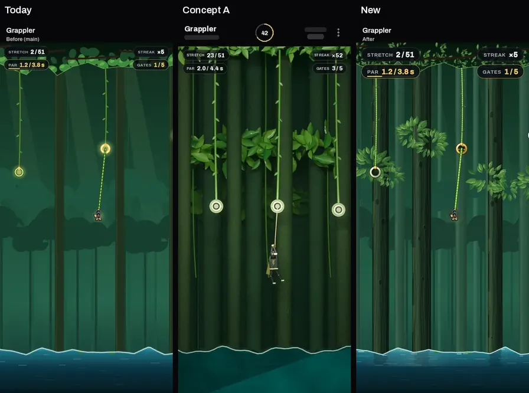

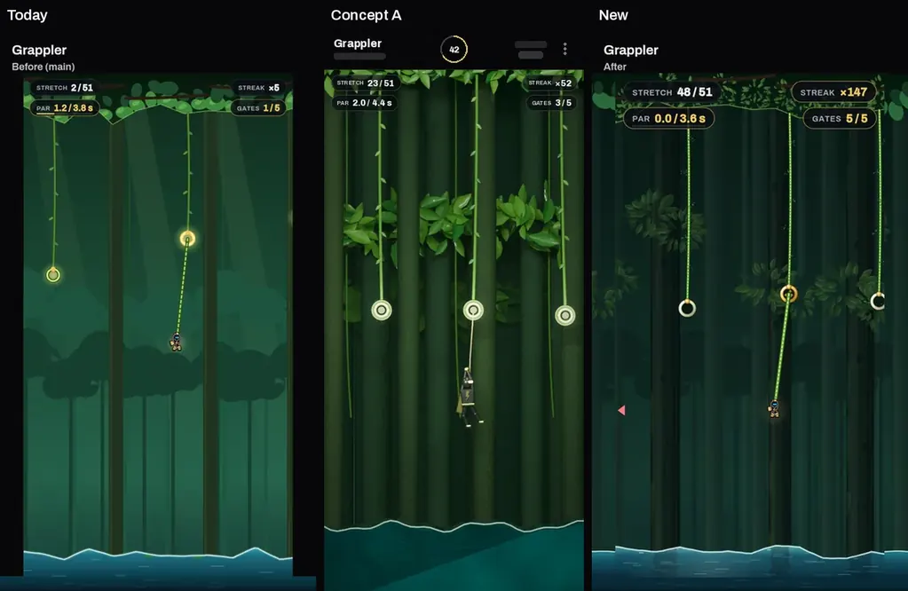 (375 × 667, near the end: the darkened jungle carried on beside the world)

| | Start | Two thirds | Near the end |
|---|---|---|---|
| Before (main) |  | 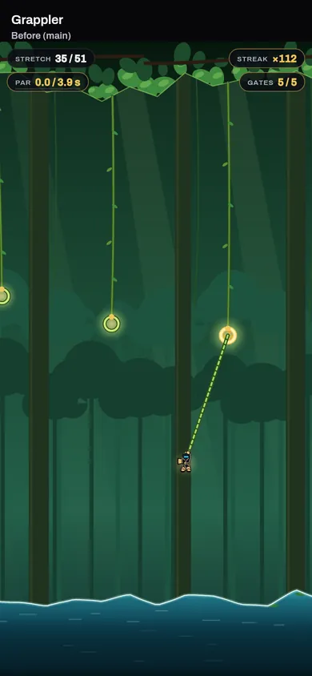 | 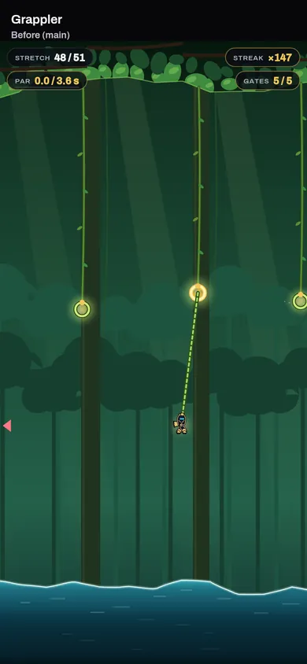 |
| After |  |  |  |

- The jungle deepens through the course (`swingJungleDepth`): darker, colder backdrop and moss curtains towards the end;
  every vine, platform and the hero stay at full contrast over it.
- Calmer backdrop, moving water with shine, bigger 12 px grab loops with less glow, a thicker held vine, a dark pool
  under the hero, the HUD chips 1.3× (labels about 11 px on a phone), one stretch count (51) on HUD and reveal.

**Edge to edge** at 375 × 667 (the world is narrower than the screen): before, black strips beside the world; after, the
jungle runs on beside and below it at the world's depth, a platform run's shade and dim included.

| Before (main) | After, start | After, near the end |
|---|---|---|
|  | 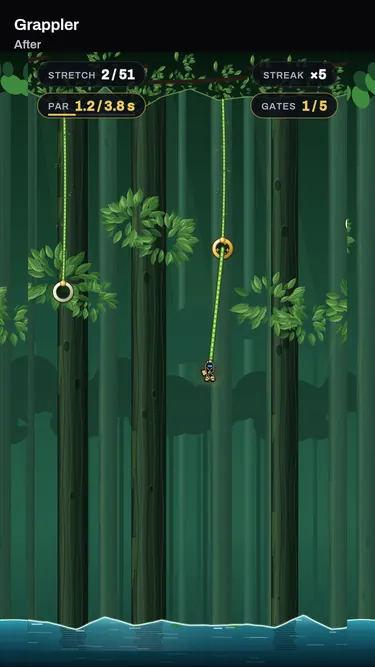 |  |

**Clip** (the setting deepening; four 1.5 s windows at the start, a third, two thirds and near the end):

## Moon Climb

<!-- moonclimb -->

The world as drawn on main (before) and on this branch (after), at the same moments of one Near-perfect bot climb on
seed 4100 (the skill-band bot, through the real sim; 390 × 730 world, shown 360 wide). The sim and score are unchanged;
the moon rises and the sky deepens with the height climbed. The HUD's second row shows lantern rides and scrolls.

**Materials pass** (today | concept A | new, at 107 m, 197 m and the end): carved moonlit slate (each block's lit
bevel, grain, strata, chipped corners and cracks), wet moss with crisp highlights, glassy ice, polished steel katanas
with a temper line, gold guards and wrapped hilts, blued-steel shurikens with a sheen, paper lanterns lit from within,
a cratered moon and the pagoda in layered mist.

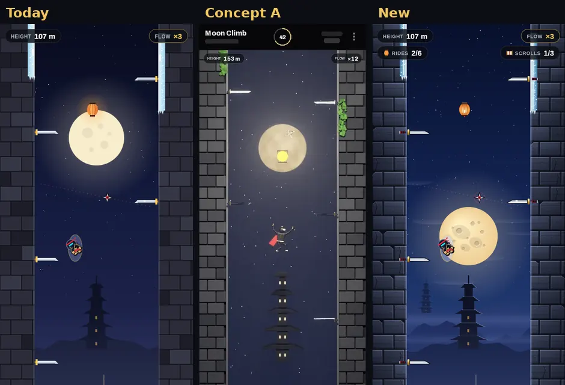

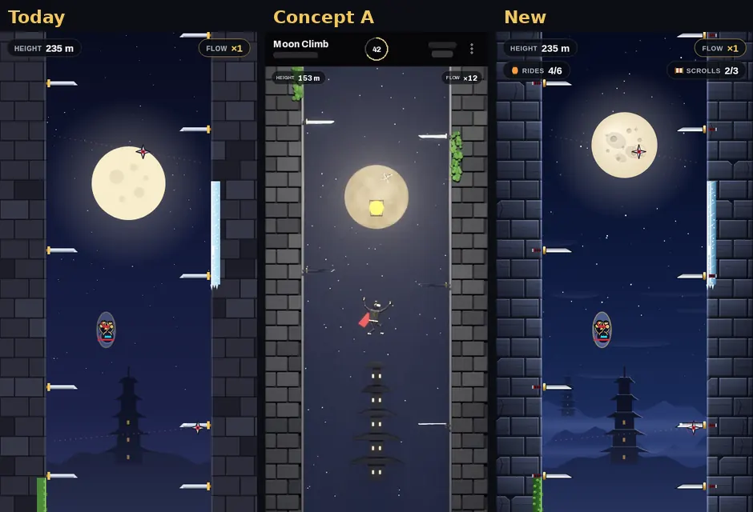

| | Start (13 m) | 107 m | 197 m | End (235 m) |
|---|---|---|---|---|
| Before |  |  | 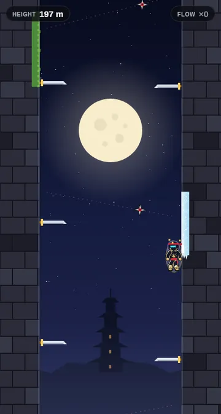 |  |
| After |  | 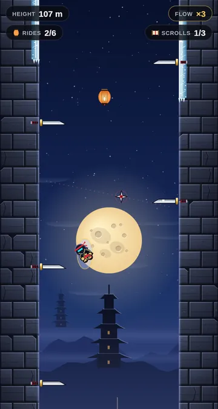 | 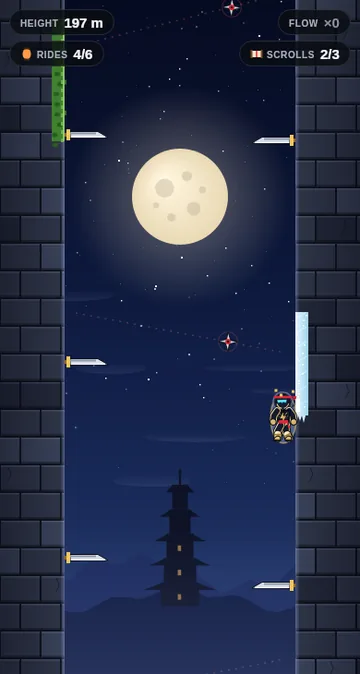 | 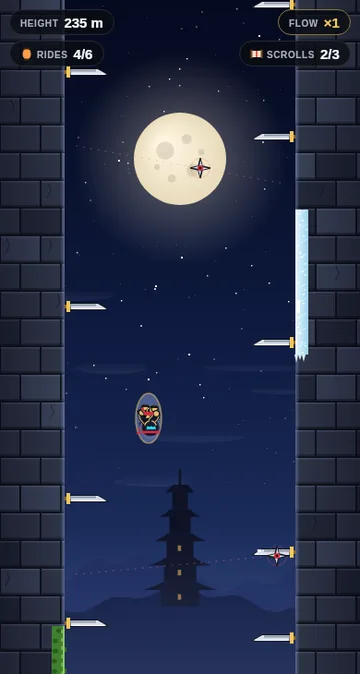 |

Clip (6 s, the whole minute at 10×): 

Edge to edge, the play screen at 390 × 844 below the 52 px header (the world and the play screen's fill as the stage
composes them; left at the start, right at 173 m): the walls' carved slate and the shaft's floor carry on below the world to the screen's bottom,
no step at the world's edge (ricochet-overhaul-check measures it at 414 × 896, 390 × 844, 375 × 667 and a desktop size).

### Stage 2 look pass (15 Nov 2026)

Today (main e0aa53f2) | Concept A | New: the witness climb on seed 11 at the same ticks (ricoRev 3 on main, ricoRev 4 on
this branch, its own tower), the 390 × 730 world at 2×, shrunk. Riding the first lantern at 33 m with the moon rising
over the ridge; about 110 m with the moon behind the shaft; riding a lantern at 240 m under a high moon.

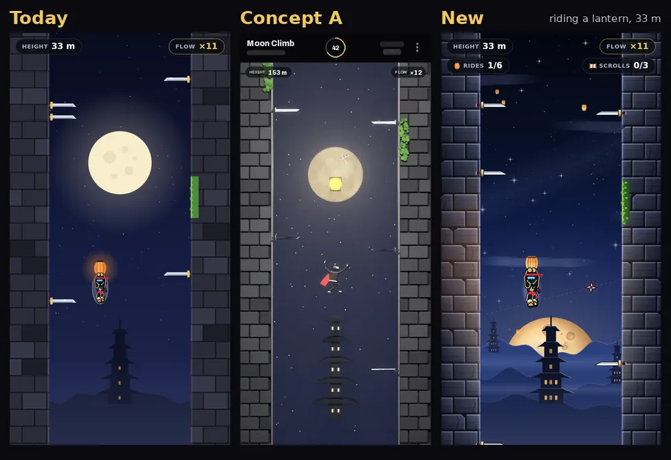
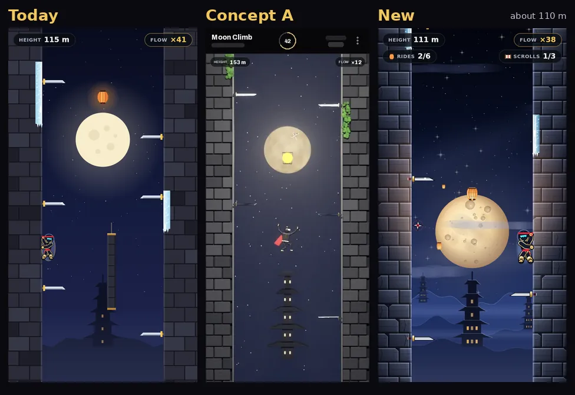
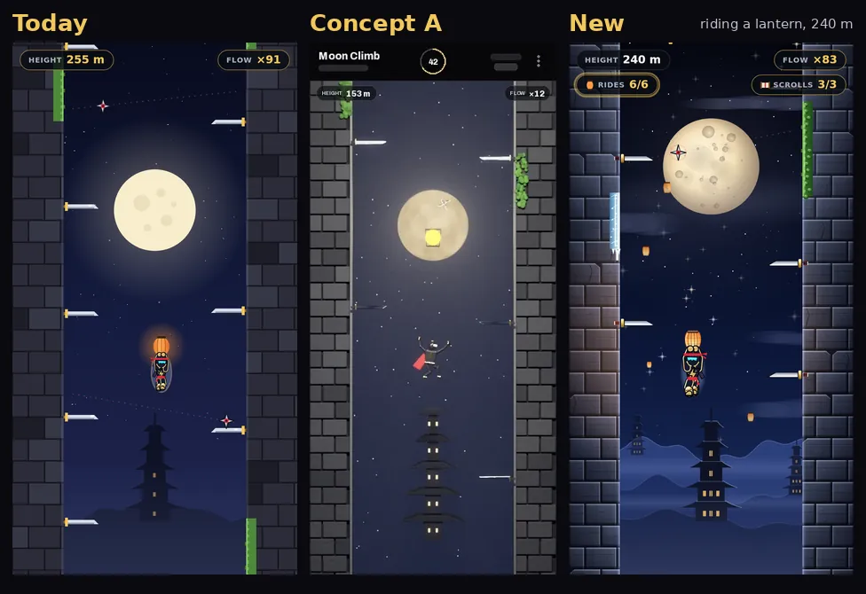

Clip (7 s, the whole minute at 8×): the moon rising and shrinking, wisps drifting across it, far lanterns rising behind
the walls, the raking moonlight moving up the stone with the moon, each lantern lighting the walls near it.
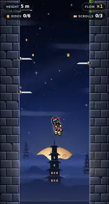

- **Sky**: a deeper five-stop night, a slanting band of star dust, 170 stars of every kind (pinpoints, cool and warm,
  bright ones with a four-point glint), drifting cloud wisps lit where they pass the moon, a moonlit mist band.
- **Moon**: larger (84 → 66 px as it rises, was 66 → 50), a lit sphere with maria and 28 craters (shadowed floors, lit
  far rims, central peaks), amber low down, warm cream high; far paper lanterns rise behind the walls and across it.
- **Pagoda in mist**: three ranges with moonlit crests, two far pagodas, the temple's with warm paper windows.
- **Walls**: blocks stand proud of a lighter mortar bed and cast short shadows on it, faces rounded by the light, crisp
  lit edges; the moon rakes across the stone at its own height every frame; moss and ice catch it along their lips;
  the mid-ledges are the same carved slate with iron bands.
- **Sky lanterns**: translucent paper lit from the flame low in the base, bamboo ribs dark against the light, a crisp
  sheen on the curve, lacquered rim; the warm light falls on the walls and ledges near it, never as a glow round it.
- **The bigger ninja** (ricoRev 4): the body box 34 × 68 (was 26 × 52) and the figure drawn at 17/13 to fill it, the
  hits following exactly what is drawn; no gold rim round it.

## Iron Wall

<!-- ironwall -->

Display and sound only (no stamp). The same Near-perfect skill-band run (seed 7, bastionRev 3) drawn by main's art
(before) and this branch's (after), each with its scene beyond the world, at waves 1, 3 and 5. The setting goes clear →
dusty desert → battle-smoke storm; far tanks get a pale outline and an S / M / H badge; the panel is navy with gold
labels at 13 px.

**Materials pass** (15 Nov 2026): the road is asphalt (aggregate speckles, worn tyre lanes, tar seams, solid worn edge
lines and worn dashes, sand drifting over the shoulders in the dust); the field has sand grain and wind ripples; peaks
have sunlit faces and the dunes lit ridges; the storm's smoke billows have volume (a lit crown, a dark core, a warm
underside over the fires) and every wreck burns with its own plume; tanks are painted metal (a lit top plane, a crisp lit
front edge, track links, a turret dome lit from above with a specular glint, a ground shadow no wider than the hull);
the barrel is gunmetal with a crisp highlight down its lit side, on a cast mount; the parapet is cast concrete with a lit
coping; the panel's shells are glass capsules (brass shells with a crisp highlight on the top curve, dark glass when
empty) and the reload gauge a recessed channel with a polished steel needle. No glow edges, no glare over the HUD or
the panel's numbers. All drawn in code and cached per setting: no new shipped images.

Today | concept | new, the same moment:

| | Wave 1 | Wave 3 | Wave 5 |
| --- | --- | --- | --- |
| Before | 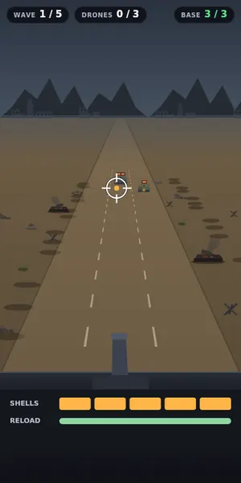 |  |  |
| After |  |  |  |

Edge to edge (the scene and the world drawn as the stage draws them, in a 375 × 667 phone's arena box, so the sides
show the scenery carried on; arcade-fill-check proved the real play screen at 414 × 896 app and 390 × 844, and
bastion-overhaul-check proves no seam at four sizes in every setting). Clip (6 s, the whole minute): the setting changing
wave by wave.

| Edge to edge, 375 × 667 | Clip: the minute |
| --- | --- |
| 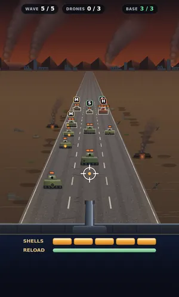 |  |

The clip is made by `bun scripts/shots/bastion-overhaul-clip.ts <dir>` (frames) and encoded as an animated WebP.

## High Rise

<!-- highrise -->

`skylineRev 11` (lives, the wide-block rescue), the new look and the materials pass (15 Nov 2026). The new frames are drawn
by the game's own renderer with the play screen's fill around it (`bun scripts/shots/skyline-overhaul-clip.ts <dir>
<screenW> <screenH> [every] [sloppy]`, in @napi-rs/canvas, no browser), so they show the world and its fill, not the app's
header; text pops that run on the real clock sit on top of each other in these stills. Today is the game review's frame
from main.

**Materials.** Each floor is a glass curtain wall exactly on the sim's rectangle: deep blue-black glass with the sky caught
on its upper half, steel mullions with a lit side, a polished gold spandrel band (heavier every fifth floor), windows that
light warm and cool as night falls, a crisp highlight line down the tower, a lit left edge and a shaded right edge so each
floor and its overlap read at once. The crane's jib is painted yellow steel, light on its top faces, the two diagonals in
two tones, with bolts. The city is concept A's three layers, held still (the tower climbs past it), and the stone plaza
is a solid foreground with kerb, paving and a footing. The harbour is glossy: a sheen under the quay, the city's lights
and the moon broken into reflections, the dusk's rose on the water. No glow edges, no glare over the HUD.

| Today · Concept A · New |
|---|
| 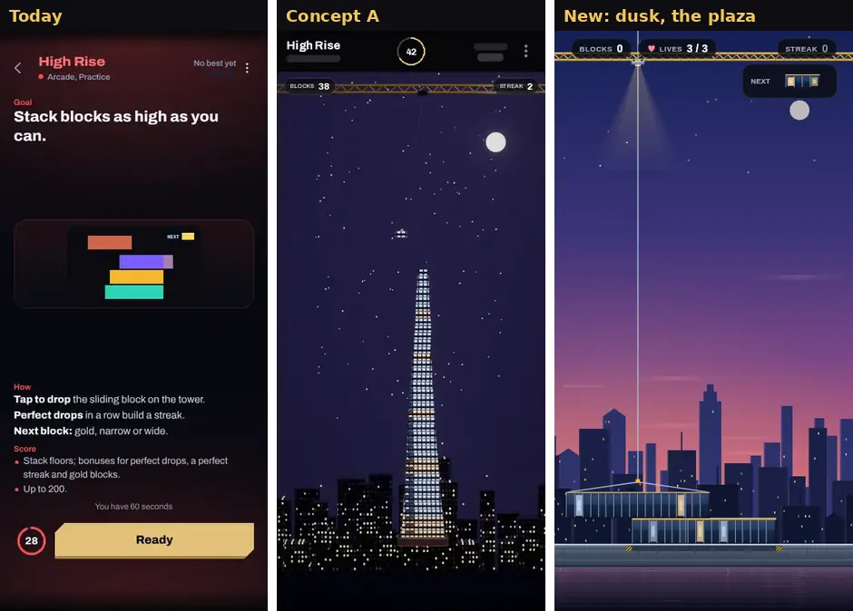 |
| 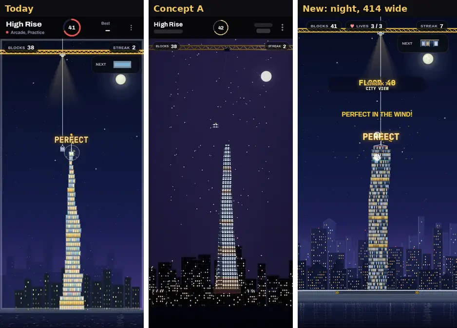 |
|  |

| Dusk, the plaza | A life lost ("−1 LIFE", LIVES 2 / 3) | Night, 414 wide, edge to edge | Late night |
|---|---|---|---|
|  | 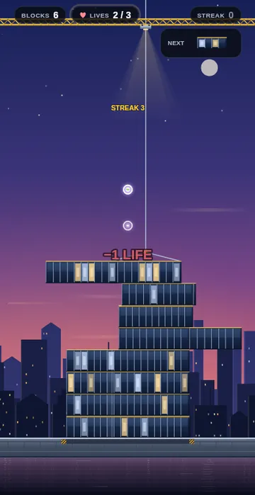 |  | 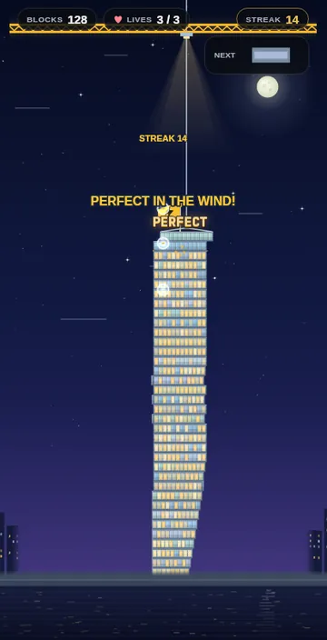 |

Edge to edge on a computer's column (640 wide): the sky, the city, the jib and the plaza run on beside the world as one
picture. 

Clip (about 6 s, one frame every 1.5 s of a 60 s run): dusk turning to night and the city lighting up as the tower
climbs: 

Before (main), for reference:   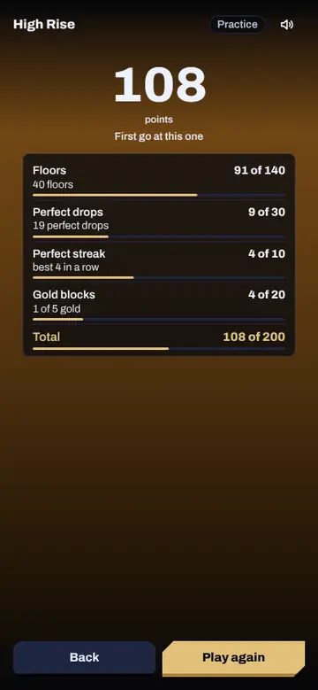

### Stage 2: effects and reveal

Joe's effects list (docs/arcade-standard/skyline.md "Stage 2"), drawn by the game's own renderer on one scripted skylineRev
11 run (five trims, a rescue, two lost lives, a sliver), in @napi-rs/canvas (`bun scripts/shots/skyline-stage2-shots.ts
<dir>`): the block falling the last floor, the perfect drop's gold ring at the join and the lit grown strip, the trimmed
overhang spinning off with crumbs at the cut, a sliver tipping on its foot, a lost block tumbling under "−1 LIFE", and the
end's count over the whole tower. No edge glow on any of them (the shared layer draws none for the Action games).

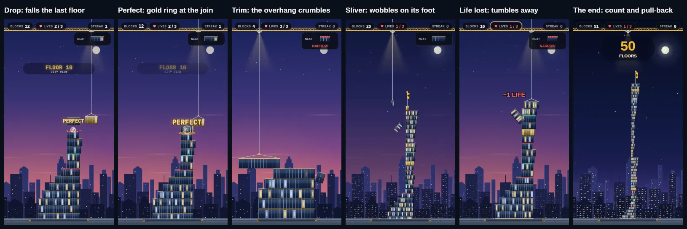

The end, a frame every 100 ms: the hook goes, the camera pulls back over the tower and the count rises to the floors
built. 

The answer reveal, the same run: today's breakdown and stat tiles | the new picture of the run under the same breakdown,
with Floors, Perfect drops and Best streak big and a legend (gold perfect drops, glass trims, teal wide blocks, red lost
lives, the best streak bracketed). Drawn on the reveal's gradient at the reveal's type sizes; the app's own CSS sets the
text (the picture itself is the real `drawSkylineRunPicture`).

## Orbit

<!-- orbit -->

Drawn from each tree's own sim, renderer and screen fill in @napi-rs/canvas (`scripts/shots/orbit-materials-frames.ts`)
on the fixed intro example, the skill-band bot playing at the elite level, at 390 × 844 below the game header. Before is
main a3f40ff7 (orbitRev 14), after is orbitRev 15 with the materials pass. The same run, the same ticks.

Today | Concept A | New (the materials pass):

| | Start (tick 60) | Planet 18 (tick 1300) | Planet 33 (tick 2200) | The sun (tick 2651) |
|---|---|---|---|---|
| Before |  |  |  |  |
| After | 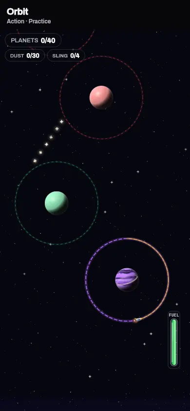 |  |  |  |

- **Planets (materials pass):** true spheres projected from six pre-rendered surface maps (two banded gas giants, two
  cratered rocks, an icy world, an ocean world; 43.7 KB of WebP in all), tinted with each planet's colour, turning slowly
  under one sun: a soft terminator into a deep night side, a thin lit atmosphere rim inside the disc (no glow round it),
  a crisp specular on water and ice. Clean black space.
- **Rocket:** brushed-metal hull lit from above, panel seams, gold fins and nose cone, a crisp highlight along its curve,
  a glass porthole with a glint, a dark nozzle bell.
- **Fuel gauge:** a glass tube with a crisp highlight down its curve and quarter ticks; the fuel a glossy liquid column
  (green, amber, red) with a curved meniscus and a moving surface glint.
- **Setting:** the sun's warmth grows from the top as the run climbs (none at the start, a warm glow by planet 33, the
  sun itself at the end).
- **HUD:** two rows of bigger pills (PLANETS and the checkpoint; DUST and SLING) instead of six small ones.
- **Edge to edge:** before, a navy band shows under the world (bottom of each frame); after, the world's own black space
  and stars carry on to the screen's bottom and sides.

Edge to edge on a wider screen (640 × 900, the world centred, its sides filled):

Clip (6 s, the whole elite run sped up): the course from near space to the sun, the warmth growing.

### Stage 2 look pass: Blender-rendered planets

Today is main e0aa53f2 (orbitRev 14's look), Concept A is `orbit-A`, New is this pass: the same run and ticks (700, 1300,
2200), drawn at 2× by `scripts/shots/orbit-materials-frames.ts --dpr=2`.

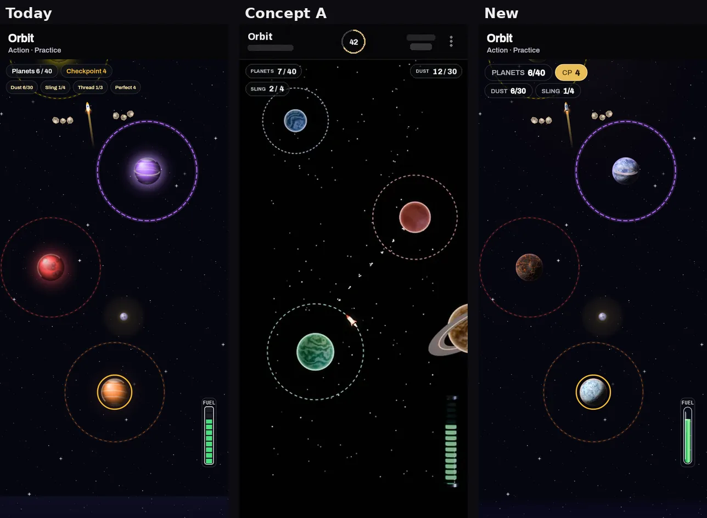

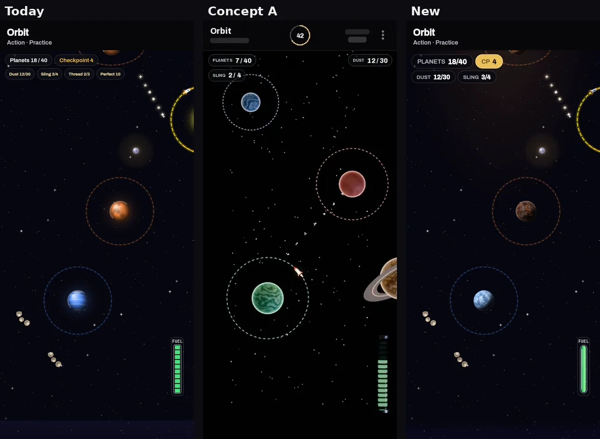

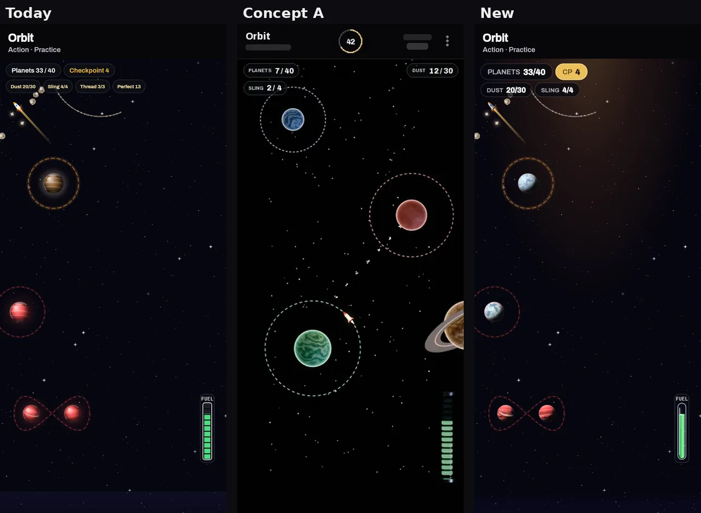

Every world type in each of the eight seeded colours at the desktop column's scale (2.84 device px a world px,
`scripts/shots/orbit-planet-sheet.ts --ring`), and the turn (sped up about 50×; in play one turn takes 40–80 s):

- **The maps are Blender bakes:** nine procedural Blender materials (noise, voronoi and wave textures) baked by Cycles into
  equirectangular maps by `scripts/orbit-planets-blender.py` (in the repo, fixed seeds, `--check` rebuilds byte for byte):
  two banded gas giants (broad belts and zones, turbulent edges, a storm oval), a marbled world (concept A's green planet),
  a cratered moon, a rust desert (canyons, craters, frost caps), a volcanic world (black basalt plates, orange fissures),
  an ocean world (seas, continents, deserts, cloud, ice caps) and two icy worlds (cracks, frozen seas, caps). Rocks and ice
  also ship a height map. 363 KB of WebP in all (640 × 320 maps, 320 × 160 heights), from 43.7 KB.
- **Lit in the renderer:** each frame is projected (bilinear) at the canvas's own device scale up to 192 px across (a
  radius-28 planet on the desktop column at 2× is 159), lit from one sun at the upper left: a soft terminator into a deep
  night side, the height map's relief catching the light (craters, canyons, ridges), a crisp highlight on water and ice,
  a thin atmosphere rim inside the disc in the planet's own colour. 240 frames a turn (120 on slow devices); reduced
  motion holds the turn. No glow halo; nothing past the collision circle + 2 px.
- **Colours:** the seeded colour stays the planet's identity (its orbit line and rim). Gas giants, the marbled world and
  the moon are tinted by it (the moon only lightly); red and orange rocks are deserts or volcanic worlds, brown deserts,
  blue ocean worlds, green and pink marbled, purple and yellow moons. Icy worlds keep their own blue-white with a blue,
  teal or lilac cast for blue, green and purple seeds and none for the warm seeds, so an icy world is never pink.
- **Rings:** three touching ringlets (a darker middle one reading as the gap), lit on the sun's side, the near half
  casting a thin shadow on the globe, all inside 0.88 of the radius.

