# Attention overhaul: gallery (stage 1, 15 Nov 2026)

Each game today (main, from the game reviews), the concept Joe chose (PR #427: A for five games, B for Matchmaker) and
the new frame from this branch, side by side, phone size 390 × 844, practice, mid-play. Then each game's answer reveal,
before and after.

Every piece is rendered in Blender from the app's own outlines (`scripts/attention-art/outlines.tsx` →
`docs/design/attention-overhaul/source/pieces.py`), so silhouettes, turns and facings are exactly as before. The
materials carry light, as the art direction asks: lacquered enamel with a clear coat over a softly domed body, polished
gold and pewter, lacquered oak, glossy rippled water, brushed gunmetal, glossy wire sleeves and domed caps. The light is a
product-shot studio: dark straight above, bright towards the horizon. A flat face reflects nothing and keeps its true
colour, with no glare across panels, tiles or numbers. Every curve and bevel catches a crisp highlight. Nothing glows.
Attention's pink stays in the background, and the actions are champagne gold and navy.

| Game | Today | Concept (chosen) | New |
|---|---|---|---|
| Eagle Eye |  | 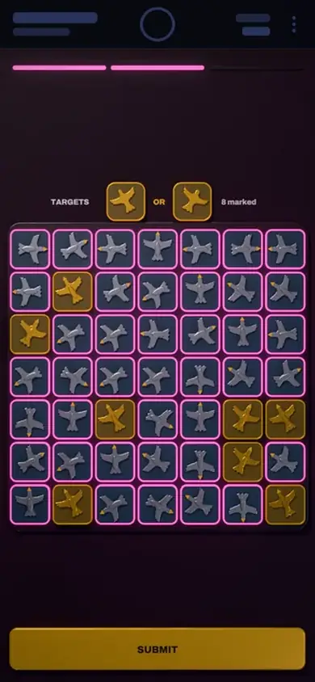 A |  |
| Double Take |  |  A | 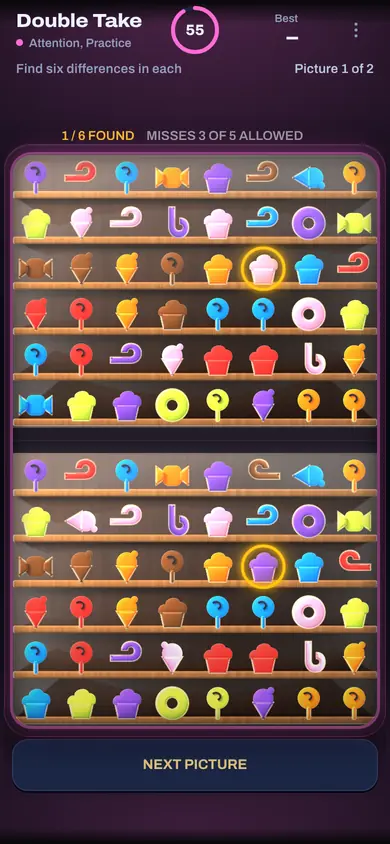 |
| Tally | 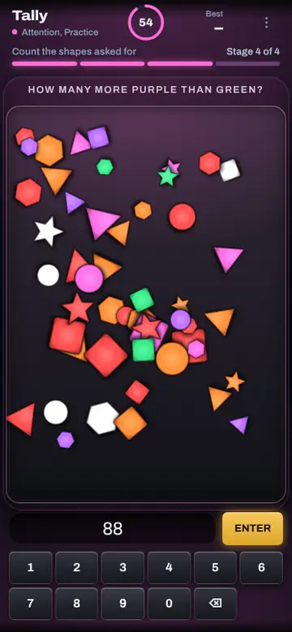 |  A |  |
| Labyrinth | 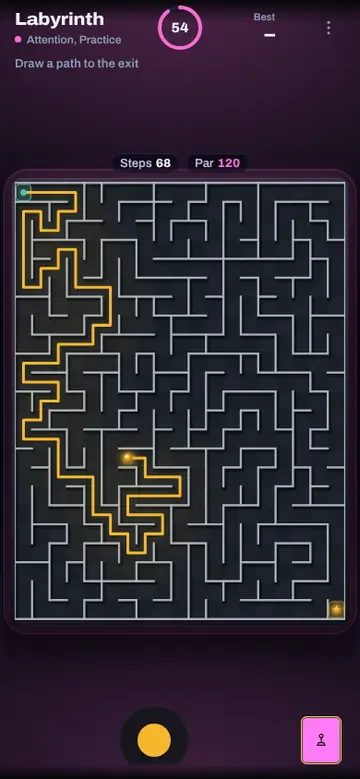 |  A |  |
| Bomb Defusal | 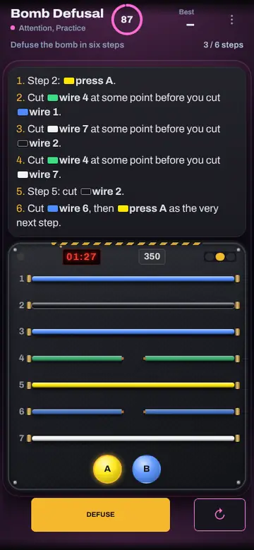 | 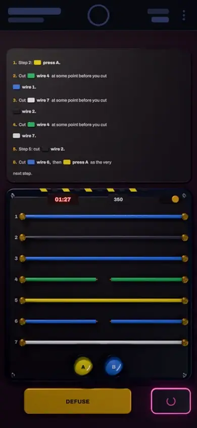 A |  |
| Matchmaker |  | 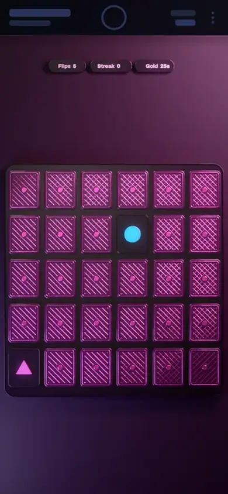 B |  |

- **Eagle Eye:** cast-pewter eagles with the bald eagle's white head and tail and a polished gold beak, turning gold once marked. Tiles are polished slate with a lit bevel and no pink glowing edge, which differs from concept A as agreed. The target chips are 56 px.
- **Double Take:** pillowed enamel pins with polished gold rims, on lacquered oak shelves and over glossy rippled water.
- **Tally:** flat-lit enamel tokens (Joe's choice over the concept's heap) on plum baize, spread with no overlaps. A tap leaves a champagne dot on the shape.
- **Labyrinth:** raised satin-metal walls on dark flagstone. The trail is a polished gold thread (dark gold edge, bright crown) rather than the concept's lit glow, as agreed. The arrows / joystick switch is in the game menu: 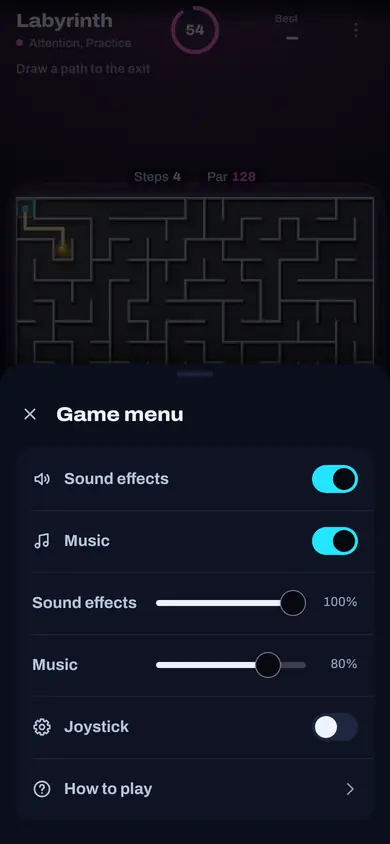
- **Bomb Defusal:** brushed gunmetal casing with a panel seam, glossy braided wires on brass posts, and domed lacquer caps in steel bezels. Clues sit on numbered pips, with names as colour chips.
- **Matchmaker:** magenta lacquer backs with a raised gold foil cross-hatch and a medallion (concept B), navy lacquer faces with enamel symbols, and cards a third bigger.

Image sizes (compressed WebP, sized for the largest display): Eagle Eye 76 KB, Double Take 304 KB, Tally 97 KB,
Labyrinth 4 KB, Bomb Defusal 57 KB, Matchmaker 111 KB (649 KB in all).

## The answer reveals

Each game's own reveal, before (main) and after, from a part-played practice round that ran out of time (so right,
wrong and missed all show), 390 × 844, the whole reveal. Built inside today's AnswerReveal (the result card, then the
game's own Reveal), which is the order #422's shared reveal layout keeps, so it drops into that layout unchanged. Shared
parts: `src/components/puzzles/attention/RevealParts.tsx` (tabs for one board at a time, a key for the marks, big
number tiles).

| Game | Before | After | What changed |
|---|---|---|---|
| Eagle Eye |  | 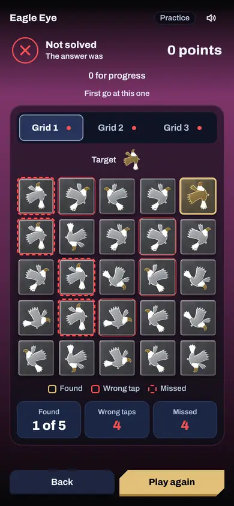 | A tab per grid; the target shown big; found gold, wrong taps red, missed dashed, named in a key; Found / Wrong taps / Missed as tiles (no "✗" or "0 / 8 found" lines). |
| Double Take |  | 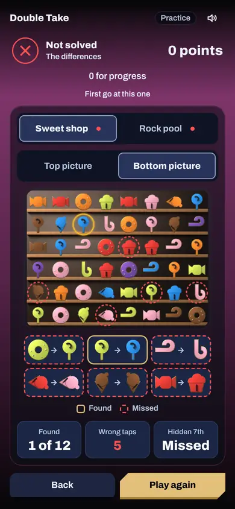 | Picture tabs, one panel at full width (Top / Bottom); each difference as a small before → after picture, found ringed gold, missed dashed; the hidden 7th starred; Found / Wrong taps / Hidden 7th as tiles. |
| Tally |  |  | A tab per tray; the tray large with every shape that counts ringed; Right count / You said / "Off by 5" or "So close: off by 1" as tiles; trays exact below. |
| Labyrinth | 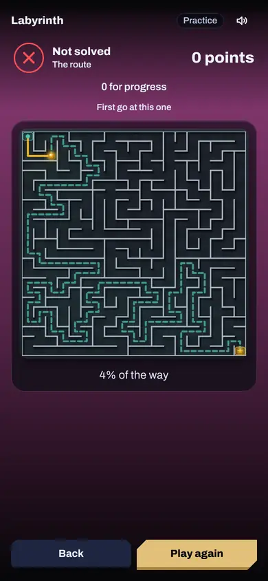 |  | The maze large, your trail in gold over the dashed shortest route, a key; How far / Steps walked / Par as tiles. |
| Bomb Defusal |  |  | One step track: the right action beside yours on each row, each a picture of the wire (its colour, cut) or the button cap; the first wrong step ringed red, later ones dimmed; Steps right / Steps made as tiles. |
| Matchmaker | 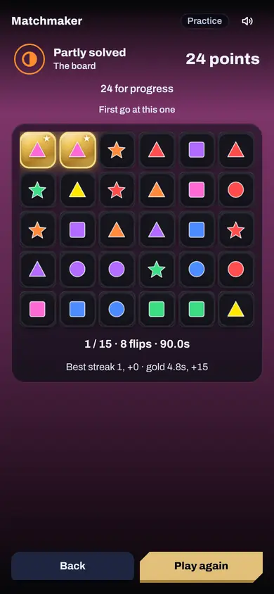 |  | The whole board face up and large: pairs you matched bright with a gold edge, the rest dimmed; Pairs / Flips / Best streak / Gold as tiles. |
