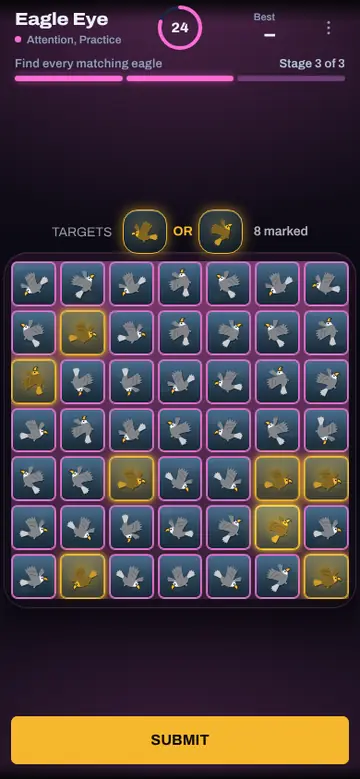
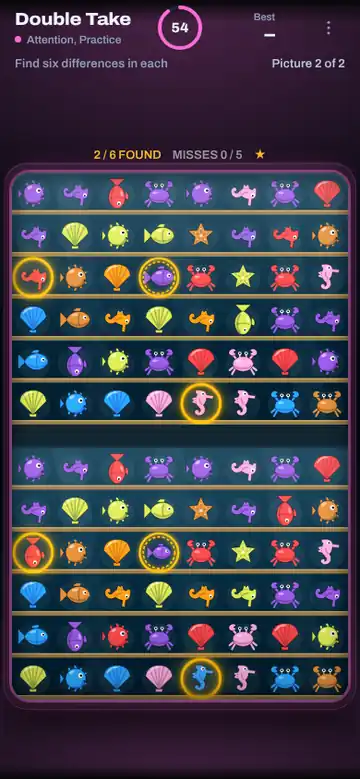
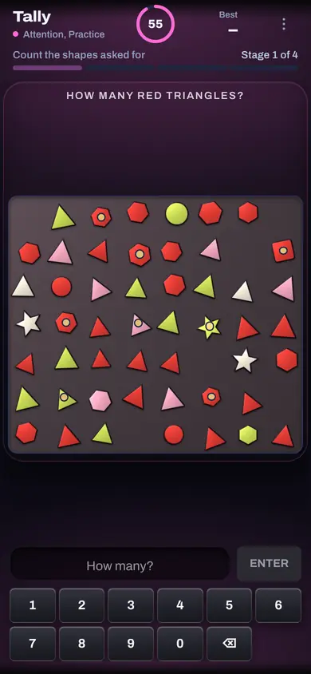
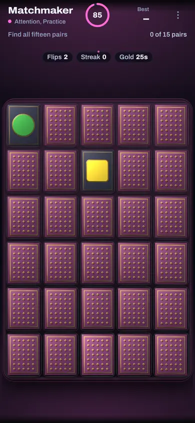
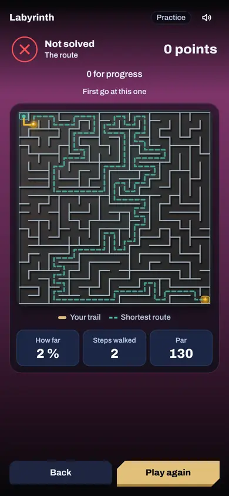
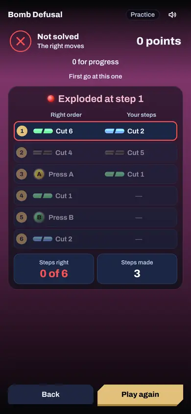

# Attention overhaul: gallery (stage 1, 15 Nov 2026)

Before (main, from the game reviews) beside after (this branch), phone size 390 × 844, practice, mid-play. Stage 1 is
the new look and the game changes; the effects (with the effects kit, #422) and the levels (with the difficulty
framework) come in stages 2 and 3, each with its own clips here.

Every piece is rendered in Blender from the app's own outlines (`scripts/attention-art/outlines.tsx` →
`docs/design/attention-overhaul/source/pieces.py`), so silhouettes, turns and facings are exactly as before; only the
material is new. Clean, even studio light, satin enamel and brushed metal, no glare, no glowing edges; Attention's pink
stays in the background; actions in champagne gold and navy.

## Eagle Eye

| Before | After |
|---|---|
|  |  |

Cast-pewter eagles with the bald eagle's white head and tail and a gold beak (the facing reads at 40 px), gold once
marked; plain honed slate tiles with no glowing edge; 56 px target chips; Submit in champagne; the grid has no height
floor, so it fits short phones.

## Double Take

| Before | After |
|---|---|
|  |  |

Enamel-pin sweets and sea creatures (gold rims) on oak shelves and over a rock pool. spotRev 4: the picture stays until
Next (Done on the last), so the hidden seventh can still be found after the six; "Misses n of 5 allowed"; no arena
shake on a miss; the reveal shows one panel at a time at full width (Top / Bottom picture). Every colour change differs
in lightness by at least 12 L*.

## Tally

| Before | After |
|---|---|
|  |  |

Flat-lit enamel tokens on plum baize. countRev 7: every tray spread on its own grid in a box of its own shape, so no two
shapes touch at any phone size; tap a shape to mark it counted (a champagne dot stays, shown here); every colour that
isn't counted differs in lightness from the counted ones and is never its hue look-alike.

## Labyrinth

| Before | After |
|---|---|
|  |   |

Dark flagstone floor under quiet stone walls, the gold trail. The arrows / joystick switch left the pad: it is in the
game menu (right) and Settings → Game controls. The help says backtracking counts against par.

## Bomb Defusal

| Before | After |
|---|---|
|  |  |

Brushed-steel casing, braided insulated wires on brass posts, domed caps in steel bezels. The clue card is matte navy,
each clue on its own numbered pip, every wire and button named as a chip in its colour. No more steps than the bomb
needs and no button pressed twice; each wire's whole row is the target (36 px); DEFUSE in champagne. The help says the
bomb never reacts while you work (stage 3 adds Expert's instant explosion).

## Matchmaker

| Before | After |
|---|---|
|  |  |

Plum-lacquer backs with a champagne border and studs, navy faces with enamel symbols. pairRev 4: five columns, so each
card is a third bigger; five colours a full step of lightness apart (no red / orange or pink / purple) over six shapes
(the hexagon and the diamond added); tapping a third card turns a miss back at once.

## The answer reveals

Each game's own reveal, before (main) and after, from a part-played practice round that ran out of time (so right,
wrong and missed all show), 390 × 844, the whole reveal. Built inside today's AnswerReveal (the result card, then the
game's own Reveal), which is the order #422's shared reveal layout keeps, so it drops into that layout unchanged. Shared
parts: `src/components/puzzles/attention/RevealParts.tsx` (tabs for one board at a time, a key for the marks, big
number tiles).

| Game | Before | After | What changed |
|---|---|---|---|
| Eagle Eye |  |  | A tab per grid; the target shown big; found gold, wrong taps red, missed dashed, named in a key; Found / Wrong taps / Missed as tiles (no "✗" or "0 / 8 found" lines). |
| Double Take |  |  | Picture tabs, one panel at full width (Top / Bottom); each difference as a small before → after picture, found ringed gold, missed dashed; the hidden 7th starred; Found / Wrong taps / Hidden 7th as tiles. |
| Tally |  |  | A tab per tray; the tray large with every shape that counts ringed; Right count / You said / "Off by 5" or "So close: off by 1" as tiles; trays exact below. |
| Labyrinth |  |  | The maze large, your trail in gold over the dashed shortest route, a key; How far / Steps walked / Par as tiles. |
| Bomb Defusal |  |  | One step track: the right action beside yours on each row, each a picture of the wire (its colour, cut) or the button cap; the first wrong step ringed red, later ones dimmed; Steps right / Steps made as tiles. |
| Matchmaker |  |  | The whole board face up and large: pairs you matched bright with a gold edge, the rest dimmed; Pairs / Flips / Best streak / Gold as tiles. |
