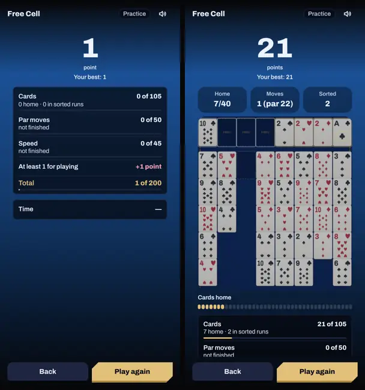
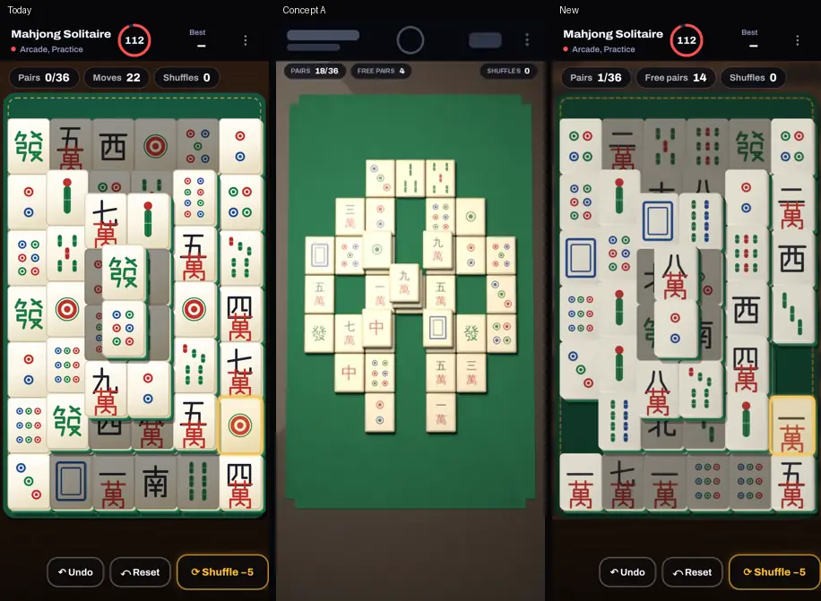
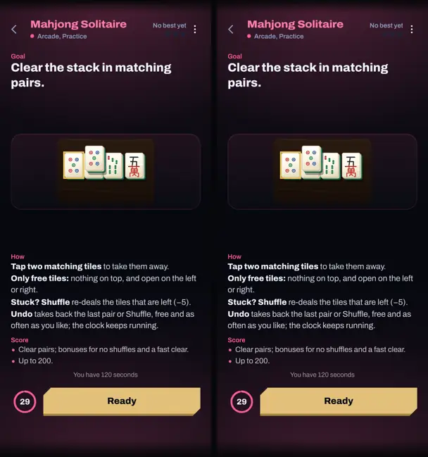
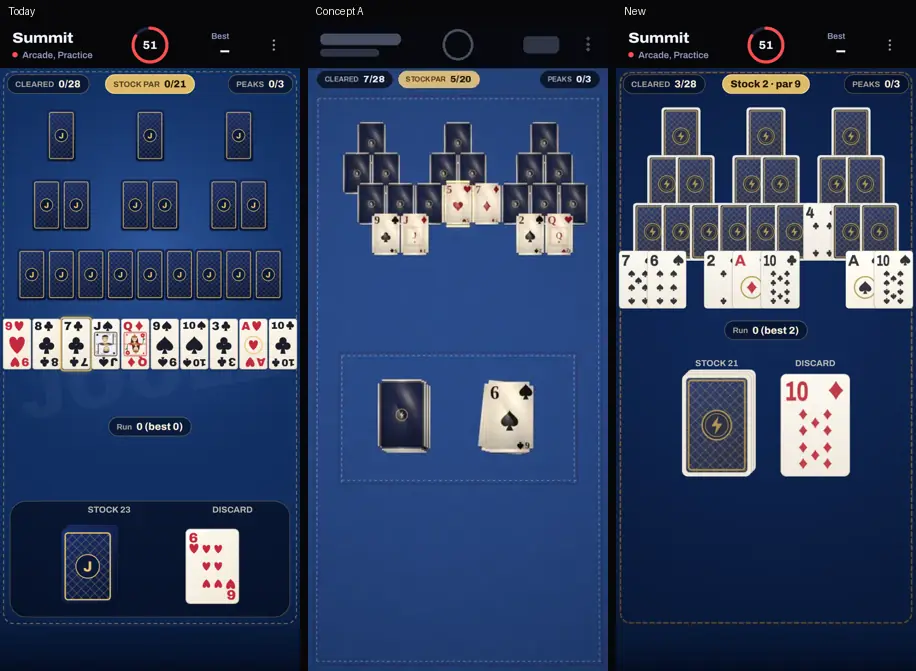
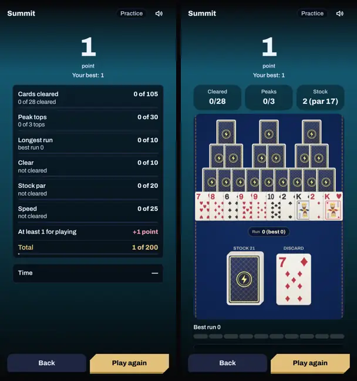
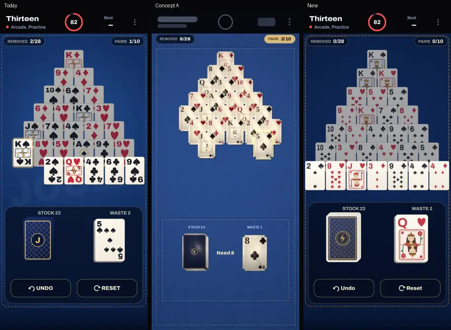
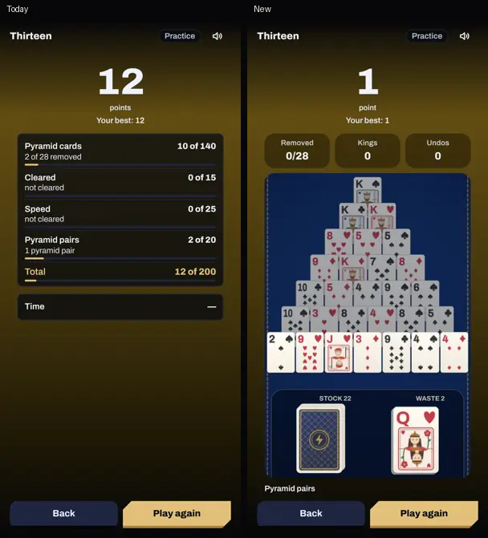
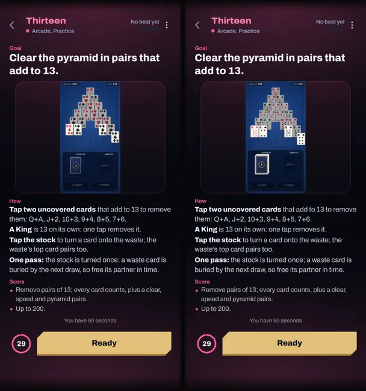

# Cards & Board overhaul: gallery (phase 2, step 4)

Stage 1 (15 Nov 2026): the look and the game changes. Each **Play** image shows **today**, **the concept Joe chose**
(PR #426: B for Free Cell, A for the others) and **the new frame**, side by side; the reveal and intro images show
today and the new screen. Frames come from a practice round at 390 × 844 on a dev server running against the server-function harness, played with the
same scripted taps (`bun scripts/shots/cards-board-gallery.ts --tag=before|after`). The clips show a move on the branch:
cards slide along a short arc, a turned card flips, and a played card lands on the discard. The finishing effects
("ALL HOME!", the tile shower, the lit peaks) come with the effects kit in stage 2; their clips will be added then.

Materials (Joe's clarification, 15 Nov 2026: real materials with light on them, no glare across a face): the cards are
cream linen stock under a satin varnish whose highlight runs only along the bevelled rim, with gold-leaf court frames
and Ace rings; the tiles are polished ivory with rounded rims catching a crisp edge light, engraved faces and jade
backs; Mahjong's table is lacquered walnut. A low grazing rim light gives the edges their highlight, and a flat face
only ever mirrors the dim studio above, so no glare crosses a face, a number or a panel.

Art: Free Cell, Summit, Five Hands and Thirteen draw real cards rendered in Blender (`scripts/cards-board-art/`) on
the royal-blue baize. Mahjong draws real ivory tiles over jade backs on the green mat inside a wooden edge. Every card
has a big rank and suit across its top strip, and the court cards keep their portraits. Images per game: a card game
194 KB (the shared 184 KB card sheet and the 10 KB felt), Mahjong 124 KB (116 KB of tiles and the 8 KB table).

## Free Cell

| Play: today · concept · new | Reveal: today · new |
|---|---|
|  |  |

Intro:  · Clip: 

- The cards are 50 × 74, as wide as eight columns allow on a 390 px phone (the 56 × 88 the brief asked for would need
  448 px). The columns now spread down the felt.
- Undo and Reset are labelled buttons under the columns, within thumb reach, and Reset asks first.
- The reveal, which used to show only the breakdown, now shows the final table, Home, Moves against par, and Time or
  Sorted, with a bar of the cards sent home.

## Mahjong Solitaire

| Play: today · concept · new | Reveal: today · new |
|---|---|
|  |  |

Intro:  · Clip: 

- Real tiles; the HUD's "Moves" is now "Free pairs"; Reset turns the thumb row into "Reset to the deal?" with Cancel
  and Reset (R on a keyboard asks too; Enter confirms).
- The reveal shows the final stack, Pairs, Shuffles, and Time or Tiles left, with a bar of the pairs taken.

## Summit

| Play: today · concept · new | Reveal: today · new |
|---|---|
|  |  |

Intro:  · Clip: 

- Cards grow from 39 × 70 to 54 × 80. The bottom row overlaps a little, each index still showing. The peaks overlap
  like a real deal, and the stock and discard sit as a large pair just under them.
- "STOCK PAR 4/16" now reads "Stock 4 · par 16".
- The reveal shows the final peaks, Cleared, Peaks, and Stock against par, with the best run as a ladder of ten.

## Five Hands

| Play: today · concept · new | Reveal: today · new |
|---|---|
|  |  |

Intro:  · Clip: 

- POINTS shows the score (hand points × 1.4), not the raw hand points.
- Your card slides from the next spot into its row, and the turned card slides down and flips onto the discards.
- The reveal shows the final rows, Hands, Rows and Column, and the sum "(90 + 15) × 1.4 = 147".

## Thirteen

| Play: today · concept · new | Reveal: today · new |
|---|---|
|  |  |

Intro:  · Clip: 

- Cards grow to 56 × 82, with larger piles. A stock card slides to the waste and flips. Reset asks first.
- The reveal shows the final pyramid, Removed, Kings, and Time or Undos, with the pyramid pairs as pips.
