# Cards & Board overhaul: gallery (phase 2, step 4)

Stage 1 (15 Nov 2026): the look and the game changes. Each **Play** image shows **today**, **the concept Joe chose**
(PR #426: B for Free Cell, A for the others) and **the new frame**, side by side; the reveal and intro images show
today and the new screen. Frames come from a practice round at 390 × 844 on a dev server running against the server-function harness, played with the
same scripted taps (`bun scripts/shots/cards-board-gallery.ts --tag=before|after`). The clips show a move on the branch:
cards slide along a short arc, a turned card flips, and a played card lands on the discard. The finishing effects
("ALL HOME!", the tile shower, the lit peaks) come with the effects kit in stage 2; their clips will be added then.

Materials (Joe's clarification, 15 Nov 2026: real materials with light on them, no glare across a face): the cards are
cream linen stock under a satin varnish whose highlight runs only along the bevelled rim, with gold-leaf court frames
and Ace rings; the tiles are polished ivory with rounded rims catching a crisp edge light, engraved faces and jade
backs; Mahjong's table is lacquered walnut. A low grazing rim light gives the edges their highlight, and a flat face
only ever mirrors the dim studio above, so no glare crosses a face, a number or a panel.

Art: Free Cell, Summit, Five Hands and Thirteen draw real cards rendered in Blender (`scripts/cards-board-art/`) on
the royal-blue baize. Mahjong draws real ivory tiles over jade backs on the green mat inside a wooden edge. Every card
has a big rank and suit across its top strip, and the court cards keep their portraits. Images per game: a card game
194 KB (the shared 184 KB card sheet and the 10 KB felt), Mahjong 124 KB (116 KB of tiles and the 8 KB table).

## Free Cell

| Play: today · concept · new | Reveal: today · new |
|---|---|
| 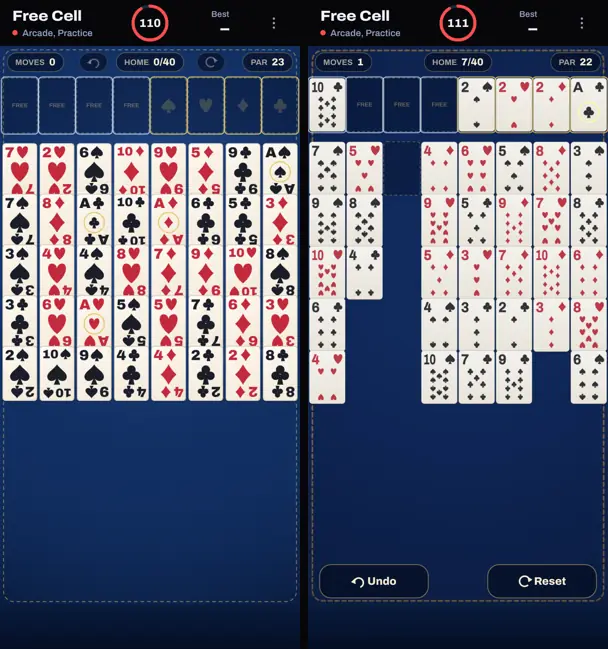 |  |

Intro: 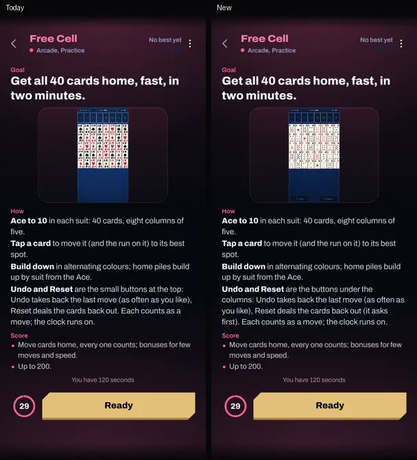 · Clip: 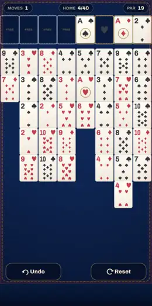

- The cards are 50 × 74, as wide as eight columns allow on a 390 px phone (the 56 × 88 the brief asked for would need
  448 px). The columns now spread down the felt.
- Undo and Reset are labelled buttons under the columns, within thumb reach, and Reset asks first.
- The reveal, which used to show only the breakdown, now shows the final table, Home, Moves against par, and Time or
  Sorted, with a bar of the cards sent home.

## Mahjong Solitaire

| Play: today · concept · new | Reveal: today · new |
|---|---|
|  | 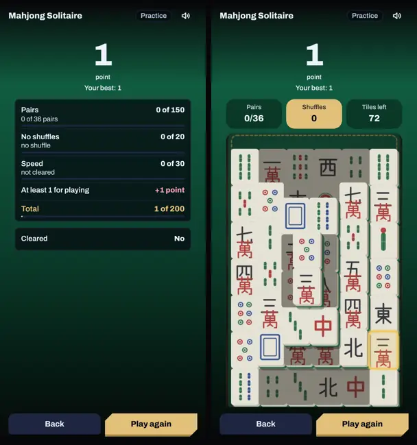 |

Intro:  · Clip: 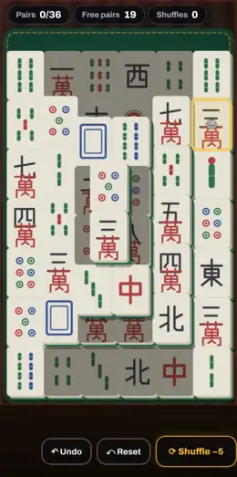

- Real tiles; the HUD's "Moves" is now "Free pairs"; Reset turns the thumb row into "Reset to the deal?" with Cancel
  and Reset (R on a keyboard asks too; Enter confirms).
- The reveal shows the final stack, Pairs, Shuffles, and Time or Tiles left, with a bar of the pairs taken.

## Summit

| Play: today · concept · new | Reveal: today · new |
|---|---|
|  |  |

Intro: 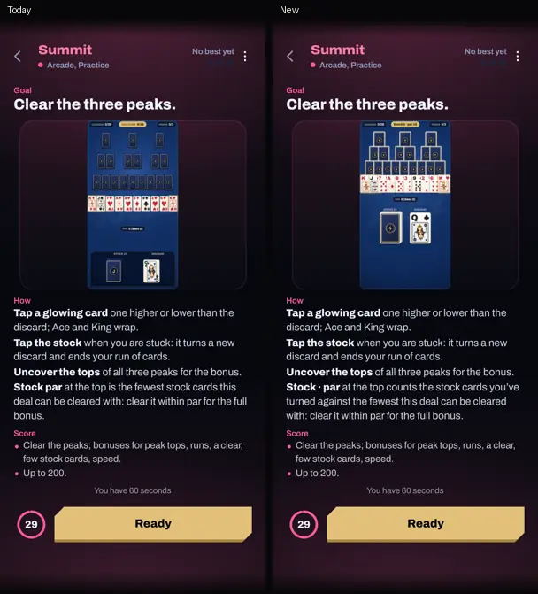 · Clip: 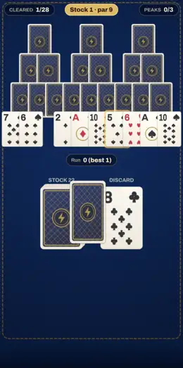

- Cards grow from 39 × 70 to 54 × 80. The bottom row overlaps a little, each index still showing. The peaks overlap
  like a real deal, and the stock and discard sit as a large pair just under them.
- "STOCK PAR 4/16" now reads "Stock 4 · par 16".
- The reveal shows the final peaks, Cleared, Peaks, and Stock against par, with the best run as a ladder of ten.

## Five Hands

| Play: today · concept · new | Reveal: today · new |
|---|---|
| 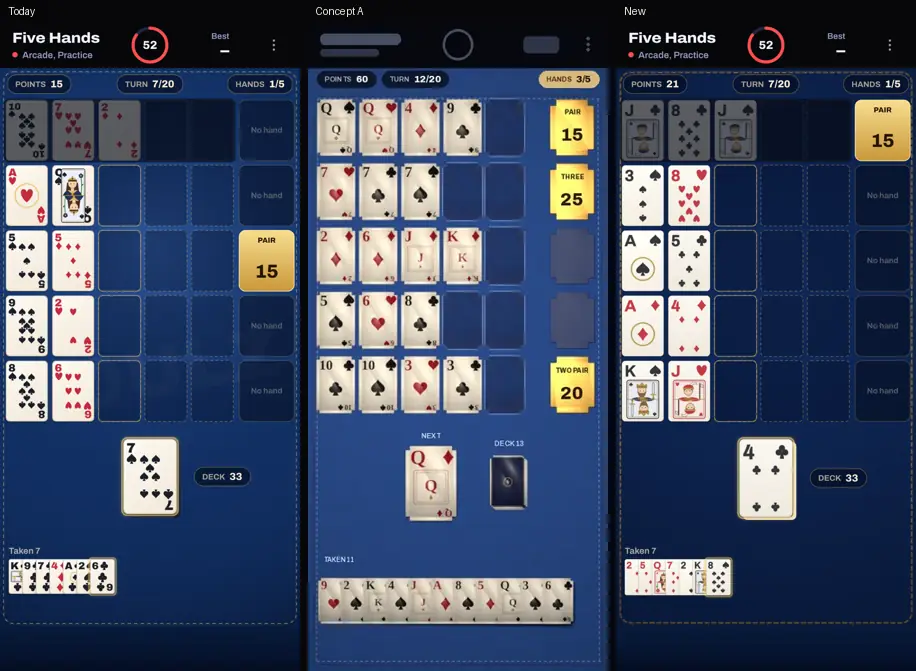 | 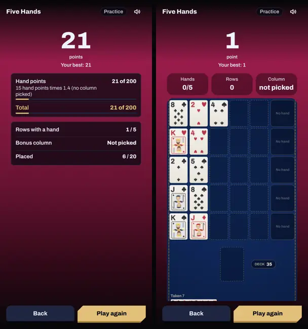 |

Intro: 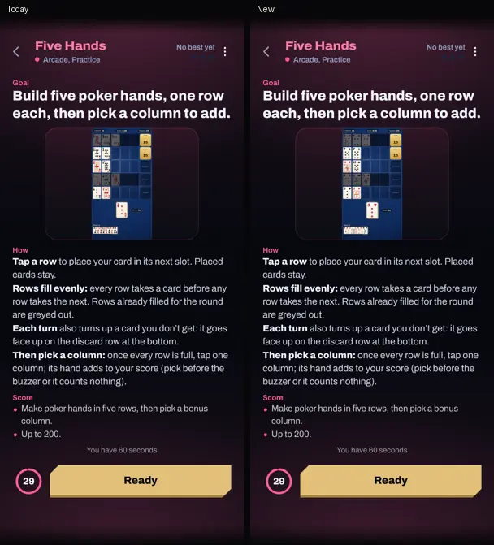 · Clip: 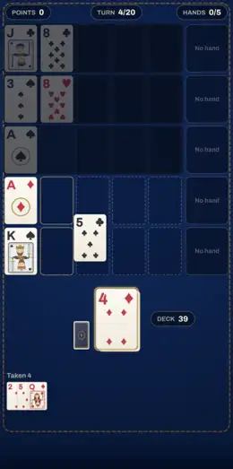

- POINTS shows the score (hand points × 1.4), not the raw hand points.
- Your card slides from the next spot into its row, and the turned card slides down and flips onto the discards.
- The reveal shows the final rows, Hands, Rows and Column, and the sum "(90 + 15) × 1.4 = 147".

## Thirteen

| Play: today · concept · new | Reveal: today · new |
|---|---|
|  |  |

Intro:  · Clip: 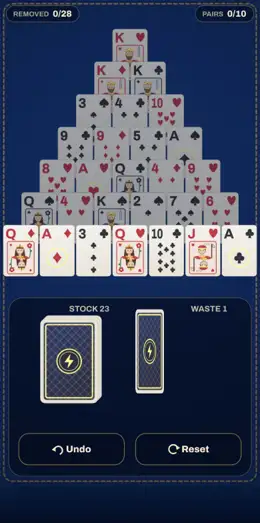

- Cards grow to 56 × 82, with larger piles. A stock card slides to the waste and flips. Reset asks first.
- The reveal shows the final pyramid, Removed, Kings, and Time or Undos, with the pyramid pairs as pips.

# Stage 2: the effects (15 Nov 2026)

Each game's effects are drawn by its own renderer, inside the canvas (the kit's rule for canvas games: board effects
come from the game's art; the kit, `src/lib/fx/kit.ts`, serves the result screens, here the Five Hands reveal's
count-up). Each effect starts when the renderer sees the sim's state change and only draws: no state, input, tick or
score is touched. Reduced motion shows the state change alone. The clips come from
`bun scripts/shots/cards-board-fx-clips.ts`: each game's proved flawless line played through its real renderer on a
virtual clock with the Blender art, at 15 frames a second, half size. Each game has a stretch of play and its finish.

| Game | Play | Finish |
|---|---|---|
| Free Cell | 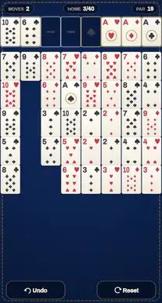 | 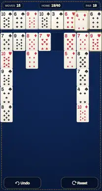 |
| Mahjong Solitaire | 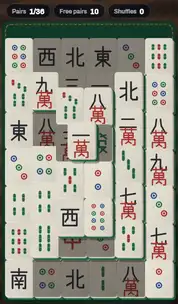 | 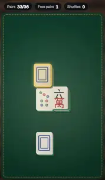 |
| Summit | 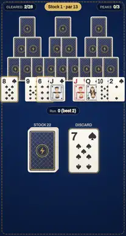 | 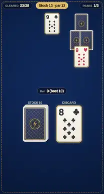 |
| Five Hands | 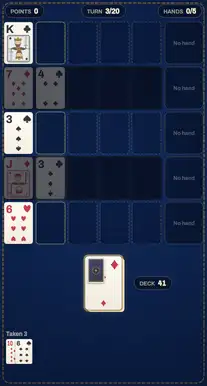 | 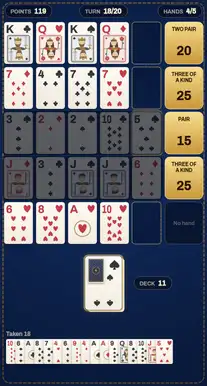 |
| Thirteen | 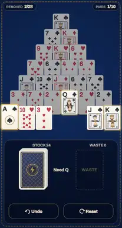 | 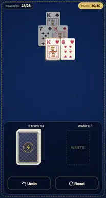 |

- **Free Cell:** a refused move wobbles back from where it started; two or more cards home in one go stamp "×n" over
  the home row; the clear sends the home piles' top cards bouncing down the felt (900 ms) as "ALL HOME!" arrives; each
  card home climbs its suit's major scale.
- **Mahjong Solitaire:** the picked tile lifts with a deeper shadow; a pair slides together, clicks and flies off in an
  arc, a step higher in pitch for each quick pair; a wrong pair shakes both tiles; a blocked tile flashes the tiles that
  block it; Shuffle turns every tile on its centre and lands it again; the mat brightens with six tiles left; the clear
  rains tiles before "CLEARED!".
- **Summit:** a "×n" ladder beside the discard grows with each card of a run and crumbles when a stock turn breaks it; a
  peak's top card flies up with a sparkle; a refused card leans to the discard and springs back; "No plays left" has a
  held tone; the clear lights the three peaks in turn.
- **Five Hands:** a hand made flashes its five cards left to right, then stamps its points on the badge (bigger for a
  straight or better); the picked column's cards lift one by one with ticks, its points fly to POINTS, which counts up,
  and "+15 × 1.4" counts into the score; the reveal's sum counts up to the score.
- **Thirteen:** a pair slides together, overlaps and flies off with "13" between them, rising in pitch through a quick
  chain; a King spins off alone; a wrong pair shakes both cards; a card whose last cover goes brightens out of its dim;
  the clear lights the pyramid's empty outline from the bottom row up.

# Stage 3: the levels (16 Nov 2026)

Easy, Hard and Expert for every game on the difficulty framework (`GAME_LEVELS`); Normal is today's game, and rated play
and the Daily stay on it. Each image shows **Easy · Hard · Expert** a few moves in, then **Easy untouched for 9 s**: the
hint lighting one good move by itself (a gold outline on the card or tile and where it goes). Hard and Expert have a
Hint button too (Hard: 5 points a hint; Expert: one a round). Below each, Easy's and Expert's intros with the level's own
lines and score. Frames from a practice round at 390 × 844 with the device's level set (`bun scripts/shots/cards-board-gallery.ts --level=…`).

| Game | Easy · Hard · Expert · Easy's hint | Intros: Easy · Expert |
|---|---|---|
| Free Cell | 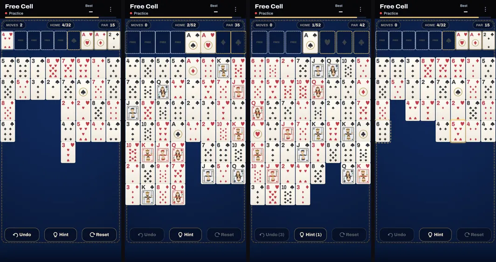 | 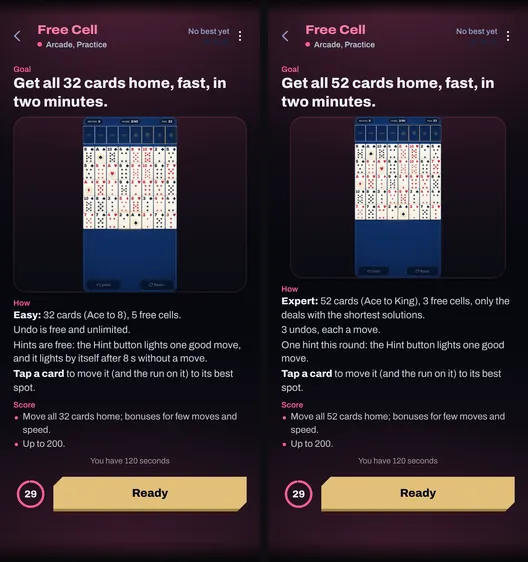 |
| Mahjong Solitaire | 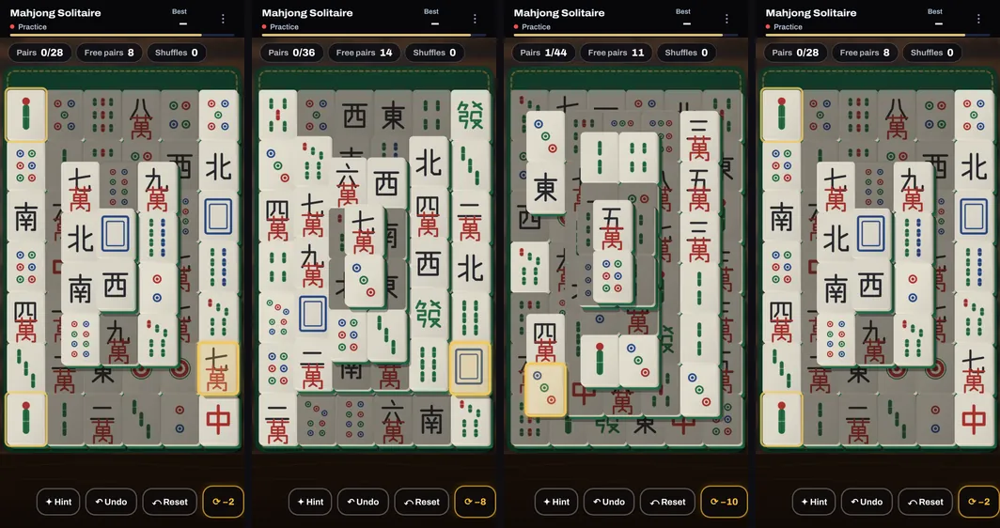 | 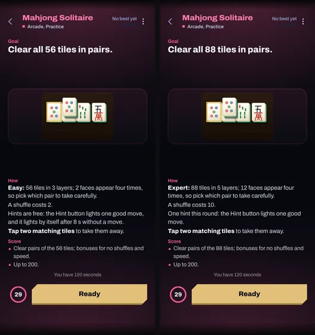 |
| Summit | 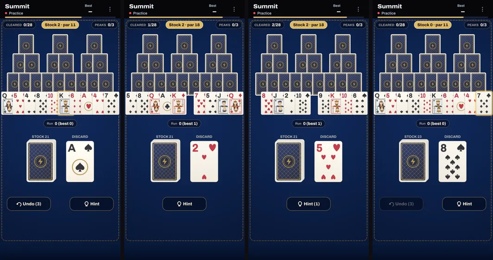 | 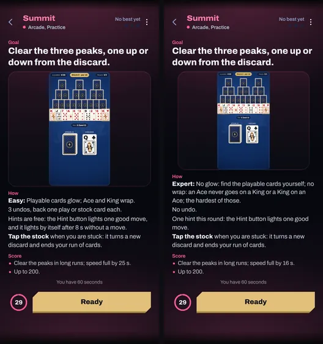 |
| Five Hands | 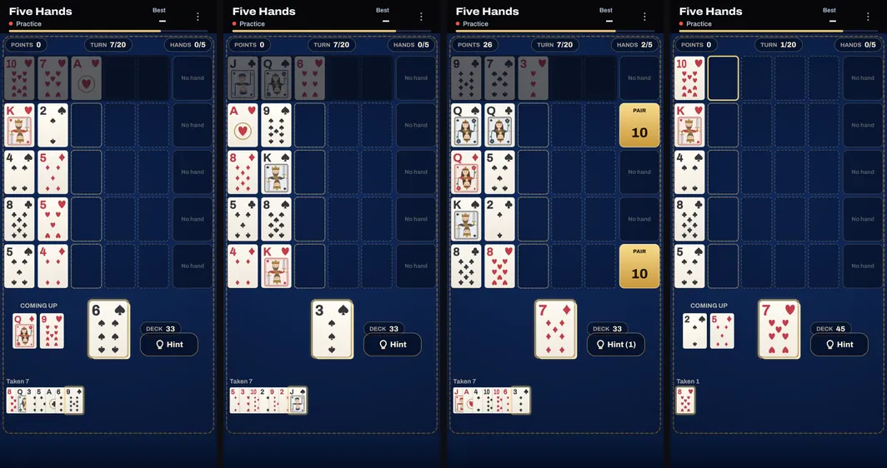 | 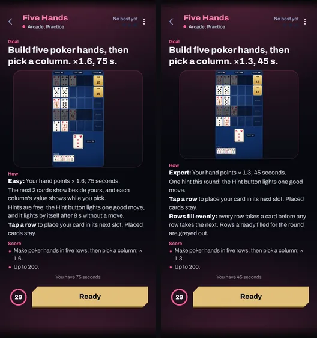 |
| Thirteen | 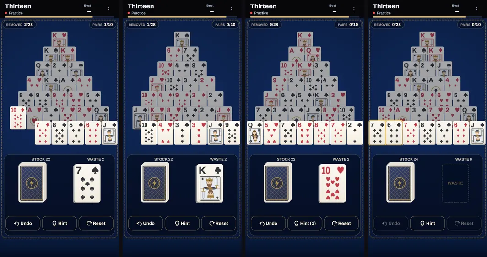 | 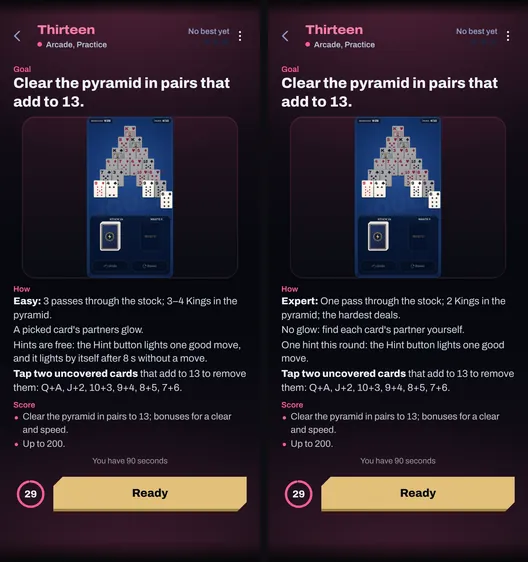 |

- **Free Cell:** Easy 32 cards and five free cells (the top row spreads to nine places); Hard 52 cards from the shortest
  solved deals; Expert 52 with three cells and three undos (the Undo button counts them down).
- **Mahjong Solitaire:** Easy 56 tiles in three layers; Hard the 72 with ten look-alike faces; Expert 88 tiles in five
  layers. On a level the thumb row holds Hint, Undo, Reset and the Shuffle's cost.
- **Summit:** Hard and Expert lose the playable glow; Expert also loses the Ace–King wrap. Easy has three undos.
- **Five Hands:** Easy shows the next two cards ("Coming up") and each column's value while picking.
- **Thirteen:** Easy has three passes through the stock; Hard and Expert lose the partner glow and deal fewer Kings.
- Intros on a level show the game's still, not Normal's saved demo.
